# 전류 미러 — 5살도 이해하는 정리노트

권익진 교수님 전자회로2 · 0918 수업 (Lec3 후반 · Lec4 도입, Razavi 9장 · 10장)

> `정리노트_0918_Current_Mirrors.html`를 마크다운으로 옮겼어요. 그림은 `figures_0918/` 폴더의 SVG, 위젯은 대표 설정의 정적 그림으로 바꿨어요. 수식은 `$…$` / `$$…$$`라서 GitHub, Obsidian, Typora에서 보여요.

**목차**

- [들어가며: 왜 이런 회로를 쓸까](#why)
  - [왜 이런 회로를 쓸까](#why-circuit)
- [1. 전류 미러의 원리](#s0)
  - [1. 전류 미러가 필요한 이유](#s0-concept)
  - [2. MOS 전류 미러의 식](#s0-mos-mirror)
  - [3. 소스에 저항이 있을 때](#s0-source-resistor)
  - [4. 채널 길이 변조가 만드는 복사 오차](#s0-lambda)
- [2. 전류 미러로 바이어스하기](#s1)
  - [5. 소스 팔로워·CS 단 바이어스와 전류 스케일링](#s1-follower-scaling)
  - [6. PMOS 미러와 CMOS 전류 미러](#s1-cmos-mirror)
- [3. 바이폴라 전류 미러](#s2)
  - [7. 바이폴라 전류 미러의 식](#s2-bjt-mirror)
  - [8. 베이스 전류가 만드는 오차](#s2-base-current)
  - [9. 병렬 연결로 배수·분수 전류 만들기](#s2-scaling)
  - [10. PNP 전류 미러의 기준 전류 만들기](#s2-pnp-iref)
  - [11. 바이어스 회로와 소신호 해석](#s2-bias-role)
- [4. 10장 도입: 차동 신호](#s3)
  - [12. 단일 종단 신호와 차동 신호](#s3-signals)
- [5. 요약 · 예고](#s4)
  - [한눈에 보는 공식](#s4-cheatsheet)
  - [다음 시간 예고](#s4-next)
  - [함께 보면 좋은 자료](#s4-links)

## 들어가며: 왜 이런 회로를 쓸까

### 왜 이런 회로를 쓸까

*0918 수업 · L03 s23–s26, L04 s1–s3*

**쉽게 말하면**

눈대중으로 소금을 넣으면 날마다 맛이 달라지니, 계량컵 하나를 정해 두고 모두 그 컵으로 덜어 써요.

작은 소식은 줄 하나 대신 두 줄에 실어, 서로 거꾸로 흔들어 보내요.

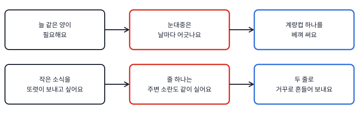

*두 줄 모두 왼쪽 선 테두리 상자의 바람이 가운데 경고색 테두리 상자에서 막히고, 오른쪽 강조색 테두리 상자에서 풀려요.*

**정확히 말하면**

**전류 미러(current mirror): 바이어스 전류를 정확히 정하기**

**1. 풀고 싶은 문제.** CS 단, 소스 팔로워 같은 증폭단은 정해 둔 바이어스 전류에서 동작하도록 설계해요. 전원 전압과 온도가 바뀌어도 그 전류가 그대로여야 해요([5. 소스 팔로워·CS 단 바이어스와 전류 스케일링](#s1-follower-scaling)).

**2. 단순한 해법과 그 한계.** 지금까지는 저항 분배기로 $V_{GS}$(바이폴라는 $V_{BE}$) 전압을 정해 바이어스했어요. 그런데 전류는 전압만으로 정해지지 않아요.

$$
I_D=\frac{1}{2}\mu_n C_{ox}\frac{W}{L}(V_{GS}-V_{TH})^2
$$

분배기 전압은 $V_{DD}$를 따라 흔들리고, $\mu_n$과 $V_{TH}$는 온도를 따라 바뀌어요. 그래서 $V_{GS}$를 정확히 정해도 $I_D$는 정확하지 않아요. 자세한 식은 [1. 전류 미러가 필요한 이유](#s0-concept), PNP 전류원의 같은 문제는 [10. PNP 전류 미러의 기준 전류 만들기](#s2-pnp-iref)에 있어요.

**3. 핵심 아이디어.** 전압을 정하지 말고 믿을 만한 기준 전류 $I_{REF}$ 하나를 만든 뒤, 다이오드 연결 소자가 찾아낸 $V_{GS}$를 다른 소자에 그대로 걸어 전류를 크기 비만큼 복사해요.

$$
I_{copy} : I_{REF} = (W/L)_1 : (W/L)_{REF}
$$

$\Rightarrow\ I_{copy}=\dfrac{(W/L)_1}{(W/L)_{REF}}\,I_{REF}$

$\mu_n$과 $V_{TH}$가 식에서 지워지는 과정은 [2. MOS 전류 미러의 식](#s0-mos-mirror), 바이폴라 버전은 [7. 바이폴라 전류 미러의 식](#s2-bjt-mirror)에 있어요.

**4. 대가와 쓰이는 곳.** 복사는 "두 소자의 $V_{GS}$가 같고 둘 다 포화 영역"이라는 전제에 기대요.

- $V_{DS1}$이 $V_{DS,REF}$와 다르면 채널 길이 변조만큼 복사 오차가 생겨요([4. 채널 길이 변조가 만드는 복사 오차](#s0-lambda)). 바이폴라는 베이스 전류만큼 복사 전류가 줄어요([8. 베이스 전류가 만드는 오차](#s2-base-current)).
- 복사 소자는 $V_{DS1} \ge V_{GS}-V_{TH}$를 지켜야 해서, 그 드레인 전압을 이 값 아래로 내릴 수 없어요.
- 소스에 저항이 붙으면 기준 쪽에도 저항을 달아 소스 전압을 맞춰야 해요([3. 소스에 저항이 있을 때](#s0-source-resistor)).

그 대신 기준 전류 하나로 칩의 모든 바이어스 전류를 만들어요. NMOS·PMOS 미러로 넣고 빼는 전류([6. PMOS 미러와 CMOS 전류 미러](#s1-cmos-mirror)), 이득을 키우는 전류원 부하, 병렬 연결로 만든 배수 전류([9. 병렬 연결로 배수·분수 전류 만들기](#s2-scaling))가 모두 미러예요. 바이어스를 이상화할 때도 AC 접지 조건과 실제 소자의 출력저항을 구분해요([11. 바이어스 회로와 소신호 해석](#s2-bias-role)).

**차동 신호(differential signal): 10장 도입**

**1. 풀고 싶은 문제.** 고성능 회로, 특히 주변 노이즈에 취약한 회로에서 작은 신호를 또렷하게 전달하고 싶어요([12. 단일 종단 신호와 차동 신호](#s3-signals)).

**2. 단순한 해법과 그 한계.** 지금까지는 단일 종단 신호(single-ended signal)로 보냈어요. 신호선 하나의 전압을 접지 기준으로 재요. 이 방식이 노이즈에 왜 약한지는 다음 수업에서 다루고, 미리 보는 설명은 보충에 있어요([12. 단일 종단 신호와 차동 신호](#s3-signals)).

**3. 핵심 아이디어.** 두 선이 같은 공통 모드 레벨 $V_{CM}$을 공유하고, AC 성분만 크기가 같고 위상이 반대가 되게 보내요.

$$
V_X = V_{CM} + V_0 \sin\omega t
$$

$$
V_Y = V_{CM} - V_0 \sin\omega t
$$

정의와 그림은 [12. 단일 종단 신호와 차동 신호](#s3-signals)에 있어요.

**4. 대가와 쓰이는 곳.** 신호선이 2개, 회로가 2배, 전력 소모도 2배이고, 위상을 반전한 신호를 따로 만들어야 해요([12. 단일 종단 신호와 차동 신호](#s3-signals)). 그래도 고성능 회로에서는 일반적으로 차동 회로를 써요. 이 신호를 증폭하는 차동 쌍(differential pair)이 10장의 주제예요([다음 시간 예고](#s4-next)).

**교수님 말씀**

교수님은 지금까지 바이어스를 전압으로 걸었다면, 이제는 전류 미러로 전류를 흘려 준다고 정리했어요.

> "온도나 supply에 무관한 전류를 만들어 줄 수 있는 게 이제 이 current mirror" (0918 02:51)

대가로 생기는 오차의 크기도 짚었어요.

> "한 10% 정도 오차는 생길 수 있어요. 왜냐하면 V_DS가 다를 수 있기 때문에" (0918 18:35)

차동 신호는 쓰이는 곳과 단점을 먼저 말했고, 장점은 다음 시간으로 넘겼어요.

> "하이 퍼포먼스 circuit, 특히 굉장히 주변의 노이즈에 취약한 회로들" (0918 54:18)

> "신호 라인도 두 개가 필요해 … 전력 소모도 두 배로 필요해." (0918 54:39–54:45)

**보충 · 수업에서 유도하진 않았어요**

**기준 전류는 왜 하나만 둘까.** 전원과 온도에 무관한 전류는 밴드갭 기준 회로(bandgap reference circuit)로 만들어요. 이 회로는 소자가 수십 개 필요해서 전류원마다 하나씩 둘 수 없어요. 그래서 귀한 기준 전류 하나를 미러로 복사해요(Razavi 9.2.1, 469쪽).

**차동 신호는 왜 노이즈에 강할까.** 저항 부하 CS 단의 출력은 $V_{DD}$에서 내려와요.

$$
V_{out}=V_{DD}-R_D I_D
$$

그래서 $V_{DD}$의 잡음이 이득 1로 출력에 그대로 실려요. 같은 CS 단 두 개를 대칭으로 두고 두 출력 사이 전압을 출력으로 쓰면, 전원 잡음은 $V_X$와 $V_Y$에 똑같이 실려 차에서 지워져요(L04 s4, Razavi 10.1.1, 498–499쪽).

$$
V_{out}=V_X-V_Y
$$

**페이지 요약**

전압으로 정한 바이어스는 전원·온도에 흔들려서 기준 전류 하나를 미러로 복사해 쓰고, 노이즈에 약한 회로는 차동 신호로 보내요.

*핵심 식*

- 복사 전류

  $$
  I_{copy} : I_{REF} = (W/L)_1 : (W/L)_{REF}
  $$

  $\Rightarrow\ I_{copy}=\dfrac{(W/L)_1}{(W/L)_{REF}}\,I_{REF}$
- 차동 신호

  $$
  V_X = V_{CM} + V_0 \sin\omega t
  $$

  $$
  V_Y = V_{CM} - V_0 \sin\omega t
  $$

*용어*

- **전류 미러(current mirror)** — 기준 전류 $I_{REF}$를 크기 비만큼 복사하는 바이어스 회로
- **차동 신호(differential signal)** — 같은 $V_{CM}$에 크기 같고 위상이 반대인 AC를 실은 두 선

---

## 1. 전류 미러의 원리

### 1. 전류 미러가 필요한 이유

*0918 수업 · L03 s23, s25*

**쉽게 말하면**

학교에 정확한 시계를 하나만 두고 교실 시계를 모두 거기에 맞추듯, 칩에도 믿을 만한 전류를 하나만 만들어 두고 곳곳에서 따라 만들어요.

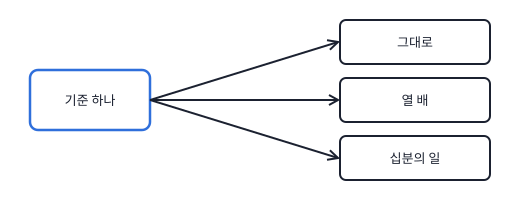

*기준 하나를 보고 곳곳에서 필요한 만큼 크게, 작게 따라 해요.*

**정확히 말하면**

0916 수업(L03 s23)에서 본 저항 분배기 바이어스는 전류를 정확히 정하지 못해요. 게이트 전압을 $V_{DD}$의 분압으로 주면 전류는 다음과 같아요.

$$
I_1 = \frac{1}{2}\mu_n C_{ox}\frac{W}{L}\left(\frac{R_2}{R_1+R_2}V_{DD}-V_{TH}\right)^2
$$

- 전원 전압 $V_{DD}$가 식에 그대로 들어가서 전원이 흔들리면 전류도 흔들려요.
- 이동도 $\mu_n$과 문턱 전압 $V_{TH}$는 온도에 따라 바뀌어요. 그래서 전류도 온도에 따라 바뀌어요.
- 슬라이드의 한 줄 정리: $V_{GS}$를 정확히 정해도 $I_D$는 정확하지 않아요.

해결책은 전원과 온도에 무관한 기준 전류(reference current) $I_{REF}$를 칩에 하나만 만드는 거예요. 각 블록은 전류 미러(current mirror)로 이 전류를 복사해 써요(L03 s25).

- 기준 전류는 대략 1–100 µA로 작게 만들어요.
- 블록마다 복사 비율을 정해 1 mA, 0.1 mA처럼 필요한 크기를 만들어요. 비율을 정하는 식은 [2. MOS 전류 미러의 식](#s0-mos-mirror)에 있어요.
- $I_{REF}$가 온도와 전원에 무관하면 복사한 전류 $I_{copy}$도 무관해요.

**교수님 말씀**

교수님은 기준 전류원을 시스템에 보통 하나만 두고, 모든 블록이 이것을 복사해 쓴다고 했어요. 복사한 전류는 블록마다 크기를 조절해 원하는 값으로 만들어요(0918 03:13).

> "요 회로는 모든 회로에 다 들어가 있겠죠." (0918 03:44)

**꼭 기억해요**

미러는 모든 회로에 들어가지만, 기준 전류원은 하나예요.

> "근데 이거는 시스템에 보통 하나 달려 있는 거죠." (0918 03:44)

**페이지 요약**

온도와 전원에 무관한 기준 전류 하나를 만들고, 전류 미러로 블록마다 복사해 써요.

*용어*

- **기준 전류(reference current)** — 칩에 하나만 두는 믿을 만한 전류 $I_{REF}$
- **전류 미러(current mirror)** — $I_{REF}$를 복사해 블록마다 나눠 주는 회로

---

### 2. MOS 전류 미러의 식

*0918 수업 · L03 s26*

**쉽게 말하면**

두 문을 막대 하나로 묶어 똑같은 높이로 들어 올리면, 같은 너비의 문으로는 같은 양이 흘러요.

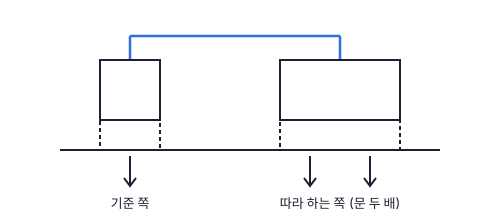

*오른쪽 문이 두 배 넓으면 두 배가 흘러요.*

**정확히 말하면**

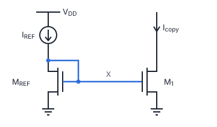

*MOS 전류 미러(L03 s26). 강조색 선이 두 게이트가 함께 쓰는 노드 X예요.*

1. 다이오드 연결(diode-connected): $M_{REF}$의 게이트와 드레인을 묶으면 $V_{DS}=V_{GS}$라서 늘 포화 영역이에요. $I_{REF}$를 흘리면 그 전류가 흐르도록 노드 X의 전압 $V_X$가 스스로 정해져요.
2. $M_1$의 게이트도 X에 묶고 두 소스를 접지에 두면 두 $V_{GS}$가 같아요.

   $$
   V_{GS,REF}=V_{GS1}=V_X
   $$
3. 기준 쪽:

   $$
   I_{D,REF}=\frac{1}{2}\mu_n C_{ox}\left(\frac{W}{L}\right)_{REF}(V_X-V_{TH})^2
   $$
4. 복사 쪽($M_1$도 포화 영역):

   $$
   I_{copy}=\frac{1}{2}\mu_n C_{ox}\left(\frac{W}{L}\right)_1(V_X-V_{TH})^2
   $$
5. 두 식의 비를 쓰면 $\frac{1}{2}\mu_n C_{ox}(V_X-V_{TH})^2$이 지워져요($V_{TH}$는 두 소자가 같다고 봐요).

   $$
   I_{copy} : I_{REF} = (W/L)_1 : (W/L)_{REF}
   $$

   $\Rightarrow\ I_{copy}=\dfrac{(W/L)_1}{(W/L)_{REF}}\,I_{REF}$

- 복사 비율은 두 소자의 크기 비, 곧 aspect ratio $W/L$의 비로만 정해져요. $\mu_n$과 $V_{TH}$가 식에서 사라지므로 온도에 따른 변화가 따라오지 않아요.
- 1:1이면 $I_{copy}=I_{REF}$예요. $M_1$을 10배로 키우면 전류도 10배, $M_{REF}$를 10배로 키우면 1/10이 돼요.
- 전류를 그대로 베끼므로 current mirror 또는 current copier라고 불러요.
- 이 식의 전제는 두 소자의 $V_{GS}$가 같고 둘 다 포화 영역이라는 거예요. 전제가 깨지는 경우는 [3. 소스에 저항이 있을 때](#s0-source-resistor)와 [4. 채널 길이 변조가 만드는 복사 오차](#s0-lambda)에서 봐요.

**교수님 말씀**

교수님은 크기가 1:1이면 같은 전류가 복사되고, 한쪽을 10배로 하면 10배 또는 1/10이 된다고 했어요. 그래서 이 회로를 current mirror, current copier라고 부른다고 했어요(0918 01:34–01:50).

$I_{REF}$가 일정하면 $I_{copy}$도 일정하지만, $V_{GS}$까지 일정한 것은 아니라고 덧붙였어요. 온도에 따라 이동도와 $V_{TH}$가 변하면, 전류를 지키도록 $V_{GS}$가 스스로 조금씩 바뀌어요(0918 02:18).

**페이지 요약**

두 소자의 $V_{GS}$를 같게 묶으면 전류 비는 크기 비 $W/L$로만 정해져요.

*핵심 식*

- 미러 조건

  $$
  V_{GS,REF}=V_{GS1}=V_X
  $$
- 복사 전류

  $$
  I_{copy} : I_{REF} = (W/L)_1 : (W/L)_{REF}
  $$

  $\Rightarrow\ I_{copy}=\dfrac{(W/L)_1}{(W/L)_{REF}}\,I_{REF}$

*용어*

- **다이오드 연결(diode-connected)** — 게이트와 드레인을 묶어 $V_{DS}=V_{GS}$로 만든 연결
- **aspect ratio** — 소자 크기 비 $W/L$
- **current copier** — current mirror의 다른 이름

---

### 3. 소스에 저항이 있을 때

*0918 수업 · L03 s26 보충*

**쉽게 말하면**

두 문을 같은 높이로 들어 올려도 한쪽 바닥만 높으면 그쪽 틈이 좁아져서 덜 흘러요.

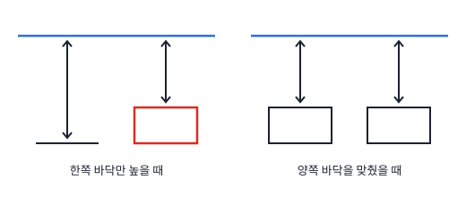

*다른 쪽 바닥도 같은 높이로 올리면 두 틈이 다시 같아져요.*

**정확히 말하면**

$M_1$의 소스가 접지가 아니라 저항 $R_1$을 거쳐 접지로 가면, 게이트가 묶여 있어도 두 소스 전압이 달라요.

1. $M_1$의 소스 전압:

   $$
   V_{S1}=I_{copy}R_1
   $$
2. 게이트는 같은 $V_X$이므로:

   $$
   V_{GS1}=V_X-I_{copy}R_1
   $$
3. $M_{REF}$의 소스는 접지라서 $V_{GS,REF}=V_X$예요. 따라서 $V_{GS1}$이 더 작고 $I_{copy}$도 크기 비로 정한 값보다 작아요.

해결책은 두 소스 전압을 같게 맞추는 거예요. $M_{REF}$의 소스에도 저항 $R_{REF}$를 달고 다음을 맞춰요.

$$
I_{REF}R_{REF}=I_{copy}R_1
$$

- 그러면 $V_{GS,REF}=V_{GS1}$이 되어 [2. MOS 전류 미러의 식](#s0-mos-mirror)이 그대로 성립해요.
- 1:1로 같은 전류를 복사하면 저항도 같게($R_{REF}=R_1$) 둬요.
- 전류 비가 다르면 두 소스 전압이 같아지도록 저항값을 조정해요. 전류가 큰 쪽의 저항을 그만큼 작게 둬요.

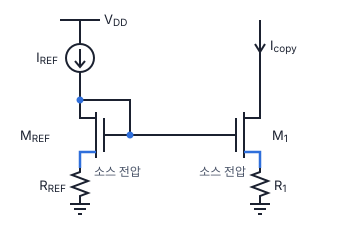

*양쪽 소스에 저항을 달아 두 소스 전압(강조색 선)을 같게 맞춰요.*

소스 저항 옆에 커패시터를 다는 방법은 통하지 않아요. 미러는 DC 바이어스 전류를 정하는 회로이고, DC에서 커패시터는 개방이에요. 그래서 커패시터를 달아도 소스 전압의 DC 값은 그대로예요.

**교수님 말씀**

교수님이 "소스에 저항이 있을 때 전류를 똑같이 흘리려면?"이라고 물었어요. 한 학생이 저항 옆에 커패시터를 달자고 했고, 교수님은 DC에서 커패시터는 개방이라고 답했어요. 다른 학생이 반대쪽에도 같은 저항을 달자고 했고, 교수님은 소스 전압을 같게 만들어 줘야 한다며 맞다고 했어요(0918 05:00–05:21).

**꼭 기억해요**

미러의 동작 조건은 두 소자의 $V_{GS}$가 같다는 거예요.

> "current mirror가 동작하려면 V_GS가 같아야 … V_GS가 다르면 전류도 다르죠" (0918 05:33)

**페이지 요약**

한쪽 소스에만 저항이 있으면 $V_{GS}$가 달라지니, 양쪽 소스 전압을 같게 맞춰요.

*핵심 식*

- 한쪽만 저항

  $$
  V_{GS1}=V_X-I_{copy}R_1
  $$
- 소스 전압 맞추기

  $$
  I_{REF}R_{REF}=I_{copy}R_1
  $$

*용어*

- **커패시터(capacitor)** — DC에서 개방이라 바이어스 전류를 맞추는 데 쓸 수 없어요

---

### 4. 채널 길이 변조가 만드는 복사 오차

*0918 수업 · L03 s26 보충*

**쉽게 말하면**

진짜 문은 뒤에서 미는 힘이 셀수록 조금 더 흘려서, 두 문 뒤쪽 사정이 다르면 따라 한 양이 살짝 어긋나요.

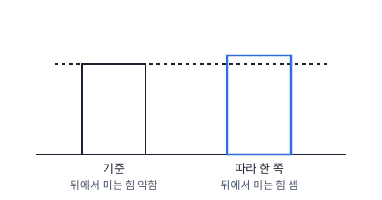

*뒤에서 미는 힘을 같게 맞추면 두 막대 높이도 같아져요.*

**정확히 말하면**

포화 영역 전류는 channel-length modulation(채널 길이 변조) 때문에 $V_{DS}$에 따라 조금 늘어요. $\lambda$와 출력저항의 관계는 [0904 정리노트: 채널 길이 변조와 출력저항 r_O](../../0904/정리노트_0904_MOS_Small_Signal_Model.html#s1-ro)에 있어요.

$$
I_D=\frac{1}{2}\mu_n C_{ox}\frac{W}{L}(V_{GS}-V_{TH})^2(1+\lambda V_{DS})
$$

1. 기준 쪽($M_{REF}$는 다이오드 연결이라 $V_{DS,REF}=V_{GS}$):

   $$
   I_{REF}=\frac{1}{2}\mu_n C_{ox}\left(\frac{W}{L}\right)_{REF}(V_{GS}-V_{TH})^2(1+\lambda V_{DS,REF})
   $$
2. 복사 쪽:

   $$
   I_{copy}=\frac{1}{2}\mu_n C_{ox}\left(\frac{W}{L}\right)_1(V_{GS}-V_{TH})^2(1+\lambda V_{DS1})
   $$
3. 두 식의 비를 쓰면:

   $$
   \begin{aligned}I_{copy} : I_{REF} &= (W/L)_1(1+\lambda V_{DS1})\\ &\quad : (W/L)_{REF}(1+\lambda V_{DS,REF})\end{aligned}
   $$

   $$
   \Rightarrow\ I_{copy}=\dfrac{(W/L)_1}{(W/L)_{REF}}\cdot\dfrac{1+\lambda V_{DS1}}{1+\lambda V_{DS,REF}}\,I_{REF}
   $$

$V_{DS1}$은 $M_1$의 드레인에 달린 회로가 정하므로 보통 $V_{DS,REF}$와 달라요. 뒤의 비율만큼 복사 오차가 생겨요.

수업의 수치 예: $\lambda=0.1\ \text{V}^{-1}$, $V_{DS1}=2$ V, $V_{DS,REF}=1$ V라는 극단적인 경우에도

$$
\frac{1+0.1\times 2}{1+0.1\times 1}=\frac{1.2}{1.1}\approx 1.09
$$

오차가 약 9%로 10% 안이에요. 그래서 손계산에서는 $\lambda$를 무시해도 돼요.

더 정확하게 복사하려면 $V_{DS1}$을 $V_{DS,REF}$에 가깝게 맞춰요.

- $M_1$도 다이오드 연결하면 $V_{DS}$는 같아지지만 쓸 수 없어요. 드레인 전압이 바뀌면 게이트 전압도 따라 바뀌어 전류가 변해요. 그래서 전류원이 아니라 저항 $1/g_m$이 돼요.
- 대신 $M_1$ 위에 트랜지스터 $M_2$를 하나 쌓고 그 게이트에 $V_b$를 걸어요. 그러면 $M_1$의 드레인 전압이 $V_b$에서 $M_2$의 게이트-소스 전압 $V_{GS2}$를 뺀 값으로 정해져요. 여기서 $V_{GS2}$는 미러의 $V_{GS}$(= $V_{DS,REF}$)와 다른 값이에요.

  $$
  V_{DS1}=V_b-V_{GS2}
  $$

  $V_b$로 $V_{DS1}$을 조절할 수 있어요.

포화 영역 안에서는 차이가 작아요. $M_1$은 $V_{DS1} \ge V_{GS}-V_{TH}$를 지켜야 해요. $V_{DS1}$이 이보다 작아 $M_1$이 선형 영역(triode region)으로 들어가면 전류가 크게 줄어 차이가 매우 커져요. 그래서 미러의 복사 소자는 선형 영역에서 동작시키면 안 돼요.

#### 직접 해 보기: $V_{DS1}$에 따라 달라지는 복사 전류 비 *(정적 스냅샷 — 직접 조작은 HTML 버전)*

$\lambda$, $V_{DS1}$, $V_{GS}$(다이오드 연결이라 $V_{DS,REF}$와 같음)를 움직이면 $I_{copy}/I_{REF}$와 오차가 바뀌어요. 두 소자 크기는 1:1, $V_{TH}=0.5$ V로 고정했어요. 선형 영역 구간은 선형 영역 전류 식에 $(1+\lambda V_{DS})$를 곱해 경계에서 이어지게 그렸어요.

복사 전류 비: **Icopy/IREF = 1.091, 오차 = +9.1 % (포화 영역, 경계 VGS − VTH = 0.50 V)**

범례: 실제 전류 비 · 포화 식을 선형 영역까지 늘린 값 · 지금 VDS1

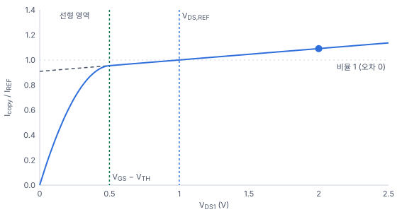

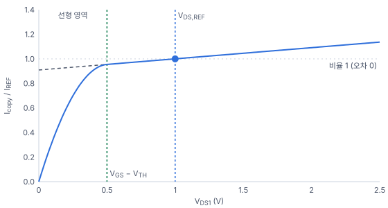

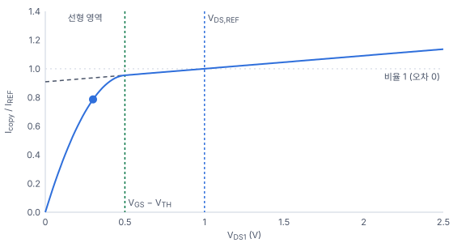

| 설정 | $I_{copy}/I_{REF}$ | 오차 | 영역 |
|---|---|---|---|
| 수업 예: $\lambda=0.1$, $V_{DS1}=2$ V, $V_{DS,REF}=1$ V | 1.091 | +9.1 % | 포화 |
| $\lambda=0.1$, $V_{DS1}=V_{DS,REF}=1$ V | 1.000 | 0.0 % | 포화 |
| $\lambda=0.1$, $V_{DS1}=0.3$ V, $V_{DS,REF}=1$ V | 0.787 (포화 식으로는 0.936) | −21.3 % | 선형 영역 |

**교수님 말씀**

교수님은 $\lambda=0.1$에 $V_{DS}$가 2 V와 1 V인 극단적인 경우에도 비율이 1.2/1.1 정도라서, 손계산에서는 무시해도 된다고 했어요(0918 08:23–09:46, 12:43).

"$M_1$을 다이오드 연결하면 이건 뭐예요?"라고 여러 번 물은 뒤, 스스로 "$1/g_m$인 저항"이라고 정리했어요(0918 10:26–10:43).

> "실제 설계해보니까 차이가 나네? 그 차이는 … V_DS의 차이 때문에 생기는 거다" (0918 11:40)

**페이지 요약**

$V_{DS1}$과 $V_{DS,REF}$가 다르면 채널 길이 변조만큼 복사 오차가 생기지만, 포화 영역에서는 작아요.

*핵심 식*

- λ를 넣은 복사 전류

  $$
  \begin{aligned}I_{copy} : I_{REF} &= (W/L)_1(1+\lambda V_{DS1})\\ &\quad : (W/L)_{REF}(1+\lambda V_{DS,REF})\end{aligned}
  $$

  $$
  \Rightarrow\ I_{copy}=\dfrac{(W/L)_1}{(W/L)_{REF}}\cdot\dfrac{1+\lambda V_{DS1}}{1+\lambda V_{DS,REF}}\,I_{REF}
  $$
- 수업 수치 예

  $$
  \frac{1.2}{1.1}\approx 1.09
  $$

*용어*

- **채널 길이 변조(channel-length modulation)** — $V_{DS}$가 커지면 포화 전류가 조금 느는 효과
- **선형 영역(triode region)** — $V_{DS1}$이 $V_{GS}-V_{TH}$보다 작은 구간, 미러로 쓰면 안 돼요

---

## 2. 전류 미러로 바이어스하기

### 5. 소스 팔로워·CS 단 바이어스와 전류 스케일링

*0918 수업 · L03 s27*

**쉽게 말하면**

기준 문으로 세 사람이 지나가면, 똑같이 열어 둔 두 칸짜리 문으로는 두 사람, 다섯 칸짜리 문으로는 다섯 사람이 지나가요.

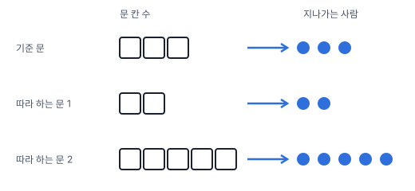

*문 칸 수만큼 지나가는 사람이 늘어서, 기준 3칸을 보고 2칸 문은 둘, 5칸 문은 다섯을 흘려요.*

**정확히 말하면**

슬라이드 27은 전류 미러로 두 증폭단의 바이어스 전류를 한꺼번에 만드는 예예요. 먼저 왼쪽 단인 소스 팔로워(source follower)를 복습했어요.

- 공통 드레인(common drain) 구조예요. 입력은 게이트, 출력은 소스이고, 드레인은 $V_{DD}$(AC 접지)에 붙어요.
- 이득이 1보다 작아서 증폭기보다는 전압 버퍼(voltage buffer)로 써요.
- 입력 임피던스는 저주파에서 $R_{in}\to\infty$예요.
- 출력 임피던스는 소스에서 들여다본 $R_{out}\approx 1/g_m$로 작아요.

버퍼가 필요한 이유는 CS 단의 출력 임피던스가 크기 때문이에요.

1. CS 단 이득은 $A_v=-g_m R_D$예요(채널 길이 변조 무시). 이득을 키우려면 $R_D$가 커야 해요.
2. 그러면 CS 단의 출력저항 $R_{out}=R_D$도 커져요.
3. 스피커 임피던스는 4–5 Ω 정도로 작아요. $P=V^2/R$에서 전압을 올리기 어려우니 $R$을 낮춰 전력을 키운 거예요.
4. $R_D=1\,\text{k}\Omega$인 CS 단에 $R_L=5\,\Omega$ 스피커를 바로 달면 $A_v=-g_m(R_D\parallel R_L)$이 돼요.
5. $R_D\parallel R_L\approx 4.98\,\Omega$라서 이득이 약 1/200로 무너져요.
6. 가운데에 소스 팔로워를 넣으면 CS 단은 큰 입력 임피던스를 보고, 스피커는 작은 $1/g_m$에서 구동돼요. 스피커 앞에 힘센 전달자를 세워 전압을 그대로 넘겨받게 하는 셈이에요.

팔로워의 소스 아래 전류원도 트랜지스터 $M_{I1}$로 만들어요. 게이트에 저항 분배기로 $V_B$를 거는 방법은 온도와 전원에 따라 전류가 변해서 부정확해요(0916에 본 문제). 그래서 기준 전류 $I_{REF}$를 미러로 복사해요.

*세 NMOS $M_{REF}$, $M_{I1}$, $M_{I2}$가 게이트를 공유하고 소스가 모두 접지라서 $V_{GS}$가 같아요. 전류비는 크기비로만 정해져요.*

복사 전류는 [2. MOS 전류 미러의 식](#s0-mos-mirror)을 그대로 써요.

$$
I_{copy} : I_{REF} = (W/L)_1 : (W/L)_{REF}
$$

$\Rightarrow\ I_{copy}=\dfrac{(W/L)_1}{(W/L)_{REF}}\,I_{REF}$

1. 주어진 값: $I_{REF}=0.3$ mA, $M_{REF}=3(W/L)$, $M_{I1}=2(W/L)$, $M_{I2}=5(W/L)$
2. $I_1=\dfrac{2}{3}\times 0.3\ \text{mA}=0.2\ \text{mA}$
3. $I_2=\dfrac{5}{3}\times 0.3\ \text{mA}=0.5\ \text{mA}$

- 1:1이면 0.3 mA가 그대로 복사되고, $M_{REF}$의 1/3 크기면 0.1 mA가 돼요.
- 배수는 정수가 아니어도 돼요(2/3, 5/3). 슬라이드도 "integer or non-integer factors"라고 해요.
- 설계할 때는 비의 분모(3)만큼 단위 소자 $(W/L)$을 기준 쪽에 병렬로 두고, 복사 쪽에 분자만큼(2개, 5개) 둬요. Razavi Example 9.21과 같은 풀이예요.

채널 길이 변조까지 보면, $M_{I1}$의 $V_{DS}$는 팔로워 출력의 DC 전압, 곧 $V_{in1}-V_{GS1}$이에요. 이 값을 $V_{DS,REF}$에 가깝게 맞추면 복사 오차가 줄어요([4. 채널 길이 변조가 만드는 복사 오차](#s0-lambda)).

오른쪽 단은 PMOS 입력 CS 단이에요.

- 입력은 $M_2$의 게이트, 출력은 드레인이에요. 소스가 붙은 $V_{DD}$가 AC 접지라서 공통 소스 구조예요.
- 부하를 저항 대신 전류원 $M_{I2}$로 두면 출력저항이 $R_{out}\approx r_O$로 커져서 이득 $|A_v|=g_m R_{out}$이 커져요.
- 저항 부하는 크게 만들면 IR drop이 커져서 $M_2$가 쓸 전압이 모자라요. 그래서 큰 저항 부하는 쓰기 어려워요.

**교수님 말씀**

"이 구조가 무엇이냐"는 물음에 한 학생이 "커먼…"이라고 답했고, 교수님은 커먼 드레인이 맞다며 더 흔한 이름인 소스 팔로워를 소개하셨어요(0918 13:31).

특징을 묻자 한 학생이 입력 임피던스를 꺼냈고, 교수님이 "입력 임피던스는 크고 출력 임피던스는 $1/g_m$로 작다"고 이어서 정리하셨어요(0918 14:19).

오디오 스피커 이야기를 하셨어요. 스피커 임피던스를 묻자 한 학생이 "50옴?"이라고 했고, 교수님은 고출력 오디오는 5 Ω, 4 Ω 정도라고 바로잡으셨어요(0918 15:18). $R_D$=1 kΩ인 CS 증폭기에 5 Ω 스피커를 바로 달면 출력 저항이 병렬로 확 떨어져 이득이 무너진다는 설명이었어요(0918 15:04–16:39).

오른쪽 PMOS 회로의 구조를 묻자 한 학생이 "커먼 소스"라고 답했어요(0918 19:36).

**꼭 기억해요**

> "이득이 1보다 작은데 왜 쓰냐? … 전압을 낮은 임피던스로 전달하는 … 볼티지 버퍼입니다." (0918 16:39)

소스 팔로워는 이득을 얻으려고 쓰는 단이 아니에요. 큰 출력 임피던스 뒤에 작은 부하를 달아야 할 때 끼워 넣는 전압 버퍼예요.

**페이지 요약**

기준 전류 하나를 크기비로 복사해서 소스 팔로워와 CS 단의 바이어스 전류를 만들어요.

*핵심 식*

- 복사 전류

  $$
  I_{copy} : I_{REF} = (W/L)_1 : (W/L)_{REF}
  $$

  $\Rightarrow\ I_{copy}=\dfrac{(W/L)_1}{(W/L)_{REF}}\,I_{REF}$
- 팔로워 바이어스

  $$
  I_1=\dfrac{2}{3}\times 0.3\ \text{mA}=0.2\ \text{mA}
  $$
- CS 단 바이어스

  $$
  I_2=\dfrac{5}{3}\times 0.3\ \text{mA}=0.5\ \text{mA}
  $$

*용어*

- **소스 팔로워(source follower)** — 입력 게이트, 출력 소스인 공통 드레인 단. 출력 임피던스 $1/g_m$
- **전압 버퍼(voltage buffer)** — 이득은 1보다 작지만 전압을 낮은 임피던스로 넘겨주는 단

---

### 6. PMOS 미러와 CMOS 전류 미러

*0918 수업 · L03 s28*

**쉽게 말하면**

바닥으로 물을 빼내는 펌프와 위에서 물을 넣어 주는 펌프가 있는데, 위쪽 펌프는 아래쪽 펌프가 빼내 준 양을 기준으로 삼아요.

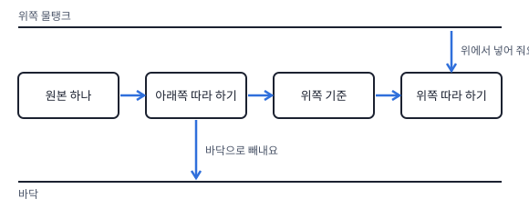

*원본 하나를 아래쪽이 그대로 베끼고 그 양을 위쪽이 다시 베껴서, 모두 같은 원본을 따라요.*

**정확히 말하면**

NMOS CS 증폭기의 부하로 PMOS 전류원(능동 부하, active load)을 쓰면, 이 PMOS 전류원도 게이트 바이어스가 필요해요. 이것도 저항 분배기 대신 PMOS 미러로 정해요.

- 기준 소자도 같은 PMOS여야 해요. NMOS와 PMOS는 이동도 같은 소자 특성이 달라서 서로 섞어 미러를 만들면 안 돼요.
- 두 PMOS의 소스를 모두 $V_{DD}$에 붙이고 게이트를 묶으면 $|V_{GS}|$가 같아져요.
- 기준 쪽 PMOS는 게이트와 드레인을 묶어 다이오드 연결로 만들어요. 그래야 게이트가 플로팅되지 않아요.
- 채널 길이 변조를 무시하면 식은 NMOS 미러와 같은 꼴이에요: $I_{copy} : I_{REF} = (W/L)_{P1} : (W/L)_{P,REF}$

두 미러가 만드는 전류의 방향이 달라요.

- NMOS 미러: 노드에서 접지로 빼내는 전류(sink)를 만들어요.
- PMOS 미러: $V_{DD}$에서 노드로 넣어 주는 전류(source)를 만들어요.

PMOS 미러의 기준 전류는 이렇게 만들어요.

1. 다이오드 연결 PMOS $M_{P,REF}$의 전류는 $V_{DD}$에서 들어와 드레인으로 나가요. 그래서 드레인 아래에서 전류를 끌어내 줘야 해요.
2. 끌어내는 전류원은 sink이므로 NMOS로 만들어요. $M_{REF}$를 1:1로 복사한 $M_{N1}$이 $I_{REF}$를 끌어내요.
3. 그 전류로 $M_{P,REF}$의 $|V_{GS}|$가 정해지고, 게이트를 공유한 $M_{P1}$이 같은 전류를 노드로 흘려 넣어요(source).

*NMOS 미러가 기준 전류를 한 번 복사해 PMOS 다이오드에 공급하고, PMOS 미러가 그것을 다시 복사해요.*

이렇게 NMOS 미러와 PMOS 미러를 함께 쓰는 구조가 CMOS 전류 미러예요. CMOS는 NMOS와 PMOS를 한 공정에 같이 만드는 기술이에요.

두 번 복사하므로 크기비도 두 번 곱해져요.

$$
I_{N1} : I_{REF} = (W/L)_{N1} : (W/L)_{REF}
$$

$$
I_{P1} : I_{N1} = (W/L)_{P1} : (W/L)_{P,REF}
$$

$$
\Rightarrow\ I_{P1}=\dfrac{(W/L)_{N1}}{(W/L)_{REF}}\cdot\dfrac{(W/L)_{P1}}{(W/L)_{P,REF}}\,I_{REF}
$$

슬라이드 28의 회로는 한 기준 전류로 네 단을 바이어스해요.

- 위쪽 PMOS 미러: NMOS 입력 CS 단($V_{in1}$)의 PMOS 전류원 부하, PMOS 소스 팔로워($V_{in2}$) 위의 PMOS 전류원
- 아래쪽 NMOS 미러: NMOS 소스 팔로워($V_{in3}$) 아래의 전류원, PMOS 입력 CS 단($V_{in4}$)의 NMOS 전류원 부하

칩 안의 기준 전류 발생기는 한 종류, 하나뿐이에요. bandgap reference 같은 기준 전류 생성 회로는 복잡하고, 전력을 쓰고, 면적도 커요. 그래서 하나만 만들고 1:1 미러로 반대 타입의 기준 전류를 만들어요. 결과적으로 NMOS 미러와 PMOS 미러의 $I_{REF}$는 같은 전류예요.

**교수님 말씀**

기준 소자를 반대 타입으로 쓰면 안 되는 이유로 NMOS와 PMOS는 이동도 같은 특성이 다르다는 점을 드셨어요(0918 24:25).

한 학생이 "PMOS 미러와 NMOS 미러에 흐르는 $I_{REF}$는 같은 값으로 가정하나요?"라고 물었어요(0918 28:41). 교수님은 칩 안에 기준 전류 발생기가 하나뿐이고, 그것을 1:1로 복사해 반대 타입의 기준을 만드니 같은 전류라고 답하셨어요. bandgap reference 같은 회로는 복잡하고 전력과 면적을 쓰니 하나만 만들어 복사하는 게 정석이라는 설명이었어요(0918 28:53–29:41).

슬라이드 28 오른쪽 위처럼 PMOS 전류원을 쓰는 소스 팔로워는 "잘 안 쓰는 구조"라고 하셨어요(0918 30:00).

**페이지 요약**

PMOS 미러는 전원에서 노드로 전류를 넣고, 그 기준 전류는 NMOS 미러가 끌어내 줘요.

*핵심 식*

- PMOS 미러

  $$
  I_{copy} : I_{REF} = (W/L)_{P1} : (W/L)_{P,REF}
  $$

  $\Rightarrow\ I_{copy}=\dfrac{(W/L)_{P1}}{(W/L)_{P,REF}}\,I_{REF}$
- 두 번 복사

  $$
  I_{N1} : I_{REF} = (W/L)_{N1} : (W/L)_{REF}
  $$

  $$
  I_{P1} : I_{N1} = (W/L)_{P1} : (W/L)_{P,REF}
  $$

  $$
  \Rightarrow\ I_{P1}=\dfrac{(W/L)_{N1}}{(W/L)_{REF}}\cdot\dfrac{(W/L)_{P1}}{(W/L)_{P,REF}}\,I_{REF}
  $$

*용어*

- **sink / source** — 노드에서 접지로 빼내는 전류(NMOS 미러) / $V_{DD}$에서 노드로 넣는 전류(PMOS 미러)
- **CMOS 전류 미러** — NMOS 미러와 PMOS 미러를 함께 쓰는 바이어스 구조
- **bandgap reference** — 칩에 하나만 두는 기준 전류 생성 회로

---

## 3. 바이폴라 전류 미러

### 7. 바이폴라 전류 미러의 식

*0918 수업 · L03 s29*

**쉽게 말하면**

쌍둥이 둘을 똑같은 세기로 눌러 주면 똑같은 양이 흐르고, 한쪽 몸집을 두 배로 키우면 두 배가 흘러요.

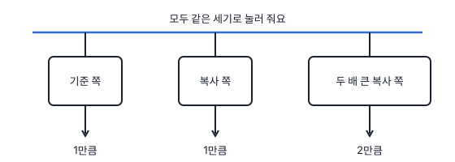

*누르는 세기는 모두 같고, 흐르는 양은 몸집에 따라 달라져요.*

**정확히 말하면**

개념은 [2. MOS 전류 미러의 식](#s0-mos-mirror)과 같아요. MOSFET을 BJT로 바꾼 것뿐이에요.

$Q_{REF}$의 베이스와 컬렉터를 묶어 다이오드 연결(diode-connected)로 만들어요. 이 노드 X의 전압 $V_X$를 $Q_1$의 베이스에 걸어요.

두 이미터가 모두 접지이고 베이스는 묶여 있어요. 그래서 두 소자의 $V_{BE}$는 같을 수밖에 없어요: $V_{BE,REF} = V_{BE1} = V_X$.

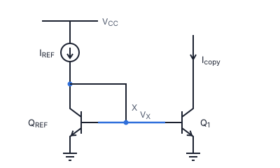

*강조색 선이 두 트랜지스터가 함께 쓰는 베이스 노드예요. 그래서 두 소자의 베이스-이미터 전압이 같아요.*

두 소자가 활성 영역(active region)에 있다고 가정해요. BE 접합은 순방향, BC 접합은 역방향 바이어스예요.

1. 기준 쪽: $I_{REF} = I_{S,REF}\exp\dfrac{V_X}{V_T}$
2. 복사 쪽: $I_{copy} = I_{S1}\exp\dfrac{V_X}{V_T}$
3. 두 식을 나누면 $\exp(V_X/V_T)$가 지워져요.
4. $$
   I_{copy} : I_{REF} = I_{S1} : I_{S,REF}
   $$

   $\Rightarrow\ I_{copy}=\dfrac{I_{S1}}{I_{S,REF}}\,I_{REF}$

$I_S$는 상수이지만 트랜지스터 크기로 정해지는 상수예요. 주로 이미터 면적(emitter area) $A_E$에 비례해요.

- 두 소자의 면적이 같으면($I_{S1} = I_{S,REF}$) $I_{REF}$와 같은 전류가 복사돼요.
- 면적이 다르면 면적비만큼 전류가 커지거나 작아져요.
- 같은 트랜지스터 두 개를 병렬로 연결하면 면적이 두 배가 돼요. 그래서 병렬 개수로도 비율을 정할 수 있어요([9. 병렬 연결로 배수·분수 전류 만들기](#s2-scaling)).

MOS 미러와 마찬가지로, $I_{REF}$가 온도와 전원에 무관하면 $I_{copy}$도 무관해요.

이 식은 베이스 전류를 무시한 결과예요. 베이스 전류까지 넣은 식은 [8. 베이스 전류가 만드는 오차](#s2-base-current)에 있어요.

**교수님 말씀**

바이폴라 미러는 MOS 미러와 내용 대부분이 같아서 부담이 크지 않다고 하셨어요.

> "개념은 같아요. … 모스 대신에 BJT로 바꾼 것뿐이고요." (0918 30:48)

요즘 BJT는 잘 쓰지 않는다고 하셨어요. 주파수가 아주 높거나 고출력인 특수한 응용에만 일부 쓰고, 대부분은 MOS를 써요.

> "BJT 잘 안 씁니다, 요새. 모스 베이스로 주로 쓰기 때문에." (0918 38:14)

**페이지 요약**

두 BJT의 $V_{BE}$가 같으면 전류는 $I_S$, 곧 이미터 면적의 비로 복사돼요.

*핵심 식*

- 바이폴라 미러

  $$
  I_{copy} : I_{REF} = I_{S1} : I_{S,REF}
  $$

  $\Rightarrow\ I_{copy}=\dfrac{I_{S1}}{I_{S,REF}}\,I_{REF}$
- 미러 조건

  $$
  V_{BE,REF} = V_{BE1} = V_X
  $$

*용어*

- **$I_S$** — 이미터 면적 $A_E$에 비례하는 상수
- **이미터 면적(emitter area)** — 같은 소자 병렬 연결 = 면적 배수

---

### 8. 베이스 전류가 만드는 오차

*0918 수업 · L03 s29*

**쉽게 말하면**

받은 물을 다 넘겨주고 싶은데, 작은 샛길 두 개로 조금씩 새서 복사되는 양이 살짝 줄어요.

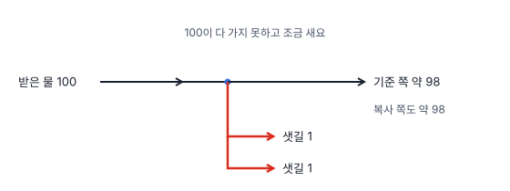

*새는 양은 아주 적어서, 손으로 계산할 때는 보통 무시해요.*

**정확히 말하면**

MOSFET은 게이트 전류가 0이에요. BJT는 베이스로 전류가 흘러요: $I_B = I_C/\beta$.

$\beta$가 100 정도이면 베이스 전류 하나는 컬렉터 전류의 약 1%예요.

1:1 미러($I_{S1} = I_{S,REF}$)에서 두 소자의 $V_{BE}$가 같으므로 컬렉터 전류도 같아요: $I_{C,REF} = I_{C1} = I_C$, $I_{copy} = I_C$.

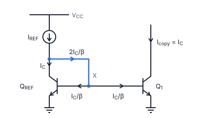

*강조색 다이오드 연결 도선으로 두 베이스 전류가 빠져나가요.*

노드에서 KCL을 쓰면 $I_{REF}$는 $Q_{REF}$의 컬렉터 전류와 두 베이스 전류를 모두 대야 해요.

1. $I_{REF} = I_C + \dfrac{I_C}{\beta} + \dfrac{I_C}{\beta}$
2. $I_{REF} = I_C\left(1 + \dfrac{2}{\beta}\right)$
3. $$
   I_{copy} = \frac{I_{REF}}{1 + 2/\beta}
   $$

그래서 복사 전류는 $I_{REF}$보다 조금 작아요. $\beta = 100$이면 $I_{copy} = I_{REF}/1.02 \approx 0.98\,I_{REF}$예요. 베이스 전류 두 개가 빠지므로 약 2% 작아요.

오차가 하나 더 있어요. 바로 Early 효과(Early effect)예요.

- $Q_{REF}$는 다이오드 연결이라 $V_{CE,REF} = V_{BE}$예요.
- $Q_1$의 $V_{CE1}$은 출력 쪽 회로가 정하므로 보통 이 값과 달라요.
- 컬렉터 전압이 다르면 MOS의 채널 길이 변조와 같은 오차가 생겨요([4. 채널 길이 변조가 만드는 복사 오차](#s0-lambda)).

두 오차 모두 손계산에서는 무시해요. $I_{copy} : I_{REF} = I_{S1} : I_{S,REF}$는 베이스 전류와 Early 효과를 무시했을 때 성립하는 식이에요.

**교수님 말씀**

BJT는 베이스 전류가 있어서 MOS보다 식이 깔끔하지 않고, 정확히는 MOS보다 오차가 조금 더 있다고 하셨어요.

> "베이스 쪽에 전류가 있다는 것 자체가 깔끔하진 않습니다." (0918 36:50)

**꼭 기억해요**

> "1%기 때문에 우리가 핸드 캘큘레이션 할 때는 거의 무시해도 되겠습니다." (0918 36:50)

문제에서 베이스 전류를 고려하라고 하면, 두 베이스 전류를 모두 넣은 $I_{copy} = \frac{I_{REF}}{1 + 2/\beta}$를 써요.

**페이지 요약**

$I_{REF}$가 두 베이스 전류까지 대야 해서 복사 전류가 조금 작아지지만, 손계산에서는 무시해요.

*핵심 식*

- 베이스 전류

  $$
  I_B = I_C/\beta
  $$
- KCL

  $$
  I_{REF} = I_C\left(1 + \dfrac{2}{\beta}\right)
  $$
- 1:1 미러 복사 전류

  $$
  I_{copy} = \frac{I_{REF}}{1 + 2/\beta}
  $$

*용어*

- **Early 효과(Early effect)** — 컬렉터 전압 차이로 생기는 복사 오차

---

### 9. 병렬 연결로 배수·분수 전류 만들기

*0918 수업 · L03 s30–s31*

**쉽게 말하면**

같은 부품을 복사 쪽에 여러 개 붙이면 흐르는 양이 그만큼 늘고, 기준 쪽에 여러 개 붙이면 그만큼 나뉘어 줄어요.

*부품 크기를 바꾸지 않고 몇 개를 나란히 붙이느냐로 양을 정해요.*

**정확히 말하면**

같은 트랜지스터를 $n$개 병렬로 연결하면 이미터 면적이 $n$배가 돼요. 그래서 $I_S$도 $n$배가 돼요([7. 바이폴라 전류 미러의 식](#s2-bjt-mirror)).

**배수 스케일링(L03 s30)**: $I_{REF} = 0.25$ mA로 0.75 mA와 0.5 mA를 만들어요. 모든 트랜지스터는 $Q_{REF}$와 같은 크기예요.

1. $Q_1$, $Q_2$, $Q_3$의 베이스를 모두 $Q_{REF}$의 베이스(노드 X)에 묶어요. 셋 모두 $V_{BE}$가 같아요.
2. 각각 0.25 mA씩 흘러요.
3. 세 컬렉터를 병렬로 묶으면 $3 \times 0.25 = 0.75$ mA예요.
4. 0.5 mA는 같은 트랜지스터 $Q_4$, $Q_5$ 두 개를 병렬로 묶어 만들어요: $2 \times 0.25 = 0.5$ mA.

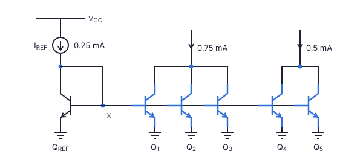

*강조색 트랜지스터 다섯 개는 모두 기준 트랜지스터와 크기가 같아요. 컬렉터를 몇 개 묶느냐로 전류가 정해져요.*

$Q_{REF}$의 베이스와 컬렉터를 묶는 이유는 베이스가 플로팅(floating)되지 않게 하기 위해서예요.

**분수 스케일링(L03 s31)**: 전류를 줄이려면 복사 쪽 면적을 줄이는 대신 기준 쪽 면적을 키워요.

1. 기준 쪽에 같은 소자 3개($Q_{REF1}$–$Q_{REF3}$)를 병렬로 둬요. 기준 쪽 면적이 3배가 돼요.
2. 세 소자가 $I_{REF}$를 나눠 가져서 각각 $I_{REF}/3$가 흘러요.
3. 같은 크기의 $Q_1$은 $V_{BE}$가 같으므로 한 소자 몫만큼 흘려요.
4. $$
   I_{copy} = \frac{1}{3} I_{REF}
   $$
5. $I_{REF} = 0.25$ mA이면 $I_{copy} = 0.25/3 \approx 0.083$ mA예요.

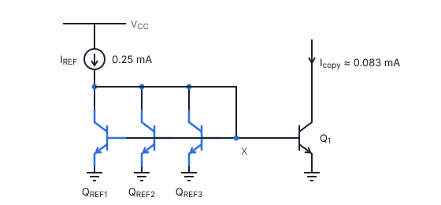

*강조색 기준 트랜지스터 세 개가 기준 전류를 셋으로 나눠 가져요.*

면적비를 직접 바꿔도 되고, 같은 소자를 몇 개 병렬로 두느냐로 면적을 늘리거나 줄여도 돼요. 배율은 정수가 아니어도 돼요. 예를 들어 복사 쪽 3개, 기준 쪽 2개면 1.5배예요.

**교수님 말씀**

배수 예제를 마친 뒤 "반대로 전류를 줄이고 싶으면 어떻게 하면 되느냐"고 물으셨어요. 답은 기준 쪽에 병렬로 붙이는 거였어요.

> "레퍼런스 쪽에 병렬로 세 개를 연결하면 각각은 3분의 1씩 나눠 써야" (0918 ~41:00)

다이오드 연결을 하는 이유도 짚으셨어요.

> "베이스와 컬렉터를 묶지 않으면 … 베이스가 플로팅될 수 있기 때문에" (0918 39:05)

**페이지 요약**

복사 쪽에 같은 소자를 병렬로 붙이면 배수, 기준 쪽에 붙이면 분수 전류가 돼요.

*핵심 식*

- 배수(3개 병렬)

  $$
  3 \times 0.25 = 0.75
  $$
- 분수(기준 쪽 3개)

  $$
  I_{copy} = \frac{1}{3} I_{REF}
  $$

*용어*

- **병렬 연결** — 같은 소자 $n$개 = 이미터 면적 $n$배
- **플로팅(floating)** — 어디에도 전압이 정해지지 않은 노드. 다이오드 연결로 막아요

---

### 10. PNP 전류 미러의 기준 전류 만들기

*0918 수업 · L03 s24, s32*

**쉽게 말하면**

위에서 넣어 주는 거울도 흉내 낼 본보기 흐름이 필요한데, 그 흐름은 바닥으로 빼 주는 거울이 끌어내서 만들어 줘요.

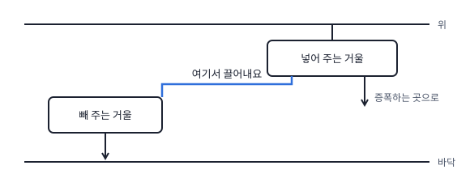

*본보기 흐름은 하나만 두고, 이렇게 이어 받아서 양쪽 거울에 다 써요.*

**정확히 말하면**

필요한 전류 방향에 따라 소자 타입을 골라요. MOS의 NMOS·PMOS 미러와 같은 이야기예요([6. PMOS 미러와 CMOS 전류 미러](#s1-cmos-mirror)).

- 노드에서 접지로 흐르는 전류원(sink)은 NPN으로 만들어요.
- 전원 $V_{CC}$에서 노드로 흐르는 전류원(source)은 PNP로 만들어요.

**예: 전류원 부하 CE 단**

1. $Q_1$은 공통 이미터(CE) 단이에요. 베이스로 입력을 넣고 이미터는 접지예요.
2. 이득을 키우려고 부하로 저항 대신 PNP 전류원 $Q_2$를 달아요. 이상적인 전류원이면 저항이 무한대이지만, 실제로는 트랜지스터로 만들어요.
3. $Q_2$의 베이스 전압을 저항 분배기로 정하면 전류가 전원과 온도에 따라 변해서 부정확해요(L03 s24).
4. 그래서 같은 PNP 타입의 기준 소자 $Q_{REF2}$를 다이오드 연결해 PNP 미러를 만들어요.
5. 두 이미터가 모두 $V_{CC}$이고 베이스가 공통이므로 $|V_{EB}|$가 같아요. PNP라서 절댓값을 씌워요.
6. 크기가 같으면 $Q_{REF2}$의 전류가 그대로 $Q_2$로 복사돼요. 다른 전류가 필요하면 면적(병렬 개수)을 바꿔요.

**$Q_{REF2}$의 기준 전류는 어디서 올까**: $Q_{REF2}$에는 노드 $X_2$에서 접지 쪽으로 끌어내는 전류가 흘러야 해요. 이건 NPN 전류원이 할 일이에요.

1. NPN 미러에 쓰던 기준 전류원 $I_{REF}$를 다이오드 연결된 $Q_{REF1}$에 흘려요.
2. $Q_M$이 $Q_{REF1}$과 $V_{BE}$를 공유해 $I_{REF}$를 복사해요. 1:1이면 $I_{C,M} = I_{REF}$예요.
3. $Q_M$의 컬렉터가 $Q_{REF2}$에서 $I_{C,M}$을 끌어내요.
4. PNP 미러가 이것을 다시 복사해요. 1:1이면 $|I_{C2}| = I_{C,M}$이에요.

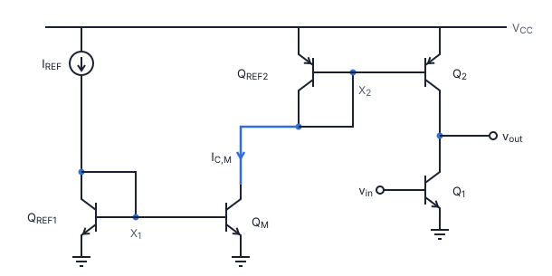

*강조색 경로가 NPN 미러가 PNP 미러에서 끌어내는 기준 전류예요.*

베이스 전류를 무시하면 두 번의 복사가 곱으로 이어져요.

$$
I_{C,M} : I_{REF} = I_{S,M} : I_{S,REF1}
$$

$\Rightarrow\ I_{C,M}=\dfrac{I_{S,M}}{I_{S,REF1}}\,I_{REF}$

$$
|I_{C2}| : I_{C,M} = I_{S2} : I_{S,REF2}
$$

$\Rightarrow\ |I_{C2}|=\dfrac{I_{S2}}{I_{S,REF2}}\,I_{C,M}$

이렇게 기준 전류원 하나로 NPN 미러와 PNP 미러 모두에 전류를 공급해요.

슬라이드는 $Q_M$ 자리도 $Q_1$로 적었어요. 여기서는 CE 단의 $Q_1$과 헷갈리지 않게 교과서(Fig. 9.35)처럼 $Q_M$이라고 불러요.

**교수님 말씀**

PNP 전류원도 저항으로 나눠서 바이어스할 수는 있지만, 그러지 않는다고 하셨어요.

> "저항을 이용해서 디바이딩 해서 … 그렇게 하지 않고 부정확하기 때문에" (0918 ~43:30)

> "요거 하나를 이용해서 NPN도 흘려 줄 수 있고 PNP 커런트 미러도" (0918 ~46:00)

**페이지 요약**

PNP 미러의 기준 전류는 NPN 미러가 기존 $I_{REF}$를 복사해 끌어내서 만들어요.

*핵심 식*

- NPN 미러

  $$
  I_{C,M} : I_{REF} = I_{S,M} : I_{S,REF1}
  $$

  $\Rightarrow\ I_{C,M}=\dfrac{I_{S,M}}{I_{S,REF1}}\,I_{REF}$
- PNP 미러

  $$
  |I_{C2}| : I_{C,M} = I_{S2} : I_{S,REF2}
  $$

  $\Rightarrow\ |I_{C2}|=\dfrac{I_{S2}}{I_{S,REF2}}\,I_{C,M}$

*용어*

- **NPN 전류원(sink)** — 노드에서 접지로 흐르는 전류
- **PNP 전류원(source)** — $V_{CC}$에서 노드로 흐르는 전류, $|V_{EB}|$가 같게 맞춰요

---

### 11. 바이어스 회로와 소신호 해석

*0918 수업 · 슬라이드 외*

**쉽게 말하면**

바이어스는 DC 동작점을 정하고, 소신호 해석에서는 전압 변화가 0인 노드만 AC 접지로 둬요.

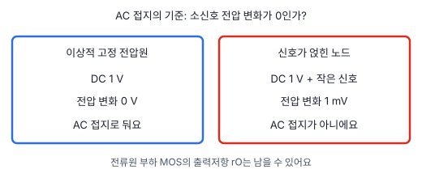

*DC 전압이 있다는 이유만으로 노드를 접지하거나 바이어스 소자의 출력저항까지 없애면 안 돼요.*

**정확히 말하면**

**작은 예시.** 이상적 전압원이 신호와 무관하게 $1\,\mathrm{V}$를 유지하는 노드는 전압 변화가 0이므로 AC 접지예요. 반면 $1\,\mathrm{V}$에 $1\,\mathrm{mV}$ 신호가 얹히는 노드는 DC 값이 있어도 AC 접지가 아니에요. 전류원 부하 MOS의 게이트를 AC 접지로 두더라도, 드레인에는 출력저항 $r_O$가 남을 수 있어요.

이 수업의 전류 미러는 증폭단에 DC 전압과 전류, 곧 동작점(operating point)을 공급하는 바이어스 회로로 사용해요. 실제 회로에는 바이어스 회로가 함께 있지만, 해석에서는 그 효과를 이상적 전압원·전류원으로 나타내기도 해요.

1. 이상적 DC 전압원은 전압 변화가 0이므로 소신호에서 단락해요. 접지 기준의 고정 전압 노드는 AC 접지가 돼요.
2. 이상적 DC 전류원은 전류 변화가 0이므로 소신호에서 개방해요. 그 출력 노드를 접지한다는 뜻은 아니에요.
3. 실제 바이어스 MOS는 소신호 모델로 바꿔요. 게이트가 AC 접지여도 출력저항 $r_O$와 필요한 종속 전류원은 회로 연결에 따라 남아요.
4. [10. PNP 전류 미러의 기준 전류 만들기](#s2-pnp-iref)의 노드 $X_2$는 기준 전류와 공급 전압의 소신호 변화가 없고, 바이어스 노드로 신호가 되먹임되지 않는 근사에서 AC 접지로 둘 수 있어요.

따라서 바이어스 회로를 생략한 그림은 어떤 이상화가 적용됐는지 확인하고 읽어요. 전류원 부하의 유한한 출력저항이 이득을 정하면 반드시 남겨야 해요.

**교수님 말씀**

전류 미러 파트를 마치면서, 회로도에 보이지 않아도 바이어스 회로는 늘 들어간다고 정리하셨어요.

> "바이어스 회로는 보통 제외하고 나타내는데 실제로 회로를 구성할 때 이게 들어가야" (0918 ~48:00)

> "소신호 해석에서는 뭐 있거나 없거나 차이는 없습니다." (0918 ~49:00)

이 말씀은 바이어스를 이상적으로 고정해 생략하는 맥락으로 읽어요. 실제 바이어스 소자의 출력저항까지 없애도 된다는 뜻으로 일반화하지 않아요.

**페이지 요약**

AC 접지는 소신호 전압 변화가 0인 노드이며, 바이어스 소자의 출력저항까지 없어지는 뜻은 아니에요.

*용어*

- **바이어스 회로(bias circuit)** — DC 전압과 전류를 정하는 회로
- **동작점(operating point)** — 신호가 없을 때의 DC 전압과 전류
- **AC 접지** — 소신호 전압 변화가 0인 노드

---

## 4. 10장 도입: 차동 신호

### 12. 단일 종단 신호와 차동 신호

*0918 수업 · L04 s1–s3*

**쉽게 말하면**

한 줄로 보내던 신호를 두 줄로 나눠, 서로 거꾸로 움직이게 보내는 방법이에요.

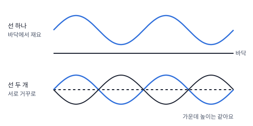

*위는 선 하나로 보내고, 아래는 두 선이 같은 가운데 높이를 두고 서로 거꾸로 흔들려요.*

**정확히 말하면**

10장은 차동 증폭기(differential amplifier)예요. 차동 쌍까지 배우면 증폭기의 기본 블록을 모두 배운 셈이에요.

- 공통 소스(CS) / 공통 이미터(CE)
- 공통 게이트(CG) / 공통 베이스(CB)
- 공통 드레인(CD), 곧 소스 팔로워(source follower)
- 캐스코드(cascode)
- 차동 쌍(differential pair)

복잡한 회로도 이 블록들로 나누면 해석할 수 있어요. 피드백 구조는 뒤에서 따로 다뤄요.

**단일 종단 신호(single-ended signal)**는 신호선 하나로 보내는 신호예요. 그 선의 전압은 접지(ground)를 기준으로 재요. 지금까지 다룬 신호가 모두 이 방식이에요.

**차동 신호(differential signal)**는 두 선으로 보내는 신호예요. 두 신호는 다음 조건을 지켜요.

1. DC 성분: 두 선이 접지 기준으로 같은 DC 레벨을 공유해요. 이것을 공통 모드 레벨(common-mode level) $V_{CM}$이라고 해요.
2. AC 성분: 두 선의 소신호는 크기가 같고 위상이 반대예요.
3. 진폭 $V_0$, 각주파수 $\omega$인 신호라면 두 선의 전압은 이래요.

   $$
   V_X = V_{CM} + V_0 \sin\omega t
   $$

   $$
   V_Y = V_{CM} - V_0 \sin\omega t
   $$
4. 두 식을 더해 2로 나누면 AC 항이 지워지고 $V_{CM}$만 남아요.

   $$
   \frac{V_X + V_Y}{2} = V_{CM}
   $$

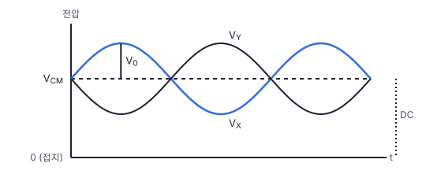

*$V_X$와 $V_Y$는 같은 $V_{CM}$을 중심으로 크기 $V_0$만큼, 서로 반대 위상으로 흔들려요. $V_{CM}$ 자체는 접지를 기준으로 잰 DC 전압이에요.*

반대 위상 신호는 저절로 생기지 않아요. 같은 신호를 두 선에 그대로 보내는 것이 아니라, 위상을 반전한 신호를 일부러 만들어 한쪽 선에 보내야 해요.

그래서 차동 신호에는 다음 단점이 있어요.

- 신호선이 2개 필요해요.
- 회로도 2배로 필요해요.
- 그만큼 전력 소모도 2배예요.
- 위상을 반전한 신호를 따로 만들어야 해요.

이 단점에도 차동 회로를 쓰는 이유는 다음 수업에서 다뤄요.

**교수님 말씀**

복잡한 회로도 기본 구조로 나눠 보면 해석할 수 있다고 하셨어요.

> 아무리 복잡한 회로라도 이걸 나누다 보면 … (0918 49:25)

> 해석의 방법을 몰라서 … 해석을 못하는 건 아닙니다. (0918 50:18)

차동 신호의 정의를 설명하면서 반대 위상 신호는 따로 만들어야 한다고 짚으셨어요.

> 위상이 반대가 된 신호를 일부러 만들어서 한쪽 라인에 보내는, 그게 차동 신호입니다. (0918 53:44)

단점을 먼저 짚으셨어요.

> 회로도 두 배로 필요해. 그럼 전력 소모도 두 배로 필요해. (0918 54:39)

**꼭 기억해요**

차동 신호는 DC는 같고($V_{CM}$ 공유), AC만 크기가 같고 위상이 반대예요.

> '이걸 왜, 왜 굳이 이렇게 쓰지?' … 굉장히 큰 장점이 있기 때문입니다. (0918 54:11)

> 특히 굉장히 주변의 노이즈에 취약한 회로들 같은 경우 … (0918 54:18)

그 장점이 무엇인지는 다음 수업에서 이어서 봐요.

**페이지 요약**

차동 신호는 같은 $V_{CM}$을 공유하고, 두 선의 AC 성분은 크기가 같고 위상이 반대예요.

*핵심 식*

- 한쪽 선

  $$
  V_X = V_{CM} + V_0 \sin\omega t
  $$
- 다른 쪽 선

  $$
  V_Y = V_{CM} - V_0 \sin\omega t
  $$

*용어*

- **단일 종단 신호(single-ended)** — 신호선 하나, 접지 기준으로 잰 전압
- **차동 신호(differential)** — 두 선, 같은 DC에 크기 같고 위상이 반대인 AC
- **공통 모드 레벨 $V_{CM}$** — 두 선이 공유하는 DC 레벨

---

## 5. 요약 · 예고

### 한눈에 보는 공식

*0918 수업 · L03 s25–s32 · L04 s3*

이번 수업의 식을 모았어요. 전류 미러의 모든 식은 "$V_{GS}$(또는 $V_{BE}$)가 같다"는 조건에서 나와요.

| 이름 | 식 | 쓰는 곳 · 조건 |
|---|---|---|
| MOS 미러 | $I_{copy} : I_{REF} = (W/L)_1 : (W/L)_{REF}$ $\Rightarrow\ I_{copy}=\dfrac{(W/L)_1}{(W/L)_{REF}}\,I_{REF}$ | 포화 영역, $V_{GS,REF}=V_{GS1}$일 때. [MOS 전류 미러의 식](#s0-mos-mirror) |
| λ 오차 | $I_{copy} : I_{REF} = (W/L)_1(1+\lambda V_{DS1}) : (W/L)_{REF}(1+\lambda V_{DS,REF})$ $\Rightarrow\ I_{copy}=\dfrac{(W/L)_1}{(W/L)_{REF}}\cdot\dfrac{1+\lambda V_{DS1}}{1+\lambda V_{DS,REF}}\,I_{REF}$ | $V_{DS1}$을 $V_{DS,REF}$에 맞추면 오차가 줄어요. 손계산에서는 무시해요. [채널 길이 변조가 만드는 복사 오차](#s0-lambda) |
| 스케일링 예 | $I_1 = \frac{2}{3} \times 0.3 = 0.2\ \text{mA}$ $I_2 = \frac{5}{3} \times 0.3 = 0.5\ \text{mA}$ | $I_{REF}=0.3$ mA, 크기 3 : 2 : 5. [소스 팔로워·CS 단 바이어스와 전류 스케일링](#s1-follower-scaling) |
| 팔로워 출력 | $R_{out} \approx 1/g_m$ | 소스 팔로워(전압 버퍼)의 출력저항. 다이오드 연결 소자도 저항 $1/g_m$이에요. |
| BJT 미러 | $I_{copy} : I_{REF} = I_{S1} : I_{S,REF}$ $\Rightarrow\ I_{copy}=\dfrac{I_{S1}}{I_{S,REF}}\,I_{REF}$ | 활성 영역, $V_{BE,REF}=V_{BE1}$. $I_S$는 이미터 면적에 비례해요. [바이폴라 전류 미러의 식](#s2-bjt-mirror) |
| 베이스 전류 | $I_B = I_C/\beta$ $I_{copy} = \frac{I_{REF}}{1 + 2/\beta}$ | 1:1 BJT 미러. $\beta \approx 100$이면 베이스 전류 하나가 약 1%, 1:1 미러에서 합친 오차 약 2%($\beta=100$)라 손계산에서는 무시해요. [베이스 전류가 만드는 오차](#s2-base-current) |
| 병렬 스케일링 | $I_{copy} = 3 I_{REF}$ $I_{copy} = \frac{1}{3} I_{REF}$ | 같은 소자를 복사 쪽에 3개 병렬로 두면 3배, 기준 쪽에 3개 병렬로 두면 1/3이에요. [병렬 연결로 배수·분수 전류 만들기](#s2-scaling) |
| PNP 기준 전류 | $I_{C,M} = I_{REF}$ | NPN 미러(1:1)로 $I_{REF}$를 복사해 $Q_{REF2}$에서 끌어내요. PNP 미러는 $\vert V_{EB}\vert $가 같아요. [PNP 전류 미러의 기준 전류 만들기](#s2-pnp-iref) |
| 차동 신호 | $V_X = V_{CM} + V_0 \sin\omega t$ $V_Y = V_{CM} - V_0 \sin\omega t$ | 같은 $V_{CM}$, 크기는 같고 위상은 반대예요. [단일 종단 신호와 차동 신호](#s3-signals) |

---

### 다음 시간 예고

*0918 수업 · L04 s4–s40*

다음 수업(0923)에서 이어서 다룰 제목이에요.

- 차동 회로가 전원 잡음에 강한 이유 (L04 s4)
- 차동 쌍(differential pair) 회로와 그 동작 (L04 s5)
- 입력 공통 모드 레벨에 대한 차동 쌍의 응답 (L04 s7)
- MOS·바이폴라 차동 쌍의 대신호 해석과 소신호 해석 (L04 s8–s26)
- 가상 접지(virtual ground)와 반회로 (L04 s14)
- 캐스코드 차동 쌍 (L04 s27–s30)
- 공통 모드 제거와 CMRR (L04 s31–s37)
- 능동 부하를 단 차동 쌍 (L04 s38 이후)

---

### 함께 보면 좋은 자료

*0918 수업*

- [복습문제 10개 (PDF)](../복습문제_0918_Current_Mirrors-문제.pdf)
- [답안 (PDF)](../복습문제_0918_Current_Mirrors-답안.pdf)
- [다음 수업 0923 정리노트: 차동 회로가 잡음에 강한 이유](../../0923/정리노트_0923_Differential_Amplifiers.html#s0-noise)
- [9장 전체 문제집 (PDF)](../../../workbook/pdf/ch09-문제.pdf)

복습문제에 든 문제예요.

- 2021-1 중간 Q5: 소스(이미터) 저항 $R_P$로 $V_{GS}$($V_{BE}$)를 바꿔 복사 전류비 정하기
- P9.53: $\lambda \neq 0$일 때 복사 오차 비와 $V_{DS1}$ 맞추기 (도전)
- E9.21: 0.3 mA 기준으로 소스 팔로워·CS 단 전류 0.2 mA, 0.5 mA 만들기
- P9.52: NMOS 미러에서 PMOS 미러로 이어지는 CMOS 미러에서 $W/L$ 비를 곱해 $I_{copy}$ 구하기, (b)는 source·sink 전류를 KCL로 합치기
- P9.46: 면적비 바이폴라 미러에서 베이스 전류 KCL로 $I_{copy}$와 정규화 오차($\approx -N/(n\beta)$) 구하기
- P9.48: NPN·PNP 두 단 미러에서 베이스 전류 오차가 쌓이는 모습
- P9.42: 130 μA 기준으로 50 μA·230 μA 만들기 (병렬 연결 스케일링)
- E9.18: NPN 미러로 PNP 미러의 기준 전류를 만들어 25 μA에서 1 mA 만들기
- 2023-1 중간 Q2: 면적비 NPN·PNP 미러로 CE 단 바이어스 전류와 이득 구하기
- E10.03: 두 CE 단 출력의 공통 모드 레벨 $V_{CM}$ 정하기

---

출처: 권익진 교수님 강의자료(Lec3, Lec4) · 수업 녹음 전사(0918) · B. Razavi, *Microelectronics*, 2nd ed. (Wiley) 9장 · 10장.
