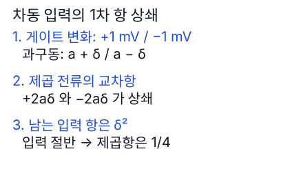

# 전자회로2 복습 0923 문제설명

주어진 조건을 읽고, 첫 줄을 쓰고, 이유를 따라가며 답을 확인해요.

문제의 첫 줄부터 검산까지 설명해요.

**목차**

- [문항별 설명](#problems)
  - [정류기 전원 CE 단에서 V_CC → V_out 소신호 이득 (리플 영향)](#p1)
  - [두 CE 단(Fig 10.2(a))에서 V_CC → V_out 소신호 이득](#p2)
  - [MOS 차동쌍(Fig 10.26)의 테일 노드 전압 변화 (W, I_SS, t_ox 두 배)](#p3)
  - [입력 CM 레벨 1.6 V인 MOS 차동쌍의 최대 부하 저항](#p4)
  - [식 10.147에서 I_D1 − I_D2 = I_SS가 되는 입력 차, 평형 과구동 전압의 √2배임을 확인](#p5)
  - [전력 3 mW, ΔV_in,max = 500 mV인 NMOS 차동쌍 설계](#p6)
  - [Fig 10.27(a)에서 M_2가 꺼졌을 때 M_1이 포화에 머무를 조건](#p7)
  - [식 (10.156)에서 차동 전압 이득 유도](#p8)
  - [평형 과구동 전압으로 차동 이득 나타내기 (예제 10.21 변형)](#p9)
  - [테일–접지 기생 저항 R_SS가 있는 MOS 차동쌍(Fig 10.74)에서 P가 가상 접지임을 증명](#p10)

## 문항별 설명

### 정류기 전원 CE 단에서 V_CC → V_out 소신호 이득 (리플 영향)

P10.01 · 장말문제 10.1 · [원 문제 보기](../%EB%B3%B5%EC%8A%B5%EB%AC%B8%EC%A0%9C_0923_Differential_Amplifiers-%EB%AC%B8%EC%A0%9C.pdf)

#### 주어진 조건

- 출력의 리플 영향을 계산하기 위해 $V_{CC}$를 소신호 "입력"으로 볼 수 있음
- $V_A < \infty$ (Early 효과 고려)
- 소자 값은 주어지지 않음 (답은 기호로)
- 베이스 바이어스 전압은 $V_{CC}$ 리플의 영향을 받지 않음

#### 구할 것

- $V_{CC}$에서 $V_{out}$까지의 (소신호) 이득

원문 보기

To calculate the effect of ripple at the output of the circuit in Fig. 10.1, we can assume $V_{CC}$ is a small-signal "input" and determine the (small-signal) gain from $V_{CC}$ to $V_{out}$. Compute this gain, assuming $V_A < \infty$.

#### 문제를 내 말로 읽어요

리플은 전원에 얹힌 작은 흔들림이에요. 평소 입력인 마이크 신호를 0으로 두고 전원만 살짝 움직여 출력이 얼마나 따라가는지 구해요. 베이스 바이어스는 전원 리플과 독립이라고 가정해요.

#### 이 문제를 봤을 때 떠올릴 개념과 공식

“$V_{CC}$를 소신호 입력으로”라는 단서에서는 중첩(superposition)을 떠올려요. 다른 독립 입력은 0으로 만들지만 조사 중인 전원 리플 $v_{cc}$는 남겨야 해요. $V_A<\infty$이므로 $r_o\simeq V_A/I_C$라는 유한 출력저항이 있어요.

이미터와 베이스가 AC 접지이면 $v_{be}=0$이고 제어 전류원 $g_mv_{be}$는 0이에요. 따라서 트랜지스터는 출력에서 접지로 연결된 $r_o$만 남아요. 이 회로는 반전 CE 신호 이득이 아니라 저항 분압(voltage division) 문제가 돼요.

#### 종이에 적는 실제 첫 줄

출력 노드에서 나가는 전류를 써요.

$$
\frac{v_{out}-v_{cc}}{R_C}+\frac{v_{out}}{r_o}=0
$$

#### 왜 이렇게 푸는지 함께 따라가요

#### 풀이

출력 노드에 연결된 위 경로의 끝은 0 V가 아니라 조사하려는 입력 $v_{cc}$예요. KCL에서 출력항을 모아요.

$$
v_{out}\left(\frac1{R_C}+\frac1{r_o}\right)=\frac{v_{cc}}{R_C}
$$

양변을 $v_{cc}$와 총 컨덕턴스로 나누어요.

$$
\frac{v_{out}}{v_{cc}}=\frac{1/R_C}{1/R_C+1/r_o}=\frac{r_o}{R_C+r_o}
$$

전원이 올라가면 위 저항 끝이 올라가 출력도 올라가므로 양의 이득이에요. 보통 $r_o\gg R_C$라서 이 비는 1에 가까워요. 베이스가 전원 리플의 영향을 받는 별도 바이어스망은 그림에 제시되지 않아 포함하지 않아요.

#### 완성 답과 검산

#### 풀이

**$v_{out}/v_{cc}=r_o/(R_C+r_o)$**예요. 저항끼리의 비라 무차원이고 0과 1 사이예요. $r_o\to\infty$이면 이득이 1이 돼요. 이때 컬렉터 전류는 변하지 않으므로 $R_C$의 전압강하도 변하지 않아 출력이 전원을 그대로 따라가요. $r_o\to0$이면 출력이 접지에 고정돼 이득은 0이에요.

#### 이 문제의 함정

모든 전원을 AC 접지로 바꾸는 습관 때문에 $v_{cc}$까지 없애면 구하려는 입력을 지운 것이에요. $-g_mR_C$는 베이스에서 출력까지의 이득이라 여기에 쓰지 않아요.

#### 설명을 닫고 다시 풀어요

1. 신호 입력을 0으로 하고 vcc만 남겨요.
2. 출력 KCL에서 분압비를 구해 부호와 극한을 확인해요.

**페이지 요약**

#### 떠올릴 개념·공식

전원 리플의 중첩·분압

#### 첫 줄

출력 KCL

#### 핵심 판단

vbe=0, ro만 남음

#### 검산

ro→∞이면 이득 1

---

### 두 CE 단(Fig 10.2(a))에서 V_CC → V_out 소신호 이득

P10.02 · 장말문제 10.2 · [원 문제 보기](../%EB%B3%B5%EC%8A%B5%EB%AC%B8%EC%A0%9C_0923_Differential_Amplifiers-%EB%AC%B8%EC%A0%9C.pdf)

#### 주어진 조건

- $R_{C1} = R_{C2}$
- 문제 10.1의 가정을 이어받음: $V_{CC}$를 소신호 "입력"으로 봄, $V_A < \infty$
- $Q_1$, $Q_2$는 같은 소자에 같은 바이어스 전류로 봄 (곧 $r_{O1} = r_{O2}$)
- 베이스 바이어스 전압은 $V_{CC}$ 리플의 영향을 받지 않음

#### 구할 것

- 이 회로에 대해 문제 10.1을 다시 풂: $V_{CC}$에서 $V_{out}$까지의 (소신호) 이득

원문 보기

Repeat Problem 10.1 for the circuit of Fig. 10.2(a), assuming $R_{C1} = R_{C2}$.

#### 문제를 내 말로 읽어요

동일한 두 CE 단이 같은 전원을 써요. 리플이 각 출력에는 나타나도 출력의 차에서 없어지는지 확인해요. 문제의 출력은 한 컬렉터 전압이 아니라 $V_X-V_Y$예요.

#### 이 문제를 봤을 때 떠올릴 개념과 공식

“두 저항이 같음”은 대칭(symmetry)과 공통 모드(common-mode)의 단서예요. 각 CE 단은 입력을 0으로 하면 $R_C$와 $r_o$ 분압기예요. 동일 소자·동일 바이어스로 $r_{o1}=r_{o2}$도 가정해요.

$V_A$가 유한하므로 각 분압비를 1로 놓지 않아도 두 비가 정확히 같으면 차동 리플은 0이에요. 베이스 바이어스가 리플과 독립인 조건에서 두 전달함수를 먼저 쓰고 빼는 것이 맞아요.

#### 종이에 적는 실제 첫 줄

같은 $v_{cc}$가 두 저항 위에 걸리도록 그린 뒤 각각 KCL을 써요.

$$
\frac{v_X-v_{cc}}{R_{C1}}+\frac{v_X}{r_{o1}}=0
$$

$$
\frac{v_Y-v_{cc}}{R_{C2}}+\frac{v_Y}{r_{o2}}=0
$$

#### 왜 이렇게 푸는지 함께 따라가요

#### 풀이

각 KCL을 풀면 두 단의 전원 이득이에요.

$$
\frac{v_X}{v_{cc}}=\frac{r_{o1}}{R_{C1}+r_{o1}},\qquad\frac{v_Y}{v_{cc}}=\frac{r_{o2}}{R_{C2}+r_{o2}}
$$

출력 정의에 따라 빼요.

$$
\frac{v_{out}}{v_{cc}}=\frac{r_{o1}}{R_{C1}+r_{o1}}-\frac{r_{o2}}{R_{C2}+r_{o2}}
$$

$R_{C1}=R_{C2}=R_C$, $r_{o1}=r_{o2}=r_o$를 대입하면 두 항이 지워져 0이에요. 각 출력의 평균에는 $[r_o/(R_C+r_o)]v_{cc}$가 남아요. 즉 전원 변화는 출력 공통 모드로 전달되지만 차동 모드에는 전달되지 않아요.

#### 완성 답과 검산

#### 풀이

**$v_{out}/v_{cc}=0$**예요. 예를 들어 검산용 $r_o=10R_C$이면 각 출력은 $10/11$배로 함께 움직여 차가 0이에요. $r_o\to\infty$에서도 $1-1=0$이에요. 두 저항이 같더라도 소자 출력저항이나 바이어스가 다르면 일반식의 두 비가 달라져 상쇄가 완전하지 않아요.

#### 이 문제의 함정

차동 출력의 리플이 0이라는 말을 각 노드가 움직이지 않는다는 뜻으로 읽지 않아요. 저항만 같으면 무조건 상쇄되는 것도 아니고 두 $r_o$ 및 바이어스도 맞아야 해요.

#### 설명을 닫고 다시 풀어요

1. 각 노드의 전원 이득을 따로 구해요.
2. 동일한 두 항을 빼고 평균에는 무엇이 남는지 적어요.

**페이지 요약**

#### 떠올릴 개념·공식

대칭과 공통 모드 제거

#### 첫 줄

두 출력 KCL

#### 핵심 판단

각 노드는 이동, 차는 상쇄

#### 검산

유한 ro에서도 0

---

### MOS 차동쌍(Fig 10.26)의 테일 노드 전압 변화 (W, I_SS, t_ox 두 배)

P10.35 · 장말문제 10.35 · [원 문제 보기](../%EB%B3%B5%EC%8A%B5%EB%AC%B8%EC%A0%9C_0923_Differential_Amplifiers-%EB%AC%B8%EC%A0%9C.pdf)

#### 주어진 조건

#### 구할 것

- 다음 각 경우 테일 노드 전압이 어떻게 되는가?
- (a) $M_1$과 $M_2$의 폭이 두 배
- (b) $I_{SS}$가 두 배
- (c) 게이트 산화막 두께가 두 배

원문 보기

Consider the MOS differential pair of Fig. 10.26. What happens to the tail node voltage if (a) the width of $M_1$ and $M_2$ is doubled, (b) $I_{SS}$ is doubled, (c) the gate oxide thickness is doubled?

#### 문제를 내 말로 읽어요

두 게이트 전압은 같은 $V_{CM}$으로 유지해요. 각 변경은 따로 적용하며 폭·전체 전류·산화막 두께가 바뀔 때 필요한 게이트–소스 전압이 어떻게 바뀌는지 봐요. 게이트가 고정이라 $V_{GS}$ 증가가 곧 테일 전압 하강이에요.

(c)의 산화막 두께 변경은 교과서의 단순화에 따라 $C_{ox}$만 바꾸고 문턱 전압 $V_{TH}$는 일정하게 유지해요. 실제로 문턱 전압도 바뀌면 그 변화만큼의 테일 전압 항을 추가해야 해요.

#### 이 문제를 봤을 때 떠올릴 개념과 공식

“평형 MOS 차동쌍”에서는 각 전류 $I_D=I_{SS}/2$와 제곱 법칙(square law)을 떠올려요. $K=\mu_nC_{ox}W/L$, $V_{ov}=V_{GS}-V_{TH}=\sqrt{I_{SS}/K}$예요. 테일 노드 전압은 $V_P=V_{CM}-V_{TH}-V_{ov}$예요.

$\lambda=0$, 길이와 이동도는 고정하고 각 변경 외의 값도 고정해요. 산화막 변경은 $C_{ox}=\varepsilon_{ox}/t_{ox}$만 바꾸고 $V_{TH}$는 일정하다는 교과서 단순화를 써요. 실제 공정에서 $V_{TH}$까지 변하면 그 변화도 더해야 해요.

#### 종이에 적는 실제 첫 줄

변경 전후 차이를 바로 구할 수 있게 첫 식을 써요.

$$
\Delta V_P=-(V_{ov,new}-V_{ov}),\qquad V_{ov,new}=\sqrt{\frac{I_{SS,new}}{\mu_nC_{ox,new}(W/L)_{new}}}
$$

#### 왜 이렇게 푸는지 함께 따라가요

#### (a)

폭만 2배면 $K$가 2배, 각 가지 전류는 그대로예요. 같은 전류를 더 넓은 소자로 흘리므로 더 작은 과구동이 필요해요.

$$
V_{ov,new}=\frac{V_{ov}}{\sqrt2}
$$

$$
\Delta V_P=\left(1-\frac1{\sqrt2}\right)V_{ov}\approx+0.293V_{ov}
$$

따라서 테일 노드는 올라가요.

#### (b)

전체 전류가 2배면 각 소자 전류도 2배예요. 폭은 그대로이므로 과구동은 제곱근 2배예요.

$$
V_{ov,new}=\sqrt2 V_{ov}
$$

$$
\Delta V_P=-(\sqrt2-1)V_{ov}\approx-0.414V_{ov}
$$

큰 $V_{GS}$를 확보하려고 테일이 내려가요.

#### (c)

두께 2배는 산화막 정전용량을 절반으로 만들어요.

$$
C_{ox,new}=C_{ox}/2,\qquad K_{new}=K/2
$$

전류가 같아야 하므로 과구동의 제곱이 2배가 돼요.

$$
V_{ov,new}=\sqrt2V_{ov}
$$

$$
\Delta V_P\approx-0.414V_{ov}
$$

고정 $V_{TH}$ 조건에서는 전류를 두 배로 한 경우와 같은 테일 변화예요.

#### 완성 답과 검산

#### (a)

**$V_P$가 $0.293V_{ov}$ 상승해요.** $K_{new}V_{ov,new}^2=(2K)(V_{ov}^2/2)=KV_{ov}^2$라 기존 전류를 유지해요. 폭이 커지면 필요한 $V_{GS}$가 줄어 테일이 올라간다는 방향도 맞아요.

#### (b)

**$V_P$가 $0.414V_{ov}$ 하강해요.** $K(\sqrt2V_{ov})^2/2$는 기존 소자 전류의 2배예요. 새 테일이 충분히 높아 테일 전류원이 포화에 남는지는 별도 전압 여유 조건이에요.

#### (c)

**$V_P$가 $0.414V_{ov}$ 하강해요.** $(K/2)(\sqrt2V_{ov})^2/2$가 원래 전류와 같아 확인돼요. $V_{TH}$ 변화까지 존재하면 일반식은 $\Delta V_P=-\Delta V_{TH}-(\sqrt2-1)V_{ov}$이며 주 답은 $\Delta V_{TH}=0$일 때예요.

#### 이 문제의 함정

산화막이 두꺼워지면 $C_{ox}$가 커지는 것이 아니라 작아져요. 0.293과 0.414는 볼트가 아니라 원래 과구동에 곱하는 무차원 계수예요.

(c)의 $0.414V_{ov}$ 하강은 $V_{TH}$ 고정일 때의 답이에요. 산화막 변화가 $V_{TH}$까지 바꾸는 공정 문제라면 $\Delta V_P$에 $-\Delta V_{TH}$도 들어가므로 이 숫자만으로 방향을 단정하지 않아요.

#### 설명을 닫고 다시 풀어요

1. 원래 과구동을 기호 하나로 두고 변화 배율만 구해요.
2. 게이트 고정에서 과구동과 테일 변화의 부호를 반대로 연결해요.

**페이지 요약**

#### 떠올릴 개념·공식

제곱 법칙과 테일 높이

#### 첫 줄

VP=VCM−VTH−Vov

#### 핵심 판단

W 두 배 ↑; 전류·tox 두 배 ↓

#### 검산

전류식을 역대입해 확인

#### 해석 조건

(c)는 $V_{TH}$ 고정·$C_{ox}$만 절반인 모델에서 $0.414V_{ov}$ 하강해요. $V_{TH}$도 변하면 $-\Delta V_{TH}$를 추가해요.

---

### 입력 CM 레벨 1.6 V인 MOS 차동쌍의 최대 부하 저항

E10.15 · 예제 10.15 · [원 문제 보기](../%EB%B3%B5%EC%8A%B5%EB%AC%B8%EC%A0%9C_0923_Differential_Amplifiers-%EB%AC%B8%EC%A0%9C.pdf)

#### 주어진 조건

- MOS 차동쌍이 입력 공통 모드 레벨 $V_{CM} = 1.6\ \text{V}$로 구동됨
- $I_{SS} = 0.5\ \text{mA}$
- $V_{TH} = 0.5\ \text{V}$
- $V_{DD} = 1.8\ \text{V}$

#### 구할 것

- 허용 가능한 최대 부하 저항 $R_D$

원문 보기

MOS 차동쌍이 $1.6\ \text{V}$의 입력 공통 모드 레벨로 구동되고 있다. 만약 $I_{SS} = 0.5\ \text{mA}$, $V_{TH} = 0.5\ \text{V}$, $V_{DD} = 1.8\ \text{V}$라면, 허용 가능한 최대 부하 저항은 얼마인가?

#### 문제를 내 말로 읽어요

두 게이트는 1.6 V로 높게 잡혀 있어요. 부하 저항을 키우면 드레인 전압이 내려가 NMOS가 포화 영역을 벗어나요. 그 경계에서 허용 부하의 상한을 찾아요.

#### 이 문제를 봤을 때 떠올릴 개념과 공식

“최대 부하 저항”과 입력 공통 모드(common-mode) 전압은 포화 전압 여유(headroom)의 단서예요. NMOS 포화 조건 $V_{DS}\ge V_{GS}-V_{TH}$를 정리하면 $V_D\ge V_G-V_{TH}$여서 소스 전압이 지워져요.

평형의 각 가지에는 전체 테일의 절반 $I_{SS}/2$가 흘러요. 이 조건은 $W/L$이나 $g_m$ 없이도 드레인 전압만으로 판정할 수 있어요. 장채널 이상식과 이상적 테일 전류원을 가정해요.

#### 종이에 적는 실제 첫 줄

각 가지 전류와 포화 조건을 붙여 써요.

$$
V_D=V_{DD}-R_D\frac{I_{SS}}2\ge V_{CM}-V_{TH}
$$

#### 왜 이렇게 푸는지 함께 따라가요

#### 풀이

드레인이 지켜야 할 최소 전압부터 계산해요.

$$
V_{D,min}=1.6-0.5=1.10\ \mathrm V
$$

전원 1.8 V 중 저항에서 떨어뜨릴 수 있는 전압은 $1.8-1.1=0.70$ V예요. 각 가지 전류는 $0.5/2=0.25$ mA예요.

$$
R_D\le\frac{0.70\ \mathrm V}{0.25\ \mathrm{mA}}=2.80\ \mathrm{k}\Omega
$$

등호에서는 두 NMOS가 포화 경계에 있어요. 포화 영역 안쪽의 여유를 원하면 $R_D<2.80$ kΩ로 잡아요. 테일 전류원의 최소 동작 전압은 주어지지 않아 이 계산은 입력쌍의 상부 포화 한계를 다뤄요.

#### 완성 답과 검산

#### 풀이

**경계 최대값은 $R_{D,max}=2.80$ kΩ**예요. 이를 역대입하면 $V_D=1.8-(2.8\ \mathrm{k}\Omega)(0.25\ \mathrm{mA})=1.10$ V로 $V_G-V_{TH}$와 같아요. 3 kΩ라면 드레인이 1.05 V로 내려가 기준보다 50 mV 낮아져 허용되지 않아요. V/mA가 kΩ여서 단위도 맞아요.

#### 이 문제의 함정

각 저항에 0.5 mA 전체가 흐른다고 놓으면 상한이 절반으로 나와요. 입력 CM과 출력 CM을 같다고 두지 말고 포화 조건에서 관계를 정해요.

#### 설명을 닫고 다시 풀어요

1. 포화 조건에서 소스 전압을 먼저 없애요.
2. 각 가지 전류로 허용 전압강하를 나눠요.

**페이지 요약**

#### 떠올릴 개념·공식

포화 영역 전압 여유

#### 첫 줄

VD≥VCM−VTH

#### 핵심 판단

각 가지는 0.25 mA

#### 검산

2.80 kΩ에서 VD=1.10 V

---

### 식 10.147에서 I_D1 − I_D2 = I_SS가 되는 입력 차, 평형 과구동 전압의 √2배임을 확인

P10.45 · 장말문제 10.45 · [원 문제 보기](../%EB%B3%B5%EC%8A%B5%EB%AC%B8%EC%A0%9C_0923_Differential_Amplifiers-%EB%AC%B8%EC%A0%9C.pdf)

#### 주어진 조건

- MOS 차동쌍의 대신호 식 (10.147)
- $I_{D1} - I_{D2} = I_{SS}$

-

#### 구할 것

- 식 (10.147)로부터 $I_{D1} - I_{D2} = I_{SS}$가 되는 $V_{in1} - V_{in2}$
- 그 결과가 평형 과구동 전압의 $\sqrt{2}$배임을 확인

  - 원문 표기 "Verify that is result is equal to …" (인쇄 그대로)
  - "this result"(이 결과)의 오식으로 보임

원문 보기

From Eq. (10.147), determine the value of $V_{in1} - V_{in2}$ such that $I_{D1} - I_{D2} = I_{SS}$. Verify that is result is equal to $\sqrt{2}$ times the equilibrium overdrive voltage.

#### 문제를 내 말로 읽어요

전류 차이가 전체 테일 전류와 같다는 말은 한 소자가 전류를 모두 맡고 다른 소자가 막 꺼지는 순간이에요. 그 입력 차이를 대신호 식으로 구하고 평형 과구동과 비교해요.

#### 이 문제를 봤을 때 떠올릴 개념과 공식

“$I_{D1}-I_{D2}=I_{SS}$”는 전류 조향(current steering)의 끝점이에요. $K=\mu_nC_{ox}W/L$, $d=V_{in1}-V_{in2}$로 두면 두 소자가 켜져 있는 구간의 차 전류는 $K d\sqrt{4I_{SS}/K-d^2}/2$예요.

제곱 법칙·동일 문턱·$\lambda=0$을 가정해요. 식을 제곱하면 부호 정보가 사라지므로 최종 양의 전류 차이에 맞게 $d>0$를 골라야 해요. 제곱근이 실수라는 조건만으로 식을 한 소자 차단 이후까지 연장하면 안 돼요.

#### 종이에 적는 실제 첫 줄

원래 대신호 식의 좌변을 목표 전류에 놓아요.

$$
\frac K2 d\sqrt{\frac{4I_{SS}}K-d^2}=I_{SS},\qquad d>0
$$

#### 왜 이렇게 푸는지 함께 따라가요

#### 풀이

양변을 제곱하고 $u=Kd^2$로 정리해요.

$$
K^2d^2\left(\frac{4I_{SS}}K-d^2\right)=4I_{SS}^2
$$

$$
u(4I_{SS}-u)=4I_{SS}^2
$$

$$
(u-2I_{SS})^2=0
$$

중근 $u=2I_{SS}$와 양의 $d$를 사용해요.

$$
d=\sqrt{\frac{2I_{SS}}K}
$$

평형에서는 각 소자 전류가 $I_{SS}/2$예요. 따라서

$$
\frac{I_{SS}}2=\frac K2V_{ov,eq}^2,\qquad V_{ov,eq}=\sqrt{\frac{I_{SS}}K}
$$

두 값을 나누면 $d/V_{ov,eq}=\sqrt2$예요. 이 입력에서 $M_2$의 과구동은 0이고 $M_1$의 과구동은 $d$가 돼 $I_{D1}=Kd^2/2=I_{SS}$를 만들어요.

#### 완성 답과 검산

#### 풀이

**$d=\sqrt{2I_{SS}/K}=\sqrt2V_{ov,eq}$**예요. 원래 식에 넣으면 제곱근 안은 $2I_{SS}/K=d^2$이고 $d>0$이므로 왼쪽은 $Kd^2/2=I_{SS}$예요. 합 $I_{D1}+I_{D2}=I_{SS}$와 차가 같으므로 $I_{D1}=I_{SS}$, $I_{D2}=0$도 확인돼요. $I_{SS}/K$는 V²라 $d$의 단위는 V예요.

#### 이 문제의 함정

식의 제곱근이 실수라고 $|d|$를 $2\sqrt{I_{SS}/K}$까지 늘리면 비물리적인 전류 감소가 나타나요. 두 소자 전도 식의 유효 범위는 차단 경계 $|d|\le\sqrt{2I_{SS}/K}$예요. 음의 근은 전류 차이 $-I_{SS}$에 해당해요.

#### 설명을 닫고 다시 풀어요

1. 제곱한 식을 u=Kd²로 바꿔 중근을 찾아요.
2. 원래 식과 전류 합·차에 대입해 부호를 확인해요.

**페이지 요약**

#### 떠올릴 개념·공식

전류 조향의 차단 경계

#### 첫 줄

대신호 차 전류=ISS

#### 핵심 판단

d=√2 Vov,eq

#### 검산

합·차로 ID1=ISS, ID2=0

---

### 전력 3 mW, ΔV_in,max = 500 mV인 NMOS 차동쌍 설계

E10.20 · 예제 10.20 · [원 문제 보기](../%EB%B3%B5%EC%8A%B5%EB%AC%B8%EC%A0%9C_0923_Differential_Amplifiers-%EB%AC%B8%EC%A0%9C.pdf)

#### 주어진 조건

- NMOS 차동쌍, 한계 전력 소모 $3\ \text{mW}$
- $\Delta V_{in,max} = 500\ \text{mV}$
- $\mu_n C_{ox} = 100\ \mu\text{A/V}^2$, $V_{DD} = 1.8\ \text{V}$

#### 구할 것

- 위 조건을 만족하는 NMOS 차동쌍 설계
- 정할 값: 테일 전류 $I_{SS}$, 트랜지스터 종횡비 $W/L$

원문 보기

한계 전력 소모가 $3\ \text{mW}$이고 $\Delta V_{in,max} = 500\ \text{mV}$인 NMOS 차동쌍을 설계하라. $\mu_n C_{ox} = 100\ \mu\text{A/V}^2$, $V_{DD} = 1.8\ \text{V}$로 가정한다.

#### 문제를 내 말로 읽어요

500 mV의 입력 차이가 되면 한쪽으로 전류가 완전히 몰리도록 크기를 정해요. 3 mW는 전력의 상한이라 그 안에서 테일 전류를 선택하고 두 입력 소자의 같은 종횡비를 구해요.

#### 이 문제를 봤을 때 떠올릴 개념과 공식

“전력 예산”에서는 $P=V_{DD}I_{SS}$를, “$\Delta V_{in,max}$”에서는 완전 조향 경계 $d_{max}=\sqrt{2I_{SS}/K}$를 떠올려요. $K=\mu_nC_{ox}W/L$이고 $W/L$은 무차원이에요.

여기서 max는 완전히 선형이라는 뜻이 아니라 한 입력 MOS가 막 차단되는 입력 차이예요. $\lambda=0$ 제곱 법칙과 이상적 테일을 사용해요. 전력 예산을 전부 쓰는 것은 한 가지 설계 선택이며 유일한 필수 전류는 아니에요.

#### 종이에 적는 실제 첫 줄

전력 조건과 입력 범위 조건을 동시에 적어요.

$$
I_{SS}\le\frac{3\ \mathrm{mW}}{1.8\ \mathrm V},\qquad\frac WL=\frac{2I_{SS}}{\mu_nC_{ox}d_{max}^2}
$$

#### 왜 이렇게 푸는지 함께 따라가요

#### 풀이

교과서의 예산을 전부 사용하는 설계를 택해요.

$$
I_{SS}=1.6667\ \mathrm{mA},\qquad I_D=0.8333\ \mathrm{mA}
$$

입력 차이 0.500 V를 경계식에 넣어 각 NMOS의 크기를 구해요.

$$
\frac WL=\frac{2(1.6667\times10^{-3})}{(100\times10^{-6})(0.500)^2}=133.33
$$

따라서 두 소자를 같은 $W/L\approx133$으로 설계해요. 평형 과구동은 $0.500/\sqrt2=0.3536$ V예요.

부하 저항의 이득·출력 CM·입력 CM 사양은 주어지지 않았으므로 유일한 $R_D$는 정해지지 않아요. 원하는 이득으로 정한 뒤 포화 전압 여유를 확인해야 해요. 예산보다 작은 전류를 고르면 위 비례식으로 $W/L$도 줄이는 다른 설계가 가능해요.

#### 완성 답과 검산

#### 풀이

**한 가지 설계는 $I_{SS}=1.67$ mA, 각 $W/L\approx133$**예요. 반올림 전 값으로 $P=1.8\times1.6667=3.000$ mW예요. $K=0.013333$ A/V²를 넣으면 $\sqrt{2I_{SS}/K}=0.500$ V가 돼요. 평형에서 $KV_{ov,eq}^2/2=0.8333$ mA로 테일 절반도 맞아요.

#### 이 문제의 함정

500 mV를 각 게이트의 진폭으로 두면 전체 입력 차이가 1 V가 되어 설계가 달라져요. 경계까지 선형 이득을 보장하는 사양으로 읽지 않아요.

#### 설명을 닫고 다시 풀어요

1. 예산으로 전체 테일 전류를 골라요.
2. 차단 경계식으로 W/L을 정하고 경계 전압을 역계산해요.

**페이지 요약**

#### 떠올릴 개념·공식

전력과 완전 조향 범위

#### 첫 줄

P=VDD ISS

#### 핵심 판단

예산 전부 쓰는 한 설계

#### 검산

1.67 mA, 133, 0.500 V

---

### Fig 10.27(a)에서 M_2가 꺼졌을 때 M_1이 포화에 머무를 조건

P10.40 · 장말문제 10.40 · [원 문제 보기](../%EB%B3%B5%EC%8A%B5%EB%AC%B8%EC%A0%9C_0923_Differential_Amplifiers-%EB%AC%B8%EC%A0%9C.pdf)

#### 주어진 조건

- $V_{in1} = 1.5\ \text{V}$, $V_{in2} = 0.3\ \text{V}$
- $M_2$는 꺼져 있다고 가정

#### 구할 것

- $M_1$이 포화 영역에서 동작하도록 보장하는 회로 파라미터 사이의 조건

원문 보기

In Fig. 10.27(a), $V_{in1} = 1.5\ \text{V}$ and $V_{in2} = 0.3\ \text{V}$. Assuming $M_2$ is off, determine a condition among the circuit parameters that guarantees operation of $M_1$ in saturation.

#### 문제를 내 말로 읽어요

입력 1.5 V인 $M_1$이 전체 테일 전류를 맡고 0.3 V인 $M_2$는 꺼져 있다고 주어졌어요. 따라서 평형의 절반 전류가 아니라 $I_{SS}$ 전체로 왼쪽 저항의 전압강하를 계산해요.

#### 이 문제를 봤을 때 떠올릴 개념과 공식

“$M_2$가 off”는 대신호 전류 조향(current steering), “$M_1$ 포화 보장”은 $V_D\ge V_G-V_{TH}$의 단서예요. $I_{SS}$는 총 테일 전류, $R_D$는 각 드레인 부하예요.

제곱 법칙으로 차단 가정을 검사할 때는 $K=\mu_nC_{ox}W/L$를 써요. 출력 포화 조건 자체는 문턱 전압과 드레인 전압으로 바로 표현할 수 있어 소신호 이득 모델은 필요 없어요.

#### 종이에 적는 실제 첫 줄

꺼진 쪽 전류를 0으로 놓고 KCL과 포화 조건을 써요.

$$
I_{D1}=I_{SS},\quad V_X=V_{DD}-R_D I_{SS}
$$

$$
V_X\ge1.5\ \mathrm V-V_{TH}
$$

#### 왜 이렇게 푸는지 함께 따라가요

#### 풀이

출력 전압 식을 부등식에 넣어 저항 전압강하를 정리해요.

$$
V_{DD}-R_DI_{SS}\ge1.5\ \mathrm V-V_{TH}
$$

$$
R_DI_{SS}\le V_{DD}-1.5\ \mathrm V+V_{TH}
$$

이것이 요청한 회로 파라미터 조건이에요. 우변이 음수라면 양의 저항·전류로 포화를 유지할 수 없어요.

차단 가정도 부가적으로 확인할 수 있어요. 전체 전류를 흘리는 $M_1$의 과구동은 $V_{ov1}=\sqrt{2I_{SS}/K}$이고 소스는 $V_P=1.5-V_{TH}-V_{ov1}$이에요. 따라서 $M_2$의 과구동은

$$
V_{GS2}-V_{TH}=0.3-V_P-V_{TH}=V_{ov1}-1.2\ \mathrm V
$$

$M_2$가 꺼지려면 이 값이 0 이하, 곧 $\sqrt{2I_{SS}/K}\le1.2$ V여야 해요.

#### 완성 답과 검산

#### 풀이

**$R_DI_{SS}\le V_{DD}-1.5\ \mathrm V+V_{TH}$**예요. 등호를 출력식에 넣으면 $V_X=1.5-V_{TH}$로 정확히 포화 경계예요. $R_D$가 증가하면 $V_X$가 낮아져 위반하기 쉬워지는 부등식 방향도 맞아요. 양변이 V이며, 충분한 테일 전류원 전압 여유 및 $M_2$ 차단 가정 아래의 조건이에요.

#### 이 문제의 함정

전류를 $I_{SS}/2$로 쓰는 것은 두 입력이 같을 때예요. 입력 차이 1.2 V만 보고 무조건 $M_2$ 차단이라고 결론내리기보다 주어진 가정을 쓰고 과구동 조건으로 일관성을 살펴요.

#### 설명을 닫고 다시 풀어요

1. M2=0에서 M1 전류와 X 전압을 적어요.
2. 포화 조건을 정리하고 필요하면 차단 가정까지 확인해요.

**페이지 요약**

#### 떠올릴 개념·공식

전류 조향과 포화 조건

#### 첫 줄

VX=VDD−RD ISS

#### 핵심 판단

전류는 절반이 아닌 전체

#### 검산

경계에서 VX=1.5−VTH

---

### 식 (10.156)에서 차동 전압 이득 유도

E10.21 · 예제 10.21 · [원 문제 보기](../%EB%B3%B5%EC%8A%B5%EB%AC%B8%EC%A0%9C_0923_Differential_Amplifiers-%EB%AC%B8%EC%A0%9C.pdf)

#### 주어진 조건

- MOS 차동쌍의 작은 차동 입력 근사식 (10.156)
- 소자 값은 주어지지 않음 (답은 기호로)

#### 구할 것

- 식 (10.156)으로부터 차동 전압 이득도 구할 수 있음을 증명

원문 보기

식 (10.156)이 차동 전압 이득 또한 산출할 수 있음을 증명하라.

#### 문제를 내 말로 읽어요

대신호 전류 특성을 평형점 근처에서 직선으로 만든 식이 이미 주어져 있어요. 그 전류 차이가 두 부하 저항을 거쳐 어떤 출력 전압 차이가 되는지 연결하면 차동 전압 이득이 나와요.

#### 이 문제를 봤을 때 떠올릴 개념과 공식

“식 10.156으로 이득 증명”은 선형화(linearization)의 단서예요. 작은 입력 차이 $d$에 대해 $I_{D1}-I_{D2}\approx\sqrt{KI_{SS}}d$이고 $K=\mu_nC_{ox}W/L$예요. 평형의 각 소자 전류는 $I_{SS}/2$라 $g_m=\sqrt{2KI_D}=\sqrt{KI_{SS}}$예요.

동일 저항·소자, 이상적 테일, $\lambda=0$이며 $d^2\ll4I_{SS}/K$인 작은 입력 범위에서 써요. 출력은 $V_{out1}-V_{out2}$ 순서로 정해 음의 이득을 구해요.

#### 종이에 적는 실제 첫 줄

각 드레인 KVL을 뺀 실제 첫 식이에요.

$$
V_{out1}-V_{out2}=-R_D(I_{D1}-I_{D2})
$$

#### 왜 이렇게 푸는지 함께 따라가요

#### 풀이

두 출력에는 같은 $V_{DD}$가 들어가므로 차를 취하면 전원 성분이 지워져요. 주어진 선형화 전류식을 바로 넣어요.

$$
V_{out1}-V_{out2}\approx-R_D\sqrt{KI_{SS}}(V_{in1}-V_{in2})
$$

계수의 의미를 평형 전류에서 확인해요.

$$
g_m=\sqrt{2KI_D}=\sqrt{2K(I_{SS}/2)}=\sqrt{KI_{SS}}
$$

따라서 작은 입력에서 비 또는 평형점의 미분계수는

$$
A_{vd}=\left.\frac{\partial(V_{out1}-V_{out2})}{\partial(V_{in1}-V_{in2})}\right|_{d=0}=-g_mR_D
$$

이는 반회로 공통 소스(common-source) 해석의 결과와 같아요. 반회로 입력이 $d/2$, 출력도 전체 차동 출력의 절반이므로 두 절반 인자가 비에서 없어져요.

#### 완성 답과 검산

#### 풀이

**$A_{vd}=-g_mR_D=-R_D\sqrt{\mu_nC_{ox}(W/L)I_{SS}}$**예요. $\sqrt{KI_{SS}}$는 A/V이고 Ω를 곱하면 무차원이에요. 양의 $d$가 첫 전류를 늘리면 첫 출력은 내려가므로 부호가 음수예요. 유도는 평형점 기울기에 관한 것으로 차단 경계에서 같은 일정 이득을 주장하지 않아요.

#### 이 문제의 함정

차동 전류에 이미 두 가지의 차이가 포함돼 있으므로 2를 추가로 곱하지 않아요. $g_m$은 전체 테일 전류가 아니라 각 소자 전류에서 계산해요.

#### 설명을 닫고 다시 풀어요

1. 두 드레인 전압식을 빼요.
2. 주어진 차 전류식의 계수가 평형 gm인지 확인해요.

**페이지 요약**

#### 떠올릴 개념·공식

대신호 특성의 평형 선형화

#### 첫 줄

vod=−RD ΔID

#### 핵심 판단

√(K ISS)=gm

#### 검산

차동 이득 −gm RD

---

### 평형 과구동 전압으로 차동 이득 나타내기 (예제 10.21 변형)

X10.21 · 연습문제 10.21 · [원 문제 보기](../%EB%B3%B5%EC%8A%B5%EB%AC%B8%EC%A0%9C_0923_Differential_Amplifiers-%EB%AC%B8%EC%A0%9C.pdf)

#### 주어진 조건

- 수식 $g_m = \dfrac{2I_D}{V_{GS} - V_{TH}}$ 이용

#### 구할 것

- 예제 10.21의 결과(차동 전압 이득)를 평형 과구동 전압 $(V_{GS} - V_{TH})_{equil}$의 항으로 나타내기

원문 보기

수식 $g_m = 2I_D/(V_{GS} - V_{TH})$을 이용하여, 평형 과구동 전압의 항으로 위의 결과를 나타내라.

#### 문제를 내 말로 읽어요

앞 예제의 차동 이득을 종횡비 대신 평형 과구동 전압으로 다시 써요. 새로운 회로를 해석하는 문제가 아니라 $g_m$ 표현을 바꿔 이득과 전압 여유의 관계를 보이는 문제예요.

#### 이 문제를 봤을 때 떠올릴 개념과 공식

“$g_m=2I_D/(V_{GS}-V_{TH})$를 사용”이라는 단서에서는 동작점의 각 소자 전류를 먼저 정해요. 평형 $I_D=I_{SS}/2$이고 $V_{ov,eq}=(V_{GS}-V_{TH})_{eq}$예요. $V_{ov,eq}$는 두 입력이 같을 때의 한 MOS 과구동이에요.

동일 저항의 대칭 NMOS 쌍, $\lambda=0$, 작은 차동 입력에서 $A_v=-g_mR_D$를 써요. 전류가 고정일 때 작은 과구동은 큰 $g_m$을 뜻하지만 더 큰 소자 크기와 좁은 대신호 입력 범위가 필요해요.

#### 종이에 적는 실제 첫 줄

기본 이득과 주어진 $g_m$ 식을 한 줄로 연결해요.

$$
A_v=-g_mR_D,\qquad g_m=\frac{2(I_{SS}/2)}{V_{ov,eq}}
$$

#### 왜 이렇게 푸는지 함께 따라가요

#### 풀이

분자의 2와 테일 절반이 지워져요.

$$
g_m=\frac{I_{SS}}{V_{ov,eq}}
$$

이를 이득에 넣어요.

$$
A_v=-\frac{I_{SS}R_D}{V_{ov,eq}}=-\frac{2I_DR_D}{V_{ov,eq}}
$$

분자 $I_{SS}R_D$는 완전 조향 시 차동 출력의 한쪽 끝 크기예요. 평형에서 각 저항의 DC 강하는 그 절반 $I_{SS}R_D/2$예요. 따라서 이득 크기는 평형 저항 전압강하의 두 배를 평형 과구동으로 나눈 값이기도 해요.

같은 $I_{SS}$와 $R_D$에서 $V_{ov,eq}$를 반으로 줄이면 이득은 두 배예요. 제곱 법칙에서 이를 실현하려면 $W/L$을 네 배로 키워야 해요.

#### 완성 답과 검산

#### 풀이

**$A_v=-I_{SS}R_D/V_{ov,eq}$**예요. V/V의 비라 무차원이에요. $V_{ov,eq}=\sqrt{I_{SS}/K}$를 되넣으면 $I_{SS}/V_{ov,eq}=\sqrt{KI_{SS}}$가 돼 앞 예제와 일치해요. $R_D\to0$이면 이득이 0으로 가요. 과구동을 무한히 0으로 보내는 수학적 극한은 약반전·기생용량 등 단순 제곱 법칙의 한계를 벗어나므로 설계의 무한 이득을 뜻하지 않아요.

#### 이 문제의 함정

$I_D=I_{SS}$로 넣으면 2가 남아 이득을 두 배로 부풀려요. 평형 과구동과 한 소자가 전체 전류를 맡을 때의 과구동은 $\sqrt2$배 차이예요.

#### 설명을 닫고 다시 풀어요

1. 한 소자 전류에 ISS/2를 대입해요.
2. 결과에 평형 과구동 제곱근식을 다시 넣어 앞 이득과 맞춰요.

**페이지 요약**

#### 떠올릴 개념·공식

gm의 과구동 표현

#### 첫 줄

gm=ISS/Vov,eq

#### 핵심 판단

Av=−ISS RD/Vov,eq

#### 검산

√(K ISS) 표현과 일치

---

### 테일–접지 기생 저항 R_SS가 있는 MOS 차동쌍(Fig 10.74)에서 P가 가상 접지임을 증명

P10.39 · 장말문제 10.39 · [원 문제 보기](../%EB%B3%B5%EC%8A%B5%EB%AC%B8%EC%A0%9C_0923_Differential_Amplifiers-%EB%AC%B8%EC%A0%9C.pdf)

#### 주어진 조건

- 작은 차동 입력

#### 구할 것

- 소신호 모델을 쓰지 않고, 작은 차동 입력에 대해 $P$가 여전히 가상 접지임을 증명

원문 보기

A MOS differential pair contains a parasitic resistance tied between its tail node and ground (Fig. 10.74). Without using the small-signal model, prove that $P$ is still a virtual ground for small, differential inputs.

#### 문제를 내 말로 읽어요

테일 노드에 접지 저항이 더해져도 작은 차동 입력에서는 두 가지가 서로 바꿔 가며 같은 양만큼 전류를 주고받아요. 소신호 등가회로를 사용하지 말라는 요구에 따라 대칭성과 원래 제곱 법칙만으로 테일 변화의 차수를 보일 거예요.

#### 이 문제를 봤을 때 떠올릴 개념과 공식

“작은 차동 입력”과 “소신호 모델 없이”는 교환 대칭(exchange symmetry)과 테일 KCL의 단서예요. 입력 $d$의 부호를 바꾸면 두 동일 소자만 자리를 바꿔 $V_P(d)=V_P(-d)$예요. 연속적이며 미분 가능한 평형 근처에서 이 짝함수는 1차 항이 없어요.

$K=\mu_nC_{ox}W/L$를 제곱 법칙의 계수로 정의해요. $R_{SS}$는 실제 기생 저항이고, 평형 전류 합은 $I_{SS}+V_{P0}/R_{SS}$라 반드시 $I_{SS}$만은 아니에요. 이 실제 평형에서의 과구동을 $u$라고 놓아요.

#### 종이에 적는 실제 첫 줄

원래 MOS 전류식과 저항 전류로 KCL을 적어요. $x=V_P-V_{P0}$, $d=V_{in1}-V_{in2}$예요.

$$
\frac K2(u-x+d/2)^2+\frac K2(u-x-d/2)^2=I_{SS}+\frac{V_{P0}+x}{R_{SS}}
$$

#### 왜 이렇게 푸는지 함께 따라가요

#### 풀이

**작은 입력을 먼저 놓아 봐요.** 입력 공통 모드를 고정하고 왼쪽 게이트를 +1 mV, 오른쪽을 −1 mV 바꾸면 $d=2$ mV예요. 테일도 $x$만큼 움직이므로 두 과구동은 $u-x+1$ mV와 $u-x-1$ mV예요. $a=u-x$, $\delta=1$ mV라 쓰고 각각 제곱해요.

$$
(a+\delta)^2=a^2+2a\delta+\delta^2
$$

$$
(a-\delta)^2=a^2-2a\delta+\delta^2
$$

더하면 $+2a\delta$와 $-2a\delta$가 지워져 $2a^2+2\delta^2$예요. 입력의 부호를 바꿔도 같고, 입력을 절반으로 줄이면 남는 입력 제곱항은 1/4이 돼요. 이것이 테일의 1차 변화가 없는 이유예요. 이제 $\delta=d/2$로 돌려 일반 KCL을 정리해요.

*위에서 아래로 전압·전류 변화를 따라가요. 수치는 이해를 위한 예시예요.*

제곱을 더하면 $d$에 비례하는 두 교차항이 정확히 지워져요.

$$
K(u-x)^2+\frac K4d^2=I_{SS}+\frac{V_{P0}+x}{R_{SS}}
$$

평형 식 $Ku^2=I_{SS}+V_{P0}/R_{SS}$를 빼면

$$
\left(2Ku+\frac1{R_{SS}}\right)x=Kx^2+\frac K4d^2
$$

$d$의 1차 변화에 대해 오른쪽에는 1차 구동항이 없고 왼쪽 계수는 양수예요. 따라서 $x$의 1차 계수는 0이에요. 더 나아가 작은 $d$에서 $x=O(d^2)$이므로 $x^2=O(d^4)$를 제외하면

$$
x=\frac{K d^2/4}{2Ku+1/R_{SS}}+O(d^4)
$$

이는 테일이 전혀 움직이지 않는다는 명제가 아니라 일차 소신호 변화가 0이라는 명제예요. 이차에는 약간 올라갈 수 있어요.

#### 완성 답과 검산

#### 풀이

**$\left.dV_P/dd\right|_{d=0}=0$이므로 $P$는 작은 차동 입력에 대한 가상 접지예요.** 직접 미분하면 $(2Ku+1/R_{SS})x'(0)=0$이라 결론이 엄밀해요. 이차식은 분자가 A, 분모가 A/V라 V 단위예요. $R_{SS}\to\infty$에서는 $x\approx d^2/(8u)$가 되어 이상적 테일의 결과와 같고, $R_{SS}\to0$에서는 변화가 0으로 억제돼요.

#### 이 문제의 함정

가상 접지는 DC 전압이 0이라는 뜻이 아니에요. 실제 저항이 있는 회로의 평형 전류 합을 무조건 ISS라고 놓지 않아요. 반회로 소신호 모델로 결론만 인용하면 “소신호 모델 없이 증명” 요구를 충족하지 못해요.

#### 설명을 닫고 다시 풀어요

1. 입력 부호를 바꿨을 때 테일 전압이 짝함수임을 설명해요.
2. 원래 전류식 합에서 d의 1차 항이 지워지는지 보여요.

**페이지 요약**

#### 떠올릴 개념·공식

교환 대칭·제곱 법칙 KCL

#### 첫 줄

원래 전류 합=ISS+VP/RSS

#### 핵심 판단

VP 변화는 입력 차의 이차부터

#### 검산

미분계수 0, RSS 극한 확인

#### 규칙을 적용하는 순서

$(a+\delta)^2+(a-\delta)^2=2a^2+2\delta^2$

1차 항 상쇄 → 테일 변화는 2차부터예요. DC 전압이 0이라는 뜻은 아니에요.

---

원 문제·정리노트·PDF는 보존해요.
