# 차동 증폭기 — 5살도 이해하는 정리노트

권익진 교수님 전자회로2 · 0923 수업 (Lec4, Razavi 10장)

> `정리노트_0923_Differential_Amplifiers.html`를 마크다운으로 옮겼어요. 그림은 `figures_0923/` 폴더의 SVG, 위젯은 대표 설정의 정적 그림으로 바꿨어요. 수식은 `$…$` / `$$…$$`라서 GitHub, Obsidian, Typora에서 보여요.

**목차**

- [들어가며: 왜 이런 회로를 쓸까](#why)
  - [왜 이런 회로를 쓸까](#why-circuit)
- [0. 왜 차동으로 쓸까](#s0)
  - [공통 모드 잡음은 빼면 사라진다](#s0-noise)
  - [차동 회로의 값: 전류 두 배와 차동 신호 만들기](#s0-cost)
- [1. 차동쌍과 공통 모드 응답](#s1)
  - [차동쌍의 구조: 소스를 묶고 테일 전류원을 단다](#s1-pair)
  - [입력 CM 레벨을 올려도 전류와 출력은 그대로](#s1-cm-response)
  - [입력 CM 레벨의 허용 범위](#s1-cm-range)
- [2. 대신호 해석](#s2)
  - [입력 차에 따라 전류가 나뉘는 방식](#s2-large-signal)
  - [최대 차동 입력: 한쪽이 꺼질 때](#s2-max-input)
- [3. 소신호 해석](#s3)
  - [작은 입력에서는 직선으로: 이득 -g_mR_D](#s3-linearize)
  - [차동쌍의 소신호 등가회로](#s3-small-model)
  - [노드 P는 차동 입력에서 가상 접지](#s3-virtual-ground)
- [4. 요약 · 예고](#s4)
  - [한눈에 보는 식](#s4-cheatsheet)
  - [다음 시간 예고](#s4-next)
  - [함께 보면 좋은 자료](#s4-links)

## 들어가며: 왜 이런 회로를 쓸까

### 왜 이런 회로를 쓸까

*0923 수업 · L04 s3–s7*

**쉽게 말하면**

출렁이는 배 위 두 사람의 머리 높이를 바닷물 기준으로 재면 둘 다 같이 오르내리지만 둘의 차이는 그대로인 것처럼, 두 줄의 차이만 보면 흔들림이 지워져요.

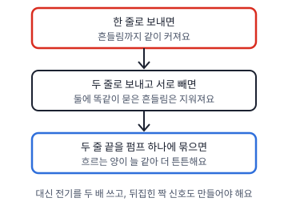

*한 줄은 흔들림에 약하고, 두 줄로 나눠 빼면 흔들림이 지워지며, 두 줄을 펌프 하나에 묶으면 더 튼튼해지는 대신 전기를 더 써요.*

**정확히 말하면**

**1. 풀고 싶은 문제: 잡음에 강한 증폭**

싱글엔디드(single-ended) 신호는 접지를 기준으로 잰 전압 하나예요. CS 단 하나로 증폭하면 $V_{DD}$에 실린 공급 잡음 $v_r$이 출력에 그대로 나타나요(L04 s4).

$$
v_X=A_vv_{in}+v_r
$$

외부에서 들어오는 잡음도 같은 문제를 일으켜요. 오디오·비디오처럼 잡음이 바로 소리나 화면으로 드러나는 회로에서는 이것을 막아야 해요. 자세한 내용은 [공통 모드 잡음은 빼면 사라진다](#s0-noise)에 있어요.

**2. 단순한 해법과 그 한계**

똑같은 CS 단 두 개를 대칭으로 두고, 크기는 같고 위상은 반대인 차동 신호(differential signal) $+v_{in}$, $-v_{in}$을 넣어요. 출력의 차이를 취하면 같은 위상으로 실린 잡음이 빠져요.

$$
v_X-v_Y=2A_vv_{in}
$$

잡음은 사라지지만 이득은 CS 단 하나와 같은 $A_v$예요([공통 모드 잡음은 빼면 사라진다](#s0-noise)). 남는 한계는 소스가 접지에 고정돼 있다는 점이에요. 입력 DC 바이어스 $V_B$가 바뀌면 바이어스 전류와 출력 DC 레벨이 따라 바뀌어요.

$$
V_X=V_{DD}-\tfrac12 k(V_B-V_{TH})^2R_D
$$

이 비교는 [입력 CM 레벨을 올려도 전류와 출력은 그대로](#s1-cm-response)의 표에 있어요.

**3. 핵심 아이디어: 소스를 묶고 테일 전류원을 단다**

두 소스를 노드 P로 묶고 테일 전류원(tail current source) $I_{SS}$를 달면, 입력 공통 모드 레벨 $V_{CM}$과 상관없이 두 전류가 절반씩 고정돼요. 그래서 공통 모드는 출력에서 걸러지고(공통 모드 제거, common-mode rejection) 차동 입력만 증폭돼요.

$$
I_{D1}=I_{D2}=\dfrac{I_{SS}}{2}
$$

$$
A_v=-g_mR_D
$$

구조는 [차동쌍의 구조: 소스를 묶고 테일 전류원을 단다](#s1-pair), 전류가 고정되는 이유는 [입력 CM 레벨을 올려도 전류와 출력은 그대로](#s1-cm-response), 이득은 [작은 입력에서는 직선으로: 이득 -g_mR_D](#s3-linearize)에서 다뤄요.

**4. 대가와 쓰이는 곳**

- 전류 소모가 두 배예요. 양쪽에 같은 바이어스 전류가 필요한데 이득은 그대로예요. 트랜지스터 수도 두 배지만 이것은 결정적인 문제가 아니에요.
- 위상이 반대인 입력 한 쌍을 따로 만들어야 해요. 보통 트랜스포머(transformer)를 써요.
- 테일 전류원은 실제로 트랜지스터라서 포화에 있으려면 전압 여유(헤드룸)가 필요해요. 그래서 $V_{CM}$에 하한이 생겨요: $V_{CM}\ge V_{GS1}+V_{OV,tail}$

앞의 두 가지는 [차동 회로의 값: 전류 두 배와 차동 신호 만들기](#s0-cost), 헤드룸은 [입력 CM 레벨의 허용 범위](#s1-cm-range)에 있어요. 이런 대가에도 공통 모드 잡음에 강하다는 점 때문에 오디오·비디오 회로에서는 차동 회로가 기본이에요.

**교수님 말씀**

차동 회로의 이점은 이득이 아니라 잡음 제거라고 정리하셨어요.

> "이득은 차이가 없어요. … 노이즈는 제거된다는 거죠." (0923 03:10)

단점은 소자 수보다 전류라고 하셨어요.

> "근데 전류를 두 배로 쓴다, 그건 문제가 될 수 있죠." (0923 05:36)

그럼에도 공급 잡음이 곧 소리·영상 잡음이 되는 오디오·비디오에서는 차동 회로를 쓰는 것이 기본이라고 하셨어요(0923 07:35). 이어서 CS 단 두 개만으로도 잡음 제거 효과는 있지만, 특성을 높이려고 소스를 묶고 테일 전류원을 단 차동쌍을 쓴다고 하셨어요(0923 08:10).

**보충 · 수업에서 유도하진 않았어요**

교과서 10.1.1(예제 10.1, 498–499쪽)은 정류기로 전원을 받는 증폭기에서 출발해요. 공급 리플이 이득 1로 출력에 섞여 웅웅거리는 잡음이 들리고, 커패시터를 키워 리플을 줄이는 방법은 여러 회로가 같은 전원을 쓰면 필요한 크기가 너무 커져요. 그래서 출력을 접지가 아니라 같은 리플을 가진 다른 노드에 대해 재자는 생각이 차동 회로의 출발점이 돼요(그림 10.2).

교과서 10.1.2(501쪽)는 같은 구조가 출력 스윙을 두 배로 준다는 점도 이점으로 꼽아요. 이득이 그대로라는 수업의 정리와 어긋나지 않아요. 입력도 두 배이기 때문이에요.

**페이지 요약**

공통 모드 잡음을 지우려고 차동으로 쓰고, 테일 전류원으로 전류를 고정해 차동만 증폭하는 대신 전류 두 배와 헤드룸을 내줘요.

*핵심 식*

- 차동 출력

  $$
  v_X-v_Y=2A_vv_{in}
  $$
- 바이어스 전류

  $$
  I_{D1}=I_{D2}=\dfrac{I_{SS}}{2}
  $$
- 헤드룸 하한

  $$
  V_{CM}\ge V_{GS1}+V_{OV,tail}
  $$

*용어*

- **차동 신호(differential signal)** — 크기는 같고 위상은 반대인 두 신호
- **테일 전류원(tail current source)** — 묶인 소스 노드에 달려 두 전류의 합을 $I_{SS}$로 고정하는 전류원
- **공통 모드 제거(common-mode rejection)** — 두 입력에 같이 들어온 신호가 차동 출력에 나타나지 않는 성질

---

## 0. 왜 차동으로 쓸까

### 공통 모드 잡음은 빼면 사라진다

*0923 수업 · L04 s3–s4*

**쉽게 말하면**

두 줄에 같은 잡음이 똑같이 묻으면, 한 줄에서 다른 줄을 빼는 순간 잡음은 지워지고 신호만 남아요.

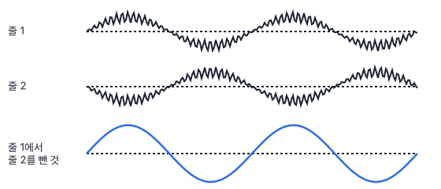

*위 두 줄은 서로 거꾸로 움직이지만 잔떨림은 똑같아서, 빼고 나면 떨림 없는 큰 물결만 남아요.*

**정확히 말하면**

싱글엔디드(single-ended) 신호는 접지를 기준으로 잰 전압 하나예요. 차동 신호(differential signal)는 두 신호가 같은 DC 레벨, 곧 공통 모드(common-mode) 레벨을 공유하고, 크기는 같고 위상은 반대인 신호예요(L04 s3, 0918 수업).

슬라이드 s4는 두 회로를 비교해요.

- (a) CS 단 하나: 출력이 $V_{DD}$에 실린 잡음에 그대로 노출돼요.
- (b) 똑같은 CS 단 두 개를 대칭으로 둔 회로: 잡음이 $V_X$와 $V_Y$에는 실리지만 차이 $V_{out}=V_X-V_Y$에는 나타나지 않아요.

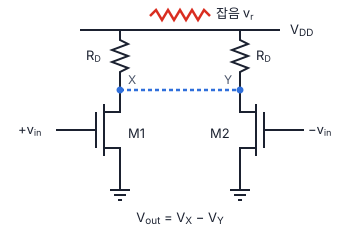

*대칭 CS 회로(슬라이드 s4 (b), 교과서 그림 10.3(b)). 잡음 선은 $V_{DD}$에서 두 저항을 거쳐 X와 Y에 똑같이 실려요.*

공급 잡음을 $v_r$로 두고 소신호로 따라가요(교과서 10.1.1–10.1.2).

1. 두 입력에 같은 신호 $v_{in}$을 주면:

   $$
   v_X=A_vv_{in}+v_r,\quad v_Y=A_vv_{in}+v_r
   $$
2. 차이를 취하면 잡음과 함께 신호도 사라져요:

   $$
   v_X-v_Y=0
   $$
3. 그래서 한쪽 입력의 위상을 뒤집어 $-v_{in}$을 줘요:

   $$
   v_X=A_vv_{in}+v_r,\quad v_Y=-A_vv_{in}+v_r
   $$
4. 잡음은 같은 위상이라 빠지고, 신호는 반대 위상이라 두 배가 돼요:

   $$
   v_X-v_Y=2A_vv_{in}
   $$

출력이 두 배가 됐다고 이득이 두 배가 되는 것은 아니에요. 차동 입력은 두 입력의 차이이고, 이것도 두 배가 되기 때문이에요.

1. 차동 입력:

   $$
   v_{in1}-v_{in2}=v_{in}-(-v_{in})=2v_{in}
   $$
2. 차동 이득:

   $$
   \frac{v_X-v_Y}{v_{in1}-v_{in2}}=\frac{2A_vv_{in}}{2v_{in}}=A_v
   $$

따라서 전압 이득은 CS 단 하나와 같아요. 달라지는 것은 잡음 제거뿐이고, 그래서 차동 회로는 싱글엔디드 회로보다 공급 잡음에 강해요(robust).

제거되는 잡음은 공급 잡음만이 아니에요. 두 입력에 같은 잡음이 들어와도 위상이 같으므로 차이에서 사라져요. 이렇게 두 노드에 같은 위상으로 들어오는 잡음을 공통 모드 잡음(common-mode noise)이라고 해요. 외부에서 들어오는 잡음은 기본적으로 공통 모드 잡음이에요.

**교수님 말씀**

노이즈 캔슬링 이어폰으로 설명하셨어요. 바깥 잡음을 하나는 그대로, 하나는 위상을 뒤집어 더하면 없어지는데, 차동 회로도 같은 원리예요.

다만 이어폰 안의 앰프가 스스로 만드는 잡음은 없앨 수 없어요. 없어지는 것은 바깥에서 들어오는 공통 모드 잡음뿐이에요.

> "모든 노이즈가 제거되는 게 아니라 외부의 노이즈가 없어지는 거다." (0923 04:47)

**꼭 기억해요**

출력은 두 배가 되지만 이득은 CS 단 하나와 같아요.

> "이득은 차이가 없어요. … 노이즈는 제거된다는 거죠." (0923 03:10)

공급 잡음만이 아니라 두 노드에 같이 들어온 잡음은 모두 차이에서 사라져요.

> "꼭 서플라이만 노이즈 제거가 되는 게 아니라 … 차이를 취했을 경우에는 제거가 된다." (0923 03:30)

**페이지 요약**

두 출력에 같은 위상으로 실린 잡음은 차이 $V_X-V_Y$에서 빠지고, 이득은 CS 단 하나와 같아요.

*핵심 식*

- 차동 출력

  $$
  v_X-v_Y=2A_vv_{in}
  $$
- 차동 이득

  $$
  \frac{v_X-v_Y}{v_{in1}-v_{in2}}=\frac{2A_vv_{in}}{2v_{in}}=A_v
  $$

*용어*

- **차동 신호(differential signal)** — 같은 공통 모드 레벨을 공유하고 크기는 같고 위상은 반대인 두 신호
- **공통 모드 잡음(common-mode noise)** — 두 노드에 같은 위상으로 들어오는 잡음. 차이를 취하면 사라져요

---

### 차동 회로의 값: 전류 두 배와 차동 신호 만들기

*0923 수업 · L04 s4*

**쉽게 말하면**

두 줄로 나눠 쓰면 잡음엔 강해지지만, 전기를 두 배로 먹고 거꾸로 뒤집힌 신호도 따로 만들어 줘야 해요.

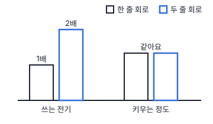

*두 줄 회로는 전기를 두 배 쓰지만, 신호를 키우는 정도는 그대로예요.*

**정확히 말하면**

차동 회로는 [공통 모드 잡음은 빼면 사라진다](#s0-noise)에서 본 잡음 제거를 얻는 대신 두 가지 값을 치러요.

**단점 1. 전류 소모가 두 배예요.**

- 한쪽 CS 단에 바이어스 전류가 필요하면, 다른 쪽에도 같은 바이어스 전류가 필요해요.
- 트랜지스터 수도 두 배지만, 한 개를 쓰느냐 두 개를 쓰느냐는 결정적인(critical) 문제가 아니에요. 전류를 두 배로 쓰는 것이 문제예요.
- 그런데 전압 이득은 두 배가 되지 않아요. 같은 이득을 얻는 데 전류만 두 배로 들어요.

**단점 2. 차동 신호를 따로 만들어야 해요.** 크기는 같고 위상은 반대인 $+v_{in}$, $-v_{in}$ 한 쌍이 필요해요.

- 이득이 $-1$인 반전 앰프(CS 단)를 한쪽에 다는 방법: 가능하지만 전류를 더 쓰고, 크기가 정확히 1이고 위상이 정확히 $-180^\circ$인 앰프를 만들기 어려워서 잘 쓰지 않아요.
- 트랜스포머(transformer, 변압기)를 쓰는 방법: 인덕터 같은 수동 소자로 만들고, 접지를 기준으로 두 끝에서 위상이 반대인 신호가 나와요(교과서 그림 10.3(c)). 보통 이 방법을 써요.

| 항목 | 싱글엔디드 (CS 단 하나) | 차동 (대칭 CS 단 두 개) |
|---|---|---|
| 전류 소모 | 1배 | 2배 |
| 전압 이득 | $A_v$ | $A_v$ (두 배가 아님) |
| 공통 모드 잡음 | 출력에 그대로 나타남 | $V_X-V_Y$에서 제거 |
| 입력 신호 | 하나면 됨 | 위상이 반대인 한 쌍이 필요(트랜스포머 등) |

이런 단점에도 차동 회로를 쓰는 이유는 공통 모드 잡음에 강하기 때문이에요. 오디오나 비디오 회로는 공급 잡음이 곧 소리나 화면의 잡음으로 드러나므로 차동 회로를 쓰는 것이 기본이에요.

**교수님 말씀**

단점을 묻자 한 학생이 "전력 소비가 두 배"라고 답했고, 교수님은 "전류 소모가 두 배"라고 정리하셨어요(0923 05:36).

> "트랜지스터를 … 한 개를 쓰냐 두 개를 쓰냐 그거는 그렇게 크리티컬한 문제는 아니에요." (0923 05:36)

> "근데 전류를 두 배로 쓴다, 그건 문제가 될 수 있죠." (0923 05:36)

차동 신호를 어떻게 만드는지 묻자 한 학생이 "커먼 소스, 커먼 이미터로 위상을 바꾼다"고 답했어요. 교수님은 가능한 방법이지만 전류가 들고 정확하게 만들기 어려워서, 보통은 트랜스포머 같은 것을 쓴다고 하셨어요(0923 06:17).

오디오·비디오 회로는 공급에 잡음이 들어오면 바로 소리나 영상의 잡음이 되므로 차동 회로가 기본이라고 하셨어요(0923 07:35).

**페이지 요약**

차동 회로는 이득은 그대로인데 전류를 두 배 쓰고, 위상이 반대인 입력 한 쌍을 트랜스포머 등으로 만들어야 해요.

*용어*

- **전류 소모** — 양쪽에 같은 바이어스 전류가 필요해 싱글엔디드의 두 배
- **트랜스포머(transformer, 변압기)** — 하나의 신호에서 위상이 반대인 두 신호를 만드는 수동 소자

---

## 1. 차동쌍과 공통 모드 응답

### 차동쌍의 구조: 소스를 묶고 테일 전류원을 단다

*0923 수업 · L04 s5*

**쉽게 말하면**

똑같은 쌍둥이 두 명이 발끝을 한데 묶고 펌프 하나에 같이 매달려 있는 모양이에요.

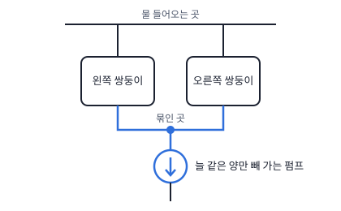

*펌프가 빼 가는 물의 양은 늘 같고, 두 쌍둥이가 그 물을 나눠서 흘려요.*

**정확히 말하면**

공통 소스(CS) 단 두 개에 차동 신호만 넣는 구조(L04 s4)에서 한 단계 나아가요. 두 MOSFET의 소스를 한 노드로 묶고, 그 노드와 접지 사이에 전류원 $I_{SS}$를 달아요. 이것이 차동쌍(differential pair)의 기본 구조예요.

- 동일한 트랜지스터 두 개: $M_1$, $M_2$
- 동일한 부하 저항 두 개: 각 드레인과 $V_{DD}$ 사이의 $R_D$ (드레인 노드를 $X$, $Y$라고 불러요)
- 테일 전류원(tail current source) $I_{SS}$ 하나: 두 소스가 묶인 노드에 달려요

두 소스가 묶인 노드를 노드 P(tail node)라고 불러요. 전류원이 회로의 꼬리(tail) 쪽에 달려 있어서 테일 전류원이라는 이름이 붙었어요.

회로는 좌우가 완전히 대칭이에요. 트랜지스터끼리, 저항끼리 크기가 같아요.

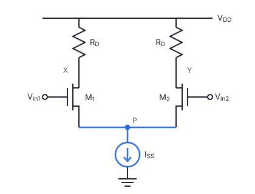

*MOS 차동쌍. 강조색이 노드 P와 테일 전류원 $I_{SS}$로 가는 경로예요.*

소스를 묶지 않고 CS 단 두 개로 차동 신호를 받아도 공급 잡음 제거 효과는 있어요. 실제로는 특성을 높이려고 소스를 묶고 테일 전류원을 단 차동쌍을 써요. 테일 전류원이 무엇을 해 주는지는 [입력 CM 레벨을 올려도 전류와 출력은 그대로](#s1-cm-response)에서 이어져요.

**교수님 말씀**

이름의 유래를 이렇게 설명했어요.

> "꼬리 쪽에 달렸다 그래서 테일이라고 하고" (0923 08:10)

구성 요소를 짚으면서 대칭을 거듭 강조했어요.

> "동일한 트랜지스터. 대칭이에요 대칭. 저항도 대칭." (0923 08:54)

CS 단 두 개만 써도 잡음 제거 효과가 있긴 하지만, 두 소스를 묶어 테일 전류원을 단 구조가 차동쌍의 기본 구조라고 정리했어요 (0923 09:07).

**페이지 요약**

똑같은 트랜지스터 두 개의 소스를 노드 P로 묶고, 그 아래 테일 전류원 $I_{SS}$를 단 대칭 회로가 차동쌍이에요.

*용어*

- **차동쌍(differential pair)** — 동일한 트랜지스터 두 개, 동일한 부하 두 개, 테일 전류원으로 된 대칭 구조
- **테일 전류원(tail current source)** — 묶인 소스 노드에 달린 전류원 $I_{SS}$
- **노드 P(tail node)** — 두 소스가 묶인 노드

---

### 입력 CM 레벨을 올려도 전류와 출력은 그대로

*0923 수업 · L04 s7*

**쉽게 말하면**

두 입구를 똑같이 들어 올리면 묶인 곳도 똑같이 따라 올라가요.

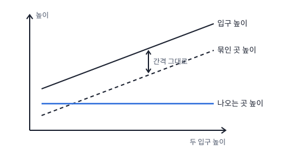

*두 선의 간격이 그대로라서 흐르는 물의 양도, 나오는 곳 높이도 바뀌지 않아요.*

**정확히 말하면**

먼저 해석 순서를 복습해요. 대신호 해석은 DC 동작점(바이어스)을 정하는, 진폭과 무관한 일반 모델이에요. 소신호 해석은 동작점이 정해진 뒤 DC 바이어스보다 작은 변화량 사이의 관계만 다뤄요. 여기서는 동작점부터 정해요.

입력 공통 모드 레벨(common-mode level) $V_{CM}$은 차동 회로의 두 입력에 공통으로 걸린 DC 레벨이에요. DC 바이어스와 거의 같은 뜻이에요. 두 게이트를 묶어 $V_{CM}$을 걸고 바이어스 전류를 구해요.

1. CS 단은 소스가 접지라서 게이트 DC 바이어스가 곧 바이어스 전류를 정해요.
2. 차동쌍은 소스가 노드 P로 묶여 있고, 두 게이트에 같은 $V_{CM}$이 걸려요: $V_{GS1}=V_{GS2}$
3. 두 트랜지스터가 같으므로: $I_{D1}=I_{D2}$
4. 노드 P에서 KCL: $I_{D1}+I_{D2}=I_{SS}$
5. 따라서 $I_{D1}=I_{D2}=\dfrac{I_{SS}}{2}$ (테일 전류원이 바이어스 전류를 정해요)

$V_{CM}$을 올려도 전류는 $I_{SS}/2$로 일정해요. 전류가 일정하면 $V_{GS}$도 일정해요.

1. 포화 영역: $I_D=\tfrac12 k(V_{GS}-V_{TH})^2$, $k=\mu_nC_{ox}\dfrac{W}{L}$
2. $I_D=\dfrac{I_{SS}}{2}$ 대입: $\tfrac12 k(V_{GS}-V_{TH})^2=\dfrac{I_{SS}}{2}$
3. 오버드라이브 전압: $V_{GS}-V_{TH}=\sqrt{\dfrac{I_{SS}}{k}}$
4. $V_{GS}=V_{TH}+\sqrt{\dfrac{I_{SS}}{k}}$

$I_{SS}$, $k$(소자 크기), $V_{TH}$가 모두 고정이라 $V_{GS}$가 고정돼요. 그래서 게이트($V_{CM}$)를 올리면 소스(노드 P)도 같은 만큼 올라가고, 내리면 같이 내려가요: $V_P=V_{CM}-V_{GS}$

(수업 중 $V_{GS}$ 식에 $V_{TH}$를 두 번 더해 말했다가 정정)

출력 DC 레벨(출력 CM 레벨)은 $V_{DD}$에서 $R_D$에 걸린 전압을 빼면 돼요.

$$
V_X=V_Y=V_{DD}-R_D\dfrac{I_{SS}}{2}
$$

전류와 저항이 모두 일정하므로 출력 CM 레벨은 입력 CM 레벨 $V_{CM}$과 무관해요.

| 항목 | CS 단(게이트 바이어스 $V_B$) | 차동쌍(입력 $V_{CM}$) |
|---|---|---|
| 소스 | 접지에 고정 | 노드 P, 게이트를 따라 움직임 |
| 입력 바이어스를 올리면 | $V_{GS}$와 전류가 모두 증가 | $V_{GS}$와 전류가 그대로 |
| 바이어스 전류 | $I_D=\tfrac12 k(V_B-V_{TH})^2$ | $I_{D1}=I_{D2}=\dfrac{I_{SS}}{2}$ |
| 출력 DC | $V_X=V_{DD}-\tfrac12 k(V_B-V_{TH})^2R_D$, $V_B$에 따라 바뀜 | $V_X=V_Y=V_{DD}-R_D\dfrac{I_{SS}}{2}$, $V_{CM}$과 무관 |

$V_X$와 $V_Y$가 둘 다 변하지 않으므로 차동 출력 $V_{out}=V_X-V_Y=0$이 $V_{CM}$과 상관없이 항상 유지돼요.

$V_{CM}$ 대신 두 입력에 같은 잡음(같은 위상의 같은 신호)을 넣어도 같은 이유로 출력에 나타나지 않아요. 차동쌍이 공통 모드 신호를 출력에서 없애는 이 성질을 공통 모드 제거(common-mode rejection)라고 해요. CMRR의 CMR이 이것이에요.

차동 신호는 크기가 같고 위상이 반대라서 제거되지 않아요.

$V_{CM}$을 얼마나 올리고 내릴 수 있는지는 [입력 CM 레벨의 허용 범위](#s1-cm-range)에서 이어져요.

**교수님 말씀**

소스가 묶였을 때 전류가 어떻게 정해지는지 학생들에게 차례로 물었어요. 합은 "$I_{SS}$", $V_{GS1}$과 $V_{GS2}$, $I_{D1}$과 $I_{D2}$는 "같아요"라는 답이 나왔어요 (0923 12:07–12:28).

> "이 테일 커런트 소스의 역할은 바이어스 전류를 결정해주는 역할입니다." (0923 13:03)

$V_{CM}$을 올리면 한 전류는 커지고 한 전류는 작아지지 않느냐는 답도 나왔어요. 교수님은 두 소스가 묶여 있어 전류가 절반씩으로 정해진다는 점을 짚었어요 (0923 13:55). 이어 "소스도 같이 올라가지 않을까요?"라는 답에 "그렇죠"라며 $V_{GS}$가 일정하다고 설명했어요 (0923 14:17).

CS 단은 왜 전류가 일정하지 않은지 묻자 "그라운드"라는 답이 나왔어요. 소스가 접지에 고정되어 게이트를 올리면 $V_{GS}$가 커질 수밖에 없다고 정리했어요 (0923 14:56).

슬라이드에 없는 CS 단의 출력 DC 식($V_B$로 쓴 식)을 칠판에 적어 차동쌍과 비교했어요 (0923 18:11).

> "V_CM 대신에 예를 들어 노이즈를 넣어 봤다 ... 출력에 영향을 주지 않는다." (0923 20:41)

> "커먼 모드 리젝션 특성이라고 그래요. CMRR 할 때 CMR 특성이죠." (0923 21:28)

**페이지 요약**

테일 전류원이 두 전류를 절반씩 고정하므로 $V_{CM}$이 바뀌어도 전류, $V_{GS}$, 출력 DC 레벨이 모두 그대로예요.

*핵심 식*

- 바이어스 전류

  $$
  I_{D1}=I_{D2}=\dfrac{I_{SS}}{2}
  $$
- 고정된 게이트-소스 전압

  $$
  V_{GS}=V_{TH}+\sqrt{\dfrac{I_{SS}}{k}}
  $$
- 출력 CM 레벨

  $$
  V_X=V_Y=V_{DD}-R_D\dfrac{I_{SS}}{2}
  $$

*용어*

- **공통 모드 레벨(common-mode level)** — 두 입력에 공통으로 걸린 DC 레벨 $V_{CM}$
- **공통 모드 제거(common-mode rejection)** — 두 입력에 같이 들어온 신호가 차동 출력에 나타나지 않는 성질

---

### 입력 CM 레벨의 허용 범위

*0923 수업 · L04 s7*

**쉽게 말하면**

두 입력의 공통 DC 전압은 입력 MOS와 테일 전류원이 모두 제 역할을 하는 범위 안에 있어야 해요.

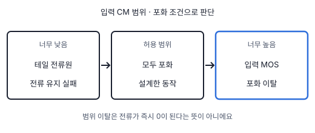

*상한에서는 입력 MOS가 포화를 벗어나고, 하한에서는 테일이 정해진 전류를 유지하지 못해요.*

**정확히 말하면**

**작은 예시.** 출력 DC 전압이 $1.0\,\mathrm{V}$, 입력 MOS의 문턱전압이 $0.4\,\mathrm{V}$이면 입력 CM 상한은 $1.4\,\mathrm{V}$예요. $V_{CM}=1.5\,\mathrm{V}$로 올리면 입력 MOS가 포화 조건을 만족하지 못해요. 전류가 곧바로 0이 되는 것은 아니며, 기존 포화 영역 모델로 계산한 전류와 이득을 그대로 쓸 수 없어요.

트랜지스터는 꺼짐, 저항(트라이오드), 전류원(포화) 중 하나로 동작해요. 여기서 사용하는 차동쌍의 전류 분배식과 이득식을 적용하려면 $M_1$, $M_2$가 포화(saturation) 영역에 있어야 해요.

**상한**: $M_1$, $M_2$의 포화 조건에서 나와요.

1. 포화 조건: $V_{DS}\ge V_{GS}-V_{TH}$ (경계이므로 등호 허용)
2. 양변의 $V_S$를 지움: $V_D\ge V_G-V_{TH}$
3. 대입: $V_D=V_X=V_Y=V_{DD}-R_D\dfrac{I_{SS}}{2}$, $V_G=V_{CM}$
4. $V_{DD}-R_D\dfrac{I_{SS}}{2}\ge V_{CM}-V_{TH}$
5. $V_{CM}\le V_{DD}-R_D\dfrac{I_{SS}}{2}+V_{TH}$

$V_{CM}$을 너무 올리면 게이트가 드레인보다 $V_{TH}$ 넘게 높아져 $M_1$, $M_2$가 포화를 벗어나요.

(수업 중 $V_{CM}\le V_D-V_{TH}$로 말했다가 $V_D+V_{TH}$로 정정)

**하한**: 슬라이드에는 없고 칠판에서 덧붙였어요. 채널이 생기려면 $V_{GS}\gt V_{TH}$여야 하는데, 이것만으로 끝나지 않아요.

1. 테일 전류원은 실제로 트랜지스터로 구현해요. 아래 하한 유도는 소스가 접지인 NMOS 테일 전류원을 가정해요.
2. 이 NMOS가 전류원(포화)으로 동작하려면 적어도 오버드라이브 전압(overdrive voltage) $V_{OV,tail}$이 걸려야 해요: $V_P\ge V_{OV,tail}$
3. 노드 P 전압: $V_P=V_{CM}-V_{GS1}$
4. $V_{CM}\ge V_{GS1}+V_{OV,tail}$

$V_{GS1}$은 전류로 정해지는 값이에요($V_{GS1}=V_{TH}+\sqrt{I_{SS}/k}$). 이상적 전류원은 이론상 이 최소 전압 조건이 없지만, NMOS로 구현하면 포화를 유지할 최소 전압이 필요해요. BJT 테일은 순방향 활성 영역과 그에 맞는 최소 전압 조건으로 따져야 하므로 이 MOS 오버드라이브 조건을 그대로 쓰지 않아요.

CS 단은 게이트 바이어스가 전류를 정하므로 원하는 전류에 맞는 입력 바이어스가 하나로 정해져요. 차동쌍은 전류가 $V_{CM}$과 무관하므로 $V_{CM}$에 특정 값이 아니라 범위(최솟값과 최댓값)만 정해져요.

$V_{CM}$이 이 범위 안에 있으면 입력이 공통 모드일 때 $V_{out}=V_X-V_Y=0$이 항상 유지돼요. 그 이유는 [입력 CM 레벨을 올려도 전류와 출력은 그대로](#s1-cm-response)에 있어요.

**교수님 말씀**

증폭하려면 트랜지스터가 어느 영역에 있어야 하는지 묻자 "세츄레이션"이라는 답이 나왔어요 (0923 22:40).

하한을 물으며 $V_{GS}\gt V_{TH}$ 이야기를 꺼냈다가, 테일 전류원을 어떻게 구현하는지로 질문을 바꿨어요. 학생이 "트랜지스터"라고 답했어요 (0923 26:19).

> "회로도 보면 전류원으로 그려져 있는 거 많잖아요. 뭘로 그려요?" (0923 26:15)

그 트랜지스터에 걸려야 할 최소 전압을 묻자 "오버드라이브 볼티지"라는 답이 나왔어요 (0923 26:53).

이상적 전류원은 이론적으로 전압이 낮아도 전류를 흘려 주지만, 트랜지스터로 구현하면 그렇지 않다고 덧붙였어요 (0923 27:44).

**꼭 기억해요**

> "V_CM을 높이면은 이게 세츄레이션을 벗어날 수 있다" (0923 24:58)

> "아무렇게나 설계하면 안 되는 거예요." (0923 28:12)

> "레인지가 있을 뿐이지 어떤 특정한 전류에 해당되는 V_CM이 있는 건 아니다." (0923 28:16)

**페이지 요약**

입력 CM이 너무 높으면 입력 MOS가 포화를 벗어나고, 너무 낮으면 테일 전류원이 정해진 전류를 유지하지 못해요. 아래 하한식은 NMOS 테일 기준이에요.

*핵심 식*

- 상한

  $$
  V_{CM}\le V_{DD}-R_D\dfrac{I_{SS}}{2}+V_{TH}
  $$
- 하한

  $$
  V_{CM}\ge V_{GS1}+V_{OV,tail}
  $$

*용어*

- **포화(saturation)** — 트랜지스터가 전류원으로 동작해 증폭할 수 있는 영역
- **오버드라이브 전압(overdrive voltage)** — 전류원 트랜지스터가 포화에 있으려면 걸려야 하는 최소 전압 $V_{OV,tail}$

---

## 2. 대신호 해석

### 입력 차에 따라 전류가 나뉘는 방식

*0923 수업 · L04 s8 · L04 s9*

**쉽게 말하면**

펌프가 빼 가는 물은 늘 같은 양이라 두 쌍둥이가 나눠 흘려요. 더 세게 미는 쪽이 물을 더 많이 가져가요.

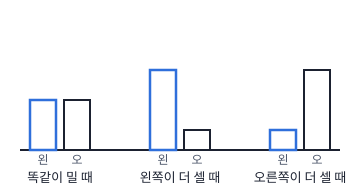

*한쪽이 늘어난 만큼 다른 쪽이 줄어요.*

**정확히 말하면**

M1 게이트에 $V_{in1}$, M2 게이트에 $V_{in2}$를 따로 줘요. 두 입력의 차이가 작다는 가정은 두지 않아요. 이것이 대신호 해석(large-signal analysis)이에요. 두 트랜지스터는 크기가 같고 포화 영역에 있으며, 채널 길이 변조는 무시해요. 여기서 $k=\mu_nC_{ox}\dfrac{W}{L}$이고 $I_D=\tfrac12 k(V_{GS}-V_{TH})^2$이에요.

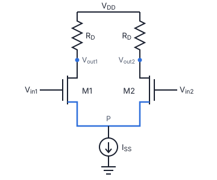

*강조색 선이 두 소스가 함께 쓰는 노드 P예요. 여기서 KVL과 KCL을 세워요.*

노드 방정식 두 개로 출발해요.

1. KVL(소스를 공유): $V_{in1}-V_{GS1}=V_{in2}-V_{GS2}$ (둘 다 $V_P$)
2. 정리: $V_{in1}-V_{in2}=V_{GS1}-V_{GS2}$
3. KCL(노드 P): $I_{D1}+I_{D2}=I_{SS}$. 이제 $V_{GS1}\ne V_{GS2}$라서 $I_{D1}\ne I_{D2}$예요. 합은 그대로 $I_{SS}$예요.
4. 제곱 법칙을 $V_{GS}$로 풀기: $V_{GS}=V_{TH}+\sqrt{2I_D/k}$
5. 2단계에 대입하면 $V_{TH}$가 소거돼요:

   $$
   V_{in1}-V_{in2}=\sqrt{\dfrac{2}{k}}\left(\sqrt{I_{D1}}-\sqrt{I_{D2}}\right)
   $$
6. 출력: $V_{out1}=V_{DD}-R_DI_{D1}$, $V_{out2}=V_{DD}-R_DI_{D2}$
7. 빼기:

   $$
   V_{out1}-V_{out2}=-R_D(I_{D1}-I_{D2})
   $$

   전류 차를 알면 출력 전압 차를 알아요.
8. 5단계에 $I_{D2}=I_{SS}-I_{D1}$을 대입해 풀면 $I_{D1}$이 입력 차의 식으로 나와요(계산은 보충에).

결과(슬라이드 s9, 교과서 식 (10.144), (10.147)):

$$
I_{D1}=\dfrac{I_{SS}}{2}+\dfrac{k}{4}(V_{in1}-V_{in2})\sqrt{\dfrac{4I_{SS}}{k}-(V_{in1}-V_{in2})^2}
$$

$$
I_{D2}=\dfrac{I_{SS}}{2}-\dfrac{k}{4}(V_{in1}-V_{in2})\sqrt{\dfrac{4I_{SS}}{k}-(V_{in1}-V_{in2})^2}
$$

$$
I_{D1}-I_{D2}=\tfrac12 k(V_{in1}-V_{in2})\sqrt{\dfrac{4I_{SS}}{k}-(V_{in1}-V_{in2})^2}
$$

슬라이드는 $k$ 대신 $\mu_nC_{ox}\dfrac{W}{L}$을 그대로 써요.

- 입력 차가 0이면 대칭이라 $I_{D1}=I_{D2}=I_{SS}/2$로 반씩 나뉘어요.
- $V_{in1}$이 커지면 $I_{D1}$이 늘고 $I_{D2}$가 줄어요. 반대면 $I_{D2}$가 늘고 $I_{D1}$이 줄어요.
- 전류와 입력이 제곱 관계라서 입력 차와 전류 차의 관계는 비선형(nonlinear)이에요.
- 소신호 근사가 들어가지 않았으므로 임의의 진폭에서 성립해요. 단 한쪽이 꺼지기 전, 즉 $|V_{in1}-V_{in2}|\le\Delta V_{in,max}$에서만 써요([최대 차동 입력: 한쪽이 꺼질 때](#s2-max-input)).
- 원점에서 곡선의 접선은 $\sqrt{kI_{SS}}(V_{in1}-V_{in2})$이에요. 입력 차가 작을 때 이 직선으로 근사하는 이야기는 [작은 입력에서는 직선으로: 이득 -g_mR_D](#s3-linearize)에서 이어져요.

#### 직접 해 보기: 입력 차에 따라 나뉘는 두 드레인 전류 *(정적 스냅샷 — 직접 조작은 HTML 버전)*

입력 차 $V_{in1}-V_{in2}$와 $I_{SS}$를 움직이면 두 드레인 전류, 전류 차, 원점 접선(소신호 근사)이 어떻게 달라지는지 보여요. $k=4\,\text{mA/V}^2$로 고정했어요.

**ID1 = 0.786 mA, ID2 = 0.214 mA, ID1 − ID2 = 0.572 mA, 소신호 근사 = 0.600 mA, 근사 오차 = 4.8 %, ΔVin,max = 0.707 V**

범례: ID1 · ID2 · ID1 − ID2 · 원점 접선(소신호 근사) · 세로 점선: ±ΔVin,max와 현재 입력 차

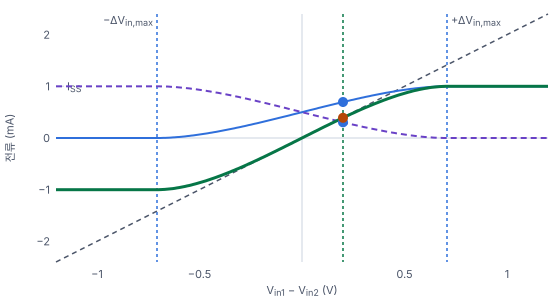

*설정 1: $I_{SS}=1\,\text{mA}$, $V_{in1}-V_{in2}=0.2\,\text{V}$*

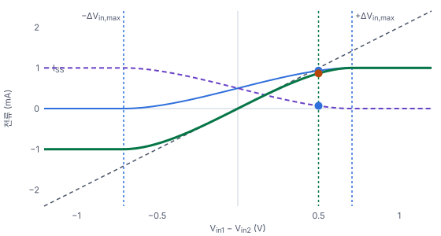

*설정 2: $I_{SS}=1\,\text{mA}$, $V_{in1}-V_{in2}=0.5\,\text{V}$*

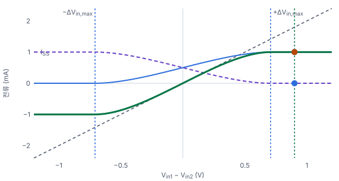

*설정 3: $I_{SS}=1\,\text{mA}$, $V_{in1}-V_{in2}=0.9\,\text{V}$*

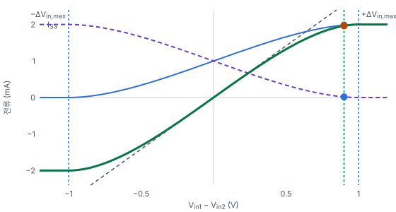

*설정 4: $I_{SS}=2\,\text{mA}$, $V_{in1}-V_{in2}=0.9\,\text{V}$*

| 설정 | $I_{SS}$ (mA) | $V_{in1}-V_{in2}$ (V) | $\Delta V_{in,max}$ (V) | $I_{D1}$ (mA) | $I_{D2}$ (mA) | $I_{D1}-I_{D2}$ (mA) | 소신호 근사 (mA) | 근사 오차 (%) |
|---|---|---|---|---|---|---|---|---|
| 1 | 1 | 0.2 | 0.707 | 0.696 | 0.304 | 0.392 | 0.400 | 2.1 |
| 2 | 1 | 0.5 | 0.707 | 0.933 | 0.067 | 0.866 | 1.000 | 15.5 |
| 3 | 1 | 0.9 | 0.707 | 1.000 | 0.000 | 1.000 | 1.800 | 80.0 |
| 4 | 2 | 0.9 | 1.000 | 1.982 | 0.018 | 1.964 | 2.546 | 29.6 |

**교수님 말씀**

핵심은 노드 방정식(KVL, KCL)을 세우는 것이고, $I_{D1}$을 푸는 대수 계산은 하면 되는 일이라며 결과만 보여 주셨어요.

> "과정은 그렇습니다. 계산을 하면." (0923 34:56)

소신호 관계 $i_d=g_mv_{gs}$를 쓰면 선형이라 훨씬 쉽다고 하셨어요. 여기서는 제곱 관계라서 식이 복잡하지만, 소신호 근사가 없어서 임의의 진폭에 대해 맞는 식이라고 강조하셨어요 (0923 35:52–36:18).

**꼭 기억해요**

> "이 식은 외울 필요 없어요, 시험 볼 때." (0923 38:00)

결과 식은 외울 필요 없어요. 일반적인 관계가 이런 비선형 모양이라는 것을 이해하면 돼요.

**보충 · 수업에서 유도하진 않았어요**

수업에서 "과정은 그렇습니다"로 넘어간 $I_{D1}$ 계산이에요(교과서 식 (10.138)–(10.144)). 편의상 $\Delta V=V_{in1}-V_{in2}$로 써요.

1. $\Delta V=\sqrt{\dfrac{2}{k}}\left(\sqrt{I_{D1}}-\sqrt{I_{D2}}\right)$을 제곱:

   $$
   \Delta V^2=\dfrac{2}{k}\left(I_{D1}+I_{D2}-2\sqrt{I_{D1}I_{D2}}\right)
   $$
2. $I_{D1}+I_{D2}=I_{SS}$를 넣고 정리:

   $$
   2\sqrt{I_{D1}I_{D2}}=I_{SS}-\dfrac{k}{2}\Delta V^2
   $$
3. $I_{D2}=I_{SS}-I_{D1}$을 대입하고 다시 제곱:

   $$
   4I_{D1}(I_{SS}-I_{D1})=\left(I_{SS}-\dfrac{k}{2}\Delta V^2\right)^2
   $$
4. $I_{D1}$에 대한 이차방정식:

   $$
   4I_{D1}^2-4I_{SS}I_{D1}+\left(I_{SS}-\dfrac{k}{2}\Delta V^2\right)^2=0
   $$
5. 근의 공식:

   $$
   I_{D1}=\dfrac{I_{SS}}{2}\pm\dfrac12\sqrt{I_{SS}^2-\left(I_{SS}-\dfrac{k}{2}\Delta V^2\right)^2}
   $$
6. 근호 안 전개:

   $$
   I_{SS}^2-\left(I_{SS}-\dfrac{k}{2}\Delta V^2\right)^2=kI_{SS}\Delta V^2-\dfrac{k^2}{4}\Delta V^4=\dfrac{k^2}{4}\Delta V^2\left(\dfrac{4I_{SS}}{k}-\Delta V^2\right)
   $$
7. $\Delta V\gt 0$이면 $I_{D1}\gt I_{SS}/2$여야 하므로 $\Delta V$의 부호를 그대로 살리는 근을 골라요:

   $$
   I_{D1}=\dfrac{I_{SS}}{2}+\dfrac{k}{4}\Delta V\sqrt{\dfrac{4I_{SS}}{k}-\Delta V^2}
   $$
8. $I_{D2}=I_{SS}-I_{D1}$:

   $$
   I_{D2}=\dfrac{I_{SS}}{2}-\dfrac{k}{4}\Delta V\sqrt{\dfrac{4I_{SS}}{k}-\Delta V^2}
   $$
9. 빼기:

   $$
   I_{D1}-I_{D2}=\dfrac{k}{2}\Delta V\sqrt{\dfrac{4I_{SS}}{k}-\Delta V^2}
   $$

2단계의 좌변은 0 이상이므로 $I_{SS}-\dfrac{k}{2}\Delta V^2\ge 0$, 즉 $|\Delta V|\le\sqrt{2I_{SS}/k}$일 때만 이 풀이가 맞아요. 이 경계가 바로 $\Delta V_{in,max}$예요.

전류 차만 필요하면 더 짧은 길도 있어요(교과서 식 (10.145)–(10.147)): $(I_{D1}-I_{D2})^2=(I_{D1}+I_{D2})^2-4I_{D1}I_{D2}=I_{SS}^2-\left(I_{SS}-\dfrac{k}{2}\Delta V^2\right)^2$이고, 6단계와 같은 전개로 9단계가 바로 나와요.

**페이지 요약**

$I_{SS}$를 두 트랜지스터가 나눠 가지며, 입력 차와 전류 차의 관계는 비선형이에요.

*핵심 식*

- 입력 차와 전류

  $$
  V_{in1}-V_{in2}=\sqrt{\dfrac{2}{k}}\left(\sqrt{I_{D1}}-\sqrt{I_{D2}}\right)
  $$
- 출력 전압 차

  $$
  V_{out1}-V_{out2}=-R_D(I_{D1}-I_{D2})
  $$
- 전류 차

  $$
  I_{D1}-I_{D2}
  $$

  $$
  =\tfrac12 k(V_{in1}-V_{in2})
  $$

  $$
  \times\sqrt{\dfrac{4I_{SS}}{k}-(V_{in1}-V_{in2})^2}
  $$

*용어*

- **대신호 해석(large-signal analysis)** — 입력 차가 작다는 가정 없이 제곱 법칙으로 푸는 해석
- **비선형(nonlinear)** — 입력 차와 전류 차가 비례하지 않는 관계

---

### 최대 차동 입력: 한쪽이 꺼질 때

*0923 수업 · L04 s9*

**쉽게 말하면**

한쪽이 훨씬 세게 밀면 그쪽이 물을 전부 가져가고 다른 쪽은 한 방울도 못 받아요.

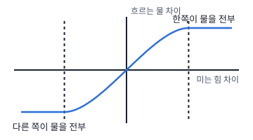

*끝에 닿으면 더 세게 밀어도 달라지지 않아요.*

**정확히 말하면**

입력 차가 아무리 커도 전류 차는 최대 $I_{SS}$예요. 한쪽에 $I_{SS}$가 모두 흐르고 다른 쪽은 0이 돼요. 수업에서 최대 전류 차를 묻자 학생이 "$I_{SS}$"라고 답했어요 (0923 38:54). $V_{in1}$이 충분히 커서 M2가 꺼지는 경우를 봐요.

1. M2는 전류 0: $I_{D2}=0$이므로 $\tfrac12 k(V_{GS2}-V_{TH})^2=0$, 즉 $V_{GS2}=V_{TH}$
2. M1은 $I_{SS}$를 모두 흘림: $I_{SS}=\tfrac12 k(V_{GS1}-V_{TH})^2$
3. $V_{GS1}$에 대해 풀기: $V_{GS1}=V_{TH}+\sqrt{2I_{SS}/k}$
4. KVL에서 $V_{in1}-V_{in2}=V_{GS1}-V_{GS2}$이므로:

   $$
   |V_{in1}-V_{in2}|_{max}=\Delta V_{in,max}=\sqrt{\dfrac{2I_{SS}}{k}}
   $$

- 확인: $\Delta V_{in,max}=\sqrt{\dfrac{2I_{SS}}{k}}$를 $I_{D1}-I_{D2}$ 식에 넣으면 $\tfrac12 k\sqrt{\dfrac{2I_{SS}}{k}}\sqrt{\dfrac{2I_{SS}}{k}}=I_{SS}$로 딱 맞아요.
- 평형($I_{D1}=I_{D2}=I_{SS}/2$)일 때 오버드라이브는 $V_{GS}-V_{TH}=\sqrt{I_{SS}/k}$라서 $\Delta V_{in,max}$는 그 $\sqrt2$배예요(교과서 식 (10.151)).
- $|V_{in1}-V_{in2}|\gt\Delta V_{in,max}$이면 한쪽이 꺼진 상태 그대로예요. 전류 차는 $\pm I_{SS}$에서 더 늘지 않고, 출력 전압 차의 크기도 $R_DI_{SS}$에서 멈춰요.
- $I_{D1}-I_{D2}$ 식은 $|V_{in1}-V_{in2}|\le\Delta V_{in,max}$에서만 써요. 그 밖에서 식을 그대로 쓰면 전류 차가 도로 줄어드는 틀린 답이 나와요.
- [입력 차에 따라 전류가 나뉘는 방식](#s2-large-signal)의 위젯에서 입력 차를 세로 점선 너머로 옮기면 한쪽 전류가 0에 붙는 것을 볼 수 있어요.

**페이지 요약**

한쪽이 꺼지고 다른 쪽이 $I_{SS}$를 모두 흘릴 때 입력 차가 최대예요.

*핵심 식*

- 꺼진 쪽과 켜진 쪽$V_{GS2}=V_{TH}$, $V_{GS1}=V_{TH}+\sqrt{2I_{SS}/k}$
- 최대 차동 입력

  $$
  |V_{in1}-V_{in2}|_{max}=\Delta V_{in,max}=\sqrt{\dfrac{2I_{SS}}{k}}
  $$

*용어*

- **최대 차동 입력** — 한쪽 트랜지스터가 꺼지기 시작하는 입력 차, 그 너머에서는 전류 차가 $\pm I_{SS}$로 고정

---

## 3. 소신호 해석

### 작은 입력에서는 직선으로: 이득 -g_mR_D

*0923 수업 · L04 s10–s11*

**쉽게 말하면**

휘어진 길도 한가운데 짧은 구간만 보면 곧은 길처럼 보여요.

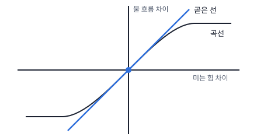

*양쪽을 미는 힘의 차이가 작을 때는 물 흐름 차이가 곧은 선을 따라가고, 차이가 커지면 곡선이 벌어져요.*

**정확히 말하면**

출발점은 [대신호 해석](#s2-large-signal)에서 얻은 전류 차 식이에요. 이 식은 입력과 전류가 제곱근으로 묶인 비선형(nonlinear) 관계예요.

$$
I_{D1}-I_{D2}=\tfrac12 k(V_{in1}-V_{in2})\sqrt{\dfrac{4I_{SS}}{k}-(V_{in1}-V_{in2})^2}
$$

차동 입력이 작다고 가정해요.

$$
(V_{in1}-V_{in2})^2\ll\dfrac{4I_{SS}}{k}
$$

1. 근호 안의 둘째 항을 버려요.

   $$
   I_{D1}-I_{D2}\approx\tfrac12 k(V_{in1}-V_{in2})\sqrt{\dfrac{4I_{SS}}{k}}
   $$
2. $\sqrt{4I_{SS}/k}=2\sqrt{I_{SS}/k}$를 대입해요.

   $$
   I_{D1}-I_{D2}\approx\tfrac12 k\cdot 2\sqrt{\dfrac{I_{SS}}{k}}\,(V_{in1}-V_{in2})
   $$
3. 정리해요.

   $$
   I_{D1}-I_{D2}\approx\sqrt{kI_{SS}}\,(V_{in1}-V_{in2})
   $$

가정의 뜻은 차동 입력의 크기가 $2\sqrt{I_{SS}/k}$(= $\sqrt2\,\Delta V_{in,max}$), 곧 최대 차동 입력 $\Delta V_{in,max}=\sqrt{2I_{SS}/k}$와 같은 크기 정도보다 충분히 작다는 거예요. 이것이 소신호 근사(small-signal approximation)예요. 입력 전압과 출력 전류가 비례상수 $\sqrt{kI_{SS}}$로 묶인 선형(linear) 관계가 돼요.

그래프로 보면 비선형 곡선을 $V_{in1}-V_{in2}=0$ 근처에서 접선(tangent)의 기울기로 근사한 거예요. 신호가 작으면 곡선과 접선이 거의 맞고, 신호가 커질수록 둘 사이 오차가 커져요.

출력 전압은 전류 차에 $-R_D$를 곱한 값이에요.

1. $$
   V_{out1}-V_{out2}=-R_D(I_{D1}-I_{D2})
   $$
2. $$
   V_{out1}-V_{out2}\approx-R_D\sqrt{kI_{SS}}\,(V_{in1}-V_{in2})
   $$
3. 전압 이득은 출력 차를 입력 차로 나눈 값이에요.

   $$
   A_v=\dfrac{V_{out1}-V_{out2}}{V_{in1}-V_{in2}}
   $$
4. $\sqrt{kI_{SS}}$는 바이어스 전류 $I_{SS}/2$에서의 $g_m$과 같아요.

   $$
   A_v=-\sqrt{kI_{SS}}\,R_D=-g_mR_D
   $$

CS 단의 이득 $-g_mR_D$와 같은 꼴이에요. 입력과 출력의 일반 관계는 비선형이고, 입력 차가 작은 영역에서만 선형으로 근사할 수 있어요. CS 단도 마찬가지로 대신호 관계는 비선형이고, 선형 관계는 신호가 작을 때만 성립해요.

소신호 차동 입력은 $V_{CM}$이 걸린 상태에서 한쪽 입력이 $+\Delta V$, 다른 쪽이 $-\Delta V$만큼 바뀌는 입력이에요. 이 변화는 DC 바이어스보다 매우 작다고 가정해요.

대신호 식은 이렇게 복잡해요. 그래서 다음 단계에서는 이미 아는 트랜지스터 소신호 모델을 바로 써서 해석해요([차동쌍의 소신호 등가회로](#s3-small-model)).

(수업 중 출력 식에 $\tfrac12$ 인수를 붙였다가 정정)

(수업 중 근사 조건을 $\lvert\Delta V_{in}\rvert\ll\sqrt{I_{SS}/k}$로 말함, 크기 정도로는 같음)

**교수님 말씀**

입력 차가 충분히 작은 영역이 어디인지 묻자 학생이 "0이요"라고 답했어요 (0923 47:00). 곡선을 0 근처에서 접선으로 바꾼 것이 소신호 근사라는 설명이에요.

비례상수 $\sqrt{kI_{SS}}$가 무엇인지 묻자 "$g_m$"이라는 답이 나왔고, 교수님은 소신호 해석에서 확인하겠다고 했어요.

> "우리가 스몰 시그널을 구해봤으면 이게 g_m이라는 거를 확인할 수 있어요." (0923 52:04)

소신호의 경험칙(rule of thumb)은 DC 바이어스의 약 10% 이내예요. DC가 1 V면 약 100 mV 이하의 변화예요. 다만 경계가 딱 정해진 것은 아니에요.

**꼭 기억해요**

> "99mV는 스몰 시그널이고 101mV는 스몰 시그널이 아니다가 아니고요." (0923 56:01)

소신호는 경계가 딱 정해진 값이 아니에요. 신호가 커질수록 오차가 커진다는 연속적인 개념이에요.

**보충 · 수업에서 유도하진 않았어요**

$\sqrt{kI_{SS}}=g_m$인지 확인해요. $k=\mu_nC_{ox}W/L$이에요.

1. 포화 영역 전류:

   $$
   I_D=\tfrac12 k(V_{GS}-V_{TH})^2
   $$
2. $V_{GS}$로 미분해요.

   $$
   g_m=\dfrac{\partial I_D}{\partial V_{GS}}=k(V_{GS}-V_{TH})
   $$
3. $V_{GS}-V_{TH}=\sqrt{2I_D/k}$를 대입해요.

   $$
   g_m=\sqrt{2kI_D}
   $$
4. 차동쌍의 각 트랜지스터에는 $I_D=I_{SS}/2$가 흘러요.

   $$
   g_m=\sqrt{2k\cdot\dfrac{I_{SS}}{2}}=\sqrt{kI_{SS}}
   $$

그래서 대신호 식을 근사해 얻은 비례상수가 각 트랜지스터의 $g_m$과 같아요.

**페이지 요약**

입력 차가 작으면 전류 차가 입력 차에 비례하고, 이득은 CS 단과 같은 $-g_mR_D$예요.

*핵심 식*

- 소신호 조건

  $$
  (V_{in1}-V_{in2})^2\ll\dfrac{4I_{SS}}{k}
  $$
- 선형 근사

  $$
  I_{D1}-I_{D2}\approx\sqrt{kI_{SS}}\,(V_{in1}-V_{in2})
  $$
- 차동 이득

  $$
  A_v=-\sqrt{kI_{SS}}\,R_D=-g_mR_D
  $$

*용어*

- **소신호 근사(small-signal approximation)** — 입력 차가 작을 때 비선형 식을 선형으로 바꾸는 근사
- **접선(tangent)** — 0 근처에서 곡선에 닿는 직선, 기울기가 비례상수

---

### 차동쌍의 소신호 등가회로

*0923 수업 · L04 s12*

**쉽게 말하면**

작은 흔들림만 보고 싶으면 늘 그대로인 부분은 지우고 봐요.

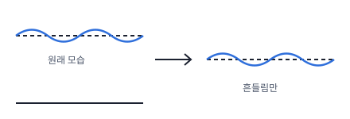

*늘 같은 높이는 빼고, 출렁이는 만큼만 남겨요.*

**정확히 말하면**

소신호 등가회로는 동작점 둘레의 작은 변화량만 표현해요. 변화량은 동작점을 바꾸지 않을 만큼 작다고 가정해요. 그리는 규칙은 두 가지예요.

- DC 전압원은 변화가 없으므로 0 V, 즉 접지로 바꿔요. $V_{DD}$와 $V_{CM}$이 여기에 해당해요.
- DC 전류원은 전류 변화가 없으므로 개방(open)으로 바꿔요. 테일 전류원 $I_{SS}$도 개방이 돼요. 접지가 아니에요.

*M1, M2를 종속 전류원으로 바꾼 소신호 등가회로예요. $g_{m1}v_1$은 게이트와 P 사이 전압 $v_1$에 의존해요. 노드 P에서 접지로 가는 길이 없고, $r_O$는 $R_D \ll r_O$라서 뺐어요.*

1. 입력 $v_{in1}$은 M1 게이트, $v_{in2}$는 M2 게이트에 들어가요. 게이트와 소스 사이는 개방이에요.
2. M1의 드레인($v_{out1}$)과 공통 소스 노드 P 사이에 종속 전류원 $g_{m1}v_1$이 있어요. $v_1$은 M1의 $v_{GS}$예요.
3. M2의 드레인($v_{out2}$)과 P 사이에 $g_{m2}v_2$가 있어요. $v_2$는 M2의 $v_{GS}$예요.
4. 각 드레인에서 $R_D$가 AC 접지($V_{DD}$)로 이어져요.
5. 노드 P에서 접지로 가는 경로는 없어요. 테일 전류원이 개방되었기 때문이에요.

각 트랜지스터의 소신호 드레인 전류는 $i_d=g_mv_{gs}$예요. 두 트랜지스터가 같고 바이어스 전류가 둘 다 $I_{SS}/2$이므로 트랜스컨덕턴스가 같아요.

$$
g_{m1}=g_{m2}=g_m
$$

원래는 각 트랜지스터의 드레인과 소스 사이에 출력저항(output resistance) $r_{O1}$, $r_{O2}$가 있어요. 출력에서 보이는 저항은 $R_D\parallel r_O$인데, 보통 $R_D\ll r_O$이므로 $r_O$를 무시해요.

$$
R_D\parallel r_O\approx R_D
$$

부하가 전류원처럼 큰 저항이면 $r_O$를 무시할 수 없어요. $r_O$는 출력 저항에 영향을 줄 때만 고려해요.

소신호 입력은 $v_{in1}-v_{in2}$, 출력은 $v_{out1}-v_{out2}$예요.

소신호 모델이 다루는 것은 변화량이에요. $V_{CM}$만 걸려 있으면 양쪽에 $I_{SS}/2$가 흘러요. 차동 입력을 주면 한쪽 전류가 $+\Delta I$, 다른 쪽이 $-\Delta I$만큼 변하고 합은 $I_{SS}$로 일정해요. 그래서 소신호 전류 식에 $I_{SS}/2$ 같은 DC 전류가 나오면 안 돼요.

**교수님 말씀**

DC 전류원을 소신호에서 어떻게 처리하는지 묻자 학생이 "임피던스가 무한이니까, 전류가 안 흐르니까 오픈"이라고 답했어요 (0923 57:03). 테일 전류원은 접지가 아니라 개방이라는 점을 짚었어요.

**꼭 기억해요**

> "여기서 갑자기 1/2 Iss가 나오면 안 됩니다. … 그거는 전류의 변화량이에요." (0923 62:33)

채널 길이 변조(channel-length modulation)는 $r_O$가 출력 저항에 영향을 줄 때 고려해요.

> "출력 저항으로 ro가 영향을 줄 때는 무시하면 안 되고" (0923 60:18)

**페이지 요약**

DC 전압원은 접지, 테일 전류원은 개방으로 바꾸고 두 트랜지스터를 같은 $g_m$의 종속 전류원으로 그려요.

*핵심 식*

- 같은 트랜스컨덕턴스

  $$
  g_{m1}=g_{m2}=g_m
  $$
- 출력 쪽 저항

  $$
  R_D\parallel r_O\approx R_D
  $$

*용어*

- **개방(open)** — DC 전류원을 소신호에서 바꾸는 모양, 테일 전류원이 여기에 해당
- **변화량** — 소신호 모델이 다루는 양, DC 전류 $I_{SS}/2$는 나오지 않음

---

### 노드 P는 차동 입력에서 가상 접지

*0923 수업 · L04 s13*

**쉽게 말하면**

시소 한쪽이 올라간 만큼 다른 쪽이 내려가면 가운데 받침점은 그대로예요.

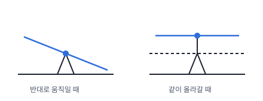

*반대로 움직이면 가운데는 제자리이고, 같이 올라가면 가운데도 올라가요.*

**정확히 말하면**

관심 대상은 테일 노드(tail node) P의 소신호 변화량 $\Delta V_P$예요. [차동쌍의 소신호 등가회로](#s3-small-model)에 작은 차동 입력을 넣어 구해요.

1. 차동 입력을 둬요.

   $$
   v_{in1}=+\Delta V,\quad v_{in2}=-\Delta V
   $$
2. 각 트랜지스터의 게이트-소스 전압이에요.

   $$
   v_1=v_{in1}-v_P=\Delta V-\Delta V_P
   $$

   $$
   v_2=v_{in2}-v_P=-\Delta V-\Delta V_P
   $$
3. 드레인 전류는 $i_d=g_mv_{gs}$예요.

   $$
   i_{d1}=g_m(\Delta V-\Delta V_P)
   $$

   $$
   i_{d2}=g_m(-\Delta V-\Delta V_P)
   $$
4. 노드 P의 KCL: 테일이 개방이라 전류가 갈 곳이 없어요.

   $$
   i_{d1}+i_{d2}=0
   $$
5. 대입해요.

   $$
   g_m(\Delta V-\Delta V_P)=-g_m(-\Delta V-\Delta V_P)
   $$
6. 정리해요.

   $$
   2g_m\Delta V_P=0
   $$
7. 결과예요.

   $$
   \Delta V_P=0
   $$

작은 차동 입력에서 노드 P의 전압은 변하지 않아요. 그래서 노드 P를 가상 접지(virtual ground), 즉 AC 접지로 볼 수 있어요. 이 결론 덕분에 차동쌍의 해석이 쉬워져요.

정성적으로 보면 노드 P는 두 입력의 중간, 즉 평균이에요. 크기가 같고 위상이 반대인 두 신호의 평균은 0이에요.

주의할 점: 노드 P는 차동 신호가 들어올 때만 접지로 볼 수 있어요. 양쪽 입력이 모두 $+\Delta V$(공통 모드)이면 같은 KCL에서 $i_{d1}=i_{d2}=g_m(\Delta V-\Delta V_P)$이고 합이 0이어야 하므로 $\Delta V_P=\Delta V$예요. 노드 P도 $\Delta V$만큼 올라가요.

수업은 이 가상 접지를 이용해 다음 시간에 해석을 계속하겠다고 예고하며 끝났어요.

**교수님 말씀**

시소 비유 (0923 69:24–70:44): 한쪽이 $\Delta V$ 올라가고 반대쪽이 같은 양만큼 내려가면 시소의 받침점은 그대로예요. 이것이 차동 입력이에요. 양쪽이 모두 올라가면 가운데도 올라가요. 이것이 공통 모드 입력이에요.

양쪽 입력이 모두 $\Delta V$만큼 오르면 노드 P가 어떻게 되는지 묻자 학생이 "델타 V?"라고 답했고, 교수님이 맞다고 했어요 (0923 70:33).

**꼭 기억해요**

> "노드 P를 항상 AC 그라운드로 볼 수 있다는 게 아니라 차동 신호가 인가되는 조건에서만" (0923 70:18)

> "이 가정이 해석을 굉장히 편하게 만듭니다." (0923 71:01)

**페이지 요약**

작은 차동 입력에서는 노드 P의 전압이 변하지 않아 가상 접지로 볼 수 있어요. 공통 모드 입력에서는 성립하지 않아요.

*핵심 식*

- M1 전류

  $$
  i_{d1}=g_m(\Delta V-\Delta V_P)
  $$
- M2 전류

  $$
  i_{d2}=g_m(-\Delta V-\Delta V_P)
  $$
- KCL 결과

  $$
  \Delta V_P=0
  $$

*용어*

- **가상 접지(virtual ground)** — 접지에 연결되지 않았지만 소신호 전압이 0인 노드
- **시소** — 반대로 움직이면 받침점이 그대로라는 교수님 비유

---

## 4. 요약 · 예고

### 한눈에 보는 식

*0923 수업 · L04 s4–13*

0923 수업의 핵심 식과 결론을 모았어요. 행마다 자세한 설명이 있는 토픽으로 이어져요.

| 무엇 | 식 · 결론 | 토픽 |
|---|---|---|
| 공통 모드 잡음 제거 | 잡음은 같은 위상이라 $V_X-V_Y$에서 사라지고, 신호는 $v_X-v_Y=2A_vv_{in}$이에요. 입력도 두 배라 이득은 같아요. | [공통 모드 잡음은 빼면 사라진다](#s0-noise) |
| 차동 회로의 값 | 전류 소모가 두 배예요. 차동 신호는 보통 트랜스포머로 만들어요. | [차동 회로의 값: 전류 두 배와 차동 신호 만들기](#s0-cost) |
| 차동쌍 구조 | 두 소스를 노드 P에 묶고 테일 전류원 $I_{SS}$를 달아요. | [차동쌍의 구조: 소스를 묶고 테일 전류원을 단다](#s1-pair) |
| 바이어스 전류 | $I_{D1}=I_{D2}=\dfrac{I_{SS}}{2}$, $V_{GS}=V_{TH}+\sqrt{\dfrac{I_{SS}}{k}}$ ($V_{CM}$과 무관해요) | [입력 CM 레벨을 올려도 전류와 출력은 그대로](#s1-cm-response) |
| 출력 CM 레벨 | $V_X=V_Y=V_{DD}-R_D\dfrac{I_{SS}}{2}$ (공통 모드 제거) | [입력 CM 레벨을 올려도 전류와 출력은 그대로](#s1-cm-response) |
| 입력 CM 범위 | $V_{CM}\le V_{DD}-R_D\dfrac{I_{SS}}{2}+V_{TH}$, $V_{CM}\ge V_{GS1}+V_{OV,tail}$ | [입력 CM 레벨의 허용 범위](#s1-cm-range) |
| 대신호 전류 차 | $I_{D1}-I_{D2}=\tfrac12 k(V_{in1}-V_{in2})\sqrt{\dfrac{4I_{SS}}{k}-(V_{in1}-V_{in2})^2}$ (비선형) | [입력 차에 따라 전류가 나뉘는 방식](#s2-large-signal) |
| 최대 차동 입력 | $\Delta V_{in,max}=\sqrt{\dfrac{2I_{SS}}{k}}$ (한쪽이 꺼지는 경계) | [최대 차동 입력: 한쪽이 꺼질 때](#s2-max-input) |
| 소신호 차동 이득 | $A_v=-g_mR_D$ ($(V_{in1}-V_{in2})^2\ll\dfrac{4I_{SS}}{k}$일 때) | [작은 입력에서는 직선으로: 이득 -g_mR_D](#s3-linearize) |
| 소신호 등가회로 | $g_{m1}=g_{m2}=g_m$, $R_D\parallel r_O\approx R_D$ | [차동쌍의 소신호 등가회로](#s3-small-model) |
| 노드 P | 차동 입력에서만 $\Delta V_P=0$ (가상 접지) | [노드 P는 차동 입력에서 가상 접지](#s3-virtual-ground) |

---

### 다음 시간 예고

*0923 수업 · L04 s14–40*

수업 끝에 교수님이 가상 접지로 해석을 이어 가겠다고 예고했어요(0923 71:01). 아래 슬라이드는 이번 수업에서 시작하지 않았어요.

- 가상 접지와 반회로(Virtual Ground and Half Circuit, s14) — 예고만
- 설계 · 이득 예제: NMOS 차동쌍 설계(s15), 차동 이득 계산(s16, s18)
- 가상 접지 확장(Extension of Virtual Ground, s17)
- BJT 차동쌍: CM 응답, 바이어스 조건, 대신호 · 소신호 해석, 반회로 소신호 모델(half circuit, s19–s26)
- 캐스코드 차동쌍: MOS · 바이폴라 캐스코드 차동쌍과 캐스코드 부하(s27–s30)
- 공통 모드 제거와 CMRR: 유한한 테일 임피던스, 입력 CM 잡음, 비대칭 부하(s31–s37)
- 차동-싱글 변환과 능동 부하(active load): MOS · BJT 차동쌍(s38–s40)

---

### 함께 보면 좋은 자료

*0923 수업*

- [복습문제 10개 (PDF)](../복습문제_0923_Differential_Amplifiers-문제.pdf)
- [답안 (PDF)](../복습문제_0923_Differential_Amplifiers-답안.pdf)

Razavi 10장의 예제와 장말문제에서 이번 수업 범위만 골랐어요.

- 공급 리플이 CE 단 출력에 새는 양, 같은 CE 단 두 개의 차동 출력에서는 상쇄되는 것 보기(P10.01, P10.02)
- $V_{GS}$ 고정 원리로 테일 노드 전압의 변화 보기(P10.35)
- 입력 CM 상한 식으로 최대 부하 저항 구하기(E10.15)
- 전류 차가 $I_{SS}$가 되는 입력 차 확인하기(P10.45)
- 최대 차동 입력으로 차동쌍 설계, 한쪽이 꺼질 때의 조건(E10.20, P10.40)
- 대신호 식을 근사해 $A_v=-g_mR_D$ 얻기, 과구동 전압으로 나타내기(E10.21, X10.21)
- 테일에 기생 저항이 있어도 노드 P가 가상 접지인지 제곱 법칙으로 증명하기(P10.39, 도전)

---

출처: 권익진 교수님 강의자료(Lec4) · 수업 녹음 전사(0923) · B. Razavi, *Microelectronics*, 2nd ed. (Wiley) 10장.
