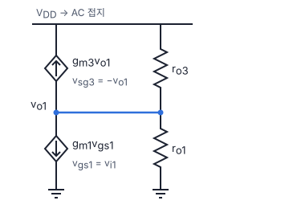
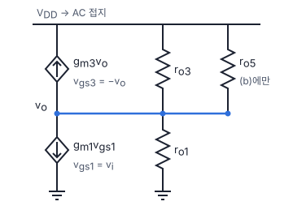
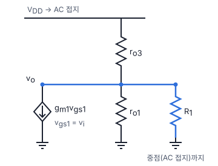
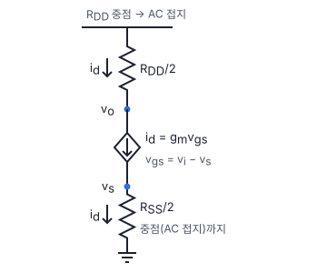
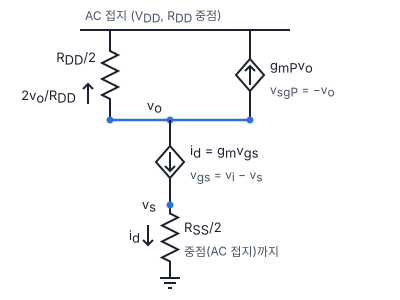

# 전자회로2 복습 0930 문제설명

주어진 조건을 읽고, 첫 줄을 쓰고, 이유를 따라가며 답을 확인해요.

문제의 첫 줄부터 검산까지 설명해요.

**목차**

- [문항별 설명](#problems)
  - [이득 5, 전력 2 mW, 출력 CM 1.6 V 이상인 NMOS 차동쌍 설계](#p1)
  - [예제 10.16을 공급 전압 2 V로 다시 설계, V_DD와 W/L의 트레이드오프](#p2)
  - [다이오드 연결 PMOS 부하 MOS 차동쌍의 전압 이득](#p3)
  - [Fig 10.78 (a)–(c) MOS 차동 회로의 차동 전압 이득 (λ > 0)](#p4)
  - [출력 사이 R_DD, 소스 사이 R_SS를 가진 차동쌍의 전압 이득](#p5)
  - [부하 전류원을 다이오드 연결 PMOS로 바꾼 경우 (예제 10.24 변형)](#p6)
  - [V_CC가 ΔV 오를 때 바이폴라 차동쌍(Fig 10.9)의 V_X, V_Y 변화](#p7)
  - [I_EE가 ΔI 변할 때 바이폴라 차동쌍(Fig 10.9)의 V_X, V_Y 변화](#p8)
  - [입력 CM 레벨을 V_CC에 얼마나 가깝게 둘 수 있나](#p9)
  - [Fig 10.11(a)에서 I_EE = 1 mA일 때 Q1이 활성 영역에 남는 최대 R_C](#p10)
  - [I_EE 반감, V_CC 상승, R_C 반감이 Fig 10.12 특성에 주는 영향](#p11)

## 문항별 설명

### 이득 5, 전력 2 mW, 출력 CM 1.6 V 이상인 NMOS 차동쌍 설계

E10.16 · 예제 10.16 · [원 문제 보기](../%EB%B3%B5%EC%8A%B5%EB%AC%B8%EC%A0%9C_0930_Differential_Amplifiers-%EB%AC%B8%EC%A0%9C.pdf)

#### 주어진 조건

- NMOS 차동쌍, 전압 이득 $5$
- 한계 전력 소모 $2\ \text{mW}$
- 차동쌍 다음 단이 적어도 $1.6\ \text{V}$의 입력 공통 모드 레벨을 요구 (즉 차동쌍의 출력 CM 레벨 $\ge 1.6\ \text{V}$)
- $\mu_n C_{ox} = 100\ \mu\text{A/V}^2$, $\lambda = 0$, $V_{DD} = 1.8\ \text{V}$

#### 구할 것

- 위 조건을 만족하는 NMOS 차동쌍 설계
- 정할 값: 테일 전류 $I_{SS}$, 부하 저항 $R_D$, 트랜지스터 종횡비 $W/L$

원문 보기

전압 이득이 5이고 한계 전력 소모가 $2\ \text{mW}$인 NMOS 차동쌍을 설계하는데, 차동쌍을 따르는 단이 적어도 $1.6\ \text{V}$의 입력 공통 모드 레벨을 요구하는 것을 조건으로 한다. $\mu_n C_{ox} = 100\ \mu\text{A/V}^2$, $\lambda = 0$, $V_{DD} = 1.8\ \text{V}$로 가정한다.

#### 문제를 내 말로 읽어요

다음 단의 입력에 연결되는 것은 지금 설계하는 쌍의 출력이에요. 따라서 1.6 V 조건은 내 입력이 아니라 내 출력의 DC 평균에 붙어요. 전력, 출력 높이, 이득의 순서로 전류·저항·소자 크기를 정해요.

#### 이 문제를 봤을 때 떠올릴 개념과 공식

“전력 예산”은 $V_{DD}I_{SS}\le P_{max}$, “다음 단의 CM”은 $V_{CM,out}=V_{DD}-I_{SS}R_D/2$의 단서예요. 평형에서 각 NMOS 전류는 $I_D=I_{SS}/2$예요. 작은 차동 이득 크기는 $|A_v|=g_mR_D$, $g_m=\sqrt{2\mu_nC_{ox}(W/L)I_D}$예요.

$\lambda=0$이라 $r_o\to\infty$로 놓아요. 예산을 모두 쓰고 출력 CM을 허용 최솟값으로 정하는 교과서 설계를 선택해요. 이 선택은 유일한 해가 아니며 수업에서 1 mA로 반올림한 설계와 구별해요.

#### 종이에 적는 실제 첫 줄

세 사양을 식으로 바꿔 나란히 써요.

$$
I_{SS}\le\frac{2\ \mathrm{mW}}{1.8\ \mathrm V}
$$

$$
\frac{I_{SS}R_D}{2}\le0.2\ \mathrm V,\qquad g_mR_D=5
$$

#### 왜 이렇게 푸는지 함께 따라가요

#### 풀이와 판단

예산을 전부 쓰면 $I_{SS}=1.1111$ mA, 각 $I_D=0.55556$ mA예요. 저항에 허용되는 0.2 V를 모두 사용하면

$$
R_D=\frac{0.2\ \mathrm V}{0.55556\ \mathrm{mA}}=360\ \Omega
$$

이득이 5가 되어야 하므로

$$
g_m=\frac5{360\ \Omega}=13.8889\ \mathrm{mS}
$$

전류로 표현한 $g_m$ 식을 제곱하여 크기를 구해요.

$$
\frac WL=\frac{g_m^2}{2\mu_nC_{ox}I_D}=\frac{(0.0138889)^2}{2(100\times10^{-6})(0.55556\times10^{-3})}\approx1736
$$

반올림한 $g_m$·전류를 쓰는 교재 값은 1738 정도예요. 따라서 유효숫자로 $W/L\approx1.74\times10^3$을 써요. 과구동은 $2I_D/g_m=0.0800$ V예요.

#### 완성 답과 검산

#### 풀이와 판단

**$I_{SS}=1.11$ mA, $R_D=360$ Ω, 각 $W/L\approx1.74\times10^3$**예요. 반올림 전 값으로 $P=2.00$ mW, $V_{CM,out}=1.8-0.55556\times10^{-3}\times360=1.600$ V, $g_mR_D=5.000$이 모두 맞아요. 입력 CM은 별도로 포화 조건 $V_{CM,in}\le1.6+V_{TH}$와 테일 전류원의 하부 전압 여유를 만족하도록 골라야 해요.

#### 이 문제의 함정

각 저항에 테일 전류 전체를 넣지 않아요. 1.6 V를 내 입력 CM으로 강제하지 않아요. 아주 큰 W/L은 작은 저항에서 큰 gm을 확보하기 위한 결과예요. 수업의 1 mA·400 Ω 설계도 예산 안의 다른 유효한 선택이에요.

#### 설명을 닫고 다시 풀어요

1. 다음 단이 요구하는 출력 CM이 $1.6$ V가 아니라 $1.5$ V라면(나머지 조건 같음, 전력 예산 전부 사용) $R_D$와 $W/L$은 얼마일지 예측해 보세요.
2. 이득 사양만 5에서 10으로 올리면 $R_D$를 키워서 해결할 수 있을까요? 무엇이 바뀌는지 첫 도구부터 정해 보세요.

**페이지 요약**

한 설계는 $I_{SS}=1.11\,\mathrm{mA}$, $R_D=360\,\Omega$, 각 $W/L\approx1.74\times10^3$예요. 평형 소자 전류는 $I_{SS}/2$이고 $\lambda=0$에서 작은 차동 이득을 맞춰요.

1.6 V는 내 출력 CM 조건이에요. 입력 CM은 별도로 포화·테일 전압 여유를 만족시켜야 하며 수업의 1 mA·400 Ω도 예산 안의 다른 설계예요.

#### 떠올릴 개념·공식

전력·출력 CM·차동 이득

#### 첫 줄

P=VDD ISS, Vout,CM=VDD−ID RD

#### 핵심 판단

예산 전부, CM 경계 선택

#### 검산

2 mW, 1.600 V, |Av|=5

---

### 예제 10.16을 공급 전압 2 V로 다시 설계, V_DD와 W/L의 트레이드오프

P10.42 · 장말문제 10.42 · [원 문제 보기](../%EB%B3%B5%EC%8A%B5%EB%AC%B8%EC%A0%9C_0930_Differential_Amplifiers-%EB%AC%B8%EC%A0%9C.pdf)

#### 주어진 조건

- 예제 10.16을 공급 전압 $V_{DD} = 2\ \text{V}$로 되풀이 (원문 표기 "Example 10-16")
- 나머지 조건은 예제 10.16과 같음: NMOS 차동쌍, 전압 이득 $5$, 한계 전력 소모 $2\ \text{mW}$, 다음 단이 요구하는 입력 공통 모드 레벨, 즉 차동쌍 출력 CM 레벨 $\ge 1.6\ \text{V}$, $\mu_n C_{ox} = 100\ \mu\text{A/V}^2$, $\lambda = 0$

#### 구할 것

- $V_{DD} = 2\ \text{V}$에서 예제 10.16의 설계 ($I_{SS}$, $R_D$, $W/L$)
- 주어진 출력 공통 모드 레벨에서 $V_{DD}$와 $W/L$ 사이의 트레이드오프를 식으로 정리

원문 보기

Repeat Example 10-16 for a supply voltage of $2\ \text{V}$. Formulate the trade-off between $V_{DD}$ and $W/L$ for a given output common-mode level.

#### 문제를 내 말로 읽어요

이득과 전력, 출력 CM 요구는 앞 예제와 같고 전원만 2 V로 올라가요. 저항에서 사용할 수 있는 전압이 더 생겨 같은 이득을 더 작은 소자로 얻는지 계산해요.

#### 이 문제를 봤을 때 떠올릴 개념과 공식

“예제 반복”에서는 상속 조건을 먼저 가져와요: $|A_v|=5$, $P=2$ mW, $V_{CM,out}\ge1.6$ V, $\mu_nC_{ox}=100$ μA/V², $\lambda=0$예요. $H=V_{DD}-V_{CM,out}$는 각 부하 저항의 허용 DC 강하예요.

동일 소자·저항과 평형 전류를 가정해 $I_D=I_{SS}/2$, $R_D=2H/I_{SS}$, $g_m=|A_v|/R_D$를 연결해요. 전력과 CM 경계를 사용하는 설계를 비교해야 공급 전압에 따른 크기의 변화가 공정하게 비교돼요.

#### 종이에 적는 실제 첫 줄

새 전원값에서 전류부터 다시 써요.

$$
I_{SS}=\frac P{V_{DD}}=\frac{2\ \mathrm{mW}}{2\ \mathrm V}=1.00\ \mathrm{mA},\quad H=0.400\ \mathrm V
$$

#### 왜 이렇게 푸는지 함께 따라가요

#### 풀이와 판단

각 가지 전류는 0.500 mA이므로

$$
R_D=\frac{0.400\ \mathrm V}{0.500\ \mathrm{mA}}=800\ \Omega
$$

$$
g_m=\frac5{800}=6.25\ \mathrm{mS}
$$

$$
\frac WL=\frac{(6.25\times10^{-3})^2}{(100\times10^{-6})(1.00\times10^{-3})}=390.625\approx391
$$

일반적인 전원–면적 관계도 같은 식에서 유도해요. $g_m^2=\mu_nC_{ox}(W/L)I_{SS}$에 $g_m=|A_v|I_{SS}/(2H)$를 넣어요.

$$
\frac WL=\frac{A_v^2 I_{SS}}{4\mu_nC_{ox}H^2}
$$

$$
\frac WL=\frac{A_v^2P}{4\mu_nC_{ox}V_{DD}(V_{DD}-V_{CM,out})^2}
$$

고정 전력에서 공급을 올리면 전류는 줄지만 허용 저항 강하가 커져 필요한 크기가 크게 줄어요. $V_{DD}>V_{CM,out}$와 포화·테일 동작 여유가 있는 범위의 관계예요.

#### 완성 답과 검산

#### 풀이와 판단

**$I_{SS}=1.00$ mA, $R_D=800$ Ω, $W/L\approx391$**예요. $V_{CM,out}=2-0.5\times10^{-3}\times800=1.600$ V, $g_mR_D=5$, $P=2$ mW예요. 1.8 V 설계와의 크기비는 $(1.8/2)(0.2/0.4)^2=0.225$로 $1736\times0.225=390.6$과 같아요. $V_{DD}\to V_{CM,out}^{+}$이면 저항 전압 여유가 0으로 가서 크기 요구가 발산해요.

#### 이 문제의 함정

전원을 바꾸면서 전류를 예전 1.11 mA로 고정하면 같은 2 mW 예산을 넘어요. $V_{DD}$ 증가의 효과를 저항 강하만으로 설명하지 말고 전력 고정에 따른 전류 변화도 포함해요.

#### 설명을 닫고 다시 풀어요

1. 같은 이득·전력·출력 CM에서 $V_{DD}=2.4$ V이면 $W/L$은 얼마일지 트레이드오프 식으로 바로 예측해 보세요.
2. $V_{DD}=2$ V는 그대로 두고 전력 예산을 $4$ mW로 두 배 늘리면 $W/L$은 커질까요, 작아질까요? 몇 배인가요?

**페이지 요약**

$W/L=A_v^2P/[4\mu_nC_{ox}V_{DD}(V_{DD}-V_{CM,out})^2]$예요. 고정 전력·이득·출력 CM에서 $V_{DD}>V_{CM,out}$이고 포화·테일 여유를 확보한 범위로 비교해요.

#### 떠올릴 개념·공식

전원과 소자 크기의 교환관계

#### 첫 줄

ISS=P/VDD, RD=2H/ISS

#### 핵심 판단

W/L∝1/(VDD H²)

#### 검산

391, 이전 크기의 0.225배

---

### 다이오드 연결 PMOS 부하 MOS 차동쌍의 전압 이득

E10.22 · 예제 10.22 · [원 문제 보기](../%EB%B3%B5%EC%8A%B5%EB%AC%B8%EC%A0%9C_0930_Differential_Amplifiers-%EB%AC%B8%EC%A0%9C.pdf)

#### 주어진 조건

- $\lambda \ne 0$
- 소자 값은 주어지지 않음 (답은 기호로)

#### 구할 것

- 전압 이득

원문 보기

그림 10.36(a) 회로의 전압 이득을 구하라. $\lambda \ne 0$을 가정한다.

#### 문제를 내 말로 읽어요

두 입력의 차를 넣었을 때 다이오드 연결 PMOS 부하가 얼마나 큰 저항처럼 보이는지 구해요. $\lambda\ne0$이므로 입력 NMOS와 부하 PMOS의 출력 저항을 모두 남겨요.

#### 이 문제를 봤을 때 떠올릴 개념과 공식

“대칭 차동쌍”은 차동 하프 서킷(differential half circuit), “다이오드 연결”은 $1/g_m\parallel r_o$의 단서예요. $g_m$은 제어 전압당 전류 변화, $r_o\simeq1/(\lambda I_D)$는 채널 길이 변조 저항이에요.

순수 차동 입력에서는 공통 소스 노드가 1차 가상 접지예요. $V_{DD}$도 AC 접지이고 PMOS는 양의 $g_{m3}$ 크기로 써요. 바디 효과는 무시해요. 출력 노드 저항을 먼저 구하면 CS(common-source) 이득을 바로 쓸 수 있어요.

#### 종이에 적는 실제 첫 줄

$V_{DD}$는 AC 접지, 테일 $I_{SS}$는 개방으로 보내요. 순수 차동 입력 $v_{i1}=v_{id}/2$, $v_{i2}=-v_{id}/2$에서는 공통 소스 노드가 가상 접지이므로 왼쪽 반회로만 그려요. $M_1$은 $g_{m1}v_{gs1}$과 $r_{o1}$, 다이오드 연결 $M_3$은 $g_{m3}v_{sg3}$과 $r_{o3}$로 바꿔요.

*$V_{DD}$를 AC 접지로, $I_{SS}$를 개방(공통 소스 노드는 차동 가상 접지)으로 보내고, $M_1$은 $g_{m1}v_{gs1}$·$r_{o1}$, 다이오드 연결 $M_3$은 $g_{m3}v_{sg3}$·$r_{o3}$로 바꾼 왼쪽 반회로예요.*

출력 노드 $v_{o1}$에서 나가는 전류를 양으로 잡아요. 아래로 $M_1$의 $g_{m1}v_{gs1}=g_{m1}v_{i1}$과 $v_{o1}/r_{o1}$, 위로 $v_{o1}/r_{o3}$가 나가요. $M_3$은 게이트·드레인이 $v_{o1}$, 소스가 AC 접지라 $v_{sg3}=-v_{o1}$이에요. 소스→드레인 전류 $g_{m3}v_{sg3}=-g_{m3}v_{o1}$은 $v_{o1}$에서 위로 $g_{m3}v_{o1}$이 나가는 것과 같아요.

$$
g_{m1}v_{i1}+\frac{v_{o1}}{r_{o1}}+g_{m3}v_{o1}+\frac{v_{o1}}{r_{o3}}=0
$$

$v_{o1}$ 항을 모으면 다음과 같아요.

$$
g_{m1}v_{i1}+\left(g_{m3}+\frac1{r_{o3}}+\frac1{r_{o1}}\right)v_{o1}=0
$$

#### 왜 이렇게 푸는지 함께 따라가요

#### 풀이와 판단

다이오드 연결 PMOS는 출력 전압이 움직이면 게이트도 함께 움직여 전류가 바뀌어요. 그 소신호 컨덕턴스가 $g_{m3}+1/r_{o3}$라 임피던스는 $1/g_{m3}\parallel r_{o3}$예요. 입력 NMOS의 $r_{o1}$도 출력에서 가상 접지로 연결돼 병렬이에요.

$$
R_L=\frac1{g_{m3}}\parallel r_{o3}\parallel r_{o1}
$$

start의 KCL을 $v_{o1}$에 대해 풀면 $v_{o1}=-g_{m1}R_Lv_{i1}$이고, 오른쪽 반회로는 $v_{i2}=-v_{i1}$이라 $v_{o2}=-v_{o1}$이에요. 출력 차와 입력 차를 각각 만들면 두 쪽의 2배 인자가 약분돼요.

$$
A_v=\frac{v_{o1}-v_{o2}}{v_{i1}-v_{i2}}=\frac{2v_{o1}}{2v_{i1}}=-g_{m1}R_L
$$

$$
A_v=-\frac{g_{m1}}{g_{m3}+1/r_{o3}+1/r_{o1}}
$$

$r_o\gg1/g_{m3}$이면 $A_v\approx-g_{m1}/g_{m3}$이나 요청한 유한 $\lambda$ 답에는 세 항을 유지해요.

#### 완성 답과 검산

#### 풀이와 판단

**$A_v=-g_{m1}(1/g_{m3}\parallel r_{o3}\parallel r_{o1})$**예요. $\lambda\to0$이면 두 $r_o\to\infty$여서 $-g_{m1}/g_{m3}$로 돌아와요. 유한 출력 저항을 병렬로 추가하면 저항이 작아져 이득 크기가 그 비보다 작아져야 해요. S·Ω이므로 무차원이에요.

#### 이 문제의 함정

PMOS의 $g_m$ 전류원을 부호 때문에 음의 저항으로 만들지 않아요. 다이오드 부하를 DC 바이어스만 있는 전류원 부하 $r_o$와 혼동하면 이득이 크게 틀려요.

#### 설명을 닫고 다시 풀어요

1. $M_3$·$M_4$의 게이트를 드레인에서 떼어 고정 바이어스 $V_b$에 연결하면(전류원 부하) 출력 KCL에서 어떤 항이 사라지고 $A_v$는 무엇이 될까요?
2. $g_{m1}=g_{m3}=1$ mS, $r_{o1}=r_{o3}=20$ kΩ이면 $A_v$는 얼마일까요? $\lambda\to0$ 값 $-1$과 비교해 보세요.

**페이지 요약**

이득은 $A_v=-g_{m1}(1/g_{m3}\parallel r_{o3}\parallel r_{o1})$예요. $\lambda\ne0$이라 두 $r_o$를 남기고, $r_o\gg1/g_{m3}$일 때만 $-g_{m1}/g_{m3}$로 근사해요.

PMOS 다이오드는 게이트도 출력과 움직여 양의 부하 컨덕턴스를 만들어요. 고정 바이어스 전류원 부하 $r_o$와 구별해요.

#### 떠올릴 개념·공식

차동 반회로·다이오드 부하

#### 첫 줄

출력 KCL

#### 핵심 판단

RL=1/gm3∥ro3∥ro1

#### 검산

λ→0에서 −gm1/gm3

---

### Fig 10.78 (a)–(c) MOS 차동 회로의 차동 전압 이득 (λ &gt; 0)

P10.52 · 장말문제 10.52 · [원 문제 보기](../%EB%B3%B5%EC%8A%B5%EB%AC%B8%EC%A0%9C_0930_Differential_Amplifiers-%EB%AC%B8%EC%A0%9C.pdf)

#### 주어진 조건

- 완벽한 대칭
- $\lambda > 0$

#### 구할 것

- (a)–(c) 각 회로의 차동 전압 이득 (소문항 표기 없음, 원문은 "the circuits depicted in Fig. 10.78"로 적음)

원문 보기

Calculate the differential voltage gain of the circuits depicted in Fig. 10.78. Assume perfect symmetry and $\lambda > 0$.

#### 문제를 내 말로 읽어요

세 회로의 입력쌍은 같고 위 부하의 연결만 달라요. 각 출력 노드에서 어느 소자의 게이트·드레인·소스가 AC 접지에 연결되는지 확인해 부하 저항을 구해요.

#### 이 문제를 봤을 때 떠올릴 개념과 공식

“완전 대칭”은 차동 반회로(half circuit)의 단서예요. $\lambda>0$이므로 모든 해당 소자의 $r_o$를 남겨요. 입력 $M_1$의 소스는 가상 접지이며 출력 KCL은 $g_{m1}v_i+G_Lv_o=0$예요.

(a)의 $M_3$는 게이트와 드레인이 $V_{DD}$에 함께 묶인 다이오드 연결 NMOS예요. 출력은 그 소스에서 읽어요. 앞 예제의 다이오드 연결 PMOS는 소스가 전원이고 게이트·드레인 쪽이 출력이었다는 단자 위치 차이가 있어요. 소스에서 본 저항은 바디 효과를 무시하면 $1/(g_{m3}+1/r_{o3})$예요. (c)는 동일한 두 저항 중점이 차동 가상 접지가 되어 PMOS 게이트를 고정해요.

#### 종이에 적는 실제 첫 줄

$V_{DD}$와 $V_b$는 AC 접지, 테일 $I_{SS}$는 개방으로 보내요. 완전 대칭·순수 차동 입력이라 공통 소스 노드가 가상 접지인 왼쪽 반회로를 그려요(입력 $v_i$, 출력 $v_o$). $M_1$은 $g_{m1}v_{gs1}$·$r_{o1}$, (a)·(b)의 $M_3$은 $g_{m3}v_{gs3}$·$r_{o3}$로 바꿔요. (b)에 더해지는 $M_5$는 게이트 $V_b$와 소스 $V_{DD}$가 모두 고정되어 $v_{sg5}=0$이므로 $r_{o5}$만 남아요.

*$V_{DD}$·$V_b$를 AC 접지로, $I_{SS}$를 개방(공통 소스 노드는 가상 접지)으로 보내고, $M_1$은 $g_{m1}v_{gs1}$·$r_{o1}$, $M_3$은 $g_{m3}v_{gs3}$·$r_{o3}$, (b)의 $M_5$는 $v_{sg5}=0$이라 $r_{o5}$로만 바꾼 그림 (a)·(b)의 왼쪽 반회로예요.*

$v_o$ 노드에서 나가는 전류를 양으로 잡아요. $M_1$ 소스가 가상 접지라 $v_{gs1}=v_i$이고, 아래로 $g_{m1}v_i$와 $v_o/r_{o1}$이 나가요. $M_3$은 게이트가 AC 접지, 소스가 $v_o$라 $v_{gs3}=-v_o$예요. 드레인→소스 전류 $g_{m3}v_{gs3}=-g_{m3}v_o$는 $v_o$에서 위로 $g_{m3}v_o$가 나가는 것과 같아요.

$$
g_{m1}v_i+\frac{v_o}{r_{o1}}+g_{m3}v_o+\frac{v_o}{r_{o3}}=0\quad\text{(a)}
$$

(b)는 위 식 좌변에 $v_o/r_{o5}$를 더해요. 모든 $v_o$ 항을 $G_Lv_o$로 묶으면 $A_v=v_o/v_i=-g_{m1}/G_L$이고, 대칭이라 반회로 비가 곧 차동 이득이에요.

#### 왜 이렇게 푸는지 함께 따라가요

#### 풀이와 판단

그림 (a): start의 KCL에서 $v_o$의 계수를 모아요. 게이트가 고정돼 있어도 소스가 움직이므로 $g_{m3}$ 항이 남아요.

$$
G_{L,a}=g_{m3}+1/r_{o3}+1/r_{o1}
$$

$$
A_{v,a}=-g_{m1}\left(\frac1{g_{m3}}\parallel r_{o3}\parallel r_{o1}\right)
$$

그림 (b): 위 소자와 병렬인 $M_5$는 $v_{sg5}=0$이므로 컨덕턴스 $1/r_{o5}$만 더해요.

$$
A_{v,b}=-g_{m1}\left(\frac1{g_{m3}}\parallel r_{o3}\parallel r_{o5}\parallel r_{o1}\right)
$$

그림 (c): $R_1=R_2$이고 양쪽 출력은 반대로 움직이므로 저항 중점은 AC 접지예요. 이곳에 연결된 $M_3$ 게이트도 고정되고 소스는 $V_{DD}$라 $v_{sg3}=0$, $g_{m3}$ 전류원이 사라져 $r_{o3}$만 남아요. 대신 출력에서 중점까지 $R_1$이 새 가지로 붙어요.

*$V_{DD}$와 $R_1$·$R_2$ 중점(차동 가상 접지)을 AC 접지로, $I_{SS}$를 개방으로 보내고, $M_1$은 $g_{m1}v_{gs1}$·$r_{o1}$, 게이트가 중점에 묶인 $M_3$은 $v_{sg3}=0$이라 $r_{o3}$로만 바꾼 그림 (c)의 왼쪽 반회로예요. (a)와 달라진 가지는 강조한 $R_1$이에요.*

같은 방향 규약으로 $v_o$ 노드 KCL을 다시 써요.

$$
g_{m1}v_i+\frac{v_o}{r_{o1}}+\frac{v_o}{r_{o3}}+\frac{v_o}{R_1}=0
$$

$$
A_{v,c}=-g_{m1}(r_{o1}\parallel r_{o3}\parallel R_1)
$$

$R_1$은 출력부터 중점까지 이미 한쪽 저항이라 다시 2로 나누지 않아요.

#### 완성 답과 검산

#### 풀이와 판단

**(a) $-g_{m1}/(g_{m3}+1/r_{o3}+1/r_{o1})$, (b)는 분모에 $1/r_{o5}$ 추가, (c) $-g_{m1}/(1/r_{o1}+1/r_{o3}+1/R_1)$**예요. (b)의 병렬 가지 추가는 (a)보다 이득 크기를 줄여요. $\lambda\to0$이면 (a),(b)는 $-g_{m1}/g_{m3}$, (c)는 $-g_{m1}R_1$이 돼요. 이는 (c)의 게이트가 고정되어 다이오드 부하가 아닌 것과 맞아요.

#### 이 문제의 함정

(a)의 출력은 위 NMOS의 소스예요. 게이트가 접지라는 이유만으로 $g_m$까지 없애면 안 돼요. (c)의 두 저항 전체를 R1로 읽거나 R1을 반으로 자르지 않아요.

#### 설명을 닫고 다시 풀어요

1. 그림 (b)에서 $M_5$의 게이트를 $V_b$ 대신 자기 드레인(출력)에 연결하면 출력 KCL에 무엇이 더해지나요?
2. 그림 (c)에서 $g_{m1}=2$ mS, $r_{o1}=r_{o3}=20$ kΩ, $R_1=R_2=10$ kΩ이면 $A_v$는 얼마일까요?

**페이지 요약**

(a)는 $1/g_{m3}\parallel r_{o3}\parallel r_{o1}$, (b)는 여기에 $r_{o5}$ 병렬, (c)는 $r_{o1}\parallel r_{o3}\parallel R_1$을 $-g_{m1}$에 곱해요. (c)의 $R_1$은 이미 출력부터 중점까지라 다시 반으로 나누지 않아요.

#### 떠올릴 개념·공식

대칭 반회로와 소스 입력 저항

#### 첫 줄

Av=−gm1/GL

#### 핵심 판단

게이트 고정이어도 소스 출력은 gm 존재

#### 검산

λ→0 극한 세 가지 비교

---

### 출력 사이 R_DD, 소스 사이 R_SS를 가진 차동쌍의 전압 이득

E10.24 · 예제 10.24 · [원 문제 보기](../%EB%B3%B5%EC%8A%B5%EB%AC%B8%EC%A0%9C_0930_Differential_Amplifiers-%EB%AC%B8%EC%A0%9C.pdf)

#### 주어진 조건

- $\lambda = 0$
- 소자 값은 주어지지 않음 (답은 기호로)

#### 구할 것

- 전압 이득

원문 보기

$\lambda = 0$을 가정하고 그림 10.38(a)에 그려진 토폴로지의 전압 이득을 계산하라.

#### 문제를 내 말로 읽어요

이 쌍은 출력 사이와 소스 사이에 각각 저항이 있어요. 공통 테일 노드 하나로 묶인 회로와 달리 소스가 따로 움직여 입력 변화의 일부를 되돌려 주는 소스 축퇴가 생겨요.

#### 이 문제를 봤을 때 떠올릴 개념과 공식

“두 노드 사이 저항”과 대칭 차동 입력은 저항 중점의 가상 접지(virtual ground)를 떠올리게 해요. 전체 연결 저항 $R_{DD}$와 $R_{SS}$는 각각 두 반회로에 절반씩 나타나요. $g_m$은 각 입력 NMOS의 트랜스컨덕턴스예요.

$\lambda=0$이라 $r_o$는 개방, 이상적 DC 전류원도 소신호 개방이에요. 반회로는 소스 축퇴(source degeneration) CS 단이므로 소스 전압 $i_dR_S$를 입력에서 빼서 실제 $v_{gs}$를 구하는 것이 첫 방법이에요.

#### 종이에 적는 실제 첫 줄

$V_{DD}$는 AC 접지, 위·아래 이상 전류원 네 개는 개방으로 보내요. $\lambda=0$이라 $M_1$은 $r_o$ 없이 $g_mv_{gs}$ 하나로 바꿔요. 순수 차동 입력에서 $R_{DD}$와 $R_{SS}$의 중점이 가상 접지이므로 왼쪽 반회로에는 $R_D=R_{DD}/2$, $R_S=R_{SS}/2$가 각각 AC 접지까지 붙어요.

*$V_{DD}$와 $R_{DD}$·$R_{SS}$ 중점(차동 가상 접지)을 AC 접지로, 이상 전류원 네 개를 개방으로 보내고, $\lambda=0$인 $M_1$은 $g_mv_{gs}$로만 바꾼 왼쪽 반회로예요.*

드레인 전류 $i_d$를 $v_o$에서 $v_s$로 내려가는 방향으로 잡아요. 게이트는 $v_i$, 소스는 $v_s$라 $v_{gs}=v_i-v_s$예요. $v_s$ 노드에서는 들어온 $i_d$가 $R_S$로 그대로 나가고, $v_o$ 노드에서는 $R_D$로 내려온 전류가 $i_d$와 같아요.

$$
i_d=g_m(v_i-v_s),\qquad \frac{v_s}{R_S}=i_d,\qquad \frac{0-v_o}{R_D}=i_d
$$

#### 왜 이렇게 푸는지 함께 따라가요

#### 풀이와 판단

둘째 식 $v_s=i_dR_S$를 첫 식에 넣으면 입력 일부가 소스에서 되돌아와 전류 증가를 억제해요.

$$
i_d=g_m(v_i-i_dR_S)
$$

$$
i_d(1+g_mR_S)=g_mv_i
$$

$$
\frac{i_d}{v_i}=\frac{g_m}{1+g_mR_S}=\frac1{1/g_m+R_S}
$$

셋째 식 $v_o=-i_dR_D$로 출력의 반전 전압강하를 곱해요.

$$
A_v=-\frac{R_D}{1/g_m+R_S}
$$

$$
A_v=-\frac{R_{DD}/2}{1/g_m+R_{SS}/2}
$$

차동 입력과 출력은 각각 반회로 값의 2배라 이 비가 전체 차동 이득과 같아요. $g_mR_{SS}/2\gg1$에서는 $A_v\approx-R_{DD}/R_{SS}$여서 소자 $g_m$ 변화에 덜 민감해져요.

#### 완성 답과 검산

#### 풀이와 판단

**$A_v=-(R_{DD}/2)/(R_{SS}/2+1/g_m)$**예요. $R_{SS}\to0$이면 $-g_mR_{DD}/2$로 축퇴 없는 반회로 이득이 돼요. $g_m\to\infty$이면 $-R_{DD}/R_{SS}$로 저항비만 남아요. 분자·분모 모두 Ω이므로 무차원이고, 소스 저항을 늘리면 이득 크기가 줄어요.

#### 이 문제의 함정

각 소스 노드 자체를 가상 접지로 두면 축퇴 효과를 지워요. 가상 접지인 곳은 두 소스를 잇는 저항의 중점이에요. 전체 연결 저항을 반회로에 그대로 쓰지 않아요.

#### 설명을 닫고 다시 풀어요

1. $g_m=2$ mS, $R_{DD}=20$ kΩ, $R_{SS}=2$ kΩ이면 $A_v$는 얼마일까요? 어느 저항을 절반으로 써야 하는지 먼저 정해 보세요.
2. 두 소스 사이 $R_{SS}$ 하나 대신 각 소스에서 AC 접지로 $R_{SS}/2$씩 따로 달면 차동 이득은 바뀔까요?

**페이지 요약**

이득은 $A_v=-(R_{DD}/2)/(1/g_m+R_{SS}/2)$예요. $\lambda=0$·이상 전류원 개방에서 소스 자체가 아니라 두 저항의 중점이 차동 가상 접지예요.

$g_mR_{SS}/2\gg1$에서만 $-R_{DD}/R_{SS}$로 근사하며 소스 저항이 커지면 이득 크기는 줄어요.

#### 떠올릴 개념·공식

차동 저항 분할·소스 축퇴

#### 첫 줄

id=gm(vi−id RSS/2)

#### 핵심 판단

두 연결 저항은 절반씩

#### 검산

강한 축퇴에서 −RDD/RSS

---

### 부하 전류원을 다이오드 연결 PMOS로 바꾼 경우 (예제 10.24 변형)

X10.24 · 연습문제 10.24 · [원 문제 보기](../%EB%B3%B5%EC%8A%B5%EB%AC%B8%EC%A0%9C_0930_Differential_Amplifiers-%EB%AC%B8%EC%A0%9C.pdf)

#### 주어진 조건

- 예제 10.24의 회로(Fig 10.38(a))에서 부하 전류원들을 다이오드 연결 PMOS 소자들로 대체
- 부하 전류원 = $V_{DD}$ 레일에서 두 드레인으로 내려오는 위쪽 전류원 두 개로 해석. 소스 쪽 아래 전류원 두 개는 그대로
- $\lambda = 0$

#### 구할 것

- 전압 이득 (예제 10.24 반복)

원문 보기

부하 전류원들이 다이오드 연결 PMOS 소자들로 대체되었을 때, 위의 예제를 반복하라.

#### 문제를 내 말로 읽어요

앞 회로에서 위의 이상적 부하 전류원을 실제 다이오드 연결 PMOS로 바꿔요. 아래 소스 전류원과 두 연결 저항은 유지돼요. 새 PMOS가 출력에 병렬 저항을 추가해 이득이 어떻게 줄어드는지 구해요.

#### 이 문제를 봤을 때 떠올릴 개념과 공식

“다이오드 연결 PMOS로 대체”는 출력 부하 임피던스 변화의 단서예요. $\lambda=0$에서 다이오드 MOS 저항은 $1/g_{mP}$이고 $g_{mP}$는 PMOS 트랜스컨덕턴스의 양의 크기예요. 입력 NMOS의 $g_m$과 구별해요.

대칭 차동 입력이므로 $R_{DD}/2$, $R_{SS}/2$의 반회로를 유지해요. PMOS 소스는 $V_{DD}$ 즉 AC 접지이고 게이트·드레인은 출력이므로 출력에서 접지로 작은 저항이 더해져요. 아래 이상적 전류원은 개방이에요.

#### 종이에 적는 실제 첫 줄

$V_{DD}$는 AC 접지, 아래 이상 전류원은 개방으로 보내요. $\lambda=0$이라 입력 NMOS는 $g_mv_{gs}$, 다이오드 연결 PMOS는 $g_{mP}v_{sgP}$ 하나로 바꿔요. PMOS 소스는 AC 접지, 게이트·드레인은 $v_o$이므로 $v_{sgP}=-v_o$예요. 반회로의 $R_{DD}/2$, $R_{SS}/2$는 앞 예제와 같아요.

*$V_{DD}$와 $R_{DD}$·$R_{SS}$ 중점(차동 가상 접지)을 AC 접지로, 아래 이상 전류원을 개방으로 보내고, $M_1$은 $g_mv_{gs}$, 다이오드 연결 PMOS는 $g_{mP}v_{sgP}$로 바꾼 왼쪽 반회로예요($\lambda=0$이라 $r_o$는 없어요).*

$v_o$ 노드에서 나가는 전류를 양으로 잡아요. 아래로 $i_d$, 위로 저항 전류 $v_o/(R_{DD}/2)=2v_o/R_{DD}$, 위로 PMOS 전류 $-g_{mP}v_{sgP}=g_{mP}v_o$가 나가요. 소스 쪽 식은 앞 예제와 같아요.

$$
i_d=g_m(v_i-v_s),\qquad v_s=i_d\frac{R_{SS}}2
$$

$$
i_d+\frac{2v_o}{R_{DD}}+g_{mP}v_o=0
$$

#### 왜 이렇게 푸는지 함께 따라가요

#### 풀이와 판단

소스 회로는 변하지 않아 유효 입력 트랜스컨덕턴스가 같아요.

$$
\frac{i_d}{v_i}=\frac1{1/g_m+R_{SS}/2}
$$

출력 KCL의 $v_o$ 항을 묶으면 $(2/R_{DD}+g_{mP})v_o=-i_d$예요. 두 컨덕턴스의 합은 $R_{DD}/2$와 $1/g_{mP}$의 병렬이에요.

$$
R_L=\frac{R_{DD}}2\parallel\frac1{g_{mP}},\qquad v_o=-i_dR_L
$$

$$
A_v=-\frac{(R_{DD}/2)\parallel(1/g_{mP})}{R_{SS}/2+1/g_m}
$$

새 부하가 기존 $R_{DD}/2$보다 작으므로 동일 동작점 파라미터로 비교한 이득 크기는 작아요. 실제 소자를 바꿀 때는 DC 동작점과 PMOS 포화도 함께 확보해야 해요.

#### 완성 답과 검산

#### 풀이와 판단

**$A_v=-[(R_{DD}/2)\parallel(1/g_{mP})]/(R_{SS}/2+1/g_m)$**예요. $g_{mP}\to0$이면 추가 부하가 개방되어 원래 예제의 이득으로 돌아와요. $R_{SS}\to0$이면 $-g_m[(R_{DD}/2)\parallel(1/g_{mP})]$예요. $R_{DD}\to\infty$이면 다이오드 부하만 남아 분자가 $1/g_{mP}$로 제한돼요.

#### 이 문제의 함정

위 전류원만 바뀌는데 아래 전류원까지 PMOS로 대체하지 않아요. PMOS 다이오드를 기존 부하와 직렬로 놓거나 $g_{mP}$를 NMOS의 $g_m$과 같은 값으로 가정하지 않아요.

#### 설명을 닫고 다시 풀어요

1. $g_m=2$ mS, $g_{mP}=0.5$ mS, $R_{DD}=20$ kΩ, $R_{SS}=2$ kΩ이면 $A_v$는 얼마일까요? 예제 10.24 값 $-6.67$과 비교해 보세요.
2. PMOS를 다이오드 연결 대신 게이트를 고정 바이어스 $V_b$에 연결하면($\lambda=0$) 출력 KCL의 어느 항이 사라지고 이득은 무엇이 될까요?

**페이지 요약**

이득은 $-[(R_{DD}/2)\parallel(1/g_{mP})]/(R_{SS}/2+1/g_m)$예요. $\lambda=0$에서 위 부하만 바꾸고 아래 이상 전류원은 개방해요.

PMOS의 양의 크기 $g_{mP}$를 입력 NMOS의 $g_m$과 구별해요. 같은 동작점에서는 추가 병렬 부하로 이득이 줄고, 실제 교체에는 DC 동작점·PMOS 포화도 확보해야 해요.

#### 떠올릴 개념·공식

다이오드 부하 추가

#### 첫 줄

RL=RDD/2∥1/gmP

#### 핵심 판단

소스 축퇴는 그대로

#### 검산

gmP→0에서 기존 이득

---

### V_CC가 ΔV 오를 때 바이폴라 차동쌍(Fig 10.9)의 V_X, V_Y 변화

P10.11 · 장말문제 10.11 · [원 문제 보기](../%EB%B3%B5%EC%8A%B5%EB%AC%B8%EC%A0%9C_0930_Differential_Amplifiers-%EB%AC%B8%EC%A0%9C.pdf)

#### 주어진 조건

- 회로: Fig 10.9 — 입력 공통 모드 전압 $V_{CM}$이 걸린 바이폴라 차동쌍, $R_{C1} = R_{C2} = R_C$ (그림 안 라벨)
- $V_{CC}$가 $\Delta V$만큼 오름
- Early 효과 무시

#### 구할 것

- $V_X$, $V_Y$, $V_X - V_Y$의 변화
- 이 회로가 공급 전원 잡음을 "제거한다(rejects)"고 말하는 이유 설명

원문 보기

Suppose in Fig. 10.9, $V_{CC}$ rises by $\Delta V$. Neglecting the Early effect, determine the change in $V_X$, $V_Y$, and $V_X - V_Y$. Explain why we say the circuit "rejects" supply noise.

#### 문제를 내 말로 읽어요

전원만 ΔV 올라가고 두 입력은 같은 공통 모드 전압을 유지해요. 두 컬렉터 전압 각각의 변화와 그 차의 변화를 구해 전원 잡음 제거의 뜻을 설명해요.

#### 이 문제를 봤을 때 떠올릴 개념과 공식

“Early 효과 무시”는 전원 변화가 컬렉터 전류를 바꾸지 않는다는 단서예요. 이상적 테일과 대칭 입력에서 $I_{C1}=I_{C2}\approx I_{EE}/2$예요. $I_C\approx I_E$는 큰 $\beta$의 근사예요.

동일한 전원 변화는 공통 모드(common-mode) 변화예요. 두 출력의 차를 쓰면 공통 성분이 소거돼요. 활성 영역과 테일 전류원의 정상 동작이 유지되는 전압 변화 범위에서 적용해요.

#### 종이에 적는 실제 첫 줄

변화 전후 컬렉터 식을 비교해요.

$$
V_X=V_{CC}-R_CI_{EE}/2,\qquad V_X'=V_{CC}+\Delta V-R_CI_{EE}/2
$$

#### 왜 이렇게 푸는지 함께 따라가요

#### 풀이와 판단

전류가 그대로라 부하 저항 강하도 그대로예요. 따라서

$$
\Delta V_X=V_X'-V_X=\Delta V
$$

오른쪽도 같은 조건이므로

$$
\Delta V_Y=\Delta V
$$

차동 출력 변화는 각 변화의 차예요.

$$
\Delta(V_X-V_Y)=\Delta V_X-\Delta V_Y=0
$$

전원 잡음을 “제거한다”는 말은 차동 신호로 읽을 때의 성질이에요. 평균 출력은 $\Delta V$만큼 올라가므로 다음 단의 공통 모드 허용 범위는 따로 고려해요.

#### 완성 답과 검산

#### 풀이와 판단

**$\Delta V_X=\Delta V_Y=\Delta V$, $\Delta(V_X-V_Y)=0$**예요. 검산용 전원 상승이 10 mV라면 두 출력 모두 10 mV 상승하고 차이는 0 mV예요. $\Delta V=0$이면 세 변화 모두 0이에요. 이상적 전원→단일 출력 이득은 1, 전원→차동 출력 이득은 0으로 구별돼요.

#### 이 문제의 함정

전원 잡음이 제거된다고 각 컬렉터가 움직이지 않는다고 쓰지 않아요. Early 효과·불일치·테일 전류의 전원 의존성이 있으면 완전 상쇄의 가정부터 다시 확인해요.

#### 설명을 닫고 다시 풀어요

1. 두 부하가 $R_{C1}=1.0$ kΩ, $R_{C2}=1.1$ kΩ으로 어긋나 있고 $V_{CC}$가 $50$ mV 오르면 $\Delta(V_X-V_Y)$는 얼마일까요? (Early 효과 무시, 이상 테일)
2. $V_{CC}$ 대신 입력 $V_{CM}$이 $\Delta V$만큼 오르면(활성 영역 유지) $V_X$는 얼마나 변할까요?

**페이지 요약**

큰 $\beta$, Early 효과 무시, 활성 영역·정상 테일 동작을 유지할 때예요. 차동 출력만 변하지 않고 출력 CM은 $\Delta V$ 올라가 다음 단의 허용 범위를 확인해요.

#### 떠올릴 개념·공식

전원 잡음의 공통 모드 전달

#### 첫 줄

VX=VCC−RC IEE/2

#### 핵심 판단

각 출력은 ΔV, 차는 0

#### 검산

단일 출력 이득 1, 차동 0

---

### I_EE가 ΔI 변할 때 바이폴라 차동쌍(Fig 10.9)의 V_X, V_Y 변화

P10.12 · 장말문제 10.12 · [원 문제 보기](../%EB%B3%B5%EC%8A%B5%EB%AC%B8%EC%A0%9C_0930_Differential_Amplifiers-%EB%AC%B8%EC%A0%9C.pdf)

#### 주어진 조건

- 회로: Fig 10.9 — 입력 공통 모드 전압 $V_{CM}$이 걸린 바이폴라 차동쌍, $R_{C1} = R_{C2} = R_C$ (그림 안 라벨)
- $I_{EE}$가 $\Delta I$만큼 변함

#### 구할 것

- $V_X$, $V_Y$, $V_X - V_Y$는 어떻게 변하는가?

원문 보기

In Fig. 10.9, $I_{EE}$ experiences a change of $\Delta I$. How do $V_X$, $V_Y$, and $V_X - V_Y$ change?

#### 문제를 내 말로 읽어요

입력은 같고 테일 전류만 ΔI 변해요. 대칭이라 늘어난 전류가 양쪽에 똑같이 나뉘며 각 저항 강하가 바뀌어요. 출력 평균과 차가 각각 어떻게 되는지 구해요.

#### 이 문제를 봤을 때 떠올릴 개념과 공식

“두 입력이 같은 CM”과 “테일 전류 변화”는 대칭 전류 분배(current splitting)의 단서예요. 큰 $\beta$와 Early 효과 무시의 교과서 모델에서 $I_{C1}=I_{C2}=I_{EE}/2$예요. $R_C$는 각 컬렉터 부하예요.

출력 KVL은 $V_X=V_{CC}-R_CI_{C1}$예요. 전류가 증가하면 저항 강하가 커져 출력이 내려가요. 두 출력에 같은 변화가 생기는지 확인하면 차동 응답을 별도 회로 풀이 없이 알 수 있어요.

#### 종이에 적는 실제 첫 줄

대칭 분배로 전류 변화부터 적어요.

$$
\Delta I_{C1}=\Delta I_{C2}=\frac{\Delta I}{2}
$$

#### 왜 이렇게 푸는지 함께 따라가요

#### 풀이와 판단

왼쪽의 변화 전후 KVL을 빼요.

$$
\Delta V_X=-R_C\Delta I_{C1}=-\frac{R_C\Delta I}{2}
$$

오른쪽도 같은 전류와 저항이므로

$$
\Delta V_Y=-\frac{R_C\Delta I}{2}
$$

이를 빼고 평균내요.

$$
\Delta(V_X-V_Y)=0
$$

$$
\Delta V_{CM,out}=-\frac{R_C\Delta I}{2}
$$

유한한 $\beta$를 정확히 남기면 $I_C=\alpha I_E$, $\alpha=\beta/(\beta+1)$라 각 변화식의 우변에 $\alpha$를 곱해요. 그래도 대칭인 한 차동 변화는 0이에요.

#### 완성 답과 검산

#### 풀이와 판단

**$\Delta V_X=\Delta V_Y=-R_C\Delta I/2$, 차동 변화는 0**예요. 검산용 $R_C=1$ kΩ, $\Delta I=20$ μA이면 각 출력이 10 mV 내려가요. 테일 전류가 감소하면 $\Delta I<0$이므로 출력이 올라가 부호가 일관돼요. Ω·A는 V예요.

#### 이 문제의 함정

한쪽 출력에 $-R_C\Delta I$를 쓰면 전체 테일 변화를 두 번 센 것이에요. 전류 잡음이 차동 출력에서 상쇄돼도 출력 DC 공통 모드는 변해 다음 단에 영향을 줄 수 있어요.

#### 설명을 닫고 다시 풀어요

1. $R_{C1}=1.0$ kΩ, $R_{C2}=1.1$ kΩ으로 어긋나고 $\Delta I=20$ μA이면 $\Delta(V_X-V_Y)$는 얼마일까요? (큰 $\beta$)
2. $\beta=100$을 남기고 $R_C=1$ kΩ, $\Delta I=20$ μA이면 $\Delta V_X$는 얼마일까요?

**페이지 요약**

대칭이면 차동 변화는 0이지만 출력 CM은 $-R_C\Delta I/2$ 변해요. 유한 $\beta$를 남기면 각 출력 변화에 $\alpha=\beta/(\beta+1)$를 곱해요.

#### 떠올릴 개념·공식

테일 변화의 대칭 분배

#### 첫 줄

ΔIC=ΔI/2

#### 핵심 판단

출력 둘 다 −RC ΔI/2

#### 검산

ΔI 부호와 단위 확인

---

### 입력 CM 레벨을 V_CC에 얼마나 가깝게 둘 수 있나

E10.04 · 예제 10.4 · [원 문제 보기](../%EB%B3%B5%EC%8A%B5%EB%AC%B8%EC%A0%9C_0930_Differential_Amplifiers-%EB%AC%B8%EC%A0%9C.pdf)

#### 주어진 조건

- 바이폴라 차동쌍, 부하 저항 $R_C = 1\ \text{k}\Omega$, 테일 전류 $I_{EE} = 1\ \text{mA}$
- 두 입력은 같은 CM 레벨 $V_{CM}$
- 참고 회로 (본문 Fig 10.9): 두 부하 $R_C$가 $V_{CC}$에서 각 컬렉터 X, Y로 연결되고, 두 베이스를 묶어 $V_{CM}$ 전압원에 연결, 공통 이미터 노드에서 접지로 테일 전류원 $I_{EE}$
- 기준: 두 트랜지스터가 포화되지 않아야 함, 즉 컬렉터 전압이 베이스 전압 아래로 떨어지지 않음

#### 구할 것

- $V_{CM}$을 $V_{CC}$에 얼마나 가까운 값으로 정할 수 있는지

원문 보기

바이폴라 차동쌍이 $1\ \text{k}\Omega$의 부하 저항과 $1\ \text{mA}$의 테일 전류를 가진다. $V_{CM}$을 $V_{CC}$에 얼마나 가까운 값으로 선택할 수 있는가?

#### 문제를 내 말로 읽어요

같은 입력 전압을 올려도 테일이 전류를 고정해 출력 전압은 거의 그대로예요. 하지만 베이스가 컬렉터보다 높아지면 BJT가 포화로 들어가므로 입력 CM을 전원 끝까지 올릴 수 없어요.

#### 이 문제를 봤을 때 떠올릴 개념과 공식

“$V_{CM}$을 전원에 얼마나 가까이”는 BJT 활성 영역(forward-active) 조건의 단서예요. 활성 영역을 엄격히 지키려면 베이스–컬렉터 접합이 순방향이 아니어야 하므로 $V_C\ge V_B$를 써요.

평형의 전류는 $I_C\approx I_{EE}/2$이며 큰 $\beta$, 대칭, 정상 테일 동작을 가정해요. MOS의 $V_D\ge V_G-V_{TH}$와 달리 BJT의 이 기준에는 문턱 전압을 빼지 않아요.

#### 종이에 적는 실제 첫 줄

공통 컬렉터 DC 전압을 활성 조건에 넣어요.

$$
V_{CM}\le V_X=V_{CC}-R_C\frac{I_{EE}}2
$$

#### 왜 이렇게 푸는지 함께 따라가요

#### 풀이와 판단

각 소자 전류는 $1/2=0.500$ mA예요. 각 부하의 전압강하를 계산해요.

$$
R_C\frac{I_{EE}}2=(1.00\ \mathrm{k}\Omega)(0.500\ \mathrm{mA})=0.500\ \mathrm V
$$

따라서 공통 베이스 전압은 이 컬렉터 전압보다 높아질 수 없어요.

$$
V_{CM}\le V_{CC}-0.500\ \mathrm V
$$

$$
V_{CC}-V_{CM}\ge0.500\ \mathrm V
$$

등호는 베이스–컬렉터 접합 전압이 0인 경계예요. 활성 영역 안의 여유를 두려면 조금 더 낮게 골라요. 전원이 수치로 주어지지 않았으므로 절대 $V_{CM}$값을 만들 필요는 없어요.

#### 완성 답과 검산

#### 풀이와 판단

**입력 CM은 전원보다 최소 0.500 V 낮아야 해요.** 이 경계에서 $V_B=V_C$예요. 이미터는 대략 $V_B-V_{BE}$이므로 $V_{CE}\approx V_{BE}$로 아직 작은 0.2 V 포화 전압을 기준으로 삼는 상황과 달라요. 테일 전류나 부하가 커지면 필요한 간격이 더 커지는 식의 경향도 맞아요.

#### 이 문제의 함정

$V_{CE,sat}\approx0.2$ V만 넣어 베이스–컬렉터가 순방향인 영역까지 허용하면 문제의 활성 영역 조건보다 느슨해져요. 각 저항 전류는 1 mA가 아니라 0.5 mA예요.

#### 설명을 닫고 다시 풀어요

1. $R_C=1$ kΩ는 그대로 두고 테일 전류를 $2$ mA로 늘리면 $V_{CM}$과 $V_{CC}$ 사이 최소 간격은 얼마일까요?
2. 기준을 '베이스–컬렉터 순바이어스 $0.4$ V까지 허용'(소프트 포화)으로 느슨하게 하면 원래 조건($1$ kΩ, $1$ mA)에서 최소 간격은?

**페이지 요약**

큰 $\beta$·대칭·정상 테일 동작의 각 전류는 $I_{EE}/2$예요. 등호는 B–C 전압 0 경계이며 $V_{CE,sat}\approx0.2$ V를 쓰면 이 활성 조건보다 느슨해져요.

#### 떠올릴 개념·공식

BJT 활성 영역과 CM 상한

#### 첫 줄

VCM≤VCC−RC IEE/2

#### 핵심 판단

베이스는 컬렉터보다 높지 않게

#### 검산

최소 간격 0.500 V

---

### Fig 10.11(a)에서 I_EE = 1 mA일 때 Q1이 활성 영역에 남는 최대 R_C

P10.14 · 장말문제 10.14 · [원 문제 보기](../%EB%B3%B5%EC%8A%B5%EB%AC%B8%EC%A0%9C_0930_Differential_Amplifiers-%EB%AC%B8%EC%A0%9C.pdf)

#### 주어진 조건

- 그림 안 값: $V_{CC} = 2.5\ \text{V}$, $V_{in1} = +2\ \text{V}$, $V_{in2} = +1\ \text{V}$
- $I_{EE} = 1\ \text{mA}$
- $Q_1$은 활성 영역에 남아야 함

#### 구할 것

- $R_C$의 최대 허용값

원문 보기

Consider the circuit of Fig. 10.11(a) and assume $I_{EE} = 1\ \text{mA}$. What is the maximum allowable value of $R_C$ if $Q_1$ must remain in the active region?

#### 문제를 내 말로 읽어요

게이트가 아니라 BJT 베이스 입력이고 두 전압 차이는 1 V예요. 열전압보다 매우 커서 $Q_1$이 테일 전류를 거의 독차지해요. 그 상태에서 컬렉터가 2 V 베이스 아래로 내려가지 않는 최대 저항을 구해요.

#### 이 문제를 봤을 때 떠올릴 개념과 공식

“큰 차동 입력”은 전류 조향(current steering)의 단서예요. BJT 전류비는 $I_{C1}/I_{C2}=e^{(V_{in1}-V_{in2})/V_T}$예요. 1 V는 상온 $V_T\approx25$ mV의 40배라 작은 쪽 전류를 무시해요.

큰 $\beta$에서 $I_{C1}\approx I_{EE}=1$ mA예요. 활성 영역(forward-active) 조건은 $V_{C1}\ge V_{B1}=2$ V이고, 반응이 작은 $Q_2$ 쪽 부하가 아닌 $Q_1$ 컬렉터 저항을 제한해요.

#### 종이에 적는 실제 첫 줄

전류 조향 후의 왼쪽 출력과 활성 조건을 나란히 적어요.

$$
V_X=2.5\ \mathrm V-R_C(1.00\ \mathrm{mA})\ge2.0\ \mathrm V
$$

#### 왜 이렇게 푸는지 함께 따라가요

#### 풀이와 판단

컬렉터가 허용받는 최저 전압은 베이스의 2 V예요. 따라서 저항에는 최대 0.5 V만 걸 수 있어요.

$$
R_C(1.00\ \mathrm{mA})\le0.500\ \mathrm V
$$

$$
R_C\le\frac{0.500\ \mathrm V}{1.00\ \mathrm{mA}}=500\ \Omega
$$

평형처럼 절반 전류를 쓰지 않아요. 정확한 지수 분배식에서는 $I_{C1}=I_{EE}/(1+e^{-1/V_T})$이고 $e^{-40}\approx4.25\times10^{-18}$이라 차이는 실질적으로 없어요. 단, 이 근사는 트랜지스터가 활성 영역에 있을 때의 전류 법칙이며 지금 구한 저항 한계가 바로 그 조건을 지켜요.

#### 완성 답과 검산

#### 풀이와 판단

**$R_{C,max}=500$ Ω**예요. 넣어 보면 $V_X=2.5-500\times0.001=2.00$ V로 베이스와 같아요. 저항을 600 Ω로 올리면 컬렉터가 1.90 V가 되어 베이스–컬렉터 접합이 순방향이 되므로 활성 조건을 위반해요. Ω·mA가 mV가 된다는 단위도 확인해요.

#### 이 문제의 함정

큰 입력에서 $I_{EE}/2$를 계속 쓰면 1 kΩ라는 두 배 큰 상한이 나와요. $V_{CE,sat}$로 계산하지 말고 베이스–컬렉터 활성 경계를 적용해요.

#### 설명을 닫고 다시 풀어요

1. 입력 차가 $1$ V가 아니라 $V_{in1}=2$ V, $V_{in2}=1.95$ V(차 $50$ mV)이면 최대 $R_C$는 얼마일까요? 전류 조향 근사를 그대로 쓸 수 있는지 먼저 판단해 보세요.
2. 두 입력을 바꿔 $V_{in1}=+1$ V, $V_{in2}=+2$ V로 두면 '$Q_1$이 활성 영역에 남는다'는 조건이 $R_C$를 제한할까요?

**페이지 요약**

큰 $\beta$에서 1 V 입력 차는 약 $40V_T$라 작은 쪽 전류를 무시해요. $V_{CE,sat}$ 대신 $V_{C1}\ge V_{B1}$를 적용해 그 전류 법칙의 활성 조건을 지켜요.

#### 떠올릴 개념·공식

큰 입력 BJT 전류 조향

#### 첫 줄

VX=2.5−RC·1 mA≥2

#### 핵심 판단

Q1이 전체 전류를 담당

#### 검산

500 Ω에서 BC 경계

---

### I_EE 반감, V_CC 상승, R_C 반감이 Fig 10.12 특성에 주는 영향

P10.17 · 장말문제 10.17 · [원 문제 보기](../%EB%B3%B5%EC%8A%B5%EB%AC%B8%EC%A0%9C_0930_Differential_Amplifiers-%EB%AC%B8%EC%A0%9C.pdf)

#### 주어진 조건

- Fig 10.12의 특성: 바이폴라 차동쌍에서 차동 입력 $V_{in1} - V_{in2}$에 따른 (a) 컬렉터 전류 $I_{C1}$, $I_{C2}$, (b) 출력 전압 $V_X$, $V_Y$
- 세 경우: (a) $I_{EE}$가 절반이 됨, (b) $V_{CC}$가 $\Delta V$만큼 오름, (c) $R_C$가 절반이 됨

#### 구할 것

- (a), (b), (c) 각 경우에 Fig 10.12의 특성이 어떻게 되는가?

원문 보기

What happens to the characteristics depicted in Fig. 10.12 if (a) $I_{EE}$ is halved, (b) $V_{CC}$ rises by $\Delta V$, or (c) $R_C$ is halved?

#### 문제를 내 말로 읽어요

전류 곡선은 입력 차이로 전류가 어느 쪽에 나뉘는지를, 출력 전압 곡선은 그 전류가 저항을 지나 만든 전압을 보여요. 세 변경을 하나씩 적용해 높이·교차점·기울기·가로 전이 폭을 비교해요.

#### 이 문제를 봤을 때 떠올릴 개념과 공식

“특성이 어떻게 변하나”는 식의 수직 배율과 평행 이동을 구분하는 단서예요. $d=V_{in1}-V_{in2}$, $f(d)=1/(1+e^{-d/V_T})$로 두면 $I_{C1}=I_{EE}f(d)$, $I_{C2}=I_{EE}[1-f(d)]$예요. $V_T$는 가로축 전이 폭을 정하는 열전압이에요.

동일 소자·저항, 큰 $\beta$, Early 효과 무시, 활성 영역을 가정해요. $V_X=V_{CC}-R_CI_{C1}$에서 전류 변화와 전원·저항 변화를 각각 대입하면 세 그림의 변화를 빠짐없이 알 수 있어요.

#### 종이에 적는 실제 첫 줄

변경 전 기준식을 먼저 써요.

$$
I_{C1}=I_{EE}f(d),\quad I_{C2}=I_{EE}[1-f(d)]
$$

$$
V_X=V_{CC}-R_CI_{EE}f(d),\quad V_Y=V_{CC}-R_CI_{EE}[1-f(d)]
$$

#### 왜 이렇게 푸는지 함께 따라가요

#### 풀이와 판단

그림의 질문 (a), 테일을 절반으로 바꾸면 $f(d)$는 그대로이고 모든 컬렉터 전류가 절반이에요. 전류 상단은 $I_{EE}/2$, 교차점은 $I_{EE}/4$가 돼요. 전압은 $V_{CC}$와 $V_{CC}-R_CI_{EE}/2$ 사이를 오가고 교차점은 $V_{CC}-R_CI_{EE}/4$예요. 전류·전압 곡선의 기울기는 절반, 가로 전이 폭은 같아요.

질문 (b), 전원만 $\Delta V$ 올리면 전류식은 전혀 바뀌지 않아요. 두 출력 전압식에 $\Delta V$가 더해져 전체 곡선이 같은 양만큼 위로 이동해요. 스윙·기울기·전이 폭은 그대로예요.

질문 (c), 저항을 절반으로 바꾸면 전류 곡선은 그대로예요. 전압 강하만 절반이므로 전압 상단 $V_{CC}$는 고정되고 하단은 $V_{CC}-R_CI_{EE}/2$, 교차점은 $V_{CC}-R_CI_{EE}/4$가 돼요. 전압 스윙과 기울기는 절반, 전류 기울기와 가로 전이 폭은 같아요.

원래 기호 $I_{EE},R_C$는 변경 전 값으로 유지해 표기했어요. 그래서 (a)의 새 교차 전류 $I_{EE}/4$와 (c)의 그대로인 교차 전류 $I_{EE}/2$를 구별할 수 있어요.

#### 완성 답과 검산

#### 풀이와 판단

**(a) 전류 높이와 전압 스윙 절반, (b) 전압만 $\Delta V$ 평행 이동, (c) 전류는 같고 전압 스윙·기울기 절반**이에요. $d=0$에서 $f=1/2$를 넣으면 위 교차점들이 나와요. $d\to\pm\infty$에서 $f\to1,0$을 넣으면 위·아래 끝값이 맞아요. $f'(0)=1/(4V_T)$이므로 원래 전류 기울기는 $I_{EE}/(4V_T)$, 전압 기울기 크기는 $R_CI_{EE}/(4V_T)$라 절반 배율 주장도 확인돼요.

#### 이 문제의 함정

전류를 절반으로 한다고 BJT의 가로 전이 폭을 MOS처럼 제곱근으로 바꾸지 않아요. BJT의 분배 비는 $d/V_T$로 정해져요. (c)에서 전류 곡선까지 절반으로 줄이거나 (b)에서 스윙을 늘리는 실수를 조심해요.

#### 설명을 닫고 다시 풀어요

1. $I_{EE}$를 두 배로, $R_C$를 절반으로 동시에 바꾸면 전류 곡선과 전압 곡선은 각각 어떻게 될까요?
2. 온도가 올라 $V_T$가 커지면 가로축 전이 폭과 $d=0$에서의 전류 기울기는 어떻게 될까요?

**페이지 요약**

(a) 테일 반감은 전류·전압 스윙·기울기 절반, (b) 전원 상승은 전압만 $\Delta V$ 평행 이동, (c) 저항 반감은 전류 그대로·전압 스윙과 기울기 절반이에요.

각 변경을 따로 적용하고 대칭·큰 $\beta$·Early 무시·활성 영역을 가정해요. 세 경우 모두 $V_T$가 같아 가로 전이 폭은 변하지 않아요.

#### 떠올릴 개념·공식

전류 분배 함수와 전압 변환

#### 첫 줄

IC1=IEE f(d), VX=VCC−RC IC1

#### 핵심 판단

수직 배율과 평행 이동 구별

#### 검산

f(0)=1/2, f(±∞)=1,0

---

원 문제·정리노트·PDF는 보존해요.
