# 차동 증폭기 예제와 BJT 차동쌍 — 5살도 이해하는 정리노트

권익진 교수님 전자회로2 · 0930 수업 (Lec4, Razavi 10장)

> `정리노트_0930_Differential_Amplifiers.html`를 마크다운으로 옮겼어요. 그림은 `figures_0930/` 폴더의 SVG, 위젯은 대표 설정의 정적 그림으로 바꿨어요. 수식은 `$…$` / `$$…$$`라서 GitHub, Obsidian, Typora에서 보여요.

**목차**

- [들어가며: 왜 이런 회로를 쓸까](#why)
  - [왜 이런 회로를 쓸까](#why-circuit)
- [0. MOS 차동쌍 설계 예제](#s0)
  - [전력 예산과 출력 CM 레벨로 바이어스 정하기](#s0-design-bias)
  - [g_m 식 세 가지와 W/L 정하기](#s0-design-size)
- [1. 부하를 트랜지스터로 바꾸기](#s1)
  - [다이오드 연결 부하와 전류원 부하](#s1-diode-vs-source)
  - [다이오드 연결 부하 차동쌍의 이득](#s1-diode-load-gain)
- [2. 가상 접지의 확장과 소스 축퇴](#s2)
  - [가상 접지의 확장: 대칭 중간점](#s2-virtual-ground-ext)
  - [소스 축퇴 차동쌍의 반회로 이득](#s2-degen-gain)
  - [축퇴 이득을 외우는 법과 쓰는 이유](#s2-degen-why)
- [3. BJT 차동쌍](#s3)
  - [BJT 차동쌍의 CM 응답](#s3-bjt-cm)
  - [활성 영역 조건과 공통 모드 제거](#s3-bjt-bias)
  - [BJT 차동쌍의 대신호 해석](#s3-bjt-large)
  - [소신호의 뜻](#s3-small-signal-meaning)
- [4. 요약 · 예고](#s4)
  - [한눈에 보는 식](#s4-cheatsheet)
  - [다음 시간 예고](#s4-next)
  - [함께 보면 좋은 자료](#s4-links)

## 들어가며: 왜 이런 회로를 쓸까

### 왜 이런 회로를 쓸까

*0930 수업 · L04 s15–21*

**쉽게 말하면**

소리를 키워 주는 상자를 가장 쉽게 만들면 크게 키우기도 어렵고, 만들 때마다 키우는 정도가 들쭉날쭉해요.

그래서 크게 키워야 하면 부품을 바꾸고, 늘 같아야 하면 눈대중 대신 같은 계량컵 두 개의 비로 재듯 같은 부품끼리 견줘서 정해요.

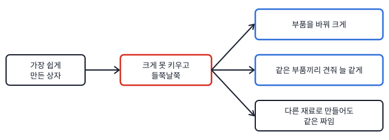

*한 가지 막힘에서 길이 세 갈래로 나뉘어요.*

**정확히 말하면**

**1. 풀고 싶은 문제**

이번 범위는 사양에 맞는 차동쌍을 설계하는 데서 시작해요. [전력 예산과 출력 CM 레벨로 바이어스 정하기](#s0-design-bias)에서 전력 예산 2 mW와 출력 CM 레벨 1.6 V 이상을, [g_m 식 세 가지와 W/L 정하기](#s0-design-size)에서 이득 5를 맞춰요. 이득에 바라는 것은 세 가지예요.

- 필요한 만큼 큰 이득
- 만들 때마다 같은, 정확한 이득
- 신호가 커져도 그대로인, 선형적인(linear) 이득

그리고 이 모든 것을 차동 구조로 얻어야 해요. 차동 증폭기를 쓰는 이유가 공통 모드 제거(common-mode rejection)이기 때문이에요([활성 영역 조건과 공통 모드 제거](#s3-bjt-bias)).

**2. 단순한 해법과 그 한계**

가장 쉬운 회로는 저항 부하 차동쌍이에요.

$$
A_v = -g_m R_D
$$

- 크기의 한계: $R_D$에 걸린 전압만큼 출력 CM 레벨이 내려가서 예제에서는 $R_D \le 400\ \Omega$로 묶여요. 이득은 $g_m$으로 올려야 하고, $g_m$은 $\sqrt{W/L}$에 비례하므로 이득 2배에 $W/L$ 4배가 들어요([g_m 식 세 가지와 W/L 정하기](#s0-design-size)).
- 정확도의 한계: $R_D$와 $g_m$은 서로 독립적으로 각각 20%까지 어긋나요. 그래서 이득도 20% 넘게 어긋나요([다이오드 연결 부하 차동쌍의 이득](#s1-diode-load-gain)).
- 선형성의 한계: $g_m$은 비선형(nonlinear)인 전압-전류 관계를 직선으로 근사한 값이에요. 신호가 커지면 이득이 변해요.

BJT로 만들 때 가장 쉬운 회로는 이미터를 접지한 공통 이미터 단이에요. 입력 바이어스가 곧 $V_{BE}$라서 전류가 지수적으로 변하고, 출력 CM 레벨도 입력 바이어스에 끌려가요([BJT 차동쌍의 CM 응답](#s3-bjt-cm)).

**3. 핵심 아이디어**

한계마다 $R_D$ 자리나 소스 쪽에 무엇을 둘지 바꿔요.

**정확한 이득: 다이오드 연결 부하.** $R_D$ 자리에 게이트와 드레인을 묶은 PMOS를 넣으면 이득이 같은 종류 소자의 비가 되고, 비는 1% 이내로 맞출 수 있어요([다이오드 연결 부하와 전류원 부하](#s1-diode-vs-source)).

$$
A_v \approx -\frac{g_{m1}}{g_{m3}}
$$

**큰 이득: 전류원 부하.** 다이오드 연결을 떼고 게이트에 $V_b$를 주면 위쪽에서 보이는 저항이 $r_O$로 커져요([다이오드 연결 부하 차동쌍의 이득](#s1-diode-load-gain)).

$$
A_v = -g_{m1}(r_{O1} \parallel r_{O3})
$$

**선형적인 이득: 소스 축퇴.** 소스 사이에 $R_{SS}$를 넣으면 이득이 선형 소자인 저항의 비로 정해져요. 대칭 중간점이 가상 접지라서 반회로 하나로 풀어요([가상 접지의 확장: 대칭 중간점](#s2-virtual-ground-ext), [소스 축퇴 차동쌍의 반회로 이득](#s2-degen-gain)).

$$
A_v \approx -\frac{R_{DD}}{R_{SS}}
$$

**같은 짜임을 BJT로: BJT 차동쌍.** 이미터를 묶어 테일 전류원을 달면 이미터가 베이스를 따라 움직여 전류가 $V_{CM}$과 무관하게 고정돼요([BJT 차동쌍의 CM 응답](#s3-bjt-cm)).

$$
I_{C1} = I_{C2} = \frac{I_{EE}}{2}
$$

**4. 대가와 쓰이는 곳**

- 다이오드 연결 부하: $\frac{1}{g_m}$이 작은 저항이라 이득이 작아요. 작아도 정확한 이득이 필요할 때 써요.
- 전류원 부하: 이득은 크지만 출력 저항이 $r_O$ 수준이라 채널 길이 변조를 반드시 고려해야 해요([다이오드 연결 부하 차동쌍의 이득](#s1-diode-load-gain)).
- 소스 축퇴: 이득 크기가 $g_{m1}\frac{R_{DD}}{2}$보다 항상 작아요. 큰 이득에는 좋지 않고, 정확하고 선형적인 이득이 필요할 때 써요([축퇴 이득을 외우는 법과 쓰는 이유](#s2-degen-why)).
- BJT 차동쌍: 선 두 개, 트랜지스터 두 개, 전류 두 배를 내주고 공통 모드 제거를 얻어요. 활성 영역 조건이 $V_{CM}$의 상한을 정해요([활성 영역 조건과 공통 모드 제거](#s3-bjt-bias)).

$$
V_{CC} - R_C\frac{I_{EE}}{2} \ge V_{CM}
$$

BJT 차동쌍은 입력 차가 작을 때만 선형이에요. 입력 차가 크면 출력이 포화하므로 그 영역은 비교기(comparator)로 써요([BJT 차동쌍의 대신호 해석](#s3-bjt-large)).

**교수님 말씀**

식을 아는 이유부터 짚으셨어요. 이득이 $g_m$과 $R_D$로 표현된다는 걸 알아야 무엇을 바꿀지 정할 수 있어요.

> "튜닝은 설계가 아니죠, 그죠?" (0930 12:24)

다이오드 연결 부하를 쓰는 이유는 정확도라고 하셨어요.

> "이득이 gm의 비로 나타나기 때문에 … 굉장히 정확한 이득을 얻을 수가 있어요." (0930 20:55)

큰 이득이 필요하면 다이오드 연결을 떼고 그 자리에 $r_O$가 들어가게 하라고 물으며 이끄셨어요 (0930 22:55).

소스 축퇴는 큰 이득이 아니라 $g_m$의 영향을 덜 받는 이득을 위한 구조라고 하셨어요.

> "이득은 크게 줄어들지만 정확한 이득을 얻고자 할 때 쓰는 용도로 있습니다." (0930 41:10)

BJT에서는 이미터를 접지에 바로 묶었다면 입력 바이어스에 따라 전류가 바뀌었을 거라며 테일 전류원이 있는 차동쌍과 비교하셨어요 (0930 43:45). 차동 증폭기를 쓰는 이유는 이렇게 정리하셨어요.

> "전류도 두 배로 쓰는데 이거 왜 쓰냐? 커먼 모드 리젝션 특성 때문이죠." (0930 50:15)

**보충 · 수업에서 유도하진 않았어요**

Razavi 예제 10.10(10.2.3절, 520쪽)은 "이득을 최대로 하기 위해" 저항 대신 이상적인 전류원을 부하로 써서 차동 이득 $-g_m r_O$를 얻어요. 예제 10.11(521쪽)은 그 전류원을 pnp 트랜지스터로 만들어 $-g_m(r_{ON} \parallel r_{OP})$를 얻어요.

전류원 부하가 저항 부하의 크기 한계를 넘는 이유는 이래요. 저항은 DC 전압 강하와 소신호 저항이 둘 다 $R_D$ 하나로 정해져요. 전류원은 DC 전압 강하가 작아도 소신호 저항 $r_O$가 커요. 그래서 출력 CM 레벨을 지키면서 큰 이득을 얻어요.

**페이지 요약**

저항 부하의 이득 $-g_m R_D$는 키우기도, 정확하게 맞추기도 어려워서 부하나 소스 쪽을 바꿔 큰 이득, 정확한 이득, 선형적인 이득을 골라 얻어요.

*핵심 식*

- 저항 부하

  $$
  A_v = -g_m R_D
  $$
- 다이오드 연결 부하

  $$
  A_v \approx -\frac{g_{m1}}{g_{m3}}
  $$
- 소스 축퇴

  $$
  A_v \approx -\frac{R_{DD}}{R_{SS}}
  $$

*용어*

- **다이오드 연결 부하(diode-connected load)** — 이득을 $g_m$의 비로 만들어 정확하게 하는 부하
- **소스 축퇴(source degeneration)** — 소스 쪽 저항으로 이득을 저항의 비에 묶어 정확하고 선형적으로 하는 구조
- **공통 모드 제거(common-mode rejection)** — 차동 증폭기를 쓰는 이유, 같은 위상의 노이즈가 출력에서 사라지는 성질

---

## 0. MOS 차동쌍 설계 예제

### 전력 예산과 출력 CM 레벨로 바이어스 정하기

*0930 수업 · L04 s15*

**쉽게 말하면**

받은 용돈 안에서만 쓰고, 친구에게 넘겨 주는 높이는 약속한 선보다 높아야 해요.

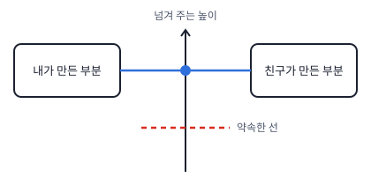

*내가 넘겨 주는 높이가 약속한 선 위에 있어야 친구가 만든 부분이 일할 수 있어요.*

**정확히 말하면**

문제는 이래요. 전압 이득이 5이고 전력 예산(power budget)이 2 mW인 NMOS 차동쌍을 설계해요. 다음 단(following stage)은 입력 CM 레벨이 1.6 V 이상이기를 요구해요. $\mu_n C_{ox} = 100\ \mu\text{A/V}^2$, $\lambda = 0$, $V_{DD} = 1.8\ \text{V}$로 둬요.

**조건 해석**이 먼저예요.

- 전력 예산 2 mW는 2 mW **이내**로 쓰라는 뜻이에요. 그보다 많이 쓰면 안 돼요.
- 다음 단의 입력에 이어지는 것은 내 회로의 출력이에요. 그래서 "다음 단의 입력 CM 레벨이 1.6 V 이상"은 내 차동쌍의 **출력 CM 레벨**이 1.6 V 이상이어야 한다는 뜻이에요.
- 내 입력 CM 레벨을 1.6 V로 잡으면 조건을 잘못 읽은 거예요.
- 차동 회로에서 DC 바이어스는 곧 CM 레벨이에요. 이 조건은 내 회로와 다음 단 사이 인터페이스(interface)의 DC 레벨을 정해 준 거예요.

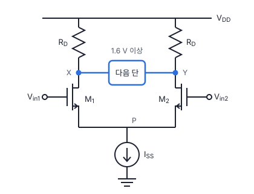

*다음 단의 입력에 이어지는 곳은 내 출력 노드 X, Y예요. 이 두 노드의 DC 전압이 출력 CM 레벨이에요.*

**설계 순서**: 바이어스를 먼저 정해요. 바이어스에는 전류와 전압이 있고, 전류부터 정해요.

1. 전력은 전원 전압과 전체 전류의 곱이에요. 전체 전류는 테일 전류 $I_{SS}$예요: $P = V_{DD} I_{SS}$
2. 전력 예산: $V_{DD} I_{SS} \le 2\ \text{mW}$
3. $V_{DD} = 1.8\ \text{V}$이므로 $I_{SS}$는 대략 1 mA예요. 계산하기 쉽게 $I_{SS} = 1\ \text{mA}$로 잡아요.
4. 두 가지에 전류가 절반씩 흘러요: $I_{D1} = I_{D2} = \dfrac{I_{SS}}{2} = 0.5\ \text{mA}$
5. $R_D$ 양단 전압은 $\dfrac{I_{SS}}{2}R_D$이므로 출력 CM 레벨은

   $$
   V_{out,CM} = V_{DD} - \frac{I_{SS}}{2}R_D
   $$
6. 조건: $V_{DD} - \dfrac{I_{SS}}{2}R_D \ge 1.6\ \text{V}$
7. 대입: $1.8\ \text{V} - (0.5\ \text{mA})R_D \ge 1.6\ \text{V}$
8. $R_D$에 걸 수 있는 전압은 0.2 V 이하예요: $R_D \le 400\ \Omega$

$R_D$가 400 Ω보다 크면 출력 전압이 낮아져 다음 단의 요구를 맞추지 못해요.

$I_{SS}$는 예산 안이면 돼요. 0.5 mA로 덜 써도 되고, $2\ \text{mW}/1.8\ \text{V}$로 딱 맞춰도 돼요.

교과서(Razavi 예제 10.16)는 예산을 다 써서 $I_{SS} = 1.11\ \text{mA}$, $R_D = 360\ \Omega$로 풀어요. 수업의 1 mA, 400 Ω은 같은 풀이를 어림값으로 한 것이에요.

400 Ω 이하에서 $R_D$를 얼마로 고를지는 이득 조건이 정해요. 이어지는 계산은 [g_m 식 세 가지와 W/L 정하기](#s0-design-size)에 있어요.

**교수님 말씀**

"버짓이 뭐예요?"라는 질문에 한 학생이 예산이라고 답했어요 (0930 00:00).

다음 단의 입력 CM 레벨 조건이 무슨 뜻인지 묻자 한 학생이 출력 CM 레벨이라고 답했어요. 교수님은 "그렇죠. 어, 그거예요."라고 받았어요 (0930 02:02).

이 조건이 왜 붙는지는 실제 설계 이야기로 설명했어요. 자동차에 들어가는 회로든 메모리의 센스 앰프든 혼자 다 설계하지 않아요. 앰프 일부는 내가, 나머지는 다른 사람이 설계하므로 둘 사이에 맞춰야 할 약속이 생겨요.

> "여러분들 혼자 다 설계하지 않잖아요. … 그러면 인터페이스가 있을 거잖아요." (0930 02:37)

> "차동 회로에서의 DC 바이어스는 커먼 모드 레벨이죠." (0930 02:50)

전류는 "대략 뭐 한 1mA 쓰면 되겠네요"라며 1 mA로 정했어요 (0930 04:27).

출력 DC 레벨이 어떻게 정해지는지, 저항에 전류가 얼마나 흐르는지 묻자 절반씩($\tfrac{1}{2}I_{SS}$)이라는 답이 나왔어요 (0930 05:27).

$R_D$는 400 Ω 이하이면 되므로 누구는 200 Ω, 누구는 400 Ω, 누구는 100 Ω으로 할 수 있다고 했어요 (0930 06:30).

**꼭 기억해요**

> "로우 파워 소모를 하는 건 이제 최근에 아주 중요한 설계 요구사항이죠, 그죠? 다 배터리로 구동을 하니까." (0930 00:20)

> "그러니까 이거는 해석을 잘 해야 되겠죠." (0930 03:20)

> "바이어스는 전류와 전압이 있는데, 우선 전류가 가장 중요하죠, 전류." (0930 03:55)

**페이지 요약**

전력 예산으로 테일 전류를 정하고, 다음 단이 요구하는 출력 CM 레벨로 $R_D$의 최댓값을 정해요.

*핵심 식*

- 전력

  $$
  P = V_{DD} I_{SS}
  $$
- 출력 CM 레벨

  $$
  V_{out,CM} = V_{DD} - \frac{I_{SS}}{2}R_D
  $$
- 부하 저항 조건

  $$
  R_D \le 400\ \Omega
  $$

*용어*

- **전력 예산(power budget)** — 이 값 이내로 전력을 쓰라는 설계 조건
- **출력 CM 레벨** — 출력 노드 X, Y의 DC 전압. 다음 단의 입력 CM 레벨이 돼요
- **인터페이스(interface)** — 내 회로와 다음 단이 만나는 곳. 서로 맞출 조건이 여기서 나와요

---

### g_m 식 세 가지와 W/L 정하기

*0930 수업 · L04 s15*

**쉽게 말하면**

전류와 부하저항을 그대로 두면, 이득의 크기를 두 배로 만들 때 트랜지스터의 폭·길이 비 $W/L$은 네 배로 키워야 해요.

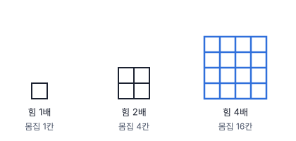

*같은 공정·포화 영역·제곱 법칙 근사에서, 이득 배율의 제곱만큼 W/L을 바꿔요.*

**정확히 말하면**

**작은 예시.** 같은 공정에서 바이어스 전류 $I_D$와 부하저항 $R_D$를 고정하고, 채널 길이 변조를 무시한 포화 영역 소신호 이득을 비교해요. 이득 크기 5를 10으로 두 배 키우려면 $g_m$도 두 배여야 하므로 $W/L$을 네 배로 해요. 이득 5를 15로 세 배 키우면 $W/L$은 아홉 배예요. 크기를 바꾼 뒤에도 포화 조건을 만족하도록 바이어스를 맞춰요.

[전력 예산과 출력 CM 레벨로 바이어스 정하기](#s0-design-bias)에서 $I_{SS} = 1\ \text{mA}$, $R_D \le 400\ \Omega$까지 정했어요. 남은 조건은 이득 5예요.

**$g_m$ 정하기**

1. 저항 부하 차동쌍의 이득: $A_v = -g_m R_D$
2. 크기가 5이므로 $A_v = -5$, 곧 $g_m R_D = 5$
3. $R_D$가 클수록 필요한 $g_m$이 작아져 전류를 덜 써요. 허용되는 최댓값 $R_D = 400\ \Omega$을 골라요.
4. $$
   g_m = \frac{5}{R_D} = \frac{5}{400\ \Omega} = 12.5\ \text{mS}
   $$

$R_D$를 절반인 200 Ω으로 하면 $g_m$은 두 배인 25 mS가 필요해요.

**$g_m$ 식 세 가지**: 슬라이드에는 없고 칠판에서 유도했어요. $k = \mu_n C_{ox}\dfrac{W}{L}$, 오버드라이브 전압(overdrive voltage) $V_{OD} = V_{GS} - V_{TH}$로 둬요.

1. 포화(saturation) 영역의 전류: $I_D = \dfrac{1}{2}k V_{OD}^2$
2. $g_m$은 $V_{GS}$ 변화에 대한 $I_D$ 변화예요: $g_m = \dfrac{\partial I_D}{\partial V_{GS}}$
3. 미분하면 첫째 식: $g_m = k V_{OD}$
4. $k$를 모를 때는 1의 $k = \dfrac{2I_D}{V_{OD}^2}$를 대입해요. 둘째 식: $g_m = \frac{2I_D}{V_{OD}}$
5. $V_{OD}$를 모를 때는 1의 $V_{OD} = \sqrt{\dfrac{2I_D}{k}}$를 대입해요: $g_m = \sqrt{2kI_D}$
6. $k$를 풀어 쓰면 셋째 식: $g_m = \sqrt{2\mu_n C_{ox}\frac{W}{L}I_D}$

세 식은 같은 값을 줘요. 지금은 전류를 알고 $W/L$과 $V_{OD}$를 모르므로 전류로 쓴 셋째 식이 편해요.

**$W/L$ 정하기**

1. 트랜지스터 하나의 전류: $I_D = \dfrac{I_{SS}}{2} = 0.5\ \text{mA}$
2. $\sqrt{2\,(100\ \mu\text{A/V}^2)\,\dfrac{W}{L}\,(0.5\ \text{mA})} = 12.5\ \text{mS}$
3. 양변을 제곱해 정리: $\dfrac{W}{L} = \dfrac{g_m^2}{2\mu_n C_{ox} I_D}$
4. $\dfrac{W}{L} = \dfrac{(12.5\ \text{mS})^2}{2\,(100\ \mu\text{A/V}^2)(0.5\ \text{mA})}$
5. 식에 넣으면 $\dfrac{W}{L} \approx 1563$

수업에서는 4번 식까지만 말하고 마지막 수치는 계산기로 하면 된다며 넘어갔어요. 1563은 그 식에 값을 넣은 결과예요.

교과서(Razavi 예제 10.16)는 $I_{SS} = 1.11\ \text{mA}$, $R_D = 360\ \Omega$로 풀어 $g_m = 13.9\ \text{mS}$, $\dfrac{W}{L} \approx 1738$을 얻어요. 수업 값과의 차이는 어림값을 썼는지의 차이예요.

**입력 바이어스**: 입력 CM 전압은 전류를 정하지 않아요. 전류는 테일 전류원이 정해요. $I_D = \dfrac{I_{SS}}{2}$가 정해지면 $V_{OD}$, 곧 $V_{GS}$가 따라 정해져요. 입력 CM 전압은 포화 조건을 만족하는 범위 안에서 임의로 주면 돼요. 그 범위는 [입력 CM 레벨의 허용 범위](../../0923/정리노트_0923_Differential_Amplifiers.html#s1-cm-range)에서 구했어요.

**식을 아는 이유**: 조건이 바뀌어도 처음부터 다시 풀지 않아요.

- $R_D$와 전류를 그대로 두고 이득을 5에서 10으로 올리려면 $g_m$이 2배여야 해요.
- 셋째 식에서 $g_m$은 $\sqrt{W/L}$에 비례하므로 $W/L$은 4배여야 해요.
- 이득을 4배로 하려면 $W/L$은 16배여야 해요.

**설계와 튜닝**: 이득이 $g_m$과 $R_D$로 표현된다는 것을 알아야 무엇을 바꿀지 정할 수 있어요. 식을 모르면 바이어스, 전류, 사이즈를 이것저것 바꿔 보게 되는데, 이것은 설계가 아니라 튜닝(tuning)이에요. 설계는 원하는 이득을 얻으려면 무엇을 얼마로 해야 하는지 관계식으로 정하는 일이에요.

**교수님 말씀**

$R_D$를 400 Ω으로 고른 이유를 이렇게 말했어요.

> "RD가 크면 클수록 gm을 좀 줄일 수가 있으니까 전류를 좀 적게 쓰겠죠." (0930 07:04)

$g_m$ 식은 칠판에서 순서대로 고쳐 갔어요. 먼저 $k V_{OD}$를 쓰고, $W/L$을 몰라 $k$를 지웠더니 "아, V_OD도 알아야 되네"라며 다시 $V_{OD}$를 지워 $\sqrt{2kI_D}$로 갔어요 (0930 08:50).

> "전류에 관한 식으로 표현된 걸 아는 게 편하죠." (0930 09:26)

$W/L$은 "12.5의 제곱을 마이크로로 나눈 것"까지만 말했어요. 나머지는 "계산은 여러분 뭐 계산기 더 잘 다루잖아요"라며 넘어갔어요 (0930 10:06).

입력 바이어스는 전류와 무관하고, 포화 조건을 만족하도록 가해 주면 된다고 했어요 (0930 10:35).

"gain을 10으로 한다, 그럼 처음부터 다시 해야 되나요?"라고 묻고, $W/L$을 4배로, 이득 4배면 16배로 해야 한다고 정리했어요 (0930 12:12).

설계가 무엇인지는 이렇게 말했어요. 내가 이득을 얼마로 하려면 무엇을 얼마로 해야 할지, 그 관계를 알고 방법을 갖는 것이에요 (0930 13:16).

**꼭 기억해요**

> "튜닝은 설계가 아니죠, 그죠?" (0930 12:24)

> "식을 뭐 외워서 이거 문제 풀려고 하는 게 아니라 사실 여러분 설계에 이걸 활용하기 위해서예요." (0930 12:24)

> "그건 이제 설계가 아니라 튜닝이고 그거는 뭐 여러분들보다 계산기가 더 잘해요." (0930 13:10)

**페이지 요약**

전류·부하저항 고정의 제곱 법칙 근사에서 이득을 n배 키우려면 $W/L$을 n²배 키워요.

*핵심 식*

- 이득

  $$
  A_v = -g_m R_D
  $$
- $k$를 모를 때

  $$
  g_m = \frac{2I_D}{V_{OD}}
  $$
- $V_{OD}$를 모를 때

  $$
  g_m = \sqrt{2\mu_n C_{ox}\frac{W}{L}I_D}
  $$

*용어*

- **오버드라이브 전압(overdrive voltage)** — $V_{OD} = V_{GS} - V_{TH}$
- **튜닝(tuning)** — 관계식 없이 값을 이것저것 바꿔 보는 일. 설계가 아니에요

---

## 1. 부하를 트랜지스터로 바꾸기

### 다이오드 연결 부하와 전류원 부하

*0930 수업 · L04 s16*

**쉽게 말하면**

수도꼭지 손잡이를 물길에 묶어 두면 밀수록 물이 많이 나오고, 손잡이를 따로 붙잡아 두면 밀어도 늘 같은 만큼만 나와요.

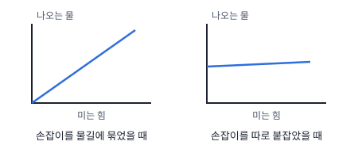

*같은 수도꼭지인데 손잡이를 어디에 두느냐에 따라 전혀 다르게 움직여요.*

**정확히 말하면**

[전력 예산과 출력 CM 레벨로 바이어스 정하기](#s0-design-bias)에서 쓴 부하는 저항 $R_D$였어요. 이번 예제는 그 자리에 PMOS $M_3$, $M_4$를 넣어요. 같은 PMOS라도 게이트를 어디에 잇느냐에 따라 부하의 종류가 달라져요.

- 게이트와 드레인을 묶으면 다이오드 연결 부하(diode-connected load)예요.
- 게이트를 드레인과 묶지 않고 바이어스 전압 $V_b$를 주면 전류원 부하(current-source load)예요.

*강조색이 게이트가 이어진 곳이에요. 왼쪽은 게이트가 드레인에 묶였고, 오른쪽은 게이트가 바이어스 전압 $V_b$에 이어졌어요.*

전류원 부하는 드레인 전압을 바꿔도 전류가 (이상적으로) 바뀌지 않아요. 전압이 변해도 전류가 그대로이니 소신호 저항은 무한대예요. 채널 길이 변조(channel-length modulation)를 고려하면 저항은 $r_O$예요. $r_O$는 큰 저항이라서 큰 전압 이득이 필요할 때 전류원 부하를 써요.

다이오드 연결 부하는 드레인 전압을 바꾸면 게이트 전압도 같이 바뀌어요. 그러면 $i_d = g_m v_{gs}$에 따라 전류가 바뀌어요. 양단 전압에 따라 전류가 바뀌므로 저항처럼 동작해요. 그 저항값은 아래처럼 구해요.

1. 등가회로를 그려요. 소스는 AC 접지예요. 게이트와 드레인이 묶인 노드에 시험 전압 $v_x$를 걸고, 그 노드로 흘러 들어가는 전류 $i_x$를 봐요.
2. 게이트와 드레인이 같은 노드예요.

   $$
   v_{gs} = v_{ds} = v_x
   $$
3. 게이트로는 전류가 들어가지 않으므로 $i_x$는 드레인 전류예요.

   $$
   i_x = g_m v_{gs}
   $$
4. 대입해요.

   $$
   i_x = g_m v_x
   $$
5. 결과예요.

   $$
   \frac{v_x}{i_x} = \frac{1}{g_m}
   $$

$\frac{1}{g_m}$은 크지 않은 저항이에요. 그래서 다이오드 연결 부하는 저항을 대신해 상대적으로 작은 이득을 얻을 때 써요. 채널 길이 변조까지 넣으면 $r_O$가 병렬로 붙어 $\frac{1}{g_m} \parallel r_O$가 돼요. 이 값을 이득에 쓰는 과정은 [다이오드 연결 부하 차동쌍의 이득](#s1-diode-load-gain)에 있어요.

| 항목 | 다이오드 연결 부하 | 전류원 부하 |
|---|---|---|
| 게이트 | 드레인에 묶어요 | 바이어스 전압 $V_b$를 줘요 |
| 드레인 전압을 바꾸면 | 게이트 전압도 바뀌어 전류가 바뀌어요 | 전류가 (이상적으로) 그대로예요 |
| 소신호 저항 | $\frac{1}{g_m}$ | 이상적으로 무한대, 채널 길이 변조를 고려하면 $r_O$ |
| 쓰는 곳 | 상대적으로 작은 이득 | 큰 전압 이득 |

**교수님 말씀**

교수님은 예제를 풀기 전에 두 부하의 이름부터 물었어요 (0930 13:40–18:05). 게이트와 드레인을 묶은 것을 뭐라고 하는지, 안 묶으면 어떻게 되는지 물었고, 학생의 답에 게이트에 전압을 가해 동작시킬 수 있다고 보충했어요.

> "커런트 소스 로드라고 하죠, 벌써 잊어버리셨어요?" (0930 14:40)

다이오드 연결 소자의 저항이 얼마냐는 질문에는 학생들이 "$g_m$분의 1"이라고 답했어요. 교수님은 칠판에 $v_x$와 $i_x$를 그려 이 값을 다시 유도했어요 (0930 17:15).

**꼭 기억해요**

> "용어가 중요한 건 아니고, 두 개는 굉장히 큰 차이가 있죠." (0930 14:46)

> "하나는 gm분의 1의 저항으로 동작을 하고, 하나는 ro의 큰 저항으로 동작을 하고요." (0930 17:25)

**페이지 요약**

게이트와 드레인을 묶은 다이오드 연결 부하는 작은 저항이고, 게이트에 바이어스 전압을 준 전류원 부하는 큰 저항이에요.

*핵심 식*

- 시험 전류

  $$
  i_x = g_m v_x
  $$
- 다이오드 연결 소자의 저항

  $$
  \frac{v_x}{i_x} = \frac{1}{g_m}
  $$

*용어*

- **다이오드 연결 부하(diode-connected load)** — 게이트와 드레인을 묶어 저항 $\frac{1}{g_m}$처럼 쓰는 부하
- **전류원 부하(current-source load)** — 게이트에 바이어스 전압을 줘 $r_O$의 큰 저항으로 쓰는 부하

---

### 다이오드 연결 부하 차동쌍의 이득

*0930 수업 · L04 s16*

**쉽게 말하면**

같은 틀로 찍어 낸 둘은 같이 커지고 같이 작아져서, 둘을 견준 값은 늘 그대로예요.

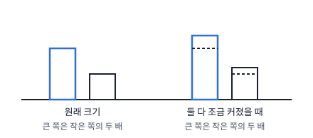

*둘 다 조금 커져도 큰 쪽은 여전히 작은 쪽의 두 배예요.*

**정확히 말하면**

NMOS 차동쌍 $M_1$, $M_2$ 위에 다이오드 연결 PMOS $M_3$, $M_4$를 부하로 올린 회로의 차동 이득을 구해요. 채널 길이 변조를 고려해요($\lambda \ne 0$). Razavi 예제 10.22(Fig. 10.36)와 같은 회로예요.

*(a) 다이오드 연결 부하 차동쌍, (b) 그 반회로예요. 강조색 선이 AC 접지로 보는 곳이에요.*

1. 소신호 회로로 바꿔요. DC 전원을 없애면 $V_{DD}$는 AC 접지예요. 테일 전류원 $I_{SS}$는 전류 변화가 없으므로 개방이에요.
2. 차동 입력은 크기가 같고 위상이 반대예요. 이때 두 소스가 만나는 테일 노드는 AC 접지(가상 접지)예요. 근거는 [노드 P는 차동 입력에서 가상 접지](../../0923/정리노트_0923_Differential_Amplifiers.html#s3-virtual-ground)에 있어요.
3. 테일 노드가 접지이므로 회로를 대칭인 두 반회로(half circuit)로 나눠요. 반회로에서 $M_1$은 소스가 접지이고, 게이트에 $v_{in1}$이 들어가고, 드레인이 출력 $v_{out1}$이에요. 드레인 위에는 다이오드 연결 $M_3$가 있고 $M_3$의 소스는 AC 접지($V_{DD}$)예요.
4. 차동 이득의 정의는 차동 출력을 차동 입력으로 나눈 값이에요. 이 값은 반회로 하나의 이득과 같으므로 반회로만 풀어요.

   $$
   A_v = \frac{v_{out}}{v_{id}} = \frac{v_{out1}}{v_{in1}}
   $$
5. 반회로는 공통 소스 단이에요. 부하가 저항 $R_D$일 때 이득은 $-g_{m1}R_D$였어요. $R_D$ 자리에 출력 노드에서 본 저항 $R_{out}$을 넣어요.

   $$
   A_v = -g_{m1}R_{out}
   $$
6. 출력 노드에서 위로는 다이오드 연결 $M_3$의 $\frac{1}{g_{m3}}$과 $r_{O3}$이, 아래로는 $M_1$의 $r_{O1}$이 병렬로 보여요.

   $$
   R_{out} = \frac{1}{g_{m3}} \parallel r_{O3} \parallel r_{O1}
   $$
7. 슬라이드의 식이에요.

   $$
   A_v = -g_{m1}\left(\frac{1}{g_{m3}} \parallel r_{O3} \parallel r_{O1}\right)
   $$
8. $g_m r_O \gg 1$(수십)이라서 $\frac{1}{g_{m3}}$은 $r_{O3}$, $r_{O1}$보다 훨씬 작아요. 병렬에서는 작은 쪽만 남아요.

   $$
   A_v \approx -\frac{g_{m1}}{g_{m3}}
   $$

**왜 저항 대신 다이오드 연결 부하를 쓰나요.** 이득이 $g_m$의 비로 나오기 때문에 정확한 이득을 얻어요. 저항 부하의 이득 $-g_m R_D$에서는 $R_D$와 $g_m$이 서로 독립적인 편차(variation)를 가져서 각각 20%까지 어긋날 수 있어요. 같은 종류 소자끼리의 비율은 1% 이내로 정확하게 만들 수 있어요.

**큰 이득이 필요하면.** 다이오드 연결을 풀어 [다이오드 연결 부하와 전류원 부하](#s1-diode-vs-source)의 전류원 부하로 바꿔요. 그러면 위쪽으로 보이는 저항이 $r_{O3}$이에요. 이 값은 충분히 커서 아래쪽 $r_{O1}$을 무시할 수 없어요.

$$
A_v = -g_{m1}(r_{O1} \parallel r_{O3})
$$

**채널 길이 변조를 언제 고려하나요.** 출력 노드에 $R_D$나 $\frac{1}{g_m}$처럼 $r_O$보다 훨씬 작은 저항이 달려 있으면 고려해도 결과가 거의 같으므로 무시해요. 출력 저항이 $r_O$ 수준인 전류원 부하에서는 반드시 고려해요. 교수님은 일반적으로는 고려하는 쪽이 맞다고 했어요.

정리하면 차동 증폭기에서 새로 알아야 할 것은 "차동 입력에서 테일 노드가 AC 접지"라는 사실 하나예요. 그다음은 이미 아는 소신호 해석과 같아요.

**교수님 말씀**

교수님은 반회로를 그리며 앞에서 배운 것을 되물었어요 (0930 19:10–20:00). 테일 노드를 어떻게 볼 수 있냐는 질문에 학생들이 "그라운드"라고 답했고, 차동 이득이 반회로의 이득과 어떻게 되냐는 질문에는 "같다"고 답했어요.

큰 이득을 얻고 싶으면 무엇을 떼면 되는지, $R_D$ 자리에 무엇이 들어가는지도 물었어요 (0930 22:55). 답은 다이오드 연결을 떼는 것이고, 그 자리에는 $r_O$가 들어가요.

$R_D$와 $g_m$은 서로 독립적으로 어긋나지만 같은 종류끼리의 비율은 정확하게 만들 수 있다는 점이 다이오드 연결 부하를 쓰는 이유라고 설명했어요 (0930 20:55).

**꼭 기억해요**

> "이득이 gm의 비로 나타나기 때문에 이득이 굉장히 정확한 이득을 얻을 수가 있어요. 정확한 이득." (0930 20:55)

> "테일 노드가 AC 그라운드가 되는 걸 알면 그다음은 그냥 … 스몰 시그널 해석하고 똑같이 되는 거예요." (0930 24:32)

**페이지 요약**

테일 노드를 AC 접지로 보고 반회로만 풀면 이득은 $g_m$의 비가 돼요. 비율이라서 정확한 이득을 얻어요.

*핵심 식*

- 출력 노드에서 본 저항

  $$
  R_{out} = \frac{1}{g_{m3}} \parallel r_{O3} \parallel r_{O1}
  $$
- 다이오드 연결 부하의 이득

  $$
  A_v \approx -\frac{g_{m1}}{g_{m3}}
  $$
- 전류원 부하의 이득

  $$
  A_v = -g_{m1}(r_{O1} \parallel r_{O3})
  $$

*용어*

- **반회로(half circuit)** — 테일 노드를 접지로 보고 대칭 회로를 반으로 나눈 한쪽
- **채널 길이 변조(channel-length modulation)** — $r_O$를 만드는 효과. 출력 저항이 $r_O$ 수준이면 반드시 고려해요

---

## 2. 가상 접지의 확장과 소스 축퇴

### 가상 접지의 확장: 대칭 중간점

*0930 수업 · L04 s17*

**쉽게 말하면**

똑같은 고무줄 두 개로 이은 두 점이 하나는 올라가고 하나는 같은 만큼 내려가면, 한가운데 매듭은 제자리예요.

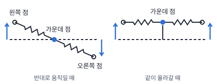

*반대로 움직이면 가운데 점은 제자리이고, 같이 올라가면 가운데 점도 올라가요.*

**정확히 말하면**

가상 접지(virtual ground)는 테일 노드에만 생기지 않아요. 지난 시간에는 테일 노드 P가 차동 입력에서 움직이지 않는 것을 봤어요([0923 정리노트: 노드 P는 차동 입력에서 가상 접지](../../0923/정리노트_0923_Differential_Amplifiers.html#s3-virtual-ground)). 이번에는 같은 생각을 두 노드 사이의 대칭 중간점으로 넓혀요.

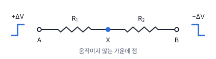

*슬라이드 그림과 같은 구성이에요. 두 저항 사이의 점이 X예요.*

두 노드 A, B 사이를 저항 $R_1$, $R_2$로 잇고, 두 저항 사이의 점을 X라고 해요. 다음 두 조건이 모두 맞으면 X의 전압은 움직이지 않아요.

- 두 저항이 같아요: $R_1 = R_2$
- A와 B가 같은 크기로, 서로 반대 방향으로 변해요. A가 $+\Delta V$이면 B는 $-\Delta V$예요.

칠판에서는 중첩의 원리(superposition)로 확인했어요. A의 변화를 $V_a$, B의 변화를 $V_b$라 해요.

1. $V_b = 0$으로 두고 $V_a$만 걸어요. $R_1$, $R_2$의 분압이에요.

   $$
   V_X = \frac{R_2}{R_1 + R_2}V_a = \frac{1}{2}V_a
   $$
2. $V_a = 0$으로 두고 $V_b$만 걸어요.

   $$
   V_X = \frac{R_1}{R_1 + R_2}V_b = \frac{1}{2}V_b
   $$
3. 두 결과를 더해요.

   $$
   V_X = \frac{1}{2}(V_a + V_b)
   $$
4. 차동 신호 $V_a = +\Delta V$, $V_b = -\Delta V$를 넣어요.

   $$
   V_X = \frac{1}{2}(+\Delta V - \Delta V) = 0
   $$

슬라이드는 이 결과를 $V_X = 0$으로 적었어요. X의 소신호 전압, 즉 변화량이 0이라는 뜻이에요.

X는 두 노드 전압의 평균이에요. 그래서 A와 B가 둘 다 $+\Delta V$만큼 오르면 같은 식에서 $V_X = \frac{1}{2}(\Delta V + \Delta V) = \Delta V$가 돼요. X도 $\Delta V$만큼 오르므로 이때는 접지로 볼 수 없어요.

가상 접지는 그 노드가 물리적으로 접지에 묶여 있다는 뜻이 아니에요. 크기가 같고 위상이 반대인 차동 신호가 들어올 때에만 접지처럼 볼 수 있다는 뜻이에요.

교과서에서는 Razavi Fig. 10.20(10.2.3절)이 같은 그림이에요. 이 확장은 [소스 축퇴 차동쌍의 반회로 이득](#s2-degen-gain)에서 $R_{SS}$와 $R_{DD}$의 중간점을 접지로 놓는 데 바로 써요.

**교수님 말씀**

지난 시간의 시소 비유를 다시 꺼내셨어요 (0930 25:36). 한쪽이 $\Delta V$만큼 오르고 다른 쪽이 $\Delta V$만큼 내려가도 시소의 가운데 받침점은 고정되어 있어요. 양쪽이 같이 오르면 가운데도 같이 올라요.

A, B가 둘 다 $+\Delta V$만큼 오르는 경우를 따로 짚으며, 그때는 X도 $\Delta V$만큼 오르니 접지가 아니라고 하셨어요.

**꼭 기억해요**

> "피지컬리 그라운드라는 얘기가 아니라 … 차동 신호가 인가될 때에만 … 그라운드가 된다는 의미예요." (0930 26:17)

가상 접지는 "항상 접지"가 아니에요. 차동 신호라는 조건이 붙어요.

**페이지 요약**

같은 저항 두 개로 이은 두 노드가 같은 크기로 반대로 움직이면 가운데 점 X도 가상 접지예요.

*핵심 식*

- 조건

  $$
  R_1 = R_2
  $$
- 중첩 결과

  $$
  V_X = \frac{1}{2}(V_a + V_b)
  $$
- 차동 신호일 때

  $$
  V_X = \frac{1}{2}(+\Delta V - \Delta V) = 0
  $$

*용어*

- **가상 접지(virtual ground)** — 접지에 묶이지 않았지만 차동 신호에서 소신호 전압이 0인 노드
- **중첩의 원리(superposition)** — 입력을 하나씩만 걸어 구한 결과를 더하는 방법
- **시소** — 양 끝이 반대로 움직이면 받침점이 그대로라는 교수님 비유

---

### 소스 축퇴 차동쌍의 반회로 이득

*0930 수업 · L04 s18*

**쉽게 말하면**

발밑에 푹신한 발판을 깔면 똑같이 굴러도 발판이 같이 눌려서 덜 높이 뛰어요.

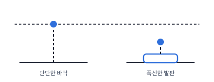

*같은 힘으로 굴러도 발판 위에서는 색칠된 점이 더 낮게 올라가요.*

**정확히 말하면**

슬라이드 예제는 $\lambda = 0$을 가정하고 아래 회로의 이득을 구하는 문제예요. 차동 회로에서 "이득을 구하라"고 하면 differential이라는 말이 없어도 차동 이득(differential gain)을 구하라는 뜻이에요.

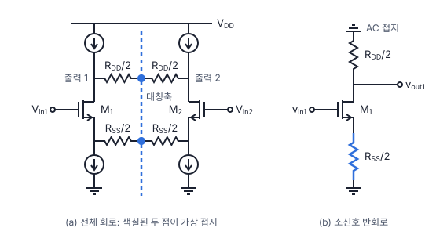

*$R_{DD}$와 $R_{SS}$를 반씩 나누면 가운데 점이 가상 접지가 되고, 한쪽만 떼면 반회로예요.*

회로의 생김새예요.

- $M_1$, $M_2$의 소스가 직접 묶여 있지 않아요. 저항 $R_{SS}$로 이어져 있고, 소스마다 접지로 가는 전류원이 하나씩 있어요.
- 두 드레인 사이에도 저항 $R_{DD}$가 있고, 드레인마다 $V_{DD}$에서 내려오는 전류원이 하나씩 있어요.
- 전류원은 이상적인 기호로 그렸지만 실제로는 트랜지스터로 만들어요.

먼저 접지로 볼 노드를 찾아요.

- 전류원이 달린 소스 노드는 접지가 아니에요.
- $R_{SS}$를 $\frac{R_{SS}}{2}$ 두 개의 직렬로 나눠 그리면 그 가운데 점이 가상 접지예요([가상 접지의 확장: 대칭 중간점](#s2-virtual-ground-ext)).
- $R_{DD}$도 $\frac{R_{DD}}{2}$ 두 개로 나누면 가운데 점이 가상 접지예요.
- 소스끼리 직접 묶인 차동쌍에서는 묶인 점이 곧 중간점이라서 테일 노드가 접지였던 거예요.

소신호 반회로(half circuit)를 그려요. "half circuit"이라고만 써도 앞에 small-signal이 생략된 것으로 읽어요.

- 전류원은 전류 변화가 0이므로 개방(open)이에요. 위쪽 두 개, 아래쪽 두 개 모두 사라져요.
- $M_1$의 게이트에 $v_{in1}$이 들어가요.
- $M_1$의 소스에서 $\frac{R_{SS}}{2}$를 거쳐 접지로 가요.
- $M_1$의 드레인이 출력 $v_{out1}$이고, $\frac{R_{DD}}{2}$를 거쳐 AC 접지로 가요.

소스와 접지 사이에 저항이 낀 이 구조가 소스 축퇴(source degeneration)예요. 소스가 접지가 아니므로 $v_{gs1} \ne v_{in1}$이에요. $\lambda = 0$이고 $\frac{R_{DD}}{2} \ll r_{O1}$이므로 $r_{O1}$은 빼고 풀어요.

1. 소스 전압은 $\frac{R_{SS}}{2}$에 $i_{d1}$이 흘러 생겨요.

   $$
   v_{s1} = i_{d1}\frac{R_{SS}}{2}
   $$
2. 게이트-소스 전압이에요.

   $$
   v_{gs1} = v_{in1} - i_{d1}\frac{R_{SS}}{2}
   $$
3. $i_{d1} = g_{m1}v_{gs1}$에 넣어요.

   $$
   i_{d1} = g_{m1}\left(v_{in1} - i_{d1}\frac{R_{SS}}{2}\right)
   $$
4. $i_{d1}$을 한쪽으로 모아요.

   $$
   i_{d1}\left(1 + g_{m1}\frac{R_{SS}}{2}\right) = g_{m1}v_{in1}
   $$
5. $i_{d1}$을 풀어요.

   $$
   i_{d1} = \frac{g_{m1}}{1 + g_{m1}\frac{R_{SS}}{2}}v_{in1} = \frac{1}{\frac{1}{g_{m1}} + \frac{R_{SS}}{2}}v_{in1}
   $$
6. 출력 전압은 $\frac{R_{DD}}{2}$에 걸려요.

   $$
   v_{out1} = -i_{d1}\frac{R_{DD}}{2}
   $$
7. 이득이에요.

   $$
   A_v = -\frac{R_{DD}/2}{\frac{1}{g_{m1}} + \frac{R_{SS}}{2}}
   $$
8. 분모와 분자에 $g_{m1}$을 곱한 꼴이에요.

   $$
   A_v = -\frac{g_{m1}R_{DD}/2}{1 + g_{m1}R_{SS}/2}
   $$

여기서 $A_v = \dfrac{v_{out1}}{v_{in1}}$은 반회로 하나의 이득이에요. 반회로 이득은 차동 이득과 같으므로 이것이 답이에요([다이오드 연결 부하 차동쌍의 이득](#s1-diode-load-gain)).

확인해 봐요. $R_{SS} = 0$이면 $i_{d1} = g_{m1}v_{in1}$이고 $A_v = -g_{m1}\frac{R_{DD}}{2}$로 돌아가요. (수업에서는 이 값을 $-g_mR_D$라고 말했어요. 이 회로의 드레인 저항은 $\frac{R_{DD}}{2}$예요.)

$R_{SS}$가 있으면 같은 입력에 흐르는 전류가 줄어요. 등가 트랜스컨덕턴스가 $g_{m1}$에서 $\dfrac{g_{m1}}{1 + g_{m1}R_{SS}/2}$로 줄어든 셈이에요. 축퇴(degeneration)는 이렇게 줄어든다는 뜻이에요.

소신호 등가회로를 따로 그려도 되고, 회로도 위에 전류원을 바로 그려 넣어 풀어도 돼요. 교과서에서는 Razavi 예제 10.24(Fig. 10.38, 식 (10.170))가 같은 문제예요. 슬라이드와 교과서는 $g_{m1}$을 $g_m$으로 적었어요.

**교수님 말씀**

"어디가 그라운드예요?"라는 질문에 한 학생이 테일 노드라고 답했어요. 교수님은 "여기 그라운드인가요?"라고 되묻고 저항의 중간 지점이라고 고쳐 주셨어요 (0930 29:50).

"전류원은 어떻게 돼요?"에는 학생들이 "오픈"이라고 답했어요. "$v_{gs1}$이 $v_{in}$과 같나요?"에는 소스가 0이 아니라서 같지 않다고 했고, 소스 저항에 흐르는 전류를 묻자 한 학생이 $i_{d1}$이라고 답했어요.

> "그래서 우리가 축퇴라고 하는 거죠, 축퇴." (0930 35:47)

**꼭 기억해요**

> "여기는 무조건 테일 노드가 그라운드가 아니라 그 중간 지점, 그죠?" (0930 29:50)

전류원이 달린 노드를 습관처럼 접지로 놓으면 틀려요. 대칭축이 지나는 중간점을 찾아요.

**페이지 요약**

$R_{SS}$와 $R_{DD}$를 반씩 나눠 가운데를 가상 접지로 놓으면, 소스에 저항이 달린 반회로 하나만 풀면 돼요.

*핵심 식*

- 드레인 전류

  $$
  i_{d1} = g_{m1}\left(v_{in1} - i_{d1}\frac{R_{SS}}{2}\right)
  $$
- 출력 전압

  $$
  v_{out1} = -i_{d1}\frac{R_{DD}}{2}
  $$
- 반회로 이득

  $$
  A_v = -\frac{R_{DD}/2}{\frac{1}{g_{m1}} + \frac{R_{SS}}{2}}
  $$

*용어*

- **소스 축퇴(source degeneration)** — 소스와 접지 사이에 저항을 넣어 등가 트랜스컨덕턴스가 줄어드는 구조
- **개방(open)** — 전류 변화가 0인 전류원을 소신호에서 바꾸는 모양
- **반회로(half circuit)** — 가상 접지를 기준으로 떼어 낸 한쪽 회로

---

### 축퇴 이득을 외우는 법과 쓰는 이유

*0930 수업 · L04 s18*

**쉽게 말하면**

손대중으로 정하면 크지만 들쭉날쭉하고, 자 두 개의 길이 비로 정하면 작아도 늘 비슷해요.

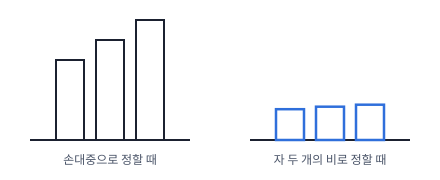

*왼쪽 막대 셋은 크지만 높이가 다르고, 오른쪽 막대 셋은 작지만 높이가 거의 같아요.*

**정확히 말하면**

[소스 축퇴 차동쌍의 반회로 이득](#s2-degen-gain)에서 구한 식을 다시 봐요.

$$
A_v = -\frac{R_{DD}/2}{\frac{1}{g_{m1}} + \frac{R_{SS}}{2}}
$$

외우는 법은 "드레인 쪽 저항을 소스 쪽 저항으로 나누고 마이너스를 붙인다"예요.

| 자리 | 무엇 | 이 회로에서 |
|---|---|---|
| 분자 | 드레인 쪽 저항 | $\frac{R_{DD}}{2}$ |
| 분모 | 소스 쪽 저항의 합 | $M_1$의 소스에서 들여다본 $\frac{1}{g_{m1}}$과 소스에 달린 $\frac{R_{SS}}{2}$의 합 |
| 부호 | 마이너스 | 전류 방향과 전압 극성 때문에 입력과 출력의 위상이 뒤집혀요(위상 반전). |

이 구조를 쓰는 이유는 큰 이득이 아니에요. 정확하고 선형적인 이득이에요.

1. $\frac{R_{SS}}{2}$를 $\frac{1}{g_{m1}}$보다 훨씬 크게 잡아요.

   $$
   \frac{R_{SS}}{2} \gg \frac{1}{g_{m1}}
   $$
2. 분모에서 $\frac{1}{g_{m1}}$을 무시할 수 있어요.

   $$
   A_v \approx -\frac{R_{DD}/2}{R_{SS}/2}
   $$
3. 2를 약분하면 저항의 비만 남아요.

   $$
   A_v \approx -\frac{R_{DD}}{R_{SS}}
   $$

- 이득이 저항의 비로 정해지므로 $g_m$의 영향을 덜 받아요.
- $g_m$은 트랜지스터의 전압-전류 관계를 직선으로 근사한 값이에요. 신호가 커지면 비선형(nonlinear)이 드러나요.
- 저항은 선형(linear) 소자예요. 그래서 저항의 비로 정한 이득은 더 정확하고 더 선형적이에요.
- 대가로 이득이 크게 줄어요. 이득 크기가 $R_{SS} = 0$일 때의 $g_{m1}\frac{R_{DD}}{2}$보다 항상 작아요.

같은 종류끼리의 비로 이득을 정해 정확도를 얻는 생각은 [다이오드 연결 부하 차동쌍의 이득](#s1-diode-load-gain)과 같아요. 거기서는 $g_m$의 비였고, 여기서는 저항의 비예요.

#### 직접 해 보기: 소스 사이 저항을 키우면 이득이 저항비에 붙어요 *(정적 스냅샷 — 직접 조작은 HTML 버전)*

$R_{SS}$와 $g_m$ 편차를 움직이면 이득 $-\dfrac{R_{DD}/2}{1/g_{m1} + R_{SS}/2}$이 저항비 $-R_{DD}/R_{SS}$에 가까워지고, $g_m$이 바뀌어도 덜 변하는 것이 보여요. 대신 이득 크기는 줄어요. $R_{DD} = 2\ \text{k}\Omega$, 기준 $g_{m1} = 10\ \text{mS}$($1/g_{m1} = 100\ \Omega$)로 고정했어요.

**Av = −3.33, 저항비 −RDD/RSS = −5.00 (크기 차이 33.3 %), gm이 ±20 % 바뀔 때 Av는 −3.08 ~ −3.53 (기준 −3.33 대비 −7.7 % ~ +5.9 %)**

범례: 축퇴 이득 크기 · 축퇴가 없을 때(RSS = 0) · 저항비 RDD/RSS · 세로 점선: 현재 gm 편차

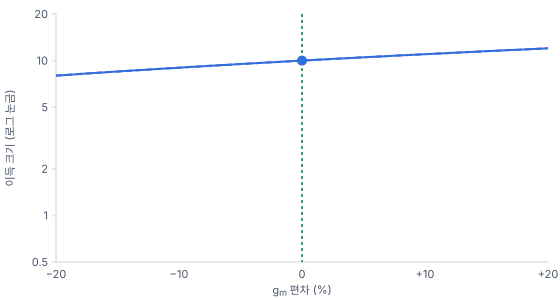

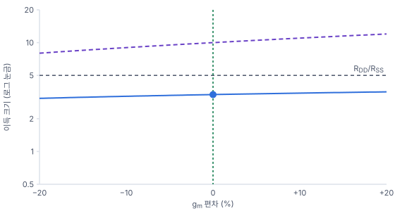

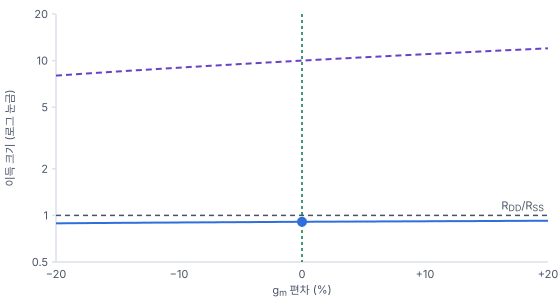

| 설정 | $R_{SS}$ (Ω) | $R_{SS}/2$ (Ω) | $A_v$ ($g_m$ −20 %) | $A_v$ (기준 $g_m$) | $A_v$ ($g_m$ +20 %) | 기준 대비 변화 | 저항비 $-R_{DD}/R_{SS}$ | 저항비와의 크기 차이 |
|---|---|---|---|---|---|---|---|---|
| 1 | 0 | 0 | −8.00 | −10.00 | −12.00 | −20.0 % ~ +20.0 % | 정할 수 없음 | 해당 없음 |
| 2 | 400 | 200 | −3.08 | −3.33 | −3.53 | −7.7 % ~ +5.9 % | −5.00 | 33.3 % |
| 3 | 2000 | 1000 | −0.89 | −0.91 | −0.92 | −2.2 % ~ +1.5 % | −1.00 | 9.1 % |

위젯의 숫자는 개념을 보기 위한 예시예요. $R_{SS} = 0$이면 $g_m$이 ±20 % 바뀔 때 이득도 ±20 % 바뀌어요. $R_{SS}$를 키울수록 곡선이 눕고 저항비 점선에 가까워지지만, 곡선 전체가 아래로 내려가요.

**교수님 말씀**

> "분모는 소스 쪽에 저항의 … 합이고, 분자는 … 드레인 쪽의 저항 … 기억을 하면 좀 편해요." (0930 38:10)

$g_m$은 비선형인 트랜지스터를 선형으로 근사한 것이고 저항은 선형이라서, 저항의 비로 이득을 정하면 더 선형적이라고 설명하셨어요 (0930 40:37).

**꼭 기억해요**

> "정확하게는 부호 마이너스가 붙습니다." (0930 38:50)

> "이득은 크게 줄어들지만 정확한 이득을 얻고자 할 때 쓰는 용도로 있습니다." (0930 41:10)

**페이지 요약**

축퇴 이득은 드레인 쪽 저항을 소스 쪽 저항으로 나눈 값에 마이너스를 붙인 것이고, 저항비로 정해져 정확하고 선형적이에요.

*핵심 식*

- 근사 조건

  $$
  \frac{R_{SS}}{2} \gg \frac{1}{g_{m1}}
  $$
- 저항비 이득

  $$
  A_v \approx -\frac{R_{DD}}{R_{SS}}
  $$

*용어*

- **소스 쪽 저항** — 이득 식의 분모, 소스에서 들여다본 저항과 소스에 달린 저항의 합
- **드레인 쪽 저항** — 이득 식의 분자, 드레인에 달린 저항
- **위상 반전** — 입력이 오르면 출력이 내려가는 것, 이득의 마이너스 부호

---

## 3. BJT 차동쌍

### BJT 차동쌍의 CM 응답

*0930 수업 · L04 s19*

**쉽게 말하면**

아래에서 펌프가 늘 같은 양의 물만 빼 가니까, 쌍둥이 두 입구를 똑같이 올려도 물은 반반씩 그대로 흘러요.

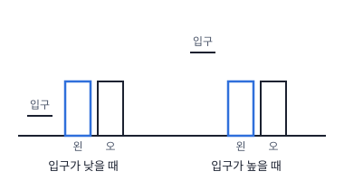

*물의 양이 그대로라서 나오는 곳 높이도 그대로예요.*

**정확히 말하면**

BJT 차동쌍은 MOS 차동쌍과 구조가 같아요. $Q_1$, $Q_2$의 이미터를 한 노드로 묶고 그 아래에 테일 전류원(tail current source) $I_{EE}$를 달아요. 컬렉터 X, Y는 $R_{C1} = R_{C2} = R_C$를 거쳐 $V_{CC}$로 이어져요.

BJT와 MOS는 "전류원으로 동작한다"는 개념이 같아요. 다른 점은 입력 단자 전류와 대신호 전류 관계예요.

| 항목 | MOS | BJT |
|---|---|---|
| 입력 단자 전류 | 게이트 전류는 0 | 베이스 전류가 있음 |
| 대신호 전류 | $V_{GS}$의 제곱 관계 | $V_{BE}$의 지수(exponential) 관계 |
| 소신호 모델 | $i_d = g_m v_{gs}$ | $i_c = g_m v_{be}$ (같은 틀) |

CM 응답은 두 베이스에 같은 전압을 걸었을 때의 동작이에요. 두 베이스를 묶어 입력 공통 모드 레벨(input CM level) $V_{CM}$을 걸고 바이어스를 구해요.

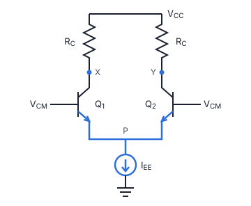

*강조색 선이 두 이미터가 함께 쓰는 노드와 테일 전류원 $I_{EE}$예요. 두 베이스에는 같은 $V_{CM}$이 걸려요.*

1. 두 이미터가 묶여 있고 두 베이스 전압이 같아요: $V_{BE1} = V_{BE2}$
2. 두 트랜지스터가 같으므로: $I_{C1} = I_{C2}$
3. 이미터 노드에서 KCL: $I_{C1} + I_{C2} = I_{EE}$ (정확히는 이미터 전류의 합이에요. $\beta \gg 1$이라 베이스 전류를 무시해요.)
4. 따라서

   $$
   I_{C1} = I_{C2} = \frac{I_{EE}}{2}
   $$
5. 출력 CM 레벨은 $V_{CC}$에서 $R_C$에 걸린 전압을 빼요:

   $$
   V_X = V_Y = V_{CC} - R_C\frac{I_{EE}}{2}
   $$

이 식 어디에도 $V_{CM}$이 없어요. 전류는 테일 전류원이 정하므로 입력 CM 레벨을 바꿔도 두 전류와 출력 전압이 그대로예요.

베이스 전압을 바꿨는데 전류가 안 바뀌는 이유는 이미터 전압이 같이 따라 움직이기 때문이에요. 베이스가 오르면 이미터도 같은 만큼 올라 $V_{BE}$가 일정하게 유지돼요.

테일 전류원 없이 이미터를 접지에 바로 묶은 구조(공통 이미터 단)는 달라요. 이미터가 고정이라 입력 바이어스가 곧 $V_{BE}$가 되고, 전류가 지수적으로 바뀌어요. 그래서 출력 CM 레벨도 입력 바이어스에 좌우돼요.

| 항목 | 공통 이미터 단(이미터 접지) | BJT 차동쌍(테일 전류원) |
|---|---|---|
| 이미터 | 접지에 고정 | 베이스를 따라 움직임 |
| 입력 바이어스를 올리면 | $V_{BE}$가 커지고 전류가 지수적으로 증가 | $V_{BE}$와 전류가 그대로 |
| 출력 DC 레벨 | 입력 바이어스에 따라 바뀜 | $V_{CC} - R_C\dfrac{I_{EE}}{2}$, $V_{CM}$과 무관 |

MOS 차동쌍에서 같은 논리를 본 곳은 [입력 CM 레벨을 올려도 전류와 출력은 그대로](../../0923/정리노트_0923_Differential_Amplifiers.html#s1-cm-response)(0923)예요. $V_{CM}$을 얼마까지 올릴 수 있는지는 [활성 영역 조건과 공통 모드 제거](#s3-bjt-bias)에서 이어져요.

**교수님 말씀**

BJT로 넘어오면서 MOS와 개념이 같다는 점부터 짚었어요. 둘 다 전류원으로 동작하고, 게이트 전류는 0인데 베이스 전류는 있다는 것, 대신호에서 제곱과 지수로 다르다는 것만 차이예요 (0930 41:45).

이미터를 물리적으로 접지한 구조였다면 입력 바이어스에 따라 전류가 바뀌었을 거라며, 테일 전류원이 있는 차동쌍과 비교했어요 (0930 43:45).

> "이미 앞에서 MOS differential pair에서 했었죠." (0930 45:05)

**페이지 요약**

테일 전류원이 전류를 정하므로 $V_{CM}$을 바꿔도 두 컬렉터 전류와 출력 CM 레벨이 그대로예요.

*핵심 식*

- 같은 베이스-이미터 전압

  $$
  V_{BE1} = V_{BE2}
  $$
- 바이어스 전류

  $$
  I_{C1} = I_{C2} = \frac{I_{EE}}{2}
  $$
- 출력 CM 레벨

  $$
  V_X = V_Y = V_{CC} - R_C\frac{I_{EE}}{2}
  $$

*용어*

- **테일 전류원(tail current source)** — 묶인 이미터 아래에서 두 전류의 합 $I_{EE}$를 정하는 전류원
- **입력 공통 모드 레벨(input CM level)** — 두 베이스에 공통으로 걸린 전압 $V_{CM}$

---

### 활성 영역 조건과 공통 모드 제거

*0930 수업 · L04 s20*

**쉽게 말하면**

두 입구는 나오는 곳보다 높이 올리면 안 돼요.

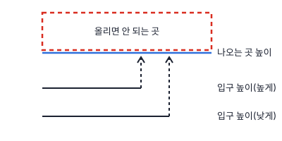

*그 밑에서는 입구를 올리고 내려도 나오는 곳 높이가 그대로라서, 양쪽에 똑같이 섞인 잡음도 사라져요.*

**정확히 말하면**

BJT는 활성 영역(active region)에서 동작해야 해요. 순방향 활성 영역(forward active region)이라고도 해요. 활성 영역은 BJT가 전류원으로 동작하는 영역이고, MOSFET의 포화 영역에 해당해요.

npn 트랜지스터가 활성 영역에 있으려면 베이스-이미터 접합은 순방향, 베이스-컬렉터 접합은 역방향이어야 해요. 전압으로 쓰면 컬렉터 전압이 베이스 전압 이상이고($V_C \ge V_B$), 베이스 전압은 이미터 전압보다 높아요.

1. 컬렉터 전압은 출력 CM 레벨이에요: $V_C = V_X = V_Y = V_{CC} - R_C\dfrac{I_{EE}}{2}$
2. 베이스 전압은 밖에서 가하는 입력 CM 레벨이에요: $V_B = V_{CM}$
3. $V_C \ge V_B$에 대입:

   $$
   V_{CC} - R_C\frac{I_{EE}}{2} \ge V_{CM}
   $$

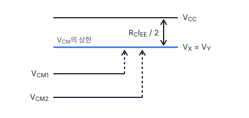

*$V_{CM}$이 $V_{CM1}$이든 $V_{CM2}$든 출력 $V_X = V_Y$는 같은 자리에 있어요. $V_{CM}$은 이 선까지만 올릴 수 있어요.*

- 이 부등식은 $V_{CM}$의 최댓값을 제한해요.
- $V_{CM}$을 그보다 높이면 활성 영역을 벗어나요(BJT의 포화 상태). 전류원으로 동작하지 않아 이득이 크게 떨어져요.
- $V_X$, $V_Y$는 가하는 전압이 아니에요. 전류 $\dfrac{I_{EE}}{2}$가 $R_C$를 흐르면서 정해지는 전압이에요.
- $V_{CM}$은 밖에서 가하는 전압이고 전류와 무관해요. 전류는 테일 전류원이 정해요([BJT 차동쌍의 CM 응답](#s3-bjt-cm)).

출력 CM 레벨이 입력 CM 레벨과 무관하게 일정한 성질을 공통 모드 제거(common-mode rejection)라고 해요.

- DC 바이어스만 해당하는 것이 아니에요. 두 입력에 같은 위상으로 들어온 노이즈도 출력에서 제거돼요.
- 신호는 일부러 위상을 반대로 만든 차동 신호예요. 차이를 취해도 살아남아요.
- 이 둘을 통틀어 넓은 의미의 공통 모드 제거라고 불러요.

차동 증폭기는 선이 두 개, 트랜지스터가 두 개이고 전류도 두 배로 써요. 그래도 쓰는 이유가 공통 모드 제거예요. 단일단(single-ended) 회로에서는 노이즈가 출력에 그대로 나와요.

**교수님 말씀**

오디오 앰프를 예로 들었어요. 단일단 앰프를 쓰면 밖에서 들어온 노이즈가 그대로 소리로 나와요. 차동 앰프를 쓰면 그 노이즈가 제거돼요 (0930 50:15–51:40).

$V_X$, $V_Y$는 우리가 가하는 전압이 아니라 전류로 결정되는 전압이고, $V_{CM}$은 전류와 상관없다는 점을 다시 짚었어요.

> "굳이 라인도 두 개고, 트랜지스터도 두 개를 쓰고, 전류도 두 배로 쓰는데 이거 왜 쓰냐? 커먼 모드 리젝션 특성 때문이죠." (0930 50:15)

**꼭 기억해요**

> "V_CM의 최댓값 조건이 제한되죠, 이거보다 높아지면 안 되겠죠." (0930 48:05)

활성 영역 조건은 입력 CM 레벨의 위쪽 한계를 정해요.

> "차동 증폭기에서 가장 중요한 특성이 뭐냐 그러면 이 커먼 모드 리젝션 특성이에요." (0930 50:04)

차동 증폭기에서 가장 중요한 특성은 공통 모드 제거예요.

**페이지 요약**

컬렉터 전압이 베이스 전압 이상이어야 활성 영역이라서 $V_{CM}$에는 상한이 있고, 그 안에서는 출력 CM 레벨이 입력 CM 레벨과 무관해요.

*핵심 식*

- 활성 영역 조건

  $$
  V_{CC} - R_C\frac{I_{EE}}{2} \ge V_{CM}
  $$

*용어*

- **활성 영역(active region)** — BJT가 전류원으로 동작하는 영역, MOSFET의 포화 영역에 해당
- **공통 모드 제거(common-mode rejection)** — 출력 CM 레벨이 입력 CM 레벨과 무관하고, 같은 위상의 노이즈가 출력에서 사라지는 성질

---

### BJT 차동쌍의 대신호 해석

*0930 수업 · L04 s21*

**쉽게 말하면**

두 입구 높이가 다르면 더 높은 쪽이 물을 더 많이 가져가요. 차이가 커지면 한쪽이 물을 다 가져가서, 더 올려도 달라지지 않아요.

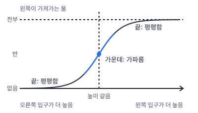

*가운데에서만 조금 올린 만큼 물이 따라 늘어요.*

**정확히 말하면**

$Q_1$ 베이스에 $V_{in1}$, $Q_2$ 베이스에 $V_{in2}$를 따로 줘요. 두 입력의 차이가 작다는 가정은 두지 않아요. 임의의 크기에 대해 푸는 대신호 해석(large-signal analysis)이에요.

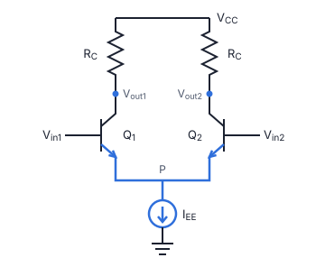

*강조색 선이 두 이미터가 함께 쓰는 노드 P와 테일 전류원이에요. 출력은 두 컬렉터 전압 $V_{out1}$, $V_{out2}$예요.*

노드 식을 세워 풀면 차동 출력이 이렇게 나와요(슬라이드 s21, 교과서 식 (10.83)).

$$
V_{out1} - V_{out2} = -R_C I_{EE}\tanh\frac{V_{in1} - V_{in2}}{2V_T}
$$

$V_T$는 열전압(thermal voltage)으로 상온에서 약 26 mV예요. 입력 차와 출력 차의 관계는 $\tanh$ 곡선이라 일반적으로 비선형(nonlinear)이에요. BJT의 $I_C$–$V_{BE}$ 관계가 지수라서 그래요.

곡선의 세 지점을 보면 모양이 잡혀요. 두 전류의 합은 늘 $I_{EE}$예요.

| 입력 | $I_{C1}$ | $I_{C2}$ | $V_{out1}$ | $V_{out2}$ | $V_{out1} - V_{out2}$ |
|---|---|---|---|---|---|
| $V_{in1}$이 훨씬 클 때 | $I_{EE}$ | $0$ | $V_{CC} - R_C I_{EE}$ | $V_{CC}$ | $-R_C I_{EE}$ |
| $V_{in1} = V_{in2}$ | $\dfrac{I_{EE}}{2}$ | $\dfrac{I_{EE}}{2}$ | $V_{CC} - R_C\dfrac{I_{EE}}{2}$ | $V_{CC} - R_C\dfrac{I_{EE}}{2}$ | $0$ |
| $V_{in2}$가 훨씬 클 때 | $0$ | $I_{EE}$ | $V_{CC}$ | $V_{CC} - R_C I_{EE}$ | $+R_C I_{EE}$ |

- $V_{in1}$이 커지면 $Q_1$ 쪽 전류가 커져요. $R_C$의 전압 강하가 커져서 $V_{out1}$이 내려가요. 그래서 식에 마이너스 부호가 붙어요.
- 입력 차가 커지면 한쪽이 $I_{EE}$를 다 가져가요. 차동 출력은 $\mp R_C I_{EE}$에서 더 변하지 않고 포화해요.
- $|V_{in1} - V_{in2}|$가 작으면 차동 출력은 $V_{in1} - V_{in2}$의 선형 함수가 돼요. 원점 부근의 곡선을 직선으로 근사하는 것이에요.
- 그 직선의 기울기가 이득이에요. 원점에서 기울기가 가장 크므로 이득이 가장 큰 영역이에요.
- 원점에서 멀어질수록 곡선이 누워 기울기가 줄어요. 그곳에서 쓰면 이득이 줄어요.
- 입력 진폭이 커지면 직선 근사와 실제 곡선의 오차가 커져요.

이 회로는 증폭기 말고 비교기(comparator)로도 써요. 큰 입력에서는 차동 출력이 0보다 큰지 작은지만 보면 $V_{in1}$과 $V_{in2}$ 중 어느 쪽이 큰지 알 수 있어요. 증폭기는 곡선의 선형 영역을, 비교기는 비선형(포화) 영역을 써요.

MOS 차동쌍의 대신호 해석은 [입력 차에 따라 전류가 나뉘는 방식](../../0923/정리노트_0923_Differential_Amplifiers.html#s2-large-signal)(0923)에 있어요. MOS는 제곱 관계라 근호가 든 식이, BJT는 지수 관계라 $\tanh$ 식이 나와요.

#### 직접 해 보기: 입력 차에 따라 나뉘는 두 컬렉터 전류 *(정적 스냅샷 — 직접 조작은 HTML 버전)*

입력 차 $V_{in1} - V_{in2}$를 움직이면 두 컬렉터 전류가 $I_{EE}$를 나눠 갖는 모습과, $\tanh$ 곡선 위의 점이 원점 접선(직선 근사)에서 얼마나 벗어나는지 보여요. $I_{EE} = 1\ \text{mA}$, $R_C = 1\ \text{k}\Omega$, $V_T = 26\ \text{mV}$로 고정해서 $R_C I_{EE} = 1\ \text{V}$예요. 전류 곡선은 보충 레이어의 전류 식으로 그렸어요.

**IC1 = 0.731 mA, IC2 = 0.269 mA, Vout1 − Vout2 = −0.462 V, 직선 근사 = −0.500 V, 근사 오차 = 8.2 %**

범례: IC1 · IC2 · Vout1 − Vout2 · 원점 접선(직선 근사) · 빨간 세로선: 접선과 곡선의 차이 · 세로 점선: ±10 mV와 현재 입력 차

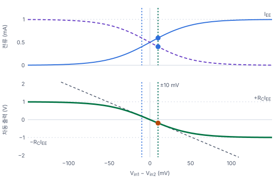

*설정 1: 입력 차 10 mV, 근사 오차 1.2 %*

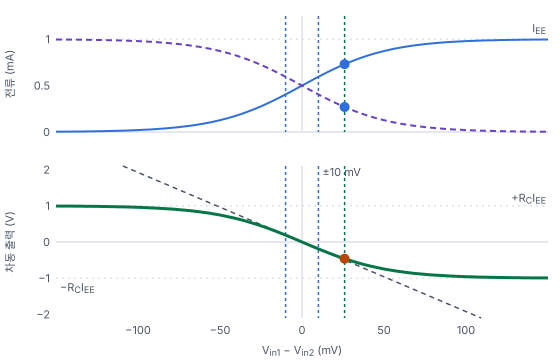

*설정 2: 입력 차 26 mV, 근사 오차 8.2 %*

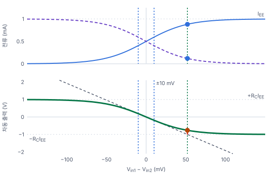

*설정 3: 입력 차 52 mV, 근사 오차 31.3 %*

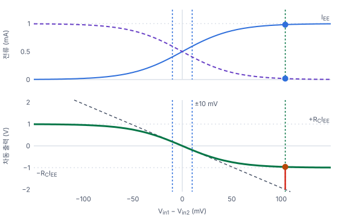

*설정 4: 입력 차 104 mV, 근사 오차 107.5 %*

| 설정 | $V_{in1} - V_{in2}$ (mV) | $I_{C1}$ (mA) | $I_{C2}$ (mA) | $V_{out1} - V_{out2}$ (V) | 직선 근사 (V) | 근사 오차 (%) |
|---|---|---|---|---|---|---|
| 1 | 10 | 0.595 | 0.405 | −0.190 | −0.192 | 1.2 |
| 2 | 26 | 0.731 | 0.269 | −0.462 | −0.500 | 8.2 |
| 3 | 52 | 0.881 | 0.119 | −0.762 | −1.000 | 31.3 |
| 4 | 104 | 0.982 | 0.018 | −0.964 | −2.000 | 107.5 |

**교수님 말씀**

MOS 차동쌍에서 했던 것처럼 이번에도 두 입력이 다르고 그 차이가 작다고 가정하지 않은 경우를 본다고 하셨어요. 식은 "노드 식을 세워서 구해 보면" 나온다며 유도 없이 결과와 그래프만 보여 주셨어요 (0930 51:40).

> "요 회로는 사실 우리가 앰프로서 동작할 수도 있지만 … 비교기 회로로도 사용될 수 있습니다. 비교기요." (0930 55:18)

증폭기로 쓸 때는 원점 부근의 직선 구간을, 비교기로 쓸 때는 양 끝의 포화 구간을 쓴다고 정리하셨어요.

**꼭 기억해요**

> "하이퍼볼릭 탄젠트 식이 나오는데, 뭐 이거는 여러분들이 굳이 기억을 하지 않아도 되지만 …" (0930 52:50)

$\tanh$ 식은 외우지 않아도 돼요. 입력 차와 출력 차의 관계가 비선형이라는 것을 기억해요.

> "그래서 여기가 이득이 가장 큰 영역이 되죠." (0930 57:15)

원점 부근이 기울기, 곧 이득이 가장 큰 영역이에요.

**보충 · 수업에서 유도하진 않았어요**

수업에서 결과만 본 $\tanh$ 식의 유도예요(교과서 10.2.2절, 식 (10.57)–(10.63), (10.77)–(10.83)). $\alpha = 1$(베이스 전류 무시), $V_A = \infty$, $I_{S1} = I_{S2}$로 두고 $V_{BE} = V_T\ln\dfrac{I_C}{I_S}$를 써요.

1. KVL(이미터를 공유): $V_{in1} - V_{BE1} = V_P = V_{in2} - V_{BE2}$
2. 정리: $V_{in1} - V_{in2} = V_{BE1} - V_{BE2}$
3. $V_{BE}$를 전류로 바꾸면 $I_S$가 소거돼요:

   $$
   V_{in1} - V_{in2} = V_T\ln\frac{I_{C1}}{I_{S1}} - V_T\ln\frac{I_{C2}}{I_{S2}} = V_T\ln\frac{I_{C1}}{I_{C2}}
   $$
4. 지수 꼴로: $I_{C1} = I_{C2}\,e^{(V_{in1}-V_{in2})/V_T}$
5. KCL(노드 P): $I_{C1} + I_{C2} = I_{EE}$
6. 4단계를 5단계에 대입: $I_{C2}\,e^{(V_{in1}-V_{in2})/V_T} + I_{C2} = I_{EE}$
7. $I_{C2}$:

   $$
   I_{C2} = \dfrac{I_{EE}}{1 + e^{(V_{in1}-V_{in2})/V_T}}
   $$
8. $I_{C1} = I_{EE} - I_{C2}$:

   $$
   I_{C1} = \dfrac{I_{EE}\,e^{(V_{in1}-V_{in2})/V_T}}{1 + e^{(V_{in1}-V_{in2})/V_T}} = \dfrac{I_{EE}}{1 + e^{-(V_{in1}-V_{in2})/V_T}}
   $$
9. 출력: $V_{out1} = V_{CC} - R_C I_{C1}$, $V_{out2} = V_{CC} - R_C I_{C2}$
10. 빼기: $V_{out1} - V_{out2} = -R_C(I_{C1} - I_{C2})$
11. 7, 8단계를 넣으면:

    $$
    V_{out1} - V_{out2} = -R_C I_{EE}\,\dfrac{e^{(V_{in1}-V_{in2})/V_T} - 1}{e^{(V_{in1}-V_{in2})/V_T} + 1}
    $$
12. 분자와 분모에 $e^{-(V_{in1}-V_{in2})/(2V_T)}$를 곱해요. $x = \dfrac{V_{in1}-V_{in2}}{2V_T}$로 쓰면 분수는 $\dfrac{e^{x} - e^{-x}}{e^{x} + e^{-x}} = \tanh x$예요.
13. 결과:

    $$
    V_{out1} - V_{out2} = -R_C I_{EE}\tanh\frac{V_{in1} - V_{in2}}{2V_T}
    $$

확인해 봐요. $V_{in1} = V_{in2}$이면 7, 8단계에서 $I_{C1} = I_{C2} = \dfrac{I_{EE}}{2}$예요. $V_{in1} - V_{in2}$가 매우 큰 양수면 $I_{C1} \to I_{EE}$, $I_{C2} \to 0$이고, 매우 큰 음수면 반대예요.

"매우 크다"의 기준은 $V_T$예요. 교과서 예제 10.8은 한쪽이 테일 전류의 98 %를 흘릴 때 입력 차가 약 $3.89V_T$(약 101 mV), 어림해 $4V_T$라고 정리해요(교과서 풀이는 근사식을 써서 $3.91V_T$로 적어요). 이 값은 $I_{EE}$나 $I_S$와 무관해요.

**페이지 요약**

입력 차에 따라 두 컬렉터 전류가 $I_{EE}$를 나눠 갖고, 차동 출력은 $\tanh$ 곡선을 따라 $\mp R_C I_{EE}$에서 포화해요.

*핵심 식*

- 차동 출력

  $$
  V_{out1} - V_{out2}
  $$

  $$
  = -R_C I_{EE}\tanh\frac{V_{in1} - V_{in2}}{2V_T}
  $$
- 포화값

  $$
  \mp R_C I_{EE}
  $$

*용어*

- **대신호 해석(large-signal analysis)** — 입력 차가 작다는 가정 없이 임의의 크기에 대해 푸는 해석
- **비선형(nonlinear)** — 입력 차와 출력 차가 비례하지 않는 관계
- **비교기(comparator)** — 차동 출력의 부호로 두 입력 중 어느 쪽이 큰지 판별하는 회로

---

### 소신호의 뜻

*0930 수업 · L04 s21*

**쉽게 말하면**

소신호는 동작점 근처의 곡선을 접선으로 바꾸어도 전류 변화를 충분히 정확하게 구할 수 있는 입력 범위예요.

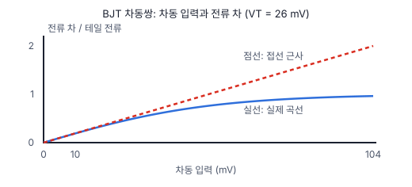

*같은 회로에서도 입력 차가 커지면 접선이 실제 곡선에서 멀어져요.*

**정확히 말하면**

**작은 예시.** 대칭인 BJT 차동쌍에서 $V_T=26\,\mathrm{mV}$로 두어요. 차동 입력 $10\,\mathrm{mV}$에서는 접선 근사가 실제 전류 차보다 약 1.2% 크지만, $104\,\mathrm{mV}$에서는 약 107.5% 커요. 오차는 (접선값 − 실제값) / 실제값으로 계산해요. 입력 CM이 $1\,\mathrm{V}$라고 해서 그 10%인 $100\,\mathrm{mV}$ 차동 입력을 소신호로 판단할 수는 없어요.

소신호(small signal) 모델은 정해 둔 동작점에서 실제 전압·전류 특성을 접선으로 선형화해요. 입력 범위에서 접선과 실제 곡선의 차이가 허용 오차 안에 있어야 같은 이득을 쓸 수 있어요.

- 기준이 되는 전압 척도는 소자와 회로에 따라 달라요. 이 BJT 차동쌍은 차동 입력을 열전압 $V_T$와 비교하고, MOS 제곱 법칙은 게이트 변화량을 오버드라이브 전압과 비교해요.
- BJT 차동쌍의 경험칙으로 차동 입력 $10\,\mathrm{mV}$ 미만을 소신호로 봐요(교과서 10.2.3절). 이는 정밀도 요구와 모델에 따라 확인해야 하는 기준이에요.
- 입력 CM의 DC 값이 커진다고 허용 차동 입력이 그 비율만큼 커지는 것은 아니에요.

수업에서는 "바이어스의 10 % 이내(100 mV까지)"와 "10 mV 이하"를 함께 말했어요. 이 BJT 차동쌍에는 DC 바이어스의 10%를 적용하지 않고, [BJT 차동쌍의 대신호 해석](#s3-bjt-large)의 $\tanh$ 곡선과 접선의 차이를 확인해요. 입력 차가 약 100 mV이면 전류가 이미 한쪽으로 크게 몰려요.

**교수님 말씀**

수업에서는 바이어스 1 V에 진폭 1 V를 얹는 예로 작은 변화량 해석과 구별하셨어요 (0930 57:45–58:50). 이 예를 DC 대비 일정 비율이라는 판정식으로 쓰지는 않아요.

마지막에 차동 회로의 두 가지 쓰임을 다시 말씀하셨어요.

> "스몰 시그널 동작 이외에 … 라지 시그널 오퍼레이션에서는 두 입력의 차이에 의한 컴패레이터로도 사용될 수 있다." (0930 60:38)

**꼭 기억해요**

> "작은 신호라고 하는 거는 … 절대값이 작다 이런 얘기가 아니라, 바이어스 전압에 대해서 … 변동이 작다라는 의미예요." (0930 57:45)

이 설명을 특정 DC 전압의 일정 비율로 일반화하지 않아요. 이 차동쌍에서는 차동 입력에 대한 접선 근사 오차로 판단해요.

**페이지 요약**

소신호의 기준은 DC 전압 대비 비율이 아니라, 동작점에서 선형화한 모델의 오차가 충분히 작은지예요.

*용어*

- **소신호(small signal)** — 접선 근사 오차가 충분히 작은 입력 범위의 신호
- **동작점** — 선형화의 기준으로 정한 DC 전압과 전류
- **소신호 모델** — 동작점 부근의 작은 변화량 사이의 관계를 선형으로 나타낸 모델

---

## 4. 요약 · 예고

### 한눈에 보는 식

*0930 수업 · L04 s15–21*

0930 수업의 핵심 식과 결론을 모았어요. 행마다 자세한 설명이 있는 토픽으로 이어져요.

| 무엇 | 식 · 결론 | 토픽 |
|---|---|---|
| 전력 예산과 출력 CM 레벨 | $P = V_{DD} I_{SS}$가 2 mW 이내여야 해요. $V_{out,CM} = V_{DD} - \frac{I_{SS}}{2}R_D$가 1.6 V 이상이어야 하니 $R_D \le 400\ \Omega$이에요. | [전력 예산과 출력 CM 레벨로 바이어스 정하기](#s0-design-bias) |
| 이득에서 $g_m$, $g_m$에서 $W/L$ | $A_v = -g_m R_D$에서 필요한 값은 $12.5\ \text{mS}$예요. $g_m = \frac{2I_D}{V_{OD}}$, $g_m = \sqrt{2\mu_n C_{ox}\frac{W}{L}I_D}$ 가운데 전류로 쓴 식으로 $W/L$을 정해요. | [g_m 식 세 가지와 W/L 정하기](#s0-design-size) |
| 두 가지 트랜지스터 부하 | 다이오드 연결 부하는 $\frac{v_x}{i_x} = \frac{1}{g_m}$인 작은 저항이에요. 전류원 부하는 $r_O$인 큰 저항이에요. | [다이오드 연결 부하와 전류원 부하](#s1-diode-vs-source) |
| 트랜지스터 부하 차동쌍의 이득 | 다이오드 연결 부하는 $A_v \approx -\frac{g_{m1}}{g_{m3}}$ ($g_m$의 비라서 정확한 이득), 전류원 부하는 $A_v = -g_{m1}(r_{O1} \parallel r_{O3})$ (큰 이득) | [다이오드 연결 부하 차동쌍의 이득](#s1-diode-load-gain) |
| 대칭 중간점 | $R_1 = R_2$이면 $V_X = \frac{1}{2}(V_a + V_b)$예요. 차동 신호에서만 0이 되는 가상 접지예요. | [가상 접지의 확장: 대칭 중간점](#s2-virtual-ground-ext) |
| 소스 축퇴 반회로 이득 | $A_v = -\frac{R_{DD}/2}{\frac{1}{g_{m1}} + \frac{R_{SS}}{2}}$ (분모는 소스 쪽 저항, 분자는 드레인 쪽 저항) | [소스 축퇴 차동쌍의 반회로 이득](#s2-degen-gain) |
| 축퇴를 쓰는 이유 | $\frac{R_{SS}}{2}$가 $\frac{1}{g_{m1}}$보다 훨씬 크면 $A_v \approx -\frac{R_{DD}}{R_{SS}}$예요. 이득은 줄지만 더 선형이에요. | [축퇴 이득을 외우는 법과 쓰는 이유](#s2-degen-why) |
| BJT 차동쌍의 CM 응답 | $I_{C1} = I_{C2} = \frac{I_{EE}}{2}$, $V_X = V_Y = V_{CC} - R_C\frac{I_{EE}}{2}$ (입력 CM 레벨과 무관해요) | [BJT 차동쌍의 CM 응답](#s3-bjt-cm) |
| 입력 CM 레벨의 상한 | $V_{CC} - R_C\frac{I_{EE}}{2} \ge V_{CM}$ (활성 영역 조건) | [활성 영역 조건과 공통 모드 제거](#s3-bjt-bias) |
| BJT 대신호 특성 | $V_{out1} - V_{out2} = -R_C I_{EE}\tanh\frac{V_{in1} - V_{in2}}{2V_T}$ (비선형이에요. 원점의 기울기가 이득이고, 양 끝은 크기 $R_C I_{EE}$에서 멈춰요) | [BJT 차동쌍의 대신호 해석](#s3-bjt-large) |
| 소신호의 기준 | 접선 근사의 오차가 충분히 작다는 뜻이에요. 이 BJT 차동쌍에서는 차동 입력 약 $10\ \text{mV}$ 미만을 기준으로 봐요. | [소신호의 뜻](#s3-small-signal-meaning) |

교수님이 쓴 비유와 단어도 같이 기억해요.

- 인터페이스: 내 증폭기의 출력이 남이 설계한 다음 단의 입력에 이어져요. 그래서 다음 단의 요구가 내 출력 CM 레벨 조건이 돼요. ([전력 예산과 출력 CM 레벨로 바이어스 정하기](#s0-design-bias))
- 튜닝: 식 없이 값을 이것저것 바꿔 보는 일이에요. 설계가 아니고, 계산기가 더 잘해요. ([g_m 식 세 가지와 W/L 정하기](#s0-design-size))
- 시소: 양쪽이 같은 크기로 반대로 움직이면 가운데 받침점은 그대로예요. ([가상 접지의 확장: 대칭 중간점](#s2-virtual-ground-ext))
- 오디오 앰프: 단일단 앰프는 노이즈가 그대로 소리로 나오고, 차동 앰프는 노이즈를 지워요. ([활성 영역 조건과 공통 모드 제거](#s3-bjt-bias))
- 비교기: 대신호에서는 차동 출력의 부호로 두 입력 중 어느 쪽이 큰지 알 수 있어요. ([BJT 차동쌍의 대신호 해석](#s3-bjt-large))

---

### 다음 시간 예고

*0930 수업 · L04 s22–40*

수업 끝에 교수님이 BJT 차동쌍의 소신호 해석을 다음 시간에 이어서 하겠다고 예고했어요(0930 59:30–61:00). 아래 슬라이드는 이번 수업에서 시작하지 않았어요.

- Small Signal Analysis of BJT Differential Pair(s22): 예고만
- BJT 소신호 모델과 반회로(s23–s24)
- 예제: 차동 이득 계산(s25–s26)
- 캐스코드 차동쌍: MOS · 바이폴라(s27–s30)
- 공통 모드 제거와 CMRR(s32–s37)
- 차동-단일단 변환과 능동 부하(active load)(s38–s40)

---

### 함께 보면 좋은 자료

*0930 수업*

- [복습문제 11개 (PDF)](../복습문제_0930_Differential_Amplifiers-문제.pdf)
- [답안 (PDF)](../복습문제_0930_Differential_Amplifiers-답안.pdf)
- [직전 정리노트: 0923 차동 증폭기](../../0923/정리노트_0923_Differential_Amplifiers.html) (차동쌍, CM 응답, MOS 대신호 · 소신호 해석, 가상 접지)
- [Razavi 10장 문제집 전체 (PDF)](../../../workbook/pdf/ch10-문제.pdf)

복습문제는 Razavi 10장의 예제 4개, 연습문제 1개, 장말문제 6개에서 이번 수업 범위만 골랐어요. 이번 범위만으로 풀리는 기출이 없어 기출은 넣지 않았어요.

- 수업에서 푼 설계 예제 원본: 전력 2 mW, 출력 CM 1.6 V, 이득 5로 $I_{SS}$, $R_D$, $W/L$ 정하기(E10.16)
- 같은 설계를 $V_{DD}$ = 2 V로 다시 하며 $V_{DD}$와 $W/L$의 트레이드오프 정리하기(P10.42)
- 다이오드 연결 PMOS 부하 차동쌍의 이득 구하기(E10.22)
- $\lambda \gt 0$에서 다이오드 연결, 전류원, $R_1 = R_2$ 중간점(가상 접지 확장) 부하 세 회로의 차동 이득 구하기(P10.52)
- $R_{DD}$와 $R_{SS}$를 반으로 쪼개 소스 축퇴 반회로 이득 구하기(E10.24)
- 축퇴 차동쌍의 부하 전류원을 다이오드 연결 PMOS로 바꿨을 때의 이득 구하기(X10.24)
- $V_{CC}$가 오를 때 $V_X$, $V_Y$, 차동 출력의 변화로 전원 잡음 제거 설명하기(P10.11)
- 테일 전류 $I_{EE}$가 변할 때 $V_X$, $V_Y$와 차동 출력의 변화 보기(P10.12)
- 활성 영역 조건으로 입력 CM 레벨의 상한 계산하기(E10.04)
- 전류가 한쪽으로 다 쏠렸을 때의 컬렉터 전압과 활성 영역 조건으로 최대 $R_C$ 구하기(P10.14)
- $I_{EE}$ 절반, $V_{CC}$ 상승, $R_C$ 절반이 대신호 전류 · 전압 특성 곡선에 주는 영향 보기(P10.17)

---

출처: 권익진 교수님 강의자료(Lec4) · 수업 녹음 전사(0930) · B. Razavi, *Microelectronics*, 2nd ed. (Wiley) 10장.
