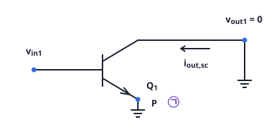
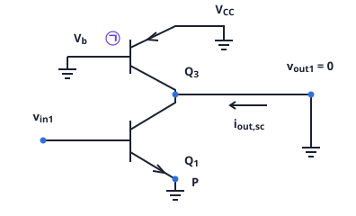
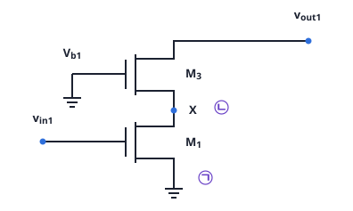
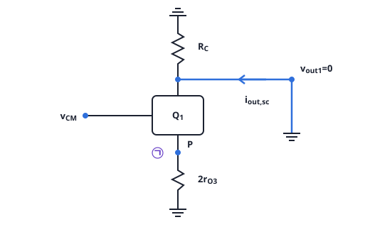

# 전자회로2 복습 1002 문제설명

회로와 첫 식을 짚고 핵심 계산으로 답을 구해요.

문제의 첫 줄부터 검산까지 설명해요.

**목차**

- [문항별 설명](#problems)
  - [P1. 기준 반회로: 이상적 전류원 부하 BJT 차동쌍](#p1)
  - [P2. pnp 전류원 부하 BJT 차동쌍](#p2)
  - [P3. MOS 캐스코드 목표 이득에서 테일 전류 역산](#p3)
  - [P4. 양쪽 캐스코드 부하의 W/L 설계](#p4)
  - [P5. BJT 부하 세 형태와 유한 rπ 캐스코드](#p5)
  - [P6. 베이스 저항 부하와 다단 BJT 캐스코드](#p6)
  - [P7. 캐스코드 테일의 차동·공통 모드 이득](#p7)
  - [P8. 캐스코드 부하의 차동·공통 모드 이득](#p8)
  - [P9. 유한 테일의 공통 모드 이득 제한 증명](#p9)

## 문항별 설명

### P1. 기준 반회로: 이상적 전류원 부하 BJT 차동쌍

E10.10 · 예제 10.10 · [원 문제 보기](../%EB%B3%B5%EC%8A%B5%EB%AC%B8%EC%A0%9C_1002_Differential_Amplifiers-%EB%AC%B8%EC%A0%9C.pdf)

#### 주어진 조건

- 이득을 최대로 하려고 이상적인 전류원을 사용함
- 소자 값은 주어지지 않음 (답은 소신호 파라미터 기호로)

#### 구할 것

- 차동 이득 $\dfrac{v_{out1} - v_{out2}}{v_{in1} - v_{in2}}$

원문 보기

그림 10.18(a)에 보인 회로의 차동 이득을 계산하라. 이득을 최대로 하기 위해 이상적인 전류원이 사용되었다.

*이상적 전류원 부하를 개방하고 출력 단자를 단락한 차동 반회로*

#### 차동 반회로의 이득

㉠ 순수 차동 입력과 좌우 대칭이면 공통 이미터 P가 가상 접지예요.

$$
\frac{v_{out1}-v_{out2}}{v_{in1}-v_{in2}}=\frac{v_{out1}}{v_{in1}}
$$

출력을 단락하고 오른쪽 접지에서 컬렉터로 흐르는 전류를 양으로 둬요. 이미터가 가상 접지라 $v_{be1}=v_{in1}$이에요.

$$
G_m=\frac{i_{out,sc}}{v_{in1}}=g_{m1}
$$

입력을 0으로 두고 출력에서 보면 이상적 부하는 개방이고, $Q_1$의 얼리 저항은 남아요.

$$
R_{out}\approx r_{O1}\parallel\infty=r_{O1}
$$

양의 입력은 컬렉터 전류를 늘려 출력을 낮춰요.

$$
A_v\approx -G_mR_{out}=-g_{m1}r_{O1}
$$

**페이지 요약**

순수 차동 입력에서는 P가 가상 접지라 한쪽 반회로의 이득을 쓰면 돼요.

이상적 전류원은 교류에서 개방되고 $Q_1$의 출력저항은 남아요.

$$
A_v\approx-g_{m1}r_{O1}
$$

---

### P2. pnp 전류원 부하 BJT 차동쌍

E10.11 · 예제 10.11 · [원 문제 보기](../%EB%B3%B5%EC%8A%B5%EB%AC%B8%EC%A0%9C_1002_Differential_Amplifiers-%EB%AC%B8%EC%A0%9C.pdf)

#### 주어진 조건

- 소자 값은 주어지지 않음 (답은 소신호 파라미터 기호로)

#### 구할 것

- 차동 전압 이득

원문 보기

그림 10.19(a)는 그림 10.18(a)에서 보인 토폴로지의 구현을 설명하고 있다. 차동 전압 이득을 계산하라.

*위쪽 pnp의 베이스와 이미터를 AC 접지에 둔 출력 단락 반회로*

#### 바이어스된 pnp 부하의 신호 경로

㉠ 순수 차동의 대칭면 P가 가상 접지예요. pnp $Q_3$의 베이스 $V_b$와 이미터 $V_{CC}$는 AC 접지예요.

$$
v_{eb3}=0
$$

오른쪽 단락 접지에서 컬렉터 노드로 들어가는 전류를 양으로 둬요. $Q_3$의 제어전류 변화는 0이고, $Q_1$의 $v_{be1}$은 $v_{in1}$이에요.

$$
G_m=\frac{i_{out,sc}}{v_{in1}}=g_{m1}
$$

입력을 0으로 두면 출력에서 위쪽 $Q_3$의 얼리 저항과 아래쪽 $Q_1$의 얼리 저항이 각각 AC 접지에 이어져요.

$$
R_{out}\approx r_{O1}\parallel r_{O3}
$$

반회로의 입력과 출력은 모두 전체 차동값의 절반이에요. $Q_1$이 끌어가는 전류가 늘면 출력 전압은 내려가요.

$$
A_v=\frac{v_{out1}}{v_{in1}}\approx-G_mR_{out}=-g_{m1}(r_{O1}\parallel r_{O3})
$$

**페이지 요약**

pnp 부하의 제어전류 변화는 0이고, $r_{O3}$은 출력에 남아요.

$$
R_{out}\approx r_{O1}\parallel r_{O3}
$$

$$
A_v\approx-G_mR_{out}
$$

---

### P3. MOS 캐스코드 목표 이득에서 테일 전류 역산

P10.62 · 장말문제 10.62 · [원 문제 보기](../%EB%B3%B5%EC%8A%B5%EB%AC%B8%EC%A0%9C_1002_Differential_Amplifiers-%EB%AC%B8%EC%A0%9C.pdf)

#### 주어진 조건

- 전압 이득 $300$을 내야 함
- $M_1$–$M_4$: $W/L = 20/0.18$
- $\mu_n C_{ox} = 100\ \mu\text{A/V}^2$
- $\lambda = 0.1\ \text{V}^{-1}$

#### 구할 것

- 필요한 테일 전류 ($I_{SS}$)

원문 보기

The MOS cascode of Fig. 10.42(a) must provide a voltage gain of 300. If $W/L = 20/0.18$ for $M_1$-$M_4$ and $\mu_n C_{ox} = 100\ \mu\text{A/V}^2$, determine the required tail current. Assume $\lambda = 0.1\ \text{V}^{-1}$.

*상단 이상적 전류원을 AC 개방한 MOS 캐스코드 차동 반회로*

#### 반회로의 이득에서 가지 전류 역산

㉠ 대칭 차동쌍의 공통 소스는 순수 차동 신호에 대해 가상 접지예요. 평형에서 테일 전류를 두 가지가 똑같이 나눠요.

$$
I_D=\frac{I_{SS}}2
$$

순수 차동 반회로의 이득은 전체 차동 이득과 같아요. 중간 노드 $X$를 기준으로 나눠요.

$$
A_v=\frac{v_{out1}}{v_{in1}}=\frac{v_X}{v_{in1}}\frac{v_{out1}}{v_X}
$$

㉡ 출력의 이상적 전류원은 AC 개방이에요. 따라서 $M_3$의 드레인과 소스에는 신호 전류가 흐르지 않아 $X$에서 $M_1$의 $r_{O1}$만 부하로 남아요.

$$
\frac{v_X}{v_{in1}}=-g_{m1}r_{O1}
$$

$M_3$의 게이트가 AC 접지이므로 $v_{gs3}=-v_X$예요. 개방 부하의 공통 게이트 단은 큰 $g_mr_O$에서 양의 이득을 내요.

$$
\frac{v_{out1}}{v_X}\approx g_{m3}r_{O3}
$$

두 소자의 치수와 바이어스 전류가 같아요. 포화 영역·몸체효과 생략 모델의 각 소자 값을 써요.

$$
g_m=g_{m1}=g_{m3}=\sqrt{2\mu_n C_{ox}(W/L)I_D}
$$

$$
r_O=r_{O1}=r_{O3}=\frac{1}{\lambda I_D}
$$

$$
A_v\approx(-g_{m1}r_{O1})(g_{m3}r_{O3})=-(g_mr_O)^2
$$

목표인 이득 크기 300을 주항에 적용하고, 공정값은 mA 단위로 맞춰요.

$$
\mu_n C_{ox}=0.1\,\mathrm{mA/V^2}
$$

$$
g_mr_O=\frac{1}{\lambda}\sqrt{\frac{2\mu_n C_{ox}(W/L)}{I_D}}
$$

$$
I_D\approx\frac{2\mu_n C_{ox}(W/L)}{\lambda^2(300)}=\frac{200}{27}\,\mathrm{mA}
$$

반올림 전 가지 전류의 두 배를 써요.

$$
I_{SS}=2I_D\approx\frac{400}{27}\,\mathrm{mA}\approx14.81\,\mathrm{mA}
$$

**페이지 요약**

출력이 AC 개방이라 $M_3$가 중간 노드 $X$에 부하를 더하지 않아요.

$$
|A_v|\approx(g_mr_O)^2
$$

테일 전류는 큰 곱 근사에서 구한 가지 전류의 두 배예요.

$$
I_{SS}\approx14.81\,\mathrm{mA}
$$

---

### P4. 양쪽 캐스코드 부하의 W/L 설계

P10.64 · 장말문제 10.64 · [원 문제 보기](../%EB%B3%B5%EC%8A%B5%EB%AC%B8%EC%A0%9C_1002_Differential_Amplifiers-%EB%AC%B8%EC%A0%9C.pdf)

#### 주어진 조건

- 전압 이득 $200$, 테일 전류 $1\ \text{mA}$로 설계됨
- $\mu_n C_{ox} = 100\ \mu\text{A/V}^2$, $\mu_p C_{ox} = 50\ \mu\text{A/V}^2$
- $\lambda_n = 0.1\ \text{V}^{-1}$, $\lambda_p = 0.2\ \text{V}^{-1}$
- 모든 트랜지스터의 $W/L$이 같음: $(W/L)_1 = \cdots = (W/L)_8$

#### 구할 것

- $(W/L)_1 = \cdots = (W/L)_8$

원문 보기

The MOS telescopic cascode of Fig. 10.43(a) is designed for a voltage gain of 200 with a tail current of $1\ \text{mA}$. If $\mu_n C_{ox} = 100\ \mu\text{A/V}^2$, $\mu_p C_{ox} = 50\ \mu\text{A/V}^2$, $\lambda_n = 0.1\ \text{V}^{-1}$, and $\lambda_p = 0.2\ \text{V}^{-1}$, determine $(W/L)_1 = \cdots = (W/L)_8$.

#### 텔레스코픽 반회로의 소자 크기

차동 반회로에서 출력 아래는 $M_3$과 $M_1$, 위는 $M_5$와 $M_7$의 캐스코드예요. 몸체 효과를 생략한 저주파 포화 모델에서 모든 소자 크기를 $x=W/L$로 놓고 이득 크기 200에서 역산해요.

$$
I_D=I_{SS}/2=0.5\,\mathrm{mA}
$$

출력을 단락하고 접지에서 아래 NMOS 가지로 들어가는 전류를 양으로 잡아요. $M_1$의 전류가 $M_3$를 지나고 위 PMOS 게이트는 AC 접지예요.

$$
G_m=\frac{i_{out,sc}}{v_{in1}}\approx g_{mn}
$$

입력 영점에서 $g_{m3}r_{O1}\gg1$과 $g_{m5}r_{O7}\gg1$의 주항을 각 가지에 적용한 뒤 출력에서 병렬로 합쳐요.

$$
r_{On}=\frac{1}{\lambda_n I_D}=20\,\mathrm{k\Omega}
$$

$$
r_{Op}=\frac{1}{\lambda_p I_D}=10\,\mathrm{k\Omega}
$$

$$
R_n\approx g_{m3}r_{O3}r_{O1}=g_{mn}r_{On}^{2}
$$

$$
R_p\approx g_{m5}r_{O5}r_{O7}=g_{mp}r_{Op}^{2}
$$

$$
R_{out}\approx R_n\parallel R_p
$$

입력이 커지면 아래 가지 전류가 늘어 출력이 내려가요. 같은 $x$와 $I_D$에서 이동도 계수의 비는 $g_{mp}=g_{mn}/\sqrt 2$를 줘요.

$$
A_v\approx -G_mR_{out}
$$

$$
K=r_{On}^2\parallel\frac{r_{Op}^2}{\sqrt 2}\approx60.09\,\mathrm{k\Omega^2}
$$

$$
|A_v|\approx g_{mn}^2 K=200
$$

반올림 전의 $K$를 사용해 $g_{mn}^{2}=2\mu_n C_{ox}I_D x$를 $x$에 대해 풀어요.

$$
x\approx\frac{200}{K\,(2\mu_n C_{ox}I_D)}
$$

이때 각 가지의 큰 곱을 확인해요.

$$
g_{m3}r_{O1}\approx36.49
$$

$$
g_{m5}r_{O7}\approx12.9
$$

$$
\boxed{(W/L)_1=\cdots=(W/L)_8\approx33.28}
$$

**페이지 요약**

위아래 캐스코드 저항을 출력에서 병렬로 묶어 공통 크기를 역산해요.

$$
R_{out}\approx R_n\parallel R_p
$$

$$
|A_v|\approx g_{mn}^2K
$$

---

### P5. BJT 부하 세 형태와 유한 rπ 캐스코드

2018-2_중간-Q1 · 기출 1 · [원 문제 보기](../%EB%B3%B5%EC%8A%B5%EB%AC%B8%EC%A0%9C_1002_Differential_Amplifiers-%EB%AC%B8%EC%A0%9C.pdf)

#### 주어진 조건

- $V_{CC} = 2.5\ \text{V}$
- $I_{EE} = I_1 = 0.5\ \text{mA}$
- $R_C = 450\ \Omega$, $R_E = 100\ \Omega$, $R_1 = R_2 = 10\ \text{k}\Omega$
- $V_T = 25\ \text{mV}$
- (1) 전용 (회로 (a)): $V_A = \infty$로 가정
- (2) 전용 (회로 (b)): $V_{A,n} = V_{A,p} = 5\ \text{V}$로 가정
- (3) 전용 (회로 (c)): $V_{A,n} = V_{A,p} = 5\ \text{V}$, $\beta = 200$으로 가정
- 바이어스 전압 $V_b$, $V_{b1}$ 값은 주어지지 않음

#### 구할 것

- (1) 회로 (a)의 차동 전압 이득
- (2) 회로 (b)의 차동 전압 이득
- (3) 회로 (c)의 전압 이득

원문 보기

다음 회로에 대해 주어진 조건을 이용하여 질문에 답하시오.

: $V_{CC} = 2.5\ \text{V}$, $I_{EE} = I_1 = 0.5\ \text{mA}$, $R_C = 450\ \Omega$, $R_E = 100\ \Omega$, $R_1 = R_2 = 10\ \text{k}\Omega$, $V_T = 25\ \text{mV}$

(1) 회로 (a)의 차동 전압 이득을 구하시오. $V_A = \infty$로 가정한다.

(2) 회로 (b)의 차동 전압 이득을 구하시오. $V_{A,n} = V_{A,p} = 5\ \text{V}$로 가정한다.

(3) 회로 (c)의 전압 이득을 구하시오. $V_{A,n} = V_{A,p} = 5\ \text{V}$, $\beta = 200$으로 가정한다.

#### (1) 이미터 축퇴와 다이오드 부하

그림 (a)는 두 테일이 각각 $I_{EE}$를 흘려요. 차동 반회로에서 $R_E$의 가운데는 가상 접지이고, 큰 $\beta$에서 $Q_1$과 $Q_3$의 $g_m$은 같아요.

$$
g_{m1}=g_{m3}=I_{EE}/V_T=20\,\mathrm{mS}
$$

왼쪽 출력을 단락해 접지에서 컬렉터로 유입하는 전류를 양으로 잡아요. $1/g_{m1}$과 $R_E/2$가 둘 다 $50\,\Omega$이므로 두 항을 모두 남겨요.

$$
G_m=\frac{i_{out,sc}}{v_{in1}}=\frac{1}{1/g_{m1}+R_E/2}=10\,\mathrm{mS}
$$

입력 영점에서 $V_A=\infty$인 $Q_1$ 가지의 출력저항은 개방이에요. 남은 $R_C$는 다이오드 접속 $Q_3$의 저항과 직렬이에요.

$$
R_{out}\approx R_C+\frac{1}{g_{m3}}=500\,\Omega
$$

차동 입력과 출력에서 각각 두 배가 상쇄돼 반회로 이득과 같아요.

$$
A_v\approx -G_mR_{out}\approx -5\,\mathrm{V/V}
$$

#### (2) pnp 부하와 가운데 저항

그림 (b)는 한 테일을 두 쪽이 나눠요. P와 $R_1$·$R_2$의 접속점 X는 차동 가상 접지예요.

$$
I_{C1}=I_{C3}\approx I_{EE}/2=0.25\,\mathrm{mA}
$$

$$
r_{O1}=r_{O3}\approx V_A/I_C=20\,\mathrm{k\Omega}
$$

왼쪽 출력을 단락하면 $R_1$ 양단의 소신호 전압은 0이고, 접지에서 출력으로 유입하는 전류는 $Q_1$이 정해요.

$$
G_m=\frac{i_{out,sc}}{v_{in1}}\approx g_{m1}=\frac{I_{C1}}{V_T}\approx10\,\mathrm{mS}
$$

입력 영점에서 $r_{O1}$, $r_{O3}$, X로 이어지는 $R_1$이 모두 접지로 연결돼요.

$$
R_{out}\approx r_{O1}\parallel r_{O3}\parallel R_1=5\,\mathrm{k\Omega}
$$

$$
A_v\approx -G_mR_{out}\approx -50\,\mathrm{V/V}
$$

#### (3) 공통 이미터와 공통 베이스의 연쇄 이득

$v_X$를 $Q_1$의 컬렉터이자 $Q_2$의 이미터 전압으로 잡아요. $Q_2$의 베이스는 AC 접지이고, 이상 전류원 $I_1$은 소신호 개방이므로 출력에 외부 부하 전류가 없어요.

$$
A_v=\frac{v_X}{v_{in}}\frac{v_{out}}{v_X}
$$

큰 $\beta=200$에서 $Q_2$의 이미터와 컬렉터 바이어스 전류를 같게 보아요.

$$
I_{C1}\approx I_{C2}=I_1=0.5\,\mathrm{mA}
$$

$$
g_{m1}\approx g_{m2}\approx I_1/V_T=20\,\mathrm{mS}
$$

$$
r_{O1}\approx r_{O2}\approx V_A/I_1=10\,\mathrm{k\Omega}
$$

$$
r_{\pi2}=\beta/g_{m2}=10\,\mathrm{k\Omega}
$$

출력 개방에서 $Q_2$의 컬렉터 소신호 전류가 0이므로, $Q_1$의 컬렉터에서는 $r_{O1}$과 $Q_2$의 베이스로 이어지는 $r_{\pi2}$를 병렬로 봐요.

$$
R_X=r_{O1}\parallel r_{\pi2}=5\,\mathrm{k\Omega}
$$

$$
\frac{v_X}{v_{in}}=-g_{m1}R_X\approx-100
$$

출력에서 $Q_2$의 $r_{O2}$ 전류가 제어 전류를 상쇄해요. $g_{m2}r_{O2}\approx200\gg1$이므로 양의 이득에서 주항을 써요.

$$
\frac{v_{out}}{v_X}=1+g_{m2}r_{O2}\approx g_{m2}r_{O2}\approx200
$$

$$
A_v\approx(-100)(200)=-2\times10^4\,\mathrm{V/V}
$$

**페이지 요약**

(1)과 (2)는 차동 반회로에서 출력 단락의 $G_m$과 부하 포함 $R_{out}$을 곱해요.

(1)은 $1/g_{m1}$과 $R_E/2$를 함께 남겨요.

(2)는 출력의 세 저항을 병렬로 묶어요.

(3)은 $r_{\pi2}$까지 포함한 공통 이미터 이득에 출력이 열린 공통 베이스 이득을 곱해요.

---

### P6. 베이스 저항 부하와 다단 BJT 캐스코드

2015-2_중간-Q2 · 기출 2 · [원 문제 보기](../%EB%B3%B5%EC%8A%B5%EB%AC%B8%EC%A0%9C_1002_Differential_Amplifiers-%EB%AC%B8%EC%A0%9C.pdf)

#### 주어진 조건

- 1) 전용 (그림 Q2): $I_{EE} = 1\ \text{mA}$, $V_{A,p} = 10\ \text{V}$, $V_{A,n} = 10\ \text{V}$, $R_{1,2} = 10\ \text{k}\Omega$, $\beta = 100$, $V_T = 26\ \text{mV}$
- 2) 전용 (그림 Q2-2): $I_{EE} = 1\ \text{mA}$, $V_{A,p} = 10\ \text{V}$, $V_{A,n} = 10\ \text{V}$, $R_{1,2} = 10\ \text{k}\Omega$, $\beta = 100$, $V_T = 26\ \text{mV}$
- 2)의 그림에는 $R_1$만 있음 ($R_2$ 없음)
- 바이어스 전압 $V_{b1}$–$V_{b3}$와 $V_{CC}$ 값은 주어지지 않음

#### 구할 것

- 1) 그림 Q2 회로의 $R_{out}$과 차동 전압 이득 $A_v$
- 2) 그림 Q2-2 회로의 $R_{out}$과 차동 전압 이득 $A_v$

원문 보기

Calculate $R_{out}$ and differential voltage gain ($A_v$) of following circuits.

1) $I_{EE}=1\text{mA}$, $V_{A,p}=10\text{V}$, $V_{A,n}=10\text{V}$, $R_{1,2} = 10\text{kohm}$, $\beta=100$, $V_T=26\text{mV}$ (15pt : $R_{out}$ 10pt / $A_v$ 5pt)

2) $I_{EE}=1\text{mA}$, $V_{A,p}=10\text{V}$, $V_{A,n}=10\text{V}$, $R_{1,2} = 10\text{kohm}$, $\beta=100$, $V_T=26\text{mV}$ (15pt : $R_{out}$ 10pt / $A_v$ 5pt)

#### (1) 베이스–컬렉터 저항으로 되먹인 부하

차동 대칭에서 테일 노드 P는 가상 접지예요. 큰 $\beta$의 바이어스 주항 $I_C\approx I_{EE}/2=0.5\,\mathrm{mA}$를 써요.

$$
g_m=I_C/V_T\approx19.23\,\mathrm{mS}
$$

$$
r_{\pi}=\beta/g_m\approx5.2\,\mathrm{k\Omega}
$$

$$
r_O=V_A/I_C\approx20\,\mathrm{k\Omega}
$$

왼쪽 출력을 단락하고 접지에서 컬렉터로 들어오는 전류를 양으로 잡아요. P가 가상 접지여서 $Q_1$의 제어 전압은 왼쪽 입력이에요.

$$
G_m=\frac{i_{out,sc}}{v_{in1}}\approx g_{m1}
$$

입력 영점에서 $Q_3$의 이미터는 $V_{CC}$의 AC 접지에 있고, 컬렉터는 $R_1$을 거쳐 자기 베이스로 연결돼요. 따라서 이 부하는 $R_1$만으로 치환할 수 없고, 큰 $\beta$의 두 단자 블록에 $R_1/\beta$와 내부 $1/g_{m3}$를 함께 남겨요.

$$
R_{Q3}\approx\left(\frac{1}{g_{m3}}+\frac{R_1}{\beta}\right)\parallel r_{O3}\approx150.85\,\Omega
$$

$$
R_{out,1}\approx r_{O1}\parallel R_{Q3}
$$

두 출력 사이 저항은 반올림 전 한쪽 저항의 두 배예요. 차동 이득은 반전하는 한쪽 반회로 이득과 같아요.

$$
R_{out,1}\approx149.72\,\Omega
$$

$$
R_{out,12}\approx2R_{out,1}\approx299.45\,\Omega
$$

$$
A_v\approx-G_mR_{out,1}\approx-2.88\,\mathrm{V/V}
$$

#### (2) 위아래 BJT 캐스코드

A–B 사이 $R_1$의 가운데는 차동 가상 접지여서 반회로의 A에 $R_1/2$가 걸려요. 조건의 $R_{1,2}$ 표기와 달리 그림에는 $R_1$만 연결돼요. 바이어스 주항이 (1)과 같으므로 $g_m$, $r_\pi$, $r_O$ 값을 재사용해요.

$$
R_1/2=5\,\mathrm{k\Omega}
$$

출력을 단락하고 접지에서 회로로 들어가는 전류를 양으로 잡아요. $g_{m3}\gg 1/r_{O1}+1/r_{\pi3}$이라 $Q_1$의 전류 변화가 대부분 $Q_3$을 거쳐 출력 단락으로 전달돼요.

$$
G_m\approx g_{m1}
$$

입력 영점에서 A 및 $Q_1$ 컬렉터의 저항에 해당 캐스코드 소자의 $r_\pi$를 병렬로 묶어요. 큰 곱의 주항으로 위아래 저항을 각각 구한 뒤 출력에서 병렬로 합쳐요.

$$
R_{E5}^*=\bigl[r_{O7}\parallel(R_1/2)\bigr]\parallel r_{\pi5}\approx2.26\,\mathrm{k\Omega}
$$

$$
R_{E3}^*=r_{O1}\parallel r_{\pi3}\approx4.13\,\mathrm{k\Omega}
$$

$$
R_{up}\approx g_{m5}r_{O5}R_{E5}^*\approx869.57\,\mathrm{k\Omega}
$$

$$
R_{dn}\approx g_{m3}r_{O3}R_{E3}^*\approx1587.3\,\mathrm{k\Omega}
$$

$$
R_{out,1}\approx R_{up}\parallel R_{dn}
$$

$$
R_{out,1}\approx561.8\,\mathrm{k\Omega}
$$

$$
R_{out,12}\approx2R_{out,1}\approx1.12\,\mathrm{M\Omega}
$$

$$
A_v\approx-G_mR_{out,1}\approx-1.08\times10^4\,\mathrm{V/V}
$$

**페이지 요약**

한쪽 출력저항은 반회로에서 구하고, 두 출력 사이 저항은 그 두 배예요.

$$
R_{Q3}\approx\left(\frac{1}{g_{m3}}+\frac{R_1}{\beta}\right)\parallel r_{O3}
$$

(2)는 A에서 $R_1/2$를 보고 각 캐스코드의 $r_\pi$를 남겨요.

---

### P7. 캐스코드 테일의 차동·공통 모드 이득

2018-2_중간-Q3 · 기출 3 · [원 문제 보기](../%EB%B3%B5%EC%8A%B5%EB%AC%B8%EC%A0%9C_1002_Differential_Amplifiers-%EB%AC%B8%EC%A0%9C.pdf)

#### 주어진 조건

- $V_{DD} = 1.8\ \text{V}$
- $I_{D5} = I_{D6} = 1\ \text{mA}$
- $(W/L)_{1,2} = 200/0.2$, $(W/L)_{3,4} = 400/0.2$, $(W/L)_{5,6} = 400/0.2$
- $\mu_n C_{ox} = 100\ \mu\text{A/V}^2$, $\mu_p C_{ox} = 50\ \mu\text{A/V}^2$
- $\lambda_n = \lambda_p = 0.1\ \text{V}^{-1}$
- $g_m r_o \gg 1$로 가정
- 바이어스 전압 $V_{b1}$–$V_{b3}$ 값은 주어지지 않음

#### 구할 것

- (1) 차동 전압 이득
- (2) Common-mode 이득 $A_{CM} = \Delta V_{out,CM}/\Delta V_{in,CM}$

원문 보기

다음 회로에 대해 주어진 조건을 이용하여 질문에 답하시오.

: $V_{DD} = 1.8\ \text{V}$, $I_{D5} = I_{D6} = 1\ \text{mA}$, $(W/L)_{1,2} = 200/0.2$, $(W/L)_{3,4} = 400/0.2$, $(W/L)_{5,6} = 400/0.2$, $\mu_n C_{ox} = 100\ \mu\text{A/V}^2$, $\mu_p C_{ox} = 50\ \mu\text{A/V}^2$, $\lambda_n = \lambda_p = 0.1\ \text{V}^{-1}$. 이 때, $g_m r_o \gg 1$로 가정한다.

(1) 차동 전압 이득을 구하시오.

(2) Common-mode 이득($A_{CM} = \Delta V_{out,CM}/\Delta V_{in,CM}$)을 구하시오.

#### (1) 차동 이득

대칭쌍에 순수 차동 입력이 들어가면 소스 노드 P는 가상 접지예요. 왼쪽 출력에서 오른쪽 출력을 뺀 차동 이득은 각 반쪽의 이득과 같아요.

$$
I_{D1}=I_{D3}=\frac{I_{D5}}2=0.5\,\mathrm{mA}
$$

한쪽 출력을 AC 접지에 단락하고 출력에서 $M_1$ 드레인으로 들어가는 전류를 양으로 둬요. 소스가 가상 접지라 단락 트랜스컨덕턴스는 $g_{m1}$이에요.

$$
G_{m,DM}=g_{m1}=\sqrt{2\mu_n C_{ox}(W/L)_1 I_{D1}}
$$

$$
g_{m1}=\sqrt{2(0.1\,\mathrm{mA/V^2})(1000)(0.5\,\mathrm{mA})}=10\,\mathrm{mS}
$$

입력을 0으로 두고 한쪽 출력에서 보면 $M_1$과 $M_3$의 출력저항이 병렬이에요.

$$
r_{O1}=r_{O3}=\frac{1}{(0.1\,\mathrm{V}^{-1})(0.5\,\mathrm{mA})}=20\,\mathrm{k\Omega}
$$

$$
R_{out,DM}\approx r_{O1}\parallel r_{O3}=10\,\mathrm{k\Omega}
$$

$$
A_v\approx-G_{m,DM}R_{out,DM}=-(10\,\mathrm{mS})(10\,\mathrm{k\Omega})=-100\,\mathrm{V/V}
$$

#### (2) 캐스코드 테일의 한쪽 CM 이득

$M_5$가 $M_6$의 저항을 키워요. $g_{m5}r_{O6}=200\gg1$이라 캐스코드의 곱 항을 사용해요.

$$
g_{m5}=\sqrt{2(0.1\,\mathrm{mA/V^2})(2000)(1\,\mathrm{mA})}=20\,\mathrm{mS}
$$

$$
r_{O5}=r_{O6}=\frac{1}{(0.1\,\mathrm{V}^{-1})(1\,\mathrm{mA})}=10\,\mathrm{k\Omega}
$$

$$
R_{SS}\approx g_{m5}r_{O5}r_{O6}\approx2\,\mathrm{M\Omega}
$$

CM에서는 두 가지의 전류가 같아 소스 노드 P가 움직여요. 한쪽 가지 전류가 $i$면 반회로의 소스 저항은 $2R_{SS}$예요.

$$
v_P=(2i)R_{SS}=i(2R_{SS})
$$

$$
2R_{SS}\approx4\,\mathrm{M\Omega}
$$

한쪽 출력을 AC 접지에 단락하고 드레인으로 유입하는 전류를 $i_{out,sc}=i$로 둬요. $g_{m1}r_{O1}=200\gg1$이라 단락 계산에서 $1/r_{O1}$을 $g_{m1}$에 비해 생략해요.

$$
G_{m,CM}\approx\frac{1}{1/g_{m1}+2R_{SS}}
$$

또 $g_{m1}(2R_{SS})\approx4\times10^4\gg1$이므로 분모에서 $1/g_{m1}$도 생략할 수 있어요.

$$
G_{m,CM}\approx\frac{1}{2R_{SS}}\approx0.25\,\mu\mathrm{S}
$$

입력이 0일 때 출력에서 보면 아래쪽 $M_1$의 $r_{O1}$은 소스 축퇴로 커져요. 위쪽에는 $r_{O3}$이 있어요.

$$
R_{dn,CM}\approx g_{m1}r_{O1}(2R_{SS})\approx800\,\mathrm{M\Omega}
$$

$$
R_{out,CM}\approx R_{dn,CM}\parallel r_{O3}\approx20\,\mathrm{k\Omega}
$$

$R_{dn,CM}\gg r_{O3}$이므로 위쪽 저항이 병렬값을 정해요.

CM 입력이 증가하면 두 출력의 같은 CM 레벨이 내려가요.

$$
A_{CM}\approx-G_{m,CM}R_{out,CM}\approx-5\,\mathrm{mV/V}
$$

**페이지 요약**

차동 입력은 P를 가상 접지로 두고 CM 입력은 반회로 소스에 $2R_{SS}$를 둬요.

차동 이득은 약 $-100\,\mathrm{V/V}$예요.

캐스코드 테일의 $R_{SS}\approx2\,\mathrm{M\Omega}$에서 한쪽 CM 이득은 약 $-5\,\mathrm{mV/V}$예요.

---

### P8. 캐스코드 부하의 차동·공통 모드 이득

2019-1_중간-Q4 · 기출 4 · [원 문제 보기](../%EB%B3%B5%EC%8A%B5%EB%AC%B8%EC%A0%9C_1002_Differential_Amplifiers-%EB%AC%B8%EC%A0%9C.pdf)

#### 주어진 조건

- $V_{DD} = 1.8\ \text{V}$, $I_{D7} = 2\ \text{mA}$
- $(W/L)_{1,2} = 100/0.2$, $(W/L)_{3,4} = (W/L)_{5,6} = 200/0.2$, $(W/L)_7 = 200/0.2$
- $\mu_n C_{ox} = 100\ \mu\text{A/V}^2$, $\mu_p C_{ox} = 50\ \mu\text{A/V}^2$
- $\lambda_n = \lambda_p = 0.1\ \text{V}^{-1}$
- $g_m r_o \gg 1$로 가정
- 바이어스 전압 $V_{b1}$, $V_{b2}$, $V_{b3}$ 값은 주어지지 않음

#### 구할 것

- (1) 차동 전압 이득
- (2) Common-mode 이득 $A_{CM}$

원문 보기

다음 회로에 대해 주어진 조건을 이용하여 질문에 답하시오.

: $V_{DD} = 1.8\ \text{V}$, $I_{D7} = 2\ \text{mA}$, $(W/L)_{1,2} = 100/0.2$, $(W/L)_{3,4} = (W/L)_{5,6} = 200/0.2$, $(W/L)_7 = 200/0.2$, $\mu_n C_{ox} = 100\ \mu\text{A/V}^2$, $\mu_p C_{ox} = 50\ \mu\text{A/V}^2$, $\lambda_n = \lambda_p = 0.1\ \text{V}^{-1}$, $g_m r_o \gg 1$로 가정한다.

(1) 차동 전압 이득을 구하시오.

(2) Common-mode 이득($A_{CM}$)을 구하시오.

#### (1) 캐스코드 부하의 차동 이득

대칭쌍의 두 가지에 전류가 반씩 흐르고, 순수 차동 입력에서는 공통 소스 노드 P가 가상 접지예요.

$$
I_{D1}=I_{D2}=\frac{I_{D7}}2=1\,\mathrm{mA}
$$

한쪽 출력을 AC 접지에 단락하고 $M_1$ 드레인으로 유입하는 전류를 양으로 둬요.

$$
G_{m,DM}=g_{m1}=\sqrt{2(0.1\,\mathrm{mA/V^2})(500)(1\,\mathrm{mA})}=10\,\mathrm{mS}
$$

입력을 0으로 두면 출력 위쪽은 $M_3$이 $M_5$의 출력저항을 키우고, 아래쪽은 $M_1$의 $r_{O1}$이에요.

$$
g_{m3}=\sqrt{2(0.05\,\mathrm{mA/V^2})(1000)(1\,\mathrm{mA})}=10\,\mathrm{mS}
$$

$$
r_{O1}=r_{O3}=r_{O5}=\frac{1}{(0.1\,\mathrm{V}^{-1})(1\,\mathrm{mA})}=10\,\mathrm{k\Omega}
$$

$g_{m3}r_{O5}=100\gg1$이라 위쪽 캐스코드의 곱 항을 사용해요.

$$
R_{up}\approx g_{m3}r_{O3}r_{O5}\approx1\,\mathrm{M\Omega}
$$

$$
R_{out,DM}\approx r_{O1}\parallel R_{up}\approx9.9\,\mathrm{k\Omega}
$$

왼쪽 출력에서 오른쪽 출력을 뺀 차와 두 입력의 차는 각각 반회로 값의 두 배예요.

$$
A_{DM}\approx-G_{m,DM}R_{out,DM}\approx-99.01\,\mathrm{V/V}
$$

#### (2) 유한 테일의 한쪽 CM 이득

같은 CM 입력에서는 두 가지의 소신호 전류가 같으므로 P에서 합쳐져요. 한쪽 전류를 $i$로 두면 반회로의 소스 저항은 $2R_{SS}$예요.

$$
v_P=(2i)R_{SS}=i(2R_{SS})
$$

$$
R_{SS}=r_{O7}=\frac{1}{(0.1\,\mathrm{V}^{-1})(2\,\mathrm{mA})}=5\,\mathrm{k\Omega}
$$

한쪽 출력을 AC 접지에 단락하고 드레인에 들어가는 전류를 양으로 둬요.

$g_{m1}r_{O1}=100\gg1$이라 단락 계산에서 $1/r_{O1}$을 $g_{m1}$에 비해 생략해요.

$g_{m1}(2R_{SS})=100\gg1$이므로 분모의 $1/g_{m1}$도 $2R_{SS}$에 비해 작아요.

$$
G_{m,CM}\approx\frac{1}{2R_{SS}}=\frac{1}{10\,\mathrm{k\Omega}}=0.1\,\mathrm{mS}
$$

입력을 0으로 두면 소스 축퇴가 아래쪽 저항을 높여요. 위쪽에는 (1)의 $R_{up}$이 그대로 있으므로 둘을 병렬로 둬요.

$$
R_{dn,CM}\approx g_{m1}r_{O1}(2R_{SS})\approx1\,\mathrm{M\Omega}
$$

$$
R_{out,CM}\approx R_{dn,CM}\parallel R_{up}\approx0.5\,\mathrm{M\Omega}
$$

$$
A_{CM}\approx-G_{m,CM}R_{out,CM}\approx-50\,\mathrm{V/V}
$$

두 출력이 같은 만큼 움직이므로 두 출력의 차는 0이에요.

**페이지 요약**

차동에서는 P가 가상 접지이고, CM에서는 소스 축퇴로 아래 저항도 캐스코드 부하만큼 커져요.

차동 이득은 약 $-99.01\,\mathrm{V/V}$예요.

위아래 저항이 각각 약 $1\,\mathrm{M\Omega}$이므로 한쪽 CM 이득은 약 $-50\,\mathrm{V/V}$예요.

---

### P9. 유한 테일의 공통 모드 이득 제한 증명

P10.66 · 장말문제 10.66 · [원 문제 보기](../%EB%B3%B5%EC%8A%B5%EB%AC%B8%EC%A0%9C_1002_Differential_Amplifiers-%EB%AC%B8%EC%A0%9C.pdf)

#### 주어진 조건

- 공통 모드 이득이 $0.01$보다 작아야 함
- $Q_1$, $Q_2$: $V_A = \infty$
- $Q_3$: $V_A < \infty$
- $I_C$는 $Q_3$의 컬렉터 전류(꼬리 전류 $I_{EE}$)로 봄. 그래야 식 (10.223)의 0.02가 나오고, $Q_1$, $Q_2$ 한쪽의 전류로 보면 0.01이 됨

#### 구할 것

- 다음을 증명

  $$
  R_C I_C < 0.02(V_A + V_T) \qquad (10.223)
  $$

원문 보기

The bipolar differential pair depicted in Fig. 10.87 must exhibit a common-mode gain of less than 0.01. Assuming $V_A = \infty$ for $Q_1$ and $Q_2$ but $V_A < \infty$ for $Q_3$, prove that

$$
R_C I_C < 0.02(V_A + V_T). \qquad (10.223)
$$

*출력 단락의 CM 반회로예요.*

㉠ 이미터 노드 P에서 두 가지의 같은 전류 $i$가 합쳐져요. $Q_3$의 베이스와 이미터는 AC 접지이고 $I_C=I_{C3}=I_{EE}$예요.

$$
v_P=(2i)R_{SS}=i(2R_{SS})
$$

$$
R_{SS}=r_{O3}=\frac{V_A}{I_C}
$$

$Q_1,Q_2$의 $r_O$는 무한대로 두고 큰 $\beta$에서 베이스 전류를 생략해요. 오른쪽 출력을 단락하고 컬렉터로 유입하는 전류를 $i_{out,sc}=i$로 잡아요.

$$
i_{out,sc}=g_m(v_{CM}-v_P)
$$

$$
G_{m,CM}=\frac{i_{out,sc}}{v_{CM}}=\frac{1}{1/g_m+2R_{SS}}
$$

원문 부등식에 $V_T$가 남아야 하므로 한쪽 $Q_1$의 $1/g_m$을 유지해요.

$$
\frac1{g_m}=\frac{2V_T}{I_C}
$$

$$
G_{m,CM}=\frac{I_C}{2(V_A+V_T)}
$$

$v_{CM}=0$에서 보면 $Q_1$ 쪽은 $r_O\to\infty$라 AC 접지로 이어지는 $R_C$가 출력을 정해요.

$$
R_{out}\approx R_C
$$

컬렉터 전류가 늘면 한쪽 출력은 낮아져요.

$$
A_{CM,SE}\approx-G_{m,CM}R_{out}\approx-\frac{R_CI_C}{2(V_A+V_T)}
$$

이 모델에서 원문의 크기 조건을 적용하고 양수 $2(V_A+V_T)$를 양변에 곱해요.

$$
\frac{R_CI_C}{2(V_A+V_T)}\lt0.01
$$

$$
R_CI_C\lt0.02(V_A+V_T)
$$

**페이지 요약**

CM 반회로에서 테일은 $2r_{O3}$이고 원문의 증명을 위해 $1/g_m$도 남겨요.

$I_C$를 $Q_3$의 테일 전류로 두면 $|A_{CM,SE}|\lt0.01$에서 $R_CI_C\lt0.02(V_A+V_T)$를 얻어요.

---

원 문제·정리노트·PDF는 보존해요.
