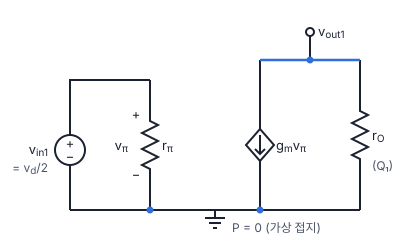
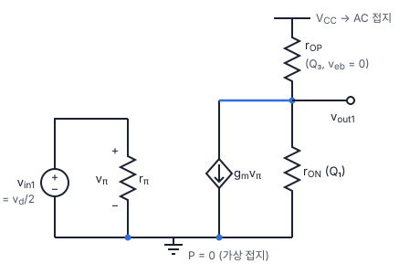
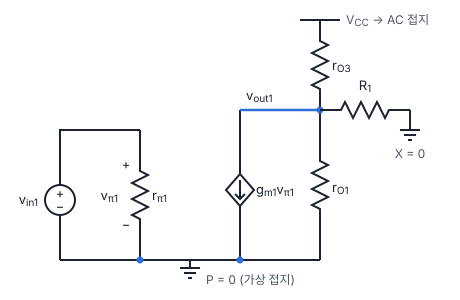
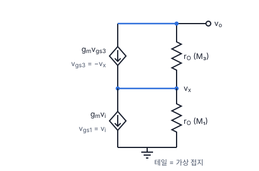
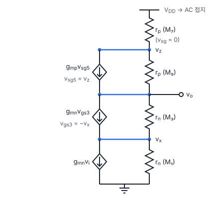
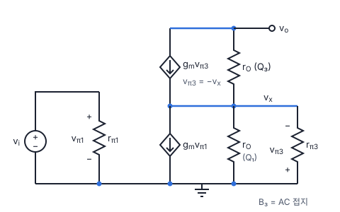
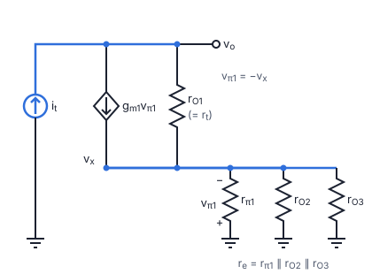
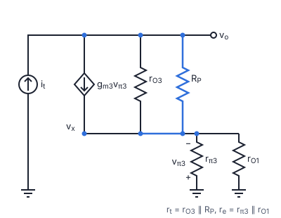
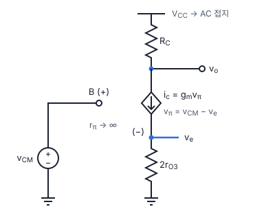

# 전자회로2 복습 1002 문제설명

주어진 조건을 읽고, 첫 줄을 쓰고, 이유를 따라가며 답을 확인해요.

문제의 첫 줄부터 검산까지 설명해요.

**목차**

- [문항별 설명](#problems)
  - [이상적 전류원 부하를 가진 바이폴라 차동쌍의 차동 이득](#p1)
  - [pnp 전류원 부하로 구현한 바이폴라 차동쌍의 차동 이득](#p2)
  - [베이스를 R1, R2 가운데 노드 X에 묶은 pnp 부하 차동쌍의 차동 이득](#p3)
  - [V_A = 4 V, R1 = R2 = 10 kΩ, I_EE = 1 mA일 때의 이득 (예제 10.13 변형)](#p4)
  - [전압 이득 300을 내는 MOS 캐스코드 차동쌍(Fig 10.42(a))의 필요 테일 전류](#p5)
  - [이득 200, 테일 전류 1 mA의 MOS 텔레스코픽 캐스코드(Fig 10.43(a))의 (W/L)_1 = … = (W/L)_8](#p6)
  - [전압 이득 4000을 내는 바이폴라 캐스코드 차동쌍(Fig 10.39(a))의 최소 Early 전압](#p7)
  - [전류를 넣는 pnp Q3가 붙은 바이폴라 캐스코드와 R_P 캐스코드 차동 증폭기의 출력 저항·이득](#p8)
  - [공통 모드 이득 < 0.01을 위한 조건 R_C I_C < 0.02(V_A + V_T) 증명 (Fig 10.87)](#p9)
  - [R_EE를 2R_EE 두 개로 나눠 공통 모드 절반 회로로 식 (10.180) 증명 (Fig 10.45(a))](#p10)

## 문항별 설명

### 이상적 전류원 부하를 가진 바이폴라 차동쌍의 차동 이득

E10.10 · 예제 10.10 · [원 문제 보기](../%EB%B3%B5%EC%8A%B5%EB%AC%B8%EC%A0%9C_1002_Differential_Amplifiers-%EB%AC%B8%EC%A0%9C.pdf)

#### 주어진 조건

- 이득을 최대로 하려고 이상적인 전류원을 사용함
- 소자 값은 주어지지 않음 (답은 소신호 파라미터 기호로)

#### 구할 것

- 차동 이득 $\dfrac{v_{out1} - v_{out2}}{v_{in1} - v_{in2}}$

원문 보기

그림 10.18(a)에 보인 회로의 차동 이득을 계산하라. 이득을 최대로 하기 위해 이상적인 전류원이 사용되었다.

#### 문제를 내 말로 읽어요

두 베이스의 차이를 넣고 두 컬렉터의 차이를 읽는 바이폴라 차동쌍이에요. 위쪽 전류원은 이상적이지만 입력 BJT의 Early 효과는 남아요.

#### 이 문제를 봤을 때 떠올릴 개념과 공식

이상적 전류원 부하라는 단서에서 부하의 소신호 저항은 무한대라고 판단해요. 차동 모드(differential mode, DM)에서는 공통 이미터가 가상 접지라 각 반쪽이 공통 이미터(common emitter, CE) 단이에요. $g_m=I_C/V_T$는 전압을 전류로 바꾸는 비율, $r_O=V_A/I_C$는 Early 출력 저항이에요. 입력 소자의 $r_O$까지 버리면 출력 전압을 정할 부하가 사라져요.

#### 종이에 쓸 실제 첫 줄

$v_{in1}=v_d/2$, $v_{in2}=-v_d/2$로 놓으면 대칭이라 $v_P=0$(가상 접지)이에요. $V_{CC}$는 교류 접지, 위 이상적 전류원과 $I_{EE}$는 소신호에서 개방이에요. 왼쪽 $Q_1$을 $r_\pi$, $g_mv_\pi$, $r_O$로 바꾸면 $v_\pi=v_{in1}-v_P=v_d/2$예요.

*$V_{CC}$와 DM 가상 접지 $P$를 AC 접지로, 위 이상 전류원과 $I_{EE}$는 개방으로 보내고 $Q_1$은 $r_\pi$·$g_mv_\pi$·$r_O$로 바꾼 왼쪽 반회로예요.*

$v_{out1}$ 노드에서 아래($P$)로 나가는 전류를 양으로 잡아요. $r_O$로 $v_{out1}/r_O$, 제어 전류원으로 $g_mv_\pi$가 나가고, 위 전류원은 개방이라 들어오는 전류가 없어요.

$$
\frac{v_{out1}}{r_O}+g_m\frac{v_d}{2}=0
$$

#### 왜 이렇게 푸는지 함께 따라가요

#### 풀이

왼쪽 출력은 $v_{out1}=-g_mr_Ov_d/2$이고 오른쪽은 $v_{out2}=+g_mr_Ov_d/2$예요. 두 출력을 빼면

$$
v_{out1}-v_{out2}=-g_mr_Ov_d
$$

따라서 $A_{DM}=-g_mr_O=-V_A/V_T$예요. 입력의 절반이 각 반쪽에 걸리는 효과와 두 출력의 차이를 취하는 효과가 상쇄돼요.

#### 완성 답과 검산

#### 검산

완성 답은 **$A_{DM}=-g_mr_O$**예요. $g_mr_O=(I_C/V_T)(V_A/I_C)=V_A/V_T$로 전류가 소거되고 S·Ω=1이에요. $V_A$를 두 배 키우면 출력 저항과 이득 크기도 두 배예요.

#### 이 문항에서 하기 쉬운 오류

테일이 이상적이라는 이유로 입력 소자 Early 효과까지 지우지 않아요. 차동 입출력 이득에 추가로 1/2을 곱하지 않아요.

#### 설명을 닫고 규칙을 적용해 봐요

1. 같은 회로에서 한쪽 출력 $v_{out1}$만 읽으면 $v_{out1}/(v_{in1}-v_{in2})$는 얼마인가요? 반회로 입력이 $v_d/2$라는 점에서 출발해 보세요.
2. 위 이상 전류원 대신 각 출력과 $V_{CC}$ 사이에 저항 $R_C=r_O$를 달면 차동 이득은 얼마인가요? 출력 노드 KCL에 어떤 가지가 하나 늘어나는지부터 정해 보세요.
3. $V_A=5$ V, $V_T=25$ mV이면 이상 전류원 부하에서 $|A_{DM}|$은 얼마인가요? 바이어스 전류가 필요한지도 판단해 보세요.

**페이지 요약**

이상적인 것은 부하 전류원이에요. 입력 BJT의 Early 출력저항은 남기고, 차동 입력·출력의 절반 인자가 상쇄되므로 1/2을 다시 곱하지 않아요.

#### 개념

차동 하프 서킷·출력 저항

#### 답

$\dfrac{v_{out1} - v_{out2}}{v_{in1} - v_{in2}} = -g_m r_O$

#### 검산

$g_mr_O=V_A/V_T$라 바이어스 전류가 약분돼요.

---

### pnp 전류원 부하로 구현한 바이폴라 차동쌍의 차동 이득

E10.11 · 예제 10.11 · [원 문제 보기](../%EB%B3%B5%EC%8A%B5%EB%AC%B8%EC%A0%9C_1002_Differential_Amplifiers-%EB%AC%B8%EC%A0%9C.pdf)

#### 주어진 조건

- 소자 값은 주어지지 않음 (답은 소신호 파라미터 기호로)

#### 구할 것

- 차동 전압 이득

원문 보기

그림 10.19(a)는 그림 10.18(a)에서 보인 토폴로지의 구현을 설명하고 있다. 차동 전압 이득을 계산하라.

#### 문제를 내 말로 읽어요

이번에는 위쪽 이상적 전류원을 고정 베이스의 pnp로 구현했어요. 위쪽도 실제 소자라 출력에 두 종류의 저항이 함께 붙어요.

#### 이 문제를 봤을 때 떠올릴 개념과 공식

고정된 pnp 베이스와 이미터라는 단서에서 그 소자의 $v_{be}$ 변화는 0이라고 읽어요. 따라서 부하의 트랜스컨덕턴스 전류는 없고 Early 출력 저항 $r_{OP}$만 남아요. 아래 npn의 $g_m$은 입력을 전류로 바꾸고 $r_{ON}$도 출력에 달려요. 작은 차동 입력과 좌우 대칭을 쓰면 테일 노드는 가상 접지예요.

#### 종이에 쓸 실제 첫 줄

$v_{in1}=v_d/2$, 대칭이라 $v_P=0$으로 두고 $V_{CC}$·$V_b$를 교류 접지로 보내요. $Q_1$은 $r_\pi$·$g_mv_\pi$·$r_{ON}$, $Q_3$은 베이스와 이미터가 모두 고정이라 $v_{eb}=0$이어서 $r_{OP}$만 남아요.

*$V_{CC}$, $V_b$, DM 가상 접지 $P$를 AC 접지로, $I_{EE}$는 개방으로 보내고 $Q_1$은 $r_\pi$·$g_mv_\pi$·$r_{ON}$, $Q_3$은 $r_{OP}$로 바꾼 왼쪽 반회로예요.*

$v_{out1}$에서 나가는 전류를 양으로 써요. 제어 전류원으로 $g_mv_\pi=g_mv_d/2$, $r_{ON}$을 거쳐 $P$로 $v_{out1}/r_{ON}$, $r_{OP}$를 거쳐 $V_{CC}$로 $v_{out1}/r_{OP}$예요.

$$
g_m\frac{v_d}{2}+\frac{v_{out1}}{r_{ON}}+\frac{v_{out1}}{r_{OP}}=0
$$

#### 왜 이렇게 푸는지 함께 따라가요

#### 풀이

두 저항의 반대쪽은 모두 교류 접지이므로 직렬이 아니라 병렬이에요. $R_h=r_{ON}\parallel r_{OP}$로 놓으면 $v_{out1}=-g_mR_hv_d/2$예요. 오른쪽은 부호가 반대이므로

$$
A_{DM}=-g_m(r_{ON}\parallel r_{OP})
$$

예요.

#### 완성 답과 검산

#### 검산

**$A_{DM}=-g_m(r_{ON}\parallel r_{OP})$**예요. $r_{OP}\to\infty$로 보내면 이상적 부하 결과 $-g_mr_{ON}$으로 돌아와요. 두 저항이 같으면 병렬은 $r_O/2$라 이득 크기가 이상적 부하의 절반이에요.

#### 이 문항에서 하기 쉬운 오류

pnp를 다이오드 연결한 것으로 보아 $1/g_{mP}$를 붙이지 않아요. 베이스는 컬렉터가 아니라 고정 바이어스에 연결돼 있어요.

#### 설명을 닫고 규칙을 적용해 봐요

1. 입력과 부하의 $r_O$가 모두 20 kΩ이면 출력 노드에서 AC 접지로 보이는 저항은 얼마인가요? 부하가 이상적 전류원이면요?
2. $Q_3$·$Q_4$의 베이스를 $V_b$ 대신 각자 자기 컬렉터에 묶으면(다이오드 연결) DM 반회로의 출력 노드에 붙는 부하 소신호 저항은 무엇으로 바뀌나요? $|A_{DM}|$의 대략적인 꼴도 써 보세요.
3. $I_C=0.5$ mA, $V_{A,N}=V_{A,P}=5$ V, $V_T=25$ mV이면 $A_{DM}$은 얼마인가요?

**페이지 요약**

작은 차동 입력·좌우 대칭에서 테일은 가상 접지예요. pnp 베이스는 고정 바이어스라 다이오드 연결의 $1/g_{mP}$가 아닌 $r_{OP}$만 남아요.

#### 개념

차동 하프 서킷·출력 저항

#### 답

차동 전압 이득 $= -g_m (r_{ON} \parallel r_{OP})$

#### 검산

$r_{OP}\to\infty$이면 $-g_mr_{ON}$으로 돌아와요.

---

### 베이스를 R1, R2 가운데 노드 X에 묶은 pnp 부하 차동쌍의 차동 이득

E10.13 · 예제 10.13 · [원 문제 보기](../%EB%B3%B5%EC%8A%B5%EB%AC%B8%EC%A0%9C_1002_Differential_Amplifiers-%EB%AC%B8%EC%A0%9C.pdf)

#### 주어진 조건

- $V_A < \infty$
- 회로는 완벽한 대칭 (본문 521–522쪽이 뒤따르는 예제 각각을 완벽한 대칭으로 가정함). $R_1 = R_2$, 대응하는 트랜지스터끼리 동일로 해석
- 소자 값은 주어지지 않음 (답은 기호로)

#### 구할 것

- 차동 이득

원문 보기

$V_A < \infty$일 때, 그림 10.22(a)에 표현된 회로의 차동 이득을 계산하라.

#### 문제를 내 말로 읽어요

두 pnp의 베이스는 두 출력 사이 동일 저항의 가운데 X에 묶여 있어요. X가 움직이는지부터 정하면 복잡한 회로가 단순해져요.

#### 이 문제를 봤을 때 떠올릴 개념과 공식

완벽한 대칭, $R_1=R_2$, 반대 방향 출력이라는 단서가 가상 접지(virtual ground)를 불러요. $v_X=(v_{out1}+v_{out2})/2=0$이므로 pnp 베이스도 고정돼요. $V_A<\infty$이므로 $r_{O1}$과 $r_{O3}$을 모두 남기고 $R_1$도 출력 부하에 포함해요.

$g_{m1}$은 입력 npn의 트랜스컨덕턴스, $r_{O1}$·$r_{O3}$은 아래 npn·위 pnp의 Early 출력 저항이에요. $R_1$은 왼쪽 출력과 중점 X 사이 저항이에요. 이 세 경로가 모두 출력에서 AC 접지로 이어지므로 출력 KCL이 가장 직접적인 첫 도구예요.

#### 종이에 쓸 실제 첫 줄

차동 입력에서 $v_P=v_X=0$을 먼저 써요. $V_{CC}$도 교류 접지예요. $X$가 고정이므로 $Q_3$의 $v_{eb}=0$이라 $Q_3$은 $r_{O3}$만 남고, $Q_1$은 $r_{\pi1}$·$g_{m1}v_{\pi1}$·$r_{O1}$로 바꿔요. $v_{\pi1}=v_{in1}$이에요.

*$V_{CC}$, DM 가상 접지 $P$와 중점 $X$를 AC 접지로, $I_{EE}$는 개방으로 보내고 $Q_1$은 $r_{\pi1}$·$g_{m1}v_{\pi1}$·$r_{O1}$, $Q_3$은 $r_{O3}$로 바꾼 왼쪽 반회로예요.*

$v_{out1}$에서 나가는 전류를 양으로 잡고 네 가지를 차례로 써요.

$$
g_{m1}v_{in1}+\frac{v_{out1}}{r_{O1}}+\frac{v_{out1}}{r_{O3}}+\frac{v_{out1}-v_X}{R_1}=0
$$

$v_X=0$을 넣고 $v_{out1}$ 항을 모으면 $g_{m1}v_{in1}+v_{out1}(1/r_{O1}+1/r_{O3}+1/R_1)=0$이에요.

#### 왜 이렇게 푸는지 함께 따라가요

#### 풀이

X 쪽 저항 끝이 교류 접지라 $R_1$은 출력에서 접지로 가는 저항이에요. 따라서 $R_h=r_{O1}\parallel r_{O3}\parallel R_1$이고 $v_{out1}=-g_{m1}R_hv_{in1}$이에요. 대칭인 오른쪽과 빼면

$$
A_{DM}=-g_{m1}(r_{O1}\parallel r_{O3}\parallel R_1)
$$

이에요.

#### 완성 답과 검산

#### 검산

**$A_{DM}=-g_{m1}(r_{O1}\parallel r_{O3}\parallel R_1)$**예요. $R_1\to\infty$이면 고정 pnp 부하의 이득으로 돌아와요. 반대로 $R_1\to0$이면 출력이 교류 접지에 묶여 이득이 0이 돼요.

#### 이 문항에서 하기 쉬운 오류

X를 접지로 보는 것은 차동 신호와 대칭 조건에서만 가능해요. $R_1$과 $R_2$를 더한 저항 하나를 반쪽 출력에 붙이면 안 돼요.

#### 설명을 닫고 규칙을 적용해 봐요

1. $R_1=R_2$이고 두 출력이 $+10$ mV, $-10$ mV이면 중점 $X$의 소신호 전압은 얼마인가요?
2. 같은 회로에 공통 모드 입력(두 입력에 같은 작은 신호)이 들어오면 $X$를 여전히 AC 접지로 볼 수 있나요? $R_1$에 흐르는 소신호 전류로 판단해 보세요.
3. $R_1=r_{O1}=r_{O3}=r$이면 $A_{DM}$은 얼마인가요?

**페이지 요약**

$R_1=R_2$와 대응 소자 대칭·순수 차동 입력에서만 X를 AC 접지로 봐요. 출력에서 X까지의 부하는 $R_1$이며 $R_1+R_2$가 아니에요.

#### 개념

차동 하프 서킷·출력 저항

#### 답

차동 이득 $A_v = -g_{m1} (r_{O1} \parallel r_{O3} \parallel R_1)$

#### 검산

$R_1\to0$이면 출력이 접지되어 이득이 0이에요.

---

### V_A = 4 V, R1 = R2 = 10 kΩ, I_EE = 1 mA일 때의 이득 (예제 10.13 변형)

X10.13 · 연습문제 10.13 · [원 문제 보기](../%EB%B3%B5%EC%8A%B5%EB%AC%B8%EC%A0%9C_1002_Differential_Amplifiers-%EB%AC%B8%EC%A0%9C.pdf)

#### 주어진 조건

- 예제 10.13의 회로(Fig 10.22(a))
- 모든 트랜지스터에서 $V_A = 4\ \text{V}$
- $R_1 = R_2 = 10\ \text{k}\Omega$
- $I_{EE} = 1\ \text{mA}$
- $V_T$ 값은 주어지지 않음

#### 구할 것

- 차동 이득

원문 보기

모든 트랜지스터에서 $V_A = 4\ \text{V}$이고, $R_1 = R_2 = 10\ \text{k}\Omega$, $I_{EE} = 1\ \text{mA}$일 때 이득을 계산하라.

#### 문제를 내 말로 읽어요

Fig 10.22(a) 회로에 실제 전류와 저항을 넣는 계산이에요. 테일 1 mA가 각 가지에 0.5 mA씩 나뉜다는 점이 시작이에요.

열전압 수치는 주어지지 않았어요. 여기서는 상온 $V_T=26$ mV를 채택하며, 이 관례에서 이득 약 -54.9를 얻어요.

#### 이 문제를 봤을 때 떠올릴 개념과 공식

$R_1=R_2$라는 단서로 X와 테일의 가상 접지를 사용해요. $g_m=I_C/V_T$, $r_O=V_A/I_C$로 회로 값을 소신호 값으로 바꿔요. $V_T$는 문제에 수치가 없으므로 26 mV를 사용할 때 그 가정을 표시해야 해요. 베이스 전류를 무시하는 교과서 근사를 사용해요.

#### 종이에 쓸 실제 첫 줄

$$
I_C=I_{EE}/2=0.5\,\mathrm{mA},\qquad A_{DM}=-\frac{I_C}{V_T}(r_{O1}\parallel r_{O3}\parallel R_1)
$$

#### 왜 이렇게 푸는지 함께 따라가요

#### 풀이

$r_{O1}=r_{O3}=4\,\mathrm V/(0.5\,\mathrm{mA})=8\,\mathrm{k}\Omega$예요. 역수를 더하면

$$
R_h=(1/8000+1/8000+1/10000)^{-1}=2857.14\,\Omega
$$

따라서 $A_{DM}=-1.42857\,\mathrm V/V_T$예요. 상온 $V_T=26\,\mathrm{mV}$를 쓰면 $g_m=19.23\,\mathrm{mS}$이고 $A_{DM}=-54.95$예요.

#### 완성 답과 검산

#### 검산

**$A_{DM}=-1.42857\,\mathrm V/V_T\approx-54.9$ ($V_T=26$ mV)**예요. $R_h=2.857$ kΩ는 병렬 소자 중 가장 작은 8 kΩ보다 작아요. $19.23$ mS와 곱하면 54.95로 단위도 무차원이에요. 25 mV를 택하면 -57.1이므로 온도 관례를 숨기지 않아요.

#### 이 문항에서 하기 쉬운 오류

테일 전체 1 mA를 $g_m$에 넣으면 이득이 두 배가 돼요. $V_T=26$ mV는 추가 가정이지 주어진 숫자가 아니에요.

#### 설명을 닫고 규칙을 적용해 봐요

1. $g_m$은 그대로 두고 출력 병렬 부하의 세 저항 $r_{O1}$, $r_{O3}$, $R_1$을 모두 2배로 하면 이득 크기는 몇 배인가요?
2. $I_{EE}$만 2 mA로 키우면($V_A=4$ V, $R_1=10$ kΩ 그대로, $V_T=26$ mV) 이득은 얼마인가요? $R_1$이 전류와 함께 바뀌지 않는다는 점에 주의해요.
3. 같은 원래 조건에서 $V_T=25$ mV를 택하면 이득은 얼마인가요?

**페이지 요약**

#### 개념

차동 하프 서킷·출력 저항

#### 답

차동 이득 $A_v \approx -54.9$

#### 검산

$R_h=2.857$ kΩ, $V_T=26$ mV에서 $A=-54.95$예요.

#### 적용 조건

상온 관례 $V_T=26$ mV에서 약 -54.9예요. 일반식은 $-1.42857\,\mathrm V/V_T$예요.

---

### 전압 이득 300을 내는 MOS 캐스코드 차동쌍(Fig 10.42(a))의 필요 테일 전류

P10.62 · 장말문제 10.62 · [원 문제 보기](../%EB%B3%B5%EC%8A%B5%EB%AC%B8%EC%A0%9C_1002_Differential_Amplifiers-%EB%AC%B8%EC%A0%9C.pdf)

#### 주어진 조건

- 전압 이득 $300$을 내야 함
- $M_1$–$M_4$: $W/L = 20/0.18$
- $\mu_n C_{ox} = 100\ \mu\text{A/V}^2$
- $\lambda = 0.1\ \text{V}^{-1}$

#### 구할 것

- 필요한 테일 전류 ($I_{SS}$)

원문 보기

The MOS cascode of Fig. 10.42(a) must provide a voltage gain of 300. If $W/L = 20/0.18$ for $M_1$-$M_4$ and $\mu_n C_{ox} = 100\ \mu\text{A/V}^2$, determine the required tail current. Assume $\lambda = 0.1\ \text{V}^{-1}$.

#### 문제를 내 말로 읽어요

같은 크기의 NMOS 네 개가 캐스코드 차동쌍을 만들어요. 목표 이득 크기 300에서 가지 전류를 역으로 찾고 마지막에 테일 전류로 바꿔요.

이득의 캐스코드 주항 $(g_mr_O)^2$로 설계하면 테일 약 14.8 mA예요. 비지배 항까지 남긴 같은 소신호 모델은 약 15.7 mA를 요구하므로 두 설계 기준을 구분해요.

#### 이 문제를 봤을 때 떠올릴 개념과 공식

캐스코드(cascode)와 이상적 부하라는 단서에서 $|A|\approx(g_mr_O)^2$를 떠올려요. $g_m=\sqrt{2kI_D}$, $r_O=1/(\lambda I_D)$이고 $k=\mu_nC_{ox}(W/L)$예요. $g_mr_O\gg1$에서 지배항만 남긴 교과서 근사이며 몸체 효과는 무시해요.

#### 종이에 쓸 실제 첫 줄

차동 입력에서 테일을 가상 접지로 두고

$$
x=g_mr_O,\qquad x^2=300,\qquad k=100\,\mu\mathrm{A/V^2}(20/0.18)
$$

를 써요.

근사식의 출발도 확인해요. $V_{DD}$와 $V_{b1}$을 교류 접지로, 위 이상 전류원을 개방으로 보내고 $M_1$·$M_3$을 $g_mv_{gs}$와 $r_O$로 바꿔요.

*$V_{DD}$, $V_{b1}$, 테일 노드(DM 가상 접지)를 AC 접지로, 위 이상 전류원은 개방으로 보내고 $M_1$·$M_3$은 $g_mv_{gs}$·$r_O$로 바꾼 반회로예요(몸체 효과 무시).*

입력 소자 드레인을 $v_x$, 위 캐스코드 드레인 출력을 $v_o$라 둬요. $M_3$은 게이트가 접지라 $v_{gs3}=-v_x$이고 제어 전류원은 $v_o$에서 $v_x$로 $g_mv_{gs3}=-g_mv_x$를 흘려요. 각 노드에서 나가는 전류를 양으로 쓰면

$$
\frac{v_x}{r_O}+\frac{v_x-v_o}{r_O}+g_mv_x+g_mv_i=0,
$$

$$
\frac{v_o-v_x}{r_O}-g_mv_x=0
$$

예요.

#### 왜 이렇게 푸는지 함께 따라가요

#### 풀이

출력 KCL에서 $v_o-v_x=g_mr_Ov_x$이므로 $v_o=(1+x)v_x$예요. 이 관계를 중간 KCL의 $(v_x-v_o)/r_O+g_mv_x$에 넣으면 0이 되어 $v_x=-g_mr_Ov_i=-xv_i$가 남아요. 따라서 $|A|=x(x+1)$이고, $x\gg1$의 주항이 $x^2=(g_mr_O)^2$예요.

$k=0.011111\,\mathrm{A/V^2}$예요. $x=\sqrt{2k/I_D}/\lambda$를 제곱하면 $x^2=2k/(\lambda^2 I_D)$이므로

$$
I_D=\frac{2k}{300\lambda^2}=7.407\,\mathrm{mA}
$$

예요. 한 가지 전류이므로 테일은 $I_{SS}=2I_D=14.81$ mA예요.

더 정밀하게 $|A|=x(x+1)=300$을 쓰면 $x=(-1+\sqrt{1201})/2=16.83$, $I_{SS}=15.70$ mA예요. 이 값은 지배항 근사를 보정한 별도 결과예요.

#### 완성 답과 검산

#### 검산

**교과서 캐스코드 근사에서 $I_{SS}\approx14.8$ mA**예요. 구한 가지 전류를 넣으면 $g_m=12.83$ mS, $r_O=1350$ Ω, $(g_mr_O)^2=300$이에요. $x$가 약 17이라 $+1$ 항의 영향이 약 6% 있다는 것도 확인돼요.

#### 이 문항에서 하기 쉬운 오류

전류를 늘리면 $g_m$도 늘지만 $r_O$는 더 빠르게 줄어요. 따라서 이 회로의 고유 이득은 전류가 늘수록 작아져요. 가지 전류와 테일 전류를 구분해요.

14.8 mA는 주항 설계값이에요. $g_mr_O(g_mr_O+1)$까지 남겨 이득 300을 맞춘 값 15.7 mA와 같은 정밀도의 답으로 섞지 않아요.

#### 설명을 닫고 규칙을 적용해 봐요

1. $W/L$을 고정한 주항 모델 $|A|=(g_mr_O)^2$에서 $I_{SS}$를 4배로 하면 차동 이득 크기는 몇 배인가요?
2. $W/L$만 $40/0.18$로 2배 키우고 이득 300을 유지하려면 필요한 $I_{SS}$는 얼마인가요($\lambda=0.1\ \mathrm{V^{-1}}$, 주항 모델)?
3. $\lambda=0.2\ \mathrm{V^{-1}}$이면(W/L은 원래대로) 이득 300에 필요한 $I_{SS}$는 얼마인가요?

**페이지 요약**

이상 부하·몸체 효과 무시에서 $g_mr_O\gg1$의 주항을 써요. 구한 $I_D=7.407\,\mathrm{mA}$는 가지 전류라 테일은 두 배이며, 고정 크기에서 전류가 커질수록 고유 이득은 줄어요.

#### 개념

차동 하프 서킷·출력 저항

#### 답

$I_{SS} \approx 14.8\ \text{mA}$

#### 검산

$(g_mr_O)^2=300$을 역대입해요. 정확 보정은 약 6%예요.

#### 적용 조건

주항 설계: 약 14.8 mA. $+1$ 항을 남긴 소신호 설계: 약 15.7 mA예요.

---

### 이득 200, 테일 전류 1 mA의 MOS 텔레스코픽 캐스코드(Fig 10.43(a))의 (W/L)_1 = … = (W/L)_8

P10.64 · 장말문제 10.64 · [원 문제 보기](../%EB%B3%B5%EC%8A%B5%EB%AC%B8%EC%A0%9C_1002_Differential_Amplifiers-%EB%AC%B8%EC%A0%9C.pdf)

#### 주어진 조건

- 전압 이득 $200$, 테일 전류 $1\ \text{mA}$로 설계됨
- $\mu_n C_{ox} = 100\ \mu\text{A/V}^2$, $\mu_p C_{ox} = 50\ \mu\text{A/V}^2$
- $\lambda_n = 0.1\ \text{V}^{-1}$, $\lambda_p = 0.2\ \text{V}^{-1}$
- 모든 트랜지스터의 $W/L$이 같음: $(W/L)_1 = \cdots = (W/L)_8$

#### 구할 것

- $(W/L)_1 = \cdots = (W/L)_8$

원문 보기

The MOS telescopic cascode of Fig. 10.43(a) is designed for a voltage gain of 200 with a tail current of $1\ \text{mA}$. If $\mu_n C_{ox} = 100\ \mu\text{A/V}^2$, $\mu_p C_{ox} = 50\ \mu\text{A/V}^2$, $\lambda_n = 0.1\ \text{V}^{-1}$, and $\lambda_p = 0.2\ \text{V}^{-1}$, determine $(W/L)_1 = \cdots = (W/L)_8$.

#### 문제를 내 말로 읽어요

위아래 모두 캐스코드를 사용한 텔레스코픽 차동쌍이에요. 모든 W/L이 같아도 n과 p의 이동도가 달라 트랜스컨덕턴스는 같지 않아요.

캐스코드의 큰 $g_mr_O$ 주항만 사용하는 교재 설계값은 공통 $W/L\approx33.3$이에요. 비지배 항과 유효 트랜스컨덕턴스를 남긴 노드 해석값 약 29.8과 구분해요.

#### 이 문제를 봤을 때 떠올릴 개념과 공식

캐스코드 부하라는 단서에서 아래 NMOS 저항과 위 PMOS 저항을 병렬로 묶어요. $R_n\approx g_{mn}r_n^2$, $R_p\approx g_{mp}r_p^2$예요. $r_n,r_p$는 각 소자 출력 저항이고, $g_{mp}=g_{mn}/\sqrt2$는 같은 전류와 같은 W/L에서 이동도 비로 나와요. $g_mr_O\gg1$의 지배항 근사를 써요.

#### 종이에 쓸 실제 첫 줄

차동 하프 서킷에서 테일은 가상 접지, $V_{DD}$와 $V_{b1}$·$V_{b2}$·$V_{b3}$는 교류 접지예요. 가지 전류는 $I_D=I_{SS}/2=0.5\,\mathrm{mA}$예요. 각 MOS를 $g_mv_{gs}$와 출력 저항으로 바꿔요.

*$V_{DD}$, $V_{b1}$, $V_{b2}$, $V_{b3}$, 테일 노드(DM 가상 접지)를 AC 접지로 보내고 $M_1$·$M_3$은 $g_{mn}v_{gs}$·$r_n$, $M_5$는 $g_{mp}v_{sg}$·$r_p$, $v_{sg}=0$인 $M_7$은 $r_p$로 바꾼 반회로예요.*

아래 입력 소자 드레인 $v_x$, 출력 $v_o$, PMOS 두 소자 사이 $v_z$에서 나가는 전류를 양으로 써요. $M_3$은 $v_{gs3}=-v_x$라 $v_o$에서 $v_x$로 $-g_{mn}v_x$, $M_5$는 $v_{sg5}=v_z$라 $v_z$에서 $v_o$로 $g_{mp}v_z$를 흘려요.

$$
\frac{v_x}{r_n}+\frac{v_x-v_o}{r_n}+g_{mn}v_x+g_{mn}v_i=0,
$$

$$
\frac{v_o-v_x}{r_n}-g_{mn}v_x+\frac{v_o-v_z}{r_p}-g_{mp}v_z=0,
$$

$$
\frac{v_z}{r_p}+\frac{v_z-v_o}{r_p}+g_{mp}v_z=0
$$

설계식은 recall의 캐스코드 출력저항 규칙으로 바로 세워요. 위 소자의 이미터(소스) 쪽에 아래 소자의 출력저항 $r$이 있으면 캐스코드 출력저항은 주항 $g_mr\cdot r$이라 아래쪽 $R_n\approx g_{mn}r_n^2$, 위쪽 $R_p\approx g_{mp}r_p^2$이고, 둘은 출력에서 AC 접지로 가는 두 경로라 병렬이에요. 입력 트랜스컨덕턴스는 $g_{mn}$이에요.

$$
200=g_{mn}[(g_{mn}r_n^2)\parallel(g_{mp}r_p^2)]
$$

이 규칙이 위 세 KCL의 주항이라는 것은 solve의 정확식 보정에서 경계 조건별로 풀어 확인해요($2r_n$, $2r_p$ 항이 $g_mr_O\gg2$에서 무시돼요).

#### 왜 이렇게 푸는지 함께 따라가요

#### 풀이

**병렬에서 공통 인자를 묶는 규칙.** 병렬 연산은 $X\parallel Y=XY/(X+Y)$예요. 양의 공통 인자 $a$에 대해

$$
(aX)\parallel(aY)=\frac{a^2XY}{a(X+Y)}=a(X\parallel Y)
$$

단순한 저항 예로 $(2\times10\mathrm{k\Omega})\parallel(2\times20\mathrm{k\Omega})=13.33$ kΩ이고, $2(10\mathrm{k\Omega}\parallel20\mathrm{k\Omega})$도 같아요.

이 문제에서는 $g_{mp}=g_{mn}/\sqrt2$라 두 캐스코드 저항 모두에 $g_{mn}$이 공통이에요. $X=r_n^2$, $Y=r_p^2/\sqrt2$를 놓으면

$$
R_n\parallel R_p=g_{mn}\frac{XY}{X+Y}
$$

앞의 입력 $g_{mn}$까지 곱해 $|A|=g_{mn}^2XY/(X+Y)$예요. 여기서 $X,Y$는 실제 저항이 아니라 Ω² 단위의 중간 계수예요. $\parallel$은 같은 $XY/(X+Y)$ 연산을 줄여 쓴 기호이며, $\mathrm{S^2}\cdot\Omega^2=1$로 이득은 무차원이에요.

$r_n=1/(0.1\times0.0005)=20$ kΩ, $r_p=10$ kΩ예요. $g_{mp}=g_{mn}/\sqrt2$를 넣고 공통인 $g_{mn}$을 묶으면

$$
200=g_{mn}^2\left[r_n^2\parallel\frac{r_p^2}{\sqrt2}\right]
$$

예요. 대괄호는 $6.0088\times10^7\,\Omega^2$여서 $g_{mn}^2=3.3284\times10^{-6}\,\mathrm{S^2}$예요.

$$
W/L=\frac{g_{mn}^2}{2\mu_nC_{ox}I_D}=33.28
$$

따라서 여덟 소자에 같은 비율 약 33.3을 사용해요.

**정확한 유한 출력저항 보정.** start에서 세운 세 KCL을 근사 없이 풀어요. 이를 풀면 $A=-G_mR_{out}$을 두 경계 조건으로 나눠 구할 수 있어요.

① $G_{m,e}$: 출력을 교류 단락($v_o=0$)해요. 그러면 $v_z$ 노드 식이 $v_z(2/r_p+g_{mp})=0$이라 $v_z=0$이고 PMOS 쪽 전류는 0이에요. $v_x$ 노드 식은

$$
\frac{v_x}{r_n}+\frac{v_x}{r_n}+g_{mn}v_x+g_{mn}v_i=0\ \Rightarrow\ v_x=-\frac{g_{mn}v_i}{g_{mn}+2/r_n}
$$

이에요. $M_3$을 통해 $v_o$에서 아래로 나가는 단락 전류는

$$
i_{sc}=\frac{0-v_x}{r_n}-g_{mn}v_x=-v_x\left(g_{mn}+\frac1{r_n}\right)
$$

이므로

$$
G_{m,e}=\frac{i_{sc}}{v_i}=g_{mn}\frac{g_{mn}+1/r_n}{g_{mn}+2/r_n}
$$

예요.

② $R_{out}$: $v_i=0$으로 두고 출력에 시험 전압 $v_t$를 걸어요. 아래 스택은 $v_x$ 노드 식 $v_x/r_n+(v_x-v_t)/r_n+g_{mn}v_x=0$에서 $v_t=(2+g_{mn}r_n)v_x$이고, 아래로 들어가는 전류는 $(v_t-v_x)/r_n-g_{mn}v_x=v_x/r_n$이에요. 따라서

$$
R_{n,e}=\frac{v_t}{v_x/r_n}=2r_n+g_{mn}r_n^2
$$

위 스택도 $v_z$ 노드 식 $v_z/r_p+(v_z-v_t)/r_p+g_{mp}v_z=0$에서 같은 방법으로

$$
R_{p,e}=2r_p+g_{mp}r_p^2
$$

이에요. 두 스택은 출력에서 병렬이라 $R_{out}=R_{n,e}\parallel R_{p,e}$예요.

③ 이득:

$$
|A_e|=G_{m,e}R_{out}=G_{m,e}(R_{n,e}\parallel R_{p,e})
$$

예요. 이 정확식을 200으로 놓아 풀면 $W/L\approx29.8$이에요. $g_{mn}=t a_n$, $g_{mp}=t a_p$로 동시에 커지는 극한에서 $|A_e|/\{g_{mn}[(g_{mn}r_n^2)\parallel(g_{mp}r_p^2)]\}\to1$이므로 본문의 33.3은 같은 모델의 지배항 근사라는 점이 확인돼요.

#### 완성 답과 검산

#### 검산

**지배항 근사에서 모든 $W/L\approx33.3$**이에요. $g_{mn}=1.824$ mS, $g_{mp}=1.290$ mS로 다시 계산하면 $R_n=729.6$ kΩ, $R_p=129.0$ kΩ, 병렬 109.6 kΩ이고 곱은 200이에요. 작은 쪽 p 캐스코드가 출력 저항을 제한해요. 정확한 노드 해석의 보정값 약 29.8과 구분해 사용해요.

#### 이 문항에서 하기 쉬운 오류

모든 W/L이 같다는 말을 모든 $g_m$과 $r_O$가 같다는 말로 바꾸지 않아요. 두 캐스코드 저항을 더하면 안 되고 병렬로 묶어요.

33.3은 캐스코드 주항 설계, 29.8은 비지배 항까지 남긴 소신호 설계예요. 목표 이득 200을 어느 모델에서 맞추는지 먼저 정해요.

#### 설명을 닫고 규칙을 적용해 봐요

1. $\lambda_p$만 $0.1\ \mathrm{V^{-1}}$로 낮추면(나머지 조건 동일) 어느 캐스코드가 출력저항을 제한하나요? 주항 설계에서 공통 $W/L$은 얼마가 되나요?
2. 모든 $W/L$이 같고 $I_D$도 같을 때 $g_{mp}/g_{mn}$은 얼마인가요? 어떤 식에서 나오는지 함께 말해 보세요.
3. $a=3$, $X=6$ kΩ, $Y=12$ kΩ에서 $(aX)\parallel(aY)$와 $a(X\parallel Y)$를 각각 계산해 같은지 확인해 보세요.

**페이지 요약**

같은 가지 전류·형상비에서도 $g_{mp}=g_{mn}/\sqrt2$, $r_n=20\,\mathrm{k}\Omega$, $r_p=10\,\mathrm{k}\Omega$예요. 두 캐스코드 저항을 직렬이 아닌 병렬로 합쳐요.

#### 개념

차동 하프 서킷·출력 저항

#### 답

$(W/L)_1 = \cdots = (W/L)_8 \approx 33.3$

#### 검산

$R_n\parallel R_p=109.6$ kΩ와 $g_{mn}=1.824$ mS의 곱은 200이에요.

#### 적용 조건

공통 형상비는 주항 설계에서 약 33.3, 비지배 항을 남긴 노드 해석에서 약 29.8이에요.

#### 규칙을 적용하는 순서

$(aX)\parallel(aY)=a(X\parallel Y)$

병렬에서 한 번, 입력에서 한 번 곱해 $g_{mn}^2$가 돼요.

---

### 전압 이득 4000을 내는 바이폴라 캐스코드 차동쌍(Fig 10.39(a))의 최소 Early 전압

P10.54 · 장말문제 10.54 · [원 문제 보기](../%EB%B3%B5%EC%8A%B5%EB%AC%B8%EC%A0%9C_1002_Differential_Amplifiers-%EB%AC%B8%EC%A0%9C.pdf)

#### 주어진 조건

- 전압 이득 $4000$을 달성해야 함
- $Q_1$–$Q_4$는 동일, $\beta = 100$

#### 구할 것

- 필요한 최소 Early 전압

원문 보기

The cascode differential pair of Fig. 10.39(a) must achieve a voltage gain of 4000. If $Q_1$–$Q_4$ are identical and $\beta = 100$, what is the minimum required Early voltage?

#### 문제를 내 말로 읽어요

바이폴라 캐스코드에서 이득 4000에 필요한 Early 전압을 구해요. MOS와 달리 위쪽 BJT의 베이스 입력 저항이 아래 소자를 부하로 눌러요.

이 문제에도 열전압 숫자는 없어요. 상온 $V_T=26$ mV와 캐스코드 주항 근사를 채택해 최소 Early 전압 약 2.24 V를 구해요.

#### 이 문제를 봤을 때 떠올릴 개념과 공식

$\beta=100$이라는 단서 때문에 $r_\pi=\beta/g_m$를 남겨야 해요. 캐스코드 소자의 이미터가 보는 저항은 $r_O\parallel r_\pi$예요. $g_mr_O=V_A/V_T=x$로 쓰면 전류가 사라져 Early 전압을 직접 풀 수 있어요. 교과서의 큰 캐스코드 이득 근사를 사용하며 $V_T$ 수치는 상온 26 mV를 채택해요.

#### 종이에 쓰는 실제 첫 줄

차동 반회로에서 이미터 공통 노드는 가상 접지, $V_{CC}$와 $V_b$는 교류 접지, 위 이상 전류원은 개방이에요. $Q_1$·$Q_3$을 $r_\pi$, $g_mv_\pi$, $r_O$로 바꿔요.

*$V_{CC}$, $V_b$, 이미터 공통 노드(DM 가상 접지)를 AC 접지로, 이상 전류원 $I_1$은 개방으로 보내고 $Q_1$·$Q_3$을 $r_\pi$·$g_mv_\pi$·$r_O$로 바꾼 반회로예요.*

중간 노드를 $v_x$, 출력을 $v_o$라 해요. $v_{\pi1}=v_i$이고, $Q_3$ 베이스가 접지라 $v_{\pi3}=-v_x$예요. $Q_3$의 제어 전류원은 $v_o$에서 $v_x$로 $g_mv_{\pi3}=-g_mv_x$를 흘려요. 각 노드에서 나가는 전류를 양으로 쓰면

$$
\frac{v_o-v_x}{r_O}-g_mv_x=0,
$$

$$
\frac{v_x}{r_O}+\frac{v_x}{r_\pi}+g_mv_i+\frac{v_x-v_o}{r_O}+g_mv_x=0
$$

$x=g_mr_O=V_A/V_T$, $g_mr_\pi=\beta$로 바꿔 두면 전류가 사라져 Early 전압을 직접 풀 수 있어요.

#### 왜 이렇게 푸는지 함께 따라가요

#### 풀이

출력 KCL에서 $v_o=(1+x)v_x$예요. 중간 KCL의 마지막 두 항은 출력 KCL과 같은 양이라 상쇄되어 $v_x=-g_m(r_O\parallel r_\pi)v_i$가 남아요.

공통 인자를 병렬 안으로 넣으면

$$
g_m(r_O\parallel r_\pi)=(g_mr_O)\parallel(g_mr_\pi)=x\parallel\beta=\frac{x\beta}{x+\beta}
$$

따라서 $|A_e|=(1+x)\dfrac{x\beta}{x+\beta}$이고, 큰 $g_mr_O$에서 $1+x\approx x$로 두면

$$
|A|\approx\frac{\beta x^2}{x+\beta}=\frac{100x^2}{x+100}
$$

예요. 이해를 위한 예로 $x=100$이면 병렬은 50, 바깥의 100까지 곱해 이득 크기는 5000이에요.

이제 목표 4000을 풀어요. 양변에 양수 $x+100$을 곱하면 $100x^2=4000x+400000$이에요.

$$
x^2-40x-4000=0
$$

두 근 중 음수는 양의 Early 전압에 맞지 않아 버려요.

$$
x=20+\sqrt{4400}=86.33
$$

그러므로 $V_A=xV_T=2.245$ V예요. 양수 x에서 $100x^2/(x+100)$는 증가하므로 목표를 넘기 위한 최소값이에요.

#### 완성 답과 검산

#### 검산

**캐스코드 근사에서 $V_{A,min}\approx2.24$ V ($V_T=26$ mV)**예요. $100(86.33)^2/(186.33)\approx4000$으로 역대입돼요. $\beta\to\infty$이면 식이 $x^2$가 되어 베이스 부하가 없는 MOS 형태로 돌아와요.

start의 KCL에서 얻은 $|A_e|=\beta x(1+x)/(\beta+x)$와 근사식의 비는 $(1+x)/x=1+1/x$이고 $x\to\infty$에서 1로 가요. $x=86.33$에서는 비지배항 보정이 약 1.16%예요. 따라서 2.24 V는 큰 $g_mr_O$ 근사의 답이고 더 정밀한 모델의 최소값과 구별해요. 유한 베이스 전류의 DC 보정도 이 근사 밖이에요.

#### 이 문항에서 하기 쉬운 오류

$r_\pi$를 무한대로 두면 주어진 $\beta$ 조건을 놓쳐요. $V_T=26$ mV를 명시하고 근사 해를 정확 해로 부르지 않아요.

#### 설명을 닫고 규칙을 적용해 봐요

1. $x=g_mr_O=50$, $\beta=100$이면 $g_m(r_O\parallel r_\pi)$와 캐스코드 주항 이득 크기는 각각 얼마인가요?
2. $\beta\to\infty$로 보내면(베이스 부하 없음) 이득 4000에 필요한 최소 $V_A$는 얼마인가요($V_T=26$ mV, 주항 근사)?
3. $\beta=50$이면 이득 4000에 필요한 $x$와 최소 $V_A$는 얼마인가요($V_T=26$ mV)? $\beta$가 작아지면 $V_A$ 요구가 커지는지 작아지는지 먼저 예측해 보세요.

**페이지 요약**

#### 개념

차동 하프 서킷·출력 저항

#### 답

최소 Early 전압 $V_A \approx 2.24\ \text{V}$

#### 검산

$100x^2/(x+100)=4000$, $x=86.33$을 확인해요.

#### 적용 조건

상온 $V_T=26$ mV를 채택한 캐스코드 근사값이 $V_{A,min}\approx2.24$ V예요.

#### 규칙을 적용하는 순서

$g_mr_O=x$, $g_mr_\pi=\beta$

$g_m(r_O\parallel r_\pi)=x\beta/(x+\beta)$

---

### 전류를 넣는 pnp Q3가 붙은 바이폴라 캐스코드와 R_P 캐스코드 차동 증폭기의 출력 저항·이득

2021-1_중간-Q3 · 기출 3 · [원 문제 보기](../%EB%B3%B5%EC%8A%B5%EB%AC%B8%EC%A0%9C_1002_Differential_Amplifiers-%EB%AC%B8%EC%A0%9C.pdf)

#### 주어진 조건

- $V_T = 25\ \text{mV}$, $\beta = 200$
- $V_{A,n} = V_{A,p} = 5\ \text{V}$
- $g_m r_o \gg 1$로 가정
- 베이스 전류는 무시
- (1) 전용 (회로 (a)): $I_1 = |I_{C3}| = 0.5\ \text{mA}$, $I_{C2} = 1\ \text{mA}$
- (2) 전용 (회로 (b)): $I_{EE} = 1\ \text{mA}$, $R_P = 10\ \text{k}\Omega$
- 전류원 $I_1$, (b)의 위쪽 두 전류원과 $I_{EE}$는 이상적 전류원으로 봄
- (2) $R_P$의 DC 전류는 무시($I_{C3} \approx I_{EE}/2$)

#### 구할 것

- (1) 회로 (a)의 출력 저항과 전압 이득
- (2) 차동 증폭기 (b)의 출력 저항과 전압 이득

원문 보기

다음 회로에 대해 주어진 조건을 이용하여 질문에 답하시오.

: $V_T = 25\ \text{mV}$, $\beta = 200$, $V_{A,n} = V_{A,p} = 5\ \text{V}$, $g_m r_o \gg 1$로 가정한다. 베이스 전류는 무시한다.

(1) 회로 (a)의 출력 저항과 전압 이득을 각각 구하시오. $I_1 = |I_{C3}| = 0.5\ \text{mA}$, $I_{C2} = 1\ \text{mA}$이다.

(2) 차동 증폭기 (b)의 출력 저항과 전압 이득을 각각 구하시오. $I_{EE} = 1\ \text{mA}$, $R_P = 10\ \text{k}\Omega$이다.

#### 문제를 내 말로 읽어요

첫 회로는 위쪽 Q1 아래에 입력 Q2가 있고 pnp Q3가 중간 노드로 전류를 넣어요. 두 번째는 캐스코드 차동쌍의 위쪽 소자 양단에 저항 RP가 붙어요.

“베이스 전류 무시”는 이 풀이에서 DC 전류 분배에만 적용해요. 주어진 유한 $\beta$의 소신호 $r_\pi$는 남겨 참고 풀이와 같은 관례로 계산하며, $r_\pi$까지 제거하는 해석과 값이 달라요.

#### 이 문제를 봤을 때 떠올릴 개념과 공식

출력 저항(output resistance)은 입력을 0으로 두고 시험 전압/전류로 정해요. 캐스코드 저항은 위 소자의 $r_O$와 이미터 쪽 저항, $r_\pi$로 결정돼요. $g_m=I_C/V_T$, $r_O=V_A/I_C$, $r_\pi=\beta/g_m$예요. 베이스 전류 무시는 DC 전류 분배 근사로 적용하고 유한 $r_\pi$의 소신호 부하는 남기는 관례를 사용해요.

#### 종이에 쓸 실제 첫 줄

전원과 고정 베이스를 교류 접지로 두고

$$
R_{out}\approx g_{m,upper}r_{O,upper}(R_E\parallel r_{\pi,upper}),\qquad A_v\approx-g_{m,input}R_h
$$

를 회로에 대응시켜요.

출력 저항의 실제 시험 식도 적어요. 입력을 0으로 두면 아래 입력 소자는 $v_{be}=0$이라 출력저항만 남아요. (1)에서는 위 소자가 $Q_1$이고, 그림처럼 시험 전류원 $i_t$를 접지에서 출력 $v_o$로 넣어요.

*(1) $V_{CC}$, $V_{b1}$, $V_{b3}$와 $v_{in}=0$을 AC 접지로, 이상 전류원 $I_1$은 개방으로 보내고 $Q_1$은 $g_{m1}v_{\pi1}$·$r_{O1}$·$r_{\pi1}$, $Q_2$·$Q_3$은 $r_{O2}$·$r_{O3}$로 바꿨어요.*

위 소자의 $r_O$(또는 (2)의 $r_O\parallel R_P$)를 $r_t$, 중간 노드에서 접지로 가는 저항들의 병렬을 $r_e$라 놓아요. 위 소자 베이스가 접지라 $v_\pi=-v_x$이고, 제어 전류원은 $v_o$에서 $v_x$로 $g_{m,u}v_\pi=-g_{m,u}v_x$를 흘려요. 각 노드에서 나가는 전류를 양으로 쓰면

$$
\frac{v_x}{r_e}+\frac{v_x-v_o}{r_t}+g_{m,u}v_x=0,
$$

$$
\frac{v_o-v_x}{r_t}-g_{m,u}v_x=i_t
$$

예요. 이 두 식을 풀어 $R_{out}=v_o/i_t$를 구하는 것이 출력저항 계산이에요.

#### 왜 이렇게 푸는지 함께 따라가요

#### (1) 풀이

Q1의 $g_{m1}=20$ mS, $r_{O1}=10$ kΩ, $r_{\pi1}=10$ kΩ예요. Q2는 $g_{m2}=40$ mS, $r_{O2}=5$ kΩ이고 Q3는 $r_{O3}=10$ kΩ예요. 고정 베이스 Q3는 중간 노드에서 저항만 보여요. 그림에서 $r_t=r_{O1}$,

$$
r_e=R_E\parallel r_{\pi1}=5\,\mathrm{k}\Omega\parallel10\,\mathrm{k}\Omega\parallel10\,\mathrm{k}\Omega=2.5\,\mathrm{k}\Omega
$$

예요.

두 KCL을 더하면 $v_x/r_e=i_t$, 즉 $v_x=i_tr_e$예요. 출력 식에 넣으면 $v_o=i_tr_t+(1+g_{m,u}r_t)v_x$이므로 $R_{out}=r_t+r_e+g_{m,u}r_tr_e$이고 주항은 $g_{m1}r_{O1}r_e$예요. 따라서 $R_{out}\approx(20\,\mathrm{mS})(10\,\mathrm{k}\Omega)(2.5\,\mathrm{k}\Omega)=500$ kΩ이고 $A_v\approx-(40\,\mathrm{mS})(500\,\mathrm{k}\Omega)=-20000$이에요.

$G_m\approx g_{m2}$로 둔 이유는 출력을 단락했을 때 $Q_2$ 전류가 $Q_1$ 이미터 쪽 입력저항 $1/g_{m1}=50\ \Omega$과 $r_e=2.5$ kΩ로 나뉘는데, $50\ \Omega\ll2.5$ kΩ라 거의 모두 $Q_1$을 거쳐 출력으로 가기 때문이에요.

#### (2) 풀이

차동 하프 서킷에서는 각 가지 전류가 0.5 mA라 $g_m=20$ mS, $r_O=r_\pi=10$ kΩ예요. 위 소자 $Q_3$에는 $R_P$가 컬렉터와 이미터 사이에 붙어 있어 시험 회로에서 바뀌는 가지는 $r_t$뿐이에요.

*(2) $V_{CC}$, $V_b$, DM 가상 접지 $P$와 $v_{in}=0$을 AC 접지로, 위 이상 전류원은 개방으로 보내고 $Q_3$은 $g_{m3}v_{\pi3}$·$r_{O3}$·$r_{\pi3}$, $Q_1$은 $r_{O1}$로 바꾼 반회로예요. 바뀐 가지 $R_P$만 강조했어요.*

그림에서 $r_t=r_{O3}\parallel R_P=5$ kΩ, $r_e=r_{\pi3}\parallel r_{O1}=5$ kΩ이고 같은 두 KCL을 써요.

$$
R_h\approx g_m(r_O\parallel R_P)(r_O\parallel r_\pi)=500\,\mathrm{k}\Omega
$$

차동 출력 두 단자 사이 저항은 $2R_h=1$ MΩ예요. 차동 전압 이득은 입력과 출력의 두 배가 상쇄돼 $A_{DM}=-g_mR_h=-10000$이에요.

#### 완성 답과 검산

#### (1) 검산

**$R_{out}\approx500$ kΩ, $A_v\approx-2.00\times10^4$**예요. $g_{m1}(R_E\parallel r_{\pi1})=50\gg1$여서 캐스코드 근사가 맞아요. $G_mR$ 단위는 S·Ω=1이에요.

#### (2) 검산

**차동 $R_{out}\approx1.00$ MΩ, $A_{DM}\approx-1.00\times10^4$**예요. 한쪽 저항은 500 kΩ예요. RP가 무한대로 커지면 위 병렬 저항이 5 kΩ에서 10 kΩ로 두 배 커져 이득도 약 두 배가 돼요.

시험 KCL의 정확한 해는 $R_h=r_t+r_e+g_{m,u}r_tr_e$예요. (1)은 정확히 512.5 kΩ, (2)는 한쪽 510 kΩ·차동 1.02 MΩ예요. 실제 입력을 넣어 두 노드를 풀면 $A_e=-g_{m,in}r_e(1+g_{m,u}r_t)$라 (1) −20100, (2) −10100이에요. 주 답의 작은 차이는 비지배항을 생략한 것이고, $g_{m,u}\to\infty$에서 각각의 정확식/근사식 비가 1로 가요.

두 소문항 모두 DC 베이스 전류만 무시하고 유한한 소신호 $r_\pi$를 유지한 값이에요. 소신호 베이스 전류까지 전부 0으로 놓은 모델의 답과 혼합하지 않아요.

#### 이 문항에서 하기 쉬운 오류

베이스 전류 무시를 소신호 $r_\pi$ 제거로 해석하는 다른 관례와 섞지 않아요. 그 해석이면 (1) 약 667 kΩ, (2) 차동 약 2 MΩ로 달라져요. 차동 출력 저항 2배를 차동 전압 이득에도 다시 곱하지 않아요.

#### 설명을 닫고 규칙을 적용해 봐요

1. (2)의 차동 출력저항 1 MΩ를 반회로 출력저항으로 바꾸면 얼마인가요? 두 출력 단자의 전압이 반대로 움직인다는 점으로 이유를 설명해 보세요.
2. (2)에서 $R_P$를 떼어 내면($R_P\to\infty$, 나머지 동일) 반회로 $R_h$와 $A_{DM}$은 대략 얼마인가요?
3. (1)의 시험 회로에서 $v_o$로 넣은 $i_t$가 중간 노드 $v_x$에서 AC 접지로 빠져나가는 경로를 모두 대 보세요. 그 병렬값은 얼마인가요?

**페이지 요약**

주 답은 $g_mr_o\gg1$의 지배항이에요. 시험 KCL의 정확한 저항은 $r_t+r_e+g_{m,u}r_tr_e$이고, 차동 저항의 2배를 차동 이득에 다시 곱하지 않아요.

#### 개념

차동 하프 서킷·출력 저항

#### 답

- (1) $R_{out} \approx 500\ \text{k}\Omega$, $A_v \approx -2.00 \times 10^4$
- (2) $R_{out} \approx 1.00\ \text{M}\Omega$ (차동, 한쪽은 $500\ \text{k}\Omega$), $A_v \approx -1.00 \times 10^4$

#### 검산

한쪽 500 kΩ 두 개라 차동 출력저항은 1 MΩ예요.

#### 적용 조건

관례: DC 베이스 전류만 무시하고 유한한 소신호 $r_\pi$를 유지해요. $r_\pi\to\infty$ 해석이면 (1) 약 667 kΩ, (2) 차동 약 2 MΩ로 달라져요.

---

### 공통 모드 이득 &lt; 0.01을 위한 조건 R_C I_C &lt; 0.02(V_A + V_T) 증명 (Fig 10.87)

P10.66 · 장말문제 10.66 · [원 문제 보기](../%EB%B3%B5%EC%8A%B5%EB%AC%B8%EC%A0%9C_1002_Differential_Amplifiers-%EB%AC%B8%EC%A0%9C.pdf)

#### 주어진 조건

- 공통 모드 이득이 $0.01$보다 작아야 함
- $Q_1$, $Q_2$: $V_A = \infty$
- $Q_3$: $V_A < \infty$
- $I_C$는 $Q_3$의 컬렉터 전류(꼬리 전류 $I_{EE}$)로 봄. 그래야 식 (10.223)의 0.02가 나오고, $Q_1$, $Q_2$ 한쪽의 전류로 보면 0.01이 됨

#### 구할 것

- 다음을 증명

  $$
  R_C I_C < 0.02(V_A + V_T) \qquad (10.223)
  $$

원문 보기

The bipolar differential pair depicted in Fig. 10.87 must exhibit a common-mode gain of less than 0.01. Assuming $V_A = \infty$ for $Q_1$ and $Q_2$ but $V_A < \infty$ for $Q_3$, prove that

$$
R_C I_C < 0.02(V_A + V_T). \qquad (10.223)
$$

#### 문제를 내 말로 읽어요

같은 공통 모드 입력을 두 베이스에 넣어요. 입력 BJT의 Early 효과는 없지만 테일 Q3의 출력 저항 때문에 테일 전류가 조금 변해요. 목표는 이 누설 이득의 크기가 0.01 미만인 조건이에요.

여기서 기호 $I_C$는 입력 BJT 한 개의 전류가 아니라 테일 $Q_3$의 컬렉터 전류예요. 각 입력 가지는 $I_C/2$를 흘리므로 이후 계수 2를 이 관례로 유지해요.

#### 이 문제를 봤을 때 떠올릴 개념과 공식

공통 모드(common mode, CM)에서는 테일이 가상 접지가 아니에요. 한 반쪽에는 테일 저항의 두 배가 붙어요. 여기서 $I_C$는 테일 Q3 전류이고 입력 가지 전류는 $I_C/2$예요. $r_{O3}=V_A/I_C$, $g_m=I_C/(2V_T)$를 써요. 입력 쌍은 문제대로 $V_A=\infty$예요. 여기에 문제에 없는 교과서 근사로 $\beta\to\infty$($\alpha\approx1$, 베이스 전류 0)를 덧붙여 이미터 전류와 컬렉터 전류를 같게 둬요. 유한 $\beta$를 남기면 $|A_{CM}|$이 오히려 작아지므로, 이 근사로 얻는 조건은 충분조건 쪽으로 안전해요.

#### 종이에 쓰는 실제 첫 줄

recall에서 고른 CM 반회로를 그대로 써요. $V_{CC}$와 $Q_3$ 베이스 $V_b$를 교류 접지로 보내면 테일 $Q_3$은 $r_{O3}$가 되고, 대칭이라 이를 $2r_{O3}$ 두 개로 나눠 반쪽마다 하나씩 붙여요. 입력 BJT는 $V_A=\infty$라 $r_O$가 없어요. 문제에 없는 교과서 근사 $\beta\to\infty$($\alpha\approx1$)를 덧붙여 $r_\pi$를 개방으로 둬요.

*$V_{CC}$와 $V_b$를 AC 접지로 보내고 테일 $Q_3$은 $r_{O3}$를 $2r_{O3}$ 둘로 나눠 반쪽에 붙였어요. $Q_1$은 $g_mv_\pi$만 남겼어요($V_A=\infty$, 문제에 없는 추가 근사 $\beta\to\infty$로 $r_\pi$ 개방).*

반쪽 컬렉터 전류 변화를 아래로 흐르는 $i_c$, 이미터 노드 전압을 $v_e$라 해요. $v_\pi=v_{CM}-v_e$이므로

$$
i_c=g_m(v_{CM}-v_e)
$$

$v_e$ 노드 KCL은 위에서 들어오는 $i_c$가 $2r_{O3}$로 모두 나간다는 것이고, 출력은 $R_C$에 같은 $i_c$가 흐르는 KVL이에요.

$$
i_c=\frac{v_e}{2r_{O3}},\qquad v_o=-R_Ci_c
$$

테일 저항이 10 kΩ라고 가정하면(이해를 위한 예시), 전체에 흐르는 $2i_c$에 10 kΩ을 곱하든 한 반쪽의 $i_c$에 20 kΩ을 곱하든 $v_e$가 같아요. 그래서 반쪽에 두 배 저항이 필요해요.

#### 왜 이렇게 푸는지 함께 따라가요

#### 풀이

첫 식에 $v_e=2r_{O3}i_c$를 넣고 $i_c$를 모아요.

$$
i_c(1+2g_mr_{O3})=g_mv_{CM}
$$

출력 식과 합치면

$$
A_{CM}=-\frac{R_C}{1/g_m+2r_{O3}}
$$

분자·분모를 2로 나누면 $A_{CM}=-(R_C/2)/(r_{O3}+1/(2g_m))$예요. 이제 같은 식에 소자 파라미터를 넣어요.

테일 저항과 두 소자 병렬의 내부 저항을 대입해요. 입력 가지 전류가 $I_C/2$이므로 $g_m=\dfrac{I_C}{2V_T}$, 즉 $\dfrac{1}{2g_m}=\dfrac{V_T}{I_C}$이고 $r_{O3}=\dfrac{V_A}{I_C}$예요.

$$
r_{O3}+\frac{1}{2g_m}=\frac{V_A}{I_C}+\frac{V_T}{I_C}=\frac{V_A+V_T}{I_C}
$$

따라서

$$
|A_{CM}|=\frac{R_CI_C}{2(V_A+V_T)}
$$

예요. 양수인 분모를 곱하면 $|A_{CM}|<0.01$은 바로

$$
R_CI_C<0.02(V_A+V_T)
$$

와 동치예요.

#### 완성 답과 검산

#### 검산

**$R_CI_C<0.02(V_A+V_T)$**예요. 양변은 모두 V 단위예요. 경계 $R_CI_C=0.02(V_A+V_T)$를 이득식에 넣으면 $\beta\to\infty$ 근사 안에서 정확히 0.01이므로 엄격한 미만 조건에서는 경계를 포함하지 않아요. $V_A\to\infty$이면 공통 모드 이득은 0으로 가요.

유한 $\beta$를 남기면 이미터 전류가 $i_c(1+1/\beta)$라

$$
|A_{CM}|=\frac{R_C}{1/g_m+2r_{O3}(1+1/\beta)}
$$

로 분모가 커져요. 같은 $R_CI_C$에서 실제 $|A_{CM}|$은 근사값보다 작으므로 식 (10.223)은 $|A_{CM}|<0.01$의 충분조건이고, 정확한 동치는 $\beta\to\infty$ 근사에서만 성립해요.

#### 이 문항에서 하기 쉬운 오류

$I_C$를 입력 가지 전류로 읽으면 계수 2가 틀려요. 이득이 음수라는 사실만으로 0.01보다 작다고 결론 내리지 말고 크기를 비교해요.

#### 설명을 닫고 규칙을 적용해 봐요

1. $R_CI_C$가 경계값 $0.02(V_A+V_T)$와 정확히 같으면 $|A_{CM}|$은 얼마인가요? 요구 조건 "0.01보다 작다"에 포함되나요?
2. $V_A=10$ V, $V_T=26$ mV, $I_C=1$ mA(테일 전류)이면 $|A_{CM}|<0.01$을 만족하는 $R_C$의 상한은 얼마인가요?
3. $I_C$를 테일 전류가 아니라 입력 가지 한쪽 전류 $I$로 정의하면 같은 조건은 $R_CI<(\ ?\ )(V_A+V_T)$의 어떤 계수로 바뀌나요?

**페이지 요약**

#### 개념

CM 하프 서킷·축퇴

#### 답

$|A_{CM}| = R_C I_C/[2(V_A + V_T)] < 0.01$에서 $R_C I_C < 0.02(V_A + V_T)$ (식 (10.223))가 나온다

#### 검산

경계 $R_CI_C=0.02(V_A+V_T)$에서 $|A_{CM}|=0.01$이에요.

#### 적용 조건

$I_C$는 테일 $Q_3$ 전류이고 입력 가지는 $I_C/2$예요. 이 관례에서 $R_CI_C<0.02(V_A+V_T)$예요.

추가 근사 $\beta\to\infty$($\alpha\approx1$)는 문제에 없는 교과서 근사예요. 유한 $\beta$면 $|A_{CM}|$이 더 작아 이 식은 충분조건이에요.

#### 규칙을 적용하는 순서

반쪽에서 $i_c=g_m(v_{CM}-2r_{O3}i_c)$

$v_o=-R_Ci_c$를 연결한 뒤 소자 값을 넣어요.

---

### R_EE를 2R_EE 두 개로 나눠 공통 모드 절반 회로로 식 (10.180) 증명 (Fig 10.45(a))

P10.65 · 장말문제 10.65 · [원 문제 보기](../%EB%B3%B5%EC%8A%B5%EB%AC%B8%EC%A0%9C_1002_Differential_Amplifiers-%EB%AC%B8%EC%A0%9C.pdf)

#### 주어진 조건

- $R_{EE}$를 전류원 양쪽에 놓인 $2R_{EE}$ 병렬 저항 두 개로 바꿈

  - 원문 "equal to $2R_{EE}$ places on the two sides"의 "places"는 "placed"의 오식으로 보임
- 회로에 수직 대칭선을 긋고 두 개의 공통 모드 절반 회로로 분해. 각 절반 회로는 $2R_{EE}$의 축퇴 저항을 가짐
- 식 (10.180): 대칭이라 두 출력을 묶어 축퇴된 CE 단으로 보면 $\dfrac{\Delta V_{out,CM}}{\Delta V_{in,CM}} = -\dfrac{R_C/2}{R_{EE} + 1/(2g_m)}$, $2g_m$은 $Q_1$과 $Q_2$ 병렬 조합의 전도성

#### 구할 것

- 식 (10.180)이 여전히 성립함을 증명

원문 보기

Consider the circuit of Fig. 10.45(a) and replace $R_{EE}$ with two parallel resistors equal to $2R_{EE}$ places on the two sides of the current source. Now draw a vertical line of symmetry through the circuit and decompose it to two common-mode half circuits, each having a degeneration resistor equal to $2R_{EE}$. Prove that Eq. (10.180) still holds.

#### 문제를 내 말로 읽어요

공통 이미터 노드에 있는 REE를 좌우로 나누어도 같은 CM 응답이 나오는지 보이는 문제예요. 같은 두 입력이 들어올 때만 두 반쪽을 독립적으로 볼 수 있어요.

#### 이 문제를 봤을 때 떠올릴 개념과 공식

공통 모드 대칭성 때문에 이미터 두 점의 전압은 같고 연결선을 가로지르는 순전류는 0이에요. $2R_{EE}\parallel2R_{EE}=R_{EE}$이므로 저항을 두 개로 바꾸어도 원래 회로와 같아요. $g_m$은 각 가지의 값이고 입력 $r_O$와 베이스 전류를 무시하는 축퇴 CE(degenerated CE) 근사를 사용해요.

#### 종이에 쓸 실제 첫 줄

$V_{CC}$를 교류 접지로, 이상적 테일 전류원 $I_{EE}$는 소신호 개방으로 보내요. $R_{EE}$를 $2R_{EE}$ 두 개로 바꾸고 대칭선을 따라 자르면 반쪽 이미터에 $2R_{EE}$가 하나씩 붙어요. 입력 $r_O$와 베이스 전류는 무시해요.

*$V_{CC}$를 AC 접지로, 이상 전류원 $I_{EE}$는 개방으로 보내고 $R_{EE}$를 $2R_{EE}$ 둘로 나눈 CM 반회로예요. $Q_1$은 $g_mv_\pi$만 남겼어요(입력 $r_O$ 무시, 베이스 전류 무시로 $r_\pi$ 개방).*

아래로 흐르는 반쪽 전류를 $i_c$, 이미터 노드 전압을 $v_e$라 하면 $v_\pi=v_{CM}-v_e$이고, $v_e$ 노드 KCL은 들어오는 $i_c$가 $2R_{EE}$로 나간다는 식이에요.

$$
i_c=g_m(v_{CM}-v_e),\qquad i_c=\frac{v_e}{2R_{EE}}
$$

#### 왜 이렇게 푸는지 함께 따라가요

#### 풀이

첫 두 식을 결합하면 $i_c(1+2g_mR_{EE})=g_mv_{CM}$이에요. 출력 $v_o=-R_Ci_c$를 넣으면

$$
A_{CM}=-\frac{R_C}{1/g_m+2R_{EE}}
$$

예요. 분자와 분모를 2로 나누면

$$
A_{CM}=-\frac{R_C/2}{R_{EE}+1/(2g_m)}
$$

가 돼요. 두 출력을 묶어 $2g_m$, $R_C/2$로 보는 방법과 같으므로 식 (10.180)이 보존돼요.

#### 완성 답과 검산

#### 검산

**$A_{CM}=-R_C/(2R_{EE}+1/g_m)$**예요. $R_{EE}=0$이면 일반 CE 이득 $-g_mR_C$, $R_{EE}\to\infty$이면 CM 전류 변화가 막혀 이득 0이에요. 둘 다 같은 물리적 극한으로 돌아와요.

#### 이 문항에서 하기 쉬운 오류

반쪽에 $R_{EE}/2$를 붙이지 않아요. 두 저항의 병렬이 원래 REE여야 하므로 각각 2REE예요. CM 대칭선을 DM의 가상 접지로 바꾸면 안 돼요.

#### 설명을 닫고 규칙을 적용해 봐요

1. 테일 $R_{EE}=10$ kΩ를 CM 반회로로 바꾸면 한쪽 이미터 저항은 얼마인가요? 같은 회로에 DM 입력이 들어오면 $R_{EE}$는 반회로에 어떻게 나타나나요?
2. $g_m=40$ mS, $R_C=5$ kΩ, $R_{EE}=10$ kΩ이면 $A_{CM}$은 얼마인가요?

**페이지 요약**

CM 대칭에서 입력 $r_O$와 베이스 전류를 무시하는 근사예요. 반회로 이미터 저항은 $2R_{EE}$이며 P를 DM 가상 접지로 바꾸면 안 돼요.

#### 개념

CM 하프 서킷·축퇴

#### 답

절반 회로의 이득 $-R_C/(2R_{EE} + 1/g_m)$은 분자·분모를 2로 나누면 $-\dfrac{R_C/2}{R_{EE} + 1/(2g_m)}$이 되어 식 (10.180)이 그대로 성립한다

#### 검산

$R_{EE}\to\infty$이면 $A_{CM}\to0$이에요.

---

원 문제·정리노트·PDF는 보존해요.
