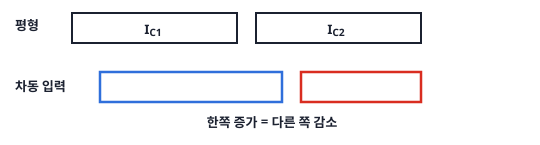
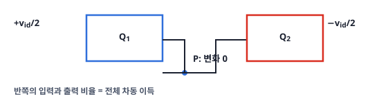
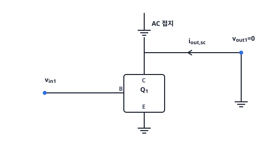
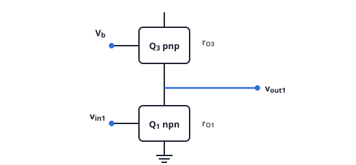
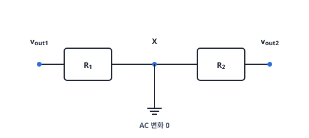
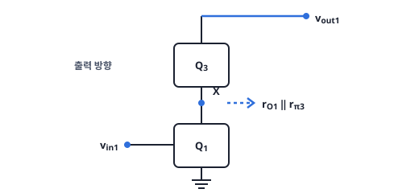
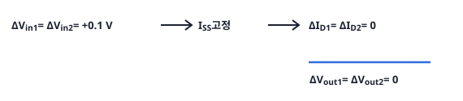
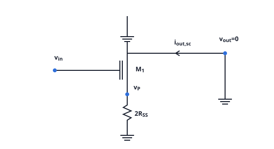

# BJT 차동쌍 소신호, 캐스코드 차동쌍, 공통 모드 제거 — 5살도 이해하는 정리노트

권익진 교수님 전자회로2 · 1002 수업 (Lec4, Razavi 10장)

> `정리노트_1002_Differential_Amplifiers.html`를 마크다운으로 옮겼어요. 그림은 `figures_1002/` 폴더의 SVG, 위젯은 대표 설정의 정적 그림으로 바꿨어요. 수식은 `$…$` / `$$…$$`라서 GitHub, Obsidian, Typora에서 보여요.

**목차**

- [들어가며: 왜 이런 회로를 쓸까](#why)
  - [왜 이런 회로를 쓸까](#why-circuit)
- [0. BJT 차동쌍의 소신호 해석](#s0)
  - [CM 레벨과 DC 바이어스, 차동 입력이 만드는 전류 변화](#s0-cm-vs-dc)
  - [가상 접지와 절반 회로: 차동 이득은 절반 회로 이득](#s0-half-circuit)
- [1. 전류원 부하 차동쌍 예제](#s1)
  - [예제 1: pnp 전류원 부하](#s1-pnp-load)
  - [예제 2: R1, R2 가운데에 베이스를 묶은 부하](#s1-r1-load)
- [2. 캐스코드 차동쌍](#s2)
  - [MOS 캐스코드 차동쌍: 전류 변화는 그대로, 출력저항은 크게](#s2-mos-cascode)
  - [캐스코드 부하, NMOS 입력, 전압 여유](#s2-mos-cascode-load)
  - [바이폴라 캐스코드 차동쌍: 베이스 전류 경로](#s2-bjt-cascode)
- [3. 공통 모드 제거](#s3)
  - [이상적인 경우: CM 입력에 출력이 꿈쩍하지 않는다](#s3-cm-ideal)
  - [유한한 테일 임피던스: $2R_{SS}$ CM 반회로](#s3-finite-rss)
  - [CM 반회로 계산과 수치 예시](#s3-cm-half)
  - [그래도 차동 출력은 0, $R_{SS}$를 키우는 법](#s3-cm-summary)
- [4. 요약 · 예고](#s4)
  - [한눈에 보는 식](#s4-cheatsheet)
  - [다음 시간 예고](#s4-next)
  - [함께 보면 좋은 자료](#s4-links)

## 들어가며: 왜 이런 회로를 쓸까

### 왜 이런 회로를 쓸까

*1002 수업 · L04 s22–s35*

**쉽게 말하면**

두 입력의 차이는 크게 키우고, 둘에 함께 들어온 잡음은 줄이고 싶어요. 저항 부하만 키우면 전압 여유가 줄어들어서 전류원 부하와 캐스코드를 써요.

*큰 이득과 공통 모드 제거를 얻는 동안 전압 여유와 소자 수를 함께 살펴야 해요.*

**정확히 말하면**

**1. 풀고 싶은 문제.** 차동 증폭기는 두 입력의 차이를 키우면서 둘에 함께 들어온 공통 모드(common mode, CM) 잡음의 영향을 줄여요. 원하는 차동 이득 $A_v$는 크고, 한쪽 출력으로 새는 CM 비율 $\Delta V_{out,CM}/\Delta V_{in,CM}$은 작아야 해요. 두 신호가 무엇인지 [CM 레벨과 차동 입력](#s0-cm-vs-dc)에서, 이상적인 제거가 언제 성립하는지 [이상적인 CM 제거](#s3-cm-ideal)에서 살펴봐요.

**2. 단순한 해법과 한계.** 동일 저항 부하 $R_C$를 둔 BJT 차동쌍은 순수 차동 입력에서 [가상 접지와 반회로](#s0-half-circuit)로 풀 수 있어요. 입력 소자의 출력저항이 $R_C$보다 충분히 클 때 한쪽 부하 저항을 키우면 이득은 커지지만, 바이어스 전류가 만드는 $R_C I_{EE}/2$의 전압 강하도 커져요. 예를 들어 같은 전류에서 $R_C$를 두 배로 키우면 그 전압 강하도 두 배가 되어 출력 전압 여유가 줄어요.

$$
A_v\approx-g_mR_C
$$

**3. 핵심 아이디어.** [pnp 전류원 부하](#s1-pnp-load)는 큰 소신호 저항을 비교적 작은 DC 전압 강하로 제공해요. 연결이 달라지는 [저항 결합 부하](#s1-r1-load)에서는 어떤 가지가 반회로의 부하가 되는지도 확인해요. 더 큰 이득이 필요하면 [MOS 캐스코드 입력 가지](#s2-mos-cascode)와 [캐스코드 부하](#s2-mos-cascode-load)가 출력저항을 키워요. BJT에서는 [캐스코드 베이스의 유한 $r_\pi$](#s2-bjt-cascode)가 증대를 제한할 수 있어요. CM 누설은 테일 전류원의 저항을 키워 줄여요. [유한한 테일 임피던스와 CM 반회로](#s3-finite-rss)에서 그 관계를 확인해요.

**4. 대가와 쓰이는 곳.** 캐스코드는 소자를 더 쌓으므로 포화 동작과 출력 스윙을 위한 헤드룸(headroom)이 줄어요. 높은 이득이 필요한 연산증폭기에는 이 선택이 유용하지만, 입력 CM 전압과 바이어스 범위를 함께 정해야 해요. 테일 저항이 유한하면 각 출력에 CM 성분이 조금 남아도 대칭인 두 출력을 빼면 상쇄돼요. 실제 불일치가 생기면 달라질 수 있다는 경계는 [차동 출력의 상쇄와 한계](#s3-cm-summary)에 적었어요. [CM 반회로의 계산](#s3-cm-half)에서는 한쪽 누설량을 구해요.

**교수님 말씀**

공통 모드 제거를 차동 회로의 중요한 성질로 강조하셨어요. 저항을 크게 쓰기 어려운 까닭은 전압 강하이고, 더 큰 이득을 위해 캐스코드를 쓴다고 설명하셨어요. 또한 실제 테일 전류원의 저항을 키우면 공통 모드 누설을 줄일 수 있다고 하셨어요.

**보충 · 수업에서 유도하진 않았어요**

교과서 10.4절은 캐스코드 차동쌍을 높은 이득과 빠른 동작이 필요한 연산증폭기 구조로 연결해요. 10.5절은 유한한 테일 저항만으로는 대칭 차동 출력에 CM 성분이 남지 않으며, 회로 불일치가 겹칠 때 차동 출력으로 전환될 수 있음을 설명해요.

**페이지 요약**

전류원 부하와 캐스코드로 차동 이득을 키우고, 높은 테일 저항으로 공통 모드 누설을 줄여요.

*핵심 식*

- 저항 부하, $r_O\gg R_C$

  $$
  A_v\approx-g_mR_C
  $$

판단: $R_C$를 키우면 전압 강하도 커져요.

판단: 캐스코드 적층은 헤드룸과 출력 스윙을 써요.

판단: 대칭인 두 출력의 CM 변화는 서로 뺄 때 상쇄돼요.

---

## 0. BJT 차동쌍의 소신호 해석

### CM 레벨과 DC 바이어스, 차동 입력이 만드는 전류 변화

*1002 수업 · L04 s19–s22*

**쉽게 말하면**

테일 전류를 두 가지가 똑같이 나눠 갖다가, 차동 입력을 넣으면 한쪽이 늘어난 만큼 다른 쪽이 줄어요. 함께 올리는 공통 모드 입력은 이 전류 배분과 다른 변화예요.

*양쪽 가지의 합은 테일이 정하고, 차동 입력은 그 전류를 재분배해요.*

**정확히 말하면**

차동쌍은 같은 BJT $Q_1,Q_2$, 같은 컬렉터 부하 $R_C$, 테일 전류 $I_{EE}$로 이루어져요. **DC 바이어스**는 두 베이스에 걸어 두는 고정 동작점이에요. **공통 모드**(common mode, CM)는 두 입력에 똑같이 더해지는 성분이므로 DC 바이어스와 같은 위상의 작은 신호를 모두 포함해요. 반대로 **차동** 입력은 한쪽을 올릴 때 다른 쪽을 내리는 변화예요.

작은 예시로 $I_{EE}=2\,\mathrm{mA}$이고 두 소자가 대칭이며 베이스 전류를 무시하면 각 컬렉터에는 약 $1\,\mathrm{mA}$가 흘러요. 작은 차동 입력이 $Q_1$ 컬렉터 전류를 $0.1\,\mathrm{mA}$ 늘리면 $Q_2$의 전류는 같은 양 줄어요. 아래 식은 그 변화를 일반 기호로 적은 거예요.

$$
I_{C1}\approx\frac{I_{EE}}{2}+\Delta I_C
$$

$$
I_{C2}\approx\frac{I_{EE}}{2}-\Delta I_C
$$

유한한 $\beta$를 유지하면 테일에는 이미터 전류와 베이스 전류가 함께 걸려요. 두 BJT의 $\beta$가 같고 활성 영역이면 $\alpha=\beta/(\beta+1)$을 먼저 써야 해요.

$$
I_{C1}=I_{C2}=\frac{\alpha I_{EE}}{2}
$$

따라서 위의 $I_{EE}/2$ 컬렉터 전류는 $\beta\gg1$에서 $\alpha\approx1$로 둔 근사예요. 예를 들어 $\beta=100$, $I_{EE}=2\,\mathrm{mA}$이면 한쪽 컬렉터 전류는 약 $0.99\,\mathrm{mA}$예요. 출력의 평형 DC 전압은 다음처럼 컬렉터 저항의 전압 강하로 정해져요.

$$
V_{out,CM}\approx V_{CC}-R_C\frac{I_{EE}}{2}
$$

차동 입력에서의 두 출력 변화는 반대라 차를 취할 때 커져요. 두 입력을 함께 움직이는 CM 변화의 응답은 테일 임피던스에도 달려 있으므로 [앞선 BJT CM 설명](../../0930/정리노트_0930_Differential_Amplifiers.html#s3-bjt-cm)과 [이번 수업의 이상적 테일 응답](#s3-cm-ideal)을 구별해요.

**교수님 말씀**

공통 모드는 DC 바이어스보다 넓은 말이라고 설명하셨어요. 같은 위상의 신호도 포함되지만, 의도한 차동 신호는 반대 위상이에요.

**꼭 기억해요**

컬렉터 전류 둘의 합을 정확히 $I_{EE}$라고 쓰려면 베이스 전류를 무시하는 큰 $\beta$ 근사가 필요해요. 공통 모드 제거도 테일과 대칭 조건을 확인해야 해요.

**페이지 요약**

차동 입력은 테일 전류를 두 가지 사이에 재분배하고, 공통 모드는 두 입력에 함께 더해지는 성분이에요.

*핵심 식*

- 평형, 큰 $\beta$

  $$
  I_{C1}\approx\frac{I_{EE}}{2}
  $$
- 차동 변화

  $$
  I_{C1}\approx\frac{I_{EE}}{2}+\Delta I_C
  $$
- 차동 변화

  $$
  I_{C2}\approx\frac{I_{EE}}{2}-\Delta I_C
  $$

판단: 유한한 $\beta$에서는 $\alpha=\beta/(\beta+1)$를 반영해요.

판단: DC 바이어스는 공통 모드의 일부예요.

---

### 가상 접지와 절반 회로: 차동 이득은 절반 회로 이득

*1002 수업 · L04 s23–s24*

**쉽게 말하면**

같은 두 회로에 반대 입력을 넣으면 가운데 이미터 노드 P의 작은 변화는 0이에요. 그래서 한쪽 절반 회로만 계산하면 차동 이득을 알 수 있어요.

*이 대칭은 순수 차동 입력에만 성립해요.*

**정확히 말하면**

두 BJT와 부하가 대칭이고 평형 동작점에서 $g_{m1}=g_{m2}$, $r_{\pi1}=r_{\pi2}$예요. 순수 차동 입력 $v_{in1}=+v_{id}/2$, $v_{in2}=-v_{id}/2$을 가해요. 대칭면의 소신호 전압은 0이므로 공통 이미터 노드 P는 **가상 접지**예요. 이는 DC 접지라는 뜻이 아니에요. 이상적인 테일 전류원은 소신호 개방이고, DC 전원은 AC 접지예요.

한쪽 **절반 회로**는 $Q_1$의 공통 이미터(CE) 단이에요. 베이스에 $v_{in1}$, 이미터에 AC 접지, 컬렉터에 $R_C$와 $r_{O1}$이 같은 출력과 접지 사이에 붙어요. 유한한 베이스 전류가 필요한 모델에서는 $r_\pi$를 베이스–이미터 사이에 유지해요. 이상적인 입력 전압원으로 구동할 때 그 전압은 $v_{\pi1}=v_{in1}$이에요. 반쪽의 입출력이 각각 전체 차동 입출력의 절반이므로 이득은 같아요.

$$
A_v=\frac{v_{out1}-v_{out2}}{v_{in1}-v_{in2}}=\frac{v_{out1}}{v_{in1}}
$$

**출력 단락에서 $G_m$.** 그림처럼 오른쪽 출력 노드를 AC 접지에 실제로 단락해요. 단락 접지에서 $Q_1$의 컬렉터로 유입해 이미터로 흐르는 전류를 양의 $i_{out,sc}$로 정해요. $R_C$와 $r_{O1}$의 양단이 모두 AC 접지여서 이 두 가지의 전류는 0이에요.

*$Q_1$의 원래 BJT 블록을 유지한 단락 측정이에요. 출력 단락 때문에 부하 가지에는 소신호 전압이 걸리지 않아요.*

$$
G_m=\frac{i_{out,sc}}{v_{in1}}=g_{m1}
$$

**입력 영점에서 $R_{out}$.** 베이스 입력을 AC 접지로 두고 출력에서 안을 봐요. 같은 저주파 모델에서 증폭기 쪽 저항은 $r_{O1}$이고 실제 외부 부하 $R_C$는 같은 출력과 접지 사이에 연결돼요.

$$
R_{amp}\approx r_{O1}
$$

$$
R_{out}\approx R_{amp}\parallel R_C\approx r_{O1}\parallel R_C
$$

**부호 있는 차동 이득.** 컬렉터 전류가 늘면 $R_C$ 전압 강하가 커져 출력은 내려가요. 따라서 단일 반회로의 반전 이득이 전체 차동 이득이에요.

$$
A_v\approx-G_mR_{out}\approx-g_{m1}(r_{O1}\parallel R_C)
$$

$r_{O1}\gg R_C$일 때만 $A_v\approx-g_{m1}R_C$로 줄여요. 예를 들어 $g_{m1}=2\,\mathrm{mS}$, $R_C=5\,\mathrm{k\Omega}$, $r_{O1}\gg R_C$이면 차동 이득은 약 $-10\,\mathrm{V/V}$예요. [앞선 가상 접지 설명](../../0923/정리노트_0923_Differential_Amplifiers.html#s3-virtual-ground)과 같은 대칭 원리예요.

**교수님 말씀**

BJT에도 $r_\pi$가 남지만 순수 차동 대칭에서는 P가 가상 접지라 절반 회로로 풀 수 있다고 강조하셨어요. $r_{O1}$이 $R_C$보다 충분히 클 때는 익숙한 CE 이득으로 줄인다고 하셨어요.

**꼭 기억해요**

공통 모드 입력에는 P의 가상 접지를 적용하지 않아요. 차동 이득과 한쪽 출력의 CM 이득은 입력 조건부터 달라요.

**보충 · 수업에서 유도하진 않았어요**

대칭 소자와 반대 입력을 동시에 바꾸면 두 절반의 소신호 응답은 서로 부호만 반대예요. 같은 노드 P는 이 변환에서 자기 자신이면서 부호도 바뀌어야 하므로 $v_P=-v_P$, 즉 $v_P=0$이에요. 같은 $r_\pi$와 $r_O$를 양쪽에 보존해도 이 대칭 판단은 유지돼요.

**페이지 요약**

순수 차동 대칭에서 P는 가상 접지이고 차동 이득은 CE 절반 회로 이득과 같아요.

*핵심 식*

- 출력 단락

  $$
  G_m=g_{m1}
  $$
- 입력 영점

  $$
  R_{out}\approx r_{O1}\parallel R_C
  $$
- 반전 이득

  $$
  A_v\approx-G_mR_{out}
  $$

판단: $r_\pi$는 유한한 베이스 전류 모델에 남겨요.

판단: $r_{O1}\gg R_C$일 때 $A_v\approx-g_{m1}R_C$로 줄여요.

---

## 1. 전류원 부하 차동쌍 예제

### 예제 1: pnp 전류원 부하

*1002 수업 · L04 s25*

**쉽게 말하면**

위쪽 저항을 pnp 전류원 부하로 바꾸면 큰 DC 전압 강하 없이 큰 소신호 저항을 얻어요. 아래 입력 $Q_1$이 만든 전류 변화가 이 큰 저항에 걸려 출력 전압을 더 크게 움직여요.

*한쪽 출력에서 위·아래로 본 두 저항은 같은 노드에 붙으므로 병렬이에요.*

**정확히 말하면**

입력 npn $Q_1$, $Q_2$와 테일 전류원 $I_{EE}$에 pnp $Q_3$, $Q_4$ 부하를 단 대칭 차동쌍이에요. pnp 이미터는 $V_{CC}$, 베이스는 고정 바이어스 $V_b$에 연결돼요. 순수 차동 입력 $v_{in2}=-v_{in1}$에서 대칭면 P는 AC 접지이므로 반회로의 $v_{out1}/v_{in1}$을 구해요. 이 값은 $v_{od}/v_{id}$와 같아요.

출력 단락($v_{out1}=0$)에서 오른쪽 접지로부터 출력 단자로 들어와 아래 $Q_1$ 가지로 흐르는 전류를 양의 $i_{out,sc}$로 정해요. $Q_1$ 이미터는 AC 접지라 $v_{be1}=v_{in1}$이에요. pnp $Q_3$는 베이스와 이미터가 모두 AC 접지라 $v_{eb3}=0$이고, 신호 전류를 만들지 않아요.

$$
G_m=\frac{i_{out,sc}}{v_{in1}}=g_{m1}
$$

다음에는 입력을 0으로 두고 같은 출력에서 봐요. $Q_1$ 쪽은 $r_{O1}$, $Q_3$ 쪽은 유한한 $r_{O3}$예요. 두 저항이 출력과 AC 접지 사이에 있으므로

$$
R_{out}\approx r_{O1}\parallel r_{O3}
$$

양의 $v_{in1}$은 컬렉터로 더 많은 전류를 끌어내려 $v_{out1}$을 낮춰요.

$$
A_v=\frac{v_{out1}}{v_{in1}}\approx-G_mR_{out}\approx-g_{m1}(r_{O1}\parallel r_{O3})
$$

저항 부하 $R_C\ll r_{O1}$에서는 $R_C$가 이득을 정했지만, 여기서는 $r_{O3}$가 $r_{O1}$과 비슷할 수 있어 둘 다 남겨요. 이상적 전류원 부하는 출력저항이 무한대인 한계이므로 실제 pnp 부하보다 이득 크기가 커요.

작은 예로 $I_{EE}=1\,\mathrm{mA}$, 양쪽 $V_A=5\,\mathrm V$, $V_T=26\,\mathrm{mV}$이면 각 가지의 $I_C=I_{EE}/2=0.5\,\mathrm{mA}$예요. 반올림 전 값으로 계산해요.

$$
g_{m1}=\frac{I_C}{V_T}=\frac{0.5\,\mathrm{mA}}{26\,\mathrm{mV}}\approx19.23\,\mathrm{mS}
$$

$$
r_{O1}=\frac{V_A}{I_C}=10\,\mathrm{k\Omega}
$$

$$
r_{O3}=\frac{V_A}{I_C}=10\,\mathrm{k\Omega}
$$

$$
R_{out}\approx10\,\mathrm{k\Omega}\parallel10\,\mathrm{k\Omega}=5\,\mathrm{k\Omega}
$$

$$
A_v\approx-\frac{0.5\,\mathrm{mA}}{26\,\mathrm{mV}}(5\,\mathrm{k\Omega})\approx-96.15\,\mathrm{V/V}
$$

저항 부하를 크게 만들면 DC 전류에 따른 $I_CR_C$ 전압 강하도 커져요. 전류원 부하는 큰 소신호 저항을 얻으면서 BJT의 활성 영역에 필요한 전압 여유를 확보할 수 있어요. pnp $Q_3$의 활성 영역은 이미터–베이스 접합의 순방향 $V_{EB3}\gt0$과 베이스–컬렉터 접합의 역방향 $V_{BC3}\gt0$로 확인해요. 이 부등식은 pnp 단자의 실제 전압 순서를 나타내요.

**교수님 말씀**

교수님은 $Q_3$의 베이스·이미터가 AC 접지여서 소신호 제어전압이 0이고 $r_{O3}$만 보인다고 설명하셨어요. 저항 부하를 무작정 크게 하면 DC의 IR 드롭 때문에 전압 여유가 부족해진다고 강조하셨어요.

**꼭 기억해요**

이 예제에서 이득을 구하라는 말은 차동 이득을 뜻해요. $r_{O1}$과 $r_{O3}$가 비슷할 때 어느 하나를 지우지 않아요.

**페이지 요약**

pnp 부하의 $r_{O3}$가 입력단의 $r_{O1}$과 병렬이 되어 큰 저항을 만들어요.

*핵심 식*

- 출력 단락

  $$
  G_m\approx g_{m1}
  $$
- 부하 포함

  $$
  R_{out}\approx r_{O1}\parallel r_{O3}
  $$
- 반전 이득

  $$
  A_v\approx-G_mR_{out}
  $$

베이스·이미터가 AC 접지인 $Q_3$는 신호 전류를 만들지 않아요.

$r_{O1}$과 $r_{O3}$가 비슷하면 둘 다 남겨요.

pnp 활성 영역은 $V_{EB3}\gt0$, $V_{BC3}\gt0$로 확인해요.

---

### 예제 2: R1, R2 가운데에 베이스를 묶은 부하

*1002 수업 · L04 s26*

**쉽게 말하면**

두 출력이 같은 크기로 반대로 움직이고 $R_1=R_2$이면 가운데 X의 작은 변화는 0이에요. 그래서 출력에서 $R_1$을 통해 X를 보면 AC 접지로 이어지는 저항 하나가 추가된 셈이에요.

*가운데 X는 DC 전압 0이 아니라 순수 차동 동작에서 AC 변화가 0인 노드예요.*

**정확히 말하면**

입력 $Q_1$, $Q_2$와 pnp $Q_3$, $Q_4$는 [pnp 전류원 부하 예제](#s1-pnp-load)와 같아요. 달라진 것은 두 출력 사이의 직렬 저항 $R_1$, $R_2$와 그 가운데 X에 연결한 pnp 베이스예요. $R_1=R_2$, 좌우 소자 매칭, 순수 차동 입력 $v_{in2}=-v_{in1}$이면 두 출력 변화가 서로 반대라 P와 X가 AC 가상 접지예요.

$$
v_X=\frac{v_{out1}+v_{out2}}{2}=0
$$

출력 단락($v_{out1}=0$)에서 오른쪽 접지로부터 출력 단자로 들어와 아래 $Q_1$ 가지로 흐르는 전류를 양의 $i_{out,sc}$로 정해요. X가 AC 접지여서 $Q_3$ 베이스·이미터의 변화가 0이고, $R_1$도 단락 출력에서 전류를 더하지 않아요.

$$
G_m=\frac{i_{out,sc}}{v_{in1}}=g_{m1}
$$

입력을 0으로 두고 반대쪽 출력에는 반대 극성의 차동 시험을 가해 X의 AC 접지 조건을 유지해요. 출력 아래 $r_{O1}$, pnp 위 $r_{O3}$, X로 이어지는 $R_1$이 모두 출력과 AC 접지 사이에 놓여요. 세 경로를 마지막에 병렬로 묶어요.

$$
R_{out}\approx r_{O1}\parallel r_{O3}\parallel R_1
$$

양의 입력은 $Q_1$의 컬렉터 전류를 늘려 출력을 낮춰요.

$$
A_v=\frac{v_{out1}}{v_{in1}}\approx-G_mR_{out}\approx-g_{m1}(r_{O1}\parallel r_{O3}\parallel R_1)
$$

예로 $I_{EE}=1\,\mathrm{mA}$, $V_A=5\,\mathrm V$, $V_T=26\,\mathrm{mV}$와 $R_1=R_2=5\,\mathrm{k\Omega}$를 두면 $g_{m1}=0.5\,\mathrm{mA}/26\,\mathrm{mV}$이고 $r_{O1}=r_{O3}=10\,\mathrm{k\Omega}$예요.

$$
R_{out}\approx10\,\mathrm{k\Omega}\parallel10\,\mathrm{k\Omega}\parallel5\,\mathrm{k\Omega}=2.5\,\mathrm{k\Omega}
$$

$$
A_v\approx-\frac{0.5\,\mathrm{mA}}{26\,\mathrm{mV}}(2.5\,\mathrm{k\Omega})\approx-48.08\,\mathrm{V/V}
$$

동작점이 따로 유지되는 소신호 비교에서 $R_1=R_2$를 함께 키우면 저항 가지의 영향이 줄어 [전류원 부하](#s1-pnp-load)의 이득으로 다가가요. 실제로 두 저항을 떼면 pnp 베이스 바이어스도 다시 마련해야 해요. 좌우 매칭과 활성 동작을 유지하며 둘을 함께 0으로 보내면 두 출력과 X가 하나의 노드로 합쳐져 순수 차동 출력 $v_{out1}-v_{out2}$는 0으로 가요. 이 극한은 좌우가 계속 매칭되고 순수 차동으로 구동될 때의 출력 차에 대한 결과예요. 한쪽 저항만 0으로 하거나 공통 모드로 구동하면 X를 AC 접지로 둔 식을 그대로 쓸 수 없어요.

$R_1=R_2=0$에서는 pnp 컬렉터와 베이스가 같은 노드라 다이오드 접속처럼 보여요. 하지만 두 출력도 서로 단락되므로, 분리된 단일 출력의 독립적인 $1/g_m$ 부하로 취급하면 잘못된 차동 이득을 얻어요. 반대로 베이스가 출력과 함께 움직이는 별도 단일 pnp 회로에서는 다이오드 접속 저항을 볼 수 있어요. X의 AC 접지 조건과 회로 연결을 먼저 확인해야 해요.

공통 모드 입력 $v_{in2}=v_{in1}$에서는 P와 X의 차동 가상 접지를 적용하지 않아요. DC의 X 전압도 0이라고 말하지 않아요.

**교수님 말씀**

교수님은 같은 $R_1$, $R_2$와 반대 출력 변화에서 X가 AC 접지라고 설명하셨어요. $R_1$을 키우면 전류원 부하에 가까워지고, 저항이 없어지면 다이오드 접속과 관련된 구조가 된다고 비교하셨어요.

**꼭 기억해요**

가상 접지는 매칭된 순수 차동 동작의 소신호 조건이에요. DC 접지나 공통 모드의 접지로 넓혀 쓰지 않아요.

**페이지 요약**

매칭된 순수 차동 입력에서는 X가 AC 접지라 $R_1$이 출력저항에 병렬로 들어가요.

*핵심 식*

- 출력 단락

  $$
  G_m\approx g_{m1}
  $$
- 부하 포함

  $$
  R_{out}\approx r_{O1}\parallel r_{O3}\parallel R_1
  $$
- 반전 이득

  $$
  A_v\approx-G_mR_{out}
  $$

이 관계는 $R_1=R_2$와 좌우 매칭, 순수 차동 입력에서 성립해요.

$R_1=R_2\to0$에서는 두 출력이 합쳐져 차동 출력이 0으로 가요.

---

## 2. 캐스코드 차동쌍

### MOS 캐스코드 차동쌍: 전류 변화는 그대로, 출력저항은 크게

*1002 수업 · L04 s27*

**쉽게 말하면**

입력 $M_1$이 전류 변화를 만들고 위의 $M_3$가 그 전류를 출력까지 보내요. $M_3$를 쌓으면 출력에서 아래로 보는 저항이 커져 같은 입력에 출력 전압이 더 크게 변해요.

*출력 전류를 만드는 소자는 $M_1$이고, 저항을 키우는 소자는 $M_3$예요.*

**정확히 말하면**

대칭 MOS 차동쌍의 $M_1$, $M_2$ 위에 $M_3$, $M_4$를 쌓아요. 순수 차동 입력에서는 대칭면 P가 소신호 가상 접지이므로 $v_{in1}=v_{id}/2$인 반회로를 써요. 여기서는 윗부하가 이상적 전류원이라 소신호로 개방되어 있어요. $v_{out1}/v_{in1}$은 전체 차동 이득 $v_{od}/v_{id}$와 같아요.

먼저 출력 단락($v_{out1}=0$)에서 오른쪽 단락 접지에서 출력 단자로 들어와 아래 입력 가지로 흐르는 전류를 양의 $i_{out,sc}$로 정의해요. $M_1$이 만든 전류 변화가 $M_3$를 지나므로 큰 $g_mr_O$ 근사에서 다음과 같아요.

$$
G_m=\frac{i_{out,sc}}{v_{in1}}\approx g_{m1}
$$

다음에는 입력을 0으로 두고 출력에서 아래를 봐요. 먼 쪽 $M_1$의 저항 $r_{O1}$을 먼저 잡고, $M_3$의 캐스코드 인자 $g_{m3}r_{O3}$을 곱해요. 위의 이상적 전류원 부하는 개방이므로 병렬 효과가 없어요. $g_{m3}r_{O1}\gg1$이고 $g_{m3}r_{O3}\gg1$인 주항에서

$$
R_{out}\approx g_{m3}r_{O3}r_{O1}
$$

같은 출력 노드에서 양의 입력은 아래로 더 많은 전류를 끌어내려 출력 전압을 낮춰요.

$$
A_v=\frac{v_{out1}}{v_{in1}}\approx-G_mR_{out}\approx-g_{m1}g_{m3}r_{O3}r_{O1}
$$

$M_3$가 없는 경우의 $R_{out}\approx r_{O1}$과 비교하면, $G_m$은 거의 같고 이득 크기는 $g_{m3}r_{O3}$배 커져요. 네 소자가 같으면 $A_v\approx-(g_mr_O)^2$예요. 실제 부하의 저항까지 포함한 경우는 [캐스코드 부하](#s2-mos-cascode-load)에서 계산해요.

DC 바이어스에서는 테일 전류가 각 가지 전류를 정하고, $V_{b1}$ 변화에는 $M_3$ 소스 전압이 따라 움직여 $V_{GS3}$가 유지돼요. 다만 $M_1$ 포화는 별도로 확인해요.

$$
V_{GD1}=V_{in,CM}-(V_{b1}-V_{GS3})\le V_{TH}
$$

**교수님 말씀**

교수님은 $M_3$를 전류가 지나가는 통로이자 출력저항을 높이는 소자로 구분하셨어요. $V_{b1}$이 변해도 소스 전압이 따라 움직여 $V_{GS3}$가 유지된다고 설명하셨어요.

**페이지 요약**

$M_3$를 쌓으면 $G_m$은 거의 같고 출력저항과 반전 이득의 크기가 커져요.

*핵심 식*

- 출력 단락

  $$
  G_m\approx g_{m1}
  $$
- 입력 영점, 이상적 부하

  $$
  R_{out}\approx g_{m3}r_{O3}r_{O1}
  $$
- 부호 있는 이득

  $$
  A_v\approx-G_mR_{out}
  $$

$g_{m3}r_{O1}\gg1$과 $g_{m3}r_{O3}\gg1$에서 주항을 써요.

양의 입력이 출력을 낮춰 이득은 음수예요.

---

### 캐스코드 부하, NMOS 입력, 전압 여유

*1002 수업 · L04 s28*

**쉽게 말하면**

출력에서 아래 저항만 키우면 위쪽의 작은 부하 저항으로 전류가 새어 이득이 줄어요. 위 부하도 캐스코드로 쌓으면 두 방향의 저항이 함께 커져요.

*두 저항은 같은 출력 노드에 연결되므로 마지막에 병렬로 묶어요.*

**정확히 말하면**

실제 전류원은 MOS로 구현해요. $M_7$ 하나만 부하로 쓰면 그 유한 저항 $r_{O7}$이 아래의 $g_{m3}r_{O3}r_{O1}$과 병렬이 되어 큰 이득이 사라져요. 그래서 $M_7$ 위쪽 전류원 가지에 $M_5$를 더해 캐스코드 부하를 만들어요. 반대쪽 가지도 대응하는 $M_6$, $M_8$로 구성해요.

순수 차동 입력, 대칭 바이어스와 포화 동작을 가정해 반회로를 써요. $v_{out1}=0$에서 위 부하의 게이트들은 AC 접지라 신호 전류를 만들지 않고, 오른쪽 단락에서 출력 단자로 들어와 아래 가지로 흐르는 양의 $i_{out,sc}$는 입력 $M_1$의 전류 변화가 정해요.

$$
G_m=\frac{i_{out,sc}}{v_{in1}}\approx g_{m1}
$$

입력을 0으로 하고 출력에서 먼 부분부터 봐요. 아래는 $r_{O1}$을 $M_3$가 키우고, 위는 $r_{O7}$을 $M_5$가 키워요. 두 가지가 같은 출력과 AC 접지 사이에 있으므로 마지막에 병렬로 묶어요. 두 캐스코드의 큰 곱 조건에서

$$
R_{out}\approx(g_{m3}r_{O3}r_{O1})\parallel(g_{m5}r_{O5}r_{O7})
$$

양의 $v_{in1}$이 아래로 더 많은 전류를 끌어내므로

$$
A_v=\frac{v_{out1}}{v_{in1}}\approx-G_mR_{out}
$$

$M_7$만 남긴 부하는 $R_{out}\approx(g_{m3}r_{O3}r_{O1})\parallel r_{O7}$이라 아래 저항만 키운 효과가 제한돼요.

같은 전류와 크기의 소자에서는 NMOS의 이동도 $\mu_n$이 PMOS의 $\mu_p$보다 커서 NMOS 입력 $g_m$이 커지기 쉬워요.

$$
g_m=\sqrt{2\mu C_{ox}\frac WL I_D}
$$

$M_7$의 소스는 $V_{DD}$에 고정돼 있어서 $V_{b3}$가 $V_{SG7}=V_{DD}-V_{b3}$와 전류를 정해요. 위쪽 전류를 $I_{SS}/2$에 맞추지 않으면 출력 DC 전압이 한쪽 끝으로 치우쳐요. $V_{b1}$, $V_{b2}$, 입력 공통 모드 전압은 포화 범위 안에서는 주로 노드 전압을 옮겨요.

전압 여유(헤드룸)를 확인해요. 다섯 소자(테일, $M_1$, $M_3$, $M_5$, $M_7$)에 각각 최소 $V_{ov}$가 필요해요. 예로 모두 $V_{ov}=0.1\,\mathrm V$이면 적층에 필요한 합은 최소 $0.5\,\mathrm V$예요. 출력 스윙을 위해 공급 전압에는 더 큰 여유가 필요해요. [전압 여유 설명](../../0916/정리노트_0916_Cascode_Amplifier.html#s1-headroom)도 참고해요.

PMOS 쪽에 입력을 넣을 때는 위에 테일 전류원을 놓고 아래를 접지하는 대응 구조를 쓸 수 있어요. 테일 없이도 동작하지만 입력 공통 모드가 전류를 바꿔요.

**교수님 말씀**

교수님은 단일 부하의 유한 저항이 병렬로 붙으면 캐스코드 이득이 줄어든다고 강조하셨어요. 위 부하의 소신호 전류 변화가 없다는 뜻과 DC 바이어스 전류가 없다는 뜻을 구분하셨어요. 낮아지는 전원 전압에서는 적층 소자의 전압 여유가 설계 부담이라고 설명하셨어요.

**페이지 요약**

위 부하도 캐스코드로 키워야 아래 캐스코드가 만든 큰 이득을 살릴 수 있어요.

*핵심 식*

- 출력 단락

  $$
  G_m\approx g_{m1}
  $$
- 부하 포함

  $$
  \begin{aligned}R_{out}&\approx(g_{m3}r_{O3}r_{O1})\\&\quad\parallel(g_{m5}r_{O5}r_{O7})\end{aligned}
  $$
- 반전 이득

  $$
  A_v\approx-G_mR_{out}
  $$

위와 아래 저항은 마지막에 병렬로 묶어요.

$V_{b3}$는 $M_7$의 전류를 정해 $I_{SS}/2$에 맞춰요.

적층에는 최소 $5V_{ov}$와 출력 스윙 여유가 필요해요.

---

### 바이폴라 캐스코드 차동쌍: 베이스 전류 경로

*1002 수업 · L04 s29–30*

**쉽게 말하면**

BJT 차동쌍의 $Q_1$ 위에 $Q_3$를 쌓아도 전류 변화는 거의 그대로 전달돼요. 다만 $Q_3$의 베이스 경로 $r_{\pi3}$가 아래 저항과 병렬로 붙어서 MOS보다 출력저항이 작아져요.

*점선 화살표는 X에서 보는 $r_{O1}\parallel r_{\pi3}$ 블록을 가리켜요. 이 블록에 $Q_3$의 캐스코드 인자를 적용해요.*

**정확히 말하면**

대칭 BJT 차동쌍 $Q_1$, $Q_2$ 위에 $Q_3$, $Q_4$를 쌓아요. 순수 차동 입력에서 대칭면은 가상 접지이고 베이스 바이어스도 AC 접지예요. 여기서는 위 부하를 이상적 전류원으로 먼저 두어요. 출력 $v_{out1}$과 반회로 입력 $v_{in1}$의 이득을 구해요.

출력을 단락하고 오른쪽 접지에서 출력 단자로 들어와 아래 가지로 흐르는 $i_{out,sc}$를 양으로 정해요. $Q_1$이 $i_{c1}=g_{m1}v_{in1}$을 만들어요. $Q_3$의 이미터 전류와 컬렉터 전류는 베이스 전류만큼 다르지만, 큰 $\beta$에서는 거의 같아요.

$$
G_m=\frac{i_{out,sc}}{v_{in1}}\approx g_{m1}
$$

이제 입력을 0으로 두고 출력에서 먼 노드 X를 먼저 봐요. $Q_1$의 $r_{\pi1}$은 베이스와 이미터가 모두 AC 접지라 이 경로에 영향을 주지 않아요. 반면 $Q_3$의 $r_{\pi3}$은 노드 X에서 AC 접지된 베이스로 이어져 $r_{O1}$과 병렬이에요.

$$
R_e^*=r_{O1}\parallel r_{\pi3}
$$

이 저항을 $Q_3$가 키워요. $g_{m3}R_e^*\gg1$의 주항과 이상적 상단 부하에서

$$
R_{out}\approx g_{m3}r_{O3}(r_{O1}\parallel r_{\pi3})
$$

양의 입력이 출력 전압을 낮추므로

$$
A_v=\frac{v_{out1}}{v_{in1}}\approx-G_mR_{out}\approx-g_{m1}g_{m3}r_{O3}(r_{O1}\parallel r_{\pi3})
$$

예를 들어 $r_{O1}=50\,\mathrm{k\Omega}$, $r_{\pi3}=5\,\mathrm{k\Omega}$이면 병렬 저항은 약 $4.55\,\mathrm{k\Omega}$예요. 따라서 $r_{\pi3}$을 없던 것으로 취급할 수 없어요. $r_\pi=\beta/g_m$라는 관계도 같은 결론을 뒷받침해요.

실제 부하는 $Q_7$ 아래에 $Q_5$를 쌓고 반대쪽에 $Q_8$, $Q_6$을 두어요. 위쪽의 먼 저항도 $r_{O7}\parallel r_{\pi5}$로 먼저 묶어요. $Q_7$의 $r_{\pi7}$은 양 끝이 AC 접지라 출력 경로에 보이지 않아요.

$$
R_{out}\approx\big[g_{m3}r_{O3}(r_{O1}\parallel r_{\pi3})\big]\parallel\big[g_{m5}r_{O5}(r_{O7}\parallel r_{\pi5})\big]
$$

$$
A_v\approx-G_mR_{out}
$$

전류원 기호는 실제 회로에서 트랜지스터로 구현해요. 고이득 차동 증폭기는 실제 OP 앰프의 대표적인 내부 구조 중 하나예요. [BJT 캐스코드 기본 구조](../../0916/정리노트_0916_Cascode_Amplifier.html#s2-bjt)도 이어서 볼 수 있어요.

**교수님 말씀**

교수님은 $r_{\pi3}$가 수 kΩ, $r_O$가 수십 kΩ 정도일 수 있어 병렬 경로를 무시할 수 없다고 설명하셨어요. 베이스 전류 때문에 생기는 차이는 큰 $\beta$에서 작아도 출력저항 계산의 $r_\pi$는 남겨야 한다고 구분하셨어요. OP 앰프를 높은 이득의 차동 증폭기로 소개하셨어요.

**페이지 요약**

BJT 캐스코드는 $r_{\pi3}$가 아래 저항과 병렬이므로 이를 먼저 묶어야 해요.

*핵심 식*

- 출력 단락, 큰 β

  $$
  G_m\approx g_{m1}
  $$
- 이상적 상단 부하

  $$
  \begin{aligned}R_{out}&\approx g_{m3}r_{O3}\\&\quad(r_{O1}\parallel r_{\pi3})\end{aligned}
  $$
- 부호 있는 이득

  $$
  A_v\approx-G_mR_{out}
  $$

$g_{m3}(r_{O1}\parallel r_{\pi3})\gg1$에서 주항을 써요.

실제 캐스코드 부하는 위쪽 저항과 마지막에 병렬로 묶어요.

---

## 3. 공통 모드 제거

### 이상적인 경우: CM 입력에 출력이 꿈쩍하지 않는다

*1002 수업 · L04 s32*

**쉽게 말하면**

두 입력을 함께 0.1 V 올려도 이상적인 테일 전류가 고정되면 두 가지 전류는 그대로예요. 따라서 두 출력도 그대로예요.

*두 입력이 같이 움직여도 이상적인 테일은 전체 전류를 고정해요.*

**정확히 말하면**

완전히 대칭인 MOS 차동쌍에 같은 공통 모드(common mode, CM) 변화 $\Delta V_{in,CM}$을 넣고 이상적인 테일 전류원 $I_{SS}$를 가정해요. 앞의 0.1 V 예시는 이 조건에서 두 출력 변화가 모두 0인 경우예요. 외부 잡음이 양쪽에 같은 위상으로 들어오는 상황이 여기에 해당해요.

1. 대칭이므로 두 가지의 드레인 전류 변화는 같아요.

   $$
   \Delta I_{D1}=\Delta I_{D2}=\Delta I_D
   $$
2. 이상적인 $I_{SS}$는 변하지 않으므로 테일 노드의 변화 전류 합은 0이에요.

   $$
   2\Delta I_D=0
   $$
3. 각 출력은 저항 $R_D$의 전류 변화가 0이라 움직이지 않아요.

   $$
   \Delta V_{out1}=\Delta V_{out2}=-R_D\Delta I_D=0
   $$
4. 한쪽 출력의 CM 이득도 0이에요.

   $$
   A_{CM,SE}=\frac{\Delta V_{out,CM}}{\Delta V_{in,CM}}=0
   $$

두 출력을 뺀 차동 출력도 0이에요. [공통 모드 잡음과 차동 출력](../../0923/정리노트_0923_Differential_Amplifiers.html#s0-noise)에서 본 빼기 원리와 같아요. 실제 테일 저항이 유한할 때의 각 출력은 [유한한 테일 임피던스: $2R_{SS}$ CM 반회로](#s3-finite-rss)에서 살펴봐요.

**교수님 말씀**

같은 위상의 잡음이 양쪽에 들어와도 이상적 테일에서는 전류가 달라지지 않는다고 설명하셨어요.

**꼭 기억해요**

CM 입력에서는 테일 노드를 차동 입력의 가상 접지로 두지 않아요. 이상적 테일에서는 전류가 0으로 변할 뿐, 그 노드 전압은 입력을 따라갈 수 있어요.

**페이지 요약**

대칭 차동쌍과 이상적인 $I_{SS}$에서는 같은 입력 변화가 두 출력의 전류를 바꾸지 않아요.

*핵심 식*

- 각 출력의 CM 이득

  $$
  A_{CM,SE}=\frac{\Delta V_{out,CM}}{\Delta V_{in,CM}}=0
  $$

판단: 두 가지가 대칭이고 테일 전류가 고정되어야 해요.

---

### 유한한 테일 임피던스: $2R_{SS}$ CM 반회로

*1002 수업 · L04 s33*

**쉽게 말하면**

테일의 저항 $R_{SS}$가 유한하면 두 가지 전류가 같은 만큼 변해요. 한 가지가 보는 테일 저항은 $2R_{SS}$예요.

*$2R_{SS}$ 둘의 병렬이 $R_{SS}$이므로 회로 연결을 유지하며 반으로 나눌 수 있어요.*

**정확히 말하면**

두 입력, 소자, 부하가 대칭이고 같은 가지 전류 $i$가 흐르는 경우예요. 실제 테일 전류원의 유한한 소신호 출력저항을 $R_{SS}$로 둬요. 한 소자로 만든 테일이면 $R_{SS}=r_O$이고, 캐스코드 테일의 큰 곱 근사에서는 $R_{SS}\approx g_{m2}r_{O2}r_{O1}$이에요.

예를 들어 $R_{SS}=10\,\mathrm{k\Omega}$이면 한쪽이 보는 저항은 $20\,\mathrm{k\Omega}$예요. 이때 양쪽 가지가 각각 $i$만큼 변하면 테일에는 $2i$가 흐르고 소스 공통 노드 P의 전압은 아래처럼 변해요.

$$
v_P=(2i)R_{SS}=i(2R_{SS})
$$

따라서 각 반쪽은 소스에 $2R_{SS}$를 단 소스 축퇴(source degeneration) 공통 소스 증폭기예요. CM 대칭선은 가상 접지가 아니고 P도 AC 접지가 아니에요. $R_{SS}\to\infty$인 이상적 경우에는 전류 변화가 0으로 돌아가요.

이 반회로의 출력 단락 전류, 출력저항, 부호 있는 이득은 [CM 반회로 계산과 수치 예시](#s3-cm-half)에서 차례로 구해요.

**교수님 말씀**

트랜지스터 하나의 유한한 출력저항보다 캐스코드 전류원의 출력저항을 크게 만들 수 있다고 설명하셨어요.

**페이지 요약**

대칭 CM 입력에서는 각 반쪽이 $2R_{SS}$의 소스 축퇴 저항을 봐요.

*핵심 식*

- P 노드와 반회로

  $$
  v_P=(2i)R_{SS}=i(2R_{SS})
  $$

판단: 양쪽 소자와 부하가 대칭이고 가지 전류가 같아야 해요.

판단: CM 대칭선은 가상 접지가 아니에요.

---

### CM 반회로 계산과 수치 예시

*1002 수업 · L04 s33*

**쉽게 말하면**

한쪽 반회로에서 입력이 전류를 얼마나 만드는지, 출력이 얼마나 버티는지 차례로 구해요. $R_{SS}$가 커질수록 한쪽 출력의 흔들림은 작아져요.

*같은 입력과 한쪽 출력 정의로 세 계산을 이어 붙여요.*

**정확히 말하면**

대칭, 같은 CM 입력, 이상적인 테일 전류원에 병렬인 유한 $R_{SS}$, 입력 MOS의 $r_O$를 생략할 수 있는 저주파 저항 부하 모델이에요. 입력은 한쪽 게이트의 $v_{in}=\Delta V_{in,CM}$, 출력은 오른쪽 드레인의 $v_{out}=\Delta V_{out,CM}$으로 정의해요. $R_D$는 외부 부하를 포함해 실제 출력에 접속된 저항이라고 두어요.

**출력 단락에서 $G_m$.** 오른쪽 출력 드레인을 AC 접지에 단락하고, 오른쪽 단락 접지에서 드레인으로 유입해 소스로 흐르는 전류를 양의 $i_{out,sc}$로 정해요. 소스 아래의 $2R_{SS}$가 입력의 일부를 받아 $v_{gs}=v_{in}-i_{out,sc}(2R_{SS})$가 돼요.

*단락은 오른쪽 출력 단자에서 접지까지 실제로 이어져요. 입력 $v_{in}$은 유지하고 $R_D$는 단락에 가려져 전류를 흘리지 않아요.*

$$
i_{out,sc}=g_m\bigl(v_{in}-i_{out,sc}2R_{SS}\bigr)
$$

$$
G_{m,CM}=\frac{i_{out,sc}}{v_{in}}=\frac{g_m}{1+2g_mR_{SS}}=\frac{1}{1/g_m+2R_{SS}}
$$

$R_{SS}\gg1/g_m$이면 큰 곱 주항은 아래처럼 줄어요.

$$
G_{m,CM}\approx\frac{1}{2R_{SS}}
$$

**입력 영점에서 $R_{out}$.** 게이트 입력을 AC 접지로 두고 오른쪽 드레인에서 안을 봐요. 이 모델에서 입력 MOS 쪽 저항은 $r_O$를 생략해 충분히 크므로 실제 외부 부하 $R_D$가 보여요.

$$
R_{out}\approx R_{amp}\parallel R_D\approx R_D
$$

**부호 있는 이득.** 드레인 전류가 증가하면 $R_D$의 전압 강하가 커져 출력은 내려가요.

$$
A_{CM,SE}=\frac{\Delta V_{out,CM}}{\Delta V_{in,CM}}\approx-G_{m,CM}R_{out}=-\frac{R_D}{1/g_m+2R_{SS}}
$$

같은 큰 곱 조건에서 주항만 남기면 아래와 같아요.

$$
A_{CM,SE}\approx-\frac{R_D}{2R_{SS}}
$$

$R_{SS}=10\,\mathrm{k\Omega}$이면 반회로 축퇴 저항은 $20\,\mathrm{k\Omega}$예요. 예컨대 $R_D=1\,\mathrm{k\Omega}$, $1/g_m=0.2\,\mathrm{k\Omega}$이면 다음과 같아요.

$$
G_{m,CM}=\frac{1}{0.2\,\mathrm{k\Omega}+20\,\mathrm{k\Omega}}\approx0.05\,\mathrm{mS}
$$

$$
R_{out}\approx1\,\mathrm{k\Omega}
$$

$$
A_{CM,SE}\approx-0.05\,\mathrm{V/V}
$$

같은 $R_D$와 $g_m$에서 전체 테일을 $50\,\mathrm{k\Omega}$로 키우면 반회로 축퇴 저항은 $100\,\mathrm{k\Omega}$예요. $g_mR_{SS}\gg1$인 큰 곱 근사에서는 $G_{m,CM}\approx1/(2R_{SS})$가 되고 CM 이득의 크기는 약 5분의 1로 줄어요. 이 축퇴 형태는 [0930 소스 축퇴 반회로](../../0930/정리노트_0930_Differential_Amplifiers.html#s2-degen-gain)와 같아요.

**교수님 말씀**

CM에서는 P를 접지로 자를 수 없고, $2R_{SS}$를 단 소스 축퇴 구조로 해석하는 편이 간단하다고 강조하셨어요.

**페이지 요약**

CM 반회로의 출력 단락 전류와 부하 저항을 곱하면 한쪽 출력의 반전 이득이에요.

*핵심 식*

- 출력 단락, $R_{SS}\gg1/g_m$

  $$
  G_{m,CM}\approx\frac{1}{2R_{SS}}
  $$
- 입력 영점

  $$
  R_{out}\approx R_D
  $$
- 한쪽 출력 이득

  $$
  A_{CM,SE}\approx-G_{m,CM}R_{out}
  $$

판단: $R_{SS}=10\,\mathrm{k\Omega}$이면 한쪽에 $20\,\mathrm{k\Omega}$를 둬요.

---

### 그래도 차동 출력은 0, $R_{SS}$를 키우는 법

*1002 수업 · L04 s34–s35*

**쉽게 말하면**

테일 저항이 유한하면 두 출력이 같이 조금 내려가요. 두 출력을 빼면 같은 하강분은 사라져요.

*두 가지가 대칭이면 각 출력에 남은 CM 성분도 똑같아요.*

**정확히 말하면**

완전 대칭이면 유한한 $R_{SS}$에서도 두 가지 전류 변화가 같아요. 그래서 한쪽 출력의 CM 누설은 있어도 두 출력의 차에는 남지 않아요.

$$
\Delta V_{out1}=\Delta V_{out2}
$$

$$
\Delta V_{out1}-\Delta V_{out2}=0
$$

[한쪽 출력의 CM 이득](#s3-cm-half)에서 $R_{SS}\gg1/g_m$이면 소스 축퇴가 지배해요.

$$
A_{CM,SE}\approx-\frac{R_D}{2R_{SS}}
$$

예를 들어 $R_D=1\,\mathrm{k\Omega}$, $R_{SS}=500\,\mathrm{k\Omega}$이면 $A_{CM,SE}\approx-1\,\mathrm{mV/V}$예요. 누설을 줄이려면 테일 전류원의 출력저항을 키워요. 한 소자 테일의 $R_{SS}$보다 캐스코드 테일의 $R_{SS}$가 큰 이유는 [유한한 테일 임피던스](#s3-finite-rss)에 적었어요.

부하나 소자가 서로 달라지면 두 출력의 변화가 같다는 전제가 깨질 수 있어요. 따라서 차동 출력 0이라는 결론은 대칭 조건과 함께 기억해야 해요.

**교수님 말씀**

작은 누설도 실제 회로에서는 살펴봐야 하고, 테일을 캐스코드 전류원으로 만들면 줄일 수 있다고 하셨어요.

**꼭 기억해요**

유한한 $R_{SS}$는 한쪽 출력의 CM 이득을 0이 아니게 해요. 차동 출력의 상쇄는 두 가지가 대칭일 때 성립해요.

**페이지 요약**

유한한 테일 저항은 각 출력에 작은 CM 누설을 만들지만, 대칭이면 차동 출력에서는 상쇄돼요.

*핵심 식*

- 큰 곱 근사

  $$
  A_{CM,SE}\approx-\frac{R_D}{2R_{SS}}
  $$
- 대칭 차동 출력

  $$
  \Delta V_{out1}-\Delta V_{out2}=0
  $$

판단: $R_{SS}\gg1/g_m$일 때 근사해요.

판단: 차동 상쇄에는 양쪽 대칭이 필요해요.

---

## 4. 요약 · 예고

### 한눈에 보는 식

*1002 수업 · L04 s22–s35*

대칭·저주파 소신호 모델에서 출력 단락의 $G_m$, 입력 영점의 부하 포함 $R_{out}$, 부호 있는 $A_v\approx-G_mR_{out}$ 순서로 읽어요. 각 행의 조건과 출력 정의는 연결된 토픽을 따라요.

MOS 캐스코드의 아래쪽 $R_n$과 위쪽 $R_p$를 정의해요. BJT 입력 캐스코드에서는 $r_{\pi3}$를 먼저 병렬로 묶어요.

$$
R_n\approx g_{m3}r_{O3}r_{O1}
$$

$$
R_p\approx g_{m5}r_{O5}r_{O7}
$$

$$
R_B\approx g_{m3}r_{O3}(r_{O1}\parallel r_{\pi3})
$$

| 회로와 조건 | $G_m$ | $R_{out}$ | 부호 있는 $A_v$ |
|---|---|---|---|
| [BJT 저항 부하](#s0-half-circuit) 차동 반회로 | $g_{m1}$ | $r_{O1}\parallel R_C$ | $\approx-g_{m1}(r_{O1}\parallel R_C)$ |
| [pnp 전류원 부하](#s1-pnp-load) 베이스·이미터 AC 접지 | $g_{m1}$ | $r_{O1}\parallel r_{O3}$ | $\approx-g_{m1}(r_{O1}\parallel r_{O3})$ |
| [$R_1$ 결합 부하](#s1-r1-load) $R_1=R_2$, X 가상 접지 | $g_{m1}$ | $r_{O1}\parallel r_{O3}\parallel R_1$ | $\approx-g_{m1}R_{out}$ |
| [MOS 입력 캐스코드](#s2-mos-cascode) 이상적 상단 부하 | $\approx g_{m1}$ | $\approx R_n$ | $\approx-g_{m1}R_n$ |
| [MOS 양쪽 캐스코드](#s2-mos-cascode-load) 실제 부하 포함 | $\approx g_{m1}$ | $\approx R_n\parallel R_p$ | $\approx-g_{m1}(R_n\parallel R_p)$ |
| [BJT 입력 캐스코드](#s2-bjt-cascode) 이상적 상단 부하·큰 $\beta$ | $\approx g_{m1}$ | $\approx R_B$ | $\approx-g_{m1}R_B$ |
| [이상적인 테일](#s3-cm-ideal) 대칭 CM 한쪽 출력 | $G_{m,CM}=0$ | $\approx R_D$ | $A_{CM,SE}=0$ |
| [유한한 테일](#s3-cm-half) CM $2R_{SS}$ 반회로, $R_{SS}\gg1/g_m$ | $G_{m,CM}\approx1/(2R_{SS})$ | $\approx R_D$ | $A_{CM,SE}\approx-R_D/(2R_{SS})$ |

캐스코드 저항은 해당 소자의 $g_mr_O$가 큰 주항이에요. [BJT 평형 바이어스](#s0-cm-vs-dc)에서는 큰 $\beta$일 때 $I_{C1}\approx I_{EE}/2$를 쓰고, [유한한 테일](#s3-finite-rss)의 CM 반회로는 같은 가지 전류를 전제로 해요. 한쪽 출력 CM 성분이 남아도 완전 대칭의 차동 출력에서는 [두 출력의 차](#s3-cm-summary)가 0이에요.

---

### 다음 시간 예고

*1002 수업 · L04 s36–s40*

아래 항목은 이번 수업에서 풀이하거나 유도하지 않았어요.

- s36: 부하 불일치가 있을 때 공통 모드 입력의 차동 출력 영향
- s37: CMRR 정의
- s38: 차동 출력을 단일 출력으로 바꾸기
- s39–s40: 능동 부하 차동쌍

---

### 함께 보면 좋은 자료

*1002 수업*

- [복습문제 9개 (PDF)](../복습문제_1002_Differential_Amplifiers-문제.pdf)
- [답안 (PDF)](../복습문제_1002_Differential_Amplifiers-답안.pdf)
- [0930 차동 증폭기 정리노트](../../0930/정리노트_0930_Differential_Amplifiers.html)
- [Razavi 10장 문제집 (PDF)](../../../workbook/pdf/ch10-문제.pdf)

---

출처: 권익진 교수님 강의자료(Lec4) · 수업 녹음 전사(1002) · B. Razavi, *Microelectronics*, 2nd ed. (Wiley) 10장.
