# BJT 차동쌍 소신호, 캐스코드 차동쌍, 공통 모드 제거 — 5살도 이해하는 정리노트

권익진 교수님 전자회로2 · 1002 수업 (Lec4, Razavi 10장)

> `정리노트_1002_Differential_Amplifiers.html`를 마크다운으로 옮겼어요. 그림은 `figures_1002/` 폴더의 SVG, 위젯은 대표 설정의 정적 그림으로 바꿨어요. 수식은 `$…$` / `$$…$$`라서 GitHub, Obsidian, Typora에서 보여요.

**목차**

- [0. BJT 차동쌍의 소신호 해석](#s0)
  - [CM 레벨과 DC 바이어스, 차동 입력이 만드는 전류 변화](#s0-cm-vs-dc)
  - [가상 접지와 절반 회로: 차동 이득은 절반 회로 이득](#s0-half-circuit)
- [1. 전류원 부하 차동쌍 예제](#s1)
  - [예제 1: pnp 전류원 부하](#s1-pnp-load)
  - [예제 2: R1, R2 가운데에 베이스를 묶은 부하](#s1-r1-load)
- [2. 캐스코드 차동쌍](#s2)
  - [MOS 캐스코드 차동쌍: G_m은 그대로, R_out은 크게](#s2-mos-cascode)
  - [캐스코드 부하, NMOS 입력, 전압 여유](#s2-mos-cascode-load)
  - [바이폴라 캐스코드 차동쌍: r_π3가 끼어든다](#s2-bjt-cascode)
- [3. 공통 모드 제거](#s3)
  - [이상적인 경우: CM 입력에 출력이 꿈쩍하지 않는다](#s3-cm-ideal)
  - [유한한 테일 임피던스 R_SS: 직접 유도](#s3-finite-rss)
  - [CM 절반 회로로 다시 풀기](#s3-cm-half)
  - [그래도 차동 출력은 0, R_SS를 키우는 법](#s3-cm-summary)
- [4. 요약 · 예고](#s4)
  - [한눈에 보는 식](#s4-cheatsheet)
  - [다음 시간 예고](#s4-next)
  - [함께 보면 좋은 자료](#s4-links)

## 0. BJT 차동쌍의 소신호 해석

### CM 레벨과 DC 바이어스, 차동 입력이 만드는 전류 변화

*1002 수업 · L04 s22*

**쉽게 말하면**

물 한 통을 두 컵에 나눠 담으면, 한 컵이 더 받은 만큼 다른 컵은 덜 받아요.

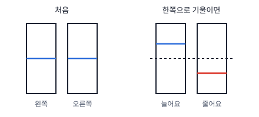

*왼쪽 컵이 늘어난 만큼 오른쪽 컵이 줄어서, 두 컵을 더한 물은 처음과 같아요.*

**정확히 말하면**

**구성.** 차동쌍은 대칭인 입력 쌍($Q_1$, $Q_2$), 테일 전류원($I_{EE}$), 부하($R_C$)로 이루어져요.

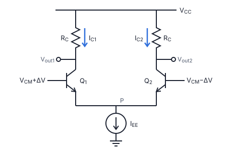

*BJT 차동쌍. 강조색 선 화살표는 저항을 지나 내려가는 컬렉터 전류예요.*

**공통 모드 레벨(common-mode level)과 DC 바이어스.** 공통 모드 레벨은 두 입력에 똑같이 들어가는 성분 전체예요. DC도 두 입력에 똑같이 들어가니 여기에 속해요. DC가 아니어도 두 입력에 같은 위상으로 들어오는 신호는 공통 모드 레벨에 들어가요. 그래서 공통 모드 레벨이 DC 바이어스보다 넓은 말이에요. 다른 공통 성분이 없을 때만 둘을 같은 뜻으로 써도 돼요.

**DC 바이어스.** 두 베이스가 같은 $V_{CM}$이고 이미터가 묶여 있어요.

1. $V_{BE1}=V_{BE2}$
2. 두 트랜지스터가 같으므로 $I_{C1}=I_{C2}$
3. 테일이 합을 정하므로 (베이스 전류를 무시하면) $I_{C1}=I_{C2}=\frac{I_{EE}}{2}$
4. $R_C$에 $\frac{I_{EE}}{2}$가 흐르므로 출력의 공통 모드 레벨은

   $$
   V_{out,CM}=V_{CC}-R_C\frac{I_{EE}}{2}
   $$

**차동 입력.** $V_{CM}$을 중심으로 크기가 같고 위상이 반대인 작은 신호 $+\Delta V$, $-\Delta V$를 넣어요. 평형점 $V_{in1}-V_{in2}=0$ 근처의 작은 변화만 봐요.

1. $Q_1$: $V_{BE1}$이 늘어 전류가 $\Delta I$만큼 늘어요.

   $$
   I_{C1}=\frac{I_{EE}}{2}+\Delta I
   $$
2. $Q_2$: $V_{BE2}$가 줄어 전류가 같은 양만큼 줄어요.

   $$
   I_{C2}=\frac{I_{EE}}{2}-\Delta I
   $$
3. 두 전류의 합은 보존돼요.

   $$
   I_{C1}+I_{C2}=I_{EE}
   $$
4. 출력 차이: $V_{out1}-V_{out2}=-R_C(I_{C1}-I_{C2})=-2R_C\Delta I$

두 출력의 차이를 취하면 공통 모드 성분은 같아서 상쇄돼요. 남는 것은 차동 입력이 만든 차이뿐이에요.

**CM 제거(CM rejection).** 싱글 엔디드 증폭기는 입력 DC 레벨이 바뀌면 출력 DC 레벨도 바뀌어요. 차동 회로는 입력의 공통 모드 레벨이 바뀌어도 출력이 영향을 받지 않고, 차동 입력에만 반응해요. 이 성질이 CM 제거예요. 입력 CM을 올려도 두 전류가 반반 그대로인 이유는 [BJT 차동쌍의 CM 응답](../0930/정리노트_0930_Differential_Amplifiers.html#s3-bjt-cm)(0930)에서 다뤘어요.

**교수님 말씀**

DC 바이어스와 공통 모드 레벨의 차이부터 짚으셨어요.

> "커먼 모드 레벨이 조금 더 넓은 의미예요." (1002 00:53)

같은 위상의 신호도 공통 모드 레벨에 들어갈 수 있고, 다른 공통 신호가 없다고 가정할 때만 DC 바이어스와 같은 뜻으로 이해해도 된다고 하셨어요.

싱글 엔디드 증폭기와 비교해서, 차동 회로는 입력 공통 모드 레벨에 출력이 영향을 받지 않는다는 점을 다시 정리하셨어요.

**꼭 기억해요**

> "커먼 모드 리젝션 특성. 그게 가장 차동 회로에서의 가장 중요한 특성" (1002 05:56)

차동 회로는 차동 입력에만 반응하고, 공통 모드 변화는 출력에 나타나지 않아요. 이것이 CM 제거예요.

**페이지 요약**

차동 입력을 넣으면 한쪽 전류가 는 만큼 다른 쪽이 줄고, 합은 테일 전류로 그대로예요.

*핵심 식*

- 출력 공통 모드 레벨

  $$
  V_{out,CM}=V_{CC}-R_C\frac{I_{EE}}{2}
  $$
- 차동 입력 때 전류

  $$
  I_{C1}=\frac{I_{EE}}{2}+\Delta I
  $$

  $$
  I_{C2}=\frac{I_{EE}}{2}-\Delta I
  $$
- 합 보존

  $$
  I_{C1}+I_{C2}=I_{EE}
  $$

*용어*

- **공통 모드 레벨(common-mode level)** — 두 입력에 똑같이 들어가는 성분 전체. DC 바이어스보다 넓은 말
- **CM 제거(CM rejection)** — 입력 공통 모드 변화가 출력에 나타나지 않는 성질

---

### 가상 접지와 절반 회로: 차동 이득은 절반 회로 이득

*1002 수업 · L04 s23–24*

**쉽게 말하면**

똑같이 생긴 쌍둥이 그림은 반쪽만 풀어도 나머지 반쪽을 알 수 있어요.

가운데 이음매가 꼼짝하지 않으니까 거기서 잘라도 돼요.

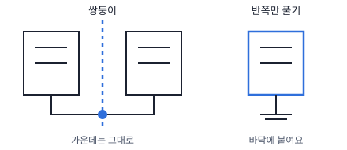

*가운데 색칠된 점에서 잘라 낸 반쪽 하나만 풀면 돼요.*

**정확히 말하면**

**소신호 해석의 약속.** 소신호 해석은 변화량끼리의 관계만 봐요. 그래서 변하지 않는 값은 모두 0으로 둬요.

- 입력의 $V_{CM}$, 바이어스 전류, 전원 $V_{CC}$는 0(AC 접지)이에요.
- 이상적 테일 전류원은 전류 변화가 0이므로 개방이에요.
- 소신호 입력은 $v_{in1}=\Delta V$, $v_{in2}=-\Delta V=-v_{in1}$이에요.

**MOS와 다른 점.** 베이스 전류가 0이 아니어서 B–E 사이에 $r_\pi$가 있어요. 두 트랜지스터는 동작점이 같아요.

1. $I_{C1}=I_{C2}$이고 $g_m=\frac{I_C}{V_T}$이므로 $g_{m1}=g_{m2}$
2. $\beta$가 상수이고 $r_\pi=\frac{\beta}{g_m}$이므로 $r_{\pi1}=r_{\pi2}$

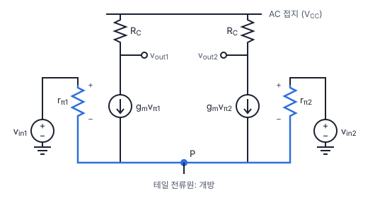

*소신호 등가회로. 강조색 선은 rπ1–P–rπ2 경로이고, 색칠된 점이 노드 P예요.*

**노드 P는 가상 접지(virtual ground).** $r_{\pi1}=r_{\pi2}$인 같은 저항 두 개의 바깥 끝이 $+\Delta V$, $-\Delta V$로 움직여요. 그래서 가운데 P는 변하지 않아요. MOS에서 증명한 내용([노드 P는 차동 입력에서 가상 접지](../0923/정리노트_0923_Differential_Amplifiers.html#s3-virtual-ground), 0923)이 $r_\pi$가 붙어도 그대로 성립해요. 수업에서 생략한 증명은 보충에 적었어요.

**절반 회로(half circuit).** P를 접지로 두면 회로가 똑같은 절반 회로 두 개로 나뉘어요. 각 절반 회로는 CE 단(common-emitter stage)의 소신호 등가회로와 같아요.

**차동 이득 = 절반 회로 이득.**

1. 차동 이득의 정의: 입력도 출력도 두 노드의 차이

   $$
   A_v=\frac{v_{out1}-v_{out2}}{v_{in1}-v_{in2}}
   $$
2. 대칭이므로 $v_{in2}=-v_{in1}$, $v_{out2}=-v_{out1}$을 대입

   $$
   A_v=\frac{2v_{out1}}{2v_{in1}}=\frac{v_{out1}}{v_{in1}}
   $$
3. $\frac{v_{out1}}{v_{in1}}$은 절반 회로(CE 단)의 이득이에요. 이미터가 접지이므로 $v_{\pi1}=v_{in1}$이고 $v_{out1}=-g_mv_{in1}R_C$예요.

   $$
   A_v=-g_mR_C
   $$
4. 정확히는 $Q_1$의 출력저항(output resistance) $r_{O1}$도 출력에 병렬로 보여요.

   $$
   A_v=-g_m(R_C\parallel r_{O1})
   $$

   보통 $r_{O1}\gg R_C$이므로 $-g_mR_C$로 써요.

$\frac{v_{out2}}{v_{in2}}$도 분자와 분모의 부호가 함께 바뀌어 같은 값이에요. 그래서 $v_{out1}$, $v_{out2}$를 따로 구할 필요 없이 절반 회로 하나의 이득만 구하면 돼요.

**교수님 말씀**

$r_\pi$가 붙어도 P가 접지라는 증명은 앞 시간 것을 그대로 쓰고 넘어가셨어요.

> "앞에서 … 프루프를 했습니다 … 여기서는 생략하고요." (1002 09:34)

테일 노드를 가상 접지로 보면 해석이 "훨씬 더 심플해지죠"라고 하셨어요 (1002 10:35).

정확하게는 $Q_1$의 출력저항도 있지만, 보통 $R_C$보다 $r_{O1}$이 충분히 커서 $-g_mR_C$로 써도 무방하다고 하셨어요 (1002 13:27).

**꼭 기억해요**

> "dm은 꼭 굳이 안 적어도 되는데요" (1002 12:08)

첨자 없이 "이득"이라고 하면 차동 이득이에요. 차동 이득은 절반 회로 하나의 이득과 같아요.

**보충 · 수업에서 유도하진 않았어요**

**$r_\pi$가 있어도 P가 가상 접지인 이유.** 소신호 등가회로에서 완전 대칭, 이상적 테일(개방), $v_{in2}=-v_{in1}$로 둬요 (Razavi 식 10.86–10.91).

1. 양쪽 KVL: $v_{in1}-v_{\pi1}=v_P=v_{in2}-v_{\pi2}$
2. P에서 KCL(테일은 개방): $\frac{v_{\pi1}}{r_{\pi1}}+g_{m1}v_{\pi1}+\frac{v_{\pi2}}{r_{\pi2}}+g_{m2}v_{\pi2}=0$
3. $r_{\pi1}=r_{\pi2}$, $g_{m1}=g_{m2}$이므로 $\left(\frac{1}{r_\pi}+g_m\right)(v_{\pi1}+v_{\pi2})=0$, 곧 $v_{\pi1}=-v_{\pi2}$
4. KVL 두 식을 더하면 $2v_P=(v_{in1}+v_{in2})-(v_{\pi1}+v_{\pi2})=0$
5. $v_P=0$

**$r_O$까지 넣어도 성립해요 (Razavi 장말문제 10.28).** 컬렉터와 P 사이에 $r_O$를 더하고, $r_O=r_{O1}=r_{O2}$로 둬요.

1. 컬렉터 1 KCL: $\frac{v_{out1}}{R_C}+g_m(v_{in1}-v_P)+\frac{v_{out1}-v_P}{r_O}=0$ (오른쪽도 같은 꼴)
2. 두 식을 더하고 $S=v_{out1}+v_{out2}$, $v_{in1}+v_{in2}=0$을 쓰면

   $$
   S\left(\frac{1}{R_C}+\frac{1}{r_O}\right)=2v_P\left(g_m+\frac{1}{r_O}\right)
   $$
3. P에서 KCL:

   $$
   -2v_P\left(\frac{1}{r_\pi}+g_m+\frac{1}{r_O}\right)+\frac{S}{r_O}=0
   $$
4. $S$를 없애면

   $$
   v_P\left[\frac{1}{r_\pi}+\left(g_m+\frac{1}{r_O}\right)\frac{r_O}{R_C+r_O}\right]=0
   $$
5. 괄호 안은 양수이므로 $v_P=0$이고 $S=0$이에요.
6. $v_P=0$을 컬렉터 KCL에 넣으면 $v_{out1}=-g_m(R_C\parallel r_{O1})v_{in1}$이에요. 위 정확한 이득과 같아요.

**페이지 요약**

차동 입력에서 P는 가상 접지라서, 차동 이득은 CE 단 절반 회로 하나의 이득과 같아요.

*핵심 식*

- 차동 이득

  $$
  A_v=\frac{v_{out1}-v_{out2}}{v_{in1}-v_{in2}}
  $$

  $$
  A_v=-g_mR_C
  $$
- rO1 포함

  $$
  A_v=-g_m(R_C\parallel r_{O1})
  $$
- 소신호 파라미터

  $$
  g_m=\frac{I_C}{V_T}
  $$

  $$
  r_\pi=\frac{\beta}{g_m}
  $$

*용어*

- **가상 접지(virtual ground)** — 차동 입력에서 전압이 변하지 않아 접지처럼 보는 노드 P
- **절반 회로(half circuit)** — P를 접지로 두고 나눈 한쪽 회로. BJT에서는 CE 단

---

## 1. 전류원 부하 차동쌍 예제

### 예제 1: pnp 전류원 부하

*1002 수업 · L04 s25*

**쉽게 말하면**

위쪽에 저항 대신 전류를 늘 똑같이 지키는 문지기를 달면, 같은 입력에도 출력이 훨씬 크게 흔들려요.

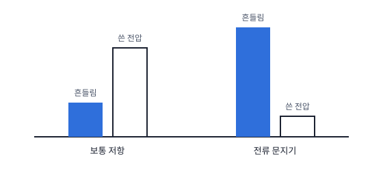

*색칠된 막대는 출력이 흔들리는 크기, 테두리 막대는 위쪽 짐이 써 버리는 전압이에요. 문지기는 전압을 조금만 쓰고도 크게 흔들어 줘요.*

**정확히 말하면**

회로는 npn 입력 쌍 $Q_1$, $Q_2$와 테일 전류원 $I_{EE}$ 위에, 부하로 pnp 트랜지스터 $Q_3$, $Q_4$를 단 차동쌍이에요(Razavi 예제 10.11, 그림 10.19). $Q_3$, $Q_4$의 베이스는 바이어스 전압 $V_b$에, 이미터는 $V_{CC}$에 붙어 있어요. 이렇게 저항 대신 트랜지스터로 만든 부하를 전류원 부하(current-source load)라고 해요.

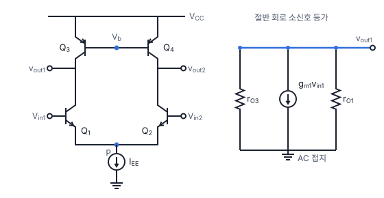

*왼쪽은 전체 회로, 오른쪽은 차동 입력일 때의 절반 회로(half circuit) 소신호 등가회로예요. 강조선이 출력 노드예요.*

문제에 "이득을 구하시오"라고만 적혀 있으면 차동 이득을 구하라는 뜻이에요. 차동 이득은 절반 회로 하나의 이득과 같아요.

1. 차동 입력 $v_{in2}=-v_{in1}$에서 노드 P는 AC 접지(가상 접지)예요. 입력 안의 DC 바이어스, $V_b$, $V_{CC}$도 소신호에서는 0이에요.
2. P를 접지로 두면 절반 회로는 CE 단인데, 부하가 저항이 아니라 전류원 부하예요.
3. $Q_3$: 베이스($V_b$)와 이미터($V_{CC}$)가 모두 AC 접지라 $v_{eb3}=0$이에요. 그래서 종속 전류원 $g_{m3}v_{eb3}=0$이고, 출력에서 위로 $r_{O3}$만 보여요.
4. $Q_1$: 이미터가 접지, 베이스가 $v_{in1}$이라 $i_{c1}=g_{m1}v_{in1}$이 살아 있고, 출력에서 아래로 $r_{O1}$이 보여요.
5. 출력 노드 KCL:

   $$
   g_{m1}v_{in1}+\frac{v_{out1}}{r_{O1}}+\frac{v_{out1}}{r_{O3}}=0
   $$
6. 정리:

   $$
   v_{out1}=-g_{m1}(r_{O1}\parallel r_{O3})\,v_{in1}
   $$
7. $v_{out2}=-v_{out1}$이므로

   $$
   \frac{v_{out1}-v_{out2}}{v_{in1}-v_{in2}}=\frac{v_{out1}}{v_{in1}}
   $$

   $$
   A_v=-g_{m1}(r_{O1}\parallel r_{O3})
   $$

**$r_{O1}$을 지금은 무시하지 않는 이유**: 저항 부하일 때는 $R_C\ll r_{O1}$이라 $-g_m(R_C\parallel r_{O1})\approx-g_mR_C$로 썼어요. 지금은 부하가 $r_{O3}$라서 $r_{O1}$과 크기가 비슷해요. 그래서 둘을 모두 남겨야 해요.

부하를 이상적 전류원으로 두면 이득은 $-g_mr_O$예요(Razavi 예제 10.10). 실제 pnp로 만들면 $r_{O3}$가 병렬로 붙어 이득이 그보다 작아져요. 예로 $I_{EE}=1\ \text{mA}$, 모든 트랜지스터의 $V_A=5\ \text{V}$, $V_T=26\ \text{mV}$이면 $g_{m1}=19.2\ \text{mS}$, $r_{O1}=r_{O3}=10\ \text{k}\Omega$이고, $A_v=-19.2\ \text{mS}\times5\ \text{k}\Omega\approx-96.2$예요.

**전류원 부하의 장점**: 저항 부하로 큰 저항을 얻으려면 IR 드롭 $R_C\cdot\tfrac12 I_{EE}$가 커져서 전압이 모자라요. 전류원 부하는 양단에 최소 전압만 있으면 돼요. BJT는 활성 영역을 지키는 최소 $|V_{CE}|$, MOS는 오버드라이브 전압 $V_{GS}-V_{TH}$예요. 그래서 큰 DC 전압 없이 큰 소신호 저항을 얻어요.

**pnp 활성 영역 조건**: $V_{EB}\gt0$(이미터–베이스 순방향), $V_{BC}\gt0$(베이스–컬렉터 역방향)이에요. 헷갈리면 npn 조건($V_{BE}\gt0$, $V_{CB}\gt0$)에 절댓값을 씌워 생각하면 돼요.

**교수님 말씀**

> "Vbe가 0이니까 여기는 이제 Ro3만 남는 거예요." (1002 16:25)

$Q_3$의 소신호 모델에도 원래 전류원과 $r_O$가 다 있지만, $v_{be}$가 0이라 전류원이 꺼지고 $r_{O3}$만 보인다고 칠판에 그려 설명하셨어요.

> "일반적으로 저항을 쓰면 크게 쓸 수가 없어요. 왜냐하면 IR 드롭이 있기 때문이에요." (1002 18:38)

> "큰 전압이 필요 없이 큰 스몰 시그널 저항을 만들 수 있는 장점이 있습니다." (1002 20:08)

> "잘 모르겠으면 그냥 이제 절댓값 씌워서 하면 되는데" (1002 19:51)

**꼭 기억해요**

> "그냥 게인을 구하시오라고 하면 차동 이득을 구하라는 얘기예요." (1002 14:16)

> "Ro3니까 Ro1을 무시할 수가 없죠, 그렇죠? 두 개가 비슷한 크기니까." (1002 18:06)

**페이지 요약**

절반 회로에서 $Q_3$는 $r_{O3}$만 남아 $r_{O1}$과 병렬이 되고, 전류원 부하는 큰 IR 드롭 없이 큰 소신호 저항을 줘요.

*핵심 식*

- pnp 전류원 부하 차동 이득

  $$
  A_v=-g_{m1}(r_{O1}\parallel r_{O3})
  $$

*용어*

- **전류원 부하(current-source load)** — 베이스·이미터가 AC 접지인 트랜지스터 부하로, 소신호로는 $r_{O3}$만 보여요.
- **IR 드롭(IR drop)** — 저항 부하에 걸리는 DC 전압으로, 저항을 키우면 같이 커져요.

---

### 예제 2: R1, R2 가운데에 베이스를 묶은 부하

*1002 수업 · L04 s26*

**쉽게 말하면**

시소 양 끝이 반대로 움직이면 가운데 받침은 제자리예요.

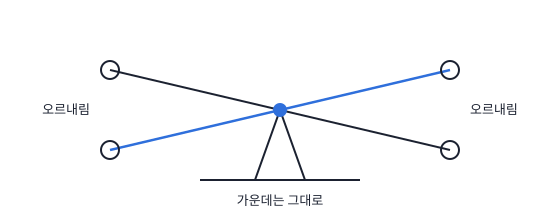

*양 끝의 테두리 원은 오르내리고, 가운데 색칠된 점은 그대로예요.*

**정확히 말하면**

아래쪽 입력단은 [예제 1: pnp 전류원 부하](#s1-pnp-load)와 같고 부하만 달라요(Razavi 예제 10.13, 그림 10.22). 두 출력 사이에 $R_1$, $R_2$가 직렬로 있고, 그 가운데 노드 X에 $Q_3$, $Q_4$의 베이스가 연결돼요.

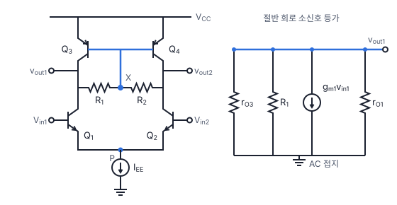

*왼쪽은 전체 회로, 오른쪽은 차동 입력일 때의 절반 회로 소신호 등가회로예요. 왼쪽 강조선은 X에서 두 베이스로 가는 선이고, 오른쪽 강조선은 출력 노드예요.*

1. 차동 입력에서 노드 P는 AC 접지예요. 절반 회로의 $Q_1$은 이미터 접지 CE 단이에요.
2. $R_1=R_2$(매칭)이고 $v_{out2}=-v_{out1}$이므로

   $$
   v_X=\frac{v_{out1}+v_{out2}}{2}=0
   $$

   X도 AC 접지예요. DC 전압이 0이라는 뜻은 아니에요.
3. X가 AC 접지이므로 회로를 반으로 나눌 수 있어요. $Q_3$는 베이스(X)와 이미터($V_{CC}$)가 모두 AC 접지라 출력에서 $r_{O3}$만 보여요.
4. $R_1$은 한쪽 끝이 출력, 다른 쪽 끝이 X(AC 접지)라 출력과 접지 사이에 놓여요. 그래서 $r_{O3}$와 병렬이에요.
5. 출력 노드 KCL:

   $$
   g_{m1}v_{in1}+\frac{v_{out1}}{r_{O1}}+\frac{v_{out1}}{r_{O3}}+\frac{v_{out1}}{R_1}=0
   $$
6. 정리:

   $$
   A_v=-g_{m1}(r_{O1}\parallel r_{O3}\parallel R_1)
   $$

**극한으로 확인하기**

- $R_1\to\infty$: $R_1$이 끊긴 것과 같아요. 이득은 $-g_{m1}(r_{O1}\parallel r_{O3})$로 예제 1의 전류원 부하와 같아요.
- $R_1\to0$: 출력이 AC 접지인 X에 바로 붙어요. $r_{O1}\parallel r_{O3}\parallel0=0$이라 이득이 0이에요. 이때 $Q_3$는 컬렉터와 베이스가 바로 이어진 다이오드 연결(diode connection) 꼴이에요. 하지만 X가 AC 접지라 다이오드 연결 소자의 $1/g_m$ 저항으로 보이지 않아요. X가 접지가 아니어야 $1/g_m$이 돼요.
- 그래서 이 부하는 다이오드 연결(저항처럼 동작)과 전류원 부하의 중간이에요. $R_1$ 값에 따라 동작이 바뀌어요.

#### 직접 해 보기: R1을 키우면 이득이 0에서 전류원 부하 이득까지 올라가요 *(정적 스냅샷 — 직접 조작은 HTML 버전)*

$R_1(=R_2)$를 로그 눈금으로 움직이면 $|A_v|=g_{m1}(r_{O1}\parallel r_{O3}\parallel R_1)$이 0($R_1\to0$)에서 $g_{m1}(r_{O1}\parallel r_{O3})$($R_1\to\infty$)로 올라가는 것이 보여요. $I_{EE}=1\ \text{mA}$, $V_A=5\ \text{V}$, $V_T=26\ \text{mV}$로 고정해서 $g_{m1}=19.2\ \text{mS}$, $r_{O1}=r_{O3}=10\ \text{k}\Omega$예요.

**R1 = 1 kΩ일 때 rO1 ∥ rO3 ∥ R1 = 833 Ω, |Av| = 16.0 (전류원 부하 이득 96.2의 16.7 %)**

범례: 차동 이득 크기 · R1→∞ 한계(전류원 부하 이득) · 세로 점선: 현재 R1, R1 = rO1 ∥ rO3(이득이 절반)

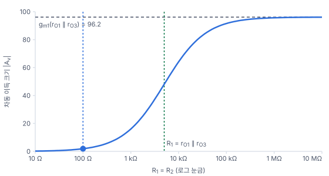

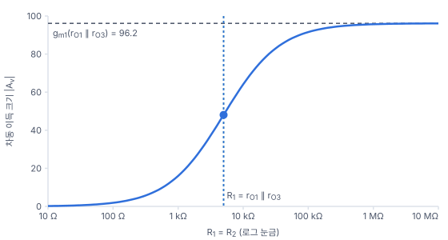

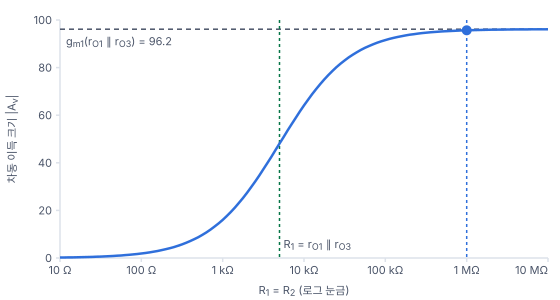

| 설정 | $R_1=R_2$ | $r_{O1}\parallel r_{O3}\parallel R_1$ | $A_v$ | $R_1\to\infty$ 한계(−96.2) 대비 |
|---|---|---|---|---|
| 1 | 100 Ω | 98 Ω | −1.9 | 2.0 % |
| 2 | 5 kΩ | 2.5 kΩ | −48.1 | 50.0 % |
| 3 | 1 MΩ | 4.98 kΩ | −95.7 | 99.5 % |

$R_1$이 $r_{O1}\parallel r_{O3}$($=5\ \text{k}\Omega$)보다 훨씬 작으면 $R_1$이 이득을 정해서 $|A_v|\approx g_{m1}R_1$이에요. 훨씬 크면 전류원 부하 이득에 붙어요. 두 값이 같으면 이득이 한계의 절반이에요.

**가상 접지는 차동 신호에서만**: P와 X가 AC 접지인 것은 $v_{in2}=-v_{in1}$일 때뿐이에요. 두 입력에 같은 위상의 공통 모드(common-mode) 신호 $v_{in2}=v_{in1}$이 들어오면 P를 접지로 볼 수 없어요. 이 경우는 뒤의 공통 모드 해석에서 다시 다뤄요.

**교수님 말씀**

$R_1$이 없으면 무슨 구조냐고 물으신 뒤, 다이오드 연결이라 컬렉터 전압이 바뀌면 베이스 전압도 바뀌어 저항처럼 동작한다고 하셨어요. $R_1$이 무한대면 앞 예제의 전류원 부하와 같다고 하셨어요 (1002 22:13).

> "저항과 커런트 소스 그 중간에 있는 거라. R1에 따라서 이제 동작이 달라지는 거예요." (1002 22:37)

> "그라운드가 연결이 안 돼 있으면 그건 g_m 분의 1의 저항을 가지게 되겠습니다." (1002 23:31)

**꼭 기억해요**

> "R1과 R2가 이제 차동이란 같다. 매칭을 가정하고 있고요." (1002 21:06)

> "DC로 DC가 0이 된다는 게 아니야. AC 그라운드예요." (1002 21:16)

> "차동 신호가 동작하는 조건에서만 버추얼 그라운드의 개념이 성립됩니다." (1002 24:23)

**페이지 요약**

$R_1=R_2$의 가운데 X가 AC 접지라 $R_1$이 $r_{O1}$, $r_{O3}$와 병렬로 붙고, $R_1$에 따라 이득이 0과 전류원 부하 이득 사이에서 바뀌어요.

*핵심 식*

- R1, R2 부하 차동 이득

  $$
  A_v=-g_{m1}(r_{O1}\parallel r_{O3}\parallel R_1)
  $$
- 가운데 노드 X

  $$
  v_X=\frac{v_{out1}+v_{out2}}{2}=0
  $$

*용어*

- **AC 접지(AC ground)** — DC 전압은 있어도 소신호 변화가 0인 노드예요.
- **다이오드 연결(diode connection)** — 컬렉터와 베이스를 바로 이은 꼴로, X가 접지가 아닐 때 $1/g_m$ 저항으로 보여요.

---

## 2. 캐스코드 차동쌍

### MOS 캐스코드 차동쌍: G_m은 그대로, R_out은 크게

*1002 수업 · L04 s27*

**쉽게 말하면**

아래 친구가 흐름의 양을 정하고, 위에 선 친구는 그 흐름을 그대로 넘기면서 문을 더 단단히 지켜요.

*흐름의 양은 그대로인데 버티는 힘이 커지니, 같은 입력에 출력이 훨씬 크게 흔들려요.*

**정확히 말하면**

전류원 부하 차동쌍보다 이득을 더 키우려고 입력 트랜지스터 $M_1$, $M_2$ 위에 **캐스코드**(cascode) 트랜지스터 $M_3$, $M_4$를 쌓아요. 두 게이트는 바이어스 전압 $V_{b1}$에 묶여요. 쌓으면 출력저항(output resistance) $R_{out}$은 커지고 전류는 그대로예요.

여기서는 위쪽 부하를 이상적 전류원으로 둬요. 실제로는 부하도 캐스코드로 만들어야 해요([캐스코드 부하, NMOS 입력, 전압 여유](#s2-mos-cascode-load)).

**바이어스**

- 전류는 테일 전류원이 정해요. 전류가 정해지면 $V_{GS}$도 정해져요.
- 그래서 $V_{b1}$이나 입력 CM 레벨을 바꿔도 전류는 그대로예요. 소스 전압이 따라 움직여서 $V_{GS}$를 일정하게 지켜요.
- 다만 $M_1$이 포화 영역에 있어야 해요. $M_1$의 드레인 전압은 $V_{b1}-V_{GS3}$이고 게이트 전압은 $V_{in,CM}$이므로, 포화 조건 $V_{D}\ge V_{G}-V_{TH}$는 이렇게 돼요.

$$
V_{b1}-V_{GS3}\ge V_{in,CM}-V_{TH}
$$

이 조건을 만족하게 $V_{b1}$을 정해요.

**절반 회로**: 차동 입력에서 노드 P는 AC(가상) 접지예요. $V_{b1}$도 AC 접지, 이상적 전류원 부하는 개방이에요.

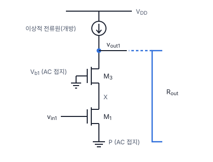

*절반 회로: 출력 노드에서 아래를 들여다본 저항이 Rout이에요.*

**이득 = $G_m$ × $R_{out}$**

$$
A_v=-G_mR_{out}
$$

1. $G_m$은 출력을 접지했을 때의 $i_{out}/v_{in}$이에요.
2. $M_1$에 흐르는 소신호 전류: $i_{d1}=g_{m1}v_{in1}$
3. $i_{d1}$은 $M_3$를 그대로 지나가므로 $i_{out}=i_{d1}$이에요.
4. $$
   G_m=g_{m1}
   $$

   $M_3$는 $G_m$을 바꾸지 않고, 전류가 지나갈 길만 만들어요.
5. $M_3$는 소스 쪽 저항 $r_{O1}$을 $g_{m3}r_{O3}$배로 키워 보이게 해요(캐스코드 출력저항). $g_mr_O\gg1$일 때

   $$
   R_{out}\approx g_{m3}r_{O3}r_{O1}
   $$
6. $$
   A_v\approx-g_{m1}g_{m3}r_{O3}r_{O1}
   $$

$M_3$가 없으면 이상적 전류원 부하 차동쌍의 이득은 $-g_{m1}r_{O1}$이에요. $G_m$은 같고 $R_{out}$만 $g_{m3}r_{O3}$배 커지니 이득도 그만큼 커져요. $M_1$–$M_4$가 모두 같으면 $A_v\approx-(g_mr_O)^2$이에요.

**교수님 말씀**

바이어스 전압 $V_{b1}$이 전류를 바꾸는지 물으시고, 바꾸지 않는다고 답하셨어요.

> "V_b1을 바꾸더라도 V_GS가 바뀌지 않으려면 이 소스 전압도 같이 … 바뀌는 거예요." (1002 27:04)

$M_3$의 역할을 두 가지로 나눠 말씀하셨어요.

> "그냥 이제 전류가 흘러가는 패스를 만들어 주는 거고" (1002 30:34)

> "출력 저항을 이만큼 부스팅해주는 역할을 하는 거죠." (1002 30:43)

**페이지 요약**

캐스코드를 쌓아도 $G_m$은 그대로이고 $R_{out}$만 $g_{m3}r_{O3}$배 커져서, 이득이 그만큼 커져요.

*핵심 식*

- 이득

  $$
  A_v=-G_mR_{out}
  $$

  $$
  G_m=g_{m1}
  $$
- 출력저항과 이득

  $$
  R_{out}\approx g_{m3}r_{O3}r_{O1}
  $$

  $$
  A_v\approx-g_{m1}g_{m3}r_{O3}r_{O1}
  $$
- M1 포화 조건

  $$
  V_{b1}-V_{GS3}
  $$

  $$
  \ge V_{in,CM}-V_{TH}
  $$

*용어*

- **캐스코드(cascode)** — 입력 트랜지스터 위에 쌓아 전류는 그대로 넘기고 출력저항을 키우는 트랜지스터

---

### 캐스코드 부하, NMOS 입력, 전압 여유

*1002 수업 · L04 s28*

**쉽게 말하면**

아래쪽 벽만 두껍게 쌓으면 소용없어요, 위쪽 벽도 똑같이 두꺼워야 해요.

*얇은 쪽으로 다 새 버리니까, 두 쪽을 함께 두껍게 쌓아요.*

**정확히 말하면**

**왜 부하도 캐스코드로 만드나**: 회로도의 전류원도 실제로는 트랜지스터로 만들어요. 트랜지스터 하나($M_7$)로 만들면 그 출력저항 $r_{O7}$이 $g_{m3}r_{O3}r_{O1}$과 병렬로 붙어요. 그러면 $R_{out}\approx r_{O7}$이 되어 캐스코드로 키운 효과가 사라져요. 그래서 부하도 **캐스코드 전류원**(cascode current source) $M_5$–$M_7$(오른쪽은 $M_6$–$M_8$)로 만들어요.

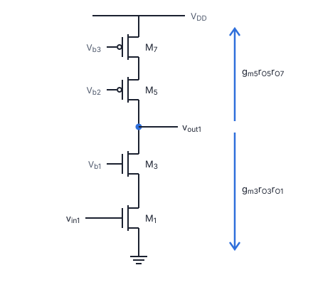

*출력 노드에서 위로도, 아래로도 캐스코드 저항이 보이고 둘은 병렬이에요.*

1. 절반 회로에서 P, $V_{b1}$, $V_{b2}$, $V_{b3}$는 모두 AC 접지예요.
2. 부하 쪽 게이트에는 신호가 없으므로 부하는 소신호 전류를 만들지 않아요. 바이어스 전류는 흐르지만 그 변화가 0이에요.
3. 출력 전류는 입력이 들어가는 $M_1$의 $i_{d1}$뿐이에요: $G_m=g_{m1}$
4. 부하는 출력저항에 병렬로만 더해져요: $R_{out}\approx(g_{m3}r_{O3}r_{O1})\parallel(g_{m5}r_{O5}r_{O7})$
5. $$
   A_v\approx-g_{m1}\big[(g_{m3}r_{O3}r_{O1})\parallel(g_{m5}r_{O5}r_{O7})\big]
   $$

캐스코드 전류원 없이 $r_{O7}$만 달면 $A_v\approx-g_{m1}r_{O7}$ 수준으로 떨어져서 캐스코드의 장점이 없어져요.

반대로 위쪽 PMOS($M_7$) 게이트에 입력을 넣고 아래를 바이어스로 두면, 이번에는 $i_{d7}$이 출력 전류가 돼요.

**NMOS 입력을 선호하는 이유**: 이동도(mobility)가 $\mu_n\gt\mu_p$이기 때문이에요.

$$
g_m=\sqrt{2\mu_nC_{ox}\frac{W}{L}I_D}
$$

같은 전류 $I_D$에서 $\mu_n$이 큰 NMOS가 $g_m$이 더 커요. 수업에서는 $k=\mu_nC_{ox}W/L$로 줄여 $g_m=\sqrt{2kI_D}$라고 했어요.

**$V_{b3}$ 설정**: $M_7$의 소스는 $V_{DD}$에 고정돼 있어요. 그래서 $|V_{GS7}|=V_{DD}-V_{b3}$가 곧 $M_7$의 전류를 정해요.

- $V_{b3}$는 $M_7$에 $I_{SS}/2$가 흐르도록 맞춰야 해요.
- 어긋나면 위아래 전류가 맞지 않아 출력 전압이 아주 높아지거나 아주 낮아져요.
- 반면 $V_{b1}$, $V_{b2}$, 입력 DC 전압은 전류에 영향이 없어요.

**단점: 전압 여유(**헤드룸**, headroom)**: 포화를 지키려면 테일, $M_1$, $M_3$, $M_5$, $M_7$ 각각에 최소 오버드라이브 전압 $V_{ov}=V_{GS}-V_{TH}$가 걸려야 해요.

- 최소 전압: $5V_{ov}$. 예를 들어 $V_{ov}=0.1$ V이면 0.5 V예요.
- 출력이 움직일 범위(스윙)도 있어야 하므로 실제로는 이보다 더 커야 해요. 수업에서는 "최소 1볼트"라고 말했는데, 이는 스윙 여유를 포함한 대략값으로 보면 돼요.
- 공급 전압은 전력 때문에 1.5 V, 1.2 V, 1 V로 낮아지고 있어서 많이 쌓는 구조는 설계가 까다로워요. 실험에서 쓰는 15 V에서는 크게 문제가 안 돼요.

헤드룸의 자세한 내용은 지난 노트 [0916 쌓을수록 필요한 전원 전압](../0916/정리노트_0916_Cascode_Amplifier.html#s1-headroom)에 있어요.

**교수님 말씀**

> "gm Rout만큼 커졌지만 이쪽이 병렬로 연결되면 커진 효과가 없어지죠." (1002 31:58)

> "모빌리티가 NMOS가 PMOS보다 높기 때문에" (1002 34:01)

$V_{b3}$를 잘못 잡으면 출력 전압이 "굉장히 높아지거나 굉장히 낮아지거나" 한다고 하셨어요 (1002 35:49).

디지털 회로는 공급 전압을 낮추면 전력이 그만큼 줄어서 계속 낮추고 있고, 아날로그 회로도 따라 낮춰야 한다고 하셨어요. 실험의 15 V에서는 "그렇게 크리티컬하지 않죠"라고 덧붙이셨어요 (1002 38:51).

질문(1002 39:09): PMOS 쪽에 입력을 넣을 때 바이어스는 어떻게 하나요? 답: 보통 테일 전류원을 위쪽($V_{DD}$ 쪽)에 달고 아래쪽은 접지로 바꿔요. 테일 없이도 동작은 하지만, 입력 CM 레벨에 따라 전류가 바뀌는 단점이 있어요.

**페이지 요약**

부하도 캐스코드 전류원으로 만들어야 캐스코드 이득이 살고, 대가는 헤드룸이에요.

*핵심 식*

- 캐스코드 부하 이득

  $$
  A_v\approx-g_{m1}\big[(g_{m3}r_{O3}r_{O1})
  $$

  $$
  \parallel(g_{m5}r_{O5}r_{O7})\big]
  $$
- 트랜스컨덕턴스

  $$
  g_m=\sqrt{2\mu_nC_{ox}\frac{W}{L}I_D}
  $$

  $$
  \mu_n\gt\mu_p
  $$

*용어*

- **캐스코드 전류원(cascode current source)** — 트랜지스터 두 개를 쌓아 출력저항을 $g_{m5}r_{O5}r_{O7}$로 키운 전류원
- **헤드룸(headroom)** — 쌓은 소자마다 오버드라이브 전압이 필요해서 생기는 전압 여유 부담
- **$V_{b3}$ (PMOS 바이어스)** — $M_7$의 전류를 정하는 바이어스, $I_{SS}/2$에 맞춰요

---

### 바이폴라 캐스코드 차동쌍: r_π3가 끼어든다

*1002 수업 · L04 s29–30*

**쉽게 말하면**

같은 방법으로 쌓았는데, 이 탑은 중간 층에 작은 구멍이 하나 더 있어서 꽤 덜 높아져요.

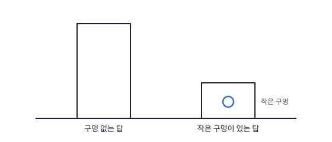

*구멍이 있어도 여전히 높게 쌓이니, 아주 크게 키워야 하는 곳에 이 탑을 써요.*

**정확히 말하면**

바이폴라 차동쌍도 입력 트랜지스터 $Q_1$, $Q_2$ 위에 캐스코드 $Q_3$, $Q_4$(베이스 $V_b$)를 쌓아요. 절반 회로는 MOS와 같아요. P와 $V_b$는 AC 접지, 이상적 전류원 부하는 개방이에요. 풀이 순서($G_m$ 다음 $R_{out}$)는 [MOS 캐스코드 차동쌍](#s2-mos-cascode)과 같아요.

**$G_m$**

1. $i_{c1}=g_{m1}v_{in1}$
2. 엄밀히는 $i_E=i_C+i_B$이고 MOS와 달리 $i_B\ne0$이에요.
3. $\beta\approx100$이면 $i_C$와 $i_E$의 차이는 약 1%라서 $i_E\approx i_C$로 둬요.
4. 그러면 $Q_3$를 지나도 $i_{out}\approx i_{c1}$이고 $G_m=g_{m1}$이에요. $Q_3$는 전류에 거의 영향을 주지 않아요.

**$R_{out}$: MOS와 다른 점**

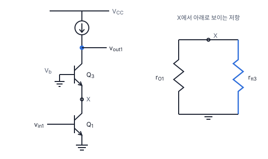

*Q3를 쌓으면 노드 X에서 rO1 옆에 rπ3가 병렬로 붙어요.*

- $Q_1$의 $r_{\pi1}$은 베이스(AC 접지)와 이미터(접지) 사이에 있어서 출력에서 보이지 않아요. 그래서 $Q_1$은 $r_{O1}$로만 보여요.
- $Q_3$를 쌓으면 $Q_3$의 $r_{\pi3}$가 이미터 노드 X와 베이스(AC 접지) 사이에 생겨요. 이 저항이 $r_{O1}$과 병렬로 보여요.
- 그래서 캐스코드가 키워 주는 축퇴 저항이 $r_{O1}$이 아니라 $r_{O1}\parallel r_{\pi3}$예요.

1. $$
   R_{out}=\big[1+g_{m3}(r_{O1}\parallel r_{\pi3})\big]r_{O3}+(r_{O1}\parallel r_{\pi3})
   $$
2. $g_{m3}(r_{O1}\parallel r_{\pi3})\gg1$일 때 덧붙는 항을 무시해요: $R_{out}\approx g_{m3}r_{O3}(r_{O1}\parallel r_{\pi3})$
3. $$
   A_v\approx-g_{m1}g_{m3}r_{O3}(r_{O1}\parallel r_{\pi3})
   $$

슬라이드 s29에는 $A_v=-g_{m1}\big[g_{m3}(r_{O1}\parallel r_{\pi3})r_{O3}+r_{O1}\big]$로 적혀 있어요. Razavi 정식은 마지막 항이 $r_{O1}$ 대신 $r_{O1}\parallel r_{\pi3}$예요. 어느 쪽이든 그 항은 무시하므로 주항은 같아요.

$r_{\pi3}$는 보통 수 kΩ이고 $r_O$는 수십 kΩ이라서 $r_{\pi3}$는 무시할 수 없어요. 오히려 $r_{\pi3}\ll r_{O1}$이면 $r_{O1}\parallel r_{\pi3}\approx r_{\pi3}$예요. 그래서 캐스코드가 키워 주는 축퇴 저항이 $r_{O1}$보다 한 자릿수가량 작아지고, 출력저항도 같은 크기의 MOS 캐스코드보다 그만큼 작아요. 참고로 $r_\pi=\beta/g_m$이므로 $g_{m3}r_{\pi3}=\beta$예요.

**캐스코드 부하(s30)**: 부하도 $Q_5$, $Q_7$(오른쪽 $Q_6$, $Q_8$)을 쌓은 캐스코드 전류원으로 만들어요.

- $Q_7$의 $r_\pi$는 양 끝이 AC 접지라서 출력에서 보이지 않아요.
- $Q_5$를 쌓으면 $r_{\pi5}$가 $r_{O7}$과 병렬로 붙어요: 축퇴 저항은 $r_{O7}\parallel r_{\pi5}$예요.

$$
A_v\approx-g_{m1}\big[g_{m3}r_{O3}(r_{O1}\parallel r_{\pi3})\big]\parallel\big[g_{m5}r_{O5}(r_{O7}\parallel r_{\pi5})\big]
$$

회로도의 전류원 기호는 따로 있는 부품이 아니에요. 모두 트랜지스터로 만들어요.

**OP 앰프와의 관계**: 이상적 OP 앰프는 $Z_{in}=\infty$, $Z_{out}=0$, $A=\infty$예요. 무한 이득은 현실에 없어요. 실제 OP 앰프는 이득이 매우 큰 **고이득 차동 증폭기**(high-gain differential amplifier)이고, 그 대표 구조가 캐스코드 차동 증폭기예요.

바이폴라 캐스코드 단 자체는 지난 노트 [0916 바이폴라 캐스코드](../0916/정리노트_0916_Cascode_Amplifier.html#s2-bjt)에 있어요.

**교수님 말씀**

> "거의 베타가 100이잖아요? … 차이가 100분의 1 정도니까" (1002 42:11)

> "r_pi3가 보통 한 수 k 정도 돼요. … r_pi3를 무시할 수 없죠." (1002 44:48)

> "커런트 소스 컴포넌트가 따로 있는 게 아니에요." (1002 46:07)

무한 이득 증폭기는 "에너지 보존 법칙을 위배"하므로 없다고 하셨어요 (1002 48:00).

> "OP 앰프를 그냥 간단하게 그냥 얘기하면 하이 게인 디퍼렌셜 앰프예요." (1002 48:23)

**페이지 요약**

바이폴라 캐스코드는 $r_{\pi3}$가 $r_{O1}$과 병렬로 붙어 축퇴 저항이 $r_{\pi3}$ 수준으로 작아지고, OP 앰프의 대표 구조예요.

*핵심 식*

- 캐스코드 이득

  $$
  A_v\approx-g_{m1}g_{m3}r_{O3}
  $$

  $$
  \times(r_{O1}\parallel r_{\pi3})
  $$
- 캐스코드 부하 포함

  $$
  A_v\approx-g_{m1}\big[g_{m3}r_{O3}(r_{O1}\parallel r_{\pi3})\big]
  $$

  $$
  \parallel\big[g_{m5}r_{O5}(r_{O7}\parallel r_{\pi5})\big]
  $$
- 이미터 전류

  $$
  i_E=i_C+i_B
  $$

*용어*

- **$r_{O1}\parallel r_{\pi3}$** — 바이폴라 캐스코드가 키워 주는 축퇴 저항
- **OP 앰프** — 고이득 차동 증폭기(high-gain differential amplifier), 대표 구조가 캐스코드 차동 증폭기

---

## 3. 공통 모드 제거

### 이상적인 경우: CM 입력에 출력이 꿈쩍하지 않는다

*1002 수업 · L04 s31–s32*

**쉽게 말하면**

두 입구에 똑같은 바깥 소음이 똑같이 들어오면, 이 회로는 그 소음을 못 본 척해요.

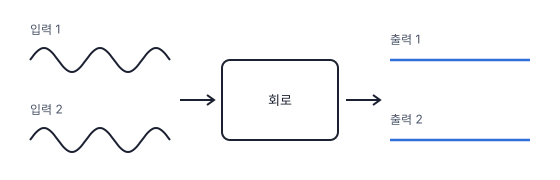

*두 입력이 똑같이 출렁여도 두 출력은 평평하게 가만히 있어요.*

**정확히 말하면**

공통 모드(common-mode, CM) 입력은 두 입력에 크기와 위상이 똑같이 들어오는 변화예요. 증폭하려는 차동 신호는 일부러 위상을 반대로 만들어 넣어요. 반면 바깥에서 들어오는 잡음(noise)은 두 입력에 같은 위상으로 들어와요. 그래서 잡음이 대표적인 CM 신호예요.

두 출력에 같이 실린 잡음이 차이에서 빠지는 원리는 [0923 정리노트: 공통 모드 잡음은 빼면 사라진다](../0923/정리노트_0923_Differential_Amplifiers.html#s0-noise)에서 봤어요. 이번에는 입력에 CM 변화가 들어올 때 차동쌍 안에서 무슨 일이 생기는지 따라가요.

가정은 두 가지예요. 회로가 완전히 대칭이고, 테일 전류원(tail current source)은 이상적인 전류원 $I_{SS}$예요. 두 게이트에 같은 변화 $\Delta V_{in,CM}$을 넣어요.

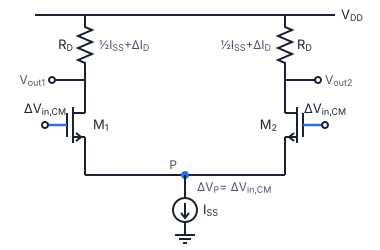

*두 게이트에 같은 $\Delta V_{in,CM}$이 들어가고, 테일은 이상적인 전류원 $I_{SS}$예요(슬라이드 s32).*

1. 두 게이트 전압이 같고 두 소스가 P에 묶여 있으니 $V_{GS1}=V_{GS2}$예요. 그래서 두 드레인 전류의 변화도 같아요:

   $$
   \Delta I_{D1}=\Delta I_{D2}=\Delta I_D
   $$
2. 노드 P에서 KCL을 써요. 이상적인 전류원이라 합은 $I_{SS}$로 고정이에요:

   $$
   \left(\tfrac12I_{SS}+\Delta I_D\right)+\left(\tfrac12I_{SS}+\Delta I_D\right)
   $$

   $$
   =I_{SS}
   $$
3. 정리하면:

   $$
   \Delta I_D=0
   $$
4. 출력은 $R_D$에 흐르는 전류 변화만큼 움직여요:

   $$
   \Delta V_{out1}=\Delta V_{out2}=-\Delta I_DR_D=0
   $$
5. 출력 CM 레벨(각 출력의 레벨)의 변화도 0이에요:

   $$
   \frac{\Delta V_{out,CM}}{\Delta V_{in,CM}}=0
   $$
6. 두 출력이 모두 0이니 차동 출력도 0이에요:

   $$
   \Delta V_{out1}-\Delta V_{out2}=0
   $$

직관으로 보면, 입력이 $\Delta V_{in,CM}$만큼 오를 때 P도 같은 양만큼 따라 올라가요($\Delta V_P=\Delta V_{in,CM}$). 그래서 $V_{GS}$가 그대로이고 전류도 그대로예요.

입력 CM 레벨이 변해도 출력이 영향을 받지 않는 이 성질을 공통 모드 제거(common-mode rejection)라고 해요. 차동 회로의 가장 기본적인 특징이에요. 이상적인 조건에서는 CM 입력이 완전히 제거돼요.

그런데 실제 회로를 만들어 재 보면 완전히 제거되지 않아요. 가정한 두 조건, 곧 이상적인 테일 전류원과 완전한 대칭이 실제로는 성립하지 않기 때문이에요. 첫째 조건이 깨진 경우는 [유한한 테일 임피던스 R_SS: 직접 유도](#s3-finite-rss)에서 보고, 둘째인 비대칭은 다음 시간에 다뤄요.

**교수님 말씀**

CM 신호의 예로 잡음을 드셨어요. 이어폰에 바깥 소리가 들어올 때, 오른쪽과 왼쪽에 일부러 위상을 반대로 해서 들어오지는 않아요.

> "이어폰 같은 데 외부에서 들어오는 신호가 … 오른쪽에는 위상이 반대가 되고 … 이렇게 들어오지 않잖아요" (1002 50:21)

증폭하려는 신호는 위상을 뒤집는 회로를 일부러 넣어서 만든 것이고, 바깥 잡음은 모두 같은 위상으로 들어온다고 정리하셨어요.

> "외부에서 들어온 노이즈들은 다 커먼 모드, 같은 위상으로 들어오는 신호가 되겠습니다." (1002 50:50)

**꼭 기억해요**

입력 CM에 출력이 흔들리지 않는 것이 차동 회로의 가장 기본적인 특징이에요.

> "입력의 커먼 모드 신호에 … 출력에 영향을 받지 않는다 라는 게 … 가장 기본적인 특징이에요." (1002 49:26)

완전한 제거는 이상적인 가정에서만 성립해요.

> "실제로는 완전히 제거되지는 않는다." (1002 56:03)

**페이지 요약**

대칭 차동쌍에 이상적인 테일 전류원이면 CM 입력이 들어와도 P가 따라 올라가 전류와 출력이 변하지 않아요.

*핵심 식*

- P에서 KCL

  $$
  \Delta I_D=0
  $$
- CM 이득

  $$
  \frac{\Delta V_{out,CM}}{\Delta V_{in,CM}}=0
  $$

*용어*

- **공통 모드 제거(common-mode rejection)** — 입력 CM 레벨이 변해도 출력이 영향을 받지 않는 성질
- **잡음(noise)** — 두 입력에 같은 위상으로 들어오는 대표적인 CM 신호

---

### 유한한 테일 임피던스 R_SS: 직접 유도

*1002 수업 · L04 s33*

**쉽게 말하면**

가운데 받침이 살짝 말랑하면, 양쪽을 똑같이 밀어도 출구가 조금은 출렁여요.

*받침이 단단할수록 색칠된 막대가 낮아져서 출렁임이 거의 사라져요.*

**정확히 말하면**

테일 전류원은 트랜지스터로 만들어요. 그래서 출력저항(output resistance)이 크긴 하지만 무한대는 아니에요. 이 유한한 테일 임피던스(tail impedance)를 $R_{SS}$라고 해요.

- 트랜지스터 하나로 만들면 $R_{SS}=r_O$예요.
- 캐스코드로 만들면 $R_{SS}\approx g_{m2}r_{O2}r_{O1}$처럼 더 크게 만들 수 있어요.

이상적인 전류원은 양 끝 전압이 변해도 전류가 그대로예요. $R_{SS}$는 노드 P의 전압이 변하면 전류도 바뀌어요. 그래서 두 드레인 전류의 합은 $I_{SS}+2\Delta I_D$가 되고, 이제 $\Delta I_D$가 0이 아닐 수 있어요.

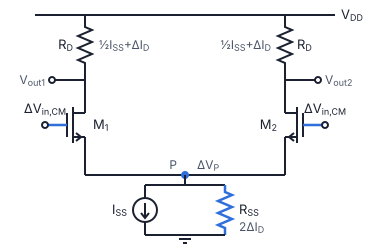

*테일에 이상적인 전류원 $I_{SS}$와 유한한 저항 $R_{SS}$가 함께 있어요. 변화 전류 $2\Delta I_D$가 $R_{SS}$로 흘러 P가 $\Delta V_P$만큼 움직여요.*

가정: $M_1$, $M_2$의 $r_O$는 무시하고($\lambda=0$), 몸체 효과도 무시해요.

칠판 유도예요. 회로가 대칭이므로 두 쪽의 변화는 같아요.

1. 테일의 변화 전류 $2\Delta I_D$가 $R_{SS}$에 흘러요:

   $$
   \Delta V_P=2\Delta I_DR_{SS}
   $$
2. 소신호 관계 $\Delta I_D=g_m\Delta V_{GS}$를 넣어요:

   $$
   \Delta V_P=2g_m\Delta V_{GS}R_{SS}
   $$
3. 입력 변화는 $V_{GS}$ 변화와 P 변화의 합이에요:

   $$
   \Delta V_{in,CM}=\Delta V_{GS}+\Delta V_P
   $$

   $$
   \Delta V_{in,CM}=(1+2g_mR_{SS})\Delta V_{GS}
   $$
4. $\Delta V_{GS}$로 풀어요:

   $$
   \Delta V_{GS}=\frac{\Delta V_{in,CM}}{1+2g_mR_{SS}}
   $$
5. 각 출력은 $R_D$에 흐르는 전류 변화만큼 내려가요:

   $$
   \Delta V_{out,CM}=-\Delta I_DR_D=-g_m\Delta V_{GS}R_D
   $$
6. 4단계 식을 5단계 식에 넣어요:

   $$
   \frac{\Delta V_{out,CM}}{\Delta V_{in,CM}}=-\frac{g_mR_D}{1+2g_mR_{SS}}
   $$
7. 분자와 분모를 $g_m$으로 나눠요:

   $$
   \frac{\Delta V_{out,CM}}{\Delta V_{in,CM}}=-\frac{R_D}{1/g_m+2R_{SS}}
   $$
8. 분자와 분모를 다시 2로 나누면 슬라이드 s33의 표기예요:

   $$
   -\frac{R_D/2}{1/(2g_m)+R_{SS}}
   $$

4단계가 핵심이에요. 입력 CM 변화가 그대로 $V_{GS}$에 걸리지 않고 $1+2g_mR_{SS}$로 나뉘어 나타나요. 나머지는 P가 따라 올라가며 받아 내요. 그래도 남은 $\Delta V_{GS}$가 0이 아니어서 전류가 변하고, 출력 CM 레벨이 이 비율만큼 움직여요.

검산: $R_{SS}\to\infty$이면 분모가 무한대가 되어 이득이 0이에요. [이상적인 경우: CM 입력에 출력이 꿈쩍하지 않는다](#s3-cm-ideal)의 결과로 돌아가요.

(수업 중 5단계에서 마이너스 부호를 빠뜨렸다가 정정)

#### 직접 해 보기: 테일 임피던스를 키우면 CM 이득이 줄어요 *(정적 스냅샷 — 직접 조작은 HTML 버전)*

$R_{SS}$ 슬라이더(로그 눈금)를 움직이면 왼쪽 곡선 $R_D/(1/g_m+2R_{SS})$ 위의 현재 점이 움직이고, 오른쪽에는 $\Delta V_{in,CM}=100\ \text{mV}$일 때 두 출력의 변화와 차동 출력이 보여요. 두 출력 막대는 늘 같은 높이이고 차이는 늘 0이에요. $g_m=4\ \text{mS}$($1/g_m=250\ \Omega$), $R_D=1\ \text{k}\Omega$로 고정했어요. 테일 트랜지스터 하나의 $r_O$를 500 kΩ쯤으로 보면 CM 이득이 약 $10^{-3}$, 캐스코드로 10배 키우면 약 $10^{-4}$예요.

**RSS = 501 kΩ일 때 CM 이득 = −0.000997 (근사 −RD/(2RSS) = −0.000998), ΔVin,CM = 100 mV이면 ΔVout1 = ΔVout2 = −0.10 mV, 차동 출력 ΔVout1 − ΔVout2 = 0 mV**

범례: CM 이득 크기 · 근사 RD/(2RSS) · 현재 RSS · 막대: 두 출력의 변화 크기(아래로 움직임)

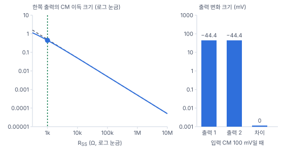

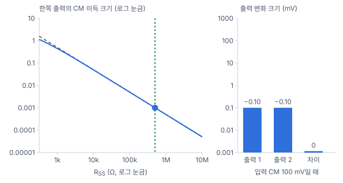

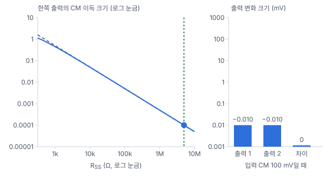

| 설정 | CM 이득 | 근사 −RD/(2RSS) | ΔVout1 = ΔVout2 (입력 CM 100 mV) | 차동 출력 |
|---|---|---|---|---|
| RSS = 1.00 kΩ | −0.444 | −0.5 | −44.4 mV | 0 mV |
| RSS = 500 kΩ (트랜지스터 한 개의 rO 수준, 10−3) | −0.001 | −0.001 | −0.10 mV | 0 mV |
| RSS = 5.00 MΩ (캐스코드 전류원 수준, 10−4) | −0.0001 | −0.0001 | −0.010 mV | 0 mV |

**교수님 말씀**

이상적인 전류원은 실제로 없다는 데서 출발하셨어요. 전류원은 트랜지스터로 만들어야 하니 출력저항이 유한해요.

> "근데 이거는 우리가 이제 어떻게 만들어야 돼요? 트랜지스터로 만들어야 되잖아요." (1002 56:27)

더 이상적인 전류원을 원하면 캐스코드로 만들어 $R_{SS}$를 키우면 된다고 하셨어요.

> "좀 더 아이디얼한 커런트 소스를 만들고 싶다 … 캐스코드로 만들면" (1002 58:04)

식을 얻은 뒤에는 극한으로 검토하셨어요.

> "rss가 무한대면 어떻게 돼요? … 이 식은 0이죠" (1002 64:47)

**페이지 요약**

테일 임피던스 $R_{SS}$가 유한하면 P가 입력을 완전히 따라가지 못해 각 출력의 CM 레벨이 조금 움직여요.

*핵심 식*

- P의 변화

  $$
  \Delta V_P=2\Delta I_DR_{SS}
  $$
- 입력의 분배

  $$
  \Delta V_{in,CM}=(1+2g_mR_{SS})\Delta V_{GS}
  $$
- CM 이득

  $$
  \frac{\Delta V_{out,CM}}{\Delta V_{in,CM}}
  $$

  $$
  =-\frac{R_D}{1/g_m+2R_{SS}}
  $$

*용어*

- **테일 임피던스(tail impedance)** — 테일 전류원의 유한한 출력저항 $R_{SS}$, 트랜지스터 하나면 $r_O$

---

### CM 절반 회로로 다시 풀기

*1002 수업 · L04 s33 (칠판)*

**쉽게 말하면**

왼쪽과 오른쪽이 거울처럼 똑같이 움직이면, 반쪽만 풀어도 전체 답을 알 수 있어요.

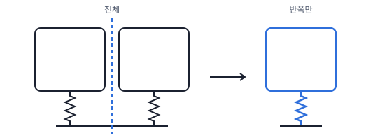

*가운데 받침을 반씩 나눠 주고 점선을 따라 자르면, 강조선으로 그린 반쪽 하나만 보면 돼요.*

**정확히 말하면**

[유한한 테일 임피던스 R_SS: 직접 유도](#s3-finite-rss)의 결과를 더 쉽게 얻는 방법이에요. 핵심은 $R_{SS}$를 $2R_{SS}$ 두 개의 병렬로 바꾸는 것이에요. 병렬 합이 원래와 같아서 회로는 바뀌지 않아요.

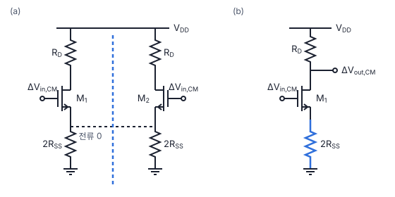

*(a) $R_{SS}$를 $2R_{SS}$ 두 개로 나눈 회로, (b) 대칭선에서 자른 CM 절반 회로. 이상적인 전류원은 소신호에서 열린 회로라서 그리지 않았어요.*

1. $R_{SS}$를 쪼개 각 소스 아래에 $2R_{SS}$를 하나씩 둬요:

   $$
   R_{SS}=2R_{SS}\parallel2R_{SS}
   $$
2. CM 입력에서는 두 입력이 같고, 대응하는 노드(두 드레인, 두 소스)도 같은 양만큼 움직여요. 그래서 두 소스를 잇는 선에는 전류가 흐르지 않고, 대칭선에서 잘라도 돼요.
3. 남은 반쪽이 CM 절반 회로(common-mode half circuit)예요. 게이트에 $\Delta V_{in,CM}$, 드레인에 $R_D$, 소스와 접지 사이에 $2R_{SS}$가 있어요.
4. 이 회로는 소스 축퇴(source degeneration) CS 단이에요. 이득은 드레인 쪽 저항을 소스 쪽 저항의 합 $1/g_m+2R_{SS}$로 나눈 값이고, 위상이 뒤집혀 마이너스가 붙어요. 한쪽 출력의 CM 이득 $\Delta V_{out,CM}/\Delta V_{in,CM}$을 $A_{CM}$으로 쓰면:

   $$
   A_{CM}=-\frac{R_D}{1/g_m+2R_{SS}}
   $$

직접 유도한 결과와 같아요. 소스 축퇴 CS 단의 이득 공식은 [0930 정리노트: 소스 축퇴 차동쌍의 반회로 이득](../0930/정리노트_0930_Differential_Amplifiers.html#s2-degen-gain)에서 쓴 것과 같은 꼴이에요.

차동 신호의 절반 회로와 헷갈리지 않게 비교해 둬요.

| 항목 | 차동 신호의 절반 회로 | CM 절반 회로 |
|---|---|---|
| 두 입력 | $v_{in2}=-v_{in1}$ | 같은 $\Delta V_{in,CM}$ |
| 노드 P | AC(가상) 접지 | 접지가 아니에요 |
| 절반 회로의 소스 | 접지에 바로 연결 | $2R_{SS}$를 거쳐 접지 |
| 이득 | $-g_mR_D$ | $-\frac{R_D}{1/g_m+2R_{SS}}$ |

두 방법 중 편한 것을 쓰면 돼요. CM 절반 회로가 훨씬 간단해요.

**교수님 말씀**

차동 신호일 때와 달리 CM에서는 P를 접지로 보면 안 된다고 짚으셨어요.

> "커먼 모드 하프 서킷이니까 … 같은 양만큼 변하겠죠? … 여기가 그라운드가 아닙니다." (1002 67:57)

남은 반쪽을 보고 어떤 구조인지 학생들에게 물으셨어요.

> "커먼 소스 구조인데 저항이 있는 소스 디제너레이션 구조죠." (1002 69:29)

> "여러분 편할 대로 하면 되겠죠. … 훨씬 더 좀 간단하게 해석할 수 있죠." (1002 70:21)

**페이지 요약**

$R_{SS}$를 $2R_{SS}$ 두 개로 나누고 대칭선에서 자르면, CM 절반 회로는 소스에 $2R_{SS}$가 달린 소스 축퇴 CS 단이에요.

*핵심 식*

- 테일 쪼개기

  $$
  R_{SS}=2R_{SS}\parallel2R_{SS}
  $$
- CM 이득

  $$
  A_{CM}=-\frac{R_D}{1/g_m+2R_{SS}}
  $$

*용어*

- **CM 절반 회로(common-mode half circuit)** — CM 입력에서 대칭선으로 자른 반쪽, P는 접지가 아님
- **소스 축퇴(source degeneration)** — 소스와 접지 사이에 저항을 둔 CS 단

---

### 그래도 차동 출력은 0, R_SS를 키우는 법

*1002 수업 · L04 s34–s35*

**쉽게 말하면**

양쪽 출구가 똑같이 조금 내려가면, 둘을 비교한 값은 꿈쩍하지 않아요.

*두 출구는 같은 만큼 한 계단 내려가지만 맨 아래 둘의 차이는 계속 평평해요.*

**정확히 말하면**

테일 임피던스가 유한하면 입력 CM 변화가 각 출력의 CM 레벨을 [유한한 테일 임피던스 R_SS: 직접 유도](#s3-finite-rss)에서 구한 비율만큼 바꿔요. 이 값이 얼마나 작은지부터 봐요.

1. $R_{SS}\gg1/g_m$일 때 분모의 $1/g_m$을 버려요:

   $$
   \frac{\Delta V_{out,CM}}{\Delta V_{in,CM}}\approx-\frac{R_D}{2R_{SS}}
   $$
2. $R_{SS}$는 테일 전류원의 출력저항이라 $r_O$ 정도예요. $R_D$가 $R_{SS}$보다 훨씬 작으면 이 값은 매우 작아요. 수업에서는 $10^{-3}$에서 $10^{-4}$ 정도라고 했어요. 예를 들어 $R_D=1\ \text{k}\Omega$, $R_{SS}=r_O=500\ \text{k}\Omega$이면 $R_D/(2R_{SS})=10^{-3}$이에요.

슬라이드 s34–s35의 입력 CM 잡음 그림은 직접 짚지 않고 말로 설명했어요. 싱글엔디드(single-ended) 증폭기는 입력 잡음이 증폭되어 출력에 나타나요. 차동쌍에서는 잡음이 증폭되지는 않지만, 완전히 사라지지 않고 각 출력에 아주 조금 남아요. 이것도 중요할 수 있어서 실제로 따져요.

공통 모드 제거는 무한대가 아니에요. 그래도 좋은 성질인 것은 여전해요. 더 좋게 하려면 $R_{SS}$를 키우면 되고, 그 방법 하나가 캐스코드 전류원(cascode current source)이에요. 트랜지스터 하나면 $R_{SS}=r_O$이지만 캐스코드면 $R_{SS}\approx g_{m2}r_{O2}r_{O1}$이에요.

지금까지는 각 출력을 봤어요. 차동 출력을 취하면 결과가 달라져요.

1. 대칭이라 두 출력이 같은 양만큼 움직여요:

   $$
   \Delta V_{out1}=\Delta V_{out2}=-\Delta I_DR_D
   $$
2. 둘을 빼요:

   $$
   \Delta V_{out1}-\Delta V_{out2}=-\Delta I_DR_D-(-\Delta I_DR_D)
   $$

   $$
   \Delta V_{out1}-\Delta V_{out2}=0
   $$

그래서 테일 임피던스가 유한해도 차동 출력에는 영향이 나타나지 않아요.

| 경우 | 각 출력의 CM 변화 | 차동 출력 |
|---|---|---|
| 이상적인 테일, 완전 대칭 | 0 | 0 |
| 유한한 $R_{SS}$, 완전 대칭 | $-\frac{R_D}{1/g_m+2R_{SS}}\Delta V_{in,CM}$ | 0 |

남은 가정은 완전한 대칭이에요. 공장에서 만들면 두 쪽이 완전히 같을 수 없어요. 이 비대칭(asymmetry, mismatch)이 만드는 특성은 다음 시간에 다뤄요.

**교수님 말씀**

크기 감을 주셨어요. $R_{SS}\approx r_O$로 보면 대략 $R_D/r_O$ 정도라서 매우 작은 값이라고 하셨어요. 정확히는 $R_D/(2R_{SS})$이고, 2를 빼고 크기만 말씀하신 거예요.

> "대략 ro분의 RD가 되기 때문에 … 1,000분의 1, 뭐 작게는 10,000분의 1" (1002 72:13)

완전한 대칭은 현실에 없다고 하셨어요.

> "완전히 똑같은 건 없어요. 뭐 99.9% 동일하게 만들 수 있겠지만" (1002 74:59)

**꼭 기억해요**

작은 값이어도 따지는 이유가 있어요.

> "그것도 중요할 수 있기 때문에 … 실제로 요거를 우리가 따져준다." (1002 72:59)

잡음의 영향을 줄이려면 $R_{SS}$를 키워요.

> "RSS를 키워라. 그중에 하나의 방법이 캐스코드 커런트 소스를 쓰는 거죠" (1002 73:32)

차동 출력에는 영향이 없어요.

> "차동 출력에선 영향이 나타나지 않으니까 … 출력에 영향을 주지 않는다고 볼 수 있어요." (1002 74:25)

**페이지 요약**

유한한 $R_{SS}$는 각 출력을 조금 움직이지만 두 출력이 같은 양만큼 움직여 차동 출력은 0이고, 남은 문제는 비대칭이에요.

*핵심 식*

- 근사 CM 이득

  $$
  \frac{\Delta V_{out,CM}}{\Delta V_{in,CM}}\approx-\frac{R_D}{2R_{SS}}
  $$
- 차동 출력

  $$
  \Delta V_{out1}-\Delta V_{out2}=0
  $$

*용어*

- **캐스코드 전류원(cascode current source)** — $R_{SS}$를 $g_{m2}r_{O2}r_{O1}$ 수준으로 키우는 테일 전류원
- **비대칭(asymmetry, mismatch)** — 두 쪽이 완전히 같지 않은 것, 다음 시간에 다룸

---

## 4. 요약 · 예고

### 한눈에 보는 식

*1002 수업 · L04 s22–35*

1002 수업의 핵심 식과 결론을 모았어요. 행마다 자세한 설명이 있는 토픽으로 이어져요.

| 무엇 | 식 · 결론 | 토픽 |
|---|---|---|
| BJT 차동쌍의 CM 레벨과 전류 변화 | 출력 CM 레벨은 $V_{CC}-R_C\frac{I_{EE}}{2}$예요. 차동 입력을 넣으면 $I_{C1}=\frac{I_{EE}}{2}+\Delta I$, $I_{C2}=\frac{I_{EE}}{2}-\Delta I$이고 $I_{C1}+I_{C2}=I_{EE}$는 그대로예요. | [CM 레벨과 DC 바이어스, 차동 입력이 만드는 전류 변화](#s0-cm-vs-dc) |
| 차동 이득 = 절반 회로 이득 | 노드 P가 가상 접지라 회로가 CE 단 두 개로 나뉘어요. $A_v=\frac{v_{out1}-v_{out2}}{v_{in1}-v_{in2}}=-g_mR_C$ (정확히는 $-g_m(R_C\parallel r_{O1})$) | [가상 접지와 절반 회로: 차동 이득은 절반 회로 이득](#s0-half-circuit) |
| pnp 전류원 부하 | $A_v=-g_{m1}(r_{O1}\parallel r_{O3})$ (부하 $r_{O3}$가 $r_{O1}$과 크기가 비슷해서 $r_{O1}$을 버리지 않아요) | [예제 1: pnp 전류원 부하](#s1-pnp-load) |
| 베이스를 R1, R2 가운데에 묶은 부하 | $R_1=R_2$이면 X는 AC 접지예요. $A_v=-g_{m1}(r_{O1}\parallel r_{O3}\parallel R_1)$이고, $R_1\to\infty$이면 예제 1, $R_1\to0$이면 이득 0이에요. | [예제 2: R1, R2 가운데에 베이스를 묶은 부하](#s1-r1-load) |
| MOS 캐스코드 차동쌍 | $A_v=-G_mR_{out}$에서 $G_m=g_{m1}$, $R_{out}\approx g_{m3}r_{O3}r_{O1}$이라 $A_v\approx-g_{m1}g_{m3}r_{O3}r_{O1}$이에요. | [MOS 캐스코드 차동쌍: G_m은 그대로, R_out은 크게](#s2-mos-cascode) |
| 캐스코드 부하까지 단 경우 | $A_v\approx-g_{m1}\big[(g_{m3}r_{O3}r_{O1})\parallel(g_{m5}r_{O5}r_{O7})\big]$ (대신 5개의 오버드라이브 전압이 필요해서 헤드룸이 줄어요) | [캐스코드 부하, NMOS 입력, 전압 여유](#s2-mos-cascode-load) |
| 바이폴라 캐스코드 차동쌍 | $r_{\pi3}$가 $r_{O1}$과 병렬로 보여서 $A_v\approx-g_{m1}g_{m3}r_{O3}(r_{O1}\parallel r_{\pi3})$예요. | [바이폴라 캐스코드 차동쌍: r_π3가 끼어든다](#s2-bjt-cascode) |
| 이상적 테일의 CM 응답 | $\Delta I_D=0$이라 $\frac{\Delta V_{out,CM}}{\Delta V_{in,CM}}=0$이에요. CM 입력은 완전히 사라져요. | [이상적인 경우: CM 입력에 출력이 꿈쩍하지 않는다](#s3-cm-ideal) |
| 유한한 테일 임피던스 $R_{SS}$ | $\frac{\Delta V_{out,CM}}{\Delta V_{in,CM}}=-\frac{R_D}{1/g_m+2R_{SS}}$ ($R_{SS}\to\infty$이면 0으로 돌아가요) | [유한한 테일 임피던스 R_SS: 직접 유도](#s3-finite-rss) |
| CM 절반 회로 | 소스에 $2R_{SS}$가 남는 소스 축퇴 CS 단이에요. $A_{CM}=-\frac{R_D}{1/g_m+2R_{SS}}$로 같은 답이 나와요. | [CM 절반 회로로 다시 풀기](#s3-cm-half) |
| 그래도 차동 출력은 0 | $\Delta V_{out1}-\Delta V_{out2}=0$이에요. 각 출력의 CM 이득은 약 $-\frac{R_D}{2R_{SS}}$이고, 줄이려면 캐스코드 전류원으로 $R_{SS}$를 키워요. | [그래도 차동 출력은 0, R_SS를 키우는 법](#s3-cm-summary) |

교수님이 쓴 비유와 단어도 같이 기억해요.

- CM 레벨과 DC 바이어스: CM 레벨은 두 입력에 똑같이 들어가는 성분 전체예요. 다른 CM 신호가 없을 때만 DC 바이어스와 같아요. ([CM 레벨과 DC 바이어스, 차동 입력이 만드는 전류 변화](#s0-cm-vs-dc))
- "이득"이라고만 하면 차동 이득이에요. 첨자 dm은 굳이 안 써도 돼요. ([가상 접지와 절반 회로: 차동 이득은 절반 회로 이득](#s0-half-circuit))
- 전류원 부하: 저항 부하처럼 큰 IR 드롭 없이 최소 전압만으로 큰 소신호 저항을 얻어요. ([예제 1: pnp 전류원 부하](#s1-pnp-load))
- AC 접지: DC가 0이라는 뜻이 아니에요. 매칭($R_1=R_2$)을 가정해야 성립해요. ([예제 2: R1, R2 가운데에 베이스를 묶은 부하](#s1-r1-load))
- 공급 전압이 낮아지는 디지털 회로: 전력을 줄이려고 공급 전압을 1 V 근처까지 낮추니 아날로그 회로도 따라 낮춰야 하고, 많이 쌓는 캐스코드는 어려워져요. ([캐스코드 부하, NMOS 입력, 전압 여유](#s2-mos-cascode-load))
- OP 앰프 = 고이득 차동 증폭기: 무한 이득 증폭기는 에너지 보존 법칙 위배라 없고, 실제 OP 앰프는 이득이 매우 큰 차동 증폭기예요. 대표 구조가 캐스코드 차동 증폭기예요. ([바이폴라 캐스코드 차동쌍: r_π3가 끼어든다](#s2-bjt-cascode))
- 이어폰 잡음: 바깥 잡음은 왼쪽과 오른쪽에 같은 위상으로 들어와요. 그래서 잡음은 공통 모드 신호예요. ([이상적인 경우: CM 입력에 출력이 꿈쩍하지 않는다](#s3-cm-ideal))
- CM 절반 회로가 더 간단해요: 테일을 $2R_{SS}$ 두 개로 쪼개면 소스 축퇴 회로 하나만 풀면 돼요. ([CM 절반 회로로 다시 풀기](#s3-cm-half))
- 잡음 영향을 줄이려면 $R_{SS}$를 키워요. 남은 문제는 공장에서 생기는 비대칭(미스매치)이에요. ([그래도 차동 출력은 0, R_SS를 키우는 법](#s3-cm-summary))

---

### 다음 시간 예고

*1002 수업 · L04 s36–40*

수업 끝에 교수님이 비대칭이 만드는 특성은 다음 시간에 이어서 설명하겠다고 했어요(1002 74:50, 추정 시각). 아래 슬라이드는 이번 수업에서 다루지 않았어요.

- CM Response with Asymmetric Loads, $A_{CM-DM}$(s36)
- CMRR(s37)
- 차동-단일단 변환(s38)
- 능동 부하(active load) 차동쌍(s39–40)

---

### 함께 보면 좋은 자료

*1002 수업*

- [복습문제 10개 (PDF)](복습문제_1002_Differential_Amplifiers-문제.pdf)
- [답안 (PDF)](복습문제_1002_Differential_Amplifiers-답안.pdf)
- [직전 정리노트: 0930 차동 증폭기](../0930/정리노트_0930_Differential_Amplifiers.html) (차동쌍 설계, 트랜지스터 부하, 소스 축퇴, BJT 차동쌍 CM 응답 · 대신호)
- [Razavi 10장 문제집 전체 (PDF)](../../workbook/pdf/ch10-문제.pdf)

복습문제는 Razavi 10장의 예제 3개, 연습문제 1개, 장말문제 5개와 2021-1 중간고사 기출 1개에서 이번 수업 범위만 골랐어요.

- 예제 1의 전 단계: 이상적 전류원 부하 바이폴라 차동쌍의 이득 $-g_mr_O$(E10.10)
- 수업 예제 1 원본: pnp 전류원 부하 차동쌍의 이득 $-g_{m1}(r_{O1}\parallel r_{O3})$(E10.11)
- 수업 예제 2 원본: $R_1$, $R_2$ 가운데 X가 AC 접지가 되는 pnp 부하 차동쌍의 이득(E10.13)
- 예제 2에 $V_A$, $R_1$, $I_{EE}$ 수치를 넣어 $-g_{m1}(r_{O1}\parallel r_{O3}\parallel R_1)$ 계산하기(X10.13)
- MOS 캐스코드 차동쌍 이득 $(g_mr_O)^2=300$에서 테일 전류 역산하기(P10.62)
- 캐스코드 부하 MOS 텔레스코픽 캐스코드 이득 $-g_{m1}\big[(g_{m3}r_{O3}r_{O1})\parallel(g_{m5}r_{O5}r_{O7})\big]$과 $\mu_n\gt\mu_p$로 $W/L$ 역산하기(P10.64)
- 바이폴라 캐스코드 차동쌍 이득에 $r_{O1}\parallel r_{\pi3}$가 들어가는 것을 써서 최소 Early 전압 계산하기(P10.54)
- 바이폴라 캐스코드($r_\pi$ 병렬)와 $R_P$가 붙은 캐스코드 차동 증폭기의 출력 저항 · 이득(2021-1 중간 Q3)
- 테일 임피던스 $r_{O3}$로 CM 이득 식을 세워 CM 이득 0.01 미만 조건 증명하기(P10.66)
- 테일을 $2R_{EE}$ 두 개로 쪼갠 CM 절반 회로로 CM 이득 식 다시 유도하기(P10.65)

---

출처: 권익진 교수님 강의자료(Lec4) · 수업 녹음 전사(1002) · B. Razavi, *Microelectronics*, 2nd ed. (Wiley) 10장.
