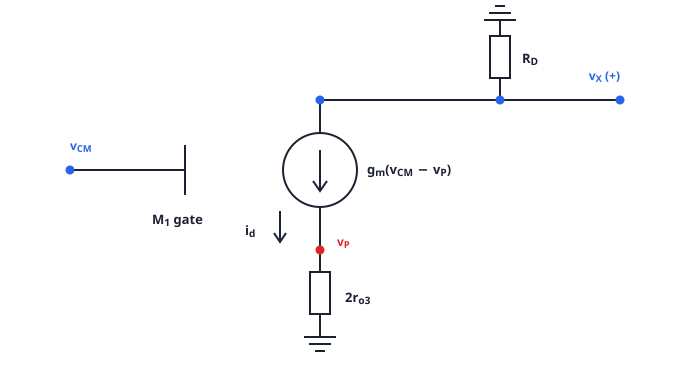

# 전자회로2 복습 1007 문제설명

주어진 조건을 읽고, 첫 줄을 쓰고, 이유를 따라가며 답을 확인해요.

문제의 첫 줄부터 검산까지 설명해요.

**목차**

- [문항별 설명](#problems)
  - [테일 소자 M3만 λ ≠ 0인 MOS 차동쌍(Fig 10.88)의 공통 모드 이득 식 증명](#p1)
  - [PMOS 전류원 부하와 테일 M5를 가진 MOS 차동쌍(Fig 10.89)의 공통 모드 이득](#p2)
  - [Fig 10.90 (a)(b) 회로에 대해 문제 10.68(공통 모드 이득)을 되풀이](#p3)
  - [이미터 축퇴 테일 전류원을 가진 바이폴라 쌍의 A_CM−DM](#p4)
  - [캐스코드 테일을 가진 MOS 차동 증폭기의 A_CM, A_CM-DM, 차동 이득, CMRR](#p5)
  - [그림 10.48 회로의 CMRR](#p6)
  - [부하 미스매치 ΔR_D가 있는 Fig 10.91 (a)(b) 두 단의 CMRR 비교](#p7)
  - [부하 저항 불일치 ΔR_D가 있는 MOS 차동 증폭기의 입력 CM 범위, A_CM, A_CM-DM, CMRR](#p8)
  - [PMOS 전류 거울(Fig 10.93)에서 I_1, I_2가 반대로 ΔI 변할 때 V_out 변화](#p9)
  - [능동 부하 바이폴라 쌍(Fig 10.96)의 이득 100을 위한 pnp Early 전압](#p10)

## 문항별 설명

### 테일 소자 M3만 λ ≠ 0인 MOS 차동쌍(Fig 10.88)의 공통 모드 이득 식 증명

P10.67 · 장말문제 10.67 · [원 문제 보기](../%EB%B3%B5%EC%8A%B5%EB%AC%B8%EC%A0%9C_1007_Differential_Amplifiers-%EB%AC%B8%EC%A0%9C.pdf)

#### 주어진 조건

- $M_1$, $M_2$: $\lambda = 0$
- $M_3$: $\lambda \neq 0$
- $(V_{GS} - V_{TH})_{eq.}$: $M_1$, $M_2$의 평형(equilibrium) 오버드라이브
- $I_{SS}$는 그림에 라벨이 없음. $M_3$가 흘리는 테일 전류로 보임

#### 구할 것

- 공통 모드 이득을 계산하고 다음을 증명

  $$
  A_{CM} = \frac{-R_D I_{SS}}{\dfrac{2}{\lambda} + (V_{GS} - V_{TH})_{eq.}} \qquad (10.224)
  $$

원문 보기

Compute the common-mode gain of the MOS differential pair shown in Fig. 10.88. Assume $\lambda = 0$ for $M_1$ and $M_2$ but $\lambda \neq 0$ for $M_3$. Prove

$$
A_{CM} = \frac{-R_D I_{SS}}{\dfrac{2}{\lambda} + (V_{GS} - V_{TH})_{eq.}}, \qquad (10.224)
$$

where $(V_{GS} - V_{TH})_{eq.}$ denotes the equilibrium overdrive of $M_1$ and $M_2$.

#### 문제를 내 말로 읽어요

저항 부하 $R_D$ 두 개를 단 NMOS 차동쌍(differential pair)이에요. 두 입력 트랜지스터 $M_1$, $M_2$의 소스가 한 점(테일 노드, tail node)에 모이고, 그 아래에 게이트가 $V_b$로 고정된 $M_3$가 테일 전류원(tail current source) 역할을 해요. $M_3$가 흘리는 직류 전류가 $I_{SS}$예요.

입력은 $V_{in1}$과 $V_{in2}$에 **똑같이** 들어오는 공통 모드(common-mode, CM) 변화 $\Delta V_{in,CM}$이고, 출력은 한쪽 드레인 $X$(또는 $Y$)의 변화예요. 구할 것은 $A_{CM}=\Delta V_X/\Delta V_{in,CM}$이고, 이것이 식 (10.224) 꼴이 됨을 보이는 것이에요.

핵심 가정은 "$\lambda$가 0이 아닌 것은 $M_3$뿐"이라는 점이에요. 그래서 $M_1$, $M_2$는 이상적인 전류 소자로 두고, 테일 전류원만 유한한 출력 저항을 가져요. 이상적인 테일이면 $A_{CM}=0$인데, 그 저항 때문에 공통 모드 신호가 출력으로 조금 새어 나온다는 이야기예요.

#### 이 문제를 봤을 때 떠올릴 개념과 공식

**단서**: "common-mode gain", 그리고 "$\lambda\neq0$ for $M_3$"이에요. 공통 모드 입력에 테일 전류원이 비이상적이라는 두 단서가 함께 나오면 공통 모드 하프 서킷(CM half circuit)과 소스 축퇴(source degeneration)를 떠올려요. ([정리노트: CM 하프 서킷 복습](../%EC%A0%95%EB%A6%AC%EB%85%B8%ED%8A%B8_1007_Differential_Amplifiers.html#s0-cm-half-recap))

**기호의 뜻**: $g_m$은 $M_1$(또는 $M_2$)의 트랜스컨덕턴스(transconductance)로, 게이트-소스 전압이 조금 변할 때 드레인 전류가 얼마나 변하는지를 나타내요. $r_{O3}$는 채널 길이 변조(channel-length modulation) 때문에 생기는 $M_3$의 출력 저항으로 $r_{O3}\approx 1/(\lambda I_{D3})=1/(\lambda I_{SS})$예요. $R_{SS}$는 테일 소자가 테일 노드에 보이는 소신호 저항이고, 여기서는 $R_{SS}=r_{O3}$예요. $(V_{GS}-V_{TH})_{eq.}$는 두 입력이 같을 때(평형) $M_1$, $M_2$의 오버드라이브(overdrive)예요.

**근사 조건**: $M_1$, $M_2$는 $\lambda=0$이라 $r_{O1}, r_{O2}\to\infty$로 두고, $M_3$에만 $r_{O3}$를 남겨요. 몸체 효과(body effect)는 교과서 관례대로 무시해요. $r_{O3}=1/(\lambda I_{SS})$에서 $(1+\lambda V_{DS3})$ 보정은 버리는 1차 근사를 써요.

**선택 이유**: 회로가 좌우 대칭이고 두 입력이 같으므로 $M_1$, $M_2$의 소신호 전류도 같아요. 그러면 테일 저항 $R_{SS}$를 $2R_{SS}$ 두 개의 병렬로 쪼개 반쪽마다 하나씩 붙여도 각 반쪽의 전압·전류가 그대로예요. 대칭선(두 $2R_{SS}$ 사이)에는 전류가 흐르지 않으니 끊을 수 있고, 남은 반쪽은 소스에 $2R_{SS}$가 달린 축퇴 공통 소스(degenerated common-source) 단이에요. 그 이득 공식 $A_v=-\dfrac{R_D}{1/g_m+R_S}$을 바로 쓸 수 있어요.

마지막으로 오버드라이브로 답을 표현해야 하므로 제곱 법칙(square law)에서 나온 $g_m=\dfrac{2I_D}{V_{GS}-V_{TH}}$를 떠올려요.

#### 종이에 쓸 실제 첫 줄

1. 소신호 등가회로로 바꿔요. $V_{DD}$와 $V_b$는 직류라 교류 접지(AC ground)로 보내요. 그러면 $M_3$는 게이트·소스가 모두 접지인 소자가 되어, 테일 노드에서 보면 저항 $r_{O3}$ 하나만 남아요.

$$
R_{SS}=r_{O3}=\frac{1}{\lambda I_{SS}}
$$

2. 공통 모드 하프 서킷을 그려요. $r_{O3}$를 $2r_{O3}\parallel 2r_{O3}$로 나누고 가운데를 끊어서, 왼쪽 반쪽만 남겨요.

3. 첫 식은 이 반쪽의 소스 노드 KCL과 출력 노드 식이에요. 소스 전압을 $v_s$, 드레인 소신호 전류를 $i_d$라 하면

$$
i_d=g_m\,(\Delta V_{in,CM}-v_s),\qquad v_s=2r_{O3}\,i_d,\qquad \Delta V_X=-R_D\,i_d
$$

#### 왜 이렇게 푸는지 함께 따라가요

#### 공통 모드 이득 유도

첫 두 식에서 $v_s$를 지우면 드레인 전류가 나와요. $v_s$를 대입한 뒤 $i_d$끼리 모아요.

$$
i_d=g_m\,\Delta V_{in,CM}-2g_m r_{O3}\,i_d\;\Rightarrow\; i_d=\frac{g_m\,\Delta V_{in,CM}}{1+2g_m r_{O3}}=\frac{\Delta V_{in,CM}}{1/g_m+2r_{O3}}
$$

소스 저항이 입력 전압의 일부를 가져가서 전류가 $g_m\Delta V_{in,CM}$보다 줄어드는 것, 이것이 축퇴의 효과예요. 출력은 $\Delta V_X=-R_D i_d$이므로

$$
A_{CM}=\frac{\Delta V_X}{\Delta V_{in,CM}}=-\frac{R_D}{\dfrac{1}{g_m}+2r_{O3}}=-\frac{R_D/2}{\dfrac{1}{2g_m}+r_{O3}}
$$

오른쪽 꼴은 분자·분모를 2로 나눈 것으로, 교과서의 $A_{CM}=-\dfrac{R_D/2}{1/(2g_m)+R_{SS}}$와 같아요. 두 반쪽을 병렬로 묶어 $2g_m$ 소자와 $R_D/2$ 부하로 본 결과와도 일치해요.

이제 $g_m$과 $r_{O3}$를 문제의 기호로 바꿔요. 평형에서 $I_{SS}$가 반씩 나뉘므로 $I_{D1}=I_{SS}/2$이고, 제곱 법칙에서

$$
g_m=\frac{2I_{D1}}{(V_{GS}-V_{TH})_{eq.}}=\frac{I_{SS}}{(V_{GS}-V_{TH})_{eq.}}\;\Rightarrow\;\frac{1}{g_m}=\frac{(V_{GS}-V_{TH})_{eq.}}{I_{SS}}
$$

$M_3$는 $I_{SS}$ 전체를 흘리므로 $2r_{O3}=\dfrac{2}{\lambda I_{SS}}$예요. 둘을 첫 꼴의 분모에 넣어요.

$$
A_{CM}=-\frac{R_D}{\dfrac{(V_{GS}-V_{TH})_{eq.}}{I_{SS}}+\dfrac{2}{\lambda I_{SS}}}
$$

분모의 두 항이 모두 $1/I_{SS}$를 가지므로 분자·분모에 $I_{SS}$를 곱해 정리하면

$$
A_{CM}=\frac{-R_D I_{SS}}{\dfrac{2}{\lambda}+(V_{GS}-V_{TH})_{eq.}}
$$

이것이 증명할 식 (10.224)예요. 여기서 $\lambda$는 $M_3$의 값이에요.

#### 완성 답과 검산

#### 식 (10.224) 검산

**완성 답: $A_{CM}=\dfrac{-R_D I_{SS}}{2/\lambda+(V_{GS}-V_{TH})_{eq.}}=-\dfrac{R_D/2}{1/(2g_m)+r_{O3}}$**

**단위**: 분자 $R_D I_{SS}$는 Ω·A = V, 분모의 $2/\lambda$는 $\lambda$가 V$^{-1}$이므로 V, 오버드라이브도 V예요. 이득은 무차원으로 맞아요.

**극한 1 ($\lambda\to0$)**: $2/\lambda\to\infty$이므로 $A_{CM}\to0$이에요. 테일이 이상적인 전류원이면 공통 모드 입력이 전류를 바꾸지 못해 출력이 변하지 않는다는 기본 결과로 돌아와요.

**극한 2 ($r_{O3}\to0$, 즉 $2/\lambda\to0$)**: $A_{CM}\to-\dfrac{R_D I_{SS}}{(V_{GS}-V_{TH})_{eq.}}=-g_m R_D$예요. 테일 노드가 접지되면 반쪽이 축퇴 없는 공통 소스 단이 되니 맞아요.

**수치 감각**: $\lambda=0.1\ \text{V}^{-1}$, $(V_{GS}-V_{TH})_{eq.}=0.2$ V, $I_{SS}=1$ mA, $R_D=2$ kΩ이면 $A_{CM}=-\dfrac{2}{20+0.2}\approx-0.099$이에요. 같은 값에서 차동 이득 $g_mR_D=10$보다 약 100배 작아요. 분모에서 $2/\lambda$가 오버드라이브보다 훨씬 커서 $A_{CM}\approx-\lambda R_D I_{SS}/2$로 봐도 거의 같아요.

#### 이 문항에서 하기 쉬운 오류

- 하프 서킷에 테일 저항을 $r_{O3}$ 그대로 붙이는 실수예요. 반쪽에는 $2r_{O3}$가 붙어요. 그대로 붙이면 분모가 $1/\lambda$가 되어 식의 2가 사라져요.
- $g_m$을 구할 때 $I_D=I_{SS}$를 쓰는 실수예요. $M_1$에는 $I_{SS}/2$만 흐르므로 $g_m=I_{SS}/(V_{GS}-V_{TH})_{eq.}$이고, 반대로 $r_{O3}$에는 $I_{SS}$ 전체를 써요.
- "$\lambda\neq0$"을 $M_1$, $M_2$에도 적용해 $r_{O1}$을 넣는 실수예요. 문제는 $M_3$만 $\lambda\neq0$으로 정했어요.
- 차동 출력 $V_X-V_Y$로 공통 모드 이득을 구하면 대칭 회로에서는 0이 나와요. 이 문제의 $A_{CM}$은 한쪽 출력 $X$ 기준이에요.

#### 설명을 닫고 다시 해 봐요

1. Fig. 10.88에서 $V_{DD}$, $V_b$를 접지로 보내고 테일 노드에서 본 저항이 왜 $r_{O3}$인지 한 줄로 써 보세요.
2. CM 하프 서킷을 그리고 $A_{CM}=-R_D/(1/g_m+2r_{O3})$를 KCL로 유도해 보세요.
3. $g_m=I_{SS}/(V_{GS}-V_{TH})_{eq.}$, $r_{O3}=1/(\lambda I_{SS})$를 넣어 식 (10.224)까지 정리하고, $\lambda\to0$일 때 0이 되는지 확인해 보세요.

**페이지 요약**

#### 떠올릴 개념·공식

CM 하프 서킷, 축퇴 CS 단

$R_{SS}=r_{O3}=1/(\lambda I_{SS})$

$g_m=2I_D/V_{ov}$

#### 첫 줄

반쪽 소스에 $2r_{O3}$

$i_d=g_m(\Delta V_{in}-v_s)$, $v_s=2r_{O3}i_d$

#### 핵심 판단

$A_{CM}=-\dfrac{R_D}{1/g_m+2r_{O3}}$

$g_m$은 $I_{SS}/2$로, $r_{O3}$는 $I_{SS}$로

#### 검산

$\lambda\to0$: $A_{CM}\to0$

$r_{O3}\to0$: $-g_mR_D$

단위: V/V

---

### PMOS 전류원 부하와 테일 M5를 가진 MOS 차동쌍(Fig 10.89)의 공통 모드 이득

P10.68 · 장말문제 10.68 · [원 문제 보기](../%EB%B3%B5%EC%8A%B5%EB%AC%B8%EC%A0%9C_1007_Differential_Amplifiers-%EB%AC%B8%EC%A0%9C.pdf)

#### 주어진 조건

- $\lambda > 0$
- $g_m r_O \gg 1$
- $A_v = -G_m R_{out}$ 관계를 사용

#### 구할 것

- 회로의 공통 모드 이득

원문 보기

Calculate the common-mode gain of the circuit depicted in Fig. 10.89. Assume $\lambda > 0$, $g_m r_O \gg 1$, and use the relationship $A_v = -G_m R_{out}$.

#### 문제를 내 말로 읽어요

NMOS 차동쌍 $M_1$·$M_2$ 위에는 저항 대신 PMOS 전류원 $M_3$·$M_4$가 부하(load)로 달려 있고, 아래 테일(tail)에는 이상적 전류원 대신 실제 트랜지스터 $M_5$가 있어요. $V_{b1}$, $V_{b2}$는 고정 바이어스라 소신호에서는 접지와 같아요.

입력은 두 게이트에 **똑같이** 들어오는 공통 모드(common-mode, CM) 변화 $\Delta V_{in,CM}$이고, 출력은 $M_1$ 드레인(= $M_3$ 드레인) 노드예요. $\lambda>0$이라 모든 트랜지스터가 출력 저항 $r_O$를 가지므로, 테일 $M_5$도 무한대가 아닌 $r_{O5}$로 보여요. 이 유한한 테일 저항 때문에 CM 입력이 출력에 새어 나오는 정도, 즉 한 출력 기준 공통 모드 이득 $A_{CM}=\Delta V_{out1}/\Delta V_{in,CM}$을 구해요.

그림의 $V_{out}$은 두 출력의 차이에요. 회로가 완전 대칭이면 두 출력이 똑같이 움직여 차동 출력의 CM 이득은 0이 되므로, 의미 있는 값은 한쪽 출력 기준 이득이에요.

#### 이 문제를 봤을 때 떠올릴 개념과 공식

**단서 → 개념.** "common-mode gain"과 대칭 회로라는 단서에서 공통 모드 하프 서킷(CM half circuit)을 떠올려요([정리노트: 유한한 $R_{SS}$와 CM 하프 서킷](../%EC%A0%95%EB%A6%AC%EB%85%B8%ED%8A%B8_1007_Differential_Amplifiers.html#s0-cm-half-recap)). "$A_v=-G_m R_{out}$을 쓰라"는 말에서는 이득을 트랜스컨덕턴스와 출력 저항 두 조각으로 나눠 구하는 방법을 떠올려요.

**기호의 뜻.** $g_{m1}$은 $M_1$의 트랜스컨덕턴스(게이트-소스 전압 변화가 드레인 전류를 얼마나 바꾸는지), $r_{O}$는 채널 길이 변조로 생기는 출력 저항 $1/(\lambda I_D)$예요. 테일 $M_5$는 게이트가 고정이라 드레인에서 $R_{SS}=r_{O5}$로 보여요. $G_m$은 출력을 교류 접지에 단락했을 때 흐르는 출력 전류/입력 전압, $R_{out}$은 입력을 0으로 두고 출력 노드에서 본 저항이에요.

**근사 조건.** $g_m r_O\gg1$을 써서 $1$이나 $r_O$ 단독 항보다 $g_m r_O\cdot r_O$ 항이 훨씬 크다고 봐요. 몸체 효과(body effect)는 문제에 없으므로 무시해요. $\lambda>0$이므로 $r_{O1}$, $r_{O3}$, $r_{O5}$를 모두 남긴 채로 시작하고, 마지막에만 근사해요.

**선택 이유.** 대칭이라 CM 입력에서는 두 반쪽이 같은 전류를 흘려요. 그래서 $r_{O5}$를 $2r_{O5}$ 두 개의 병렬로 쪼개면 대칭선을 지나는 전류가 0이 되어 끊을 수 있고, 반쪽은 "소스 축퇴(source degeneration) $2r_{O5}$ + 전류원 부하 $r_{O3}$"인 CS 단이 돼요. 부하가 저항이 아닌 $r_{O3}$이고 $M_1$의 $r_{O1}$까지 있으면 $-R_D/(1/g_m+R_S)$ 공식을 그대로 쓸 수 없으므로, $G_m$과 $R_{out}$을 따로 구하는 $A_v=-G_mR_{out}$이 가장 깔끔한 도구예요.

#### 종이에 쓸 첫 줄

1) 소신호에서 $V_{DD}$, $V_{b1}$, $V_{b2}$를 접지로 보내요. 그러면 $M_3$는 출력과 접지 사이의 저항 $r_{O3}$, $M_5$는 꼬리 노드와 접지 사이의 저항 $r_{O5}$가 돼요.

2) CM 하프 서킷: $r_{O5}=2r_{O5}\parallel 2r_{O5}$로 나누고 대칭선을 끊어요. 왼쪽 반쪽은 게이트에 $v_{in}$, 소스에 $R_S=2r_{O5}$, 드레인(출력)에 $r_{O3}$가 달린 $M_1$이에요. $M_1$은 $g_{m1}v_{gs1}$ 전류원과 $r_{O1}$ 병렬로 바꿔요.

3) $G_m$을 위한 첫 식: 출력을 접지에 단락하고 드레인 전류를 $i$라 하면 소스 전압은 $v_s=iR_S$이고, 드레인 노드 KCL은

$$
i=g_{m1}(v_{in}-v_s)-\frac{v_s}{r_{O1}},\qquad v_s=2r_{O5}\,i
$$

#### 왜 이렇게 푸는지 함께 따라가요

#### 공통 모드 이득 $A_{CM}$

**먼저 $G_m$ 구하기.** 첫 식에 $v_s=2r_{O5}i$를 넣고 $i$를 모아요.

$$
i\left(1+2g_{m1}r_{O5}+\frac{2r_{O5}}{r_{O1}}\right)=g_{m1}v_{in}
$$

양변에 $r_{O1}$을 곱해 정리하면

$$
G_m=\frac{i}{v_{in}}=\frac{g_{m1}r_{O1}}{r_{O1}+2r_{O5}+2g_{m1}r_{O1}r_{O5}}
$$

분모에서 $2g_{m1}r_{O1}r_{O5}$는 $r_{O1}$, $2r_{O5}$보다 $g_mr_O$배쯤 커요($g_mr_O\gg1$). 그래서 분모를 이 항 하나로 두면

$$
G_m\approx\frac{g_{m1}r_{O1}}{2g_{m1}r_{O1}r_{O5}}=\frac{1}{2r_{O5}}
$$

뜻: 축퇴 저항 $2r_{O5}$가 $1/g_{m1}$보다 훨씬 크면 $M_1$이 소스 전압을 게이트에 거의 붙여 따라가게 해서, 전류는 "$v_{in}$이 $2r_{O5}$에 걸려 흐르는 만큼"으로 정해져요.

**다음 $R_{out}$ 구하기.** 출력 노드에서 위로는 $r_{O3}$, 아래로는 소스에 $2r_{O5}$가 달린 $M_1$이 보여요. 축퇴된 트랜지스터의 드레인 쪽 저항 공식을 쓰면

$$
R_{down}=r_{O1}+2r_{O5}+2g_{m1}r_{O1}r_{O5}\approx2g_{m1}r_{O1}r_{O5}
$$

이 값은 $r_{O3}$보다 $g_mr_O$배쯤 크므로 병렬에서는 작은 쪽이 지배해요.

$$
R_{out}=r_{O3}\parallel R_{down}\approx r_{O3}
$$

**합치기.** 근사 전 식을 그대로 곱하면 분모의 $R_{down}$이 $G_m$의 분모와 같다는 점이 보여요($G_m=g_{m1}r_{O1}/R_{down}$).

$$
A_{CM}=-G_mR_{out}=-\frac{g_{m1}r_{O1}}{R_{down}}\cdot\frac{r_{O3}R_{down}}{r_{O3}+R_{down}}=-\frac{g_{m1}r_{O1}r_{O3}}{r_{O3}+r_{O1}+2r_{O5}+2g_{m1}r_{O1}r_{O5}}
$$

분모에서 $2g_{m1}r_{O1}r_{O5}$만 남기면

$$
A_{CM}\approx-\frac{r_{O3}}{2r_{O5}}
$$

차동 출력 $V_{out}=V_{out1}-V_{out2}$로 보면 두 반쪽이 같은 값을 내므로 완전 대칭에서는 0이에요. 위 값은 한 출력 기준이에요.

#### 완성 답과 검산

#### 검산

**완성 답: $A_{CM}\approx-\dfrac{r_{O3}}{2r_{O5}}$ (한 출력 기준, 정확식 $-\dfrac{g_{m1}r_{O1}r_{O3}}{r_{O3}+r_{O1}+2r_{O5}+2g_{m1}r_{O1}r_{O5}}$), 차동 출력 기준은 0.**

**단위·차수.** $r_{O3}/r_{O5}$는 Ω/Ω라 무차원이에요. 정확식도 분자 $g_m r\cdot r$ = Ω, 분모 각 항 Ω라 무차원으로 맞아요.

**극한 대입.** $r_{O5}\to\infty$(이상적 테일 전류원)이면 $A_{CM}\to0$이 되어 이상적인 경우(테일 전류 고정 → CM 입력에 전류 변화 없음)와 일치해요. 반대로 $r_{O5}\to0$(테일을 접지에 단락)이면 정확식이 $-g_{m1}(r_{O1}\parallel r_{O3})$, 즉 축퇴 없는 CS 단의 이득으로 돌아와요.

**저항 부하 공식과 비교.** 저항 부하 차동쌍의 $A_{CM}=-\dfrac{R_D}{1/g_m+2R_{SS}}$에서 $R_D\to r_{O3}$, $R_{SS}\to r_{O5}$, $2R_{SS}\gg1/g_m$로 두면 같은 $-r_{O3}/(2r_{O5})$가 나와요.

**크기 감각(교과서 보충).** $M_3$는 $I_{SS}/2$, $M_5$는 $I_{SS}$를 흘리므로 $\lambda$가 같다면 $r_{O3}=\dfrac{1}{\lambda I_{SS}/2}=2r_{O5}$이고, 이때 $|A_{CM}|\approx1$이에요. 전류원 부하는 차동 이득을 키우는 만큼 CM 이득도 키워서, 테일을 더 좋게(예: 캐스코드) 만들지 않으면 단일 출력 CM 이득이 1보다 많이 작아지지 않아요.

#### 자주 하는 실수

- 테일을 쪼갤 때 $r_{O5}$를 반쪽마다 그대로 붙이는 실수. 두 반쪽 전류가 합쳐 흐르므로 반쪽에는 $2r_{O5}$가 달려요.
- $R_{out}$을 $r_{O1}\parallel r_{O3}$로 쓰는 실수. $M_1$의 소스에 $2r_{O5}$가 있어 아래쪽 저항이 $2g_{m1}r_{O1}r_{O5}$로 크게 부풀어요.
- $G_m$을 그냥 $g_{m1}$으로 두는 실수. 축퇴 때문에 $G_m\approx1/(2r_{O5})$로 크게 줄어요.
- 그림의 $V_{out}$(차동 출력)으로 답을 0이라고만 쓰고 끝내는 것. 문제가 $G_mR_{out}$을 요구하므로 한 출력 기준 값을 구해야 하고, 차동 출력이 0인 것은 대칭일 때의 부가 설명이에요.

#### 설명을 닫고 다시 해 봐요

1. CM 하프 서킷을 그리고, 테일이 반쪽에 $2r_{O5}$로 붙는 이유를 한 줄로 써 보세요.
2. 출력 단락 KCL에서 $G_m$의 정확식을 유도하고 $g_mr_O\gg1$로 $1/(2r_{O5})$까지 줄여 보세요.
3. $\lambda$가 같을 때 $r_{O3}$와 $r_{O5}$의 비를 바이어스 전류로 구해 $|A_{CM}|$ 크기를 어림해 보세요.

**페이지 요약**

#### 떠올릴 개념·공식

CM 하프 서킷: 테일 $r_{O5}$는 반쪽마다 $2r_{O5}$

이득은 $A_v=-G_mR_{out}$로 나눠 구해요

#### 첫 줄

출력 단락 KCL: $i=g_{m1}(v_{in}-v_s)-v_s/r_{O1}$

소스 전압은 $v_s=2r_{O5}i$

#### 핵심 판단

트랜스컨덕턴스 $G_m\approx\dfrac{1}{2r_{O5}}$

출력 저항 $R_{out}\approx r_{O3}$ (아래쪽 $2g_{m1}r_{O1}r_{O5}$가 훨씬 큼)

답 $A_{CM}\approx-\dfrac{r_{O3}}{2r_{O5}}$

#### 검산

$r_{O5}\to\infty$이면 0

같은 $\lambda$면 $r_{O3}=2r_{O5}$라 $|A_{CM}|\approx1$

---

### Fig 10.90 (a)(b) 회로에 대해 문제 10.68(공통 모드 이득)을 되풀이

P10.69 · 장말문제 10.69 · [원 문제 보기](../%EB%B3%B5%EC%8A%B5%EB%AC%B8%EC%A0%9C_1007_Differential_Amplifiers-%EB%AC%B8%EC%A0%9C.pdf)

#### 주어진 조건

- 문제 10.68을 되풀이 (아래 상속·참조)

#### 구할 것

- (a), (b) 각 회로의 공통 모드 이득 (소문항 표기 없음, 원문은 "the circuits shown in Fig. 10.90"으로 적음)

원문 보기

Repeat Problem 10.68 for the circuits shown in Fig. 10.90.

#### 문제를 내 말로 읽어요

문제 10.68은 PMOS 전류원 부하 $M_3$·$M_4$와 테일 트랜지스터 하나($M_5$)를 가진 MOS 차동쌍의 공통 모드 이득(common-mode gain)을 $A_v=-G_mR_{out}$로 구하라는 문제였어요. 조건은 $\lambda>0$(모든 트랜지스터에 $r_O$가 있음)과 $g_mr_O\gg1$이에요. 이번 문제는 같은 일을 Fig. 10.90의 두 변형 회로에 반복해요.

- 그림 (a): 부하는 그대로 $M_3$·$M_4$ 한 개씩이고, 테일만 $M_5$ 아래에 $M_6$를 쌓은 캐스코드(cascode) 전류원이에요.
- 그림 (b): 테일은 $M_7$ 하나이고, 부하를 $M_5$ 아래 $M_3$(오른쪽은 $M_6$ 아래 $M_4$)로 쌓은 캐스코드 부하로 바꿨어요.

입력은 두 게이트에 똑같이 들어가는 $\Delta V_{in,CM}$이고, 출력은 한쪽 드레인($M_1$ 드레인) 전압 변화예요. 회로가 완전 대칭이면 두 드레인이 똑같이 움직여 차동 출력 $V_{out}$의 공통 모드 이득은 0이므로, 여기서 구하는 값은 한 출력 기준 $A_{CM}=\Delta V_{out1}/\Delta V_{in,CM}$이에요. 몸체 효과(body effect)는 문제 10.68처럼 무시해요.

#### 이 문제를 봤을 때 떠올릴 개념과 공식

**단서 → 개념.** "공통 모드 이득"과 좌우 대칭 그림에서 공통 모드 하프 서킷(CM half circuit)을 떠올려요([정리노트: CM 하프 서킷](../%EC%A0%95%EB%A6%AC%EB%85%B8%ED%8A%B8_1007_Differential_Amplifiers.html#s0-cm-half-recap)). 공통 모드 입력에서는 두 반쪽이 같은 전류를 흘리므로, 테일 노드에서 아래로 본 소신호 저항 $R_T$를 $2R_T$ 두 개의 병렬로 쪼개면 대칭선으로 전류가 흐르지 않아요. 그래서 반쪽 회로는 "소스에 $2R_T$가 달린 $M_1$ + 위쪽 부하"인 축퇴(degenerated) CS 단이 돼요.

**단서 → 개념.** 트랜지스터가 세로로 두 개 쌓인 테일·부하에서 캐스코드 출력 저항(output resistance)을 떠올려요. 소스에 $R_S$가 달린 트랜지스터의 드레인에서 본 저항은

$$
R_{D}=r_O+R_S+g_mr_OR_S\approx g_mr_OR_S\quad(g_mR_S\gg1)
$$

**단서 → 공식.** 문제가 정해 준 $A_v=-G_mR_{out}$을 써요. $G_m$은 출력 노드를 교류 접지로 단락했을 때 입력 전압 대비 드레인 전류, $R_{out}$은 출력 노드에서 본 전체 저항(위로 본 저항 $\parallel$ 아래로 본 저항)이에요. 축퇴 저항 $2R_T$가 달린 $M_1$의 단락 트랜스컨덕턴스는

$$
G_m=\frac{g_{m1}r_{O1}}{r_{O1}+2R_T(1+g_{m1}r_{O1})}
$$

**기호의 뜻.** $g_m$은 게이트 전압 변화가 드레인 전류를 얼마나 바꾸는지(트랜스컨덕턴스), $r_O=1/(\lambda I_D)$는 채널 길이 변조로 생기는 출력 저항, $R_T$는 테일 소자(들)가 공통 소스 노드에 보이는 저항이에요. 바이어스 게이트 $V_{b1},V_{b2},V_{b3}$는 소신호에서 교류 접지예요.

**근사 조건.** $g_mr_O\gg1$을 쓰면 $g_{m1}\cdot2R_T\gg1$이 되어 $G_m\approx\dfrac{1}{2R_T}$이에요. 하지만 $R_{out}$의 병렬에서는 두 저항의 *차수*를 비교해서 한쪽을 버릴지 정해야 해요. 차수가 다르면 작은 쪽만 남고, 같으면 둘 다 남겨요.

**선택 이유.** CM 이득을 $G_m$("테일이 얼마나 전류를 못 바꾸게 막나")과 $R_{out}$("그 전류가 얼마나 큰 전압이 되나")으로 나누면, 캐스코드를 테일에 넣었는지(분모 $G_m$ 쪽) 부하에 넣었는지(분자 $R_{out}$ 쪽)가 식에서 바로 보여요.

#### 종이에 쓸 첫 줄

① $V_{DD}$와 바이어스 게이트를 교류 접지로 보내고, 테일 노드에서 아래로 본 저항 $R_T$를 먼저 적어요.

$$
\text{(a)}\;R_T=r_{O5}+r_{O6}+g_{m5}r_{O5}r_{O6},\qquad \text{(b)}\;R_T=r_{O7}
$$

② 테일을 $2R_T\parallel2R_T$로 쪼개 반쪽 회로를 그려요: 게이트에 $\Delta V_{in,CM}$, 소스–접지 사이 $2R_T$, 드레인 위쪽에 부하((a)는 $r_{O3}$, (b)는 $M_3$+$M_5$ 캐스코드).

③ 출력 노드에서 두 덩어리를 따로 적어요.

$$
A_{CM}=-G_m\,R_{out},\qquad G_m\approx\frac{1}{2R_T},\qquad R_{out}=R_{up}\parallel R_{down}
$$

#### 왜 이렇게 푸는지 함께 따라가요

#### (a) 캐스코드 테일

$M_5$의 소스에 $M_6$의 $r_{O6}$가 달려 있으니 $M_5$ 드레인에서 아래로 본 저항은 축퇴된 트랜지스터의 출력 저항이에요. $g_{m5}r_{O6}\gg1$이라

$$
R_T=r_{O5}+r_{O6}+g_{m5}r_{O5}r_{O6}\approx g_{m5}r_{O5}r_{O6}
$$

반쪽 회로의 $G_m$은 축퇴 저항 $2R_T$로 거의 정해져요.

$$
G_m\approx\frac{1}{2R_T}=\frac{1}{2g_{m5}r_{O5}r_{O6}}
$$

출력 노드에서 위로 보면 $M_3$ 하나라 $R_{up}=r_{O3}$이에요. 아래로 보면 $2R_T$로 축퇴된 $M_1$이라

$$
R_{down}\approx2g_{m1}r_{O1}R_T\approx2g_{m1}r_{O1}\,g_{m5}r_{O5}r_{O6}
$$

$R_{down}$은 $g_m^2r_O^3$ 차수, $r_{O3}$은 $r_O$ 차수라 $R_{down}$이 $(g_mr_O)^2$배쯤 커요. 병렬에서는 작은 쪽이 지배하므로 $R_{out}\approx r_{O3}$이에요.

$$
A_{CM}=-G_mR_{out}\approx-\frac{r_{O3}}{2g_{m5}r_{O5}r_{O6}}
$$

#### (b) 캐스코드 부하

테일은 $M_7$ 하나라 $R_T=r_{O7}$이고 $G_m\approx\dfrac{1}{2r_{O7}}$이에요.

위로 보면 $M_3$의 소스에 $M_5$의 $r_{O5}$가 달린 캐스코드라

$$
R_{up}=r_{O3}+r_{O5}+g_{m3}r_{O3}r_{O5}\approx g_{m3}r_{O3}r_{O5}
$$

아래로 보면 $2r_{O7}$로 축퇴된 $M_1$이라

$$
R_{down}=r_{O1}+2r_{O7}+2g_{m1}r_{O1}r_{O7}\approx2g_{m1}r_{O1}r_{O7}
$$

이번에는 두 저항이 모두 $g_mr_O^2$ 차수예요. 한쪽이 다른 쪽보다 $g_mr_O$배 크지 않으므로 어느 것도 버릴 수 없고 병렬을 그대로 남겨요.

$$
R_{out}\approx(g_{m3}r_{O3}r_{O5})\parallel(2g_{m1}r_{O1}r_{O7})
$$

$$
A_{CM}\approx-\frac{(g_{m3}r_{O3}r_{O5})\parallel(2g_{m1}r_{O1}r_{O7})}{2r_{O7}}
$$

#### 완성 답과 검산

**(a) $A_{CM}\approx-\dfrac{r_{O3}}{2g_{m5}r_{O5}r_{O6}}$, (b) $A_{CM}\approx-\dfrac{(g_{m3}r_{O3}r_{O5})\parallel(2g_{m1}r_{O1}r_{O7})}{2r_{O7}}$** (한 출력 기준, 차동 출력으로는 0)

**단위.** (a) 분자 Ω, 분모 S·Ω·Ω = Ω라 무차원이에요. (b) 분자 $g_mr_O^2$는 S·Ω² = Ω, 분모 Ω라 무차원이에요.

**극한 대입.** (a)에서 $M_6$를 단락($r_{O6}\to0$)하면 정확한 식 $R_T=r_{O5}+r_{O6}+g_{m5}r_{O5}r_{O6}\to r_{O5}$가 되어 문제 10.68의 $-r_{O3}/(2r_{O5})$로 돌아와요. (b)에서 $M_5$를 단락($r_{O5}\to0$)하면 $R_{up}\to r_{O3}$이고 $R_{down}$이 훨씬 커서 역시 $-r_{O3}/(2r_{O7})$로 돌아와요. (b)에서 $r_{O7}\to\infty$(이상적 테일)이면 $R_{out}$은 유한한 $g_{m3}r_{O3}r_{O5}$로 수렴하고 분모만 커져 $A_{CM}\to0$이에요.

**수치 확인.** 모든 트랜지스터를 $g_m=1\,\text{mS}$, $r_O=100\,\text{k}\Omega$($g_mr_O=100$)로 두고 근사 없는 식($G_m$ 정확식, $R_{up}$·$R_{down}$ 정확식)으로 계산해요.

- (a) 정확값 $-4.85\times10^{-3}$, 근사식 $-1/(2g_mr_O)=-5.0\times10^{-3}$. 문제 10.68의 $-0.5$보다 $g_mr_O=100$배 작아졌어요.
- (b) $R_{up}=10.2\,\text{M}\Omega$, $R_{down}=20.3\,\text{M}\Omega$, $R_{out}=6.79\,\text{M}\Omega$, $G_m=4.93\,\mu\text{S}$라 정확값 $-33.4$이고, 근사식은 $-\tfrac{(2/3)g_mr_O^2}{2r_O}=-g_mr_O/3=-33.3$이에요.

(b)에서 $R_{down}$을 버리고 $R_{out}\approx g_{m3}r_{O3}r_{O5}$로 두면 $-50$이 되어 정확값과 50% 차이가 나요. 같은 차수라 둘 다 남겨야 한다는 판단이 숫자로도 확인돼요.

#### 이 문항에서 하기 쉬운 오류

- (b)에서 문제 10.68·(a)의 습관대로 아래로 본 저항 $2g_{m1}r_{O1}r_{O7}$을 버리는 실수예요. 버려도 되는 건 상대가 $r_O$ 하나짜리일 때뿐이고, 캐스코드 부하와는 같은 $g_mr_O^2$ 차수라 병렬로 남겨야 해요.
- 반쪽 회로의 축퇴 저항을 $R_T$로 두는 실수예요. 반쪽에는 $2R_T$가 붙으므로 분모에 2가 들어가요.
- (a)의 캐스코드 테일을 $r_{O5}+r_{O6}$처럼 단순 직렬로 계산하는 실수예요. 축퇴로 생기는 $g_{m5}r_{O5}r_{O6}$ 항이 지배항이에요.
- "캐스코드 = 좋은 것"으로 생각해 (b)도 CM 이득이 줄었다고 보는 실수예요. 부하 쪽 캐스코드는 $R_{out}$을 키워 한 출력 기준 $|A_{CM}|$을 오히려 $g_mr_O/3$ 수준으로 키워요. CM 이득을 줄이는 것은 테일 저항(분모)을 키우는 (a)의 방식이에요.

#### 설명을 닫고 다시 해 봐요

1. (a)의 큰 고유 이득 근사에서 다른 저항을 유지하고 테일 저항만 2배로 하면 $|A_{CM}|$은 몇 배인가요?
2. (b)의 같은 근사에서 위·아래 출력저항이 각각 200 kΩ이고 테일 저항이 10 kΩ이면 병렬 출력저항과 공통 모드 이득은 얼마인가요? $A_{CM}\approx-(R_{up}\parallel R_{down})/(2R_T)$를 사용해요.
3. 테일 캐스코드의 $r_o$를 0으로 놓으면 큰 $g_mr_o$ 근사를 유지할 수 있나요? 극한을 보려면 어떤 식으로 돌아가야 하나요?

**페이지 요약**

#### 떠올릴 개념·공식

CM 하프 서킷: 테일 $R_T$ → 반쪽에 $2R_T$

$A_{CM}=-G_mR_{out}$, $G_m\approx\dfrac{1}{2R_T}$

축퇴 출력 저항 $\approx g_mr_OR_S$

#### 첫 줄

(a) $R_T\approx g_{m5}r_{O5}r_{O6}$

(b) $R_T=r_{O7}$

$R_{out}=R_{up}\parallel R_{down}$

#### 핵심 판단

(a) $R_{down}\gg r_{O3}$ → $R_{out}\approx r_{O3}$

(b) 둘 다 $g_mr_O^2$ 차수 → 병렬 유지

#### 답

(a) $-\dfrac{r_{O3}}{2g_{m5}r_{O5}r_{O6}}$

(b) $-\dfrac{(g_{m3}r_{O3}r_{O5})\parallel(2g_{m1}r_{O1}r_{O7})}{2r_{O7}}$

#### 검산

비지배 항을 복원한 정확식에서 $r_{O6}\to0$ 또는 $r_{O5}\to0$ → 문제 10.68 답

수치: (a) $-0.005$, (b) $\approx-33$

---

### 이미터 축퇴 테일 전류원을 가진 바이폴라 쌍의 A_CM−DM

E10.27 · 예제 10.27 · [원 문제 보기](../%EB%B3%B5%EC%8A%B5%EB%AC%B8%EC%A0%9C_1007_Differential_Amplifiers-%EB%AC%B8%EC%A0%9C.pdf)

#### 주어진 조건

- $Q_1$과 $Q_2$의 $V_A = \infty$
- $Q_3$의 $V_A$는 유한 (답에 $r_{O3}$가 들어감)
- 소자 값은 주어지지 않음 (답은 기호로)

#### 구할 것

- 회로의 $A_{CM-DM}$

원문 보기

그림 10.48에 보인 회로의 $A_{CM-DM}$을 구하라. $Q_1$과 $Q_2$의 $V_A = \infty$라고 가정한다.

#### 문제를 내 말로 읽어요

바이폴라 차동쌍(bipolar differential pair) $Q_1$·$Q_2$의 두 베이스가 같은 전압원 $V_{CM}$에 묶여 있어요. 그러니 입력은 순수한 공통 모드(common mode, CM) 변화 $\Delta V_{CM}$ 하나뿐이에요.

출력은 두 컬렉터 사이의 차동 전압 $V_{out1}-V_{out2}$예요. 부하가 $R_C$와 $R_C+\Delta R_C$로 조금 달라서, 두 쪽에 같은 전류 변화가 흘러도 전압 변화는 $\Delta R_C$만큼 어긋나요.

테일(tail)은 이상적인 전류원이 아니라 $R_1$로 이미터 축퇴(emitter degeneration)된 $Q_3$예요. 그래서 노드 $P$에서 아래를 보면 유한한 저항 $R_{out3}$가 보여요.

구할 것은 공통 모드 입력이 차동 출력으로 새는 비율 $A_{CM-DM}=\left|\dfrac{\Delta V_{out1}-\Delta V_{out2}}{\Delta V_{CM}}\right|$이에요. 값이 없으니 답은 기호로 써요.

#### 이 문제를 봤을 때 떠올릴 개념과 공식

**단서 1**: "두 베이스가 같은 $V_{CM}$", "부하가 $R_C$와 $R_C+\Delta R_C$". 이 조합은 부하 미스매치가 만드는 공통 모드→차동 모드 이득(CM-to-DM gain)이에요([정리노트 3절](../%EC%A0%95%EB%A6%AC%EB%85%B8%ED%8A%B8_1007_Differential_Amplifiers.html#s1-mismatch)). MOS 쌍에서 배운 결과는 $A_{CM-DM}=\dfrac{\Delta R_D}{1/g_m+2R_{SS}}$였어요.

**단서 2**: 입력이 대칭이고 두 트랜지스터가 같으니 공통 모드 하프 서킷(CM half circuit)을 써요([정리노트 1절](../%EC%A0%95%EB%A6%AC%EB%85%B8%ED%8A%B8_1007_Differential_Amplifiers.html#s0-cm-half-recap)). 두 반쪽이 같은 전류를 흘리면 $P$의 테일 저항 $R_{SS}$를 $2R_{SS}$ 두 개로 나눠 각 이미터에 하나씩 붙일 수 있어요. 각 반쪽은 이미터 축퇴 공통 이미터 단이 되고, 컬렉터 전류 변화는 $\Delta I_C=\dfrac{\Delta V_{CM}}{1/g_{m1}+2R_{SS}}$예요.

**단서 3**: 테일이 "$Q_3$ + 이미터 저항 $R_1$"이에요. 여기서는 축퇴된 바이폴라 전류원의 출력 저항(output resistance)을 떠올려요(교과서 5장, 식 10.193).

$$
R_{out3}=\big[1+g_{m3}(R_1\parallel r_{\pi3})\big]r_{O3}+R_1\parallel r_{\pi3}
$$

**기호의 뜻**: $g_{m1}=I_C/V_T$는 $Q_1$의 트랜스컨덕턴스(transconductance)로, 베이스-이미터 전압 변화가 컬렉터 전류를 얼마나 바꾸는지예요. $r_{\pi3}=\beta/g_{m3}$는 $Q_3$의 베이스-이미터 소신호 저항이고, $r_{O3}=V_{A3}/I_{C3}$는 Early 효과로 생기는 $Q_3$의 출력 저항이에요. $R_{out3}$는 $P$에서 $Q_3$ 컬렉터로 들여다본 저항으로, 이 문제의 $R_{SS}$ 역할을 해요.

**근사 조건**: $Q_1$·$Q_2$는 $V_A=\infty$라서 $r_{O1},r_{O2}\to\infty$예요. 그래서 컬렉터 쪽 부하가 달라도 두 컬렉터 전류는 똑같이 움직여요. $Q_3$만 $r_{O3}$를 남겨요. $R_1$은 작을 수 있으니 $1+g_{m3}(\cdot)$의 1을 버리지 않아요. 하프 서킷의 $\Delta I_C$ 식은 $\beta\gg1$로 베이스 전류와 $\alpha\approx1$의 차이를 무시한 형태예요.

**선택 이유**: 회로가 MOS 예제와 구조적으로 같고 테일만 바뀌었어요. 그래서 새로 KCL을 세우기보다 $R_{SS}\to R_{out3}$, $\Delta R_D\to\Delta R_C$로 바꿔 넣는 것이 가장 빠르고 실수가 적어요. 남은 일은 $R_{out3}$를 정확히 구하는 것뿐이에요.

#### 종이에 쓰는 첫 줄

1) 테일부터 떼어 내요. $V_b$·$V_{CC}$는 소신호 접지로 보내고 $Q_3$를 $r_{\pi3}$, $g_{m3}v_\pi$, $r_{O3}$로 바꿔요. 컬렉터에 시험 전압 $V_X$를 걸고 흘러드는 전류를 $I_X$라고 써요.

2) 베이스가 접지이므로 $r_{\pi3}$는 이미터와 접지 사이에서 $R_1$과 병렬이에요. $I_X$는 모두 이 병렬 조합으로 흘러요.

$$
v_E=I_X\,(R_1\parallel r_{\pi3}),\qquad v_\pi=-v_E
$$

3) 첫 KCL은 컬렉터 노드에서 써요.

$$
I_X=g_{m3}v_\pi+\frac{V_X-v_E}{r_{O3}}
$$

4) 그다음 CM 하프 서킷을 그려요. $Q_1$ 반쪽은 베이스에 $\Delta V_{CM}$, 이미터에 $2R_{out3}$, 컬렉터에 $R_C$가 달린 축퇴 CE 단이에요. $Q_2$ 반쪽은 컬렉터 저항만 $R_C+\Delta R_C$로 달라요.

#### 왜 이렇게 푸는지 함께 따라가요

#### 테일 출력 저항에서 $A_{CM-DM}$까지

컬렉터 KCL에 $v_\pi=-I_X(R_1\parallel r_{\pi3})$와 $v_E$를 넣어요. 편의상 $R_E'=R_1\parallel r_{\pi3}$로 써요.

$$
I_X=-g_{m3}R_E'I_X+\frac{V_X-R_E'I_X}{r_{O3}}
$$

양변에 $r_{O3}$를 곱하고 $V_X$만 남겨요.

$$
V_X=I_X\big(r_{O3}+g_{m3}R_E'r_{O3}+R_E'\big)
$$

$$
R_{out3}=\frac{V_X}{I_X}=\big[1+g_{m3}(R_1\parallel r_{\pi3})\big]r_{O3}+R_1\parallel r_{\pi3}
$$

이제 하프 서킷으로 가요. $V_A=\infty$이므로 컬렉터 저항은 컬렉터 전류에 영향을 주지 않아요. 두 반쪽은 베이스 입력·이미터 저항·$g_m$이 같으니 같은 전류 변화를 흘려요. 그래서 $P$를 둘로 쪼개는 하프 서킷 분할이 $\Delta R_C$가 있어도 그대로 성립해요.

$$
\Delta I_{C1}=\Delta I_{C2}=\Delta I_C=\frac{\Delta V_{CM}}{\dfrac{1}{g_{m1}}+2R_{out3}}
$$

각 컬렉터 전압은 전류 증가만큼 부하 양단 강하가 늘어서 내려가요.

$$
\Delta V_{out1}=-R_C\,\Delta I_C,\qquad \Delta V_{out2}=-(R_C+\Delta R_C)\,\Delta I_C
$$

빼면 $R_C$ 항이 지워지고 미스매치 몫만 남아요.

$$
\Delta V_{out1}-\Delta V_{out2}=\Delta R_C\,\Delta I_C
$$

$$
A_{CM-DM}=\frac{\Delta R_C}{\dfrac{1}{g_{m1}}+2R_{out3}}
$$

$R_{out3}$를 넣으면 최종 답이에요.

$$
A_{CM-DM}=\frac{\Delta R_C}{\dfrac{1}{g_{m1}}+2\Big\{\big[1+g_{m3}(R_1\parallel r_{\pi3})\big]r_{O3}+R_1\parallel r_{\pi3}\Big\}}
$$

보통 $r_{O3}\gg R_1\parallel r_{\pi3}$이라 끝의 $R_1\parallel r_{\pi3}$ 항은 작아요. 이를 버리면 $A_{CM-DM}\approx\dfrac{\Delta R_C}{1/g_{m1}+2[1+g_{m3}(R_1\parallel r_{\pi3})]r_{O3}}$이에요.

#### 완성 답과 검산

#### 극한·단위 확인

**완성 답**: $A_{CM-DM}=\dfrac{\Delta R_C}{1/g_{m1}+2\{[1+g_{m3}(R_1\parallel r_{\pi3})]r_{O3}+R_1\parallel r_{\pi3}\}}$

**대칭 특수값**: $\Delta R_C=0$이면 분자가 0이라 $A_{CM-DM}=0$이에요. 완전 대칭이면 CM 입력이 차동 출력으로 새지 않는다는 사실과 맞아요.

**극한 1**: $R_1=0$이면 $R_1\parallel r_{\pi3}=0$이라 $R_{out3}=r_{O3}$예요. 축퇴 없는 전류원을 테일로 쓴 경우로 돌아와요.

**극한 2**: $R_1\gg r_{\pi3}$이면 $R_1\parallel r_{\pi3}\to r_{\pi3}$이고 $g_{m3}r_{\pi3}=\beta$라서 $R_{out3}\to(1+\beta)r_{O3}+r_{\pi3}\approx\beta r_{O3}$예요. 바이폴라 축퇴 전류원 출력 저항의 상한과 맞아요.

**극한 3**: $r_{O3}\to\infty$(이상적인 테일)이면 분모가 무한대라 $A_{CM-DM}\to0$이에요. 테일이 이상적이면 CM 입력으로 전류 자체가 바뀌지 않으니 미스매치가 있어도 출력이 생기지 않아요.

**단위**: 분자 $\Delta R_C$는 Ω이고, 분모의 $1/g_{m1}$, $r_{O3}$, $R_1\parallel r_{\pi3}$도 모두 Ω이에요. $g_{m3}(R_1\parallel r_{\pi3})$는 S·Ω이라 무차원이니 1과 더할 수 있어요. 결과는 무차원 이득이에요.

#### 이 문항에서 하기 쉬운 오류

- 테일을 $2R_{out3}$로 나누지 않고 반쪽에 $R_{out3}$를 그대로 붙이는 실수예요. 두 반쪽 전류가 모두 $R_{out3}$로 흐르니 반쪽에서 보면 2배로 보여요.
- $R_{out3}$에서 $r_{\pi3}$를 빼먹고 $(1+g_{m3}R_1)r_{O3}$로 쓰는 실수예요. $Q_3$ 베이스가 소신호 접지라서 $r_{\pi3}$가 $R_1$과 병렬로 들어가요.
- $R_1$이 작다고 1을 버리고 $g_{m3}(R_1\parallel r_{\pi3})r_{O3}$만 쓰면 $R_1\to0$에서 $R_{out3}=0$이 되는 엉뚱한 결과가 나와요.
- 차동 출력을 구할 때 $R_C$ 항이 지워지는 것을 놓치고 $(2R_C+\Delta R_C)\Delta I_C$처럼 더하는 실수예요. 두 출력은 같은 방향으로 움직이므로 빼야 해요.
- $Q_1$·$Q_2$의 $V_A=\infty$ 조건을 무시하면 안 돼요. 이 가정이 있어야 부하가 달라도 두 컬렉터 전류가 같다고 둘 수 있어요.

#### 설명을 닫고 다시 해 봐요

1. $Q_3$ 컬렉터에 시험 전원을 걸고 KCL 한 줄로 $R_{out3}$를 유도해 보세요. $R_1\parallel r_{\pi3}$가 어디서 나오는지 말할 수 있나요?
2. CM 하프 서킷을 그리고 $\Delta I_C=\Delta V_{CM}/(1/g_{m1}+2R_{out3})$를 적은 뒤, 두 출력을 빼서 $\Delta R_C\,\Delta I_C$가 남는 것을 확인해 보세요.
3. $R_1=0$과 $\Delta R_C=0$을 넣어 답이 예상과 맞는지 확인해 보세요.

**페이지 요약**

#### 떠올릴 개념·공식

부하 미스매치 CM-DM 이득과 CM 하프 서킷, 축퇴 전류원 출력 저항

$A_{CM-DM}=\dfrac{\Delta R_C}{1/g_{m1}+2R_{SS}}$

테일 저항은 $R_{SS}=R_{out3}$로 바꿔요.

#### 첫 줄

이미터 전압은 $v_E=I_X(R_1\parallel r_{\pi3})$예요.

컬렉터 KCL은 $I_X=g_{m3}v_\pi+\dfrac{V_X-v_E}{r_{O3}}$예요.

#### 핵심 판단

테일 출력 저항은 $R_{out3}=[1+g_{m3}R_E']r_{O3}+R_E'$이고, $R_E'=R_1\parallel r_{\pi3}$예요.

$V_A=\infty$라 두 쪽 $\Delta I_C$가 같아요.

$\Delta V_{out1}-\Delta V_{out2}=\Delta R_C\,\Delta I_C$

#### 검산

미스매치가 없으면 $\Delta R_C=0\Rightarrow0$이에요.

축퇴가 없으면 $R_1=0\Rightarrow R_{out3}=r_{O3}$예요.

이상적 테일이면 $r_{O3}\to\infty\Rightarrow0$이에요.

---

### 캐스코드 테일을 가진 MOS 차동 증폭기의 A_CM, A_CM-DM, 차동 이득, CMRR

2021-1_중간-Q4 · 기출 4 · [원 문제 보기](../%EB%B3%B5%EC%8A%B5%EB%AC%B8%EC%A0%9C_1007_Differential_Amplifiers-%EB%AC%B8%EC%A0%9C.pdf)

#### 주어진 조건

- $I_{D6} = 2\ \text{mA}$
- $(W/L)_{1,2} = 100/0.2$, $(W/L)_{3,4} = 200/0.2$, $(W/L)_{5,6} = 200/0.2$
- $\mu_n C_{ox} = 100\ \mu\text{A/V}^2$, $\mu_p C_{ox} = 50\ \mu\text{A/V}^2$
- $\lambda_n = \lambda_p = 0.1\ \text{V}^{-1}$
- $g_m r_o \gg 1$로 가정
- (1) 전용: 차동 출력 양단에 $50\ \Omega$의 출력 저항 차이가 생긴 경우를 봄
- 바이어스 전압 $V_{b1}$–$V_{b3}$와 $V_{DD}$ 값은 주어지지 않음

#### 구할 것

- (1) Common-mode 이득 $A_{CM}$. 그리고 차동 출력 양단에 $50\ \Omega$의 출력 저항 차이가 생길 때 common-mode to differential-mode 변환 이득 $A_{CM-DM}$
- (2) 차동 전압 이득. 그리고 (1)에서 구한 $A_{CM-DM}$ 값으로 common-mode rejection ratio (CMRR)

원문 보기

다음 차동 증폭기에 대해 주어진 조건을 이용하여 질문에 답하시오.

: $I_{D6} = 2\ \text{mA}$, $(W/L)_{1,2} = 100/0.2$, $(W/L)_{3,4} = 200/0.2$, $(W/L)_{5,6} = 200/0.2$, $\mu_n C_{ox} = 100\ \mu\text{A/V}^2$, $\mu_p C_{ox} = 50\ \mu\text{A/V}^2$, $\lambda_n = \lambda_p = 0.1\ \text{V}^{-1}$. 단, $g_m r_o \gg 1$로 가정한다.

(1) Common-mode 이득($A_{CM}$)을 구하시오. 그리고, 차동 출력 양단에 $50\ \Omega$의 출력 저항 차이가 발생할 때, common-mode to differential-mode 변환 이득($A_{CM-DM}$)을 구하시오.

(2) 차동 전압 이득을 구하시오. 그리고 위에서 구한 $A_{CM-DM}$ 값을 이용하여 common-mode rejection ratio (CMRR) 값을 구하시오.

#### 문제를 내 말로 읽어요

NMOS 차동쌍 $M_1$·$M_2$가 입력을 받고, 위쪽 PMOS $M_3$·$M_4$는 게이트가 고정 전압 $V_{b1}$에 묶인 전류원 부하(current-source load)예요. 다이오드 연결이 아니므로 두 부하는 똑같이 생긴 대칭 회로예요. 아래쪽 테일(tail)은 $M_6$ 위에 $M_5$를 쌓은 캐스코드 전류원(cascode current source)이에요.

입력은 두 게이트 $V_{in1}$, $V_{in2}$이고 출력은 두 드레인 사이의 차동 출력 $V_{out}$이에요. 테일 전류 $I_{D6}=2\ \text{mA}$가 반씩 나뉘어 $M_1$–$M_4$에는 각각 $1\ \text{mA}$가 흘러요.

구할 것은 네 가지예요. (1) 같은 신호가 두 입력에 들어올 때 한 출력 노드가 얼마나 흔들리는지($A_{CM}$), 그리고 두 출력 노드의 저항이 $50\ \Omega$ 다를 때 그 흔들림이 차동 출력으로 얼마나 새는지($A_{CM-DM}$). (2) 원하는 차동 신호의 이득과, 그 이득을 새는 양으로 나눈 CMRR이에요.

#### 이 문제를 봤을 때 떠올릴 개념과 공식

**단서 1: 테일에 트랜지스터가 두 개 쌓여 있어요.** 이것은 캐스코드 전류원이고, 위 트랜지스터 $M_5$가 아래 $M_6$의 $r_{O6}$로 소스 축퇴(source degeneration)된 구조예요. 출력 저항은 $R_{SS}=r_{O5}+r_{O6}+g_{m5}r_{O5}r_{O6}$이고, $g_m r_o\gg1$이면 $R_{SS}\approx g_{m5}r_{O5}r_{O6}$예요. 여기서 $R_{SS}$는 테일 소자가 공통 소스 노드에 보이는 소신호 저항이에요.

**단서 2: "Common-mode 이득".** 두 입력에 같은 $\Delta V_{in,CM}$이 들어가면 두 반쪽 전류가 같아요. 그래서 공통 모드 하프 서킷(CM half circuit)을 써요. 테일을 $2R_{SS}$ 두 개로 쪼개 반쪽마다 하나씩 소스에 붙이면, 반쪽은 축퇴 CS 단이 돼요. 한 노드의 CM 이득은 $A_{CM}=-\dfrac{R_{out}}{1/g_m+2R_{SS}}$ 꼴이에요([CM 하프 서킷 복습](../%EC%A0%95%EB%A6%AC%EB%85%B8%ED%8A%B8_1007_Differential_Amplifiers.html#s0-cm-half-recap)).

**단서 3: "출력 저항 차이 $50\ \Omega$".** 부하 미스매치(mismatch)가 있으면 같은 CM 전류가 두 노드에 다른 전압을 만들어 차동 출력으로 새요. 이것이 CM-to-DM 변환 이득이고 $A_{CM-DM}=\dfrac{\Delta R}{1/g_m+2R_{SS}}$예요([부하 미스매치와 CM-to-DM 이득](../%EC%A0%95%EB%A6%AC%EB%85%B8%ED%8A%B8_1007_Differential_Amplifiers.html#s1-mismatch)). 강의 식의 $\Delta R_D$ 자리에 여기서는 출력 노드 저항의 차이 $\Delta R$이 들어가요.

**단서 4: "차동 전압 이득"과 CMRR.** 차동 입력에서는 대칭선(테일 노드)이 가상 접지(virtual ground)이므로 반쪽은 축퇴 없는 CS 단이고 $A_{DM}=-g_{m1}(r_{O1}\parallel r_{O3})$예요. CMRR(common-mode rejection ratio)은 $\left|A_{DM}/A_{CM-DM}\right|$로 정의해요([CMRR](../%EC%A0%95%EB%A6%AC%EB%85%B8%ED%8A%B8_1007_Differential_Amplifiers.html#s1-cmrr)).

**기호의 뜻.** $g_m=\sqrt{2\mu C_{ox}(W/L)I_D}$는 게이트 전압 변화가 드레인 전류를 얼마나 바꾸는지, $r_o=1/(\lambda I_D)$는 채널 길이 변조로 생기는 출력 저항이에요. 이 문제는 $\lambda_n=\lambda_p=0.1\ \text{V}^{-1}$이라 모든 트랜지스터에 $r_o$가 있어요.

**근사 조건과 선택 이유.** 문제가 $g_m r_o\gg1$을 주므로 $R_{SS}$에서 $r_{O5}+r_{O6}$을 버리고, $M_1$ 드레인에서 아래를 본 저항(축퇴로 매우 큼)도 $r_{O3}$와 병렬일 때 버려요. 회로가 완전히 대칭이라 하프 서킷이 가장 빠른 첫 도구예요. 미스매치는 문제에서 "$50\ \Omega$ 차이"라는 작은 섭동으로만 주어지므로, 대칭 회로로 전류를 구한 뒤 그 전류에 $\Delta R$을 곱하면 돼요.

#### 종이에 쓰는 첫 줄

먼저 바이어스 전류를 나눠 적어요. $M_5$와 $M_6$은 직렬이라 둘 다 $2\ \text{mA}$, $M_1$–$M_4$는 대칭이라 각각 $1\ \text{mA}$예요.

$$
g_{m1}=\sqrt{2\mu_nC_{ox}(W/L)_1 I_{D1}},\quad r_{O1}=r_{O3}=\frac{1}{\lambda I_{D1}}
$$

$$
g_{m5}=\sqrt{2\mu_nC_{ox}(W/L)_5 I_{D5}},\quad r_{O5}=r_{O6}=\frac{1}{\lambda I_{D5}}
$$

소신호 등가회로에서는 $V_{DD}$, $V_{b1}$–$V_{b3}$를 모두 교류 접지로 보내요. 그러면 $M_3$·$M_4$는 각각 저항 $r_{O3}$, $r_{O4}$이고, $M_6$은 저항 $r_{O6}$이에요. 테일은 한 저항 $R_{SS}$로 바꿔요.

(1)의 첫 그림은 CM 하프 서킷이에요. $M_1$의 소스에 $2R_{SS}$, 드레인에 $r_{O3}$를 단 축퇴 CS 단을 그리고, 첫 식으로 반쪽 소신호 전류를 써요.

$$
\Delta I_D=\frac{\Delta V_{in,CM}}{1/g_{m1}+2R_{SS}}
$$

(2)의 첫 그림은 DM 하프 서킷이에요. 테일 노드를 접지로 놓고 $M_1$ 드레인에 $r_{O1}\parallel r_{O3}$가 보이는 CS 단을 그려요.

#### 왜 이렇게 푸는지 함께 따라가요

#### (1) $A_{CM}$과 $A_{CM-DM}$

소신호 파라미터부터 숫자로 바꿔요. $(W/L)_1=100/0.2=500$이에요.

$$
g_{m1}=\sqrt{2\times100\ \mu\text{A/V}^2\times500\times1\ \text{mA}}=10\ \text{mS}
$$

$$
r_{O1}=r_{O3}=\frac{1}{0.1\ \text{V}^{-1}\times1\ \text{mA}}=10\ \text{k}\Omega
$$

테일 쪽은 $(W/L)_5=1000$, $I_D=2\ \text{mA}$예요.

$$
g_{m5}=\sqrt{2\times100\ \mu\text{A/V}^2\times1000\times2\ \text{mA}}=20\ \text{mS},\quad r_{O5}=r_{O6}=5\ \text{k}\Omega
$$

캐스코드 테일의 출력 저항은 $g_{m5}r_{O6}=100\gg1$이므로 곱 항만 남겨요.

$$
R_{SS}\approx g_{m5}r_{O5}r_{O6}=20\ \text{mS}\times5\ \text{k}\Omega\times5\ \text{k}\Omega=500\ \text{k}\Omega
$$

CM 하프 서킷의 소스 축퇴 저항은 $2R_{SS}=1\ \text{M}\Omega$예요. 출력 노드에서 보면 위로 $r_{O3}=10\ \text{k}\Omega$, 아래로 $M_1$ 드레인 저항 $\approx(1+g_{m1}r_{O1})\,2R_{SS}\approx101\ \text{M}\Omega$가 병렬이에요. 아래쪽이 만 배쯤 크니 노드 저항은 $r_{O3}$로 둬요.

$$
A_{CM}=-\frac{r_{O3}}{1/g_{m1}+2R_{SS}}=-\frac{10\ \text{k}\Omega}{100\ \Omega+1\ \text{M}\Omega}
$$

$$
A_{CM}\approx-1.0\times10^{-2}
$$

이 값은 한 출력 노드(싱글엔디드)의 CM 이득이에요. 완전히 대칭이면 두 노드가 똑같이 움직여 차동 출력에는 CM 성분이 0이에요.

이제 두 출력 노드 저항이 $R$과 $R+\Delta R$ ($\Delta R=50\ \Omega$)이라고 둬요. CM 전류 $\Delta I_D$는 양쪽이 같으므로 차동 출력은 두 전압의 차이예요.

$$
\Delta V_{out}=\Delta I_D R-\Delta I_D(R+\Delta R)=-\Delta I_D\,\Delta R
$$

첫 줄의 $\Delta I_D$를 넣고 $\Delta V_{in,CM}$으로 나눠요.

$$
\left|A_{CM-DM}\right|=\frac{\Delta R}{1/g_{m1}+2R_{SS}}=\frac{50\ \Omega}{1.0001\ \text{M}\Omega}\approx5.0\times10^{-5}
$$

교재 식 10.188의 부호 관례를 그대로 쓰면 $A_{CM-DM}\approx-5.0\times10^{-5}$이고, 어느 쪽 저항이 더 큰지에 따라 부호만 바뀌어요. 의미 있는 값은 크기예요.

#### (2) 차동 이득과 CMRR

차동 입력에서는 한쪽 전류가 늘면 다른 쪽이 같은 만큼 줄어 테일 전류가 변하지 않아요. 그래서 테일 노드는 가상 접지이고 $R_{SS}$는 이득에 나오지 않아요.

반쪽은 축퇴 없는 CS 단이고, 출력 노드에서 아래로 $r_{O1}$, 위로 $r_{O3}$가 보여요.

$$
r_{O1}\parallel r_{O3}=10\ \text{k}\Omega\parallel10\ \text{k}\Omega=5\ \text{k}\Omega
$$

차동 출력 $V_{out1}-V_{out2}$를 차동 입력 $V_{in1}-V_{in2}$로 나누면 반쪽 이득과 같아요.

$$
A_{DM}=-g_{m1}(r_{O1}\parallel r_{O3})=-10\ \text{mS}\times5\ \text{k}\Omega=-50
$$

CMRR은 (1)에서 구한 $A_{CM-DM}$의 크기로 나눠요.

$$
\text{CMRR}=\left|\frac{A_{DM}}{A_{CM-DM}}\right|=\frac{50}{5.0\times10^{-5}}=1.0\times10^{6}
$$

dB로 쓰면 $20\log_{10}(10^6)=120\ \text{dB}$예요.

#### 완성 답과 검산

#### (1) 검산

**$A_{CM}\approx-1.0\times10^{-2}$, $\left|A_{CM-DM}\right|\approx5.0\times10^{-5}$ (교재 부호 관례로 $-5.0\times10^{-5}$)**

**극한 대입:** $R_{SS}\to\infty$이면 두 식의 분모가 무한대라 $A_{CM}\to0$, $A_{CM-DM}\to0$이에요. 이상적인 테일은 CM 신호를 완전히 막는다는 직관과 맞아요. $\Delta R=0$(완전 대칭)이면 $A_{CM-DM}=0$이에요.

**단위:** 두 식 모두 Ω/Ω이라 무차원이에요. $1/g_{m1}=100\ \Omega$은 $2R_{SS}=1\ \text{M}\Omega$의 만 분의 일이라, $A_{CM}\approx-r_{O3}/(2R_{SS})$로 줄여도 같은 값이 나와요.

**근사 영향 확인:** $M_1$의 $r_{O1}$까지 넣은 축퇴 CS 식 $-\dfrac{g_{m1}r_{O1}\,r_{O3}}{r_{O3}+r_{O1}+(1+g_{m1}r_{O1})2R_{SS}}$로 다시 계산하면 $-0.0099$예요. $R_{SS}$에 $r_{O5}+r_{O6}$을 더해 $510\ \text{k}\Omega$로 써도 $-0.0097$이에요. 모두 유효숫자 두 자리에서 $-1.0\times10^{-2}$ 근처라 $g_m r_o\gg1$ 근사가 결론을 바꾸지 않아요.

**비율 확인:** $A_{CM-DM}/A_{CM}=\Delta R/r_{O3}=50/10^4=5\times10^{-3}$이에요. 두 결과가 같은 $\Delta I_D$를 공유하므로 이 비율이 정확히 나와야 해요.

유한한 입력 $r_o$까지 남긴 CM 반회로의 정확식도 있어요. $Q=r_{O1}+2R_{SS}(1+g_{m1}r_{O1})$라 놓으면 $G_{m,e}=g_{m1}r_{O1}/Q$, $A_{CM,e}=-G_{m,e}(Q\parallel r_{O3})$예요. 테일의 작은 항까지 넣은 $R_{SS}=510$ kΩ에서 $A_{CM,e}=-0.009705$이고 주 답 −0.0100과 약 3% 달라요. 출력 저항 차이를 작은 섭동으로 보는 같은 전달전류 모델의 변환 이득은 $G_{m,e}\Delta R$예요. $g_{m1}$을 크게 하는 극한에서 $G_{m,e}/[1/(2R_{SS})]\to1$, $A_{CM,e}/[-r_{O3}/(2R_{SS})]\to1$이고, 테일 역시 $g_{m5}\to\infty$에서 $R_{SS}/(g_{m5}r_{O5}r_{O6})\to1$이에요.

#### (2) 검산

**$A_{DM}\approx-50$, $\text{CMRR}\approx1.0\times10^{6}$ ($120\ \text{dB}$)**

**특수값:** $r_{O1}=r_{O3}$이므로 $A_{DM}=-\tfrac12 g_{m1}r_{O1}=-\tfrac12\times100=-50$이에요. 고유 이득(intrinsic gain) $g_m r_o=100$의 절반이라는 익숙한 결과와 맞아요.

**단위:** $\text{mS}\times\text{k}\Omega$는 무차원이에요. CMRR도 이득끼리의 비라 무차원이에요.

**식 구조 확인:** 근사식을 합치면 $\text{CMRR}\approx g_{m1}(r_{O1}\parallel r_{O3})\cdot\dfrac{2R_{SS}}{\Delta R}=50\times\dfrac{10^6}{50}=10^6$이에요. $R_{SS}$를 키우거나 $\Delta R$을 줄이면 CMRR이 비례해서 커지므로, 캐스코드 테일을 쓴 이유가 수치로 드러나요.

#### 이 문항에서 하기 쉬운 실수

- $M_5$·$M_6$의 전류를 $1\ \text{mA}$로 두는 실수예요. 둘은 직렬인 테일이라 $2\ \text{mA}$이고, 그래서 $g_{m5}=20\ \text{mS}$, $r_{O5}=5\ \text{k}\Omega$가 돼요.
- CM 하프 서킷에서 축퇴 저항을 $R_{SS}$ 그대로 쓰는 실수예요. 반쪽에는 $2R_{SS}$가 붙어요. 그러면 $A_{CM}$이 두 배로 틀려요.
- 차동 이득에서 부하를 $r_{O3}$만 쓰는 실수예요. DM에서는 $M_1$ 소스가 접지라 $r_{O1}$이 출력 노드에 병렬로 보이므로 $r_{O1}\parallel r_{O3}$예요. 반대로 CM에서는 $M_1$ 아래가 $2R_{SS}$로 축퇴돼 매우 크므로 $r_{O3}$만 남아요.
- CMRR을 $A_{DM}/A_{CM}$으로 계산해 $5\times10^3$을 답으로 내는 실수예요. 문제가 "위에서 구한 $A_{CM-DM}$ 값을 이용"하라고 했고, 차동 출력에서 의미 있는 새는 이득은 $A_{CM-DM}$이에요.

#### 설명을 닫고 다시 풀어 봐요

1. $M_1$과 $M_5$의 $g_m$, $r_o$를 전류부터 다시 구하고, 캐스코드 테일의 $R_{SS}$가 $500\ \text{k}\Omega$이 되는지 확인해요.
2. CM 하프 서킷과 DM 하프 서킷을 나란히 그리고, 출력 노드에서 보이는 저항이 각각 왜 $r_{O3}$와 $r_{O1}\parallel r_{O3}$인지 한 줄로 써 봐요.
3. $\Delta R=50\ \Omega$에서 $A_{CM-DM}$과 CMRR을 구하고, $\Delta R$이 $100\ \Omega$이면 CMRR이 몇 dB가 되는지 예측해요.

**페이지 요약**

#### 떠올릴 개념·공식

캐스코드 테일은 $R_{SS}\approx g_{m5}r_{O5}r_{O6}$예요.

CM 하프 서킷은 소스에 $2R_{SS}$를 달아요.

미스매치 누설은 $A_{CM-DM}=\dfrac{\Delta R}{1/g_m+2R_{SS}}$예요.

차동 이득은 $A_{DM}=-g_{m1}(r_{O1}\parallel r_{O3})$예요.

#### 첫 줄

전류는 $I_{D1}=1\ \text{mA}$, $I_{D5}=2\ \text{mA}$예요.

입력쌍은 $g_{m1}=10\ \text{mS}$, $r_{O1}=10\ \text{k}\Omega$예요.

테일은 $g_{m5}=20\ \text{mS}$, $r_{O5}=5\ \text{k}\Omega$예요.

#### 핵심 판단

CM에서 노드 저항은 $r_{O3}$예요(아래쪽은 축퇴로 매우 큼).

DM에서 테일은 가상 접지라 노드 저항이 $r_{O1}\parallel r_{O3}$예요.

#### 답

(1) $A_{CM}\approx-1.0\times10^{-2}$, $\left|A_{CM-DM}\right|\approx5.0\times10^{-5}$이에요.

(2) $A_{DM}\approx-50$, $\text{CMRR}\approx10^6$ ($120\ \text{dB}$)이에요.

#### 검산

$R_{SS}\to\infty$이면 $A_{CM}\to0$이에요.

비율 $A_{CM-DM}/A_{CM}=\Delta R/r_{O3}$로 맞춰 봐요.

---

### 그림 10.48 회로의 CMRR

E10.28 · 예제 10.28 · [원 문제 보기](../%EB%B3%B5%EC%8A%B5%EB%AC%B8%EC%A0%9C_1007_Differential_Amplifiers-%EB%AC%B8%EC%A0%9C.pdf)

#### 주어진 조건

- 예제 10.27의 가정($Q_1$, $Q_2$의 $V_A = \infty$) 유지
- 소자 값은 주어지지 않음 (답은 기호로)

#### 구할 것

- 회로의 CMRR

원문 보기

그림 10.48 회로의 CMRR을 계산하라.

#### 문제를 내 말로 읽어요

바이폴라 차동쌍 $Q_1$·$Q_2$가 있고, 위쪽 부하 저항이 $R_C$와 $R_C+\Delta R_C$로 살짝 달라요(부하 미스매치, mismatch). 아래 테일(tail)에는 $Q_3$가 전류원 노릇을 하는데, 이미터에 $R_1$이 붙어 있어서(이미터 축퇴, emitter degeneration) $P$에서 내려다본 저항 $R_{out3}$가 아주 커요.

입력은 두 베이스, 출력은 두 컬렉터 사이의 차동 전압 $V_{out1}-V_{out2}$예요. 구할 것은 CMRR, 즉 "원하는 차동 신호는 얼마나 키우고, 원치 않는 공통 모드 변화가 차동 출력으로 새는 것은 얼마나 작은가"의 비율이에요.

예제 10.27에서 같은 회로의 $A_{CM-DM}$을 이미 구했으니, 이번에는 차동 이득 $A_{DM}$ 하나만 더 구해서 나누면 돼요. $Q_1$·$Q_2$는 $V_A=\infty$($r_o\to\infty$)이고 $Q_3$만 $r_{O3}$가 유한해요.

#### 이 문제를 봤을 때 떠올릴 개념과 공식

**단서**: "CMRR을 계산하라"와 부하 라벨 "$R_C+\Delta R_C$"가 함께 나오면, 공통 모드 제거비(common-mode rejection ratio)의 정의와 미스매치로 생기는 공통 모드→차동 변환 이득 $A_{CM-DM}$을 떠올려요([CMRR 정리](../%EC%A0%95%EB%A6%AC%EB%85%B8%ED%8A%B8_1007_Differential_Amplifiers.html#s1-cmrr), [미스매치 정리](../%EC%A0%95%EB%A6%AC%EB%85%B8%ED%8A%B8_1007_Differential_Amplifiers.html#s1-mismatch)).

**개념과 공식**:

$$
\text{CMRR}=\left|\frac{A_{DM}}{A_{CM-DM}}\right|
$$

분자는 차동 이득(differential-mode gain), 분모는 공통 모드 입력이 차동 출력으로 바뀌는 이득이에요. 분모는 식 (10.191)을 바이폴라로 옮긴 $A_{CM-DM}=\dfrac{\Delta R_C}{1/g_{m1}+2R_{SS}}$이고, 여기서 $R_{SS}$ 자리에 테일의 출력 저항(output resistance) $R_{out3}$가 들어가요.

**기호의 뜻**: $g_{m1}$은 $Q_1$의 트랜스컨덕턴스(베이스-이미터 전압 변화가 컬렉터 전류를 얼마나 바꾸는지, $I_C/V_T$), $r_{O3}$는 $Q_3$의 얼리 효과(Early effect) 출력 저항 $V_A/I_{C3}$, $r_{\pi3}=\beta/g_{m3}$는 $Q_3$의 베이스 입력 저항, $R_{out3}$는 $P$에서 $Q_3$ 컬렉터로 들여다본 소신호 저항이에요. 축퇴된 BJT의 출력 저항은

$$
R_{out3}=\left[1+g_{m3}(R_1\parallel r_{\pi3})\right]r_{O3}+R_1\parallel r_{\pi3}
$$

(식 10.193)이에요. $r_{\pi3}$가 들어가는 이유는 $Q_3$ 베이스가 소신호 접지($V_b$ 고정)라서 $r_{\pi3}$가 $R_1$과 나란히 이미터-접지 사이에 걸리기 때문이에요.

**근사 조건**: $Q_1$·$Q_2$는 $r_o\to\infty$라서 컬렉터 전류가 부하 저항 값에 영향을 받지 않아요. 그래서 부하가 달라도 이미터 쪽에서 보면 두 반쪽이 대칭이에요. $\beta\gg1$이라 $Q_1$·$Q_2$의 베이스 전류는 무시해요. 미스매치는 작다($\Delta R_C\ll R_C$, 예: 1%)고 봐서 $A_{DM}$에서는 $\Delta R_C$를 버리지만, $A_{CM-DM}$에서는 $\Delta R_C$가 유일한 원인이라 절대 버리지 않아요.

**선택 이유**: 분모는 이미 예제 10.27에서 얻었으니 새로 할 일은 차동 하프 서킷으로 $A_{DM}$을 구하는 것뿐이에요. 차동 입력에서는 $P$가 가상 접지(virtual ground)라 각 반쪽이 단순한 CE 단(common-emitter stage)이 되어 한 줄로 끝나요.

#### 종이에 쓸 첫 줄

1) 정의부터 적어요: $\text{CMRR}=\left|A_{DM}\right|/\left|A_{CM-DM}\right|$.

2) 차동 입력 $V_{in1}=+V_{id}/2$, $V_{in2}=-V_{id}/2$를 넣어요. 두 이미터 전류 변화가 크기는 같고 부호가 반대라 $P$로 들어가는 합이 0이고, $\Delta V_P=0$이에요. 그래서 $P$를 접지로 보내고 테일 $Q_3$·$R_1$은 지워요.

3) 각 반쪽의 첫 식:

$$
\Delta I_{C1}=g_{m1}\frac{V_{id}}{2},\qquad \Delta I_{C2}=-g_{m1}\frac{V_{id}}{2}
$$

4) 분모는 예제 10.27의 결과를 그대로 가져와요: 공통 모드 하프 서킷에서 각 이미터에 $2R_{out3}$가 붙어 $\Delta I_C=\dfrac{\Delta V_{CM}}{1/g_{m1}+2R_{out3}}$.

#### 왜 이렇게 푸는지 함께 따라가요

#### CMRR 유도

**차동 이득.** 컬렉터 전압은 부하 저항에 전류 변화를 곱한 만큼 내려가요.

$$
\Delta V_{out1}=-R_C\,g_{m1}\frac{V_{id}}{2}
$$

$$
\Delta V_{out2}=+(R_C+\Delta R_C)\,g_{m1}\frac{V_{id}}{2}
$$

차동 출력은 두 식을 빼서 얻어요.

$$
\Delta V_{out1}-\Delta V_{out2}=-g_{m1}\left(R_C+\frac{\Delta R_C}{2}\right)V_{id}
$$

$\Delta R_C\ll R_C$이므로 $\Delta R_C/2$를 버리면 $|A_{DM}|\approx g_{m1}R_C$예요. 예를 들어 1% 부하 미스매치라면 차동 이득 변화는 약 0.5%여서 작은 미스매치 근사에서 생략해요.

**공통 모드→차동 이득.** 두 베이스가 함께 $\Delta V_{CM}$만큼 움직이면 $Q_1$·$Q_2$ 전류가 똑같이 변해요. 대칭이라 $R_{out3}$를 $2R_{out3}$ 두 개로 나눠 각 이미터에 하나씩 붙인 축퇴 단으로 봐요.

$$
\Delta I_{C1}=\Delta I_{C2}=\frac{\Delta V_{CM}}{1/g_{m1}+2R_{out3}}
$$

같은 전류가 서로 다른 저항을 지나니 두 출력의 변화가 $\Delta R_C\,\Delta I_C$만큼 달라져요.

$$
|A_{CM-DM}|=\left|\frac{\Delta V_{out1}-\Delta V_{out2}}{\Delta V_{CM}}\right|=\frac{\Delta R_C}{1/g_{m1}+2R_{out3}}
$$

**나누기.** 분모의 분수를 뒤집어 곱해요.

$$
\text{CMRR}=\frac{g_{m1}R_C}{\Delta R_C}\left(\frac{1}{g_{m1}}+2R_{out3}\right)
$$

**$R_{out3}$ 대입.** 식 (10.193)을 넣으면 교과서 식 (10.196)과 같은 완성 답이에요.

$$
\text{CMRR}=\frac{g_{m1}R_C}{\Delta R_C}\left\{\frac{1}{g_{m1}}+2\left[1+g_{m3}(R_1\parallel r_{\pi3})\right]r_{O3}+2(R_1\parallel r_{\pi3})\right\}
$$

마지막 항 $2(R_1\parallel r_{\pi3})$는 $r_{O3}$ 항보다 훨씬 작아서($R_1\parallel r_{\pi3}\ll g_{m3}(R_1\parallel r_{\pi3})\,r_{O3}$) 실제로는 생략해도 값이 거의 같아요. $g_{m1}R_C/\Delta R_C\cdot1/g_{m1}=R_C/\Delta R_C$ 항도 $r_{O3}$ 항에 비하면 작아요.

#### 완성 답과 검산

#### 검산

**완성 답: $\text{CMRR}=\dfrac{g_{m1}R_C}{\Delta R_C}\left\{\dfrac{1}{g_{m1}}+2\left[1+g_{m3}(R_1\parallel r_{\pi3})\right]r_{O3}+2(R_1\parallel r_{\pi3})\right\}$**

**단위**: $g_{m1}R_C$는 S·Ω라 무차원, $1/\Delta R_C$는 1/Ω, 괄호 안 세 항은 모두 Ω(1/S, Ω, Ω)이에요. 전체가 무차원이라 이득의 비로 맞아요.

**대칭 특수값**: $\Delta R_C\to0$이면 $A_{CM-DM}\to0$이라 CMRR $\to\infty$예요. 미스매치가 없으면 공통 모드가 차동 출력으로 전혀 새지 않는다는 뜻과 일치해요.

**극한 대입 1**: $R_1\to0$이면 $R_1\parallel r_{\pi3}\to0$, $R_{out3}\to r_{O3}$라 $\text{CMRR}\to\dfrac{g_{m1}R_C}{\Delta R_C}\left(\dfrac{1}{g_{m1}}+2r_{O3}\right)$이에요. 축퇴 없는 단순 전류원의 결과로 돌아와요.

**극한 대입 2**: $R_1\to\infty$이면 $R_1\parallel r_{\pi3}\to r_{\pi3}$이고 $g_{m3}r_{\pi3}=\beta$라 $R_{out3}\to(1+\beta)r_{O3}+r_{\pi3}\approx\beta r_{O3}$예요. BJT 축퇴로 얻는 출력 저항의 상한 $\beta r_O$와 맞아요.

**극한 대입 3**: $r_{O3}\to\infty$(이상적 테일)이면 CMRR $\to\infty$예요. 테일 저항이 클수록 CMRR이 커진다는 수업 강조점과 같아요.

**수치 감각**(예시 값): $I_{C1}=0.5$ mA라 $1/g_{m1}=52\ \Omega$, $R_C=10\ \text{k}\Omega$, $\Delta R_C=100\ \Omega$(1%), $I_{C3}=1$ mA라 $1/g_{m3}=26\ \Omega$, $\beta=100$이라 $r_{\pi3}=2.6\ \text{k}\Omega$, $V_A=100$ V라 $r_{O3}=100\ \text{k}\Omega$, $R_1=500\ \Omega$로 두어요. $R_1\parallel r_{\pi3}\approx419\ \Omega$, $1+g_{m3}\cdot419\approx17.1$이라 $R_{out3}\approx1.71\ \text{M}\Omega$예요. $g_{m1}R_C/\Delta R_C\approx1.92$, 괄호 $\approx3.42\ \text{M}\Omega$라 CMRR $\approx6.6\times10^6$, 약 136 dB예요. 괄호 안에서 $52\ \Omega$와 $2\times419\ \Omega$는 $3.42\ \text{M}\Omega$에 비해 무시할 만해요.

#### 하기 쉬운 실수

- CMRR 분모에 $A_{CM}$(공통 모드→공통 모드 이득)을 넣는 실수. 이 문제의 출력은 차동이라 분모는 $A_{CM-DM}$이에요.
- $A_{CM-DM}$을 구할 때도 $\Delta R_C\ll R_C$라고 $\Delta R_C$를 0으로 버리는 실수. 그러면 분모가 0이 돼요. $\Delta R_C$는 $A_{DM}$에서만 버려요.
- 공통 모드 하프 서킷에서 테일을 $R_{out3}$ 그대로 붙이는 실수. 두 반쪽이 한 저항을 나눠 쓰므로 각 반쪽에는 $2R_{out3}$가 붙어요.
- $R_{out3}$에서 $R_1$만 쓰고 $r_{\pi3}$와의 병렬을 빠뜨리는 실수. $Q_3$ 베이스가 소신호 접지라 $R_1\parallel r_{\pi3}$예요.

#### 설명을 닫고 다시 해 봐요

1. $P$를 가상 접지로 두고 $V_{out1}-V_{out2}$를 직접 써서 $|A_{DM}|\approx g_{m1}R_C$를 다시 얻어 보세요.
2. $Q_3$ 베이스 접지, 이미터에 $R_1$을 단 소신호 회로로 $R_{out3}$ 식을 유도해 보세요.
3. $R_1\to0$과 $R_1\to\infty$를 넣어 CMRR이 어떻게 바뀌는지 말로 설명해 보세요.

**페이지 요약**

#### 떠올릴 개념·공식

$\text{CMRR}=A_{DM}/A_{CM-DM}$

$A_{CM-DM}=\dfrac{\Delta R_C}{1/g_{m1}+2R_{out3}}$

$R_{out3}=[1+g_{m3}(R_1\parallel r_{\pi3})]r_{O3}$ $+R_1\parallel r_{\pi3}$

#### 첫 줄

차동 입력에서 $P$는 가상 접지, 각 반쪽은 CE 단: $|A_{DM}|\approx g_{m1}R_C$

#### 핵심 판단

$\Delta R_C$는 $A_{DM}$에서만 버리고 $A_{CM-DM}$에서는 남겨요.

$\text{CMRR}=\dfrac{g_{m1}R_C}{\Delta R_C}\left(\dfrac{1}{g_{m1}}+2R_{out3}\right)$

#### 검산

$\Delta R_C\to0$이면 $\infty$, $R_1\to0$이면 $R_{out3}=r_{O3}$, 무차원

---

### 부하 미스매치 ΔR_D가 있는 Fig 10.91 (a)(b) 두 단의 CMRR 비교

P10.70 · 장말문제 10.70 · [원 문제 보기](../%EB%B3%B5%EC%8A%B5%EB%AC%B8%EC%A0%9C_1007_Differential_Amplifiers-%EB%AC%B8%EC%A0%9C.pdf)

#### 주어진 조건

- 간단히 하기 위해 $M_1$, $M_2$의 채널 길이 변조는 무시, 다른 트랜지스터의 채널 길이 변조는 무시하지 않음

#### 구할 것

- (a), (b) 각 단의 공통 모드 제거비(CMRR)
- 두 결과를 비교

원문 보기

Compute the common-mode rejection ratio of the stages illustrated in Fig. 10.91 and compare the results. For simplicity, neglect channel-length modulation in $M_1$ and $M_2$ but not in other transistors.

#### 문제를 내 말로 읽어요

두 회로 모두 저항 부하 MOS 차동쌍이에요. 입력은 $V_{in1}$, $V_{in2}$ 두 게이트이고, 출력은 두 드레인 $v_{out1}$, $v_{out2}$의 차이 $v_{out1}-v_{out2}$예요.

일부러 넣은 흠이 두 가지 있어요. 하나는 오른쪽 부하가 $R_D+\Delta R_D$로 왼쪽보다 조금 큰 부하 미스매치(mismatch)이고, 다른 하나는 테일 전류원이 이상적이지 않아 유한한 저항 $R_{SS}$를 갖는다는 점이에요.

두 회로는 테일만 달라요. (a)는 $M_3$ 하나, (b)는 $M_3$ 아래에 $M_4$를 쌓은 캐스코드(cascode) 테일이에요. $M_1$, $M_2$는 $\lambda=0$이고 $M_3$, $M_4$는 $\lambda\neq0$이라서, 테일의 $r_O$만 살아 있어요.

구할 것은 두 회로의 CMRR(common-mode rejection ratio, 공통 모드 제거비)과, 테일 구조가 바뀌면 CMRR이 몇 배 달라지는지 비교하는 거예요.

#### 이 문제를 봤을 때 떠올릴 개념과 공식

**단서 1**: 부하가 $R_D$와 $R_D+\Delta R_D$로 다르고 CMRR을 묻는다는 점에서 공통 모드에서 차동 출력으로 새는 이득 $A_{CM-DM}$(CM-to-DM conversion gain)을 떠올려요. 대칭이면 $A_{CM-DM}=0$이라 CMRR이 무한대가 되므로, 이 문제의 CMRR은 미스매치 $\Delta R_D$가 있어야만 유한해져요. ([부하 미스매치와 CM-to-DM 이득](../%EC%A0%95%EB%A6%AC%EB%85%B8%ED%8A%B8_1007_Differential_Amplifiers.html#s1-mismatch))

**단서 2**: "CMRR"이라는 말에서 정의 $\mathrm{CMRR}=\left|A_{DM}/A_{CM-DM}\right|$를 떠올려요. 분자는 원하는 차동 이득(differential-mode gain), 분모는 원하지 않는 CM 잡음이 차동 출력으로 바뀌는 이득이에요. ([CMRR](../%EC%A0%95%EB%A6%AC%EB%85%B8%ED%8A%B8_1007_Differential_Amplifiers.html#s1-cmrr))

**단서 3**: 테일이 트랜지스터이고 $\lambda\neq0$이라는 점에서 테일 소자의 출력 저항(output resistance)을 떠올려요. $R_{SS}$는 노드 $P$에서 아래 테일을 들여다본 소신호 저항이에요. (a)는 게이트·소스가 교류 접지인 단일 트랜지스터라 $r_{O3}$, (b)는 $M_4$의 $r_{O4}$가 $M_3$의 소스를 축퇴(degeneration)하는 캐스코드라 $r_{O3}+r_{O4}+g_{m3}r_{O3}r_{O4}$예요.

**기호의 뜻**: $g_m$은 $M_1$·$M_2$의 트랜스컨덕턴스(게이트-소스 전압 변화가 드레인 전류를 얼마나 바꾸는지)예요. $g_{m3}$는 $M_3$의 트랜스컨덕턴스, $r_{O3}$, $r_{O4}$는 채널 길이 변조로 생기는 출력 저항 $1/(\lambda I_D)$예요.

**근사 조건**: $M_1$·$M_2$는 $\lambda=0$이라 드레인 전류가 $v_{GS}$로만 정해지고 부하 저항 값에 영향을 받지 않아요. $A_{DM}$에는 $\Delta R_D\ll R_D$를 써서 $g_mR_D$로 근사해요. (b)의 $R_{SS}$에는 $g_{m3}r_{O4}\gg1$을 써요. 몸체 효과(body effect)는 문제에 없으니 무시해요.

**선택 이유**: CMRR은 $R_{SS}$의 함수로 한 번만 유도해 두면, (a)와 (b)는 $R_{SS}$ 자리에 각 테일의 출력 저항만 바꿔 넣으면 끝나요. 그래서 일반식 → 테일 저항 두 개 순서로 풀어요.

#### 종이에 쓸 첫 줄

소신호 등가회로에서 $V_{DD}$와 바이어스 $V_{b1}$, $V_{b2}$, $V_{b3}$를 교류 접지로 보내고, 테일 전체를 노드 $P$와 접지 사이의 저항 $R_{SS}$ 하나로 바꿔요.

CM 입력 $v_{in1}=v_{in2}=v_{CM}$을 넣고 $P$의 전압을 $v_P$라 두면, $M_1$·$M_2$는 $\lambda=0$이라 각각 같은 전류를 흘려요.

$$
i_1=i_2=g_m\left(v_{CM}-v_P\right)
$$

첫 식은 노드 $P$의 KCL이에요. 위에서 들어온 두 전류가 모두 $R_{SS}$로 빠져나가요.

$$
2g_m\left(v_{CM}-v_P\right)=\frac{v_P}{R_{SS}}
$$

#### 왜 이렇게 푸는지 함께 따라가요

#### 일반식 → (a) 단일 테일 → (b) 캐스코드 테일

**1단계: 반쪽 전류.** KCL을 $v_P$에 대해 풀어 각 트랜지스터 전류를 구해요.

$$
v_P=\frac{2g_mR_{SS}}{1+2g_mR_{SS}}\,v_{CM}
$$

$$
i_1=i_2=g_m\left(v_{CM}-v_P\right)=\frac{g_m}{1+2g_mR_{SS}}\,v_{CM}=\frac{v_{CM}}{1/g_m+2R_{SS}}
$$

분모가 $1/g_m+2R_{SS}$인 것은 CM 하프 서킷(CM half circuit)에서 반쪽이 $2R_{SS}$로 축퇴된 CS 단이라는 뜻과 같아요.

**2단계: 차동 출력으로 새는 양.** 두 전류가 같아도 부하가 달라 두 출력의 흔들림이 달라요.

$$
v_{out1}=-R_D\,i_1,\qquad v_{out2}=-(R_D+\Delta R_D)\,i_2
$$

$$
v_{out1}-v_{out2}=\Delta R_D\,i_1=\frac{\Delta R_D}{1/g_m+2R_{SS}}\,v_{CM}
$$

$$
\left|A_{CM-DM}\right|=\frac{\Delta R_D}{1/g_m+2R_{SS}}=\frac{g_m\Delta R_D}{1+2g_mR_{SS}}
$$

**3단계: 차동 이득.** $v_{in1}=+v_d/2$, $v_{in2}=-v_d/2$를 넣으면 $\lambda=0$인 $M_1$·$M_2$의 전류는 각각 $i_1=g_m(v_d/2-v_P)$, $i_2=g_m(-v_d/2-v_P)$예요. 더하면 입력의 $\pm g_mv_d/2$가 상쇄되어 $i_1+i_2=-2g_mv_P$예요. 테일 KCL $i_1+i_2=v_P/R_{SS}$와 연결하면 $(2g_m+1/R_{SS})v_P=0$이므로 $v_P=0$이에요. 이 결론을 얻은 뒤에야 두 가지 전류가 크기는 같고 부호가 반대라고 할 수 있어요. 입력 소자 $\lambda=0$ 가정 때문에 부하 미스매치가 있어도 이 소신호 결론이 유지돼요.

$$
v_{out1}-v_{out2}=-R_D\,\frac{g_mv_d}{2}-(R_D+\Delta R_D)\,\frac{g_mv_d}{2}=-g_m\!\left(R_D+\frac{\Delta R_D}{2}\right)v_d
$$

$$
\left|A_{DM}\right|=g_m\!\left(R_D+\frac{\Delta R_D}{2}\right)\approx g_mR_D\qquad(\Delta R_D\ll R_D)
$$

**4단계: CMRR 일반식.** 두 이득을 나눠요.

$$
\mathrm{CMRR}=\frac{\left|A_{DM}\right|}{\left|A_{CM-DM}\right|}=\frac{g_mR_D}{\Delta R_D}\left(\frac{1}{g_m}+2R_{SS}\right)=\frac{R_D}{\Delta R_D}\left(1+2g_mR_{SS}\right)
$$

이제 $R_{SS}$만 회로마다 구하면 돼요.

**5단계: (a)의 $R_{SS}$.** $M_3$은 게이트가 $V_{b1}$(교류 접지), 소스가 접지라 $v_{gs3}=0$이에요. 드레인에서 본 저항은 $r_{O3}$뿐이에요.

$$
R_{SS,a}=r_{O3}\quad\Rightarrow\quad\mathrm{CMRR}_a=\frac{R_D}{\Delta R_D}\left(1+2g_mr_{O3}\right)
$$

**6단계: (b)의 $R_{SS}$.** $M_4$는 게이트·소스가 교류 접지라 $r_{O4}$ 하나로 바뀌고, 이것이 $M_3$의 소스를 축퇴해요. 드레인에 시험 전류 $i_X$를 넣으면 $M_3$ 소스 전압은 $i_Xr_{O4}$, $v_{gs3}=-i_Xr_{O4}$예요. $r_{O3}$를 흐르는 전류는 $i_X-g_{m3}v_{gs3}=i_X(1+g_{m3}r_{O4})$이므로

$$
v_X=i_X(1+g_{m3}r_{O4})\,r_{O3}+i_Xr_{O4}
$$

$$
R_{SS,b}=r_{O3}+r_{O4}+g_{m3}r_{O3}r_{O4}\approx g_{m3}r_{O3}r_{O4}\quad(g_{m3}r_{O4}\gg1)
$$

$$
\mathrm{CMRR}_b=\frac{R_D}{\Delta R_D}\left(1+2g_mR_{SS,b}\right)\approx\frac{R_D}{\Delta R_D}\left(1+2g_mg_{m3}r_{O3}r_{O4}\right)
$$

**7단계: 비교.** $2g_mr_{O3}\gg1$이면 두 식의 1을 버릴 수 있어요.

$$
\frac{\mathrm{CMRR}_b}{\mathrm{CMRR}_a}\approx\frac{2g_mg_{m3}r_{O3}r_{O4}}{2g_mr_{O3}}=g_{m3}r_{O4}
$$

캐스코드 테일은 $R_{SS}$를 약 $g_{m3}r_{O4}$배(트랜지스터 하나의 고유 이득만큼, 보통 수십 배) 키우고, CMRR도 그만큼 커져요. 대가는 테일에 트랜지스터가 하나 더 쌓여 전압 여유(headroom)가 줄어든다는 점이에요.

#### 완성 답과 검산

#### 완성 답과 검산

**(a) $\mathrm{CMRR}=\dfrac{R_D}{\Delta R_D}\left(1+2g_mr_{O3}\right)$**

**(b) $\mathrm{CMRR}\approx\dfrac{R_D}{\Delta R_D}\left(1+2g_mg_{m3}r_{O3}r_{O4}\right)$** (정확히는 $R_{SS}=r_{O3}+r_{O4}+g_{m3}r_{O3}r_{O4}$를 넣은 값)

**비교: (b)가 (a)보다 약 $g_{m3}r_{O4}$배 커요.**

**대칭 특수값**: $\Delta R_D=0$이면 $A_{CM-DM}=0$이고 CMRR $\to\infty$예요. 미스매치가 없으면 CM 잡음이 차동 출력으로 새지 않는다는 사실과 맞아요.

**극한 대입**: $R_{SS}\to\infty$(이상적 테일)이면 $|A_{CM-DM}|\to0$, CMRR $\to\infty$예요. $R_{SS}=0$(테일을 접지에 직결)이면 $|A_{CM-DM}|=g_m\Delta R_D$로 축퇴 없는 CS 단 두 개의 이득 차이와 같고, CMRR $=R_D/\Delta R_D$로 미스매치 비율만 남아요. (b)에서 $r_{O4}\to0$으로 두면 $R_{SS,b}\to r_{O3}$가 되어 (a)로 돌아와요.

**단위·차수**: $g_mR_{SS}$, $g_{m3}r_{O4}$는 S·Ω이라 무차원이고, $R_D/\Delta R_D$도 무차원이라 CMRR이 무차원 비가 맞아요. $R_{SS,b}$의 세 항은 모두 Ω이에요.

**수치 감각 (예시값)**: $g_m=g_{m3}=1$ mS, $r_{O3}=r_{O4}=10$ kΩ, $\Delta R_D/R_D=1\%$로 두면 (a)는 $100\times(1+20)=2100$(약 66 dB), (b)는 $R_{SS,b}=10+10+100=120$ kΩ이라 $100\times(1+240)=24100$(약 88 dB)이에요. 비는 약 11.5배로 $g_{m3}r_{O4}=10$에 가까워요(차이는 생략한 1과 $r_{O3}+r_{O4}$ 항 때문이에요).

#### 하기 쉬운 실수

- CM 하프 서킷에서 테일을 $R_{SS}$ 그대로 반쪽에 붙이는 실수예요. 두 반쪽 전류가 모두 $R_{SS}$를 지나므로 반쪽에는 $2R_{SS}$가 보여요. 그래서 분모가 $1/g_m+2R_{SS}$예요.
- 미스매치가 있으니 차동 입력에서도 $P$가 움직인다고 생각하는 실수예요. 여기서 $\Delta R_D$는 부하에만 있고 $M_1$·$M_2$는 $\lambda=0$이라 전류가 부하와 무관하므로, DM에서 $P$는 정확히 가상 접지예요.
- CMRR 분모에 각 노드의 CM 이득 $A_{CM}\approx -R_D/(2R_{SS})$를 넣는 실수예요. 차동 출력 기준 CMRR의 분모는 $A_{CM-DM}$이에요.
- (b)에서 $R_{SS}=r_{O3}+r_{O4}$처럼 직렬 합만 쓰는 실수예요. $M_3$은 소스가 $r_{O4}$로 축퇴되어 $g_{m3}r_{O3}r_{O4}$ 항이 생기고, 이것이 지배적이에요.

#### 설명을 닫고 다시 해 봐요

1. 노드 $P$의 KCL 한 줄에서 $|A_{CM-DM}|=\dfrac{\Delta R_D}{1/g_m+2R_{SS}}$까지 혼자 유도해 보세요.
2. 캐스코드 테일의 드레인에 시험 전류 $i_X$를 넣어 $R_{SS}=r_{O3}+r_{O4}+g_{m3}r_{O3}r_{O4}$를 다시 구해 보세요.
3. $\mathrm{CMRR}_b/\mathrm{CMRR}_a\approx g_{m3}r_{O4}$가 되는 근사 조건이 무엇인지 말해 보세요.

**페이지 요약**

#### 떠올릴 개념·공식

$\mathrm{CMRR}=|A_{DM}/A_{CM-DM}|$

$|A_{CM-DM}|=\dfrac{\Delta R_D}{1/g_m+2R_{SS}}$

$|A_{DM}|\approx g_mR_D$

#### 첫 줄

테일 → $R_{SS}$, 노드 $P$ KCL

$2g_m(v_{CM}-v_P)=v_P/R_{SS}$

#### 핵심 판단

$\mathrm{CMRR}=\dfrac{R_D}{\Delta R_D}(1+2g_mR_{SS})$

(a) $R_{SS}=r_{O3}$

(b) $R_{SS}\approx g_{m3}r_{O3}r_{O4}$

(b)/(a) $\approx g_{m3}r_{O4}$

#### 검산

$\Delta R_D=0$ → CMRR $\to\infty$

$r_{O4}\to0$ → (b)가 (a)로

---

### 부하 저항 불일치 ΔR_D가 있는 MOS 차동 증폭기의 입력 CM 범위, A_CM, A_CM-DM, CMRR

2023-1_중간-Q4 · 기출 4 · [원 문제 보기](../%EB%B3%B5%EC%8A%B5%EB%AC%B8%EC%A0%9C_1007_Differential_Amplifiers-%EB%AC%B8%EC%A0%9C.pdf)

#### 주어진 조건

- $V_{DD} = 1.8\ \text{V}$, $I_{D3} = 1\ \text{mA}$
- $R_D = 1\ \text{k}\Omega$, $\Delta R_D = 20\ \Omega$
- $(W/L)_{1,2} = 200/0.2$, $(W/L)_3 = 400/0.2$
- $V_{TH,n} = 0.4\ \text{V}$, $\mu_n C_{ox} = 100\ \mu\text{A/V}^2$, $\lambda_n = 0.1\ \text{V}^{-1}$
- $g_m r_o \gg 1$로 가정
- 바이어스 전압 $V_{b1}$ 값은 주어지지 않음

#### 구할 것

- (1) 입력 common-mode level $V_{CM,in}$의 최대값과 최소값
- (2) Common-mode 이득 $A_{CM}$과 common-mode to differential-mode 변환 이득 $A_{CM-DM}$
- (3) Common-mode rejection ratio (CMRR)

원문 보기

다음 차동 증폭기에 대해 주어진 조건을 이용하여 질문에 답하시오.

: $V_{DD} = 1.8\ \text{V}$, $I_{D3} = 1\ \text{mA}$, $R_D = 1\ \text{k}\Omega$, $\Delta R_D = 20\ \Omega$, $(W/L)_{1,2} = 200/0.2$, $(W/L)_3 = 400/0.2$, $V_{TH,n} = 0.4\ \text{V}$, $\mu_n C_{ox} = 100\ \mu\text{A/V}^2$, $\lambda_n = 0.1\ \text{V}^{-1}$. 단, $g_m r_o \gg 1$로 가정한다.

(1) 입력 common-mode level($V_{CM,in}$)의 최대값과 최소값을 각각 구하시오.

(2) Common-mode 이득($A_{CM}$)과 common-mode to differential-mode 변환 이득($A_{CM-DM}$)을 각각 구하시오.

(3) Common-mode rejection ratio(CMRR)를 구하시오.

#### 문제를 내 말로 읽어요

저항 부하 NMOS 차동쌍(differential pair)이에요. 입력은 두 게이트 $V_{in1}$, $V_{in2}$이고 출력은 두 드레인 $v_{out1}$, $v_{out2}$예요. 아래쪽 $M_3$는 게이트가 고정 바이어스 $V_{b1}$에 묶인 테일 전류원(tail current source)이라서 $I_{D3}=1\ \text{mA}$를 공급하고, 평형 상태에서는 반씩 나눠 $M_1$, $M_2$에 $0.5\ \text{mA}$씩 흘러요.

이 회로의 특징은 오른쪽 부하만 $\Delta R_D=20\ \Omega$ 더 크다는 점이에요. 완전 대칭이면 두 입력에 똑같이 들어온 잡음(공통 모드, common mode)은 두 출력을 똑같이 흔들어서 차동 출력 $v_{out1}-v_{out2}$에는 안 나타나요. 부하가 조금 다르면 두 출력이 흔들리는 크기가 달라져 차동 출력에 잡음이 새어 나와요.

구할 것은 세 가지예요. (1) 세 트랜지스터가 모두 포화(saturation)에 머무는 입력 공통 모드 전압의 범위, (2) 공통 모드 이득 $A_{CM}$과 공통 모드가 차동 출력으로 바뀌는 이득 $A_{CM-DM}$, (3) 이 둘과 차동 이득의 비 CMRR이에요. $V_{b1}$ 값은 없지만 $M_3$의 전류와 $W/L$을 알면 $M_3$의 오버드라이브를 구할 수 있으니 문제를 푸는 데 지장이 없어요.

주답은 채널 길이 변조를 DC 전류·과구동 계산에서 무시하고, 입력 소자의 $r_o$도 두 이득에서 함께 무시하는 교재 근사예요. $\Delta R_D/R_D=0.02$의 작은 미스매치로 차동 이득의 평균 부하 보정도 생략해요. $r_o$를 일관되게 남긴 보충 소신호 결과와 구분해요.

#### 이 문제를 봤을 때 떠올릴 개념과 공식

**(1) "입력 CM level의 최대·최소"**라는 말에서 입력 공통 모드 범위(input common-mode range)를 떠올려요. 핵심은 "어느 트랜지스터가 먼저 포화를 벗어나는가"예요. $V_{in,CM}$을 내리면 소스 노드 $P$가 같이 내려가 테일 $M_3$의 $V_{DS3}$가 줄어들고, 올리면 $M_1$·$M_2$의 게이트가 드레인보다 $V_{TH}$ 넘게 높아져 트라이오드로 들어가요. 포화 조건 $V_{DS}\ge V_{GS}-V_{TH}$를 각각 노드 전압으로 바꿔 쓰는 것이 도구예요. 여기서 $V_{ov}=V_{GS}-V_{TH}=\sqrt{2I_D/[\mu_nC_{ox}(W/L)]}$는 오버드라이브 전압(overdrive voltage)이에요.

**(2) "common-mode 이득"과 테일이 전류원 $M_3$**라는 단서에서 공통 모드 하프 서킷(CM half circuit)을 떠올려요([CM 하프 서킷 복습](../%EC%A0%95%EB%A6%AC%EB%85%B8%ED%8A%B8_1007_Differential_Amplifiers.html#s0-cm-half-recap)). $R_{SS}$는 테일 소자가 $P$ 노드에 보이는 소신호 저항이고, 여기서는 $M_3$의 출력 저항 $r_{O3}=1/(\lambda_n I_{D3})$예요. CM 입력에서는 두 반쪽 전류가 같이 변하므로 $R_{SS}$를 $2R_{SS}$ 두 개로 쪼개 반쪽마다 붙이면, 반쪽은 소스 축퇴(source degeneration) CS 단이 돼요.

**"$R_D$ 대 $R_D+\Delta R_D$"**라는 비대칭에서 부하 미스매치에 의한 CM-to-DM 변환([부하 미스매치](../%EC%A0%95%EB%A6%AC%EB%85%B8%ED%8A%B8_1007_Differential_Amplifiers.html#s1-mismatch))을 떠올려요. 두 반쪽에 흐르는 소신호 전류는 같고 부하만 다르므로, 차동 출력은 그 전류에 $\Delta R_D$를 곱한 만큼 생겨요.

$$
A_{CM}=-\frac{R_D}{1/g_m+2R_{SS}},\qquad A_{CM-DM}=\frac{\Delta R_D}{1/g_m+2R_{SS}}
$$

**(3) CMRR**은 원하는 신호의 이득과 원하지 않는 신호의 이득의 비 $\text{CMRR}=|A_{DM}/A_{CM-DM}|$예요([CMRR](../%EC%A0%95%EB%A6%AC%EB%85%B8%ED%8A%B8_1007_Differential_Amplifiers.html#s1-cmrr)). 차동 입력에서는 $P$가 가상 접지(virtual ground)라 $|A_{DM}|=g_mR_D$예요.

**근사 조건**: 문제가 $g_m r_o\gg1$을 주었으므로 $M_1$·$M_2$의 $r_o$는 *모든 이득에서 똑같이* 무시하고, 테일의 $r_{O3}$만 $R_{SS}$로 남겨요. CM 하프 서킷에서 $M_1$ 드레인으로 들여다본 저항 $r_{O1}+(1+g_{m1}r_{O1})(2R_{SS})$가 MΩ급이라는 점이 이 근사의 근거예요. 이렇게 하면 $A_{DM}$, $A_{CM-DM}$, CMRR이 모두 같은 가정 위에 서서 강의·Razavi 식과 일치해요. $r_{O1}$을 넣고 싶다면 $A_{DM}$과 $A_{CM-DM}$ 둘 다에 넣어야 해요. 두 출력의 전압이 다르면 $r_{O1}$, $r_{O2}$로 흐르는 전류도 달라져 $A_{CM-DM}$ 역시 약 5% 바뀌기 때문이에요. DM에서 $r_{O1}$을 생략하려면 추가로 $R_D/r_{O1}\ll1$도 필요해요. 여기서는 $R_D/r_{O1}=0.05$로 유한 출력저항 보정이 수%임을 아래에서 수치로 공개해요. 미스매치의 차동 이득 영향 $\Delta R_D/(2R_D)=0.01$도 생략하는 작은 미스매치 근사예요. DC 바이어스 계산(전류·$V_{ov}$)에서는 관례대로 $\lambda$를 무시해요.

#### 종이에 쓸 첫 줄

모든 소문항이 같은 바이어스 값을 쓰니 먼저 DC 값을 한 줄씩 정리해요.

$$
I_{D1}=I_{D2}=\frac{I_{D3}}{2}=0.5\ \text{mA}
$$

$$
V_{ov1}=\sqrt{\frac{2(0.5\ \text{mA})}{(100\ \mu\text{A/V}^2)(1000)}}=0.1\ \text{V},\qquad V_{ov3}=\sqrt{\frac{2(1\ \text{mA})}{(100\ \mu\text{A/V}^2)(2000)}}=0.1\ \text{V}
$$

$$
g_{m1}=\frac{2I_{D1}}{V_{ov1}}=10\ \text{mS},\quad r_{O1}=\frac{1}{\lambda_nI_{D1}}=20\ \text{k}\Omega,\quad R_{SS}=r_{O3}=\frac{1}{\lambda_nI_{D3}}=10\ \text{k}\Omega
$$

(1)의 첫 줄은 포화 조건을 노드 전압으로 쓴 두 부등식이에요.

$$
M_3:\ V_P\ge V_{ov3},\qquad M_{1,2}:\ V_{D}\ge V_{in,CM}-V_{TH,n}
$$

(2)의 첫 줄은 CM 하프 서킷이에요. $V_{DD}$와 $V_{b1}$을 소신호 접지로 보내고, $P$에서 $R_{SS}=r_{O3}$를 둘로 쪼개 왼쪽 반쪽은 $M_1$ + 소스 저항 $2R_{SS}$ + 드레인 저항 $R_D$, 오른쪽 반쪽은 $M_2$ + $2R_{SS}$ + $R_D+\Delta R_D$로 그려요. 반쪽 드레인 소신호 전류는 축퇴 CS 단의 유효 트랜스컨덕턴스로 써요.

$$
i_d=\frac{v_{in,CM}}{1/g_{m1}+2R_{SS}}
$$

#### 왜 이렇게 푸는지 함께 따라가요

#### (1) 입력 공통 모드 범위

최소값은 테일 $M_3$가 포화 경계에 닿을 때예요. $M_3$의 소스가 접지이므로 $V_{DS3}=V_P\ge V_{ov3}$이고, $V_P=V_{in,CM}-V_{GS1}$이에요.

$$
V_{in,CM}\ge V_{GS1}+V_{ov3}=(V_{TH,n}+V_{ov1})+V_{ov3}
$$

$$
V_{in,CM,min}=0.4+0.1+0.1=0.600\ \text{V}
$$

최대값은 $M_1$이나 $M_2$가 트라이오드 경계에 닿을 때예요. 포화 조건 $V_{DS}\ge V_{GS}-V_{TH}$에서 양변의 $V_P$가 지워져 $V_D\ge V_G-V_{TH}$, 곧 게이트가 드레인보다 $V_{TH}$ 넘게 높으면 안 돼요. 두 드레인 중 낮은 쪽이 먼저 걸리므로, 부하가 큰 오른쪽 $M_2$가 기준이에요.

$$
V_{out2}=V_{DD}-(R_D+\Delta R_D)I_{D2}=1.8-(1.02\ \text{k}\Omega)(0.5\ \text{mA})=1.29\ \text{V}
$$

$$
V_{in,CM}\le V_{out2}+V_{TH,n}=1.29+0.4=1.69\ \text{V}
$$

완성 답: $\mathbf{0.600\ V\le V_{in,CM}\le 1.69\ V}$예요.

#### (2) $A_{CM}$과 $A_{CM-DM}$

CM 하프 서킷의 왼쪽 반쪽은 축퇴 CS 단이에요. $M_1$ 드레인으로 들여다본 저항은 $g_mr_o\gg1$ 근사식으로 $g_{m1}r_{O1}(2R_{SS})=200\times20\ \text{k}\Omega\approx4.00\ \text{M}\Omega$예요(정확식 $r_{O1}+(1+g_{m1}r_{O1})(2R_{SS})$로는 약 $4.04\ \text{M}\Omega$). 어느 쪽이든 $R_D=1\ \text{k}\Omega$에 비해 무시하고, 드레인 전류 $i_d$가 모두 $R_D$로 흐른다고 봐요.

$$
\frac{1}{g_{m1}}+2R_{SS}=0.1\ \text{k}\Omega+20\ \text{k}\Omega=20.1\ \text{k}\Omega
$$

$$
A_{CM}=\frac{v_{out1}}{v_{in,CM}}=-\frac{R_D}{1/g_{m1}+2R_{SS}}=-\frac{1\ \text{k}\Omega}{20.1\ \text{k}\Omega}=-4.98\times10^{-2}
$$

오른쪽 출력은 부하만 $R_D+\Delta R_D$로 바뀌어요: $v_{out2}/v_{in,CM}=-1.02/20.1=-5.07\times10^{-2}$. 대칭 회로의 정의대로 한쪽 출력 기준 값을 $A_{CM}$으로 적고, 비대칭 때문에 두 출력이 약간 다르다는 점을 함께 적어 두면 좋아요.

$A_{CM-DM}$은 차동 출력을 CM 입력으로 나눈 값이에요. 두 반쪽에 같은 $i_d$가 흐르니 차동 출력은 부하 차이에서만 생겨요.

$$
v_{out1}-v_{out2}=-i_dR_D+i_d(R_D+\Delta R_D)=i_d\,\Delta R_D
$$

$$
A_{CM-DM}=\frac{\Delta R_D}{1/g_{m1}+2R_{SS}}=\frac{20\ \Omega}{20.1\ \text{k}\Omega}=9.95\times10^{-4}
$$

#### (3) CMRR

차동 입력에서는 두 반쪽 전류가 반대로 변해 $P$의 소신호 전압이 0, 곧 가상 접지예요. 그러면 반쪽은 축퇴 없는 CS 단이고, (2)와 같은 가정($M_1$·$M_2$의 $r_o$ 무시)을 지켜 차동 이득을 써요.

$$
|A_{DM}|=g_{m1}R_D=(10\ \text{mS})(1\ \text{k}\Omega)=10
$$

$$
\text{CMRR}=\left|\frac{A_{DM}}{A_{CM-DM}}\right|=\frac{g_{m1}R_D}{\Delta R_D}\left(\frac{1}{g_{m1}}+2R_{SS}\right)=\frac{(1+2g_{m1}r_{O3})R_D}{\Delta R_D}
$$

$$
\text{CMRR}=\frac{(1+200)(1\ \text{k}\Omega)}{20\ \Omega}=1.005\times10^4\approx1.01\times10^4
$$

$$
\text{CMRR}_{dB}=20\log_{10}(1.005\times10^4)=80.0\ \text{dB}
$$

보충: $r_{O1}$, $r_{O2}$를 *두 이득 모두*에 넣어 소신호 회로를 정확히 풀면 $|A_{DM}|\approx9.61$, $A_{CM-DM}\approx9.42\times10^{-4}$이라 CMRR $\approx1.02\times10^4$(80.2 dB)예요. 주 답과 1% 남짓 달라요.

#### 완성 답과 검산

#### (1) 검산

**$V_{in,CM,min}=0.600\ \text{V}$, $V_{in,CM,max}\approx1.69\ \text{V}$**

최소값에서 노드를 다시 계산해 보면 $V_P=0.6-0.5=0.1\ \text{V}=V_{ov3}$라 $M_3$가 정확히 경계예요. 최대값에서는 $V_{GS2}-V_{TH}=0.1\ \text{V}$, $V_{DS2}=1.29-(1.69-0.5)=0.1\ \text{V}$라 $M_2$가 경계예요. 이때 왼쪽 드레인은 $1.8-0.5=1.30\ \text{V}$이고 $V_{DS1}=0.11\ \text{V}>0.1\ \text{V}$라 $M_1$은 아직 포화예요. $\Delta R_D=0$이면 최대값이 $1.70\ \text{V}$로 돌아와 대칭 회로의 결과와 같아요.

#### (2) 검산

**$A_{CM}\approx-4.98\times10^{-2}$ ($v_{out2}$ 기준 $-5.07\times10^{-2}$), $A_{CM-DM}\approx9.95\times10^{-4}$**

극한 대입: $R_{SS}\to\infty$(이상적 테일)이면 두 식 모두 0이 되어, 테일이 이상적 전류원이면 CM 입력이 전류를 바꾸지 못한다는 사실과 맞아요. $\Delta R_D=0$이면 $A_{CM-DM}=0$이라 대칭 회로에서 CM이 차동 출력으로 새지 않는다는 사실과도 맞아요.

단위: 분자·분모 모두 Ω이라 두 이득 모두 무차원이에요. 비율 확인: $A_{CM-DM}/|A_{CM}|=\Delta R_D/R_D=0.02$이고 실제로 $9.95\times10^{-4}/4.98\times10^{-2}=0.020$이에요.

근사의 크기: $r_{O1}$, $r_{O2}$까지 넣어 정확히 풀면 $A_{CM}\approx-4.95\times10^{-2}$라 0.6%만 달라요. 반면 $A_{CM-DM}$은 $9.42\times10^{-4}$로 약 5% 작아져요. 두 출력 전압이 서로 달라서 $r_{O1}$, $r_{O2}$로 흐르는 전류도 달라지고, 그 차이가 부하 차이를 일부 상쇄하기 때문이에요. 그래도 $g_mr_o\gg1$ 가정 아래의 표준 답은 $9.95\times10^{-4}$이고, 이 근사를 (3)에서도 똑같이 지켜야 해요.

보충 수치의 정확한 KCL 형태를 적어요. $a=1+R_D/r_o$, $b=1+(R_D+\Delta R_D)/r_o$, $k=g_m+1/r_o$라 두면

$$
i_1=(g_mv_1-kv_P)/a,\qquad i_2=(g_mv_2-kv_P)/b,
$$

$$
v_P/R_{SS}=i_1+i_2,\qquad v_{o1}=-R_Di_1,\quad v_{o2}=-(R_D+\Delta R_D)i_2
$$

예요. CM에는 $v_1=v_2=1$, 단위 DM에는 $v_1=1/2,v_2=-1/2$를 넣어 위 보충값들을 얻어요. $r_o\to\infty$에서 CM·변환 이득은 본문 축퇴식과 정확히 같아지고, DM에서는 추가로 $\Delta R_D/R_D\to0$일 때 본문의 $-g_mR_D$와 비가 1로 가요.

#### (3) 검산

**$\text{CMRR}\approx1.01\times10^4$ (80.0 dB)** (계산값 $10050$, 보충: $r_{O1}$을 두 이득 모두에 넣으면 $1.02\times10^4$, 80.2 dB)

근사식 $\text{CMRR}\approx2g_mR_DR_{SS}/\Delta R_D=2(10\ \text{mS})(1\ \text{k}\Omega)(10\ \text{k}\Omega)/20\ \Omega=1.0\times10^4$과 맞아요. 비율 확인: $|A_{DM}|/|A_{CM}|=10/0.0498\approx201=1+2g_{m1}r_{O3}$이고, 여기에 $R_D/\Delta R_D=50$을 곱하면 $1.005\times10^4$이 되어 (2)의 값과 일관돼요. 극한: $\Delta R_D\to0$이면 CMRR$\to\infty$, $R_{SS}$를 키우면 CMRR이 비례해 커져요. 단위: 이득의 비라 무차원이고, $10^4$은 정확히 80 dB예요.

#### 자주 하는 실수

- 최소 공통 모드를 $V_{TH}+V_{ov1}$(=0.5 V)로 쓰고 테일 $M_3$의 $V_{ov3}$를 빠뜨리는 실수. 테일이 전류원이면 그 전류원도 포화를 지킬 전압이 필요해요.
- 최대 공통 모드를 $V_{DD}-R_DI_D+V_{TH}=1.70\ \text{V}$로 계산하는 실수. 부하가 큰 쪽 드레인이 더 낮아서 먼저 트라이오드에 닿아요.
- CM 하프 서킷에 $R_{SS}$를 그대로 붙이는 실수. 두 반쪽 전류가 모두 $R_{SS}$를 지나므로 반쪽에는 $2R_{SS}$가 보여요. $R_{SS}$를 쓰면 이득이 약 2배로 틀려요.
- $I_{D3}$로 $r_{O1}$을 구하거나, $I_{D1}$로 $r_{O3}$를 구하는 실수. $r_o=1/(\lambda I_D)$의 $I_D$는 그 트랜지스터의 전류예요.
- $r_{O1}$을 $A_{DM}=g_{m1}(R_D\parallel r_{O1})=9.52$에만 넣고 $A_{CM-DM}=9.95\times10^{-4}$은 그대로 두면 CMRR이 $9.57\times10^3$(79.6 dB)이 돼요. 분자와 분모의 모델이 섞인 값이라 어느 모델의 답도 아니에요. $r_{O1}$은 두 이득에서 똑같이 무시하거나 똑같이 넣어요.
- CMRR을 $A_{DM}/A_{CM}$으로 계산하는 실수. 이 문제에서는 차동 출력에 섞이는 잡음이 기준이라 분모는 $A_{CM-DM}$이에요.

주답의 $|A_{DM}|=10$은 작은 미스매치에서 평균 부하 보정을 생략한 값이에요. $r_o$와 미스매치를 남긴 보충 결과를 쓸 때는 CM-to-DM 이득도 같은 모델로 계산해요.

#### 설명을 닫고 다시 풀어 봐요

1. $V_{ov1}$, $V_{ov3}$, $g_{m1}$, $r_{O1}$, $r_{O3}$를 계산하고, 포화 조건 두 개로 $V_{in,CM}$의 최소·최대를 구해 보세요.
2. CM 하프 서킷을 그려 $A_{CM}$과 $A_{CM-DM}$을 구하고, 두 값의 비가 $\Delta R_D/R_D$인지 확인해 보세요.
3. $P$를 가상 접지로 두고 $|A_{DM}|$을 구한 뒤 CMRR을 배수와 dB로 적어 보세요.

**페이지 요약**

#### 떠올릴 개념·공식

포화 조건으로 입력 CM 범위, CM 하프 서킷($2R_{SS}$), 부하 미스매치 CM-to-DM, $\text{CMRR}=|A_{DM}/A_{CM-DM}|$

#### 첫 줄

$I_D=0.5\ \text{mA}$, $V_{ov1}=V_{ov3}=0.1\ \text{V}$

$g_{m1}=10\ \text{mS}$, $r_{O1}=20\ \text{k}\Omega$, $R_{SS}=r_{O3}=10\ \text{k}\Omega$

#### 핵심 판단

최소는 $M_3$, 최대는 부하가 큰 $M_2$가 먼저 포화를 벗어나요.

$A_{CM}=-R_D/(1/g_m+2R_{SS})$

$A_{CM-DM}=\Delta R_D/(1/g_m+2R_{SS})$

근사 일관성: $r_{O1}$은 $A_{DM}$·$A_{CM-DM}$에서 똑같이 무시해요.

#### 답

(1) $0.600\ \text{V}$ ~ $1.69\ \text{V}$

(2) $A_{CM}\approx-4.98\times10^{-2}$, $A_{CM-DM}\approx9.95\times10^{-4}$

(3) $\text{CMRR}\approx1.01\times10^4$ (80.0 dB)

보충: $r_{O1}$을 두 이득 모두에 넣으면 $1.02\times10^4$

#### 검산

$R_{SS}\to\infty$이면 두 CM 이득 0, $\Delta R_D=0$이면 CMRR$\to\infty$

#### 적용 조건

주답 모델: DC 제곱 법칙, 입력 $r_o$를 두 이득에서 함께 생략, 작은 미스매치의 DM 부하 보정 생략. 보충 정확 소신호 모델과 섞지 않아요.

---

### PMOS 전류 거울(Fig 10.93)에서 I_1, I_2가 반대로 ΔI 변할 때 V_out 변화

P10.72 · 장말문제 10.72 · [원 문제 보기](../%EB%B3%B5%EC%8A%B5%EB%AC%B8%EC%A0%9C_1007_Differential_Amplifiers-%EB%AC%B8%EC%A0%9C.pdf)

#### 주어진 조건

- $I_1$은 $I_0$에서 $I_0 + \Delta I$로, $I_2$는 $I_0$에서 $I_0 - \Delta I$로 바뀜
- 채널 길이 변조 무시

#### 구할 것

- 변화 전과 후의 $V_{out}$을 다음 각 경우에 계산
- (a) $(W/L)_3 = (W/L)_4$
- (b) $(W/L)_3 = 2(W/L)_4$

원문 보기

In the circuit shown in Fig. 10.93, $I_1$ changes from $I_0$ to $I_0 + \Delta I$ and $I_2$ from $I_0$ to $I_0 - \Delta I$. Neglecting channel-length modulation, calculate $V_{out}$ before and after the change if

(a) $(W/L)_3 = (W/L)_4$.

(b) $(W/L)_3 = 2(W/L)_4$.

#### 문제를 내 말로 읽어요

왼쪽의 $M_3$는 게이트와 드레인이 묶인 다이오드 연결(diode-connected) PMOS예요. $I_1$이 $M_3$에서 전류를 끌어내리면 그 전류에 맞는 $V_{SG}$가 생기고, 같은 게이트 전압을 받는 $M_4$가 그 전류를 오른쪽에 복사해요. 즉 이 회로는 PMOS 전류 거울(current mirror)이에요.

입력은 두 전류원 $I_1$, $I_2$이고 출력은 $M_4$ 드레인 노드의 전압 $V_{out}$이에요. 출력 노드에는 위에서 $M_4$가 전류 $I_{D4}$를 밀어 넣고, 아래로 $I_2$와 $R_L$이 전류를 빼가요. 두 전류원이 남긴 "차이"만 $R_L$로 흘러 전압이 돼요.

구할 것은 $I_1=I_2=I_0$일 때(전)와 $I_1=I_0+\Delta I$, $I_2=I_0-\Delta I$일 때(후)의 $V_{out}$이고, 거울 비율이 1:1인 (a)와 $M_4$가 $M_3$의 절반 크기인 (b)를 비교해요. 채널 길이 변조는 무시하니 $\lambda=0$이에요.

(b)의 음의 출력은 $I_2$를 음의 출력 전압에서도 정해진 전류를 유지하는 이상적 전류원으로 보는 결과예요. 실제 전류원의 전압 여유는 주어지지 않았으므로 이 이상 모델과 $M_4$ 포화 범위에서 전후 전압을 계산해요.

#### 이 문제를 봤을 때 떠올릴 개념과 공식

**단서**: "게이트와 드레인이 묶인 $M_3$와 그 게이트를 공유하는 $M_4$", "$(W/L)_3$와 $(W/L)_4$의 비"라는 표현이 전류 거울(current mirror)을 불러요. "$I_1$은 늘고 $I_2$는 같은 양만큼 줄어"라는 말은 능동 부하 차동쌍(active-load differential pair)에서 두 가지 전류가 반대로 변하는 상황과 같은 그림이에요.

**개념**: 포화 영역 MOSFET의 제곱 법칙(square law) 전류 $I_D=\tfrac12\mu_pC_{ox}\tfrac{W}{L}(V_{SG}-|V_{TH}|)^2$와 전류 거울의 복사 비율이에요. $M_3$와 $M_4$는 소스(둘 다 $V_{DD}$)와 게이트가 같으니 $V_{SG}$가 같아요. 그래서 두 전류의 비는 $W/L$의 비만 남아요.

$$
I_{D4}=\frac{(W/L)_4}{(W/L)_3}\,I_{D3}=\frac{(W/L)_4}{(W/L)_3}\,I_1
$$

**기호의 뜻**: $I_{D4}$는 $M_4$가 출력 노드로 내보내는 드레인 전류, $(W/L)$은 트랜지스터의 폭/길이 비(클수록 같은 $V_{SG}$에서 전류가 커요), $R_L$은 출력 노드에서 접지로 가는 부하 저항이에요.

**근사 조건**: $\lambda=0$이라 $M_4$의 전류가 $V_{SD4}$와 무관해요. 그래서 포화 범위 안에서는 $V_{out}$ 변화와 무관하게 $I_{D4}$가 위 식을 따라요. 단, $M_4$가 포화에 머문다는 가정($V_{out}\le V_{DD}-(V_{SG}-|V_{TH}|)$)이 필요하고, $I_2$는 출력 전압과 무관한 이상 전류원으로 봐요. 이 문제는 대신호(large-signal) 계산이라 $g_m$이나 하프 서킷은 필요 없어요.

**선택 이유**: $\lambda=0$이면 $M_4$는 출력 노드에서 보면 고정 전류원 하나예요. 그러면 출력 노드는 "전류원 두 개 + 저항 하나"뿐이라 KCL 한 줄로 $V_{out}$이 나와요. 정리노트의 [MOS 능동 부하 차동쌍](../%EC%A0%95%EB%A6%AC%EB%85%B8%ED%8A%B8_1007_Differential_Amplifiers.html#s2-mos-active)에서 본 "한쪽이 하나 더, 다른 쪽이 하나 덜이면 출력에는 두 개 차이"가 바로 (a)예요.

#### 종이에 쓸 첫 줄

먼저 $M_3$ 쪽에서 $I_{D3}=I_1$을 적어요. 다이오드 연결이라 $M_3$는 항상 포화이고, $I_1$이 그대로 $M_3$를 지나요.

다음으로 거울 식을 적어요.

$$
I_{D4}=\frac{(W/L)_4}{(W/L)_3}\,I_1
$$

그다음 출력 노드 KCL을 "들어오는 전류 = 나가는 전류"로 적어요. $M_4$에서 들어오고, $I_2$와 $R_L$로 나가요.

$$
I_{D4}=I_2+\frac{V_{out}}{R_L}\quad\Rightarrow\quad V_{out}=R_L\,(I_{D4}-I_2)
$$

이제 각 경우에 $I_1$, $I_2$와 거울 비율만 대입하면 돼요.

#### 왜 이렇게 푸는지 함께 따라가요

#### (a) $(W/L)_3=(W/L)_4$

거울 비율이 1이라 $I_{D4}=I_1$이에요. $M_4$는 $I_1$을 그대로 복사해요.

변화 전에는 $I_1=I_2=I_0$이므로 $M_4$가 넣는 전류와 $I_2$가 빼는 전류가 정확히 같아요. $R_L$로 갈 전류가 남지 않아요.

$$
V_{out}=R_L\,(I_0-I_0)=0
$$

변화 후에는 $I_{D4}=I_0+\Delta I$로 늘고 $I_2=I_0-\Delta I$로 줄어요. 남는 전류는 늘어난 $\Delta I$와 덜 빠진 $\Delta I$를 더한 $2\Delta I$예요.

$$
V_{out}=R_L\big[(I_0+\Delta I)-(I_0-\Delta I)\big]=2\Delta I\,R_L
$$

그래서 출력 변화량은 $\Delta V_{out}=2\Delta I\,R_L$이에요.

#### (b) $(W/L)_3=2(W/L)_4$

$M_4$가 $M_3$보다 절반 크기라 거울 비율이 $1/2$이고 $I_{D4}=I_1/2$이에요.

변화 전에는 $I_{D4}=I_0/2$인데 $I_2$는 $I_0$를 빼가요. 모자란 $I_0/2$는 $R_L$을 거꾸로(접지에서 출력 쪽으로) 흘러야 하므로 $V_{out}$이 음수가 돼요.

$$
V_{out}=R_L\left(\frac{I_0}{2}-I_0\right)=-\frac{I_0R_L}{2}
$$

변화 후에는 $I_{D4}=(I_0+\Delta I)/2$이고 $I_2=I_0-\Delta I$예요.

$$
\begin{aligned}V_{out}&=R_L\left[\frac{I_0+\Delta I}{2}-(I_0-\Delta I)\right]\\&=R_L\left(\frac{3\Delta I}{2}-\frac{I_0}{2}\right)=\frac{R_L\,(3\Delta I-I_0)}{2}\end{aligned}
$$

출력 변화량은 $\Delta V_{out}=\tfrac32\Delta I\,R_L$이에요. 거울이 $\Delta I$의 절반만 복사하므로 위쪽 기여가 $\Delta I/2$, 아래쪽 $I_2$의 감소가 $\Delta I$로 합이 $1.5\Delta I$예요.

#### 완성 답과 검산

#### (a) 검산

**전 $V_{out}=0$, 후 $V_{out}=2\Delta I\,R_L$**

단위: 전류×저항이라 V로 맞아요. 극한: $\Delta I=0$을 넣으면 후의 값이 전의 값 $0$으로 돌아와요. 대칭: 1:1 거울에 같은 전류를 넣으면 출력에 남는 전류가 없어야 하는데 실제로 $0$이에요. 이 결과는 능동 부하 차동쌍에서 거울이 "버려질 뻔한" 반쪽 신호 전류를 출력으로 옮겨 단일 출력 이득을 두 배로 만드는 원리와 같아요.

#### (b) 검산

**전 $V_{out}=-I_0R_L/2$, 후 $V_{out}=R_L(3\Delta I-I_0)/2$**

극한: $\Delta I=0$이면 후의 식이 $-I_0R_L/2$로 전의 값과 같아요. 일반화 확인: 거울 비율을 $k=(W/L)_4/(W/L)_3$로 두면 $V_{out}=R_L[k(I_0+\Delta I)-(I_0-\Delta I)]$이고, $k=1$이면 (a), $k=1/2$이면 (b)가 나와요. 변화량은 $(1+k)\Delta I\,R_L$이라 (a)의 $2\Delta I R_L$보다 (b)의 $1.5\Delta I R_L$가 작아요. 비대칭 거울은 직류 출력도 $0$에서 벗어나게 만들어요.

포화 확인: $V_{out}$이 음수이거나 작을수록 $V_{SD4}$가 커지므로 $M_4$의 포화 조건은 더 잘 만족돼요. 다만 $V_{out}$이 음수인 것은 $I_2$가 이상 전류원이라 출력 전압이 접지 아래로 내려가도 전류를 유지한다고 본 결과예요.

#### 이 문항에서 하기 쉬운 오류

- 거울 비율을 뒤집는 실수: $(W/L)_3=2(W/L)_4$이면 $M_4$가 작으므로 $I_{D4}=I_1/2$예요. $2I_1$이 아니에요.
- 출력 노드 KCL에서 $I_2$의 변화를 빼먹고 $\Delta V_{out}=\Delta I\,R_L$로 쓰는 실수. $I_2$가 줄어드는 것도 $R_L$로 가는 전류를 늘려요.
- (b)의 변화 전 값을 $0$으로 두는 실수. 거울 비율이 1이 아니면 같은 $I_0$를 넣어도 $I_{D4}\neq I_2$라 직류 출력이 $0$이 아니에요.
- $\lambda=0$인데 $r_{O4}$를 $R_L$과 병렬로 넣는 실수. 이 문제에서 $M_4$는 이상 전류원이에요.

(b)의 음의 출력값을 접지에서 잘라 0 V로 바꾸지 않아요. 이상적 $I_2$의 전압 무관 전류를 가정한 답이며, 실제 전류원에는 별도의 전압 여유 확인이 필요해요.

#### 설명을 닫고 다시 해 봐요

1. 거울 비율 $k$와 출력 노드 KCL 두 줄로 $V_{out}=R_L[kI_1-I_2]$를 직접 적어 보세요.
2. $k=1$과 $k=1/2$를 넣어 변화 전·후 $V_{out}$ 네 개를 구하고, 변화량이 $(1+k)\Delta I\,R_L$인지 확인해 보세요.
3. $(W/L)_4=2(W/L)_3$이면 변화 전 $V_{out}$과 변화량이 얼마인지 예측해 보세요.

**페이지 요약**

#### 떠올릴 개념·공식

PMOS 전류 거울, $\lambda=0$ 가정

거울 식 $I_{D4}=\dfrac{(W/L)_4}{(W/L)_3}I_1$

#### 첫 줄

출력 노드 KCL에서 $V_{out}=R_L(I_{D4}-I_2)$

#### 핵심 판단

(a) 전 $0$, 후 $2\Delta I R_L$

(b) 전 $-I_0R_L/2$, 후 $R_L(3\Delta I-I_0)/2$

#### 검산

$\Delta I=0$이면 전 값으로 복귀

변화량은 $(1+k)\Delta I R_L$

#### 적용 조건

(b) 음의 출력은 이상적 $I_2$가 그 전압에서도 전류를 유지하는 모델의 값이에요. $M_4$ 포화 범위와 실제 전류원의 전압 여유를 구분해요.

---

### 능동 부하 바이폴라 쌍(Fig 10.96)의 이득 100을 위한 pnp Early 전압

P10.75 · 장말문제 10.75 · [원 문제 보기](../%EB%B3%B5%EC%8A%B5%EB%AC%B8%EC%A0%9C_1007_Differential_Amplifiers-%EB%AC%B8%EC%A0%9C.pdf)

#### 주어진 조건

- 목표 전압 이득 100
- $V_{A,n} = 5\ \text{V}$

#### 구할 것

- pnp 트랜지스터에 필요한 Early 전압

원문 보기

We wish to design the stage shown in Fig. 10.96 for a voltage gain of 100. If $V_{A,n} = 5\ \text{V}$, what is the required Early voltage for the pnp transistors?

#### 문제를 내 말로 읽어요

npn 차동쌍 $Q_1$, $Q_2$가 입력을 받고, 위쪽 부하는 저항이 아니라 pnp 전류 거울(current mirror) $Q_3$(다이오드 연결)·$Q_4$예요. 테일은 이상적인 전류원 $I_{EE}$이고, 출력은 $Q_2$와 $Q_4$의 컬렉터가 만나는 한 점 $V_{out}$에서만 뽑아요(싱글엔디드 출력).

입력은 차동 전압 $V_{in1}-V_{in2}$, 출력은 $V_{out}$이에요. 회로 모양과 npn의 Early 전압 $V_{A,n}=5\ \text{V}$는 정해져 있고, 이득이 100이 되도록 pnp의 Early 전압 $V_{A,p}$를 거꾸로 구하라는 설계 문제예요. $I_{EE}$ 값은 주어지지 않았는데, 풀다 보면 전류가 약분되어 필요 없다는 걸 확인하게 돼요.

#### 이 문제를 봤을 때 떠올릴 개념과 공식

**단서.** "차동쌍 위에 다이오드 연결 pnp + 같은 베이스의 pnp", "출력은 한쪽 컬렉터에서만"이라는 그림이 능동 부하 차동쌍(differential pair with active load)을 불러요. "Early 전압을 구하라"는 말은 이득이 트랜지스터 출력 저항 $r_O$로 정해지는 구조라는 뜻이에요([7. BJT 능동 부하 차동쌍](../%EC%A0%95%EB%A6%AC%EB%85%B8%ED%8A%B8_1007_Differential_Amplifiers.html#s2-bjt-active)).

**개념.** 능동 부하 차동쌍의 소신호 전압 이득은 $|A_v| = G_m R_{out}$으로 나눠 봐요. 거울이 $Q_1$ 쪽 전류 변화를 출력 쪽으로 복사해 더해 주므로 $G_m \approx g_m$, 출력 노드에서 위아래로 보이는 저항은 $Q_2$와 $Q_4$의 출력 저항이 병렬이라 $R_{out}=r_{O2}\parallel r_{O4}$예요.

$$
|A_v| = g_m\,(r_{O2}\parallel r_{O4})
$$

**기호의 뜻.** $g_m = I_C/V_T$는 $Q_1$, $Q_2$의 트랜스컨덕턴스(transconductance)로, 베이스-이미터 전압 변화가 컬렉터 전류를 얼마나 바꾸는지예요. $r_O = V_A/I_C$는 Early 효과(Early effect, 베이스 폭 변조)로 생기는 출력 저항이고, $V_A$가 그 트랜지스터의 Early 전압이에요. $V_T = kT/q \approx 26\ \text{mV}$는 열전압(thermal voltage)이에요.

**근사 조건.** $\beta \gg 1$로 두어 거울의 베이스 전류 오차를 무시하고, 테일 $I_{EE}$는 이상 전류원으로 봐요. $Q_1$의 $r_{O1}$, $Q_3$의 $r_{O3}$은 다이오드 쪽 작은 저항 $1/g_{m3}$에 묻혀 이득에 거의 영향이 없어서 $G_m\approx g_m$으로 둬요.

**선택 이유.** 대칭이 아니라 하프 서킷을 그대로 쓸 수 없으므로, 위에서 두 가지 전류를 합쳐 얻은 $G_m$과 출력 병렬 저항을 따로 구해 곱해요. 게다가 바이폴라는 $g_m r_O = V_A/V_T$로 전류가 약분되므로, 이득이 Early 전압만의 함수가 돼요. 그래서 $I_{EE}$ 없이도 $V_{A,p}$를 정할 수 있어요.

**왜 반쪽 전류가 전체 $g_m$이 되나요?** $v_d=v_{in1}-v_{in2}$라 하고, 이상적 테일·큰 고유 이득·거울 비율 1:1의 근사에서 $\Delta i_{C1}=+g_mv_d/2$, $\Delta i_{C2}=-g_mv_d/2$예요. 거울은 왼쪽의 증가분을 오른쪽 위에서 들어오는 전류 증가로 복사해요. 오른쪽 아래로 빠지는 전류는 같은 양만큼 줄어요.

$$
\Delta i_{out}=\frac{g_mv_d}{2}-\left(-\frac{g_mv_d}{2}\right)=g_mv_d
$$

이해를 위한 예시로 $g_m=2$ mS, $v_d=1$ mV이면 각 가지 변화는 +1 μA/−1 μA, 출력에 남는 전류는 2 μA예요. 양의 $v_d$는 출력을 올려요. p9의 $2\Delta I$와 같은 전류 차이 규칙이에요. 유한 $r_o$ 등의 작은 보정은 verify에서 구분해요.

*위에서 아래로 전압·전류 변화를 따라가요. 수치는 이해를 위한 예시예요.*

#### 종이에 쓸 첫 줄

바이어스부터 적어요. 대칭 차동쌍이라 평형에서 $Q_1$, $Q_2$는 $I_{EE}/2$씩 흘리고, 거울 $Q_3$, $Q_4$도 같은 $I_{EE}/2$를 흘려요. 네 소자의 컬렉터 전류가 모두 $I_C = I_{EE}/2$예요.

$$
g_m = \frac{I_{EE}/2}{V_T},\qquad r_{O2} = \frac{V_{A,n}}{I_{EE}/2},\qquad r_{O4} = \frac{V_{A,p}}{I_{EE}/2}
$$

그다음 이득 식을 역수로 적어 두면 병렬 저항이 덧셈으로 풀려서 편해요.

$$
\frac{1}{|A_v|} = \frac{1}{g_m r_{O2}} + \frac{1}{g_m r_{O4}}
$$

#### 왜 이렇게 푸는지 함께 따라가요

#### pnp Early 전압

첫 줄의 각 항에 바이어스 식을 넣어요. $I_{EE}/2$가 분자와 분모에서 약분돼요.

$$
g_m r_{O2} = \frac{I_{EE}/2}{V_T}\cdot\frac{V_{A,n}}{I_{EE}/2} = \frac{V_{A,n}}{V_T}
$$

$$
g_m r_{O4} = \frac{V_{A,p}}{V_T}
$$

그래서 이득은 두 Early 전압과 $V_T$만으로 정해져요. 이 회로의 "고유 이득(intrinsic gain)" $V_A/V_T$ 두 개가 병렬처럼 합쳐진 꼴이에요.

$$
\frac{1}{|A_v|} = \frac{V_T}{V_{A,n}} + \frac{V_T}{V_{A,p}}
$$

$|A_v| = 100$, $V_{A,n}=5\ \text{V}$, $V_T = 26\ \text{mV}$를 넣고 $V_{A,p}$ 항만 남겨요.

$$
\frac{V_T}{V_{A,p}} = \frac{1}{100} - \frac{0.026}{5} = 0.0100 - 0.0052 = 4.80\times10^{-3}
$$

$$
V_{A,p} = \frac{0.026\ \text{V}}{4.80\times10^{-3}} \approx 5.42\ \text{V}
$$

npn만으로 낼 수 있는 이득 상한이 $V_{A,n}/V_T = 5/0.026 \approx 192$이라, pnp 쪽도 비슷한 크기($\approx 208$)가 되어야 병렬 결과가 100이 돼요. $V_{A,p}$가 이 값보다 크면 이득이 100을 넘으므로, "이득 100 이상"이 목표라면 $V_{A,p}\ge 5.42\ \text{V}$가 조건이에요.

#### 완성 답과 검산

#### 검산

**$V_{A,p} \approx 5.42\ \text{V}$** (이보다 크면 이득이 100을 넘어요)

**되대입.** $V_{A,n}/V_T = 192.3$, $V_{A,p}/V_T = 5.42/0.026 = 208.5$이고, 두 값의 병렬은 $\dfrac{192.3\times208.5}{192.3+208.5}\approx 100.0$이라 목표와 맞아요.

**단위.** $V_T/V_A$는 V/V라 무차원이고, 이득도 무차원이에요. 답 $V_{A,p}$는 V로 나와요.

**극한·특수값.** $V_{A,p}\to\infty$($r_{O4}\to\infty$, 이상적인 거울)이면 이득은 $V_{A,n}/V_T \approx 192$로 가요. 100이 이 상한보다 작으니 해가 존재해요. 만약 $V_{A,n}$이 $100V_T = 2.6\ \text{V}$보다 작았다면 $V_T/V_{A,p}$가 음수가 되어 어떤 pnp로도 이득 100을 못 만들어요. 대칭 특수값으로 $V_{A,p}=V_{A,n}$이면 이득은 $V_A/(2V_T)\approx 96$이라 100에 조금 못 미치므로, 답이 5 V보다 약간 큰 5.42 V인 것도 자연스러워요.

**$V_T$ 민감도.** $V_T = 25\ \text{mV}$를 쓰면 $1/100 - 0.005 = 0.005$라 $V_{A,p} = 5.0\ \text{V}$가 나와요. 두 항의 차가 작아서 $V_T$ 값에 답이 민감하니, 쓴 $V_T$를 답과 함께 적어 두세요.

네 소자의 유한 $r_o$와 이상적 테일을 모두 남기고 베이스 전류만 무시하는 모델도 비교할 수 있어요. 동일 동작 전류에서 npn·pnp의 $g_m$은 같고, 다이오드 쪽 노드 $v_x$, 출력 $v_o$, 공통 이미터 $v_e$라 두고 $g_n=1/r_{ON}$, $g_p=1/r_{OP}$로 정의해요. 두 베이스에 $+v_d/2,-v_d/2$를 넣고 각 노드에서 나가는 전류를 쓰면

$$
(g_m+g_p)v_x+g_n(v_x-v_e)+g_m(v_d/2-v_e)=0
$$

$$
g_pv_o+g_n(v_o-v_e)+g_m(-v_d/2-v_e)+g_mv_x=0
$$

$$
g_n(2v_e-v_x-v_o)+2g_mv_e=0
$$

마지막 식에서 $v_e=g_n(v_x+v_o)/[2(g_m+g_n)]$예요. 이것을 앞의 두 식에 대입하여 $v_x$를 소거하면 $v_o/v_d=g_m(2g_m+g_p)/[2(g_m+g_p)(g_n+g_p)]$가 돼요. $1/(g_n+g_p)=r_{ON}\parallel r_{OP}$를 넣으면

$$
|A_e|=g_m(r_{ON}\parallel r_{OP})\frac{2g_mr_{OP}+1}{2(g_mr_{OP}+1)}
$$

예요. 본문의 주 답은 뒤 인자를 1로 둔 큰 고유 이득 근사예요. $g_mr_{OP}\to\infty$에서 정확식/근사식 비가 1로 가고, $V_T=26$ mV·$V_{A,p}=5.42$ V에서는 이 보정이 약 0.24%예요. 따라서 작은 보정을 정밀 결과와 구별하며 교과서 설계값을 사용해요.

#### 이 문항에서 하기 쉬운 오류

- 저항 부하 싱글엔디드 출력처럼 $g_m R/2$로 이득을 반으로 나누는 실수예요. 능동 부하는 거울이 $Q_1$ 쪽 전류를 복사해 더하므로 $G_m\approx g_m$이고 2로 나누지 않아요.
- $R_{out}$을 $r_{O4}$ 하나로만 보거나 $r_{O2}+r_{O4}$로 더하는 실수예요. 출력 노드에서 $Q_2$는 아래로, $Q_4$는 위(교류 접지 $V_{CC}$)로 연결되어 둘이 병렬이에요.
- $I_{EE}$가 없다고 막히는 경우예요. 바이폴라는 $g_m r_O = V_A/V_T$로 전류가 약분되므로 바이어스 전류가 필요 없어요.
- $1/100 - V_T/V_{A,n}$을 계산할 때 자릿수를 놓쳐 $0.0048$ 대신 $0.048$로 쓰면 답이 10배 틀려요.

#### 설명을 닫고 다시 해 봐요

1. Fig. 10.96의 출력 노드에서 위아래로 보이는 저항을 표시하고, $|A_v| = g_m(r_{O2}\parallel r_{O4})$를 $V_{A,n}$, $V_{A,p}$, $V_T$만으로 다시 써 보세요.
2. $V_{A,n}=5\ \text{V}$, $V_T=26\ \text{mV}$에서 이득 100이 되는 $V_{A,p}$를 계산하고, 되대입해 100이 나오는지 확인해 보세요.
3. pnp가 이상적($V_{A,p}\to\infty$)일 때 얻을 수 있는 최대 이득은 얼마인지 말해 보세요.

**페이지 요약**

#### 떠올릴 개념·공식

능동 부하 차동쌍: $G_m\approx g_m$

$R_{out}=r_{O2}\parallel r_{O4}$

$|A_v|=g_m(r_{O2}\parallel r_{O4})$

#### 첫 줄

네 소자 모두 $I_C=I_{EE}/2$

역수 꼴: $1/|A_v|=V_T/V_{A,n}+V_T/V_{A,p}$

#### 핵심 판단

$g_m r_O=V_A/V_T$라 전류가 약분돼요.

$V_{A,p}\approx 5.42\ \text{V}$ ($V_T=26\ \text{mV}$)

#### 검산

$192\parallel208\approx100$

$V_{A,p}\to\infty$이면 상한 $\approx192$

#### 규칙을 적용하는 순서

각 가지 $\pm g_mv_d/2$ → 공급 증가와 배출 감소 → 출력 $g_mv_d$

1:1 거울·큰 고유 이득 근사에서 $G_m\approx g_m$예요.

---

원 문제·정리노트·PDF는 보존해요.
