# 전자회로2 복습 1007 문제설명

주어진 조건을 읽고, 첫 줄을 쓰고, 이유를 따라가며 답을 확인해요.

문제의 첫 줄부터 검산까지 설명해요.

**목차**

- [문항별 설명](#problems)
  - [P1. MOS 차동쌍의 공통 모드 이득](#p1)
  - [P2. 전류원 부하의 공통 모드 이득](#p2)
  - [P3. 캐스코드 테일의 DM·CM 이득](#p3)
  - [P4. 공통 모드 제거와 부하 불일치](#p4)
  - [P5. MOS 차동쌍의 입력 범위와 CMRR](#p5)
  - [P6. CMRR로 정하는 부하 오차](#p6)
  - [P7. 테일 폭 변경과 CMRR](#p7)
  - [P8. 직렬 테일 저항과 CMRR](#p8)
  - [P9. 캐스코드 부하의 DM·CM 이득](#p9)
  - [P10. 전류 거울의 면적비와 이득](#p10)
  - [P11. 전류 거울의 출력 변화](#p11)
  - [P12. MOS 차동쌍의 부하별 이득](#p12)
  - [P13. BJT 차동쌍의 부하별 이득](#p13)
  - [P14. 목표 이득과 Early 전압](#p14)

## 문항별 설명

### P1. MOS 차동쌍의 공통 모드 이득

P10.67 · 장말문제 10.67 · [원 문제 보기](../%EB%B3%B5%EC%8A%B5%EB%AC%B8%EC%A0%9C_1007_Differential_Amplifiers-%EB%AC%B8%EC%A0%9C.pdf)

#### 주어진 조건

- $M_1$, $M_2$: $\lambda = 0$
- $M_3$: $\lambda \neq 0$
- $(V_{GS} - V_{TH})_{eq.}$: $M_1$, $M_2$의 평형(equilibrium) 오버드라이브
- $I_{SS}$는 그림에 라벨이 없음. $M_3$가 흘리는 테일 전류로 보임

#### 구할 것

- 공통 모드 이득을 계산하고 다음을 증명

  $$
  A_{CM} = \frac{-R_D I_{SS}}{\dfrac{2}{\lambda} + (V_{GS} - V_{TH})_{eq.}} \qquad (10.224)
  $$

원문 보기

Compute the common-mode gain of the MOS differential pair shown in Fig. 10.88. Assume $\lambda = 0$ for $M_1$ and $M_2$ but $\lambda \neq 0$ for $M_3$. Prove

$$
A_{CM} = \frac{-R_D I_{SS}}{\dfrac{2}{\lambda} + (V_{GS} - V_{TH})_{eq.}}, \qquad (10.224)
$$

where $(V_{GS} - V_{TH})_{eq.}$ denotes the equilibrium overdrive of $M_1$ and $M_2$.

#### 문제를 읽어요

두 입력을 똑같이 조금 올렸을 때 **한쪽 출력 X가 얼마나 움직이는지** 구해요. 대칭이므로 Y도 똑같이 움직여요. 여기서 $A_{CM}=v_X/v_{CM}=v_Y/v_{CM}$은 단일종단 공통 모드 이득이에요. 두 출력을 뺀 전달비와 구별해요.

$I_{SS}$는 평형에서 $M_3$가 흘리는 테일 전류로 정의해요. $M_1$, $M_2$에는 각각 $I_{SS}/2$가 흘러요. 저주파·작은 신호·포화 영역의 교과서 MOS 모델을 쓰며 몸체 효과는 무시해요.

#### 이 개념과 공식을 떠올려요

“두 입력이 같은 변화”와 대칭 회로라는 단서에서 **공통 모드 반회로(CM half circuit)**를 골라요. 한 가지 전류가 $i_d$만큼 늘면 테일에는 $2i_d$가 흘러요. 같은 소스 전압을 한 가지 전류만으로 재현하려면 반회로의 소스 아래에 $2r_{O3}$가 필요해요.

$g_m$은 입력 MOS 한 개의 트랜스컨덕턴스이고, $V_{ov}=(V_{GS}-V_{TH})_{eq.}$는 평형 오버드라이브예요. $r_{O3}$는 테일 전압 변화가 테일 전류를 바꾸는 정도를 나타내요. $M_3$는 게이트와 소스가 AC 접지이므로 $v_{gs3}=0$, 따라서 제어 전류원은 0이고 $r_{O3}$만 남아요.

$$
r_{O3}=\frac{1}{\lambda I_{SS}}
$$

이 식의 $\lambda$는 $M_3$의 값이에요. $M_1$, $M_2$는 $\lambda=0$이므로 두 입력 소자의 $r_o$를 생략해요. 몸체 효과도 생략한 이 모델에서는 드레인과 소스의 증분 전류가 같아 **소스 축퇴(source degeneration)** 관계를 바로 세울 수 있어요.

#### 종이에 쓸 첫 줄

먼저 $v_P=r_{O3}(i_d+i_d)=2r_{O3}i_d$라고 적어요. 저항을 반으로 나누는 것이 아니라, $2r_{O3}$ 두 개의 병렬이 원래 $r_{O3}$가 되도록 나누는 거예요. 다음은 X 쪽 반회로예요.

*두 게이트에 같은 $v_{CM}$을 가하고 전원 $V_{DD}$와 바이어스 $V_b$를 AC 접지로 둔 전압 이득 회로예요. 입력 MOS의 $r_o$와 몸체 효과는 생략하고 실제 부하 $R_D$를 남겨요. 출력 X는 단락하지 않아요. 반회로의 $2r_{O3}$는 실제 테일 $r_{O3}$와 구별해요.*

$$
i_d=g_m(v_{CM}-v_P)
$$

$$
\frac{v_P}{2r_{O3}}=i_d
$$

$$
\frac{v_X}{R_D}+i_d=0
$$

아래 방향 $i_d$는 제어 전류원이 X에서 P로 보내는 전류예요. P에서 접지로 나가는 전류는 $v_P/(2r_{O3})$이고, 게이트에는 전류가 흐르지 않아요. X에서는 $R_D$를 통해 접지로 나가는 전류와 $i_d$를 더해 KCL을 썼어요.

#### 이렇게 풀어요

소스 전압이 입력을 따라 올라가므로 실제 제어 전압은 $v_{CM}-v_P$로 줄어요. P의 KCL을 제어 전류식에 넣어요.

$$
i_d=g_m(v_{CM}-2r_{O3}i_d)
$$

$$
(1+2g_mr_{O3})i_d=g_mv_{CM}
$$

$$
\frac{i_d}{v_{CM}}=\frac{g_m}{1+2g_mr_{O3}}=\frac{1}{1/g_m+2r_{O3}}
$$

$$
A_{CM}=\frac{v_X}{v_{CM}}=-\frac{R_D}{1/g_m+2r_{O3}}
$$

마지막 부호는 X의 KCL에서 $v_X=-R_Di_d$이기 때문이에요. 이제 원문에 있는 평형 오버드라이브로 $g_m$을 바꿔요. 장채널 제곱 법칙의 $g_m=2I_D/V_{ov}$에서 한 입력 MOS의 전류는 테일 전류의 절반이에요.

$$
g_m=\frac{2(I_{SS}/2)}{V_{ov}}=\frac{I_{SS}}{V_{ov}}
$$

$$
A_{CM}=-\frac{R_D}{V_{ov}/I_{SS}+2/(\lambda I_{SS})}
$$

$$
A_{CM}=\frac{-R_DI_{SS}}{V_{ov}+2/\lambda}
$$

분자와 분모에 $I_{SS}$를 곱해 분모의 전류를 없앴어요. $V_{ov}$를 원문의 $(V_{GS}-V_{TH})_{eq.}$로 되돌리면 요구한 식이에요. 이 문항은 원문이 특정 식의 증명을 요구하므로 그 증명식을 보존해요. 수업의 기본 근사 $2g_mr_{O3}\gg1$에서는 $A_{CM}\approx-R_D/(2r_{O3})$로 정리해요.

#### 완성 답과 검산

**한쪽 출력의 공통 모드 이득**은 다음과 같아요. 대칭·포화·저주파 소신호, 입력 MOS의 $\lambda=0$, 몸체 효과 생략 모델이에요.

$$
\boxed{A_{CM}=\frac{-R_DI_{SS}}{2/\lambda+(V_{GS}-V_{TH})_{eq.}}}
$$

- **단위:** $R_DI_{SS}$는 $\Omega\cdot\mathrm A=\mathrm V$이고 $2/\lambda$와 $V_{ov}$도 V이므로 이득은 V/V예요.
- **부호:** $v_{CM}>0$이면 $i_d>0$, 따라서 $v_X=-R_Di_d<0$이에요.
- **이상적 테일:** $\lambda\to0^+$이면 $r_{O3}\to\infty$라 $A_{CM}\to0$이에요.
- **축퇴가 없어지는 수학적 극한:** $r_{O3}\to0$이면 $A_{CM}\to-g_mR_D$로 보통 CS 단 이득이 돼요.
- **대칭:** $v_X=v_Y$이므로 $(v_X-v_Y)/v_{CM}=0$이에요. 각 출력의 CM 이득이 유한해도 차동 출력의 CM 전달은 0이에요.

#### 주의할 점

- 공통 모드에서 P를 가상 접지로 두면 테일의 억제 작용이 사라져요. 가상 접지는 대칭 차동 자극에서 쓰는 판단이에요.
- 반회로에는 $r_{O3}/2$가 아니라 $2r_{O3}$를 써요. 한 가지 전류가 절반이 되어도 P의 전압은 원 회로와 같아야 해요.
- $g_m$에 넣는 전류는 $I_{SS}/2$예요. $M_3$의 $r_{O3}$에는 전체 테일 전류 $I_{SS}$를 써요.
- 입력쌍의 $\lambda=0$을 테일에도 적용하면 이 문항에서 증명할 유한 CM 이득을 잃어요. 한쪽 출력 이득과 차동 출력 CM 전달비도 구분해요.

#### 조건을 바꾸어 생각해요

1. **다른 바이어스와 소자는 그대로 두고 $R_D$만 두 배로 하면?** 같은 포화 영역을 유지한다면 $g_m$과 $r_{O3}$가 같으므로 $A_{CM}$은 두 배가 돼요. 단, DC 드레인 전압이 낮아져 포화를 잃지 않는지 확인해야 해요.
2. **한쪽 출력 대신 X−Y를 읽으면?** 완전 대칭에서는 0이에요. 두 반회로가 같은 $i_d$와 같은 출력 전압 변화를 만들기 때문에 뺄셈에서 사라져요.
3. **테일 $\lambda$만 더 작게 만들고 평형 $I_{SS}$·입력쌍 $V_{ov}$를 유지하면?** $2/\lambda$가 커져 $|A_{CM}|$이 작아져요. 무조건 정확히 $\lambda$에 비례하는 것은 아니며, 그 비례는 $2/\lambda\gg V_{ov}$일 때예요.

**페이지 요약**

CM 반회로의 소스 아래에는 $2r_{O3}$가 남아요.

#### 첫 식

$$
i_d=g_m(v_{CM}-v_P)
$$

$$
v_P=2r_{O3}i_d
$$

#### 원문이 요구한 결과

$$
A_{CM}=-\frac{R_DI_{SS}}{2/\lambda+V_{ov}}
$$

$V_{ov}=(V_{GS}-V_{TH})_{eq.}$이며, 입력 $\lambda=0$·몸체 효과 생략·포화 소신호 모델이에요.

큰 테일 저항 근사에서는 $A_{CM}\approx-R_D/(2r_{O3})$예요.

#### 출력 구분

한쪽 출력 CM 이득은 음수이고, 완전 대칭에서 X−Y의 CM 전달은 0이에요.

---

### P2. 전류원 부하의 공통 모드 이득

P10.68 · 장말문제 10.68 · [원 문제 보기](../%EB%B3%B5%EC%8A%B5%EB%AC%B8%EC%A0%9C_1007_Differential_Amplifiers-%EB%AC%B8%EC%A0%9C.pdf)

#### 주어진 조건

- $\lambda > 0$
- $g_m r_O \gg 1$
- $A_v = -G_m R_{out}$ 관계를 사용

#### 구할 것

- 회로의 공통 모드 이득

원문 보기

Calculate the common-mode gain of the circuit depicted in Fig. 10.89. Assume $\lambda > 0$, $g_m r_O \gg 1$, and use the relationship $A_v = -G_m R_{out}$.

#### 문제를 읽어요

두 입력을 함께 $v_{CM}$만큼 올렸을 때, 한쪽 출력이 얼마나 움직이는지 구해요. 테일 $M_5$가 완벽한 전류원은 아니어서 공통 소스 전압이 움직이면 전류도 조금 변해요. 위의 PMOS 부하도 유한한 저항이므로 그 전류 변화가 출력 전압 변화로 바뀌어요.

**출력의 정의부터 구별해요.** 원 그림의 두 단자 사이 $V_{out}$은 차동 출력으로 읽혀요. 완전 대칭이면 두 출력은 똑같이 움직여 차동 출력의 CM 이득은 0이에요. 여기서는 지시한 $-G_mR_{out}$으로 구하는 **한 출력 기준** 이득을 $A_{CM,SE}=v_{out1}/v_{CM}$으로 정의해요. 몸체 효과는 무시하는 저주파 소신호 모델을 사용해요.

#### 이 개념과 공식을 떠올려요

“공통 모드”와 대칭인 두 가지가 단서예요. 공통 모드 반회로(CM half circuit)는 두 반쪽의 전류가 같다는 성질을 이용해요. $M_5$는 게이트와 소스가 AC 접지여서 제어 전류는 0이지만, 채널 길이 변조의 $r_{o5}$는 남아요.

$g_{m1}$은 $M_1$ 자체의 트랜스컨덕턴스이고 $r_{o1}$은 드레인–소스 소신호 저항이에요. $G_m$은 *반회로 전체*의 출력 단락 전류를 입력 전압으로 나눈 값이에요. $R_{out}$은 같은 반회로에서 입력을 0으로 두고 출력에서 본 저항이에요. 둘을 곱하면 전압 이득이 돼요.

$V_{DD},V_{b1},V_{b2}$는 AC 접지예요. PMOS $M_3$의 소스와 게이트가 모두 AC 접지이므로 $g_{m3}v_{gs3}=0$이고 부하는 $r_{o3}$예요. 이것은 PMOS가 DC에서 꺼졌다는 뜻이 아니에요. $g_mr_o\gg1$은 뒤에서 곱 항을 남길 때 사용해요. 반회로를 고르면 테일의 축퇴와 부하의 역할을 따로 볼 수 있어요.

#### 종이에 쓸 첫 줄

공통 소스 전압을 $v_s$, 한 가지 증분 전류를 $i$라 하면 테일에는 $2i$가 흘러요. 따라서 $v_s=(2i)r_{o5}=i(2r_{o5})$예요. 반쪽마다 $R_S=2r_{o5}$를 붙여야 원래 테일 전류가 재현돼요. $2r_{o5}$ 두 개의 병렬값도 원래 $r_{o5}$예요.

대칭 CM 반회로에서 $R_S=2r_{o5}$로 두고, $G_m$ 측정에는 출력을 실제로 접지에 단락해요. $i_o$는 접지 쪽에서 출력 단자로 들어오는 방향이에요.

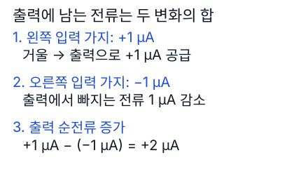

*$G_m$ 측정: 출력 단락이므로 $r_{o3}$ 양단 전압도 0이라 그 가지는 생략했어요. $M_1$의 $r_{o1}$은 유지했어요. 입력의 +/−는 $v_{gs1}=v_{CM}-v_s$를 나타내요.*

$$
v_s=2r_{o5}i_o
$$

$$
i_o=g_{m1}(v_{CM}-v_s)-\frac{v_s}{r_{o1}}
$$

MOS 게이트 전류가 0이므로 드레인에서 들어온 순전류가 그대로 $R_S$로 나가요. $r_{o1}$에는 소스에서 접지된 드레인 쪽으로 $v_s/r_{o1}$이 흘러요. 따라서 이 전류를 제어 전류에서 빼야 해요. 소스 전압 상승이 $v_{gs1}$을 줄이는 것이 축퇴(degeneration)의 핵심이에요.

#### 이렇게 풀어요

먼저 $v_s=2r_{o5}i_o$를 단락 전류식에 넣어 같은 $i_o$ 항끼리 모아요.

$$
i_o=g_{m1}(v_{CM}-2r_{o5}i_o)-\frac{2r_{o5}}{r_{o1}}i_o
$$

$$
i_o\left(1+2g_{m1}r_{o5}+\frac{2r_{o5}}{r_{o1}}\right)=g_{m1}v_{CM}
$$

양변을 입력과 괄호로 나눈 뒤 역수 꼴로 쓰면 어떤 저항 항이 지배하는지 보여요.

$$
G_m=\frac{i_o}{v_{CM}}=\frac{1}{1/g_{m1}+2r_{o5}+2r_{o5}/(g_{m1}r_{o1})}\approx\frac1{2r_{o5}}
$$

$g_{m1}r_{o1}\gg1$, $2g_{m1}r_{o5}\gg1$에서 $2r_{o5}$가 분모를 지배해요.

이제 입력을 0으로 바꾸고 출력에서 저항을 봐요. 아래 그림은 **같은 CM 반회로**의 저항 측정이에요. 원래 두 출력 중 한쪽만 비대칭으로 자극하는 별도 측정과 구별해요. $r_{o3}$는 이번에는 출력–접지 사이 전압이 생기므로 반드시 남겨요.

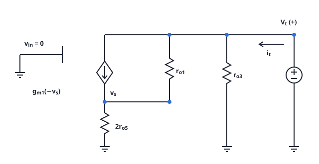

*$R_{out}$ 측정: 게이트 입력을 접지하고 오른쪽 시험원 $V_t$를 걸어요. $i_t$는 출력으로 유입하며 $R_{out}=V_t/i_t$예요. 제어원·$r_{o1}$·출력의 좌우 순서를 유지하고 테일 축퇴를 소스 아래에 두었어요.*

$M_1$ 아래쪽은 소스 축퇴로 저항이 커져요. 큰 곱 항이 지배하는 조건에서 다음 근사를 사용해요.

$$
R_{\downarrow}\approx 2g_{m1}r_{o1}r_{o5}
$$

$$
R_{out}\approx r_{o3}\parallel\left(2g_{m1}r_{o1}r_{o5}\right)\approx r_{o3}
$$

마지막 근사는 $2g_{m1}r_{o1}r_{o5}\gg r_{o3}$일 때예요. 곱 항은 $r_{o1},2r_{o5}$보다 커야 해요.

통상 같은 차수의 $r_o$를 가진 소자와 $g_mr_o\gg1$에서는 아래쪽 저항이 부하보다 훨씬 커서 병렬값은 작은 $r_{o3}$가 정해요. $r_{o3}$가 특별히 큰 설계라면 병렬 근사에서 멈춰야 해요. $R_{out}$은 소자 하나의 $r_o$와 다른 전체 출력 저항이에요.

$$
A_{CM,SE}=-G_mR_{out}\approx-\frac{r_{o3}}{2r_{o5}}
$$

입력이 올라가면 출력에서 아래로 빠지는 전류가 늘어요. 무부하 출력은 그 증가를 부하 전압으로 맞추려고 내려가므로 부호는 음수예요.

#### 완성 답과 검산

**한 출력 기준 공통 모드 이득**은 큰 $g_mr_o$, 몸체 효과 무시 및 $2g_{m1}r_{o1}r_{o5}\gg r_{o3}$에서 다음과 같아요.

$$
\boxed{A_{CM,SE}\approx-\frac{r_{o3}}{2r_{o5}}}
$$

완전 대칭인 원 그림의 두 단자 차동 출력은 $A_{CM,DM}=(v_{out1}-v_{out2})/v_{CM}=0$이에요.

**단위:** $G_m$은 $1/\Omega=\mathrm S$, $R_{out}$은 $\Omega$이므로 곱은 V/V인 무차원 이득이에요. **극한:** 부하 $r_{o3}$를 고정하고 테일 $r_{o5}\to\infty$로 보내면 한 출력의 CM 이득도 0으로 가요.

**대칭:** 두 출력은 같은 음의 이득으로 움직여 서로 빼면 0이에요. 예를 들어 $r_{o3}=r_{o5}$이고 근사 조건이 유지되면 한 출력 이득은 약 $-1/2$지만 차동 CM 이득은 여전히 0이에요. 이 비교는 수치 소자값을 추가한 계산이 아니라 저항비를 확인하는 특수 경우예요.

#### 주의할 점

- CM에서는 테일을 반쪽마다 $2r_{o5}$로 나눠요. $r_{o5}/2$를 붙이면 총전류가 맞지 않아요.
- $\lambda>0$이므로 모든 $r_o$를 지우면 안 돼요. 특히 $r_{o3}$는 $G_m$ 측정에서는 단락 때문에 기여가 0이고, $R_{out}$ 측정에서는 이득을 결정해요.
- $G_m\approx1/(2r_{o5})$는 전체 반회로의 값이에요. $g_{m1}$과 같다고 두면 축퇴가 사라져요.
- 원 그림의 차동 출력과 한 출력 기준 답을 바꾸어 쓰지 않아요. 완전 대칭이면 한 출력의 흔들림이 남아도 두 출력의 차에서는 지워져요.
- $R_{out}\approx r_{o3}$에는 아래쪽 저항이 $r_{o3}$보다 크다는 비교가 필요해요. $g_mr_o\gg1$만으로 임의의 극단적인 소자 저항비까지 보장하지 않아요.

#### 조건을 바꾸어 생각해요

1. 부하 $r_{o3}$와 다른 소신호 파라미터는 고정하고 테일 $r_{o5}$만 2배로 키우면 한 출력 CM 이득의 크기는 어떻게 변할까요? **약 절반**이에요. $G_m$이 절반으로 줄고 $R_{out}\approx r_{o3}$는 유지되기 때문이에요. 바뀐 조건에서도 큰 곱 항 근사가 성립한다고 가정해요.
2. $r_{o3}=r_{o5}$라 한 출력 이득이 약 $-1/2$라면 완전 대칭인 두 출력의 차에도 그 이득이 남을까요? **0이에요.** 두 출력이 같은 양만큼 움직여 뺄셈에서 상쇄되기 때문이에요.

**페이지 요약**

CM 대칭을 이용해 테일을 반쪽마다 $2r_{o5}$로 바꿔요.

#### 측정과 근사

출력 단락에서 $G_m\approx1/(2r_{o5})$를 구해요.

입력 영점에서 아래쪽 저항 $2g_{m1}r_{o1}r_{o5}\gg r_{o3}$이면 $R_{out}\approx r_{o3}$예요.

#### 각 출력의 CM 이득

$$
A_{CM,SE}\approx-r_{o3}/(2r_{o5})
$$

몸체 효과를 생략한 큰 $g_mr_o$ 주항이에요.

완전 대칭 차동 출력의 CM 이득은 0이에요.

---

### P3. 캐스코드 테일의 DM·CM 이득

2018-2_중간-Q3 · 기출 3 · [원 문제 보기](../%EB%B3%B5%EC%8A%B5%EB%AC%B8%EC%A0%9C_1007_Differential_Amplifiers-%EB%AC%B8%EC%A0%9C.pdf)

#### 주어진 조건

- $V_{DD} = 1.8\ \text{V}$
- $I_{D5} = I_{D6} = 1\ \text{mA}$
- $(W/L)_{1,2} = 200/0.2$, $(W/L)_{3,4} = 400/0.2$, $(W/L)_{5,6} = 400/0.2$
- $\mu_n C_{ox} = 100\ \mu\text{A/V}^2$, $\mu_p C_{ox} = 50\ \mu\text{A/V}^2$
- $\lambda_n = \lambda_p = 0.1\ \text{V}^{-1}$
- $g_m r_o \gg 1$로 가정
- 바이어스 전압 $V_{b1}$–$V_{b3}$ 값은 주어지지 않음

#### 구할 것

- (1) 차동 전압 이득
- (2) Common-mode 이득 $A_{CM} = \Delta V_{out,CM}/\Delta V_{in,CM}$

원문 보기

다음 회로에 대해 주어진 조건을 이용하여 질문에 답하시오.

: $V_{DD} = 1.8\ \text{V}$, $I_{D5} = I_{D6} = 1\ \text{mA}$, $(W/L)_{1,2} = 200/0.2$, $(W/L)_{3,4} = 400/0.2$, $(W/L)_{5,6} = 400/0.2$, $\mu_n C_{ox} = 100\ \mu\text{A/V}^2$, $\mu_p C_{ox} = 50\ \mu\text{A/V}^2$, $\lambda_n = \lambda_p = 0.1\ \text{V}^{-1}$. 이 때, $g_m r_o \gg 1$로 가정한다.

(1) 차동 전압 이득을 구하시오.

(2) Common-mode 이득($A_{CM} = \Delta V_{out,CM}/\Delta V_{in,CM}$)을 구하시오.

#### 문제를 읽어요

위의 $M_3,M_4$는 전류원 부하이고, 아래의 $M_5,M_6$는 하나의 캐스코드(cascode) 테일이에요. 평형에서는 테일의 $1\,\mathrm{mA}$가 두 입력 가지로 반씩 나뉘어요. 차동 입력은 두 게이트를 반대 방향으로, 공통 모드 입력은 같은 방향으로 움직여요. 이 차이 때문에 같은 테일도 두 해석에서 다르게 보여요.

왼쪽 출력을 $v_{o1}$, 오른쪽을 $v_{o2}$라고 정하고 $v_{id}=v_{in1}-v_{in2}$, $v_{od}=v_{o1}-v_{o2}$로 써요. (1)은 $v_{od}/v_{id}$이고, (2)는 두 출력의 평균 $v_{out,CM}=(v_{o1}+v_{o2})/2$의 이득이에요. 대칭인 CM 응답에서는 이 평균이 각 출력과 같아요. 바이어스가 모든 MOS를 포화 영역에 두는 저주파 소신호 해석이에요.

#### 이 개념과 공식을 떠올려요

**대칭인 두 입력 가지**에서 반회로(half circuit)를 떠올려요. 차동 모드(differential mode, DM)에서는 두 가지의 전류 변화가 상쇄되어 공통 소스 P가 가상 접지예요. 공통 모드(common mode, CM)에서는 두 가지 전류가 더해져 P가 움직이므로 소스 축퇴(source degeneration)를 남겨야 해요.

$g_m$은 게이트–소스 전압에 대한 드레인 전류의 기울기이고 $r_o=1/(\lambda I_D)$는 채널 길이 변조의 소신호 저항이에요. $R_{SS}$는 P에서 $M_5,M_6$ 쪽을 내려다본 테일 저항이에요. $g_mr_o\gg1$이라는 단서는 캐스코드 저항의 곱 항과 축퇴 이득의 주항을 고르라는 뜻이지, 모든 $r_o$를 없애라는 뜻은 아니에요.

CM에서는 한쪽 전류가 $i$이면 전체 테일 전류는 $2i$예요. 따라서 $v_P=(2i)R_{SS}=i(2R_{SS})$가 되어 반쪽 소스 아래에는 $2R_{SS}$를 붙여요. 게이트를 올리면 소스도 따라 올라가므로 $v_{gs}=v_{CM}-v_P$가 작아지고 출력 변화가 억제돼요. [공통 모드 잡음 설명](../%EC%A0%95%EB%A6%AC%EB%85%B8%ED%8A%B8_1007_Differential_Amplifiers.html#s0-cm-noise)의 각 출력 변화와 차동 출력 상쇄가 이 구분이에요.

#### 종이에 쓸 첫 줄

$V_{DD}$와 이상적인 DC 바이어스 전압은 AC 접지로 보내요. PMOS 부하는 게이트와 소스가 모두 AC 접지여서 $v_{gs3}=0$이고, 소신호에서는 $r_{o3}$가 출력 부하로 남아요. 이것은 PMOS의 DC 전류가 0이라는 말이 아니에요.

DM 자극은 $v_{in1}=v_{id}/2$, $v_{in2}=-v_{id}/2$예요. P는 가상 접지이므로 왼쪽은 부하가 $r_{o1}\parallel r_{o3}$인 공통 소스(common-source, CS) 단이에요.

$$
\frac{v_{o1}}{v_{id}/2}=-g_{m1}(r_{o1}\parallel r_{o3})
$$

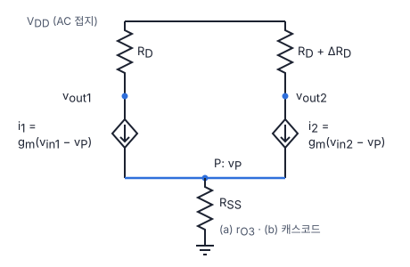

*CM 전압 이득을 구하는 왼쪽 반회로예요. 출력은 외부 무부하이고 $r_{o3}$는 내부 부하예요. 입력 $v_{CM}$은 $M_1$의 게이트 제어 전압을 정하며, $v_{gs1}=v_{CM}-v_P$예요. $r_{o1}$을 포함한 CS 블록에 알려진 축퇴 이득의 큰 $g_mr_o$ 근사를 적용해요. DM에서는 같은 그림의 P를 접지로 바꾸어요.*

캐스코드 테일은 $g_{m5}r_{o5}r_{o6}\gg r_{o5},r_{o6}$에서 알려진 주항 블록으로 써요.

$$
R_{SS}\approx g_{m5}r_{o5}r_{o6}
$$

CM 반회로는 소스 아래 $2R_{SS}$를 둔 축퇴 CS 단이에요. 큰 $g_{m1}r_{o1}$, $2g_{m1}R_{SS}\gg1$ 및 $r_{o3}/(2R_{SS})\ll g_{m1}r_{o1}$의 주항 이득을 바로 적용해요. 이는 유한 $r_{o1}$ 모델의 주항 근사예요.

$$
A_{CM}\approx-\frac{r_{o3}}{2R_{SS}}
$$

알려진 CS 전압 이득과 캐스코드 블록을 같은 반회로에 적용해요. 출력 무부하·내부 부하·소스 축퇴 조건을 확인한 뒤 수업의 큰 곱 근사로 계산해요.

#### 이렇게 풀어요

#### (1) 차동 전압 이득

대칭인 평형 상태에서 입력쌍과 PMOS 부하의 전류는 각각 테일 전류의 절반이에요. 먼저 $100\,\mu\mathrm{A/V^2}=0.1\,\mathrm{mA/V^2}$로 바꾸어요.

$$
I_{D1}=I_{D2}=I_{D3}=I_{D4}=\frac{1\,\mathrm{mA}}2=0.5\,\mathrm{mA}
$$

$$
g_{m1}=g_{m2}=\sqrt{2(0.1\,\mathrm{mA/V^2})(200/0.2)(0.5\,\mathrm{mA})}=10\,\mathrm{mS}
$$

$$
r_{o1}=r_{o2}=r_{o3}=r_{o4}=\frac1{(0.1\,\mathrm{V^{-1}})(0.5\,\mathrm{mA})}=20\,\mathrm{k\Omega}
$$

PMOS와 NMOS의 이동도 계수는 다르지만 여기서는 $\lambda$와 가지 전류가 같아서 $r_o$가 같아요. $g_{m3}$는 바이어스가 AC 접지된 부하의 이득 계산에 필요하지 않아요.

$$
r_{o1}\parallel r_{o3}=20\,\mathrm{k\Omega}\parallel20\,\mathrm{k\Omega}=10\,\mathrm{k\Omega}
$$

$$
v_{o1}=-g_{m1}(r_{o1}\parallel r_{o3})\frac{v_{id}}2
$$

$$
v_{o2}=+g_{m1}(r_{o1}\parallel r_{o3})\frac{v_{id}}2
$$

$$
A_{DM}=\frac{v_{o1}-v_{o2}}{v_{id}}=-g_{m1}(r_{o1}\parallel r_{o3})=-(10\,\mathrm{mS})(10\,\mathrm{k\Omega})=-100
$$

출력 차를 구할 때 두 출력이 반대 위상이라 두 배가 돼요. 이것이 입력을 반으로 나눈 $1/2$를 없애므로, 최종 차동 이득에 $1/2$를 남기지 않아요.

#### (2) 공통 모드 이득

$$
g_{m5}=g_{m6}=\sqrt{2(0.1\,\mathrm{mA/V^2})(400/0.2)(1\,\mathrm{mA})}=20\,\mathrm{mS}
$$

$$
r_{o5}=r_{o6}=\frac1{(0.1\,\mathrm{V^{-1}})(1\,\mathrm{mA})}=10\,\mathrm{k\Omega}
$$

$$
g_{m5}r_{o6}=(20\,\mathrm{mS})(10\,\mathrm{k\Omega})=200\gg1
$$

$$
R_{SS}\approx(20\,\mathrm{mS})(10\,\mathrm{k\Omega})(10\,\mathrm{k\Omega})=2000\,\mathrm{k\Omega}=2\,\mathrm{M\Omega}
$$

$M_5$는 테일의 위쪽 캐스코드 소자이고, $M_6$의 $r_{o6}$가 그 소스 아래에 보여요. 따라서 입력쌍의 $g_{m1}$이 아니라 테일 소자 $g_{m5}$를 저항의 곱 항에 써요.

소스 축퇴가 큰 CS 블록은 입력 전압 대부분을 소스 전압 상승으로 되돌려요. $g_{m1}r_{o1}=200\gg1$이고 $r_{o3}/(2R_{SS})=5\times10^{-3}\ll1$이므로, 유한 $r_{o1}$을 가진 모델에서도 위 첫 식의 주항으로 줄일 수 있어요. $r_{o1}$을 처음부터 무한대로 둔 정확식이라고 해석하지 않아요.

$$
\frac1{g_{m1}}=\frac1{10\,\mathrm{mS}}=0.1\,\mathrm{k\Omega}
$$

$$
2R_{SS}\approx4000\,\mathrm{k\Omega}\gg0.1\,\mathrm{k\Omega}
$$

$$
A_{CM}\approx-\frac{20\,\mathrm{k\Omega}}{4000\,\mathrm{k\Omega}}=-5\times10^{-3}
$$

양쪽 출력이 같은 만큼 내려가므로 평균 출력의 이득도 이 값이에요. 두 출력의 차에 대한 CM 이득은 대칭에 의해 0이지만, 문제에서 구하는 $A_{CM}$은 그 차가 아니에요.

#### 완성 답과 검산

#### (1) 차동 전압 이득

**$A_{DM}=-100\,\mathrm{V/V}$**예요. 왼쪽−오른쪽 출력과 왼쪽−오른쪽 입력을 사용한 대칭 소신호 이득이에요.

$\mathrm{mS}\times\mathrm{k\Omega}=1$이므로 전압 이득은 무차원이에요. 왼쪽 입력이 올라가면 왼쪽 드레인 전류가 증가하고 출력이 내려가므로 음의 부호가 맞아요. 반회로 하나를 $v_{id}$로 나눈 이득은 $-50$이지만, 반대 위상의 오른쪽 출력까지 빼면 $-100$이에요.

#### (2) 공통 모드 이득

**$A_{CM}\approx-5\times10^{-3}\,\mathrm{V/V}$**예요. $g_mr_o\gg1$의 주항, 캐스코드 테일 $R_{SS}\approx2\,\mathrm{M\Omega}$, 완전 대칭인 포화 소신호 동작 조건이에요.

$20\,\mathrm{k\Omega}/4000\,\mathrm{k\Omega}=5\times10^{-3}$이라 차수와 단위가 맞아요. 양쪽 입력이 함께 올라가면 테일 전류가 조금 증가하고 두 출력이 함께 내려가므로 부호는 음이에요. $R_{SS}\to\infty$이면 $A_{CM}\to0$으로 이상적인 테일의 동작에 가까워져요. 유한한 테일이어도 $v_{o1}=v_{o2}$이므로 CM 입력에 대한 $v_{od}$는 0이에요.

#### 주의할 점

- $1\,\mathrm{mA}$는 테일 전류예요. 입력 MOS에 그대로 넣으면 $g_{m1}$과 $r_{o1}$을 모두 잘못 구해요.
- CM 반회로에서 $R_{SS}$를 그대로 붙이면 테일 전류를 반으로 잘못 세어요. 반쪽 저항은 $2R_{SS}$예요.
- $g_mr_o\gg1$은 캐스코드 주항을 고르는 조건이에요. DM 부하의 $r_{o1}\parallel r_{o3}$를 지우거나 CM 주항식을 유한 $r_o$의 정확식이라고 쓰면 안 돼요.
- 각 출력에 CM 변화가 남는 것과 차동 출력에 CM 변화가 남는 것을 구분해요. 이 문제의 $A_{CM}$을 0으로 답하면 평균 출력과 차동 출력을 혼동한 것이에요.

#### 조건을 바꾸어 생각해요

1. 동작 전류·입력쌍·부하를 유지하고 테일 저항만 두 배로 키우면 $A_{DM}$과 $A_{CM}$은 각각 어떻게 변할까요?
2. 입력은 같은 CM 자극 그대로 두고, 관측 출력을 평균 대신 왼쪽−오른쪽 차로 바꾸면 대칭 회로의 이득은 얼마일까요?

**페이지 요약**

DM은 P를 가상 접지로, CM은 소스 아래를 $2R_{SS}$로 두어요.

#### 캐스코드 테일

$$
R_{SS}\approx g_{m5}r_{o5}r_{o6}=2\,\mathrm{M\Omega}
$$

#### 두 자극의 이득

$$
A_{DM}=-g_{m1}(r_{o1}\parallel r_{o3})=-100
$$

$$
A_{CM}\approx-\frac{r_{o3}}{2R_{SS}}
$$

큰 $g_mr_o$ 주항에서 각 출력의 $A_{CM}\approx-5\times10^{-3}$예요.

완전 대칭 차동 출력의 CM 이득은 0이에요.

---

### P4. 공통 모드 제거와 부하 불일치

2018-2_중간-Q4 · 기출 4 · [원 문제 보기](../%EB%B3%B5%EC%8A%B5%EB%AC%B8%EC%A0%9C_1007_Differential_Amplifiers-%EB%AC%B8%EC%A0%9C.pdf)

#### 주어진 조건

- $V_{DD} = 1.8\ \text{V}$, $I_{D3} = 1\ \text{mA}$
- $(W/L)_{1,2} = 200/0.2$, $(W/L)_3 = 400/0.2$
- $R_D = 1\ \text{k}\Omega$, $\Delta R_D = 0.02R_D = 20\ \Omega$
- $\mu_n C_{ox} = 100\ \mu\text{A/V}^2$, $\lambda_n = 0.1\ \text{V}^{-1}$
- $r_o \gg R_D$이고 $g_m r_o \gg 1$로 가정
- (1)은 회로 값을 쓰지 않는 서술형 소문항
- 바이어스 전압 $V_{b1}$ 값은 주어지지 않음

#### 구할 것

- (1) Differential pair에서 "common-mode (CM) rejection" 특성의 의미를 설명. 그리고 실제 회로에서 CM rejection 특성이 제한되는 이유 2가지를 설명
- (2) Common-mode input to differential-mode output 이득 $A_{CM-DM} = \Delta V_{out}/\Delta V_{in,CM}$

원문 보기

다음 회로에 대해 주어진 조건을 이용하여 질문에 답하시오.

: $V_{DD} = 1.8\ \text{V}$, $I_{D3} = 1\ \text{mA}$, $(W/L)_{1,2} = 200/0.2$, $(W/L)_3 = 400/0.2$, $R_D = 1\ \text{k}\Omega$, $\Delta R_D = 0.02R_D = 20\ \Omega$, $\mu_n C_{ox} = 100\ \mu\text{A/V}^2$, $\lambda_n = 0.1\ \text{V}^{-1}$, $r_o \gg R_D$이고 $g_m r_o \gg 1$로 가정한다.

(1) Differential pair에서 "common-mode (CM) rejection" 특성의 의미를 설명하고, 실제 회로에서 CM rejection 특성이 제한되는 이유 2가지를 설명하시오.

(2) Common-mode input to differential-mode output 이득($A_{CM-DM} = \Delta V_{out}/\Delta V_{in,CM}$)을 구하시오.

#### 문제를 읽어요

두 입력에 함께 들어온 변화가 두 출력을 얼마나 다르게 만드는지 묻는 문제예요. (1)은 CM 제거의 의미와 실제 한계 두 가지를 설명하고, (2)는 오른쪽 저항이 $20\,\Omega$ 더 클 때 차동 누출을 계산해요. 출력은 $v_{od}=v_{o1}-v_{o2}$, 입력 CM 변화는 두 게이트에 같은 $v_{CM}$으로 정의해요.

#### 이 개념과 공식을 떠올려요

두 게이트가 같이 움직이는 단서에서 공통 모드 반회로(CM half circuit)를 떠올려요. 대칭 CM에서는 한 가지 전류가 $i$일 때 꼬리에는 $2i$가 흘러 $v_P=(2i)R_{SS}=i(2R_{SS})$예요. 따라서 반쪽 소스 아래 저항은 $2R_{SS}$예요. 소스가 따라 올라가 $v_{gs}=v_{CM}-v_P$를 줄이는 소스 축퇴(source degeneration)가 CM 전류 변화를 억제해요.

$g_m$은 입력 MOS 한 개의 전류 변화율이고 $R_{SS}=r_{o3}=1/(\lambda_n I_{D3})$는 테일 출력저항이에요. 원문이 $r_o\gg R_D$를 주므로 입력쌍 $r_{o1},r_{o2}$는 생략하되 테일 저항은 유지해요. 그러면 서로 다른 부하에서도 두 가지 전류가 같아 반회로의 전류를 두 부하에 각각 적용할 수 있어요.

#### 종이에 쓸 첫 줄

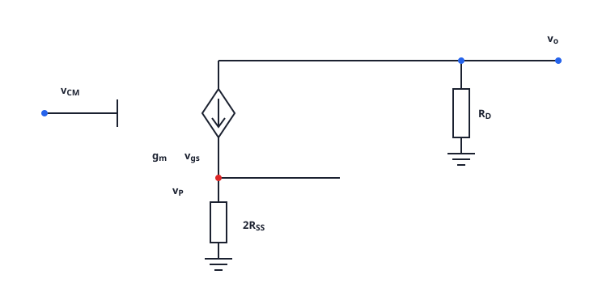

*두 입력에 같은 $v_{CM}$을 가해요. 전원과 고정 바이어스는 AC 접지이고 출력은 단락하지 않아요. $v_{gs}=v_{CM}-v_P$이며 입력쌍의 $r_o$를 생략한 수업 모델이에요. 반쪽 소스 아래의 $2R_{SS}$는 공유 꼬리를 나눈 값이에요.*

저항 부하 $R_D$ 또는 $R_D+\Delta R_D$만 바꾸며 같은 입력쌍 전류 변환율을 사용해요. 각 출력은 전류가 증가하면 내려가요.

$$
i=g_m(v_{CM}-2R_{SS}i)
$$

$$
\frac{i}{v_{CM}}=\frac{1}{1/g_m+2R_{SS}}\approx\frac1{2R_{SS}}
$$

#### 이렇게 풀어요

#### (1) CM 제거의 의미와 두 한계

CM 제거는 두 입력에 똑같이 더해진 잡음·간섭이 차동 출력에 나타나지 않도록 억제하는 성질이에요. 실제 한계는 ① 테일 전류원의 출력저항이 유한해 CM 입력에 따라 가지 전류가 변하는 것, ② 부하 저항·문턱전압·$g_m$의 불일치가 그 변화를 서로 다른 출력으로 바꾸는 것이에요.

유한 테일만 있고 두 가지가 완전히 같다면 각 출력은 움직여도 차에서는 지워져요. 유한 테일 저항 하나만으로 대칭 회로의 CM-to-DM 이득이 생긴다고 설명하지 않아요.

#### (2) CM-to-DM 이득

$$
100\,\mu\mathrm{A/V^2}=0.1\,\mathrm{mA/V^2}
$$

$$
I_{D1}=I_{D2}=0.5\,\mathrm{mA}
$$

$$
g_m=\sqrt{2(0.1)(200/0.2)(0.5)}=10\,\mathrm{mS}
$$

$$
R_{SS}=\frac1{(0.1)(1\,\mathrm{mA})}=10\,\mathrm{k\Omega}
$$

$2g_mR_{SS}=200\gg1$이므로 큰 축퇴 주항을 써요. 오른쪽 저항이 더 커 같은 전류 증가에 오른쪽 출력이 더 많이 내려가요.

$$
v_{o1}=-R_Di
$$

$$
v_{o2}=-(R_D+\Delta R_D)i
$$

$$
v_{od}=\Delta R_Di
$$

$$
A_{CM-DM}\approx\frac{\Delta R_D}{2R_{SS}}
$$

$$
A_{CM-DM}\approx\frac{0.02\,\mathrm{k\Omega}}{20\,\mathrm{k\Omega}}=+10^{-3}
$$

#### 완성 답과 검산

#### (1) 의미 검산

두 입력에 함께 실린 변화를 차동 출력에서 억제해요. 유한한 테일 출력저항과 좌우 소자·부하 불일치가 실제 제거 성능을 제한해요.

부하·소자가 완전히 맞으면 같은 출력 변화의 차는 0이 되어 정의와 맞아요.

#### (2) 누출의 단위·부호

$A_{CM-DM}\approx+10^{-3}\,\mathrm{V/V}$예요. 왼쪽−오른쪽 출력, 입력쌍 $r_o$ 생략 및 큰 축퇴 주항 조건이에요.

저항/저항은 무차원이에요. $\Delta R_D\to0$ 또는 $R_{SS}\to\infty$이면 누출이 0이에요. $1/g_m$까지 남기는 식은 $9.95\times10^{-4}$이지만 여기서는 사용자 수업 기본인 큰 축퇴 주항으로 정리했어요.

#### 주의할 점

입력쌍의 $r_o$를 생략하는 조건을 테일에 적용하지 않아요. 테일도 이상화하면 이 문제의 누출을 없애 버려요. $A_{CM}$은 한 출력의 변화, $A_{CM-DM}$은 두 출력 차의 변화라는 구분을 유지해요.

#### 조건을 바꾸어 생각해요

1. 두 부하를 완전히 같게 하되 테일 저항은 그대로 두면 각 출력과 차동 출력의 CM 응답은 각각 어떻게 될까요?
2. 바이어스와 다른 소자를 유지하며 저항 차이만 절반으로 줄이면 누출 이득은 어떻게 변할까요?

**페이지 요약**

CM 제거는 함께 들어온 입력 변화를 차동 출력에서 억제하는 성질이에요.

#### 제한되는 이유

유한 테일 출력저항과 좌우 소자·부하 불일치가 제거 성능을 제한해요.

#### 부하 불일치의 누출

입력쌍 $r_o$를 생략하면 부하가 달라도 CM 가지 전류가 같아요.

$$
v_{od}=\Delta R_Di
$$

큰 축퇴 주항에서 왼쪽−오른쪽 누출은 $A_{CM-DM}\approx+10^{-3}$예요.

---

### P5. MOS 차동쌍의 입력 범위와 CMRR

2023-1_중간-Q4 · 기출 4 · [원 문제 보기](../%EB%B3%B5%EC%8A%B5%EB%AC%B8%EC%A0%9C_1007_Differential_Amplifiers-%EB%AC%B8%EC%A0%9C.pdf)

#### 주어진 조건

- $V_{DD} = 1.8\ \text{V}$, $I_{D3} = 1\ \text{mA}$
- $R_D = 1\ \text{k}\Omega$, $\Delta R_D = 20\ \Omega$
- $(W/L)_{1,2} = 200/0.2$, $(W/L)_3 = 400/0.2$
- $V_{TH,n} = 0.4\ \text{V}$, $\mu_n C_{ox} = 100\ \mu\text{A/V}^2$, $\lambda_n = 0.1\ \text{V}^{-1}$
- $g_m r_o \gg 1$로 가정
- 바이어스 전압 $V_{b1}$ 값은 주어지지 않음

#### 구할 것

- (1) 입력 common-mode level $V_{CM,in}$의 최대값과 최소값
- (2) Common-mode 이득 $A_{CM}$과 common-mode to differential-mode 변환 이득 $A_{CM-DM}$
- (3) Common-mode rejection ratio (CMRR)

원문 보기

다음 차동 증폭기에 대해 주어진 조건을 이용하여 질문에 답하시오.

: $V_{DD} = 1.8\ \text{V}$, $I_{D3} = 1\ \text{mA}$, $R_D = 1\ \text{k}\Omega$, $\Delta R_D = 20\ \Omega$, $(W/L)_{1,2} = 200/0.2$, $(W/L)_3 = 400/0.2$, $V_{TH,n} = 0.4\ \text{V}$, $\mu_n C_{ox} = 100\ \mu\text{A/V}^2$, $\lambda_n = 0.1\ \text{V}^{-1}$. 단, $g_m r_o \gg 1$로 가정한다.

(1) 입력 common-mode level($V_{CM,in}$)의 최대값과 최소값을 각각 구하시오.

(2) Common-mode 이득($A_{CM}$)과 common-mode to differential-mode 변환 이득($A_{CM-DM}$)을 각각 구하시오.

(3) Common-mode rejection ratio(CMRR)를 구하시오.

#### 문제를 읽어요

같은 회로로 DC 허용 범위와 작은 신호의 누출을 모두 묻고 있어요. (1)은 모든 MOS가 포화에 남는 입력 CM 구간, (2)는 한 출력의 CM 이득과 두 출력 차의 누출, (3)은 원하는 차동 이득과 누출의 비예요. $A_{CM}$은 왼쪽 출력 $v_{o1}$, 차동 출력은 왼쪽−오른쪽으로 정해요.

DC는 제곱법칙에서 CLM 보정인자를 생략하는 수업 근사를 사용해요. 이득에서는 입력쌍 $r_o=20\,\mathrm{k\Omega}$가 $R_D=1\,\mathrm{k\Omega}$보다 크다는 추가 근사를 명시해 두 입력쌍 $r_o$를 일관되게 생략해요. 테일 $r_{o3}$는 남기며 모든 결과는 이 수업 모델의 주항이에요.

#### 이 개념과 공식을 떠올려요

두 게이트가 같이 움직이는 단서에서 공통 모드 반회로(CM half circuit)를 떠올려요. 대칭 CM에서는 한 가지 전류가 $i$일 때 꼬리에는 $2i$가 흘러 $v_P=(2i)R_{SS}=i(2R_{SS})$예요. 따라서 반쪽 소스 아래 저항은 $2R_{SS}$예요. 소스가 따라 올라가 $v_{gs}=v_{CM}-v_P$를 줄이는 소스 축퇴(source degeneration)가 CM 전류 변화를 억제해요.

CM 입력 범위는 입력 MOS와 테일 MOS의 포화 조건으로 양 끝을 따로 구해요. NMOS 포화는 $V_{DS}\ge V_{OV}$ 또는 $V_D\ge V_G-V_{TH}$예요. CMRR은 같은 차동 출력에서 $|A_{DM}|/|A_{CM-DM}|$로 정의해요. 불일치는 작으므로 분자의 차동 이득은 대칭 기준값을 써요.

#### 종이에 쓸 첫 줄

먼저 $I_D=I_{D3}/2$로 나누어 각 소자 오버드라이브를 구해요. DC 경계와 AC 변화량을 같은 전압으로 혼동하지 않아요.

$$
I_D=0.5\,\mathrm{mA}
$$

$$
\mu_nC_{ox}=0.1\,\mathrm{mA/V^2}
$$

$$
V_{OV1}=\sqrt{\frac{2(0.5)}{(0.1)(200/0.2)}}=0.1\,\mathrm V
$$

$$
V_{OV3}=\sqrt{\frac{2(1)}{(0.1)(400/0.2)}}=0.1\,\mathrm V
$$

$$
g_m=\frac{2(0.5\,\mathrm{mA})}{0.1\,\mathrm V}=10\,\mathrm{mS}
$$

$$
R_{SS}=r_{o3}=10\,\mathrm{k\Omega}
$$

*두 입력에 같은 $v_{CM}$을 가해요. 전원과 고정 바이어스는 AC 접지이고 출력은 단락하지 않아요. $v_{gs}=v_{CM}-v_P$이며 입력쌍의 $r_o$를 생략한 수업 모델이에요. 반쪽 소스 아래의 $2R_{SS}$는 공유 꼬리를 나눈 값이에요.*

$$
\frac{i}{v_{CM}}=\frac1{1/g_m+2R_{SS}}\approx\frac1{2R_{SS}}
$$

#### 이렇게 풀어요

#### (1) 입력 CM 범위

아래 한계는 테일 $M_3$의 포화가 정해요. 공통 소스 $P$가 $V_{OV3}$ 이상이어야 하고, 입력 게이트는 그보다 $V_{GS1}=V_{TH}+V_{OV1}$ 높아요.

$$
V_P=V_{CM,in}-(V_{TH}+V_{OV1})\ge V_{OV3}
$$

$$
V_{CM,in,min}=0.4+0.1+0.1=0.6\,\mathrm V
$$

큰 오른쪽 부하가 더 낮은 드레인 전압을 만들므로 입력쌍 포화 상한을 먼저 제한해요.

$$
V_{D2}=1.8-(0.5\,\mathrm{mA})(1.02\,\mathrm{k\Omega})=1.29\,\mathrm V
$$

$$
V_{CM,in}\le V_{D2}+V_{TH}=1.69\,\mathrm V
$$

두 경계 등호는 포화가 막 유지되는 경계예요. 실제 증폭에는 여유를 두어 경계 안쪽에서 동작시켜요.

#### (2) 한 출력 CM 이득과 차동 누출

수업 모델에서 두 가지 CM 전류는 같아요. 출력 변화는 각각 부하 저항에 음의 전류 변화를 곱한 값이에요.

$$
A_{CM,1}\approx-\frac{R_D}{2R_{SS}}=-0.05
$$

$$
A_{CM,2}\approx-\frac{R_D+\Delta R_D}{2R_{SS}}=-5.1\times10^{-2}
$$

$$
A_{CM-DM}=A_{CM,1}-A_{CM,2}\approx+10^{-3}
$$

평균 출력의 CM 이득을 정의했다면 두 이득의 평균 $-5.05\times10^{-2}$예요. 원문이 한쪽 출력 선택을 지정하지 않아 여기서는 왼쪽 기준을 명시해요.

#### (3) CMRR

분자와 분모를 같은 차동 출력으로 맞춰요. 작은 부하 불일치에서 분자는 수업의 대칭 기준 차동 이득이에요.

$$
A_{DM}\approx-g_mR_D=-(10\,\mathrm{mS})(1\,\mathrm{k\Omega})=-10
$$

$$
\mathrm{CMRR}\approx\frac{10}{10^{-3}}=10000
$$

$$
\mathrm{CMRR}_{dB}\approx20\log_{10}(10000)=80\,\mathrm{dB}
$$

#### 완성 답과 검산

#### (1) DC 범위 확인

$0.6\,\mathrm V\le V_{CM,in}\le1.69\,\mathrm V$예요. 제곱법칙 DC·포화 경계 기준이며 증폭에는 경계 안쪽 여유가 필요해요.

최솟값에서 $V_P=0.1$ V라 테일 포화 경계, 최댓값에서 오른쪽 $V_{GD2}=0.4$ V라 입력 포화 경계가 맞아요.

#### (2) CM 이득과 부호 확인

왼쪽 기준 $A_{CM}\approx-0.05$, 왼쪽−오른쪽 차동 누출 $A_{CM-DM}\approx+10^{-3}$예요. 입력쌍 $r_o$ 생략·큰 축퇴 모델이에요.

오른쪽 출력이 더 많이 내려가므로 차동 누출은 양수예요. 부하 차이가 0이면 차동 누출은 지워져도 각 출력 CM 이득은 남아요.

#### (3) 비와 단위 확인

작은 불일치·대칭 기준 DM 이득·큰 축퇴 주항에서 CMRR $\approx10000$ 또는 $80\,\mathrm{dB}$예요.

이득 비는 무차원이며 $10^4$의 전압비는 80 dB예요. 입력쌍 $r_o$와 불일치의 DM 보정을 모두 포함한 다른 모델의 값과 섞지 않아요.

#### 주의할 점

입력 CM 범위와 차동 입력 범위는 다른 질문이에요. 상한은 더 낮은 오른쪽 드레인으로 판단해요. $A_{CM}$을 CMRR 분모에 넣으면 단일 출력 이득과 차동 누출을 섞게 돼요. $g_mr_o\gg1$만으로 입력 $r_o$ 생략이 보장되지는 않으며, 여기서는 $r_o/R_D=20$을 이용한 별도 수업 근사예요.

#### 조건을 바꾸어 생각해요

1. 부하 차이를 20 Ω에서 10 Ω로 줄이되 바이어스와 다른 값은 같다면 CMRR은 얼마일까요?
2. 입력 CM을 1.7 V로 올리면 먼저 포화 경계를 벗어나는 입력 소자는 어느 쪽일까요?

**페이지 요약**

CM 입력 범위는 테일 MOS와 입력 MOS의 포화 경계로 정해요.

#### 입력 범위

제곱법칙 DC의 CM 범위는 0.6–1.69 V예요.

#### CM 이득과 CMRR

입력쌍 $r_o$ 생략·큰 축퇴 모델에서 왼쪽 $A_{CM}\approx-0.05$예요.

왼쪽−오른쪽 누출은 $A_{CM-DM}\approx+10^{-3}$예요.

작은 불일치에서 대칭 기준 DM 이득을 쓰면 CMRR은 약 10000, 80 dB예요.

---

### P6. CMRR로 정하는 부하 오차

2015-1_중간-Q4 · 기출 4 · [원 문제 보기](../%EB%B3%B5%EC%8A%B5%EB%AC%B8%EC%A0%9C_1007_Differential_Amplifiers-%EB%AC%B8%EC%A0%9C.pdf)

#### 주어진 조건

- $\mu_n C_{ox} = 100\ \mu\text{A/V}^2$, $\mu_p C_{ox} = 50\ \mu\text{A/V}^2$ (원문 표기는 uA/V²)
- $\lambda_n = 0.1\ \text{V}^{-1}$, $\lambda_p = 0.2\ \text{V}^{-1}$
- $V_{TH,N} = 0.4\ \text{V}$
- $R_D = 10\ \text{k}\Omega$, $I_{D3} = 0.2\ \text{mA}$
- $(W/L)_1 = (W/L)_2 = 50$
- 2) 전용: $\Delta R_D = 0$
- 3) 전용: $\Delta R_D = 0$
- 4) 전용: $\Delta R_D = 100\ \Omega$
- 5) 전용: common-mode rejection ratio (CMRR) $= 30000$
- $V_{DD}$, 바이어스 전압 $V_{b1}$, $(W/L)_3$ 값은 주어지지 않음

#### 구할 것

- 1) (W/L)를 두 배로 하면 차동 입력 범위가 늘어나는지 O / X로 답함
- 2) $\Delta R_D = 0$일 때 차동 이득 $A_{DM}$
- 3) $\Delta R_D = 0$일 때 common-mode 이득 $A_{CM}$
- 4) $\Delta R_D = 100\ \Omega$일 때 common-mode to differential 이득 $A_{CM-DM}$
- 5) CMRR이 30000이 되는 $\Delta R_D$

원문 보기

With device parameters,

$\mu_n C_{ox} = 100\ \text{uA/V}^2$, $\mu_p C_{ox} = 50\ \text{uA/V}^2$, $\lambda_n=0.1\ \text{V}^{-1}$, $\lambda_p=0.2\ \text{V}^{-1}$, $V_{TH,N} =0.4\text{V}$, $R_D=10\text{kohm}$, $I_{D3}=0.2\text{mA}$

$(W/L)_1=(W/L)_2=50$

1) Doubling (W/L) increases differential input range ( O / X ) (5pt)

2) Calculate differential gain $A_{DM}$ when $\Delta R_D=0$ (5pt)

3) Calculate common-mode gain $A_{CM}$ when $\Delta R_D=0$ (5pt)

4) Calculate common-mode to differential gain $A_{CM-DM}$ when $\Delta R_D=100\text{ohm}$ (5pt)

5) Calculate $\Delta R_D$ if common-mode rejection ratio is 30000. (10pt)

#### 문제를 읽어요

입력쌍 크기를 바꾸는 판단, 대칭 회로의 두 이득, 부하 불일치의 누출, 목표 CMRR에서 허용 저항 차이까지 다섯 질문이에요. (1)의 $(W/L)$는 제시된 입력쌍 $M_1,M_2$의 크기로 읽고 테일 전류 $I_{D3}=0.2$ mA는 고정해요. 출력 차는 왼쪽−오른쪽으로 정해요.

이 문제의 입력 $r_o$는 $100$ kΩ, 부하는 $10$ kΩ예요. $g_mr_o=100\gg1$이어도 $r_o$가 부하의 10배라는 유한 비는 차동 이득에 남길 수 있어요. 본풀이는 입력 $r_o$를 유지하고, CM에서는 큰 축퇴 및 작은 불일치 주항을 일관되게 사용해요. DC 바이어스는 참고답과 같이 CLM 보정을 생략한 제곱법칙이에요.

#### 이 개념과 공식을 떠올려요

두 게이트가 같이 움직이는 단서에서 공통 모드 반회로(CM half circuit)를 떠올려요. 대칭 CM에서는 한 가지 전류가 $i$일 때 꼬리에는 $2i$가 흘러 $v_P=(2i)R_{SS}=i(2R_{SS})$예요. 따라서 반쪽 소스 아래 저항은 $2R_{SS}$예요. 소스가 따라 올라가 $v_{gs}=v_{CM}-v_P$를 줄이는 소스 축퇴(source degeneration)가 CM 전류 변화를 억제해요.

입력 소자의 $r_o$는 $R_D$에 비해 무한히 크지 않으므로 차동 부하와 불일치 변환에 유지해요. 대칭 CM 이득은 반회로로 계산하고, 부하가 달라지면 $r_o$ 전류 때문에 두 순 드레인 전류가 같다는 전제를 그대로 쓰지 않아요. 이때는 두 가지를 공유 소스에 연결한 모델로 돌아가요. $g_mr_o\gg1$, $2g_mR_{SS}\gg1$의 수업 주항은 쓰되 $R_D/r_o$ 자체를 0으로 두지는 않아요.

입력쌍의 한쪽이 꺼지는 차동 경계는 $\sqrt{2I_{SS}/[\mu_nC_{ox}(W/L)]}$예요. 이는 선형성이 유지되는 끝점과 같지 않아요. CMRR은 같은 차동 출력의 원하는 이득과 CM 누출의 크기 비예요.

#### 종이에 쓸 첫 줄

$$
\mu_nC_{ox}=0.1\,\mathrm{mA/V^2}
$$

$$
I_D=I_{SS}/2=0.1\,\mathrm{mA}
$$

$$
g_m=\sqrt{2(0.1)(50)(0.1)}=1\,\mathrm{mS}
$$

$$
r_o=r_{o1}=r_{o2}=\frac1{(0.1)(0.1\,\mathrm{mA})}=100\,\mathrm{k\Omega}
$$

$$
R_{SS}=r_{o3}=50\,\mathrm{k\Omega}
$$

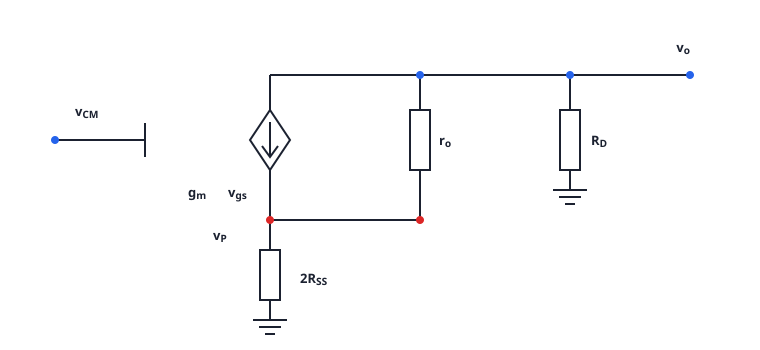

*두 입력에 같은 $v_{CM}$을 가해요. 전원과 고정 바이어스는 AC 접지이고 출력은 단락하지 않아요. $v_{gs}=v_{CM}-v_P$이며 입력 소자의 $r_o$도 드레인–소스 사이에 남겨요. 반쪽 소스 아래의 $2R_{SS}$는 공유 꼬리를 나눈 값이에요.*

대칭 CM에서는 반쪽 소스 아래 $2R_{SS}$예요. $r_o$를 포함한 CS 축퇴 이득에 큰 $g_mr_o$·큰 $2g_mR_{SS}$를 적용하면 CM 주항은 다음과 같아요.

$$
A_{CM}\approx-\frac{R_D}{2R_{SS}}
$$

#### 이렇게 풀어요

#### (1) 입력쌍 크기와 차동 입력 범위

$$
|v_{id}|_{cutoff}=\sqrt{\frac{2(0.2)}{(0.1)(50)}}\,\mathrm V=\sqrt{0.08}\,\mathrm V\approx0.28\,\mathrm V
$$

$$
|v_{id}|_{cutoff,new}=\frac{|v_{id}|_{cutoff}}{\sqrt2}=0.2\,\mathrm V
$$

입력 범위는 오히려 줄어드므로 **X**예요. 테일 소자 폭을 늘리고 전류도 늘어나는 앞 유형과 고정 조건이 달라요.

#### (2) 차동 이득

대칭 DM에서는 공통 소스가 가상 접지라 입력 $r_o$와 $R_D$가 같은 출력–접지 사이 병렬이에요. 두 출력 차를 취하면 입력의 절반 인자가 없어져요.

$$
R_D\parallel r_o=\frac{10\times100}{10+100}\,\mathrm{k\Omega}=\frac{100}{11}\,\mathrm{k\Omega}
$$

$$
A_{DM}=-g_m(R_D\parallel r_o)=-\frac{100}{11}\approx-9.09
$$

#### (3) 대칭 공통 모드 이득

$\Delta R_D=0$이고 $2g_mR_{SS}=100\gg1$, $g_mr_o=100\gg1$이에요. 각 출력의 주항을 써요.

$$
A_{CM}\approx-\frac{10\,\mathrm{k\Omega}}{100\,\mathrm{k\Omega}}=-0.1
$$

두 출력의 CM 변화는 같아 차동 출력의 CM 이득은 0이에요. 여기서 말하는 $A_{CM}$은 각 출력 기준이에요.

#### (4) 유한 입력 출력저항과 CM-to-DM 변환

*불일치가 있을 때 유지하는 전체 소신호 연결이에요. 두 제어 전압은 모두 $v_{CM}-v_P$이지만 드레인 전압은 달라 $r_o$ 전류와 순 드레인 전류가 서로 다를 수 있어요. 두 가지가 공유하는 것은 실제 $R_{SS}$이고, 이 그림에 $2R_{SS}$를 두 번 넣지 않아요. 출력 전압은 두 오른쪽 노드에서 읽어요.*

드레인–소스의 $r_o$ 전류를 유지해요. $j=1,2$에서 게이트 전압은 $v_{CM}$, 공통 소스는 $v_P$예요. 드레인에서 아래로 흐르는 순 전류를 $i_j$로 정의하면 각 소자의 제어 전류와 저항 전류를 합쳐요.

$$
i_j=g_m(v_{CM}-v_P)+\frac{v_{oj}-v_P}{r_o}
$$

$$
\frac{v_{oj}}{R_j}+i_j=0
$$

$$
\frac{v_P}{R_{SS}}=i_1+i_2
$$

각 출력 부하와 $r_o$를 묶어 $Z_j=R_j\parallel r_o$, $g_o=1/r_o$라 두어요. 드레인 KCL을 $v_{oj}$에 대해 풀면 공통 계수가 보이므로 그것을 $F$로 정의해요.

$$
v_{oj}=Z_j[-g_mv_{CM}+(g_m+g_o)v_P]
$$

$$
F\equiv-g_m+(g_m+g_o)\frac{v_P}{v_{CM}}
$$

$$
\frac{v_{oj}}{v_{CM}}=Z_jF
$$

소스 KCL의 두 $i_j$에 앞의 식을 넣고 합을 $S=Z_1+Z_2$로 묶어요.

$$
\frac{v_P}{R_{SS}}=2g_mv_{CM}-2(g_m+g_o)v_P+g_o(v_{o1}+v_{o2})
$$

$$
\left[\frac1{R_{SS}}+(g_m+g_o)(2-g_oS)\right]v_P=g_m(2-g_oS)v_{CM}
$$

$$
F=-\frac{g_m}{1+R_{SS}(g_m+g_o)(2-g_oS)}
$$

큰 곱 주항에서는 $g_m+g_o\approx g_m$이고 분모의 1을 생략해요. 작은 부하 불일치의 1차항은 $R_1=R_D$, $R_2=R_D+\Delta R_D$에 대해 다음과 같아요.

$$
F\approx-\frac1{R_{SS}(2-S/r_o)}
$$

$$
2-\frac{S}{r_o}\approx\frac{2}{1+R_D/r_o}
$$

$$
Z_1-Z_2\approx-\frac{\Delta R_D}{(1+R_D/r_o)^2}
$$

$$
A_{CM-DM}=(Z_1-Z_2)F
$$

$$
A_{CM-DM}\approx\frac{\Delta R_D}{2R_{SS}(1+R_D/r_o)}
$$

이 유도는 전압 이득의 큰 곱·작은 불일치 근사예요. 출력저항의 전체 정확식을 학습 본문에 추가하는 계산은 아니에요.

$$
\Delta R_D=100\,\Omega=0.1\,\mathrm{k\Omega}
$$

$$
A_{CM-DM}\approx\frac{0.1}{(100)(1+10/100)}=\frac1{1100}\approx9.09\times10^{-4}
$$

오른쪽 저항 증가가 오른쪽 출력을 더 낮추므로 좌−우 부호는 양수예요. $r_o\to\infty$일 때만 추가 인자가 1이 되어 입력 $r_o$ 생략식으로 돌아와요.

#### (5) 목표 CMRR에서 허용 저항 차이

앞에서 구한 DM 이득과 같은 모델의 누출을 나누면 $(1+R_D/r_o)$ 인자가 소거돼요. 작은 불일치에서 DM 분자는 대칭 기준값으로 써요.

$$
\mathrm{CMRR}\approx\frac{g_mR_D/(1+R_D/r_o)}{|\Delta R_D|/[2R_{SS}(1+R_D/r_o)]}
$$

$$
\mathrm{CMRR}\approx\frac{2g_mR_{SS}R_D}{|\Delta R_D|}
$$

$$
|\Delta R_D|\approx\frac{(1\,\mathrm{mS})(100\,\mathrm{k\Omega})(10\,\mathrm{k\Omega})}{30000}
$$

$$
|\Delta R_D|\approx\frac1{30}\,\mathrm{k\Omega}=\frac{100}{3}\,\Omega\approx33.33\,\Omega
$$

#### 완성 답과 검산

#### (1) 배율

**X**, 차동 입력 경계의 크기가 $1/\sqrt2$배, 약 $0.28\to0.2$ V예요. 입력쌍 크기 변경·테일 전류 고정·제곱법칙 조건이에요.

차동 입력 범위를 늘리는 변화라면 새 경계가 커져야 하는데 계산은 그 반대예요.

#### (2) 부하

$A_{DM}\approx-9.09$예요. 대칭 DM·유한 입력 $r_o=100$ kΩ를 유지해요.

입력 $r_o$를 무한대로 두는 별도 근사에서는 $-10$이에요. 유한 병렬 부하는 더 작으므로 이득 크기가 줄어드는 방향이 맞아요.

#### (3) 공통 변화

각 출력 $A_{CM}\approx-0.1$예요. 큰 $g_mr_o$·큰 축퇴 주항이며 대칭 차동 출력 CM 전달은 0이에요.

저항비라 무차원이고 테일 저항을 무한히 키우면 0으로 가요.

#### (4) 누출

좌−우 $A_{CM-DM}\approx+9.09\times10^{-4}$예요. 입력 $r_o$ 유지·작은 불일치·큰 곱 주항이에요.

입력 $r_o$ 생략 주항 $10^{-3}$에 $1/(1+0.1)$이 곱해져 누출 크기가 줄어요. 불일치가 사라지면 0이에요.

#### (5) 목표 역대입

주항 설계의 허용 저항 차이 크기는 $|\Delta R_D|\approx33.33\,\Omega$예요. 작은 불일치·대칭 기준 DM·동일 유한 $r_o$ 모델이에요.

반올림 전 $100/3$ Ω를 넣으면 $2g_mR_{SS}R_D/|\Delta R_D|=30000$이에요. 참고 풀이의 $33.7$ Ω는 입력 $r_o$ 생략과 $1/g_m$ 유지의 다른 근사 차수예요. 이 본문은 큰 곱 주항을 한결같이 적용해요.

#### 주의할 점

입력쌍 폭을 두 배로 하는 것과 테일 폭을 두 배로 하는 것을 구분해요. $g_mr_o\gg1$만 보고 DM 병렬의 $r_o$를 지우지 않아요. 불일치에서 유한 $r_o$를 유지하면서 두 순 드레인 전류가 무조건 같다고 두면 누출 보정인자를 잃어요. 정확 모델·다른 근사 결과를 계산 도중 섞지 않아요.

#### 조건을 바꾸어 생각해요

1. 테일 전류는 고정하고 입력쌍 크기를 네 배로 하면 차동 입력 경계는 몇 배가 될까요?
2. 다른 소신호 값은 고정하고 입력 $r_o$만 매우 크게 만들면 DM 이득과 CM 누출의 주항은 각각 어디로 갈까요?
3. 목표 CMRR을 30000에서 60000으로 높이고 다른 조건은 같게 두면 허용 저항 차이는 얼마일까요?

**페이지 요약**

입력쌍 폭을 2배로 키워도 테일 전류가 고정이면 차동 입력 범위는 줄어요.

#### 이득의 모델

입력 $r_o=100$ kΩ를 유지하면 $A_{DM}\approx-9.09$예요.

큰 곱·작은 불일치 주항에서 각 출력 CM 이득은 약 $-0.1$, 왼쪽−오른쪽 누출은 약 $+9.09\times10^{-4}$예요.

#### 목표에서 역산

같은 모델로 CMRR 30000을 맞추는 저항 차이는 $|\Delta R_D|\approx33.33$ Ω예요.

---

### P7. 테일 폭 변경과 CMRR

2015-2_중간-Q3 · 기출 3 · [원 문제 보기](../%EB%B3%B5%EC%8A%B5%EB%AC%B8%EC%A0%9C_1007_Differential_Amplifiers-%EB%AC%B8%EC%A0%9C.pdf)

#### 주어진 조건

- $\mu_n C_{ox} = 100\ \mu\text{A/V}^2$, $\mu_p C_{ox} = 50\ \mu\text{A/V}^2$ (원문 표기는 "uA/V²")
- $\lambda_n = 0.1\ \text{V}^{-1}$, $\lambda_p = 0.2\ \text{V}^{-1}$
- $V_{TH,N} = 0.4\ \text{V}$
- $R_D = 10\ \text{k}\Omega$
- $V_{b1} = 0.6\ \text{V}$
- $(W/L)_1 = (W/L)_2 = 50$, $(W/L)_3 = 100$
- 2) 전용: $\Delta R_D = 0$
- 3) 전용: $\Delta R_D = 0$
- 4) 전용: $\Delta R_D / R_D = 1\%$
- 6) 전용: $(W/L)_3$를 두 배로 함
- $V_{DD}$ 값은 주어지지 않음

#### 구할 것

- 1) $(W/L)_3$를 두 배로 하면 차동 입력 범위가 늘어나는지 O / X로 답함
- 2) $\Delta R_D = 0$일 때 차동 이득 $A_{DM}$
- 3) $\Delta R_D = 0$일 때 공통 모드 이득 $A_{CM}$
- 4) $\Delta R_D / R_D = 1\%$일 때 공통 모드 입력에서 차동 출력으로의 이득 $A_{CM-DM}$
- 5) CMRR
- 6) $(W/L)_3$를 두 배로 했을 때의 CMRR

원문 보기

With device parameters,

$\mu_n C_{ox} = 100\ \text{uA/V}^2$, $\mu_p C_{ox} = 50\ \text{uA/V}^2$, $\lambda_n=0.1\ \text{V}^{-1}$, $\lambda_p=0.2\ \text{V}^{-1}$, $V_{TH,N}=0.4\text{V}$, $R_D=10\text{kohm}$, $V_{b1}=0.6\text{V}$, $(W/L)_1=(W/L)_2=50$, $(W/L)_3=100$

1) Doubling $(W/L)_3$ increases differential input range ( O / X ) (5pt)

2) Calculate differential gain $A_{DM}$ when $\Delta R_D=0$ (5pt)

3) Calculate common-mode gain $A_{CM}$ when $\Delta R_D=0$ (5pt)

4) Calculate common-mode input to differential output gain $A_{CM-DM}$ when $\Delta R_D/R_D=1\%$ (5pt)

5) Calculate CMRR (5pt)

6) Calculate CMRR if $(W/L)_3$ is doubled. (5pt)

#### 문제를 읽어요

두 입력의 차이는 키우고, 두 입력에 같이 들어오는 변화는 지우고 싶어요. 그런데 테일 $M_3$의 전류가 조금 변하고 오른쪽 저항도 더 크면, 같은 전류 변화가 서로 다른 출력 전압으로 바뀌어요. 차동 출력은 $v_{od}=v_{out1}-v_{out2}$, 차동 입력은 $v_{id}=v_{in1}-v_{in2}$로 정해요.

**모델 경계:** 원문은 유한한 $\lambda_n$을 주지만 참고답은 DC 전류를 제곱법칙으로 정하고, 이득에서는 입력쌍 $r_{o1},r_{o2}$를 무시하며 테일 $r_{o3}$만 유지하는 수업 근사를 써요. 아래 수치는 그 모델의 답이에요. $V_{DD}$와 입력 DC 공통 모드가 없으므로 채널 길이 변조(CLM)를 모두 반영한 정확한 DC 동작점을 추정할 수 없어요. 각 소자가 포화 상태를 유지하는 범위에서 비교해요.

(1)은 테일 폭을 늘렸을 때 전류가 고정되는지부터 판단해요. (2)는 차동 출력 이득, (3)은 대칭 부하의 각 출력 CM 이득, (4)는 부하 불일치에 의한 차동 누출이에요. (5)와 (6)은 (4)의 1% 불일치를 유지하고 수업의 $A_{DM}=-g_mR_D$를 분자로 쓰는 CMRR 비교예요.

#### 이 개념과 공식을 떠올려요

“$V_{b1}$ 고정”에서 전압으로 정하는 MOS 전류원, “두 입력에 같은 변화”에서 공통 모드 하프 서킷(common-mode half circuit)을 떠올려요. $g_m$은 게이트–소스 전압이 만드는 드레인 전류 변화율이고, $r_{o3}=1/(\lambda_nI_{SS})$는 테일의 유한 출력저항이에요.

DM에서는 대칭 소스 노드 $P$가 가상 접지가 돼요. CM에서는 두 반쪽 전류가 같아 테일 $r_{o3}$ 하나를 반쪽마다 $2r_{o3}$로 나눠요. 알려진 축퇴 CS 블록의 전류 변환율 $1/(1/g_m+2r_{o3})$를 쓰면 입력쌍 출력저항을 생략한 이득을 바로 구할 수 있어요. 수업의 기본 큰 축퇴 조건 $2g_mr_{o3}\gg1$에서 이 변환율을 $1/(2r_{o3})$로 정리해요. 소스 전압 상승이 $v_{gs}$ 증가를 줄이는 음의 되먹임이어서 CM 전류 변화가 작아져요.

CMRR(common-mode rejection ratio)는 같은 차동 출력에서 원하는 DM 이득과 원치 않는 CM-to-DM 누출의 크기 비예요. 대칭 회로의 한쪽 출력 $A_{CM}$을 분모로 넣지 않아요. [하프 서킷](../%EC%A0%95%EB%A6%AC%EB%85%B8%ED%8A%B8_1007_Differential_Amplifiers.html#s0-cm-half-recap)과 [CMRR](../%EC%A0%95%EB%A6%AC%EB%85%B8%ED%8A%B8_1007_Differential_Amplifiers.html#s1-cmrr)를 연결해요.

#### 종이에 쓸 첫 줄

먼저 테일 전류를 구하고 절반을 입력쌍에 배분해요. $V_{b1}$과 문턱전압이 고정되어 $V_{OV3}=0.2\,\mathrm V$는 폭을 바꿔도 같아요. 전류에 CLM 보정인자를 넣지 않는 수업 DC 근사를 적용해요.

$$
100\,\mu\mathrm{A/V^2}=0.1\,\mathrm{mA/V^2}
$$

$$
I_{SS}=\frac12(0.1)(100)(0.6-0.4)^2=0.2\,\mathrm{mA}
$$

$$
I_{D1}=I_{D2}=I_{SS}/2=0.1\,\mathrm{mA}
$$

$$
g_{m1}=g_{m2}=\sqrt{2\mu_nC_{ox}(W/L)_1I_{D1}}=1\,\mathrm{mS}
$$

$$
r_{o3}=\frac1{\lambda_n I_{SS}}=50\,\mathrm{k\Omega}
$$

출력에는 외부 부하를 연결하지 않아요. DM은 $+v_{id}/2,-v_{id}/2$를 가하고 두 출력을 빼요. CM은 두 게이트에 $v_{CM}$을 같이 가해, 각 반회로의 소스 아래 $2r_{o3}$가 붙는 알려진 축퇴 블록을 적용해요. 전원·고정 바이어스는 AC 접지이고 입력쌍 $r_o$는 수업 근사로 생략해요. 반회로의 소스 축퇴 블록에 전류와 저항을 대입해요.

$$
\frac{\Delta i_D}{v_{CM}}\approx\frac1{2r_{o3}}\qquad(2g_{m1}r_{o3}\gg1)
$$

#### 이렇게 풀어요

#### (1) 차동 입력 범위

$V_{b1}$ 고정, 제곱법칙 DC 근사에서 $(W/L)_3$ 두 배 → $I_{SS}$ 두 배예요.

$$
|v_{id}|_{\rm cutoff}=\sqrt{\frac{2I_{SS}}{\mu_nC_{ox}(W/L)_1}}=\sqrt{0.08}\,\mathrm V\approx0.28\,\mathrm V
$$

$$
\frac{|v'_{id}|_{\rm cutoff}}{|v_{id}|_{\rm cutoff}}=\sqrt2
$$

두 배 후 경계는 $0.4\,\mathrm V$이므로 **O**예요. 전후 모두 포화·테일 전류원 동작이 유지되어야 해요.

이 경계는 한 입력 소자가 꺼지기 시작하는 큰 신호 경계예요. 경계까지 완전한 선형 증폭을 한다는 뜻은 아니에요.

#### (2) 대칭 부하의 차동 이득

왼쪽 입력을 올리면 왼쪽 드레인 전류가 증가해 왼쪽 출력은 내려가요. 두 출력의 차를 취하면 반회로의 $1/2$가 없어져요.

$\Delta R_D=0$, 입력쌍 $r_o$ 무시인 수업 모델이에요.

$$
A_{DM}=-g_{m1}R_D=-(1\,\mathrm{mS})(10\,\mathrm{k\Omega})=-10
$$

#### (3) 대칭 부하의 공통 모드 이득

$\Delta R_D=0$, $r_{o1},r_{o2}$ 무시·$r_{o3}$ 유지예요. 각 출력은 같은 이득으로 움직여요.

$$
A_{CM}\approx-\frac{R_D}{2r_{o3}}=-\frac{10}{100}=-0.1
$$

기본 큰 축퇴 가정으로 $1/g_m$을 생략하면 분모는 $100\,\mathrm{k\Omega}$예요. 여기서 두 출력의 차를 취한 CM 이득은 대칭 때문에 0이지만, 각 출력 CM 이득은 0이 아니에요.

#### (4) 공통 모드가 차동 출력으로 새는 이득

입력쌍 $r_o$를 무시하면 부하가 달라도 두 가지의 CM 전류 변화는 같아요. 오른쪽 저항이 더 커서 오른쪽 출력이 더 많이 내려가므로 왼쪽−오른쪽 출력 변화는 양수예요.

$$
\Delta R_D=0.01R_D=0.1\,\mathrm{k\Omega}
$$

$$
v_{od}=(-R_D\Delta i_D)-[-(R_D+\Delta R_D)\Delta i_D]=\Delta R_D\Delta i_D
$$

$$
A_{CM-DM}\approx\frac{\Delta R_D}{2r_{o3}}=\frac{0.1}{100}=+0.001
$$

#### (5) CMRR

1% 불일치에서, 분자는 수업의 대칭 기준 $A_{DM}=-10$을 사용해요.

$$
\mathrm{CMRR}\approx\frac{10}{0.001}=10000
$$

$$
\mathrm{CMRR}_{dB}\approx20\log_{10}(10000)=80\,\mathrm{dB}
$$

분모도 수업의 큰 축퇴 주항인 $0.001$을 써서 근사 차수를 맞췄어요. 실제 불일치 부하의 DM 보정까지 포함한 다른 모델의 CMRR과 섞지 않아요.

#### (6) 테일 폭 두 배 후 CMRR

같은 $V_{b1}$, 같은 입력쌍 크기, 같은 $\lambda_n$, 같은 1% 불일치를 유지해요. 전류 두 배는 $g_m$을 $\sqrt2$배 키우지만 $r_{o3}$는 절반으로 줄여요.

$$
I'_{SS}=0.4\,\mathrm{mA}
$$

$$
g'_{m1}=\sqrt2\,\mathrm{mS}\approx1.41\,\mathrm{mS}
$$

$$
r'_{o3}=25\,\mathrm{k\Omega}
$$

$$
A'_{DM}=-10\sqrt2\approx-14.14
$$

$$
A'_{CM-DM}\approx\frac{0.1}{50}=0.002
$$

$$
\mathrm{CMRR}'\approx\frac{10\sqrt2}{0.002}=5000\sqrt2\approx7071.07
$$

$$
\mathrm{CMRR}'_{dB}\approx76.99\,\mathrm{dB}
$$

누출의 증가가 원하는 신호 이득의 증가보다 커서 CMRR이 악화해요.

#### 완성 답과 검산

아래 수치는 모두 제곱법칙 DC, 입력쌍 $r_o$ 무시·테일 $r_{o3}$ 유지의 수업 모델이에요. 미지정 $V_{DD}$·입력 CM에서 정확 CLM DC 답을 뜻하지 않아요.

#### (1) 범위 검산

**O: 경계 약 $\pm0.28\to\pm0.4\,\mathrm V$, $\sqrt2$배** ($V_{b1}$ 고정·포화·테일 동작).

전류는 범위의 제곱에 비례하므로 경계값 제곱의 비는 2예요.

#### (2) 이득 검산

**$A_{DM}=-10$** (대칭·입력 $r_o$ 무시).

$\mathrm{mS}\times\mathrm{k\Omega}=1$로 무차원이고, 왼쪽 입력 증가가 왼쪽 출력을 내려 음수예요.

#### (3) CM 검산

**$A_{CM}\approx-0.1$** (각 출력·대칭·입력 $r_o$ 무시·테일 유지).

$r_{o3}\to\infty$이면 분모가 커져 $A_{CM}\to0$이 돼요. 두 출력의 CM 변화는 같으므로 그 차는 0이에요.

#### (4) 누출 검산

**$A_{CM-DM}\approx+0.001$** (1%·좌−우·입력 $r_o$ 무시).

$\Delta R_D\to0$이면 누출은 0이에요. 오른쪽 저항 증가와 출력 차 정의가 양의 부호를 결정해요.

#### (5) CMRR 검산

**CMRR $\approx10000$ / $80\,\mathrm{dB}$** (1%·대칭 기준 $A_{DM}$).

$10^4$의 전압비는 $80\,\mathrm{dB}$이므로 결과와 맞아요.

#### (6) 변경 후 검산

**$\mathrm{CMRR}'\approx7071.07$ / $76.99\,\mathrm{dB}$** ($V_{b1}$ 고정·테일 폭 2배·1%·수업 모델).

주항으로 계산한 변화 비는 $1/\sqrt2\approx0.71$예요. $g_m$은 $\sqrt2$배, 테일 저항은 절반이므로 둘의 곱은 $1/\sqrt2$배가 돼요.

#### 주의할 점

- $\lambda_n\ne0$인데 입력쌍 $r_o$를 없앤 것은 원문 자체의 조건이 아니라 참고답의 수업 근사예요. $r_{o3}$까지 없애면 CM 누출을 계산할 수 없어요. 전원과 입력 DC CM이 없는 상태에서 정확 CLM 바이어스를 만들어 넣지 않아요.
- $A_{CM}$은 한쪽 출력, $A_{CM-DM}$은 두 출력의 차예요. CMRR 분모는 후자예요.
- 테일 크기 두 배에서 전류를 고정하면 안 돼요. 이 문제는 $V_{b1}$가 고정되어 전류가 두 배가 돼요.
- 1% 미스매치의 CMRR은 수업처럼 대칭 기준 DM 이득을 사용했어요. 이득 정의·근사 차수를 계산 도중 바꾸지 않아요.

#### 조건을 바꾸어 생각해요

1. 부하를 완전히 맞추면 각 출력의 CM 이득도 0일까요? 아니에요. 유한 테일 저항 때문에 각 출력은 같이 움직이지만 두 출력의 차만 0이 돼요.
2. 다른 조건을 유지하고 불일치만 1%에서 0.5%로 줄이면? 누출은 절반, CMRR은 두 배가 되어 약 $86.02\,\mathrm{dB}$예요. 차이를 만드는 저항이 절반이기 때문이에요.
3. 테일 폭을 늘리면서 전류가 원래 값이 되도록 바이어스를 다시 조절하면 입력 범위도 늘까요? 이 제곱법칙 모델에서는 아니에요. 입력쌍 크기와 테일 전류가 같으므로 범위와 $g_m$이 같아요.

**페이지 요약**

고정 $V_{b1}$에서 테일 폭을 늘리면 전류와 테일 저항이 함께 바뀌어요.

#### 적용 모델

제곱법칙 DC와 입력쌍 $r_o$ 생략·테일 $r_{o3}$ 유지의 수업 모델이에요.

큰 축퇴의 CM 반회로는 소스 아래 $2r_{o3}$를 둬요.

#### 변경 전후

1% 불일치에서 대칭 기준 CMRR은 약 10000, 80 dB예요.

테일 폭 2배이면 $g_m$은 $\sqrt2$배이고 테일 저항은 절반이에요.

따라서 CMRR은 $1/\sqrt2$배인 약 7071.07, 76.99 dB로 낮아져요.

---

### P8. 직렬 테일 저항과 CMRR

2017-1_중간_C030-Q2 · 기출 2 · [원 문제 보기](../%EB%B3%B5%EC%8A%B5%EB%AC%B8%EC%A0%9C_1007_Differential_Amplifiers-%EB%AC%B8%EC%A0%9C.pdf)

#### 주어진 조건

- $V_{DD} = 3\ \text{V}$
- 그림에는 전원이 $V_{CC}$로 인쇄됨. 문제 문장의 $V_{DD}$를 이 전원 값으로 봄
- $\mu_n C_{ox} = 100\ \mu\text{A/V}^2$ (원문 표기는 uA/V²)
- $V_{TH,N} = 0.4\ \text{V}$, $\lambda_n = 0.1\ \text{V}^{-1}$
- $I_{D1} = 100\ \mu\text{A}$ (원문 표기는 100uA)
- $(W/L)_1 = 50$, $(W/L)_2 = (W/L)_3 = 25$ (원문 표기 $(W/L)_{2,3} = 25$)
- $R_E = R_C = 10\ \text{k}\Omega$ (원문 표기 $R_c$ = 10 kohm, 그림 라벨은 $R_C$)
- 3), 4) 전용: $\Delta R_C = 0$
- 5) 전용: $\Delta R_C = 10\ \Omega$ (원문 표기 10ohm)
- 바이어스 전압 $V_{b1}$ 값은 주어지지 않음

#### 구할 것

- 1) $V_{in1,2}$ 공통 모드 입력의 입력 범위
- 2) 차동 입력 $V_{in1} - V_{in2}$의 입력 범위
- 3) $\Delta R_C = 0$일 때 소신호 차동 이득 $A_{DM} = V_{out}/(V_{in1} - V_{in2})$
- 4) $\Delta R_C = 0$일 때 공통 모드 이득 $A_{CM}$
- 5) $\Delta R_C = 10\ \Omega$일 때 공통 모드 입력에서 차동 출력으로의 이득 $A_{CM-DM}$
- 6) CMRR

원문 보기

$V_{DD}=3\text{V}$, $\mu_n C_{ox} = 100\ \text{uA/V}^2$, $V_{TH,N} =0.4\text{V}$, $\lambda_n=0.1\ \text{V}^{-1}$,

$I_{D1}=100\text{uA}$, $(W/L)_1=50$, $(W/L)_{2,3} = 25$ , $R_E=R_c=10\ \text{kohm}$

1) Calculate input range of common-mode input of $V_{in1,2}$ (5pt)

2) Calculate input range of differential input ($V_{in1}$-$V_{in2}$) (5pt)

3) Calculate small signal differential gain $A_{DM}$ ($V_{out}/(V_{in1}$-$V_{in2}$)) when $\Delta R_C=0$ (5pt)

4) Calculate common-mode gain $A_{CM}$ when $\Delta R_C=0$ (5pt)

5) Calculate common-mode input to differential output gain $A_{CM-DM}$ when $\Delta R_C = 10\text{ohm}$ (5pt)

6) Calculate CMRR (5pt)

#### 문제를 읽어요

입력쌍은 $M_2,M_3$, 테일은 $M_1$이에요. 특히 $R_E$는 $M_1$의 **드레인 위쪽**에 직렬 연결돼 있어요. $M_1$ 소스는 접지이므로 이를 소스 축퇴 캐스코드처럼 $g_mr_o$배 키운 저항으로 바꾸지 않아요. 그림의 출력은 왼쪽 +, 오른쪽 −인 차동 출력이에요.

DC는 제곱법칙으로 바이어스를 구하는 수업 근사예요. 이득은 입력 $r_o=200$ kΩ를 유지하고 큰 $g_mr_o$·큰 축퇴 주항 및 작은 불일치를 일관되게 사용해요. (4)는 그림의 차동 출력 CM 이득과 각 출력의 CM 이득을 나눠 답해요.

#### 이 개념과 공식을 떠올려요

두 게이트가 같이 움직이는 단서에서 공통 모드 반회로(CM half circuit)를 떠올려요. 대칭 CM에서는 한 가지 전류가 $i$일 때 꼬리에는 $2i$가 흘러 $v_P=(2i)R_{SS}=i(2R_{SS})$예요. 따라서 반쪽 소스 아래 저항은 $2R_{SS}$예요. 소스가 따라 올라가 $v_{gs}=v_{CM}-v_P$를 줄이는 소스 축퇴(source degeneration)가 CM 전류 변화를 억제해요.

입력 소자의 $r_o$는 $R_C$에 비해 무한히 크지 않으므로 차동 부하와 불일치 변환에 유지해요. 대칭 CM 이득은 반회로로 계산하고, 부하가 달라지면 $r_o$ 전류 때문에 두 순 드레인 전류가 같다는 전제를 그대로 쓰지 않아요. 대칭 CM 반회로로 기준 전류를 먼저 구한 뒤, 같은 $v_{gs}$를 가진 두 가지의 전류 차이만 $r_o$로 보정하면 돼요. $g_mr_o\gg1$, $2g_mR_{SS}\gg1$의 수업 주항은 쓰되 $R_C/r_o$ 자체를 0으로 두지는 않아요.

테일 $M_1$의 게이트와 소스는 AC 접지라 제어 전류가 0이에요. 공통 소스에서 내려다보면 $R_E$와 $r_{o1}$를 차례로 지나므로 $R_{SS}=R_E+r_{o1}$예요. DC에서는 $R_E$가 전압 $I_{D1}R_E$를 떨어뜨려 입력 CM 하한을 높이고, AC에서는 테일 저항을 조금 더해요.

#### 종이에 쓸 첫 줄

$$
I_{SS}=I_{D1}=100\,\mu\mathrm A=0.1\,\mathrm{mA}
$$

$$
I_D=I_{D2}=I_{D3}=0.05\,\mathrm{mA}
$$

$$
\mu_nC_{ox}=0.1\,\mathrm{mA/V^2}
$$

$$
V_{OV1}=\sqrt{\frac{2(0.1)}{(0.1)(50)}}=0.2\,\mathrm V
$$

$$
V_{OV2}=V_{OV3}=\sqrt{\frac{2(0.05)}{(0.1)(25)}}=0.2\,\mathrm V
$$

$$
g_m=\frac{2(0.05\,\mathrm{mA})}{0.2\,\mathrm V}=0.5\,\mathrm{mS}
$$

$$
r_o=r_{o2}=r_{o3}=200\,\mathrm{k\Omega}
$$

$$
r_{o1}=\frac1{(0.1)(0.1\,\mathrm{mA})}=100\,\mathrm{k\Omega}
$$

$$
R_{SS}=R_E+r_{o1}=110\,\mathrm{k\Omega}
$$

$$
v_P=(2i)R_{SS}=i(2R_{SS})
$$

$$
2R_{SS}=220\,\mathrm{k\Omega}
$$

대칭 CM에서 두 가지 전류가 함께 꼬리로 흘러 반쪽 소스 아래에는 $2R_{SS}$를 놓아요.

#### 이렇게 풀어요

#### (1) 입력 CM 범위

아래 경계에서는 테일 MOS 드레인이 $V_{OV1}$에 도달해요. 입력쌍 소스는 그보다 $I_{SS}R_E$ 높고 게이트는 다시 $V_{GS2}=V_{TH}+V_{OV2}$ 높아요.

$$
V_{CM,min}=V_{OV1}+I_{SS}R_E+V_{TH}+V_{OV2}
$$

$$
V_{CM,min}=0.2+(0.1\,\mathrm{mA})(10\,\mathrm{k\Omega})+0.4+0.2=1.8\,\mathrm V
$$

$$
V_D=3-(0.05\,\mathrm{mA})(10\,\mathrm{k\Omega})=2.5\,\mathrm V
$$

$$
V_{CM,max}=V_D+V_{TH}=2.9\,\mathrm V
$$

대칭 기준 범위예요. (5)의 10 Ω 불일치를 포함하면 오른쪽 상한이 0.5 mV 낮아지지만 두 자리 표시값은 같아요. 경계 안쪽에 여유를 두어 동작시켜요.

#### (2) 차동 입력 범위

테일 전류가 한쪽 입력 MOS로 모두 조향될 때 다른 쪽이 꺼지는 경계예요. 그때 켜진 쪽 오버드라이브가 평형의 $\sqrt2$배가 돼요.

$$
|v_{id}|_{cutoff}=\sqrt{\frac{2I_{SS}}{\mu_nC_{ox}(W/L)_{2,3}}}
$$

$$
|v_{id}|_{cutoff}=\sqrt{\frac{2(0.1)}{(0.1)(25)}}\,\mathrm V=\sqrt{0.08}\,\mathrm V\approx0.28\,\mathrm V
$$

이는 꼬리 전류가 유지되고 각 소자 동작영역 여유가 있는 CM 바이어스에서의 전류 조향 경계예요. 전체 구간에서 선형 증폭한다는 뜻은 아니에요.

#### (3) 차동 전압 이득

$\Delta R_C=0$의 대칭 DM에서 소스 노드는 가상 접지예요. 입력 $r_o$는 부하와 병렬이므로 유지해요.

$$
R_C\parallel r_o=10\parallel200\,\mathrm{k\Omega}=\frac{200}{21}\,\mathrm{k\Omega}
$$

$$
A_{DM}=-g_m(R_C\parallel r_o)=-\frac{100}{21}\approx-4.76
$$

#### (4) CM 이득: $G_m$을 구한 뒤 $R_{out}$을 곱해요

대칭 CM 반회로에서 출력 하나의 이득을 먼저 구해요. 출력 단락에서 전류 변환 $G_{m,CM}$을, 입력 영점에서 부하를 포함한 $R_{out}$을 구한 뒤 부호를 붙여 곱해요.

① 출력 단락에서 $G_{m,CM}$

*출력을 단락해 $v_{out}=0$으로 두고 부하 $R_C$는 단락과 병렬이라 생략했어요. 접지에서 회로로 들어가 드레인→소스로 흐르는 $i_{sc}$를 양으로 정의하며 $G_{m,CM}=i_{sc}/v_{CM}$이에요. 입력 $r_o$는 그림에 유지해요.*

단락 전류가 그대로 소스 아래 $2R_{SS}$로 흘러 $v_P=2R_{SS}i_{sc}$예요. $r_o$ 전류도 남긴 관계를 먼저 쓰면 다음과 같아요.

$$
i_{sc}=g_m(v_{CM}-v_P)-\frac{v_P}{r_o}
$$

여기에 $v_P=2R_{SS}i_{sc}$를 넣고 $i_{sc}$를 묶어요.

$$
i_{sc}\left(1+2g_mR_{SS}+\frac{2R_{SS}}{r_o}\right)=g_mv_{CM}
$$

$2R_{SS}/r_o$는 $2g_mR_{SS}$의 $1/(g_mr_o)$배이므로 큰 $g_mr_o$의 주항에서 생략해요.

$$
G_{m,CM}=\frac{i_{sc}}{v_{CM}}\approx\frac{g_m}{1+2g_mR_{SS}}
$$

$2g_mR_{SS}\gg1$이면 분모의 1도 생략해요.

$$
G_{m,CM}\approx\frac1{2R_{SS}}=\frac1{220\,\mathrm{k\Omega}}\approx4.55\,\mu\mathrm S
$$

② 입력 영점에서 $R_{out}$

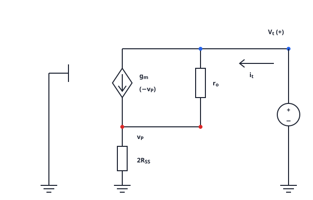

*입력 게이트를 AC 접지하고 부하 $R_C$를 잠시 떼어 입력 MOS 쪽만 보아요. 오른쪽 전압 시험원을 출력과 접지 사이에 연결해 $V_t$를 가해요. 시험원에서 회로로 들어가는 왼쪽 방향 전류를 $i_t$로 두면 $R_{trans}=V_t/i_t$예요. 실제 출력저항은 여기에 $R_C$를 병렬로 다시 연결한 값이에요.*

게이트가 접지된 소스 축퇴 MOS이므로 드레인에서 보는 저항은 $r_o$에 $g_m(2R_{SS})$를 곱한 주항이에요.

$$
R_{trans}\approx g_mr_o(2R_{SS})
$$

$$
R_{trans}\approx(0.5\,\mathrm{mS})(200\,\mathrm{k\Omega})(220\,\mathrm{k\Omega})=22\,\mathrm{M\Omega}
$$

실제 부하 $R_C=10$ kΩ를 병렬로 연결해요. $R_{trans}\gg R_C$이므로 출력저항은 거의 $R_C$예요.

$$
R_{out}=R_C\parallel R_{trans}\approx R_C=10\,\mathrm{k\Omega}
$$

③ 두 값을 곱하고 출력 정의를 확인해요

양의 입력이 드레인 전류를 늘려 출력 전압을 낮추므로 음의 부호를 붙여요.

$$
A_{CM,SE}=-G_{m,CM}R_{out}\approx-\frac{R_C}{2R_{SS}}
$$

$$
A_{CM,SE}\approx-\frac{10\,\mathrm{k\Omega}}{220\,\mathrm{k\Omega}}=-\frac1{22}\approx-4.55\times10^{-2}
$$

$$
A_{CM,DM}=\frac{v_{o1}-v_{o2}}{v_{CM}}=0
$$

두 출력이 같은 만큼 내려가므로 그림의 차동 출력 이득은 0이에요. 각 출력의 유한한 흔들림을 0이라고 답하지 않아요.

#### (5) 10 Ω 불일치의 CM-to-DM 누출

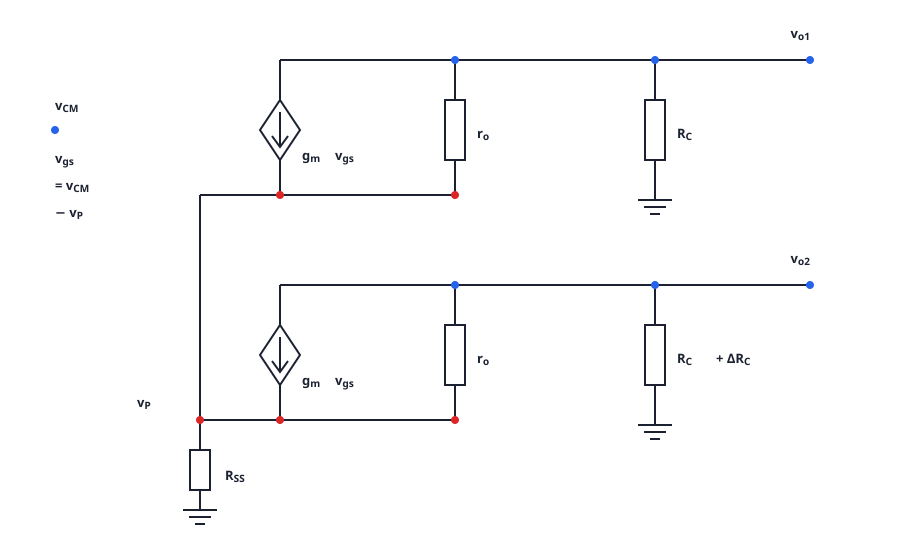

*불일치가 있을 때 유지하는 전체 소신호 연결이에요. 두 제어 전압은 모두 $v_{CM}-v_P$이지만 드레인 전압은 달라 $r_o$ 전류와 순 드레인 전류가 서로 다를 수 있어요. 두 가지가 공유하는 것은 실제 $R_{SS}$이고, 이 그림에 $2R_{SS}$를 두 번 넣지 않아요. 출력 전압은 두 오른쪽 노드에서 읽어요.*

(4)의 $G_{m,CM}$과 큰 $R_{trans}$를 이용해 불일치 전 기준 전류를 정해요. 부하를 연결할 때의 보정은 $R_C/R_{trans}\ll1$이라 여기서는 생략해요. 따라서 다음은 단락 전류를 정확히 그대로 쓰는 식이 아니라 대칭 부하 전류의 주항이에요.

$$
i\approx\frac{v_{CM}}{2R_{SS}}
$$

불일치를 넣은 뒤 드레인에서 소스로 내려가는 순 전류를 $i_1,i_2$로, 출력을 $v_o=v_{o1}-v_{o2}$로 정의해요. 두 게이트와 소스를 공유하므로 $v_{gs}$와 제어 전류는 같고, 전류 차이는 드레인 전압 차이가 $r_o$에 만드는 성분뿐이에요.

$$
i_1-i_2=\frac{v_{o1}-v_{o2}}{r_o}=\frac{v_o}{r_o}
$$

왼쪽 부하에는 $R_C$, 오른쪽에는 $R_C+\Delta R_C$가 있어요. 아래로 흐르는 전류가 커지면 출력 전압이 내려가므로 두 출력의 차를 쓰면 돼요.

$$
v_o=-R_Ci_1+(R_C+\Delta R_C)i_2
$$

$$
v_o=\Delta R_Ci_2-R_C\frac{v_o}{r_o}
$$

$|\Delta R_C|\ll R_C$의 1차항만 남기므로 $\Delta R_C$에 곱해진 $i_2$에는 대칭 기준값 $i$를 넣어요. 불일치 뒤 두 전류가 정확히 같다는 뜻은 아니에요.

$$
v_o\left(1+\frac{R_C}{r_o}\right)\approx\Delta R_C\frac{v_{CM}}{2R_{SS}}
$$

$$
A_{CM-DM}\approx\frac{\Delta R_C}{2R_{SS}(1+R_C/r_o)}
$$

오른쪽 저항이 더 크면 오른쪽 출력이 더 내려가므로, 왼쪽에서 오른쪽을 뺀 누출 이득은 양수예요.

$$
\Delta R_C=10\,\Omega=0.01\,\mathrm{k\Omega}
$$

$$
A_{CM-DM}\approx\frac{0.01}{(220)(1+10/200)}
$$

$$
A_{CM-DM}\approx\frac1{23100}\approx+4.33\times10^{-5}
$$

#### (6) CMRR

DM과 누출 모두 입력 $r_o$를 유지한 동일 모델이에요. 작은 불일치의 분자에는 대칭 DM 이득을 써요. 이때 두 이득의 $1+R_C/r_o$가 소거돼요.

$$
\mathrm{CMRR}\approx\frac{g_mR_C/(1+R_C/r_o)}{|\Delta R_C|/[2R_{SS}(1+R_C/r_o)]}
$$

$$
\mathrm{CMRR}\approx\frac{2g_mR_{SS}R_C}{|\Delta R_C|}
$$

$$
\mathrm{CMRR}\approx\frac{(0.5)(220)(10)}{0.01}=110000
$$

$$
\mathrm{CMRR}_{dB}\approx20\log_{10}(110000)\approx100.83\,\mathrm{dB}
$$

참고 풀이의 $1.06\times10^5$는 DM에는 입력 $r_o$를 남기고 CM 누출에는 그 보정을 생략한 계산이에요. 본풀이는 두 이득을 같은 모델·큰 곱 주항으로 맞춰요.

#### 완성 답과 검산

#### (1) 포화 경계

대칭 DC 기준 $1.8\,\mathrm V\le V_{CM}\le2.9\,\mathrm V$예요. 제곱법칙·테일 전류 유지·포화 경계 조건이에요.

하한의 1 V는 $R_E$의 DC 강하예요. 이것을 빼먹으면 테일 MOS 포화 여유를 과대평가해요.

#### (2) 전류 조향 경계

$-\sqrt{0.08}\,\mathrm V\le v_{id}\le+\sqrt{0.08}\,\mathrm V$, 즉 약 $\pm0.28$ V예요. 테일 전류 고정·동작영역 유지에서 한쪽 꺼짐 경계예요.

차동 입력의 양과 음에 따라 꺼지는 소자만 바뀌므로 경계는 대칭이에요.

#### (3) DM 검산

$A_{DM}\approx-4.76$예요. 대칭 DM이며 $r_{o2}=r_{o3}=200$ kΩ를 병렬 부하로 유지해요.

입력 $r_o$ 무한대의 $-5$보다 크기는 작고 부호는 그대로예요.

#### (4) CM 출력 검산

그림의 차동 출력은 $A_{CM,DM}=0$, 각 출력은 $A_{CM,SE}\approx-4.55\times10^{-2}$예요. 대칭·큰 곱 주항 조건이에요.

테일 저항이 무한대면 각 출력 이득도 0으로 가요. 두 출력을 빼는 상쇄는 유한 테일에서도 성립해요.

#### (5) 누출 검산

$A_{CM-DM}\approx+4.33\times10^{-5}$예요. 좌−우 출력·유한 입력 $r_o$·작은 불일치·큰 곱 주항이에요.

출력 부하 차이를 0으로 보내면 0이에요. 오른쪽 저항 증가가 오른쪽 출력을 더 낮추므로 양의 부호가 맞아요.

#### (6) 비 검산

동일 유한 입력 $r_o$ 모델의 큰 곱·작은 불일치 주항에서 CMRR $\approx110000$, 약 $100.83$ dB예요.

반올림 전 $100/21$과 $1/23100$의 비는 110000이에요. 약 5%인 DM 부하 보정이 누출에도 같은 인자로 적용되어 CMRR 비에서 소거돼요.

#### 주의할 점

$R_E$는 테일 MOS 소스가 아닌 드레인 위쪽에 있어요. 따라서 $R_{SS}=R_E+r_{o1}$이며 $g_{m1}R_Er_{o1}$가 아니에요. 그림의 차동 출력 CM 전달은 대칭에서 0이고 각 출력 CM 전달은 유한해요. 유한 $r_o$를 DM에만 남기고 누출에서는 지우는 식으로 모델을 섞지 않아요.

#### 조건을 바꾸어 생각해요

1. 전류와 소자 파라미터를 유지하며 $R_E$를 10 kΩ에서 20 kΩ로 늘리면 입력 CM 하한과 테일 소신호 저항은 각각 얼마일까요?
2. 불일치만 10 Ω에서 5 Ω로 줄이면 CMRR과 dB 값은 어떻게 바뀔까요?
3. 양쪽 부하를 정확히 맞춘 경우, 유한한 각 출력 CM 이득이 그림의 차동 출력에서도 남을까요?

**페이지 요약**

$R_E$는 테일 드레인 위 직렬저항이므로 $R_{SS}=R_E+r_{o1}$로 합쳐요.

#### 입력 경계

대칭 DC의 CM 범위는 1.8–2.9 V예요.

고정 테일 전류에서 한쪽이 꺼지는 차동 경계는 약 $\pm0.28$ V예요.

#### 이득과 제거비

유한 입력 $r_o$를 유지하면 $A_{DM}\approx-4.76$예요.

출력 단락에서 $G_{m,CM}$을 구하고 입력 영점에서 부하 포함 $R_{out}$을 구해요.

대칭 CM에서 $-G_{m,CM}R_{out}\approx-4.55\times10^{-2}$이고 두 출력의 차는 0이에요.

불일치 누출은 반회로 기준 전류에 $r_o$의 전류 차이만 보정해요.

같은 모델의 큰 곱·작은 불일치 주항 CMRR은 약 110000, 100.83 dB예요.

---

### P9. 캐스코드 부하의 DM·CM 이득

2019-1_중간-Q4 · 기출 4 · [원 문제 보기](../%EB%B3%B5%EC%8A%B5%EB%AC%B8%EC%A0%9C_1007_Differential_Amplifiers-%EB%AC%B8%EC%A0%9C.pdf)

#### 주어진 조건

- $V_{DD} = 1.8\ \text{V}$, $I_{D7} = 2\ \text{mA}$
- $(W/L)_{1,2} = 100/0.2$, $(W/L)_{3,4} = (W/L)_{5,6} = 200/0.2$, $(W/L)_7 = 200/0.2$
- $\mu_n C_{ox} = 100\ \mu\text{A/V}^2$, $\mu_p C_{ox} = 50\ \mu\text{A/V}^2$
- $\lambda_n = \lambda_p = 0.1\ \text{V}^{-1}$
- $g_m r_o \gg 1$로 가정
- 바이어스 전압 $V_{b1}$, $V_{b2}$, $V_{b3}$ 값은 주어지지 않음

#### 구할 것

- (1) 차동 전압 이득
- (2) Common-mode 이득 $A_{CM}$

원문 보기

다음 회로에 대해 주어진 조건을 이용하여 질문에 답하시오.

: $V_{DD} = 1.8\ \text{V}$, $I_{D7} = 2\ \text{mA}$, $(W/L)_{1,2} = 100/0.2$, $(W/L)_{3,4} = (W/L)_{5,6} = 200/0.2$, $(W/L)_7 = 200/0.2$, $\mu_n C_{ox} = 100\ \mu\text{A/V}^2$, $\mu_p C_{ox} = 50\ \mu\text{A/V}^2$, $\lambda_n = \lambda_p = 0.1\ \text{V}^{-1}$, $g_m r_o \gg 1$로 가정한다.

(1) 차동 전압 이득을 구하시오.

(2) Common-mode 이득($A_{CM}$)을 구하시오.

#### 문제를 읽어요

위쪽은 PMOS 캐스코드 부하이고 아래 테일은 $M_7$ 한 개예요. 차동 입력과 같은 CM 입력을 각각 넣어 이득을 비교해요. 차동 출력은 왼쪽 드레인에서 오른쪽 드레인을 뺀 $v_{od}$, CM 이득은 한쪽 출력 기준으로 정해요.

주어진 전류로 동작점을 정하는 수업 제곱법칙 모델을 써요. 원문이 준 $g_mr_o\gg1$을 적용하고 바디 효과는 무시해요. 바이어스 전압이 미지정이므로 모든 소자가 포화 상태를 유지하는 작은 신호 범위의 결과예요.

#### 이 개념과 공식을 떠올려요

“두 소자가 위로 쌓인 부하”에서 캐스코드(cascode)의 출력저항 증대를 떠올려요. $r_o=1/(\lambda I_D)$는 채널 길이 변조 저항, $g_m$은 게이트 전압에 대한 전류 변화율이에요. 기존 $r_{o5}$에 출력 쪽 캐스코드 소자 $M_3$의 $g_{m3}r_{o3}$를 곱해요.

DM은 대칭 테일이 가상 접지여서 CS 반회로예요. CM은 P가 움직이므로 테일 $r_{o7}$을 반쪽마다 $2r_{o7}$로 남겨요. 두 가지 전류가 같아 $v_P=(2i)r_{o7}=i(2r_{o7})$이기 때문이에요. 캐스코드 부하가 매우 크므로 입력쌍 $r_o$도 반드시 남겨야 해요.

#### 종이에 쓸 첫 줄

각 가지 전류는 테일의 절반이에요. NMOS와 PMOS의 $\mu C_{ox}W/L$은 주어진 폭 비율 때문에 같아요.

$$
I_{D1}=I_{D2}=I_{D3}=I_{D5}=I_{D7}/2=1\,\mathrm{mA}
$$

$$
g_{m1}=g_{m3}=\sqrt{2(0.1)(500)(1)}\,\mathrm{mS}=10\,\mathrm{mS}
$$

$$
r_{o1}=r_{o3}=r_{o5}=\frac1{0.1\times1\,\mathrm{mA}}=10\,\mathrm{k\Omega}
$$

$$
r_{o7}=\frac1{0.1\times2\,\mathrm{mA}}=5\,\mathrm{k\Omega}
$$

먼저 위쪽 저항을 유효 블록으로 정의해요. $100\,\mu\mathrm{A/V^2}=0.1\,\mathrm{mA/V^2}$, $50\,\mu\mathrm{A/V^2}=0.05\,\mathrm{mA/V^2}$로 환산했어요.

$$
R_{up}\approx(g_{m3}r_{o3})r_{o5}=(100)(10\,\mathrm{k\Omega})=1000\,\mathrm{k\Omega}
$$

#### 이렇게 풀어요

#### (1) 차동 이득

DM에서는 P가 가상 접지라 $M_1$의 출력저항은 축퇴되지 않은 $r_{o1}$이에요. 위아래 저항은 같은 출력–AC 접지 사이이므로 병렬이에요.

$$
R_{DM}\approx r_{o1}\parallel R_{up}=10\parallel1000\,\mathrm{k\Omega}\approx9.9\,\mathrm{k\Omega}
$$

$$
A_{DM}\approx-g_{m1}(r_{o1}\parallel R_{up})=-\frac{10000}{101}\approx-99.01
$$

왼쪽 입력이 올라가면 왼쪽 출력은 내려가므로 왼쪽−오른쪽 차동 이득은 음수예요.

#### (2) CM 반회로

이번에는 두 입력이 같이 올라가요. 소스 아래 저항은 $R_S=2r_{o7}=10\,\mathrm{k\Omega}$이고 위쪽 부하는 $R_{up}$이에요. 아래 그림에서 $r_{o1}$은 드레인–소스 사이이므로 $R_{up}$에 곧바로 병렬로 붙이면 안 돼요.

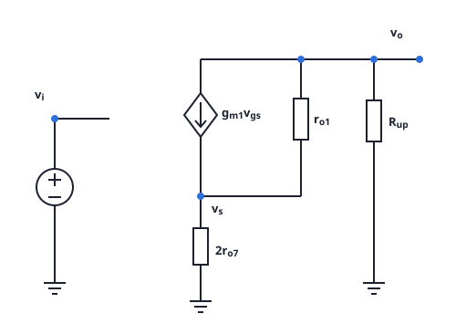

*전원과 고정 바이어스는 AC 접지예요. 제어 전압은 $v_{gs}=v_i-v_s$예요. 제어원은 왼쪽, 드레인–소스 $r_o$는 오른쪽, 출력은 맨 오른쪽이에요. 입력 게이트에는 전류가 흐르지 않아요.*

$g_{m1}R_S=100\gg1$인 축퇴 CS 블록을 써요. 입력 영점에서 축퇴된 아래쪽 저항은 기존 $r_{o1}$에 $g_{m1}R_S$를 곱한 주항이에요.

$$
R_{dn}\approx g_{m1}r_{o1}(2r_{o7})=1000\,\mathrm{k\Omega}
$$

$$
G_{m,CM}\approx\frac1{2r_{o7}}=0.1\,\mathrm{mS}
$$

$$
A_{CM}\approx-\frac{R_{up}\parallel R_{dn}}{2r_{o7}}=-\frac{500}{10}=-50
$$

테일은 보통의 단일 MOS 전류원인데 부하는 캐스코드라 커요. 그래서 CM 이득이 반드시1보다 작다는 보장은 없어요. $-R_{up}/(2r_{o7})=-100$을 바로 쓰면 입력 $r_o$가 만든 축퇴 출력저항을 놓쳐 두 배 오차가 생겨요.

#### 완성 답과 검산

#### (1) 차동 이득 확인

**$A_{DM}\approx-99.01$**, 왼쪽−오른쪽 차동 출력·포화·$g_mr_o\gg1$ 주항이에요.

$R_{up}\to\infty$이면 입력 $r_{o1}$만 남아 $A_{DM}\to-g_{m1}r_{o1}=-100$이에요. 구한 크기가100보다 조금 작은 것이 맞아요.

#### (2) CM 이득 확인

**$A_{CM}\approx-50$**는 한쪽 출력이에요. 같은 두 출력의 차에서 CM 전달은0이에요.

전류 변화율의 단위 $\mathrm{mS}$와 유효 부하 $\mathrm{k\Omega}$를 곱하므로 이득은 무차원이에요. 테일 저항을 키우면 분모와 아래쪽 저항이 함께 바뀌므로 한쪽만 바꾸어 배율을 읽지 않아요.

#### 주의할 점

캐스코드가 부하에 있다는 사실을 테일 캐스코드로 뒤바꾸지 않아요. $M_7$은 한 개예요. CM에서는 P를 접지하지 않고 입력 $r_o$를 남겨요. $A_{CM}=-50$이라도 대칭이면 CM-to-DM 이득은0이며, 각 출력의 흔들림과 차동 누출은 달라요.

#### 조건을 바꾸어 생각해요

1. 다른 소자값과 $g_m$을 고정하고 테일 저항만 두 배로 키우면 같은 주항 모델의 CM 이득은 얼마인가요?
2. 입력 $r_{o1}$이 무한대인 다른 모델이라면 CM 이득이 왜 $-100$이 되나요?

**페이지 요약**

캐스코드 부하는 크므로 CM 계산에서도 입력쌍 $r_o$를 남겨요.

#### 위아래 출력저항

위쪽 캐스코드 부하는 $R_{up}\approx1000\,\mathrm{k\Omega}$예요.

CM의 $2r_{o7}$ 축퇴로 아래쪽도 $R_{dn}\approx1000\,\mathrm{k\Omega}$이 되어 둘을 병렬로 합쳐요.

#### 큰 곱 주항의 이득

차동 이득은 약 $-99.01$이고 한쪽 CM 이득은 약 $-50$이에요.

완전 대칭 차동 출력의 CM 전달은 0이에요.

---

### P10. 전류 거울의 면적비와 이득

P10.71 · 장말문제 10.71 · [원 문제 보기](../%EB%B3%B5%EC%8A%B5%EB%AC%B8%EC%A0%9C_1007_Differential_Amplifiers-%EB%AC%B8%EC%A0%9C.pdf)

#### 주어진 조건

- $(W/L)_3 = N(W/L)_4$
- 채널 길이 변조 무시
- $i_1$은 $I_1$의 소신호 성분으로 보임

#### 구할 것

- 소신호 이득 $v_{out}/i_1$

원문 보기

Determine the small-signal gain $v_{out}/i_1$ in the circuit of Fig. 10.92 if $(W/L)_3 = N(W/L)_4$. Neglect channel-length modulation.

#### 문제를 읽어요

왼쪽 $I_1$은 전류를 아래로 빼내고, 위쪽 PMOS 거울은 그만큼을 공급해요. 작은 변화 $i_1$도 원 그림의 아래 방향을 양으로 잡아요. $M_3$의 게이트·드레인과 $M_4$의 게이트가 만나는 전압을 $v_g$라 부를게요.

왼쪽에서 더 빼내면 $v_g$가 내려가고, 두 PMOS의 소스–게이트 전압이 커져요. 그러면 오른쪽 $M_4$도 더 공급하고 $R_L$의 전압이 올라가요. 구할 것은 전압/전류인 **트랜스임피던스(transimpedance)**이며 단위는 Ω예요. 두 소자가 포화 상태인 바이어스점 근처의 저주파 작은 변화를 해석해요.

#### 이 개념과 공식을 떠올려요

게이트끼리 연결되고 소스끼리 연결된 두 PMOS라는 단서에서 전류 거울(current mirror)을 떠올려요. 같은 공정의 두 소자는 같은 $V_{SG}$와 문턱전압 크기를 가져 과구동 전압 $V_{OV}=V_{SG}-|V_{TH}|$가 같아요. 포화 영역에서 전류는 $(W/L)$에 비례해요.

$$
I_D=\frac12\mu_p C_{ox}\frac WL V_{OV}^2
$$

$g_m$은 소스–드레인 전류 크기가 $V_{SG}$에 따라 변하는 기울기이며 양수로 정의해요.

$$
g_m=\frac{2I_D}{V_{OV}}=\mu_p C_{ox}\frac WL V_{OV}
$$

다이오드 연결 $M_3$는 소신호에서 $1/g_{m3}$로 바꿀 수 있어요. 채널 길이 변조를 무시하므로 두 소자의 $r_o$는 무한대예요. 이 문제는 전압 입력의 $-G_mR_{out}$ 공식을 적용하기보다, 입력 전류 → 게이트 전압 → 복사 전류 → 부하 전압 순서로 풀면 부호까지 드러나요. 수업의 [MOS 능동 부하의 전류 복사](../%EC%A0%95%EB%A6%AC%EB%85%B8%ED%8A%B8_1007_Differential_Amplifiers.html#s2-mos-active)와 같은 원리예요.

#### 종이에 쓸 첫 줄

DC 전원 $V_{DD}$를 AC 접지로 보내면 PMOS 소스의 소신호 전압은 0이에요. 따라서 $v_{sg3}=v_{sg4}=-v_g$이고, $v_g$가 조금 내려갈수록 PMOS 공급 전류는 늘어요. 게이트 전류는 0이므로 $M_3$의 공급 변화와 입력 흡수 변화가 같아야 해요.

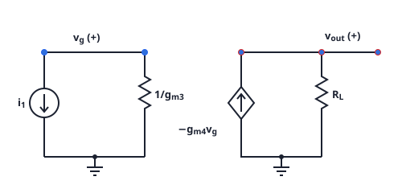

*$V_{DD}$는 AC 접지예요. $M_3$는 다이오드 등가저항, $M_4$는 $v_g$로 제어되는 공급 전류원으로 바꿨어요. $\lambda=0$이므로 $r_{o3},r_{o4}$ 가지는 없고, 실제 부하 $R_L$은 남겨요. 두 신호 노드는 게이트의 제어 관계로 연결되며 도선으로 단락되지 않아요.*

$v_g$ 노드에서 아래로 나가는 전류는 전류원의 $i_1$과 저항의 $g_{m3}v_g$예요. 두 전류를 더해 0으로 놓아요.

$$
i_1+g_{m3}v_g=0
$$

$$
v_g=-\frac{i_1}{g_{m3}}
$$

#### 이렇게 풀어요

먼저 미러의 전류비를 구해요. 같은 $V_{OV}$에서 크기가 $1/N$인 $M_4$는 DC 전류도 $1/N$만 흘려요. 여기서 $I_{D3},I_{D4}$는 PMOS 전류의 양의 크기예요.

$$
\frac{I_{D4}}{I_{D3}}=\frac{(W/L)_4}{(W/L)_3}=\frac1N
$$

$$
\frac{g_{m4}}{g_{m3}}=\frac{2I_{D4}/V_{OV}}{2I_{D3}/V_{OV}}=\frac1N
$$

제곱근 식 $g_m=\sqrt{2\mu_p C_{ox}(W/L)I_D}$를 써도 크기비와 전류비가 각각 $1/N$이므로 $\sqrt{(1/N)(1/N)}=1/N$이에요. 전류를 고정한 채 폭만 바꾼 상황과 달라요.

$M_4$가 출력으로 공급하는 소신호 전류를 $i_4$라 두면 다음과 같아요.

$$
i_4=g_{m4}v_{sg4}=-g_{m4}v_g=\frac{g_{m4}}{g_{m3}}i_1=\frac{i_1}{N}
$$

출력 노드에서 $R_L$로 나가는 전류와 위로부터 들어오는 $i_4$가 같아요. 출력은 단락하지 않고 $R_L$에 걸린 전압을 구해요.

$$
\frac{v_{out}}{R_L}-i_4=0
$$

$$
v_{out}=\frac{R_L}{N}i_1
$$

#### 완성 답과 검산

**아래 방향 입력 전류 $i_1$에 대한 트랜스임피던스는 양수예요.**

$$
\boxed{\frac{v_{out}}{i_1}=+\frac{R_L}{N}\quad[\Omega]}
$$

두 PMOS의 포화 동작·작은 신호·채널 길이 변조 무시와 실제 부하 $R_L$ 조건에서의 결과예요.

**부호:** $i_1$ 증가 → $v_g$ 감소 → $V_{SG4}$ 증가 → $M_4$ 공급 증가 → $v_{out}$ 상승이므로 +예요. **단위:** V/A=Ω이고 $N$은 무차원이라 $R_L/N$과 맞아요.

**비율 검산:** $N=1$이면 입력 전류가 그대로 복사되어 이득은 $R_L$이에요. 같은 $R_L$에서 $N$을 두 배로 하면 복사 전류와 이득은 절반이 돼요. $R_L\to0$이면 출력도 0으로 가요. $R_L$을 무한히 키우는 극한은 DC 출력 전압과 포화 여유를 함께 확인해야 하므로 실제 무한 이득을 뜻하지 않아요.

#### 주의할 점

$g_{m4}/g_{m3}=1/\sqrt N$으로 쓰면 안 돼요. 그 배율은 전류를 고정했을 때 폭만 바꾸는 경우예요. 여기서는 공통 게이트·소스가 $V_{OV}$를 같게 만들고 전류비도 $1/N$으로 바꿔요.

PMOS라는 이유만으로 음의 이득을 붙이지 않아요. 입력은 아래로 흡수하는 방향이고 출력은 접지 기준 전압이에요. 또한 $\lambda=0$은 $M_4$가 꺼진다는 뜻이 아니라 출력 전압에 따른 전류 변화가 없다는 뜻이에요. $R_L$에는 여전히 복사 전류가 흘러요.

#### 조건을 바꾸어 생각해요

- **질문:** $M_4$의 크기는 그대로 두고 $M_3$의 $(W/L)$만 두 배로 늘리며 DC 입력 전류 $I_1$과 $R_L$을 유지하면, 새 소신호 이득은 몇 배가 될까요? 두 소자는 계속 포화 상태라고 해요.

  **답과 이유:** 절반이에요. 새 $V_{OV}$는 달라져도 두 PMOS 사이에서는 여전히 같아요. 크기비를 뜻하는 $N$이 $2N$이 되어 복사 전류는 $i_1/(2N)$, 이득은 $R_L/(2N)$이 돼요. 개별 $g_m$의 변화만 보고 결론을 내리기보다 두 소자의 비를 구해요.

**페이지 요약**

공통 $V_{OV}$의 PMOS 거울에서는 전류비와 $g_m$비가 모두 $1/N$이에요.

#### 전류와 출력의 방향

$$
i_4=-g_{m4}v_g=i_1/N
$$

$$
v_{out}/i_1=+R_L/N\ [\Omega]
$$

포화·소신호·$\lambda=0$이며 출력에 $R_L$이 연결된 조건이에요.

입력 흡수 전류가 증가하면 오른쪽 출력은 올라가요.

---

### P11. 전류 거울의 출력 변화

P10.72 · 장말문제 10.72 · [원 문제 보기](../%EB%B3%B5%EC%8A%B5%EB%AC%B8%EC%A0%9C_1007_Differential_Amplifiers-%EB%AC%B8%EC%A0%9C.pdf)

#### 주어진 조건

- $I_1$은 $I_0$에서 $I_0 + \Delta I$로, $I_2$는 $I_0$에서 $I_0 - \Delta I$로 바뀜
- 채널 길이 변조 무시

#### 구할 것

- 변화 전과 후의 $V_{out}$을 다음 각 경우에 계산
- (a) $(W/L)_3 = (W/L)_4$
- (b) $(W/L)_3 = 2(W/L)_4$

원문 보기

In the circuit shown in Fig. 10.93, $I_1$ changes from $I_0$ to $I_0 + \Delta I$ and $I_2$ from $I_0$ to $I_0 - \Delta I$. Neglecting channel-length modulation, calculate $V_{out}$ before and after the change if

(a) $(W/L)_3 = (W/L)_4$.

(b) $(W/L)_3 = 2(W/L)_4$.

#### 문제를 읽어요

왼쪽 전류를 정하는 $I_1$이 커지면 거울이 오른쪽에 공급하는 전류도 커져요. 동시에 $I_2$는 줄어들므로 출력에서 빼내는 전류는 작아져요. 두 효과가 함께 부하 저항의 전압을 올려요. 구할 것은 변화량만이 아니라 **변화 전과 후의 출력 전압 각각**이에요.

출력 전압은 접지 기준이에요. 전류원은 그림의 방향으로 주어진 전류를 유지하는 이상 전류원으로 해석하고, 두 PMOS는 같은 공정 파라미터를 갖는 전류 거울로 다뤄요. 결과는 $M_4$가 포화 영역에 머물고 전류원들이 요구 전압에서 동작할 수 있을 때 유효해요.

#### 이 개념과 공식을 떠올려요

공통 게이트·공통 소스의 PMOS와 다이오드 연결 $M_3$가 단서이므로 **전류 거울(current mirror)**의 크기 비를 먼저 떠올려요. 두 소자의 $V_{SG}$가 같고 채널 길이 변조를 무시하면, 포화 전류는 $W/L$에 비례해요. $I_4$는 $M_4$가 출력에 공급하는 전류의 양의 크기이고, $k$는 기준 소자에 대한 출력 소자의 크기 비예요.

$$
k=\frac{(W/L)_4}{(W/L)_3}
$$

$$
I_4=kI_1
$$

그다음 출력 노드의 전류 법칙(Kirchhoff’s current law, KCL)을 써요. 저항은 공급과 흡수의 차이만 받으므로, 두 전류를 각각 구한 뒤 빼는 것이 전압을 바로 추측하는 것보다 안전해요. 이 관계는 [MOS 능동 부하의 두 신호 경로](../%EC%A0%95%EB%A6%AC%EB%85%B8%ED%8A%B8_1007_Differential_Amplifiers.html#s2-mos-active)와 같아요.

#### 종이에 쓸 첫 줄

원 회로의 실제 부하 $R_L$를 그대로 두고 DC 전류 균형을 써요. $I_1$은 $M_3$ 아래쪽으로 흐르는 기준 전류, $I_4$는 위에서 출력 노드로 들어오는 전류, $I_2$와 $I_L$은 출력에서 접지 쪽으로 나가는 전류를 양으로 정해요. 그러면 저항 가지는 $I_L=V_{out}/R_L$예요. 예를 들어 공급이 흡수보다 작으면 $I_L<0$이므로 실제 저항 전류는 접지에서 출력으로 흘러요.

$$
I_4=I_2+\frac{V_{out}}{R_L}
$$

$$
V_{out}=R_L(kI_1-I_2)
$$

이는 변화 전후의 DC 동작점을 각각 구하는 문제라서 소신호 등가회로·출력 단락·시험원을 도입하지 않아요. $\lambda=0$이므로 별도의 유한 출력저항 보정도 넣지 않아요.

#### 이렇게 풀어요

#### (a) 같은 크기의 거울

기준 소자와 출력 소자의 크기가 같으므로 거울은 기준 전류를 그대로 복사해요.

$\lambda=0$, $M_4$ 포화에서 $k=1$, $I_4=I_1$이에요. 출력 KCL은 $V_{out}=R_L(I_4-I_2)$예요.

$$
V_{out,\mathrm{전}}=R_L(I_0-I_0)=0
$$

$$
V_{out,\mathrm{후}}=R_L[(I_0+\Delta I)-(I_0-\Delta I)]=2\Delta I R_L
$$

후 상태에서 공급의 증가 $+\Delta I$와 흡수의 감소 $-\Delta I$가 차이에 함께 더해져요. 따라서 저항 전류는 $2\Delta I$만큼 증가해요.

#### (b) 출력 소자가 기준 소자의 절반인 거울

조건에서 두 배인 것은 기준 소자 $M_3$예요. 따라서 출력 소자 $M_4$가 공급하는 전류는 기준 전류의 절반이에요.

$\lambda=0$, $M_4$ 포화에서 $k=1/2$, $I_4=I_1/2$이고 $V_{out}=R_L(I_4-I_2)$예요.

$$
V_{out,\mathrm{전}}=R_L\left(\frac{I_0}{2}-I_0\right)=-\frac{I_0R_L}{2}
$$

$$
V_{out,\mathrm{후}}=R_L\left[\frac{I_0+\Delta I}{2}-(I_0-\Delta I)\right]=\frac{(3\Delta I-I_0)R_L}{2}
$$

$$
\Delta V_{out}=V_{out,\mathrm{후}}-V_{out,\mathrm{전}}=\frac32\Delta I R_L
$$

거울이 복사하는 증가분은 $\Delta I/2$이지만, 직접 흡수하는 가지의 감소분은 여전히 $\Delta I$예요. 두 효과를 합치면 $1.5\Delta I$예요. 이 증가량을 초기 전압 $-I_0R_L/2$에 더해야 최종 출력이 나와요.

#### 완성 답과 검산

#### (a) 답과 대칭 검산

**전에는 $V_{out}=0$, 후에는 $V_{out}=2\Delta I R_L$예요.** 채널 길이 변조 무시, $M_4$ 포화 및 이상 전류원의 동작 가능 범위에서의 결과예요.

$\Delta I=0$이면 전후 모두 0이에요. $\Delta I>0$이면 공급은 늘고 흡수는 줄므로 출력이 양으로 올라가며 전류 경로와 부호가 맞아요.

#### (b) 답과 초기값 검산

**전에는 $V_{out}=-I_0R_L/2$, 후에는 $V_{out}=(3\Delta I-I_0)R_L/2$예요.** 변화량은 $\Delta V_{out}=1.5\Delta I R_L$예요. 채널 길이 변조 무시, $M_4$ 포화 및 음의 출력을 포함한 전류원 동작 가능 범위를 전제로 해요.

$\Delta I=0$을 후 식에 넣으면 초기값 $-I_0R_L/2$가 나와요. $\Delta I=I_0/3$에서는 공급과 흡수가 모두 $2I_0/3$이 되어 후 출력이 0이에요. 따라서 출력이 증가해도 $0<\Delta I<I_0/3$이면 최종 출력은 여전히 음수예요.

두 답 모두 전류×저항이라 전압 단위예요. mA와 kΩ를 쓰면 그 곱은 V예요. $M_4$의 포화 조건은 $V_{SD4}=V_{DD}-V_{out}\ge V_{SG4}-|V_{TP}|$예요. 전류가 바뀌면 필요한 $V_{SG4}$도 달라지므로 전후 모두 확인해야 해요. 이 조건은 상한을 주며, 실제 하한은 특히 $I_2$ 전류원의 전압 여유(compliance)에 달려 있어요. 원문에는 그 수치가 없어 허용 출력 범위를 수치로 확정하지 않아요.

#### 주의할 점

- 거울 비는 출력 $M_4$의 크기 ÷ 기준 $M_3$의 크기예요. (b)에서 $I_4=2I_1$로 뒤집지 않아요.
- $I_2$는 출력에서 빠져나가므로 $V_{out}=R_L(I_4-I_2)$예요. $I_2$가 줄면 출력 상승에 기여해요.
- (b)의 $1.5\Delta I R_L$는 변화량이에요. 초기값을 생략하면 원문이 요구하는 변화 후 전압을 잘못 답하게 돼요.
- 음의 출력은 음의 저항을 뜻하지 않아요. 저항 전류가 정의한 방향의 반대로 흐른다는 뜻이에요. 다만 접지에 연결된 실제 전류원이 음의 단자 전압에서 그 전류를 유지할 수 있는지는 별도 확인이 필요해요. 포화·전압 여유가 깨지면 이 이상 거울 답을 그대로 적용하지 않아요.

#### 조건을 바꾸어 생각해요

1. 출력 소자 크기가 기준 소자의 두 배여서 $k=2$라면, 같은 전류 변화에서 초기 출력과 출력 증가량은 각각 얼마일까요?
2. (b)에서 $\Delta I=I_0/4$라면 후 출력은 양수일까요, 음수일까요? 출력이 증가했다는 사실과 최종 전압의 부호를 구별해 보세요.

**페이지 요약**

출력 유입 전류에서 유출 전류를 빼고 $R_L$을 곱해요.

#### 첫 식

$$
V_{out}=R_L(kI_1-I_2)
$$

$k=(W/L)_4/(W/L)_3$이며 포화 PMOS 거울·$\lambda=0$ 모델이에요.

#### 전후 값과 변화량

$k=1$이면 초기 출력은 0이고 최종 출력은 $2\Delta I R_L$예요.

$k=1/2$이면 초기 출력은 $-I_0R_L/2$이고 최종 출력은 $(3\Delta I-I_0)R_L/2$예요.

이때 변화량 $1.5\Delta I R_L$과 최종값을 구별해요.

전후 모두 $M_4$ 포화와 이상 전류원의 전압 여유가 필요해요.

---

### P12. MOS 차동쌍의 부하별 이득

2013-1_중간-Q4 · 기출 4 · [원 문제 보기](../%EB%B3%B5%EC%8A%B5%EB%AC%B8%EC%A0%9C_1007_Differential_Amplifiers-%EB%AC%B8%EC%A0%9C.pdf)

#### 주어진 조건

- $I_{SS} = 2\ \text{mA}$
- $(W/L)_{1,2} = 500$, $(W/L)_{3,4} = 1000$
- $R_{DD} = 1\ \text{k}\Omega$, $R_{SS} = 200\ \Omega$
- $\mu_n C_{ox} = 100\ \mu\text{A/V}^2$, $\mu_p C_{ox} = 50\ \mu\text{A/V}^2$
- $\lambda_n = 0.1\ \text{V}^{-1}$, $\lambda_p = 0.1\ \text{V}^{-1}$
- (4) 전용 (회로 (c)): $I_{DS1} = I_{DS2} = 1\ \text{mA}$
- $V_{DD}$ 값과 (c)의 네 전류원 값은 주어지지 않음

#### 구할 것

- (1) 그림 (a) 회로의 차동 전압 이득 $v_{out}/(v_{in1} - v_{in2})$의 식
- (2) 주어진 조건으로 그림 (a) 회로의 차동 전압 이득 값
- (3) 주어진 조건으로 그림 (b) 회로의 차동 전압 이득 값
- (4) 주어진 조건으로 그림 (c) 회로의 차동 전압 이득 값

원문 보기

다음 차동증폭단에 대해 다음 조건을 이용하여 질문에 답하시오.

$I_{SS} = 2\ \text{mA}$, $(W/L)_{1,2} = 500$, $(W/L)_{3,4} = 1000$, $R_{DD} = 1\ \text{k}\Omega$, $R_{SS} = 200\ \Omega$,

$\mu_n C_{ox} = 100\ \mu\text{A/V}^2$, $\mu_p C_{ox} = 50\ \mu\text{A/V}^2$, $\lambda_n = 0.1\ \text{V}^{-1}$, $\lambda_p = 0.1\ \text{V}^{-1}$

(1) 그림(a) 회로의 차동 전압이득($v_{out}/(v_{in1} - v_{in2})$) 식을 구하시오.

(2) 주어진 조건을 이용하여 그림(a) 회로의 차동 전압이득 값을 구하시오.

(3) 주어진 조건을 이용하여 그림(b) 회로의 차동 전압이득 값을 구하시오.

(4) 주어진 조건을 이용하여 그림(c) 회로의 차동 전압이득 값을 구하시오. ($I_{DS1} = I_{DS2} = 1\ \text{mA}$)

#### 문제를 읽어요

세 회로는 입력쌍이 비슷해도 부하와 소스 연결이 달라요. (a)는 전류 거울의 오른쪽 한 출력, (b)는 두 다이오드 부하의 왼쪽−오른쪽 출력, (c)는 드레인 사이와 소스 사이의 저항을 가진 왼쪽−오른쪽 출력이에요.

전류와 소자 크기는 제곱법칙 소신호 파라미터를 정하는 데 써요. 포화·바디 효과 무시 모델에서 계산하며 바이어스 전압을 새로 추정하지 않아요. 특히 (c)는 실제 수치가 $g_mR_S=1$이라 큰 축퇴 가정과 반대예요. 이 전압이득 계산에서는 분모의1을 유지해요.

#### 이 개념과 공식을 떠올려요

“게이트끼리 연결된 거울”과 “각자 자기 드레인에 연결된 다이오드”는 다른 부하예요. 거울(current mirror)은 한쪽 신호 전류를 출력에 합치고, 다이오드 연결(diode-connected) MOS는 $1/g_m$ 정도의 작은 저항이 돼요.

대칭 DM 입력에서는 두 노드를 잇는 저항의 중간점이 가상 접지예요. 따라서 (c)의 반회로는 $R_D=R_{DD}/2$와 $R_S=R_{SS}/2$예요. $r_o$는 드레인–소스 사이의 저항이라 소스가 움직일 때 단순 접지 병렬로 옮길 수 없어요.

#### 종이에 쓸 첫 줄

먼저 평형 전류와 서로 같은 파라미터를 구해요. $\mu_nC_{ox}(W/L)_1=\mu_pC_{ox}(W/L)_3$이므로 NMOS와 PMOS의 $g_m$이 같아요.

$$
I_D=I_{SS}/2=1\,\mathrm{mA}
$$

$$
g_{m1}=g_{m3}=\sqrt{2(0.1)(500)(1)}\,\mathrm{mS}=10\,\mathrm{mS}
$$

$$
r_{o1}=r_{o2}=r_{o3}=r_{o4}=\frac1{0.1\times1\,\mathrm{mA}}=10\,\mathrm{k\Omega}
$$

여기서 $100\,\mu\mathrm{A/V^2}=0.1\,\mathrm{mA/V^2}$, $50\,\mu\mathrm{A/V^2}=0.05\,\mathrm{mA/V^2}$예요. (c)도 명시된 가지 전류1mA라 같은 $g_m,r_o$를 써요.

#### 이렇게 풀어요

#### (1) 거울 부하의 식

왼쪽 전류가 늘면 PMOS 거울의 오른쪽 공급도 늘어요. 동시에 오른쪽 입력 NMOS는 덜 흡수해 두 변화가 더해져요. 전체는 다이오드 연결이 한쪽에만 있어 동일 반회로 둘로 자르지 않아요.

$$
i_{sig}\approx g_{m1}(v_{in1}-v_{in2})
$$

$$
R_{out,a}\approx r_{o2}\parallel r_{o4}
$$

$$
A_a\approx+g_{m1}(r_{o2}\parallel r_{o4})
$$

1:1 거울·같은 입력쌍·$g_mr_o\gg1$ 주도항이에요. 입력이 왼쪽−오른쪽이고 오른쪽 출력이므로 양수예요. 원본 모범답안 손글씨의 음의 부호는 이 정의에 맞춰 정정했어요.

#### (2) 거울 부하의 수치

$$
R_{out,a}\approx10\parallel10\,\mathrm{k\Omega}=5\,\mathrm{k\Omega}
$$

$$
A_a\approx(10\,\mathrm{mS})(5\,\mathrm{k\Omega})=50
$$

#### (3) 각자 다이오드 연결인 부하

DM에서는 공통 소스가 가상 접지예요. 각 PMOS의 게이트와 드레인이 자기 출력에 붙어서 그 반쪽 부하는 $1/g_{m3}$와 두 소자의 $r_o$가 병렬이에요. 입력과 출력의2배가 서로 없어져 반회로 전압이득이 차동 이득이에요.

$$
R_{L,b}=\frac1{g_{m3}}\parallel r_{o3}\parallel r_{o1}=0.1\parallel10\parallel10\,\mathrm{k\Omega}
$$

$$
A_b=-\frac{g_{m1}}{g_{m3}+1/r_{o3}+1/r_{o1}}=-\frac{10}{10+0.1+0.1}\approx-0.98
$$

$r_o$를 함께 남긴 저주파 모델 값이에요. 기본 $g_mr_o\gg1$의 가장 큰 항만 쓰면 $A_b\approx-g_{m1}/g_{m3}=-1$로도 확인돼요.

#### (4) 두 저항을 반으로 자른 축퇴 회로

이상 전류원은 소신호 개방이에요. 두 저항의 중간은 DM에서 가상 접지라 아래 반회로를 얻어요. 입력의 반쪽 전압을 $v_i=v_{id}/2$, 출력의 반쪽을 $v_o=v_{od}/2$로 정의해요.

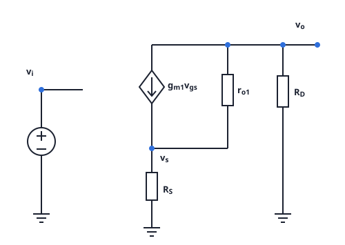

*전원과 고정 바이어스는 AC 접지예요. 제어 전압은 $v_{gs}=v_i-v_s$예요. 제어원은 왼쪽, 드레인–소스 $r_o$는 오른쪽, 출력은 맨 오른쪽이에요. 입력 게이트에는 전류가 흐르지 않아요.*

$$
R_D=R_{DD}/2=0.5\,\mathrm{k\Omega}
$$

$$
R_S=R_{SS}/2=0.1\,\mathrm{k\Omega}
$$

$$
g_mR_S=(10\,\mathrm{mS})(0.1\,\mathrm{k\Omega})=1
$$

이 수치는 강한 축퇴가 아니므로 gain 분모의1을 유지해요. $r_o$도 드레인–소스 연결 그대로 남겨요.

드레인에서 나가는 전류를 양수로 잡으면 부하 전류, $r_o$ 전류, 제어원 전류의 합이0이에요. 게이트 전류가 없어서 소스 저항의 전류와 부하 전류가 크기 같고 방향 반대예요.

$$
\frac{v_o}{R_D}+\frac{v_o-v_s}{r_o}+g_m(v_i-v_s)=0
$$

$$
v_s=-\frac{R_S}{R_D}v_o
$$

$$
A_c=\frac{v_o}{v_i}=-\frac{g_mR_Dr_o}{r_o+R_D+R_S+g_mr_oR_S}
$$

$$
A_c=-\frac{(10)(0.5)(10)}{10+0.5+0.1+(10)(10)(0.1)}=-\frac{50}{20.6}\approx-2.43
$$

mS와kΩ 단위를 썼어요. 이것은 위 저주파 반회로의 전압이득이에요. 참고 풀이의 $-2.44$는 출력저항을 별도 근사 블록으로 분리한 값이고, 여기서는 원래 드레인–소스 $r_o$ 경로를 남겨 직접 계산했어요.

#### 완성 답과 검산

#### (1) 식의 부호

**$A_a\approx+g_{m1}(r_{o2}\parallel r_{o4})$**. 1:1 거울·같은 입력쌍·포화·큰 $g_mr_o$ 주항이에요.

왼쪽 입력 증가가 오른쪽 공급 증가와 흡수 감소를 함께 일으켜 양수예요. 원본 모범답안 손글씨에 적힌 음의 부호는 이 입력·출력 정의와 맞지 않아 정정했어요.

#### (2) 수치

**$A_a\approx+50$**. 같은 주도항 모델이에요.

$\mathrm{mS}\times\mathrm{k\Omega}=1$로 무차원이에요.

#### (3) 다이오드 부하

**$A_b\approx-0.98$**, $r_o$를 남긴 모델이에요. 큰 $g_mr_o$ 선도항은 $-1$이에요.

부하가 큰 출력저항이 아니라 약100Ω이므로 거울 회로보다 이득이 훨씬 작아요.

#### (4) 축퇴 이득

**$A_c\approx-2.43$**. 주어진 $g_mR_S=1$ 때문에1을 유지하고 유한 $r_o$를 남긴 전압이득 모델이에요.

$r_o\to\infty$이면 $A_c=-g_mR_D/(1+g_mR_S)=-2.5$로 가요. 유한 $r_o$가 있을 때 이득 크기가 조금 작아진 결과와 맞아요.

#### 주의할 점

원본 모범답안의 (a) 음의 부호를 그대로 옮기지 않아요. 왼쪽−오른쪽 입력과 오른쪽 출력에서는 양수예요. (a)와(b)는 PMOS 개수가 같아도 게이트 연결과 출력 정의가 달라요. (c)의 $R_{SS}/2$는 두 소스 사이 저항을 DM으로 자른 값이고, 테일 저항을 CM으로 자를 때의 $2R_{SS}$와 달라요. 수치가 $g_mR_S=1$인데1을 버리면 약 두 배의 이득 오차가 생겨요.

#### 조건을 바꾸어 생각해요

- (b)에서 모든 $r_o$를 무한대로 보되 $g_{m1}=g_{m3}$를 유지하면 이득은 얼마인가요?
- (c)에서 소스 사이 저항을0으로 만들고 다른 값은 고정하면 차동 이득은 얼마인가요?

**페이지 요약**

거울은 전류 합성으로, 다이오드·축퇴 부하는 DM 반회로로 풀어요.

#### 거울과 다이오드

왼쪽−오른쪽 입력·오른쪽 출력의 거울 이득은 $+50$이며 원본 손글씨의 음의 부호를 정정해요.

다이오드 부하는 유한 $r_o$를 유지하면 이득이 약 $-0.98$예요.

#### 축퇴의 수치 예외

(c)는 $R_S=R_{SS}/2$이고 $g_mR_S=1$이므로 분모의 1을 유지해요.

유한 $r_o$를 남긴 전압이득은 약 $-2.43$예요.

---

### P13. BJT 차동쌍의 부하별 이득

2015-1_중간-Q3 · 기출 3 · [원 문제 보기](../%EB%B3%B5%EC%8A%B5%EB%AC%B8%EC%A0%9C_1007_Differential_Amplifiers-%EB%AC%B8%EC%A0%9C.pdf)

#### 주어진 조건

- 1) 전용: $I_{EE} = 2\ \text{mA}$, $V_{A,p} = 10\ \text{V}$, $V_{A,n} = 10\ \text{V}$, $R_1 = R_2 = 10\ \text{k}\Omega$ (원문 표기 $R_{1,2}$ = 10kohm), $\beta = 100$
- 2) 전용: $I_{EE} = 0.2\ \text{mA}$, $V_{A,p} = 4\ \text{V}$, $V_{A,n} = 5\ \text{V}$, $\beta = 100$
- 3) 전용: $I_{EE} = 0.1\ \text{mA}$, $V_{A,n} = 10\ \text{V}$, $R_C = 1\ \text{k}\Omega$, $R_E = 5\ \text{k}\Omega$, $\beta = 100$
- 3) 전용: 그림의 두 전류원은 모두 $I_{EE}$로 인쇄됨
- 열전압 $V_T$와 $V_{CC}$ 값은 주어지지 않음

#### 구할 것

- 1) 그림 Q3 회로의 차동 전압 이득
- 2) 그림 Q3-2 회로의 차동 전압 이득
- 3) 그림 Q3-3 회로의 차동 전압 이득

원문 보기

Calculate differential voltage gain of following circuits.

1) $I_{EE}=2\text{mA}$, $V_{A,p}=10\text{V}$, $V_{A,n}=10\text{V}$, $R_{1,2} = 10\text{kohm}$, $\beta=100$ (10pt)

2) $I_{EE}=0.2\text{mA}$, $V_{A,p}=4\text{V}$, $V_{A,n}=5\text{V}$, $\beta=100$ (5pt)

3) $I_{EE}=0.1\text{mA}$, $V_{A,n}=10\text{V}$, $R_C=1\text{kohm}$, $R_E=5\text{kohm}$, $\beta=100$ (5pt)

#### 문제를 읽어요

세 소문항은 서로 다른 BJT 차동쌍이에요. (1)은 각 PNP의 자기 베이스–컬렉터 사이에 저항을 둔 부하, (2)는 베이스를 공유하는 전류 거울, (3)은 두 이미터 사이 저항과 각각의 전류원을 둔 회로예요.

$V_T$가 원문에 없어 **$V_T=26\,\mathrm{mV}$를 가정**해요. (1)과(3)은 왼쪽−오른쪽 차동 출력, (2)는 오른쪽 한 출력으로 정해요. 바이어스 파라미터는 큰 $\beta$로 컬렉터 전류와 이미터 전류의 약1% 차이를 무시해 정해요. (1)의 저항 부하는 유한 $\beta=100$과 $r_\pi$를 반드시 남기며, (2)(3)은 큰 $\beta$의 수업 주항이에요.

#### 이 개념과 공식을 떠올려요

BJT에서 $g_m=I_C/V_T$, $r_\pi=\beta/g_m$, $r_o=V_A/I_C$예요. “자기 B–C 사이 저항”은 출력 변화가 자기 베이스를 움직이는 다이오드형 귀환 부하를 뜻해요. 양쪽 베이스가 연결되어 가상 접지라는 다른 회로로 바꾸면 안 돼요.

전류 거울(current mirror)은 두 신호 전류를 한 출력에 합쳐요. 두 이미터 사이 저항은 DM 대칭의 가운데가 가상 접지여서 반회로에는 $R_E/2$가 남아요. 내부 $1/g_m$과 외부 $R_E/2$를 구별하고, 수업 기본 큰 축퇴에서는 외부 저항 주항을 써요.

#### 종이에 쓸 첫 줄

전류원을 몇 개가 공유하는지부터 읽어요. (1)(2)는 테일 하나를 두 가지가 나눠요. (3)은 **각 전류원이 $I_{EE}=0.1\,\mathrm{mA}$**이므로 각 가지 전류가0.1mA예요. 다시 절반으로 나누지 않아요.

$$
I_{C,(1)}\approx I_{EE}/2=1\,\mathrm{mA}
$$

$$
I_{C,(2)}\approx I_{EE}/2=0.1\,\mathrm{mA}
$$

$$
I_{C,(3)}\approx I_{EE}=0.1\,\mathrm{mA}
$$

동일한 활성 영역·평형·저주파 하이브리드파이 모델을 써요. DC 전류의 유한 베이스 전류 보정을 생략한 정도와 소신호에서 $r_\pi$를 반드시 남길 정도는 구별해요.

#### 이렇게 풀어요

#### (1) 자기 베이스–컬렉터 저항 부하

명목1mA에서 입력 NPN과 부하 PNP의 파라미터를 구해요. 각각의 $r_o$를 입력 소자와 부하 소자의 컬렉터에서 바라봐요.

$$
g_m=\frac{1\,\mathrm{mA}}{0.026\,\mathrm V}=\frac{1000}{26}\,\mathrm{mS}\approx38.46\,\mathrm{mS}
$$

$$
r_\pi=\frac{100}{g_m}=2.6\,\mathrm{k\Omega}
$$

$$
r_{o1}=r_{o3}=\frac{10\,\mathrm V}{1\,\mathrm{mA}}=10\,\mathrm{k\Omega}
$$

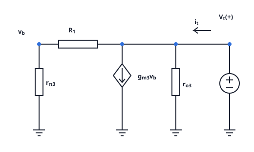

*PNP 이미터는 AC 접지예요. 자기 베이스는 접지가 아니라 $R_1$을 통해 출력과 연결돼요. 오른쪽 시험전압의 유입 전류는 왼쪽을 향해요.*

부하만 떼어 컬렉터에 $v_t$를 걸어요. 이미터는 AC 접지지만 베이스는 저항을 통해 움직여요. 베이스로 들어간 전류를 $i_b$로 잡으면 $v_b=i_br_{\pi3}$, $v_t-v_b=i_bR_1$이에요. 제어원과 베이스 전류의 합은 $(\beta+1)i_b$예요.

$$
v_t=i_b(R_1+r_{\pi3})
$$

$$
i_t=(1+\beta)i_b+\frac{v_t}{r_{o3}}
$$

$$
R_{fb}\approx\frac{R_1+r_{\pi3}}{\beta+1}=\frac{10+2.6}{101}\,\mathrm{k\Omega}\approx0.12\,\mathrm{k\Omega}
$$

$$
R_{out,h}\approx r_{o1}\parallel r_{o3}\parallel\frac{R_1+r_{\pi3}}{\beta+1}
$$

$$
A_{v1}\approx-g_mR_{out,h}\approx-4.68
$$

반올림 전의 $R_{fb}=12.6/101\,\mathrm{k\Omega}$를 병렬 계산에 써요. 약0.12kΩ라는 표시값을 다시 대입해 오차를 만들지 않아요. 두 입력은 반대 위상이어서 공통 이미터 P가 가상 접지예요.

#### (2) 전류 거울 부하

왼쪽 NPN 전류가 늘면 오른쪽 PNP의 공급도 늘고 오른쪽 NPN은 덜 흡수해요. 같은 두 입력 소자·1:1 거울·큰 $\beta$의 주항에서 순신호 전류는 $g_mv_{id}$예요.

$$
g_m=\frac{0.1}{0.026}\,\mathrm{mS}\approx3.85\,\mathrm{mS}
$$

$$
r_{o2}=\frac5{0.1}\,\mathrm{k\Omega}=50\,\mathrm{k\Omega}
$$

$$
r_{o4}=\frac4{0.1}\,\mathrm{k\Omega}=40\,\mathrm{k\Omega}
$$

$$
R_{out}\approx r_{o2}\parallel r_{o4}=\frac{200}{9}\,\mathrm{k\Omega}
$$

$$
A_{v2}\approx+g_m(r_{o2}\parallel r_{o4})\approx+85.47
$$

외부 부하가 없어도 두 Early 저항이 남아요. 유한 $\beta$의 거울 복사 오차는 여기 큰 $\beta$ 주항에서 생략하며 완전한 유한 $\beta$ 결과라고 부르지 않아요.

#### (3) 이미터 사이 저항

각 가지가0.1mA이고 두 이상 전류원은 소신호에서 개방이에요. 두 이미터가 반대로 움직이므로 $R_E$의 중간이 가상 접지예요. 알려진 축퇴 CE 반회로에 $R_E/2$를 붙여요.

$$
R_{E,h}=R_E/2=2.5\,\mathrm{k\Omega}
$$

$$
g_m=\frac{0.1}{0.026}\,\mathrm{mS}\approx3.85\,\mathrm{mS}
$$

$$
g_mR_{E,h}\approx9.62
$$

$$
A_{v3}\approx-\frac{R_C}{R_E/2}=-\frac1{2.5}=-0.4
$$

큰 $\beta$와 수업 기본 큰 축퇴 주항이에요. 입력 $r_o\approx100\,\mathrm{k\Omega}$가 축퇴로 더 커지므로1kΩ 부하가 지배해요. 참고 풀이처럼 내부 $1/g_m=0.26\,\mathrm{k\Omega}$를 남긴 gain 블록에서는 약$-0.36$이지만, 이 복습팩은 사용자 확정 큰 축퇴 주항을 최종 답으로 통일해요.

#### 완성 답과 검산

#### (1) 자기 귀환 부하

**$A_{v1}\approx-4.68$**, $V_T=26\,\mathrm{mV}$·명목1mA DC·유한 $\beta=100$의 부하 모델이에요.

$R_1\to0$이면 $(R_1+r_\pi)/(\beta+1)\to r_\pi/(\beta+1)\approx1/g_m$으로 가서 다이오드 부하처럼 돼요. $R_1+r_\pi$에 임의의 두 베이스 공유 저항을 넣지 않아요.

#### (2) 거울 부하

**$A_{v2}\approx+85.47$**, 같은 $V_T$ 가정·큰 $\beta$ 거울 주항이에요.

공급 증가와 흡수 감소로 오른쪽 출력이 올라가 양수예요. $3.85\,\mathrm{mS}$는 표시용이고 계산은 반올림 전 값을 썼어요.

#### (3) 축퇴 주항

**$A_{v3}\approx-0.4$**, 각 $I_{EE}=0.1\,\mathrm{mA}$·큰 $\beta$·큰 외부 축퇴 주항이에요.

이 주항에서는 $g_m$이 소거돼 저항비만 남아요. $R_E$를 두 배로 바꾸고 다른 조건을 고정하면 이득 크기는 약 절반이에요. 유한 축퇴 블록과의 약10% 차이는 주항 근사의 정확도 한계예요.

#### 주의할 점

(1)에서 양쪽 PNP 베이스는 서로 연결되어 있지 않아요. 각 베이스는 자기 컬렉터를 따라 움직여 $(R_1+r_\pi)/(\beta+1)$ 부하를 만들어요. (2)는 오른쪽 단일 출력이라 양수이고 (1)(3)은 왼쪽−오른쪽 차동 출력이라 음수예요. (3)의 각 전류를 다시 절반으로 나누거나 $R_E/2$ 대신$2R_E$를 쓰지 않아요.

#### 조건을 바꾸어 생각해요

1. (1)에서 $R_1$만0으로 줄이면 부하 저항은 어떤 익숙한 값에 가까워지나요?
2. (3)에서 각0.1mA 전류는 유지하고 $R_E$만10kΩ으로 바꾸면 같은 큰 축퇴 모델의 이득은 얼마인가요?

**페이지 요약**

자기 B–C 저항 부하·전류 거울·이미터 축퇴를 실제 연결로 구분해요.

#### 바이어스와 부하

$V_T=26\,\mathrm{mV}$를 가정하고 (1)(2)는 테일 전류를 절반으로 나눠요.

(1)은 두 베이스를 묶지 않으며 유한 $r_\pi$ 부하에서 이득이 약 $-4.68$예요.

(2)는 큰 $\beta$ 거울 주항에서 오른쪽 출력 이득이 약 $+85.47$예요.

#### 이미터 축퇴

(3)은 각 전류원값을 그대로 쓰며 큰 $\beta$·큰 외부 축퇴 주항에서 이득이 약 $-0.4$예요.

---

### P14. 목표 이득과 Early 전압

P10.75 · 장말문제 10.75 · [원 문제 보기](../%EB%B3%B5%EC%8A%B5%EB%AC%B8%EC%A0%9C_1007_Differential_Amplifiers-%EB%AC%B8%EC%A0%9C.pdf)

#### 주어진 조건

- 목표 전압 이득 100
- $V_{A,n} = 5\ \text{V}$

#### 구할 것

- pnp 트랜지스터에 필요한 Early 전압

원문 보기

We wish to design the stage shown in Fig. 10.96 for a voltage gain of 100. If $V_{A,n} = 5\ \text{V}$, what is the required Early voltage for the pnp transistors?

#### 문제를 읽어요

원 그림에서 아래 $Q_1,Q_2$는 NPN 입력쌍이고, 위 $Q_3,Q_4$는 PNP 전류 거울(current mirror)이에요. $Q_3$만 베이스–컬렉터를 연결하고, 출력은 오른쪽 $Q_2,Q_4$ 컬렉터의 공통 노드에서 읽어요. 입력은 $v_{id}=v_{in1}-v_{in2}$로 정의해요.

구할 것은 전류가 아니라 PNP의 Early 전압 크기 $V_{A,p}$예요. 원문은 열전압 $V_T$를 지정하지 않았으므로 **수업값 $V_T=26\,\mathrm{mV}$를 가정**해요. 짝이 맞는 입력쌍과 1:1 거울, 큰 $\beta$, 각 소자의 $g_mr_O\gg1$, 순방향 활성 영역의 저주파 소신호 근사를 사용해요. 외부 부하 저항은 연결하지 않아요.

#### 이 개념과 공식을 떠올려요

“전류 거울 부하”와 “Early 전압으로 이득 설계”라는 단서에서 [BJT 능동 부하(active load)](../%EC%A0%95%EB%A6%AC%EB%85%B8%ED%8A%B8_1007_Differential_Amplifiers.html#s2-bjt-active)의 알려진 블록식을 떠올려요. $g_m$은 입력 소자 하나의 전압–전류 변환율이고, $G_m$은 두 입력과 거울 전체의 변환율이에요. 큰 $\beta$로 베이스 전류 오차를 무시하면 거울이 한쪽 신호를 복사해 $G_m\approx g_m$이 돼요.

$G_m$은 출력을 접지로 단락한 상태에서 출력으로 공급되는 신호 전류를 입력 차전압으로 나눈 값이에요. 반면 $R_{out}$은 두 입력을 영점으로 놓고 출력에 시험원을 연결해서 보는 저항이에요. 이 문제는 두 값을 새로 측정·유도하지 않고, 조건을 확인한 주도항 블록식을 적용해요.

$$
G_m\approx g_m
$$

$$
R_{out}\approx r_{O2}\parallel r_{O4}
$$

$r_{O2}$는 NPN 출력저항, $r_{O4}$는 PNP 출력저항이에요. 두 Early 전압을 각각 저항으로 바꿔 병렬 합성하면 목표 이득에서 미지의 $V_{A,p}$를 역산할 수 있어요.

#### 종이에 쓸 첫 줄

먼저 부호를 정해요. 왼쪽 입력을 올리고 오른쪽 입력을 내리면 $Q_1$ 전류는 늘고 $Q_2$ 전류는 줄어요. $Q_3,Q_4$ 거울을 통해 위에서 공급하는 전류도 늘기 때문에 오른쪽 출력은 올라가요. 따라서 이 입력 정의의 전압이득은 양수예요.

$v_{id}=v_{in1}-v_{in2}$, 오른쪽 무부하 출력이에요. 큰 $\beta$, $g_mr_O\gg1$에서 $G_m\approx g_m$, $R_{out}\approx r_{O2}\parallel r_{O4}$를 사용해요. $V_T=26\,\mathrm{mV}=0.026\,\mathrm V$는 수업 가정이에요.

$$
A_v=\frac{v_{out}}{v_{id}}\approx+G_mR_{out}\approx+g_m(r_{O2}\parallel r_{O4})
$$

출력에 공급하는 전류를 양으로 잡았으므로 $+G_mR_{out}$이에요. 전류를 출력에서 빼내는 방향으로 정의한 공식의 마이너스를 그대로 옮기지 않아요. 조건을 확인한 능동 부하 블록식에서 병렬저항과 Early 전압의 관계를 계산해요.

#### 이렇게 풀어요

먼저 소자별 중간값을 같은 가지 전류로 표현해요. 큰 $\beta$에서 각 컬렉터의 DC 전류를 $I_C\approx I_{EE}/2$로 놓아요. $I_C$를 mA, $V_T,V_A$를 V로 쓰면 $g_m$은 mS, $r_O$는 kΩ가 되어 곱이 무차원이에요.

$$
g_m=\frac{I_C}{V_T}
$$

$$
r_{O2}=\frac{V_{A,n}}{I_C}
$$

$$
r_{O4}=\frac{V_{A,p}}{I_C}
$$

병렬저항의 역수는 가지별 역수의 합이므로 이득의 역수로 바꾸어요.

$$
\frac{1}{|A_v|}\approx\frac{1}{g_mr_{O2}}+\frac{1}{g_mr_{O4}}
$$

$$
g_mr_{O2}=\frac{I_C}{V_T}\frac{V_{A,n}}{I_C}=\frac{V_{A,n}}{V_T}
$$

$$
g_mr_{O4}=\frac{I_C}{V_T}\frac{V_{A,p}}{I_C}=\frac{V_{A,p}}{V_T}
$$

$$
\frac{1}{|A_v|}\approx\frac{V_T}{V_{A,n}}+\frac{V_T}{V_{A,p}}
$$

전류를 높이면 $g_m$은 커지지만 두 $r_O$는 같은 비율로 작아져요. 그래서 이 모델의 이득에서는 $I_C$가 소거돼요. 전류값이 원문에 없어도 Early 전압을 구할 수 있는 이유예요.

주도항 설계식에 목표 크기 100과 $V_{A,n}=5\,\mathrm V$를 넣고 PNP 항만 남겨요.

$$
\frac{0.026\,\mathrm V}{V_{A,p}}=\frac{1}{100}-\frac{0.026\,\mathrm V}{5\,\mathrm V}=4.8\times10^{-3}
$$

$$
V_{A,p}=\frac{0.026\,\mathrm V}{4.8\times10^{-3}}=\frac{65}{12}\,\mathrm V\approx5.42\,\mathrm V
$$

차이 $4.8\times10^{-3}$은 양수이므로 양의 Early 전압 크기로 실현할 수 있어요. 이 값을 0으로 둬 버리면 필요한 PNP 출력저항을 무한대로 만드는 다른 설계가 돼요.

#### 완성 답과 검산

**필요한 PNP Early 전압 크기는 $V_{A,p}=65/12\,\mathrm V\approx5.42\,\mathrm V$예요.** $V_T=26\,\mathrm{mV}$, 큰 $\beta$, $g_mr_O\gg1$인 주도항 설계에서 $A_v\approx+100$이에요.

**목표에 역대입해요.** 반올림 전 분수로 확인하면 이득 크기가 100으로 돌아와요.

$$
\frac{0.026}{5}+\frac{0.026}{65/12}=0.0052+0.0048=0.01
$$

$$
|A_v|\approx\frac{1}{0.01}=100
$$

**근사와 단위를 확인해요.** Early 전압과 열전압의 비는 무차원이고 두 소자 모두 큰 고유 이득을 가져요.

$$
g_mr_{O2}=\frac{5}{0.026}\approx192.31
$$

$$
g_mr_{O4}=\frac{65/12}{0.026}\approx208.33
$$

**PNP를 아무리 좋게 만들어도 NPN 한계가 남아요.** $V_{A,p}\to\infty$이면 아래 NPN의 출력저항만 이득을 제한해요.

$$
|A_v|_{\mathrm{limit}}\approx\frac{V_{A,n}}{V_T}=\frac{5}{0.026}\approx192.31
$$

목표 100은 이 한계보다 작아요. $V_{A,p}$를 5.42 V보다 높이면 같은 주도항 모델에서 이득은 100보다 커지지만 이 한계를 넘지는 못해요. $v_{id}>0$일 때 오른쪽 출력이 올라가므로 부호도 $+$예요. 두 Early 전압이 같아지는 특수값에서는 병렬저항이 한 소자 저항의 절반이 되는 결과와 일치해요.

#### 주의할 점

- 단일 출력이라고 $g_m/2$를 쓰면 거울이 복사하는 신호를 빠뜨려요. 여기서는 두 경로가 합쳐져 $G_m\approx g_m$이에요.
- $r_{\pi2}$는 베이스–이미터 사이예요. 출력 컬렉터와 AC 접지 사이의 $r_{O4}$에 직접 병렬로 붙이지 않아요.
- $V_{A,p}$는 PNP의 Early 전압 **크기**예요. 소자 극성이 PNP라고 음수 답을 만들지 않아요.
- 26 mV는 원문의 주어진 값이 아니에요. 온도에 따라 $V_T$가 달라지면 요구되는 Early 전압도 달라져요. 전류 독립성 역시 위 주도항 모델 안에서의 결론이에요.
- $Q_3$만 다이오드 연결이므로 전체를 완전히 대칭인 두 반회로로 잘라 출력 신호를 버리면 안 돼요.

#### 조건을 바꾸어 생각해요

1. $V_A$와 $V_T$를 고정하고 모든 가지 전류를 두 배로 하면 이득도 두 배일까요? **아니에요.** $g_m$은 두 배, 두 $r_O$는 절반이므로 병렬 합성 저항도 절반이고 곱은 같아요.
2. $V_{A,n}=5\,\mathrm V$, $V_T=26\,\mathrm{mV}$를 유지하며 이득 200을 요구하면 가능한가요? **이 주도항 모델에서 양의 유한 $V_{A,p}$로는 불가능해요.** NPN 한계 192.31보다 큰 목표이고, $1/200-0.026/5<0$이 돼요.
3. 수업 가정 대신 $V_T=25\,\mathrm{mV}$라면 목표 100에 필요한 값은 무엇일까요? **$V_{A,p}=5\,\mathrm V$예요.** $1/100-0.025/5=0.005$이므로 $0.025/0.005=5\,\mathrm V$예요.

**페이지 요약**

능동 부하의 $g_m$과 Early 저항을 곱하면 바이어스 전류가 소거돼요.

#### 목표에서 역산

$$
\frac{1}{|A_v|}\approx\frac{V_T}{V_{A,n}}+\frac{V_T}{V_{A,p}}
$$

큰 $\beta$·큰 $g_mr_O$의 거울 주항이며 왼쪽−오른쪽 입력과 오른쪽 출력의 이득은 양수예요.

#### 결과

$V_T=26\,\mathrm{mV}$를 가정하면 $V_{A,p}=65/12\,\mathrm V\approx5.42\,\mathrm V$예요.

이때 목표 이득은 $A_v\approx+100$이에요.

---

원 문제·정리노트·PDF는 보존해요.
