# 차동 증폭기 — 5살도 이해하는 정리노트

권익진 교수님 전자회로2 · 1007 수업 (Lec4, Razavi 10장)

> `정리노트_1007_Differential_Amplifiers.html`를 마크다운으로 옮겼어요. 그림은 `figures_1007/` 폴더의 SVG, 위젯은 대표 설정의 정적 그림으로 바꿨어요. 수식은 `$…$` / `$$…$$`라서 GitHub, Obsidian, Typora에서 보여요.

**목차**

- [들어가며: 왜 이런 회로를 쓸까](#why)
  - [왜 이런 회로를 쓸까](#why-circuit)
- [1. 공통 모드 잡음은 어디로 가나](#s0)
  - [1. 복습: 유한한 R_SS와 커먼 모드 하프 서킷](#s0-cm-half-recap)
  - [2. 이상적인 테일과 실제 테일에서 본 CM 잡음](#s0-cm-noise)
- [2. 비대칭과 CMRR](#s1)
  - [3. 부하 미스매치와 CM-to-DM 이득](#s1-mismatch)
  - [4. CMRR: 원하는 신호 대 원하지 않는 신호](#s1-cmrr)
- [3. 싱글엔디드 출력과 능동 부하](#s2)
  - [5. 한쪽 출력만 쓰면 생기는 두 가지 손해](#s2-single-ended)
  - [6. MOS 능동 부하 차동쌍](#s2-mos-active)
  - [7. BJT 능동 부하 차동쌍](#s2-bjt-active)
- [4. 요약 · 예고](#s3)
  - [10장 핵심 정리](#s3-cheatsheet)
  - [다음 시간 예고](#s3-next)
  - [함께 보면 좋은 자료](#s3-links)

## 들어가며: 왜 이런 회로를 쓸까

### 왜 이런 회로를 쓸까

*1007 수업 · L04 s32–40*

**쉽게 말하면**

두 입력에 함께 섞인 흔들림은 줄이고, 필요한 신호는 하나의 출력에 모으고 싶어요.

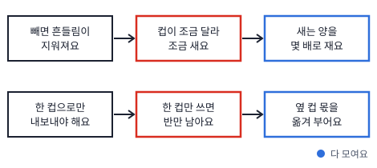

*전류 거울(current mirror)은 버리던 가지의 신호 전류를 복사해, 하나의 출력에서도 두 가지의 기여를 활용해요.*

**정확히 말하면**

**1. 풀고 싶은 문제.** 차동 증폭기(differential amplifier)는 두 입력의 차이를 키우면서, 두 선에 같은 방향으로 섞인 공통 모드(common-mode, CM) 성분을 줄이는 데 써요. 예를 들어 두 입력에 같은 잡음이 더해지면 그 입력 차이에는 잡음이 남지 않아요. 완전히 대칭인 회로의 차동 출력에서도 같은 원리로 CM 성분이 상쇄돼요. 유한한 테일 저항에서는 각 출력이 함께 흔들릴 수 있으므로, 각 출력의 흔들림과 두 출력의 차이를 구분해야 해요. 이 동작은 [2. 이상적인 테일과 실제 테일에서 본 CM 잡음](#s0-cm-noise)에서 확인해요. 실제 회로의 비대칭으로 남는 누출은 [3. 부하 미스매치와 CM-to-DM 이득](#s1-mismatch)에서 다뤄요. 다음 단이 출력 한 개를 받는 경우에는 원하는 차동 신호를 싱글엔디드(single-ended) 출력으로 옮기는 일도 필요해요.

**2. 단순한 해법과 그 한계.** 두 출력 중 하나만 고르면 출력 단자는 하나가 돼요. 그러나 같은 차동 입력을 가한 대칭 저항 부하 회로에서는 두 출력의 차이를 취할 때에 비해 신호 전압이 절반이에요. 또한 두 출력에 공통으로 남은 흔들림을 마지막에 빼서 지우는 단계도 잃어요. 테일 저항이 크면 한쪽 CM 이득도 작을 수 있으므로, 한쪽 출력에서 모든 잡음 억제 능력이 사라진다는 뜻은 아니에요. 이 두 손실은 [5. 한쪽 출력만 쓰면 생기는 두 가지 손해](#s2-single-ended)에서 비교해요. 누출만 작다고 충분한 것도 아니에요. 원하는 신호의 이득과 누출 이득을 함께 비교하는 CMRR(common-mode rejection ratio)이 필요해요. [4. CMRR: 원하는 신호 대 원하지 않는 신호](#s1-cmrr)는 이 두 전달 이득의 크기 비를 설명해요.

**3. 핵심 아이디어.** 저항 부하 대신 전류 거울로 만든 능동 부하(active load)를 써서, 왼쪽 가지의 전류 변화를 오른쪽 출력으로 복사해요. 차동 입력이 왼쪽 전류를 늘리고 오른쪽 전류를 줄이면, 미러가 오른쪽에 더 공급하는 변화와 오른쪽 입력 소자가 덜 흡수하는 변화가 함께 출력을 올려요. 예를 들어 두 효과가 각각 같은 크기로 출력 상승을 돕는다면 하나만 남길 때보다 두 배의 신호 전류를 활용해요. 이것이 단순 한쪽 취출의 절반 손실을 회복하는 이유예요. 같은 유효 출력저항을 기준으로 한 비교이며, 저항 부하와 능동 부하의 실제 이득 숫자가 항상 같다는 뜻은 아니에요. 구현은 [6. MOS 능동 부하 차동쌍](#s2-mos-active)과 [7. BJT 능동 부하 차동쌍](#s2-bjt-active)에서 살펴봐요.

**4. 대가와 쓰이는 곳.** 전류를 잘 복사하려면 미러 소자의 매칭과 올바른 동작 영역이 필요해요. 위아래 트랜지스터가 동작할 전압 여유(headroom)를 남겨야 하므로 출력이 전원 끝까지 마음대로 움직이지는 못해요. 이 설계 관점은 보충에서 구분해요. 실제 출력저항은 유한하고 외부 부하도 이득에 영향을 줘요. 또 미러의 한쪽만 다이오드 연결이므로 일반적인 대칭 하프 회로를 그대로 쓰지 않아요. [MOS 능동 부하 차동쌍](#s2-mos-active)과 [BJT 능동 부하 차동쌍](#s2-bjt-active)은 이런 조건에서의 분석을 보여줘요. 차동 입력과 한 개의 출력을 연결하는 이 구조는 op-amp 입력단 같은 곳에 쓰여요. 한편 CM 누출을 줄이려면 테일을 더 좋은 전류원으로 만들 수 있어요. 캐스코드 테일로 저항을 키우는 방향과 미스매치의 역할은 [부하 미스매치와 CM-to-DM 이득](#s1-mismatch), 성능 비교는 [CMRR](#s1-cmrr)로 이어져요.

**교수님 말씀**

> 가장 중요한 이유가 뭐라고 그랬죠? 노이즈.

여기서 제거하려는 것은 두 입력에 함께 들어온 CM 잡음이에요. 모든 종류의 잡음을 없앤다는 뜻으로 넓히지 않아요.

> 커먼 모드 리젝션 특성을 이상적인 값에 가깝도록 설계하는 게 굉장히 중요해요.

교수님은 CM-to-DM 누출을 줄이면서 원하는 차동 이득도 확보해야 하므로 CMRR로 비교한다고 설명했어요. 한쪽 취출의 잡음 상쇄 손실을 지적한 뒤에는, 테일 저항이 크면 그 한쪽 CM 이득도 작다는 점을 덧붙였어요.

> 커런트 미러에서 전류의 변화를 카피해서 출력으로 전달하는 역할을 하는 거죠.

> 이거는 사실은 굉장히 많이 쓰는 구조예요.

op-amp의 차동 입력과 한 개의 출력을 실제 쓰임으로 들었어요. 차동 구조의 대가로 전류와 차동 신호 생성도 언급했어요. 강의의 “전류가 2배”는 두 가지를 구성하는 비교의 설명이며, 서로 다른 모든 증폭기 설계가 정확히 같은 전력비를 갖는다는 법칙은 아니에요.

**보충 · 수업에서 유도하진 않았어요**

능동 부하는 큰 저항의 면적 부담을 줄이며 높은 이득을 얻는 데도 쓰여요. Razavi 10.6절의 책 551쪽 상자는 1967년 Robert Widlar의 LM101A를 역사적 사례로 들고, MOS 능동 부하 차동쌍을 5-트랜지스터 OTA라고도 부른다고 설명해요. OTA는 operational transconductance amplifier의 약자예요. 이는 교과서의 배경 설명이며 이번 수업에서 역사나 명칭을 유도한 것은 아니에요.

헤드룸과 매칭은 실제 설계에서 확인할 조건이에요. 미러 트랜지스터를 포함한 소자들이 포화 영역 또는 활성 영역을 유지해야 전류 복사가 유효해요. 수업에서는 $g_mr_o\gg1$, 축퇴 저항에 대해 $g_mR_e\gg1$을 기본으로 큰 곱항을 써요. 캐스코드의 출력저항은 아래쪽 저항에 캐스코드 소자의 $g_mr_o$를 곱해요. 여기서 $R_e$는 외부 축퇴 저항이며 $1/g_m$인 내부 이미터 저항과 구별해요. 테일을 캐스코드로 만들면 더 큰 테일 저항을 얻는 대신 추가 소자가 동작할 전압이 필요하므로 입력 CM 범위에도 제약을 줄 수 있어요. 매칭을 개선하는 설계는 가능하지만 제조 때 생길 무작위 오차를 원하는 값으로 직접 지정할 수는 없어요.

**페이지 요약**

차동 구조로 CM 잡음을 줄이고, 전류 거울로 두 가지 신호를 한 출력에 모아요.

#### 풀고 싶은 문제

같이 들어온 CM 성분은 줄이고 원하는 차동 신호는 한 출력으로 전달해요.

#### 핵심 아이디어

전류 거울이 반대쪽 가지의 전류 변화를 복사해 두 신호 기여를 합쳐요.

#### 확인할 조건

같은 유효 출력저항 기준으로 한쪽 취출의 절반 손실을 회복해요.

거울의 매칭과 소자의 동작 영역을 확인해요.

---

## 1. 공통 모드 잡음은 어디로 가나

### 1. 복습: 유한한 R_SS와 커먼 모드 하프 서킷

*1007 수업 · L04 s32–33*

**쉽게 말하면**

두 입력이 같이 올라가면 두 가지 전류도 같이 늘고, 유한한 테일 저항 때문에 소스 P도 올라가 전류 증가를 억제해요.

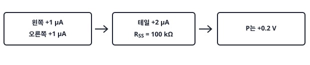

*한쪽 반회로에서는 같은 1 μA로 같은 0.2 V를 만들어야 해서 소스 아래 저항이 200 kΩ가 돼요.*

**정확히 말하면**

공통 모드(common-mode, CM)는 두 입력에 같은 전압 변화가 들어가는 자극이에요. 원하는 차동 입력은 두 입력의 차예요.

$$
v_{id}=v_{in1}-v_{in2}
$$

$$
v_{od}=v_{out1}-v_{out2}
$$

여기서는 같은 입력 MOS 두 개와 같은 부하 $R_D$를 가진 저주파 소신호 회로를 다뤄요. 두 소자는 포화 영역에 있고, 입력 소자의 $r_O$와 바디 효과는 무시해요. 테일 전류원의 **유한한 출력저항** $R_{SS}$는 남겨요. 이 저항은 DC 전류 $I_{SS}$ 자체가 아니라 테일 전압 변화에 따른 전류 변화를 나타내요.

**작은 예시를 먼저 적용해요.** 각 가지 증분이 $1\,\mu\mathrm A=0.001\,\mathrm{mA}$이고 $R_{SS}=100\,\mathrm{k\Omega}$라면 다음과 같아요.

$$
\Delta i_{tail}=2\Delta i_D=0.002\,\mathrm{mA}
$$

$$
\Delta v_P=100\,\mathrm{k\Omega}\times0.002\,\mathrm{mA}=0.2\,\mathrm V
$$

반회로에서도 P 전압은 0.2 V여야 해요. 따라서 한 가지 전류 0.001 mA가 보는 저항은 $0.2\,\mathrm V/(0.001\,\mathrm{mA})=200\,\mathrm{k\Omega}$, 즉 $2R_{SS}$예요.

**실제 CM 입력·부하 조건을 적용한 반회로예요.** 두 게이트에 같은 $\Delta v_{in,CM}$을 인가하고 전원은 AC 접지로 둬요. 출력은 $R_D$만 연결된 드레인에서 읽으며, 출력 단락이나 시험원을 붙이는 측정이 아니에요.

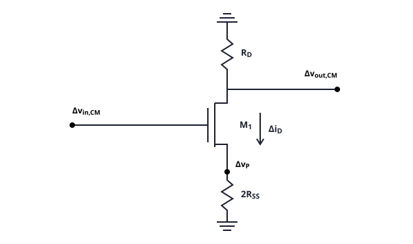

*CM 하프 서킷(common-mode half circuit)은 소스 축퇴(source degeneration) CS 단이에요. $r_O$와 바디 효과를 생략한 모델에서 드레인 전류와 소스 전류가 같고, $\Delta v_P=2R_{SS}\Delta i_D$예요. P에는 접지 기호를 직접 붙이지 않아요.*

1. 같은 두 입력과 대칭 가지에서는 테일에 두 가지 전류가 합쳐져요.

   $$
   \Delta v_P=(2\Delta i_D)R_{SS}=\Delta i_D(2R_{SS})
   $$

   따라서 반쪽 소스 아래에는 $2R_{SS}$를 붙여요. $2R_{SS}\parallel2R_{SS}=R_{SS}$이고, CM에서 P를 가상 접지로 바꾸지는 않아요.
2. 이 반회로는 소스 축퇴 CS 단이므로, 알려진 축퇴 전압이득을 바로 적용해요.

   $$
   A_{CM}=-\frac{g_mR_D}{1+g_m(2R_{SS})}
   $$

   $$
   A_{CM}\approx-\frac{R_D}{2R_{SS}}\qquad(2g_mR_{SS}\gg1)
   $$

   수업의 큰 축퇴 근사에서는 입력 전압을 $2R_{SS}$로 나눈 가지 전류에 부하 $-R_D$를 곱하면 끝나요.

보충: 축퇴 이득의 첫 식 확인

위 반회로에서 입력 MOS의 $r_O$와 바디 효과를 생략했으므로 드레인 전류와 소스 전류가 같아요. 소스가 따라 올라간 전압을 제어 전압에서 빼요.

$$
\Delta i_D=g_m(\Delta v_{in,CM}-2R_{SS}\Delta i_D)
$$

$$
\Delta v_{in,CM}=(1/g_m+2R_{SS})\Delta i_D
$$

$$
\Delta v_{out,CM}=-R_D\Delta i_D
$$

$$
A_{CM}=-\frac{R_D}{1/g_m+2R_{SS}}=-\frac{R_D/2}{R_{SS}+1/(2g_m)}
$$

마지막은 슬라이드 s33과 같은 식이에요. 독립적인 출력 단락·시험원 계산을 추가할 필요 없이 같은 반회로에서 전압이득을 얻어요.

$2g_mR_{SS}\gg1$이면 소스 쪽 합에서 $1/g_m$을 무시할 수 있어요.

$$
A_{CM}\approx-\frac{R_D}{2R_{SS}}
$$

이 근사 조건만으로 이득 크기가 반드시 1보다 작아지는 것은 아니에요. 추가로 보통의 설계처럼 $R_{SS}\gg R_D$이면 $|A_{CM}|\ll1$이에요. $R_D,g_m$을 고정하고 큰 $R_{SS}$를 두 배로 키우면 CM 전류 변화와 각 출력의 CM 흔들림은 약 절반이 돼요.

이상적 테일의 극한 $R_{SS}\to\infty$에서는 CM 전류 변화가 0이에요. 회로가 대칭이면 유한한 테일에서도 두 출력의 CM 변화가 같아 차동 출력은 변하지 않아요.

$$
\Delta v_{out1}=\Delta v_{out2}
$$

$$
\Delta v_{od}=\Delta v_{out1}-\Delta v_{out2}=0
$$

따라서 $A_{CM}$은 CM 입력에서 **출력 CM**으로 가는 이득이에요. 차동 입력의 차동 출력 이득 $A_{DM}$이나 CM 입력의 차동 출력 누출 이득과 구별해요.

| 구분 | 차동 하프 서킷 | 공통 모드 하프 서킷 |
|---|---|---|
| 입력 자극 | $+v_{id}/2$, $-v_{id}/2$ | 양쪽에 같은 $\Delta v_{in,CM}$ |
| 테일 P | 대칭에 의한 가상 접지 | 일반적으로 움직임 |
| 소스 아래 | AC 접지 | $2R_{SS}$ |
| 계산 목적 | 차동 이득 | CM 자극에 대한 각 출력 변화 |

BJT는 $R_D\to R_C$, $R_{SS}\to R_{EE}$로 대응하며, 큰 $\beta$로 베이스 전류를 무시하고 입력 소자의 $r_O$를 무시하면 같은 구조예요.

$$
A_{CM}\approx-\frac{R_C}{2R_{EE}}\qquad(2g_mR_{EE}\gg1)
$$

유한 $\beta$가 중요하면 이미터 전류와 컬렉터 전류를 같게 둘 수 없어요. 위 BJT 식은 그 오차를 무시한 결과예요. 교과서 식 10.180–10.181도 이 구조를 보여줘요. 지난 유도는 [1002 정리노트: CM 절반 회로로 다시 풀기](../../1002/정리노트_1002_Differential_Amplifiers.html#s3-cm-half)에 있어요.

**교수님 말씀**

> “커먼 모드 하프 서킷을 이용하면 조금 편하다고 그랬죠.”

학생이 CM에서도 같은 하프 서킷을 쓰는지 질문했어요. 교수님은 같은 반쪽 두 개로 나눌 수 있다는 뜻은 같지만, 차동 하프 서킷과 CM 하프 서킷의 소스 연결은 다르다고 설명했어요.

**꼭 기억해요**

> “가장 중요한 이유가 뭐라고 그랬죠? 노이즈.”

> “커먼 모드 신호가 들어올 때는 여기를 그라운드로 할 수 없다”

제거 대상으로 설명한 잡음은 두 입력에 함께 들어오는 CM 성분이에요. 모든 잡음이 CM인 것은 아니에요. $R_{SS}/2$를 쓰거나 P를 가상 접지로 두면 CM 반회로의 KCL이 달라져요.

**페이지 요약**

CM에서는 소스 아래에 $2R_{SS}$를 둔 축퇴 반회로를 써요.

#### 반회로의 첫 식

$$
\Delta v_P=2R_{SS}\Delta i_D
$$

#### 각 출력의 CM 이득

$$
A_{CM}\approx-\frac{R_D}{2R_{SS}}
$$

같은 입력쌍·부하에서 입력 $r_O$와 몸체 효과를 생략하고 $2g_mR_{SS}\gg1$을 적용해요.

#### 구별할 점

CM에서 P는 움직이며, 차동 자극의 가상 접지와 달라요.

완전 대칭이면 각 출력이 함께 흔들려도 두 출력의 차는 0이에요.

---

### 2. 이상적인 테일과 실제 테일에서 본 CM 잡음

*1007 수업 · L04 s34–35*

**쉽게 말하면**

대칭인 두 출력에 같은 잡음이 남아도, 두 출력을 빼면 그 잡음은 지워지고 반대 방향의 원하는 신호는 더해져요.

*이 예시는 각 출력에 같은 잡음이 있다는 사실과 차동 출력에 잡음이 있다는 사실이 다름을 보여줘요.*

**정확히 말하면**

**작은 예시예요.** 원하는 출력 성분이 각각 $+10\,\mathrm{mV}$, $-10\,\mathrm{mV}$이고 출력에 남은 CM 잡음이 양쪽 모두 $+2\,\mathrm{mV}$인 순간을 생각해요.

$$
v_{out1}=10\,\mathrm{mV}+2\,\mathrm{mV}=12\,\mathrm{mV}
$$

$$
v_{out2}=-10\,\mathrm{mV}+2\,\mathrm{mV}=-8\,\mathrm{mV}
$$

$$
v_{od}=12\,\mathrm{mV}-(-8\,\mathrm{mV})=20\,\mathrm{mV}
$$

잡음 없이 원하는 출력 두 개를 뺐을 때와 같아요. 이 숫자는 **출력에 남은 잡음**의 예시이며 입력 잡음이 그대로 2 mV 전달된다는 뜻은 아니에요.

슬라이드 s34–35·교과서 그림 10.46은 BJT 차동쌍을 보여줘요. 입력 A·B에 원하는 음악 신호를 반대 위상으로 보내고, 외부의 같은 잡음이 함께 섞이는 상황이에요. BJT 테일의 $I_{EE},R_{EE}$는 MOS의 $I_{SS},R_{SS}$에 대응해요. 원리는 같지만 BJT 전류 관계의 단순화에는 큰 $\beta$가 필요해요.

DC 동작점 주위의 작은 변화로 쓰고, 두 가지 부하·입력 소자가 대칭이며 신호가 선형 범위에 있다고 가정해요. 입력 CM 잡음 $n(t)$과 원하는 입력 차동 신호 $v_{id}(t)$를 구별해요.

$$
v_{in1}(t)=\frac{v_{id}(t)}2+n(t)
$$

$$
v_{in2}(t)=-\frac{v_{id}(t)}2+n(t)
$$

원하는 출력 성분을 각각 $s_o(t),-s_o(t)$라 하고, 공통 출력 잡음 성분을 $n_o(t)$라 두면 중첩 원리에 따라 다음처럼 써요. $s_o$는 출력에 정의한 신호여서 입력·출력의 반전 부호를 별도로 가정하지 않아요.

$$
v_{out1}(t)=s_o(t)+n_o(t)
$$

$$
v_{out2}(t)=-s_o(t)+n_o(t)
$$

$$
v_{out,CM}(t)=\frac{v_{out1}(t)+v_{out2}(t)}2=n_o(t)
$$

$$
v_{od}(t)=v_{out1}(t)-v_{out2}(t)=2s_o(t)
$$

**이상적인 테일.** $R_{SS}\to\infty$이면 CM 자극에 대한 테일 증분이 0이에요. 대칭 때문에 두 가지 CM 전류가 같으면서 합도 0이어야 하므로 각각 0이에요. 따라서 각 출력에도 이 입력 CM 잡음이 나타나지 않아요.

$$
\Delta i_{D,CM}=0
$$

$$
n_o(t)=0
$$

원하는 차동 신호에 대한 가지 변화는 크기가 같고 부호가 반대이므로 테일 총전류를 바꾸지 않으면서 각 출력의 신호는 만들어요. DC 전류가 사라지는 것이 아니라 평형에서는 양쪽에 $I_{SS}/2$가 흐르고 그 위에 증분이 얹혀요.

**유한한 실제 테일.** CM 잡음이 P를 움직이면 $R_{SS}$로 증분 전류가 흐르고, 두 가지에 같은 전류 변화가 생겨 각 출력에도 같은 잡음이 나타나요. [CM 반회로](#s0-cm-half-recap)의 큰 축퇴 주항을 바로 써요. $2g_mR_{SS}\gg1$이며 입력 $r_O$와 바디 효과를 생략해요.

$$
n_o(t)=A_{CM}n(t)
$$

$$
A_{CM}\approx-\frac{R_D}{2R_{SS}}
$$

BJT는 큰 $\beta$, 입력 $r_O$ 무시 조건에서 다음 꼴로 대응해요.

$$
A_{CM}\approx-\frac{R_C}{2R_{EE}}
$$

보통 $R_{SS}\gg R_D$이면 각 출력의 잡음 크기도 입력보다 훨씬 작아요. 두 출력에 남은 잡음끼리는 같은 위상이고, 음의 $A_{CM}$ 때문에 입력 CM 잡음과 출력 CM 잡음은 반전돼요. 강의의 파형은 상쇄 원리를 보이려고 잡음을 크게 그린 개념도이므로 실제 감쇠량을 파형 높이에서 읽지 않아요.

| 입력 CM 잡음에 대한 응답 | 이상적 테일 | 유한한 테일, 완전 대칭 |
|---|---|---|
| 각 출력의 CM 잡음 | 0 | 동일한 $n_o(t)$가 남음 |
| 출력 CM 성분 | 0 | $A_{CM}n(t)$ |
| 차동 출력의 CM 잡음 | 0 | 0, 두 출력의 차에서 상쇄 |
| 원하는 반대 위상 출력 | 두 출력을 빼면 한쪽 출력 성분의 2배 |  |

DC 레벨도 공통 모드 성분이에요. 여기서 CM 변화는 잡음이나 두 입력에 함께 가한 작은 변화이며, 갑작스러운 변화만을 뜻하는 용어는 아니에요. 실제 잡음 중 두 입력에 같게 들어오지 않는 성분과 소자 내부 잡음까지 모두 제거된다는 주장은 하지 않아요.

**상쇄의 조건은 대칭이에요.** 유한한 테일만으로 차동 출력의 CM 누출이 생기는 것은 아니에요. 비대칭까지 있으면 남은 잡음이 서로 달라져 차에서도 지워지지 않을 수 있어요. 이 조건은 [3. 부하 미스매치와 CM-to-DM 이득](#s1-mismatch)에서 계산해요. 한 출력만 읽으면 두 출력을 빼는 마지막 상쇄는 이용하지 못해요.

**교수님 말씀**

교수님은 원하는 신호를 음악 신호에 빗대고, 외부 잡음은 두 입력에 같은 위상으로 함께 들어오는 경우로 설명했어요. 각 출력에 남은 잡음과 최종 차동 출력에 남은 잡음을 구별해야 해요.

> “MOSFET이나 BJT는 사실은 같아요.”

슬라이드가 BJT인 것은 책의 BJT 그림을 가져왔기 때문이라고 설명했어요. 같은 문단에서 실제 출력 잡음은 큰 테일 저항 때문에 그림보다 훨씬 줄어든다고 덧붙였어요.

**페이지 요약**

대칭 회로에서는 두 출력에 남은 같은 CM 잡음도 차동 출력에서 상쇄돼요.

#### 남는 신호와 잡음

$$
n_o(t)=A_{CM}n(t)
$$

$$
v_{od}(t)=2s_o(t)
$$

#### 테일과 대칭의 역할

이상적 테일은 각 출력의 입력 CM 잡음도 없애요.

유한한 테일에서는 각 출력에 같은 잡음이 남을 수 있어요.

상쇄에는 좌우 대칭과 선형 소신호 조건이 필요해요.

---

## 2. 비대칭과 CMRR

### 3. 부하 미스매치와 CM-to-DM 이득

*1007 수업 · L04 s36*

**쉽게 말하면**

같은 전류 변화도 두 부하 저항이 다르면 서로 다른 전압 변화가 되어, 차동 출력에 흔들림이 남아요.

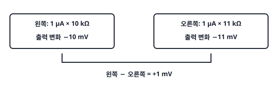

*공통 모드 입력이 만든 전류 변화는 같아도, 저항의 불일치(mismatch)가 출력의 차이를 만들어요.*

**정확히 말하면**

예를 들어 두 가지 전류가 모두 $1\,\mu\mathrm A=0.001\,\mathrm{mA}$ 증가하면, $10\,\mathrm{k\Omega}$와 $11\,\mathrm{k\Omega}$의 출력은 각각 $-10\,\mathrm{mV}$와 $-11\,\mathrm{mV}$ 변해요. $\mathrm{mA}\times\mathrm{k\Omega}=\mathrm V$이며, 왼쪽에서 오른쪽을 뺀 차동 출력의 변화는 $+1\,\mathrm{mV}$예요.

이번 모델은 입력 MOS 두 개의 $g_m$은 같고, 왼쪽 부하는 $R_D$, 오른쪽 부하는 $R_D+\Delta R_D$예요. 입력 소자의 $r_O$에 의한 드레인 전압 피드백과 몸체 효과는 무시해요. 소자들이 포화 영역에 머무르는 작은 저주파 변화만 다뤄요. 이 모델에서 두 소스와 게이트의 전압이 같으므로 두 가지의 증분 전류도 같아요. $r_O$를 포함하면 부하 차이가 전류에도 영향을 줄 수 있어요.

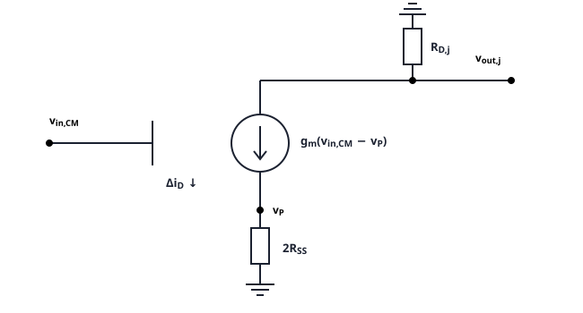

*CM 자극에서는 소스 $v_P$가 움직이므로 접지하지 않아요. 게이트는 제어 단자이고 제어원과 도선으로 이어지지 않아요. 왼쪽 하프는 $R_{D,1}=R_D$, 오른쪽 하프는 $R_{D,2}=R_D+\Delta R_D$로 읽어요. 각 하프의 $2R_{SS}$가 병렬이면 원래 테일의 $R_{SS}$가 돼요. 출력은 개방 전압을 읽으며 $r_O$는 위 근사로 생략했어요.*

**반회로로 바로 계산해요.** 이미 소스 아래 저항이 $2R_{SS}$인 축퇴 CS 단임을 알았으므로 큰 축퇴 주항을 써요. 두 부하가 달라도 입력 $r_O$를 생략한 모델에서는 가지 전류가 같아요.

$$
\frac{\Delta i_D}{\Delta v_{in,CM}}\approx\frac1{2R_{SS}}
$$

$$
A_{CM,1}\approx-\frac{R_D}{2R_{SS}}
$$

$$
A_{CM,2}\approx-\frac{R_D+\Delta R_D}{2R_{SS}}
$$

$$
\frac{\Delta v_{od}}{\Delta v_{in,CM}}=A_{CM,1}-A_{CM,2}\approx\frac{\Delta R_D}{2R_{SS}}
$$

수업의 기본 조건 $2g_mR_{SS}\gg1$에서의 결과예요. 아래 전개는 같은 반회로의 전류 관계와 부호를 확인하는 보충이에요.

보충: 반회로 전류와 출력 차의 연결

1. 두 가지 전류가 같은 양 $\Delta i_D$ 증가하므로 테일에는 두 배가 흘러요.

   $$
   \Delta i_{tail}=2\Delta i_D
   $$

   $$
   \Delta v_P=2R_{SS}\Delta i_D
   $$
2. 입력 변화 중 소스가 따라 올라간 부분을 빼야 실제 게이트–소스 제어 전압이 남아요.

   $$
   \Delta v_{GS}=\Delta v_{in,CM}-\Delta v_P
   $$

   $$
   \Delta i_D=g_m(\Delta v_{in,CM}-2R_{SS}\Delta i_D)
   $$
3. 전류가 들어간 항을 한쪽에 모은 뒤 $g_m$으로 나눠요.

   $$
   \Delta i_D(1+2g_mR_{SS})=g_m\Delta v_{in,CM}
   $$

   $$
   \Delta v_{in,CM}=\Delta i_D(1/g_m+2R_{SS})
   $$

   $$
   \Delta i_D=\frac{\Delta v_{in,CM}}{1/g_m+2R_{SS}}
   $$

   $1/g_m$과 $2R_{SS}$는 모두 저항이에요. 소스 상승의 되먹임이 분모에 더해져 전류 변화가 줄어요.
4. AC 접지인 전원에서 부하 전압강하가 커지므로 드레인 출력은 내려가요.

   $$
   \Delta v_{out1}=-R_D\Delta i_D
   $$

   $$
   \Delta v_{out2}=-(R_D+\Delta R_D)\Delta i_D
   $$
5. 출력 순서를 먼저 정하고 두 음수를 빼요.

   $$
   v_{od}=v_{out1}-v_{out2}
   $$

   $$
   \Delta v_{od}=-R_D\Delta i_D+(R_D+\Delta R_D)\Delta i_D=\Delta R_D\Delta i_D
   $$

   $$
   \frac{\Delta v_{od}}{\Delta v_{in,CM}}=\frac{\Delta R_D}{1/g_m+2R_{SS}}
   $$

   오른쪽 저항이 크고 $\Delta v_{in,CM}$이 양수이면 오른쪽 출력이 더 내려가므로 이 부호는 양수예요. 출력 순서를 바꾸면 부호가 바뀌어요.
6. 수업에서 비교하는 CM-to-DM 이득 $A_{CM-DM}$은 이 전달비의 크기로 정의해요.

   $$
   A_{CM-DM}\equiv\left|\frac{\Delta v_{od}}{\Delta v_{in,CM}}\right|=\frac{|\Delta R_D|}{1/g_m+2R_{SS}}
   $$

   $2g_mR_{SS}\gg1$일 때만 $1/g_m$을 생략해요.

   $$
   A_{CM-DM}\approx\frac{|\Delta R_D|}{2R_{SS}}
   $$

$\Delta R_D=0$이면 유한한 $R_{SS}$ 때문에 각 출력이 흔들려도 두 출력의 차이는 0이에요. 반대로 이 모델에서 $R_{SS}\to\infty$이면 전류 변화 자체가 0으로 가요. 따라서 유한 테일 저항과 비대칭이 함께 있어야 이 경로로 공통 모드 입력이 차동 출력에 새어요. 각 출력의 공통 모드 변화에 관한 $A_{CM}$과 혼동하지 않아요.

BJT 입력쌍에 같은 형태를 적용할 때는 $R_D$를 $R_C$, $R_{SS}$를 $R_{EE}$로 바꿔요. 입력쌍의 베이스 전류를 무시하는 큰 $\beta$ 및 Early 효과를 무시하는 조건이 필요해요. 유한 $\beta$를 유지하면 테일 전류는 컬렉터 전류 변화의 단순 두 배가 아니라 이미터 전류 변화의 합이에요.

**교수님 말씀**

교수님은 공정에서 완벽한 대칭을 만들기 어렵다고 설명하고, 같은 입력 소자에 부하 불일치만 남겨 누출을 계산했어요. 강의의 저항 “20%”는 절대 저항의 공정 편차 설명이지 모든 저항 쌍의 매칭 오차가 20%라는 뜻은 아니에요.

테일 저항을 키우는 방법으로 캐스코드 전류원을 언급했어요. 무작위 $\Delta R_D$를 독립 바이어스처럼 원하는 값으로 지정할 수 없다는 설명이며, 레이아웃과 매칭 설계의 효과를 부정하는 말은 아니에요.

**꼭 기억해요**

> 커먼 모드 리젝션 특성을 이상적인 값에 가깝도록 설계하는 게 굉장히 중요해요.

같은 CM 입력, 같은 가지 전류, 다른 부하, 다른 출력 변화의 순서로 설명해요. 부호를 구할 때는 오른쪽 저항과 출력 빼기 순서를 함께 적어요.

**페이지 요약**

유한 테일 저항과 부하 불일치가 함께 있으면 CM 입력이 차동 출력으로 새어요.

#### 누출의 크기

$$
A_{CM-DM}\approx\frac{|\Delta R_D|}{2R_{SS}}
$$

입력쌍 일치·입력 $r_O$와 몸체 효과 생략·$2g_mR_{SS}\gg1$ 조건이에요.

#### 부호와 상쇄

오른쪽 부하가 더 크고 왼쪽−오른쪽 출력을 읽으면 부호 있는 전달비는 양수예요.

$A_{CM-DM}$은 그 크기이며 각 출력의 $A_{CM}$과 달라요.

부하가 같아지거나 테일 저항이 무한대로 가면 이 누출은 0이에요.

---

### 4. CMRR: 원하는 신호 대 원하지 않는 신호

*1007 수업 · L04 s37*

**쉽게 말하면**

CMRR은 같은 크기로 넣은 원하는 차동 입력과 원치 않는 공통 모드 입력이 출력에서 얼마나 큰 차이를 만드는지 비교해요.

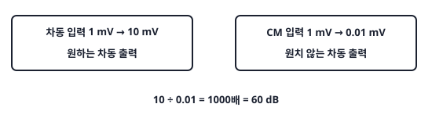

*두 출력 모두 같은 차동 출력 단자에서 비교하며, CMRR이 클수록 원하는 성분이 상대적으로 커요.*

**정확히 말하면**

예시의 차동 전압 이득 크기는 10, CM-to-DM 이득 크기는 0.01이에요. 같은 $1\,\mathrm{mV}$ 입력으로 얻은 $10\,\mathrm{mV}$와 $0.01\,\mathrm{mV}$를 나누면 1000이 돼요. 입력 크기가 같으므로 출력의 비에서 입력 크기가 소거돼요.

공통 모드 제거비(common-mode rejection ratio, CMRR)는 원하는 차동 이득의 크기를 원치 않는 CM-to-DM 이득으로 나눈 무차원 비예요. 다음 두 자극은 따로 가하고 각각 같은 출력 $v_{od}$를 읽어요.

$$
v_{id}=v_{in1}-v_{in2}
$$

$$
A_{DM}=\left.\frac{v_{od}}{v_{id}}\right|_{v_{in,CM}=0}
$$

$$
A_{CM-DM}=\left|\left.\frac{\Delta v_{od}}{\Delta v_{in,CM}}\right|_{v_{id}=0}\right|
$$

$$
\mathrm{CMRR}=\frac{|A_{DM}|}{A_{CM-DM}}
$$

저항 부하 NMOS 차동쌍에서 $v_{od}=v_{out1}-v_{out2}$를 쓰면, 왼쪽 입력 증가로 왼쪽 출력은 내려가므로 부호 있는 차동 이득은 음수예요. 입력 소자의 $r_O$를 무시하고 $|\Delta R_D|\ll R_D$이면 다음 크기 근사를 써요.

$$
A_{DM}\approx-g_mR_D
$$

$$
|A_{DM}|\approx g_mR_D
$$

분모는 각 출력의 CM 이득 $A_{CM}$이 아니라 [부하 미스매치와 CM-to-DM 이득](#s1-mismatch)의 $A_{CM-DM}$이에요. 완전 대칭에서 $A_{CM-DM}=0$이면 이 모델의 CMRR은 무한대로 가지만, 유한 테일 저항에 의한 각 출력의 CM 변화는 남을 수 있어요.

전압비이므로 dB에서는 20을 곱해요.

$$
\mathrm{CMRR}_{dB}=20\log_{10}(\mathrm{CMRR})
$$

$$
20\log_{10}(1000)=60\,\mathrm{dB}
$$

다른 인자를 고정하면 큰 테일 저항 영역에서 $R_{SS}$를 10배 키울 때 CMRR이 약 10배 커져요. $|\Delta R_D|$를 10분의 1로 줄여도 CMRR은 10배 커져요. 비율 10배의 증가는 20 dB 증가예요. 작은 $R_{SS}$까지 같은 비례를 확대하지 않아요.

**교수님 말씀**

교수님은 같은 크기의 입력 신호와 잡음을 넣었을 때 출력에서 원하는 것과 원치 않는 것의 상대적인 비라고 설명했어요. “SNR이 크다”는 직관을 빌린 설명이에요. CMRR은 전압 전달 이득의 비이며, 실제 신호와 잡음 입력의 크기나 잡음의 종류까지 정하는 지표는 아니에요.

**꼭 기억해요**

> 차동 증폭기에서는 굉장히 중요한 개념이 되겠습니다.

교수님은 CM 이득, CM-to-DM 이득, CMRR을 구하고 CM 리젝션의 의미를 설명할 수 있어야 한다고 강조했어요.

**보충 · 수업에서 유도하진 않았어요**

수업에서 제시한 확장식을 한 줄씩 복원해요. 입력쌍이 같고 $r_O$·몸체 효과를 무시하며 부하 미스매치가 작은 조건이에요. BJT의 대응에는 큰 $\beta$와 Early 효과 무시도 필요해요.

1. 정의에 두 전달 이득의 크기를 넣어요.

   $$
   \mathrm{CMRR}\approx g_mR_D\div\frac{|\Delta R_D|}{1/g_m+2R_{SS}}
   $$
2. 분수의 역수를 곱해요.

   $$
   \mathrm{CMRR}\approx\frac{g_mR_D}{|\Delta R_D|}(1/g_m+2R_{SS})
   $$
3. $g_m$을 괄호 안에 분배해요.

   $$
   \mathrm{CMRR}\approx\frac{R_D}{|\Delta R_D|}(1+2g_mR_{SS})
   $$
4. 수업의 기본 큰 축퇴 조건 $2g_mR_{SS}\gg1$로 1을 생략해요.

   $$
   \mathrm{CMRR}\approx2g_mR_{SS}\frac{R_D}{|\Delta R_D|}
   $$

정적 계산 예로 $g_m=5\,\mathrm{mS}$, $R_D=2\,\mathrm{k\Omega}$, $R_{SS}=100\,\mathrm{k\Omega}$, $|\Delta R_D|/R_D=1\%$를 써요. 미스매치 저항을 먼저 같은 단위로 바꿔요.

$$
|\Delta R_D|=0.01\times2\,\mathrm{k\Omega}=0.02\,\mathrm{k\Omega}
$$

$$
2g_mR_{SS}=2\times5\,\mathrm{mS}\times100\,\mathrm{k\Omega}=1000
$$

$$
|A_{DM}|\approx5\,\mathrm{mS}\times2\,\mathrm{k\Omega}=10
$$

$$
A_{CM-DM}\approx\frac{0.02\,\mathrm{k\Omega}}{200\,\mathrm{k\Omega}}=1\times10^{-4}
$$

$$
\mathrm{CMRR}\approx\frac{2}{0.02}\times1000=100000
$$

$$
\mathrm{CMRR}_{dB}\approx100\,\mathrm{dB}
$$

작은 이득은 0.00으로 표시하지 않고 과학 표기로 적었어요. 이 예시는 수업의 기본 큰 곱항 근사로 계산했어요. 이것은 수업에서 상세 계산한 예제가 아니라 위 식의 적용 예시예요.

**페이지 요약**

CMRR은 같은 차동 출력에서 원하는 이득과 CM 누출 이득의 크기를 비교해요.

#### 정의

$$
\mathrm{CMRR}=\frac{|A_{DM}|}{A_{CM-DM}}
$$

$$
\mathrm{CMRR}_{dB}=20\log_{10}(\mathrm{CMRR})
$$

#### 작은 부하 불일치

$$
\begin{aligned}\mathrm{CMRR}&\approx\frac{R_D}{|\Delta R_D|}\\&\quad\times2g_mR_{SS}\end{aligned}
$$

입력쌍 일치·입력 $r_O$와 몸체 효과 생략·작은 불일치·큰 축퇴 조건이에요.

분모에는 각 출력의 $A_{CM}$ 대신 차동 출력의 누출을 써요.

---

## 3. 싱글엔디드 출력과 능동 부하

### 5. 한쪽 출력만 쓰면 생기는 두 가지 손해

*1007 수업 · L04 s38*

**쉽게 말하면**

두 출력의 차에서 신호를 읽다가 오른쪽 출력 하나만 읽으면, 신호는 절반이 되고 공통 모드 변화는 서로 지워지지 않아요.

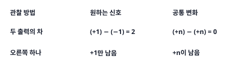

*신호 변화가 양쪽에서 각각 1만큼 반대로 생기면 차이는 2이고 한쪽은 1이에요.*

**정확히 말하면**

**작은 예시를 먼저 적용해요.** 같은 차동 입력에서 왼쪽 출력이 −10 mV, 오른쪽이 +10 mV 움직이면 차동 출력의 크기는 20 mV이고, 오른쪽 하나의 변화는 10 mV예요. 양쪽에 같은 +3 mV 잡음이 추가되면 차동 출력에서는 없어지지만 오른쪽 출력에는 +3 mV가 남아요. 신호의 변화와 공통 변화는 따로 계산해야 해요.

**왜 출력 하나가 필요한가요?** 차동으로 처리한 신호를 접지 기준의 한 출력으로 내보내야 할 때가 있어요. 차동 입력·싱글엔디드(single-ended) 출력인 op-amp가 대표적이에요. 가장 쉬운 방법은 두 출력 중 한 노드만 쓰는 것이지만 두 가지 손해가 생겨요.

1. **같은 차동 입력을 유지해요.** 완전 대칭 저항 부하 쌍, 작은 입력, 입력 소자의 출력저항은 무시하고 각 부하를 $R_D$라 해요. 왼쪽 입력에 $+\Delta V$, 오른쪽 입력에 $-\Delta V$를 인가해요.

   $$
   v_{id}=v_{in1}-v_{in2}=2\Delta V.
   $$
2. **양쪽은 반대로 움직여요.** 차동 자극에서 대칭인 테일 노드가 가상 접지이므로 각 쪽은 CS 반회로예요.

   $$
   v_{out1}=-g_mR_D\Delta V.
   $$

   $$
   v_{out2}=+g_mR_D\Delta V.
   $$

   $$
   v_{od}=v_{out1}-v_{out2}=-2g_mR_D\Delta V.
   $$

   $$
   A_{DM}=\frac{v_{od}}{v_{id}}=-g_mR_D.
   $$
3. **오른쪽 한 노드만 쓰면 출력만 절반이에요.** 입력은 여전히 $2\Delta V$이므로

   $$
   A_{SE}=\frac{v_{out2}}{v_{id}}=+\frac{g_mR_D}{2}.
   $$

   $$
   |A_{SE}|=\frac{|A_{DM}|}{2}.
   $$

   부호는 차동 출력의 순서와 취출한 쪽에 따라 달라져요. 여기서는 차동 출력은 왼쪽 빼기 오른쪽, 단일 출력은 오른쪽이에요. 입력도 함께 절반으로 바꾸어 두 이득을 비교하면 안 돼요.

**두 번째 손해는 공통 모드의 마지막 상쇄를 잃는 것이에요.** 유한 테일 저항 $R_{SS}$와 대칭 부하에서 각 출력의 공통 모드 이득은 다음과 같아요.

$$
A_{CM}=\frac{v_{out,CM}}{v_{in,CM}}\approx-\frac{R_D}{2R_{SS}}.
$$

대칭인 두 출력의 차에서는 같은 CM 변화가 지워지지만 한쪽 출력에는 이 $A_{CM}$만큼 남아요. $2g_mR_{SS}\gg1$이고 $R_D\ll2R_{SS}$이면 $|A_{CM}|\ll1$이므로, 한쪽을 써도 잡음이 무조건 그대로 통과하는 것은 아니에요. 이상적인 테일에서는 이 모델의 한쪽 CM 이득도 0이에요. 실제 테일에서 두 출력을 빼는 추가 상쇄를 잃는 것이 핵심이에요.

부하 미스매치까지 있으면 차동 출력에도 [CM-to-DM 누출](#s1-mismatch)이 생겨요. 한쪽 출력의 $A_{CM}$과 차동 출력의 $A_{CM-DM}$을 같은 식으로 쓰지 않아요. 두 손해를 줄이는 방법이 [전류 거울 능동 부하](#s2-mos-active)예요.

**교수님 말씀**

> “한쪽만 뽑으면 절반이 되는 거예요.”

교수님은 이득의 감소보다 공통 모드 리젝션이 나빠지는 점을 더 강조했어요. 다만 한쪽 출력에서도 테일 저항에 의한 감쇠가 남으므로 CM 리젝션이 완전히 사라지는 것은 아니라고 설명했어요.

**페이지 요약**

한쪽 출력만 읽으면 같은 차동 입력의 신호가 절반이고 마지막 CM 상쇄를 잃어요.

#### 오른쪽 출력의 이득

$$
A_{SE}=+\frac{g_mR_D}{2}.
$$

$$
|A_{SE}|=\frac{|A_{DM}|}{2}.
$$

왼쪽−오른쪽 입력과 오른쪽 출력 기준의 대칭 저항 부하·입력 $r_O$ 생략 모델이에요.

#### 남는 CM 응답

$$
A_{CM}\approx-\frac{R_D}{2R_{SS}}.
$$

이 식은 큰 축퇴 주항이며 테일에 의한 감쇠는 한쪽 출력에도 남아요.

이상적 테일이면 한쪽 CM 이득도 0이에요.

---

### 6. MOS 능동 부하 차동쌍

*1007 수업 · L04 s39*

**쉽게 말하면**

전류 거울은 왼쪽 전류의 변화를 오른쪽으로 복사해서, 출력에 넣는 전류의 증가와 빼는 전류의 감소가 함께 신호가 되게 해요.

*대칭 입력 쌍과 1:1 거울의 작은 변화에서, 공급 0.6 mA와 흡수 0.4 mA의 차이는 +0.2 mA예요.*

**정확히 말하면**

**예시를 적용해요.** 평형에서 공급과 흡수가 각각 0.5 mA이면 출력에 남는 순전류는 0이에요. 왼쪽 변화가 +0.1 mA이면 거울이 공급을 0.6 mA로 올리고, 오른쪽 입력 소자는 흡수를 0.4 mA로 줄여요. 순전류의 변화는 $+0.1-(-0.1)=+0.2\,\mathrm{mA}$예요. 이 전류가 출력저항을 통해 출력 전압을 움직여요. 수치는 두 전류가 더해지는 규칙을 보여 주는 예이며 작은 변화 근사가 성립하는 범위에서 적용해요.

**실제 연결부터 확인해요.** M1·M2는 아래쪽 NMOS 입력 쌍, M3·M4는 위쪽 PMOS 전류 거울(current mirror)이에요. M3는 자기 게이트와 드레인을 연결한 다이오드 연결이에요. 두 PMOS의 소스는 $V_{DD}$에, 게이트는 노드 A에 함께 연결해요. M1 드레인·M3 드레인이 A이고, M2·M4 드레인이 오른쪽 출력이에요.

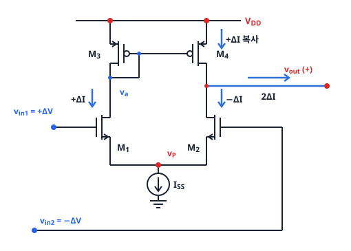

*두 입력 단자는 왼쪽이며 오른쪽 입력 선은 그림 아래로 돌아가요. 점 없는 교차는 연결이 아니에요. M1의 전류 변화가 M3·M4를 거쳐 오른쪽 출력으로 전달돼요.*

**모델의 범위를 정해요.** 두 입력 NMOS는 같고, PMOS는 1:1 거울이며 모두 포화 상태예요. 저주파의 작은 차동 입력에서 $g_mr_O\gg1$이고 거울 오차를 무시하는 주도항 해석이에요. M3만 다이오드 연결이므로 전체 회로는 완전 대칭이 아니에요. 테일을 정확한 가상 접지로 두고 전체를 두 동일 반회로로 잘라 풀지 않아요. 주도항에서 각 입력쌍 전류를 구하고 거울의 전류 전달로 합쳐요.

1. **DC와 변화량을 분리해요.** 같은 입력 CM 바이어스에서 각 가지 DC는 $I_{SS}/2$예요. 차동 입력은

   $$
   v_{id}=v_{in1}-v_{in2}.
   $$

   $$
   v_{in1}=+\frac{v_{id}}2.
   $$

   $$
   v_{in2}=-\frac{v_{id}}2.
   $$

   공통 소스의 변화가 작은 주도항 모델에서 입력 소자가 만드는 변화는

   $$
   \Delta i_{D1}\approx+\frac{g_mv_{id}}2.
   $$

   $$
   \Delta i_{D2}\approx-\frac{g_mv_{id}}2.
   $$
2. **거울이 복사하는 방향을 정해요.** PMOS 전류는 출력으로 내려오는 공급 방향을 양으로 정해요.

   $$
   \Delta i_{D4}\approx\Delta i_{D3}\approx\Delta i_{D1}.
   $$

   오른쪽 노드로 공급하는 순신호 전류는 “위에서 공급 − 아래에서 흡수”예요.

   $$
   i_{sig}=\Delta i_{D4}-\Delta i_{D2}.
   $$

   $$
   i_{sig}\approx\frac{g_mv_{id}}2-\left(-\frac{g_mv_{id}}2\right)=g_mv_{id}.
   $$

   두 변화는 단순히 같은 방향의 두 전류가 아니에요. 공급이 늘고 흡수가 줄므로 차이를 취하면 더해져요.

**전류 생성과 출력저항은 서로 다른 조건에서 봐요.** 다음 첫 그림은 두 가지를 합친 주도항 Norton 블록이에요. 소자 $g_m$과 단의 $G_m$을 같은 기호로 혼동하지 않아요.

*출력 오른쪽을 실제 접지로 단락해요. 제어 전류원이 왼쪽, 병렬 출력저항이 그 오른쪽, 출력 단락이 맨 오른쪽이에요. 단락에서 저항 양단 전압은 0이고 오른쪽으로 내보내는 전류가 iₛc예요.*

$$
G_m\equiv\left.\frac{i_{sc}}{v_{id}}\right|_{v_{out}=0}\approx g_m.
$$

다음은 입력을 0으로 둔 출력저항의 주도항 모델이에요. 입력쌍·미러의 내부 결합으로 생기는 작은 보정은 제외하고, 출력에서 아래로 M2와 위로 M4의 $r_O$가 같은 출력–AC 접지 사이에 놓인 것으로 보아요. 유한 $r_O$ 자체는 출력 전압을 정하므로 남겨요.

*입력은 왼쪽에서 접지하고, 오른쪽 맨 끝 Vₜ에 시험전압원을 연결해요. 시험전류 iₜ는 그 점 왼쪽에서 회로로 유입해요. 두 저항은 같은 시험 노드와 AC 접지 사이의 병렬이에요.*

$$
R_{out}\approx r_{O2}\parallel r_{O4}.
$$

외부 부하가 없으면 이 저항이 남아요. $\lambda\ne0$인 실제 MOS에서 “외부 저항이 없으니 출력저항이 무한대”라고 하면 안 돼요. 부하 $R_L$은 신호 주파수에서 출력–접지 사이에 연결한 저항으로 정의해요.

$$
R_{eff}\approx r_{O2}\parallel r_{O4}\parallel R_L.
$$

오른쪽 출력의 KCL에서 순공급 전류가 병렬 저항으로 흘러나가므로

$$
v_{out}\approx i_{sig}R_{eff}.
$$

$$
A_v\equiv\frac{v_{out}}{v_{id}}\approx+g_mR_{eff}.
$$

$R_L\ll r_{O2}\parallel r_{O4}$일 때만 $A_v\approx+g_mR_L$로 줄여요. 양의 부호는 왼쪽 입력을 올리면 M4의 공급이 늘고 M2의 흡수가 줄어 오른쪽 출력이 올라간다는 뜻이에요. 단위도 $\mathrm{mS}\times\mathrm{k\Omega}=1$로 무차원이에요.

**거울 연결을 고정 바이어스로 바꾸면?** M4 게이트를 A에서 떼어 고정 DC 바이어스에 연결하면 게이트와 소스가 AC 접지여서 제어 전압의 변화는 0이에요. $g_m$ 제어 전류원의 복사 신호가 사라지지만 DC 바이어스 전류와 유한 $r_{O4}$는 남아요. 출력 신호는 M2의 변화 하나만 받아 같은 유효 부하에서

$$
A_{v,\,fixed}\approx+\frac{g_mR_{eff}}2.
$$

게이트를 떠 있게 두는 개방 회로를 말하는 것은 아니에요. 거울은 공급 신호까지 전달해 이 1/2 손실을 회복해요. “원래 이득 유지”는 같은 유효 부하로 비교한 두 가지 신호 합성의 뜻이에요. 서로 다른 부하 저항을 가진 임의의 두 회로가 수치상 같은 이득이라는 주장은 아니에요. 또한 이 차동 이득 회복만으로 CM 이득이 완전히 0이라고 결론 내리지 않아요.

**교수님 말씀**

> “두 개가 상쇄되는 게 아니라 … 두 개가 더해지는 거죠.”

교수님은 외부 $R_L$이 없을 때도 채널 길이 변조 때문에 출력저항이 남는다고 설명했어요. 차동 입력·단일 출력을 가진 op-amp, 저항 피드백 증폭기와 유니티 게인 버퍼에서 접하는 구조라는 점도 연결했어요.

**꼭 기억해요**

> “이거 완전 대칭인 회로는 아니에요, 기본적으로.”

M3만 다이오드 연결이에요. 대칭 반회로를 그대로 쓰지 말고 거울의 전류 전달과 출력 KCL을 연결해요. “중요한 부분입니다. 다시 한번 보세요.”라는 강조도 있었어요.

**페이지 요약**

PMOS 전류 거울은 공급 증가와 흡수 감소를 합쳐 오른쪽 출력을 올려요.

#### 신호 합성과 이득

$$
G_m\approx g_m.
$$

$$
\begin{aligned}R_{eff}&\approx r_{O2}\parallel r_{O4}\\&\quad\parallel R_L.\end{aligned}
$$

$$
A_v\approx+g_mR_{eff}.
$$

왼쪽−오른쪽 입력·오른쪽 출력 기준이며, 같은 입력쌍·1:1 거울·포화·작은 입력·큰 $g_mr_O$의 주항이에요.

#### 연결에서 판단할 점

M3만 다이오드 연결이므로 전체를 동일 반회로로 자르지 않아요.

거울을 고정 바이어스로 바꾸면 같은 유효 부하에서 이득이 절반이에요.

---

### 7. BJT 능동 부하 차동쌍

*1007 수업 · L04 s40*

**쉽게 말하면**

바이폴라(BJT) 전류 거울도 한쪽의 변화를 출력으로 복사해서, 위에서 더 넣는 전류와 아래에서 덜 빼는 전류를 함께 써요.

*좋은 1:1 거울과 작은 차동 입력에서 공급 +10 μA와 흡수 −10 μA는 출력 순변화 +20 μA가 돼요.*

**정확히 말하면**

**예시와 연결을 확인해요.** Q4의 공급 전류가 10 μA 늘고 Q2의 흡수 전류가 10 μA 줄면 출력에 공급하는 변화는 $10-(-10)=20\,\mathrm{\mu A}=0.02\,\mathrm{mA}$예요. 이 관계가 [MOS 능동 부하](#s2-mos-active)와 같아요.

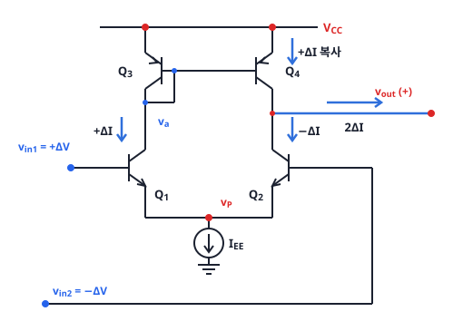

*Q1·Q2는 NPN 입력 쌍, Q3·Q4는 PNP 전류 거울이에요. Q3의 베이스–컬렉터가 A에 연결되고, Q4가 그 전류 변화를 오른쪽 출력으로 전달해요.*

**접속과 근사.** 두 PNP의 이미터는 $V_{CC}$, 베이스는 A에 함께 연결돼요. Q3는 **베이스–컬렉터** 다이오드 연결이지 베이스–이미터 단락이 아니에요. Q1·Q2는 같고 Q3·Q4는 1:1 거울이며 모두 순방향 활성 영역이라고 해요. 아래 계산은 큰 $\beta$로 거울 베이스 전류 오차를 무시하고, $g_mr_O\gg1$인 저주파 주도항이에요. DC 바이어스는 각 가지 약 $I_{EE}/2$이고, $g_m=I_C/V_T$는 이 바이어스에서 정해져요.

1. **DC를 제거해 변화만 남겨요.** 공급 전압은 AC 접지, 이상적인 테일 전류원의 증분은 0이에요. 두 입력은

   $$
   v_{id}=v_{in1}-v_{in2}.
   $$

   $$
   v_{in2}=-v_{in1}.
   $$

   소스가 아니라 공통 이미터 노드 P의 움직임이 작은 주도항에서

   $$
   i_{c1}\approx g_mv_{in1}.
   $$

   $$
   i_{c2}\approx g_mv_{in2}=-g_mv_{in1}.
   $$
2. **Q3가 받은 변화를 Q4가 공급해요.** PNP 컬렉터 전류의 양의 방향을 출력으로 공급하는 방향으로 정의해요.

   $$
   i_{c4}\approx i_{c1}.
   $$

   $$
   i_{sig}=i_{c4}-i_{c2}.
   $$

   $$
   i_{sig}\approx g_m(v_{in1}-v_{in2})=g_mv_{id}.
   $$

   DC가 상쇄된 뒤 남는 증분 전류예요. 증분 $\Delta I$를 DC 회로 위에 써서 추적하는 것 자체가 소신호 해석이에요.

**출력 조건을 따로 적용해요.** 다음 두 그림은 앞선 베이스 전류 무시 주도항에서 입력쌍과 미러의 작용을 하나의 전류 생성 블록으로 묶고, 출력 쪽 Early 저항을 남긴 모델이에요. 큰 $\beta$를 쓰지 못하는 문항이면 이 그림을 정밀 모델로 재사용하지 않아요.

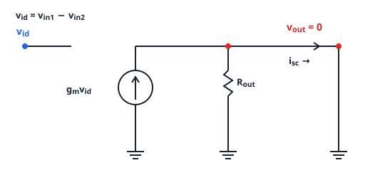

*출력을 맨 오른쪽에서 접지 단락한 상태예요. 그림의 gₘvᵢd는 Q1·Q2와 거울을 합친 주도항 제어 전류이며 오른쪽으로 내보내는 iₛc를 측정해요.*

$$
G_m\equiv\left.\frac{i_{sc}}{v_{id}}\right|_{v_{out}=0}\approx g_m.
$$

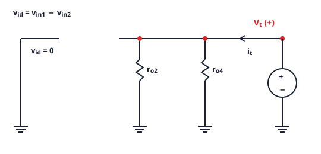

*입력은 0으로 접지하고 출력 시험전압 Vₜ를 인가해요. 그림의 rO2·rO4는 Q2·Q4 컬렉터에서 보이는 주도항 Early 저항이에요. iₜ는 오른쪽 시험 노드에서 왼쪽 회로로 들어가요.*

$$
R_{out}\approx r_{O2}\parallel r_{O4}.
$$

$$
R_{eff}\approx r_{O2}\parallel r_{O4}\parallel R_L.
$$

$$
v_{out}\approx i_{sig}R_{eff}.
$$

$$
A_v\approx+g_mR_{eff}.
$$

왼쪽 베이스를 올리고 오른쪽을 내리면 공급은 늘고 흡수는 줄어 오른쪽 출력이 올라가요. 따라서 $v_{id}=v_{in1}-v_{in2}$와 오른쪽 출력 정의에서 양의 이득이에요. 수업의 구두 계산에는 $-g_mR_{out}$ 표기가 섞였지만, 이 입력 순서·출력 방향에서는 $+g_mR_{out}$으로 읽어요. 외부 $R_L$이 없다면 병렬식에서 그 가지만 제외해요. $R_L\ll r_{O2}\parallel r_{O4}$이면 $A_v\approx+g_mR_L$이에요.

**거울 신호를 없애면?** Q4 베이스를 A에서 떼어 고정 DC 바이어스로 묶으면 복사되는 제어 전류 변화가 사라져요. Q2 한쪽 변화만 남으므로 같은 유효 부하에서

$$
A_{v,\,fixed}\approx+\frac{g_mR_{eff}}2.
$$

Q4가 DC에서 차단된다는 뜻은 아니에요. 바이어스 전류와 $r_{O4}$는 그대로 모델에 남아요.

**왜 $r_{\pi2}$를 $r_{O4}$와 병렬로 묶지 않나요?** $r_{\pi2}$는 Q2의 베이스–이미터 사이, $r_{O4}$는 출력 컬렉터–AC 접지 쪽에 있어요. 입력을 0으로 두면 베이스는 접지되지만 $r_{\pi2}$의 다른 끝은 이미터 P예요. P가 출력 컬렉터와 같은 노드가 아니므로 두 저항은 같은 두 노드를 공유하지 않아요. 유한 $\beta$의 내부 작용을 무시할 수 없는 상황에는 전체 모델에 $r_\pi$를 남겨야 하지만, 이를 곧바로 출력 병렬 저항으로 옮기면 안 돼요. 캐스코드는 위 소자의 이미터와 아래 소자의 컬렉터가 실제 연결되어 $r_\pi$와 아래 $r_O$가 병렬로 만나는 경우가 있어요. 회로 모양보다 두 끝의 실제 노드를 확인해요.

**교수님 말씀**

> “원리는 같기 때문에 뭐 다시 반복해서 좀 설명을 합니다.”

한 학생이 $r_{\pi2}$를 출력의 $r_{O4}$와 병렬로 보아야 하는지 물었어요. 교수님은 출력 컬렉터와 이미터의 접속이 다르며 캐스코드와 혼동하면 안 된다고 설명했어요. 다른 한 학생이 정식 소신호 모델로도 같은지 묻자, DC를 0으로 둔 $g_mv_{in1}$·$g_mv_{in2}$와 복사 전류를 다시 적었어요. DC 위에 덧붙여 그린 $\Delta I$ 추적도 같은 소신호 분석이라는 뜻이에요.

**페이지 요약**

PNP 전류 거울도 두 가지 신호를 합쳐 단일 출력의 절반 손실을 회복해요.

#### 오른쪽 출력의 이득

$$
G_m\approx g_m.
$$

$$
\begin{aligned}R_{eff}&\approx r_{O2}\parallel r_{O4}\\&\quad\parallel R_L.\end{aligned}
$$

$$
A_v\approx+g_mR_{eff}.
$$

왼쪽−오른쪽 입력·오른쪽 출력 기준이며, 같은 입력쌍·1:1 거울·활성 영역·큰 $\beta$·큰 $g_mr_O$의 주항이에요.

#### 연결에서 판단할 점

Q3는 베이스–컬렉터 연결이고 Q4가 그 신호를 출력에 공급해요.

$r_{\pi2}$는 출력 컬렉터 저항과 직접 병렬이 아니에요.

---

## 4. 요약 · 예고

### 10장 핵심 정리

입력과 출력의 정의를 먼저 적고, 공통 모드(CM) 입력이 각 출력에 남는지와 차동 출력에 남는지를 나눠 확인해요.

| 구분 | 핵심 관계 | 조건과 판단 |
|---|---|---|
| 입력·출력 정의 | $ v_{id}=v_{in1}-v_{in2} $ $ v_{od}=v_{out1}-v_{out2} $ $ v_{out,CM}=\frac{v_{out1}+v_{out2}}2 $ | 차동 출력은 왼쪽에서 오른쪽을 뺀 값이고, 출력 CM은 두 출력의 평균이에요. |
| [CM 반회로](#s0-cm-half-recap) | $ \Delta v_P=2R_{SS}\Delta i_D $ $ 2R_{SS}\parallel2R_{SS}=R_{SS} $ | 같은 두 입력과 대칭 회로에서 테일 증분은 두 가지 전류의 합이에요. P는 움직이므로 각 소스 아래 $2R_{SS}$를 남겨요. 차동 자극의 가상 접지와 달라요. |
| 각 출력의 CM 이득 | $ A_{CM}\approx-\frac{R_D}{2R_{SS}} $ | 입력 MOS의 $r_O$·바디 효과를 무시한 소신호 모델이에요. 수업의 큰 축퇴 조건 $2g_mR_{SS}\gg1$에서 반회로 이득을 바로 적용해요. 추가로 보통처럼 $R_{SS}\gg R_D$이면 각 출력의 CM 흔들림이 작아요. |
| [CM 잡음의 상쇄](#s0-cm-noise) | $ v_{out1}(t)=s_o(t)+n_o(t) $ $ v_{out2}(t)=-s_o(t)+n_o(t) $ $ v_{od}(t)=2s_o(t) $ | 완전 대칭·선형 소신호 조건이에요. 이상적 테일은 각 출력의 입력 CM 잡음도 0으로 만들어요. 유한 테일에서는 같은 잡음이 각 출력에 남지만 차에서는 지워져요. 모든 잡음이 CM은 아니에요. |
| [CM-to-DM 누출](#s1-mismatch) | $ \Delta v_{od}=\Delta R_D\Delta i_D $ $ A_{CM-DM}\approx\frac{\vert \Delta R_D\vert }{2R_{SS}} $ | 입력쌍 일치, 입력 $r_O$·바디 효과 무시, 오른쪽 부하 $R_D+\Delta R_D$ 모델이에요. 양의 $\Delta R_D$이면 부호 있는 전달비는 양수이고, 표의 $A_{CM-DM}$은 크기예요. 마지막 식은 $2g_mR_{SS}\gg1$ 조건이에요. |
| [CMRR 정의와 dB](#s1-cmrr) | $ \mathrm{CMRR}=\frac{\vert A_{DM}\vert }{A_{CM-DM}} $ $ \mathrm{CMRR}_{dB}=20\log_{10}(\mathrm{CMRR}) $ $ 20\log_{10}(1000)=60\,\mathrm{dB} $ | 두 이득 모두 같은 차동 출력에서 비교해요. 분모를 각 출력의 $A_{CM}$으로 바꾸지 않아요. 완전 대칭에서는 CM-to-DM 누출이 0이라 이 모델의 CMRR은 무한대예요. 실제 출력 SNR은 입력 신호·잡음 크기에도 달려요. |
| CMRR 개선의 보충 관계 | $ \mathrm{CMRR}\approx2g_mR_{SS}\frac{R_D}{\vert \Delta R_D\vert } $ | [CMRR 토픽의 보충 유도](#s1-cmrr)예요. 입력쌍 일치, $r_O$·바디 효과 무시, 작은 부하 미스매치를 가정해요. 수업의 큰 축퇴 조건 $2g_mR_{SS}\gg1$의 주항이에요. 다른 인자를 고정하고 테일 저항을 키우거나 상대 미스매치를 줄이면 개선돼요. |
| [저항 부하에서 한쪽만 읽기](#s2-single-ended) | $ A_{DM}\approx-g_mR_D $ $ A_{SE}\approx+\frac{g_mR_D}{2} $ | 같은 차동 입력, 같은 $R_D$, 오른쪽 단일 출력 기준이에요. 대칭 저항 부하·입력 $r_O$ 무시 조건에서 신호 크기가 절반이고 두 출력의 마지막 CM 상쇄를 잃어요. 테일 저항에 의한 CM 감쇠는 남아요. |
| [전류 거울의 신호 합성](#s2-mos-active) | $ i_{sig}=\Delta i_{D4}-\Delta i_{D2} $ $ i_{sig}\approx g_mv_{id} $ | 같은 입력쌍·1:1 PMOS 거울·포화·작은 입력·$g_mr_O\gg1$인 저주파 주도항이에요. M3는 게이트–드레인 다이오드 연결이에요. 공급 증가와 흡수 감소가 합쳐져요. 전체 회로는 비대칭이므로 동일 반회로로 자르지 않아요. |
| 전류 생성과 출력저항 | $ G_m\approx g_m $ $ R_{out}\approx r_{O2}\parallel r_{O4} $ | $G_m$은 출력 접지 단락에서 $i_{sc}/v_{id}$로 구해요. $R_{out}$은 입력을 0으로 하고 출력 시험원을 걸어 구해요. 같은 주도항 모델에서 외부 부하가 없어도 유한한 두 $r_O$가 남아요. |
| 오른쪽 단일 출력의 이득 | $ R_{eff}\approx r_{O2}\parallel r_{O4}\parallel R_L $ $ A_v\approx+g_mR_{eff} $ | $v_{id}=v_{in1}-v_{in2}$와 오른쪽 출력 정의에서 양의 부호예요. 왼쪽 입력 증가로 공급은 늘고 흡수는 줄어요. 외부 부하가 없으면 $R_L$ 가지를 제외해요. $R_L\ll r_{O2}\parallel r_{O4}$일 때만 $A_v\approx+g_mR_L$이에요. |
| 거울의 복사 신호 제거 | $ A_{v,\,fixed}\approx+\frac{g_mR_{eff}}2 $ | M4 게이트를 고정 DC 바이어스에 묶으면 같은 유효 부하에서 이득이 절반이에요. DC 전류와 $r_{O4}$가 사라지는 뜻은 아니에요. 거울의 이득 회복만으로 CM 이득이 0이라고 결론 내리지 않아요. |
| [BJT 대응과 접속 확인](#s2-bjt-active) | $ A_v\approx+g_mR_{eff} $ | NPN Q1·Q2 입력쌍, PNP Q3·Q4 거울이고 Q3는 베이스–컬렉터 연결이에요. 큰 $\beta$로 베이스 전류 오차를 무시하고 $g_mr_O\gg1$인 주도항이에요. $r_{\pi2}$는 베이스–이미터 사이이므로 출력 컬렉터의 $r_{O4}$와 직접 병렬로 묶지 않아요. |

CM 식의 BJT 대응은 $R_D\to R_C$, $R_{SS}\to R_{EE}$예요. 베이스 전류와 Early 효과를 무시할 조건을 함께 확인해요. 유한 $\beta$가 중요한 문제에서는 필요한 $r_\pi$를 실제 노드 사이에 유지해요.

**복습할 때 설명할 수 있어야 해요.**

- CM과 DM에서 P 노드가 왜 다르게 움직이는지 설명하고, $2R_{SS}$를 테일 KCL로 확인해요.
- $A_{CM}$, $A_{CM-DM}$, CMRR의 입력·출력과 크기·부호를 구별해요.
- 같은 잡음이 각 출력에 남아도 차동 출력에서는 지워지는 이유와 그 대칭 조건을 설명해요.
- 전류 거울의 공급 증가·흡수 감소를 추적하고, 출력 단락과 입력 영점의 서로 다른 측정 조건으로 $G_m$과 $R_{out}$을 확인해요.
- 부하가 달라지거나 거울을 고정 바이어스로 바꿨을 때 이득과 CM 상쇄를 따로 판단해요.

#### 시험에서 첫 줄을 고르는 순서

1. **입력과 출력부터 정해요.** 차동 입력인지 같은 CM 입력인지, 출력 한쪽인지 두 출력의 차인지 적어요. 같은 이름의 이득도 출력 정의가 바뀌면 값과 부호가 달라져요.
2. **테일과 대칭을 확인해요.** 대칭 차동 자극은 P를 가상 접지로 두고, 같은 CM 자극에서 가지 전류가 같으면 소스 아래 $2R_{SS}$인 반회로를 써요. 거울로 결합된 능동 부하는 반쪽을 임의로 떼지 않아요.
3. **회로의 역할을 식에 연결해요.** CM 반회로는 축퇴 이득으로, 미스매치는 두 출력의 차로, 능동 부하는 공급 전류에서 흡수 전류를 뺀 출력 KCL로 시작해요. 캐스코드 테일은 기존 저항에 캐스코드 소자의 $g_mr_o$를 곱해요.
4. **비교할 조건을 고정해요.** CMRR은 같은 출력 정의의 두 이득을 나눠요. 테일 저항·소자 폭·부하를 바꾸는 문제는 무엇이 고정되는지 먼저 적고, 전류와 $g_m$, $r_o$ 중 실제 바뀌는 양을 다시 계산해요.

---

### 다음 시간 예고

- 주파수 응답

---

### 함께 보면 좋은 자료

- [복습문제 (PDF)](../복습문제_1007_Differential_Amplifiers-문제.pdf)
- [답안 (PDF)](../복습문제_1007_Differential_Amplifiers-답안.pdf)

문제지에서 핵심 문제를 먼저 풀고, 추가 연습으로 조건이 달라졌을 때도 같은 판단을 적용해요. 예상 시간은 풀이 속도에 따라 달라지는 추정치예요.

---

출처: 권익진 교수님 강의자료(Lec4) · 수업 녹음 전사(1007) · B. Razavi, *Microelectronics*, 2nd ed. (Wiley) 10장.
