# CMRR과 능동 부하 차동 증폭기 — 5살도 이해하는 정리노트

권익진 교수님 전자회로2 · 1007 수업 (Lec4, Razavi 10장)

> `정리노트_1007_Differential_Amplifiers.html`를 마크다운으로 옮겼어요. 그림은 `figures_1007/` 폴더의 SVG, 위젯은 대표 설정의 정적 그림으로 바꿨어요. 수식은 `$…$` / `$$…$$`라서 GitHub, Obsidian, Typora에서 보여요.

**목차**

- [들어가며: 왜 이런 회로를 쓸까](#why)
  - [왜 이런 회로를 쓸까](#why-circuit)
- [1. 공통 모드 잡음은 어디로 가나](#s0)
  - [1. 복습: 유한한 R_SS와 커먼 모드 하프 서킷](#s0-cm-half-recap)
  - [2. 이상적인 테일과 실제 테일에서 본 CM 잡음](#s0-cm-noise)
- [2. 비대칭과 CMRR](#s1)
  - [3. 부하 미스매치와 CM-to-DM 이득](#s1-mismatch)
  - [4. CMRR: 원하는 신호 대 원하지 않는 신호](#s1-cmrr)
- [3. 싱글엔디드 출력과 능동 부하](#s2)
  - [5. 한쪽 출력만 쓰면 생기는 두 가지 손해](#s2-single-ended)
  - [6. MOS 능동 부하 차동쌍](#s2-mos-active)
  - [7. BJT 능동 부하 차동쌍](#s2-bjt-active)
- [4. 요약 · 예고](#s3)
  - [10장 핵심 정리](#s3-cheatsheet)
  - [다음 시간 예고](#s3-next)
  - [함께 보면 좋은 자료](#s3-links)

## 들어가며: 왜 이런 회로를 쓸까

### 왜 이런 회로를 쓸까

*1007 수업 · L04 s36–39*

**쉽게 말하면**

두 컵에 똑같이 묻은 흔들림은 빼면 지워지지만, 컵이 조금씩 달라서 새는 만큼은 몇 배나 작은지 재 둬야 해요.

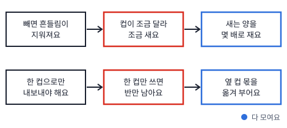

*한 컵으로만 내보낼 때는 옆 컵의 몫을 버리지 않고 옮겨 부어서, 줄어든 만큼을 되찾아요.*

**정확히 말하면**

**1. 풀고 싶은 문제.** 차동 증폭기(differential amplifier)를 쓰는 가장 큰 이유는 두 라인에 같은 위상으로 들어오는 공통 모드(common-mode, CM) 잡음을 지우는 거예요. 두 쪽이 완전히 대칭이면 잡음은 각 노드에만 실리고 차동 출력에서는 상쇄돼요([2. 이상적인 테일과 실제 테일에서 본 CM 잡음](#s0-cm-noise)). 실제로는 $R_{SS}$가 유한하고 부하에 미스매치 $\Delta R_D$가 있어서, 잡음 일부가 차동 출력으로 새요([3. 부하 미스매치와 CM-to-DM 이득](#s1-mismatch)). 여기에 문제가 하나 더 있어요. op-amp처럼 입력은 차동이어도 출력은 하나(싱글엔디드, single-ended)여야 할 때가 있어요([5. 한쪽 출력만 쓰면 생기는 두 가지 손해](#s2-single-ended)).

**2. 단순한 해법과 그 한계.** 새는 양은 CM-to-DM 이득으로 적을 수 있어요.

$$
A_{CM-DM} \approx \frac{\Delta R_D}{2R_{SS}}
$$

하지만 이 값만으로는 성능을 말할 수 없어요. 차동 증폭기는 원하는 신호의 이득도 커야 하니, 새는 양이 같아도 이득이 큰 회로가 더 좋은 회로예요([4. CMRR: 원하는 신호 대 원하지 않는 신호](#s1-cmrr)). 싱글엔디드 출력을 얻는 가장 쉬운 방법은 두 출력 가운데 한 노드만 꺼내는 거예요. 그러면 이득이 절반이 되고, 그 노드의 CM 이득이 출력에 그대로 남아요([5. 한쪽 출력만 쓰면 생기는 두 가지 손해](#s2-single-ended)).

$$
|A_v|=\frac{g_mR_D}{2}
$$

**3. 핵심 아이디어.** CMRR(common-mode rejection ratio)은 원하는 신호의 이득을 원하지 않는 신호의 이득으로 나눠, 두 가지를 한 숫자로 재요([4. CMRR: 원하는 신호 대 원하지 않는 신호](#s1-cmrr)).

$$
\mathrm{CMRR} = \frac{A_{DM}}{A_{CM-DM}}
$$

능동 부하(active load)는 저항 부하를 전류 거울(current mirror)로 바꿔, 버리던 쪽의 전류 변화를 출력 쪽으로 복사해 더해요. 출력은 하나인데 전류 변화가 $2\Delta I$라서 차동 이득을 그대로 지켜요([6. MOS 능동 부하 차동쌍](#s2-mos-active), [7. BJT 능동 부하 차동쌍](#s2-bjt-active)).

$$
A_v = g_m (r_{O2} \parallel r_{O4})
$$

**4. 대가와 쓰이는 곳.** CMRR을 키우려면 $R_{SS}$를 키워야 해요. $\Delta R_D$는 공정에 달려 있어서 설계자가 정할 수 없어요. 그래서 캐스코드 전류원처럼 테일을 더 좋은 전류원으로 만들어요([3. 부하 미스매치와 CM-to-DM 이득](#s1-mismatch)). CMRR은 값이 커서 데이터시트에 dB로 적혀요. 차동 구조 자체의 대가는 전류를 2배로 쓰고 차동 신호를 따로 만들어야 한다는 거예요([4. CMRR: 원하는 신호 대 원하지 않는 신호](#s1-cmrr)). 능동 부하 차동쌍은 M3만 다이오드 연결이라 대칭이 아니어서, 하프 서킷으로 풀 수 없어요. 출력저항은 $r_{O2} \parallel r_{O4}$로 유한하고, 출력에 $R_L$을 달면 그만큼 이득이 줄어요([6. MOS 능동 부하 차동쌍](#s2-mos-active)). 이 구조는 차동 입력, 싱글엔디드 출력인 op-amp의 입력단에 널리 쓰여요.

**교수님 말씀**

교수님은 차동 증폭기를 왜 쓰는지 묻고 바로 답하셨어요.

> "가장 중요한 이유가 뭐라고 그랬죠? 노이즈." (1007 Part 01)

좋은 차동 증폭기의 기준도 이득보다 CM 리젝션이라고 하셨어요.

> "커먼 모드 리젝션 특성을 이상적인 값에 가깝도록 설계하는 게 굉장히 중요해요." (1007 Part 04)

데이터시트에는 $A_{CM-DM}$이 아니라 CMRR이 적혀 있다고 하셨어요. 이득도 크면 좋기 때문이에요.

> "ACM-DM이 얼마다 이렇게 나와 있지 않고, CMRR이 얼마다라고" (1007 Part 04)

한쪽 출력만 뽑는 회로는 쓰지 않는 이유를 이렇게 말씀하셨어요.

> "노이즈 제거가 안 되잖아요." (1007 Part 05)

능동 부하 차동쌍은 op-amp를 예로 들며 실제로 많이 쓰는 구조라고 하셨어요.

> "이거는 사실은 굉장히 많이 쓰는 구조예요." (1007 Part 06)

> "싱글 엔디드 구조로 구현하는 대표적인 방법이 되겠어요." (1007 Part 07)

**보충 · 수업에서 유도하진 않았어요**

Razavi 10.6절(551쪽 상자 글)에 따르면, 예전 op-amp는 입력에 차동쌍을 쓰고도 마지막 출력에서 한쪽 신호를 버렸어요. 능동 부하는 1967년 Widlar가 설계한 LM101A에서 처음 쓰였어요. 칩 면적을 많이 차지하는 큰 저항 대신 트랜지스터 부하를 쓰면 전압 여유(headroom)를 아끼면서 높은 이득을 얻어요. 이 차동쌍은 "5-트랜지스터 OTA"라고도 불러요.

캐스코드 전류원은 $R_{SS}$를 크게 키우지만, 트랜지스터를 하나 더 쌓으므로 테일에서 전압 여유를 더 써요. CMRR과 입력 CM 범위가 서로 맞바뀌는 셈이에요.

**페이지 요약**

CMRR은 CM 잡음이 차동 출력으로 새는 정도를 이득과 함께 한 숫자로 재고, 능동 부하는 싱글엔디드 출력에서도 이득을 반으로 잃지 않게 해요.

*핵심 식*

- CMRR 정의

  $$
  \mathrm{CMRR} = \frac{A_{DM}}{A_{CM-DM}}
  $$
- 한쪽만 쓸 때 이득

  $$
  |A_v|=\frac{g_mR_D}{2}
  $$
- 능동 부하 이득

  $$
  A_v = g_m (r_{O2} \parallel r_{O4})
  $$

*용어*

- **CMRR(common-mode rejection ratio)** — 원하는 신호 이득 대 CM 잡음이 차동 출력으로 바뀌는 이득의 비예요.
- **능동 부하(active load)** — 저항 대신 전류 거울로 만든 부하로, 한쪽 전류 변화를 출력으로 복사해요.

---

## 1. 공통 모드 잡음은 어디로 가나

### 1. 복습: 유한한 R_SS와 커먼 모드 하프 서킷

*1007 수업 · L04 s32–33*

**쉽게 말하면**

양쪽이 똑같이 흔들리면, 둘 사이의 차이는 하나도 변하지 않아요.

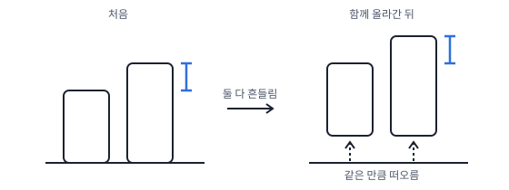

*두 상자가 함께 같은 만큼 올라가도, 강조선으로 그린 높이 차이는 그대로예요.*

**정확히 말하면**

차동 증폭기(differential amplifier)의 이득은 두 입력의 차(차동 입력)에 대한 두 출력의 차(차동 출력)로 정의해요. 차동 증폭기를 쓰는 가장 큰 이유는 **노이즈**(잡음) 제거예요. 노이즈는 두 라인에 같은 위상으로 들어오므로 공통 모드(common-mode, CM) 신호에 해당해요.

**이상적인 경우(s32).** 완전히 대칭인 차동쌍에 입력 CM 변화가 들어와도 테일 전류가 고정이면 전류가 바뀌지 않아요.

$$
\Delta I_{D1} = \Delta I_{D2} = 0
$$

$$
\Delta V_{out1} = \Delta V_{out2} = \Delta V_{out,CM} = 0
$$

실제로는 CM 리젝션(CM rejection)이 무한하지 않아요.

**유한한 테일 임피던스(s33).** 테일 전류원을 트랜지스터로 만들면 출력저항 $R_{SS}$가 유한해요(값은 매우 커요). 입력 CM이 변하면 노드 P가 $\Delta V_P$만큼 움직이고, $R_{SS}$로 흐르는 전류가 $2\Delta I_D$만큼 바뀌어요. 그 결과 두 출력이 같은 양 $\Delta V_{out,CM}$만큼 움직여요.

**커먼 모드 하프 서킷(common-mode half circuit) 유도(칠판).**

1. $R_{SS}$를 $2R_{SS} \parallel 2R_{SS}$로 나눠요. 병렬 합이 같으니 회로는 그대로이고, 이제 완전히 대칭이에요.
2. 대칭선으로 잘라요. 두 소스를 잇던 선에는 전류가 흐르지 않아서 같은 회로 두 개가 나와요.
3. 이때 노드 P는 AC 접지가 아니에요($\Delta V_P \neq 0$). 차동 입력에서 쓰던 가상 접지(virtual ground)를 여기서는 쓸 수 없어요.
4. 반쪽은 게이트에 $\Delta V_{in,CM}$, 드레인에 $R_D$, 소스와 접지 사이에 $2R_{SS}$가 달린 소스 디제너레이션(source degeneration) CS 단이에요.
5. 이득 = −(드레인 쪽 저항) / (소스 쪽 저항의 합)이고, 소스 쪽 합은 M1을 들여다본 $1/g_m$과 $2R_{SS}$예요.

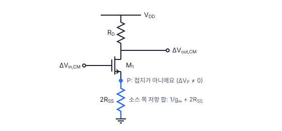

*커먼 모드 하프 서킷: 소스와 접지 사이에 강조선으로 그린 2RSS가 달린 소스 디제너레이션 CS 단이에요.*

$$
\frac{\Delta V_{out,CM}}{\Delta V_{in,CM}} = -\frac{R_D}{1/g_m + 2R_{SS}}
$$

$$
= -\frac{R_D/2}{1/(2g_m) + R_{SS}}
$$

두 번째 꼴이 슬라이드 s33의 식이에요. 분자와 분모를 2로 나눴을 뿐 같은 값이에요. 교재는 BJT 꼴 $-\frac{R_C/2}{R_{EE} + 1/(2g_m)}$로 적어요(Razavi 식 10.180–10.181).

**근사.** $R_{SS} \gg 1/g_m$일 때 다음과 같아요.

$$
\frac{\Delta V_{out,CM}}{\Delta V_{in,CM}} \approx -\frac{R_D}{2R_{SS}}
$$

보통 $R_{SS} \gg R_D$라서 이 값은 매우 작아요. 입력에 노이즈가 들어와도 각 출력에서는 크게 줄어들어요.

이 비를 **커먼 모드 게인(common-mode gain)**이라고 불러요. 그냥 "게인"이라고 하면 차동 입력에 대한 차동 출력의 이득이고, 커먼 모드 게인은 입력 CM 변화에 대한 출력 CM 변화의 비예요.

**차동 출력에는 영향이 없어요.** 회로가 대칭이면 두 출력이 같은 양만큼 움직이므로 $\Delta V_{out1} - \Delta V_{out2} = 0$이에요. 노이즈는 각 노드 전압에만 나타나요.

**두 하프 서킷 비교(학생 질문에서 나온 정리).**

| 구분 | (차동) 하프 서킷 | 커먼 모드 하프 서킷 |
|---|---|---|
| 가정하는 입력 | 차동 입력 $\pm\Delta V$ | CM 입력 $\Delta V_{in,CM}$ |
| 노드 P | 가상 접지(AC 접지) | 접지가 아님($\Delta V_P \neq 0$) |
| 소스에 달린 것 | 없음(접지) | $2R_{SS}$ |
| 쓰는 목적 | 차동 이득 | 노이즈(CM 변화)에 대한 출력 |

지난 수업의 유도는 [1002 정리노트: CM 절반 회로로 다시 풀기](../1002/정리노트_1002_Differential_Amplifiers.html#s3-cm-half)에 있어요.

**교수님 말씀**

> "커먼 모드 하프 서킷을 이용하면 조금 편하다고 그랬죠." (1007 Part 01)

한 학생이 물었어요. 차동 신호에서는 하프 서킷을 쓰는데, CM일 때도 같은 하프 서킷으로 표현하느냐고요.

교수님은 대칭이 되도록 $R_{SS}$를 $2R_{SS}$ 두 개로 일부러 나눴으니 어느 쪽을 계산해도 같다고 답했어요. 그냥 "하프 서킷"이라고 하면 차동 입력을 가정한 것이고, 앞에 "커먼 모드"를 붙이면 CM 입력 조건의 하프 서킷이에요. 두 회로는 달라요. 차동 하프 서킷에서는 P가 접지이고, 커먼 모드 하프 서킷에서는 소스에 $2R_{SS}$가 달려요. P를 AC 접지로 둘 수 없어서 노이즈에 대한 출력을 보려고 따로 도입한 거예요.

**꼭 기억해요**

> "가장 중요한 이유가 뭐라고 그랬죠? 노이즈." (1007 Part 01)

> "대칭으로 만들긴 하지만 … 테일 노드가 그라운드는 아니에요." (1007 Part 08)

차동 입력이면 테일 노드가 가상 접지이지만, CM 입력이면 테일 노드가 접지가 아니에요. 그래서 CM에는 소스에 $2R_{SS}$가 남은 커먼 모드 하프 서킷을 써요.

**페이지 요약**

$R_{SS}$를 $2R_{SS}$ 두 개로 나눠 자른 커먼 모드 하프 서킷으로 CM 이득을 구하고, 대칭이면 차동 출력에는 영향이 없어요.

*핵심 식*

- 커먼 모드 게인

  $$
  \frac{\Delta V_{out,CM}}{\Delta V_{in,CM}}
  $$

  $$
  = -\frac{R_D}{1/g_m + 2R_{SS}}
  $$
- $R_{SS} \gg 1/g_m$일 때

  $$
  \approx -\frac{R_D}{2R_{SS}}
  $$

*용어*

- **커먼 모드 하프 서킷(common-mode half circuit)** — 소스와 접지 사이에 $2R_{SS}$가 달린 반쪽 회로
- **가상 접지(virtual ground)** — 차동 입력에서만 테일 노드 P가 AC 접지가 되는 것

---

### 2. 이상적인 테일과 실제 테일에서 본 CM 잡음

*1007 수업 · L04 s34–35*

**쉽게 말하면**

노래에 섞인 잡음이 두 줄에 똑같이 들어오면, 두 줄을 서로 빼서 잡음만 지울 수 있어요.

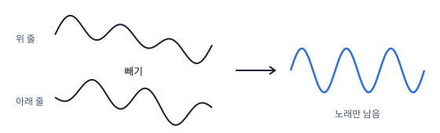

*두 줄을 빼면 똑같이 묻은 출렁임은 지워지고, 강조선처럼 노래만 두 배로 남아요.*

**정확히 말하면**

**상황(s34–35, Razavi 그림 10.46).** 입력 노드 A, B에는 원하는 차동 신호(예: 음악 신호)가 서로 반대 위상으로 들어오고, 외부 잡음 $v_{CM}$이 두 노드에 같은 위상으로 함께 들어와요. 슬라이드 회로는 BJT 차동쌍이고 테일은 전류원 $I_{EE}$와 그 출력저항 $R_{EE}$예요. MOSFET이든 BJT든 원리는 같아요.

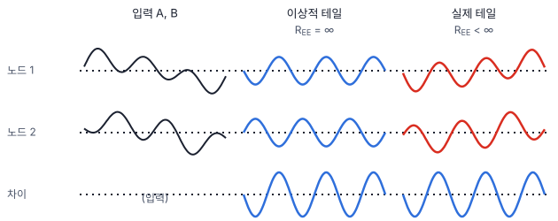

*강조선은 잡음 없는 파형, 위험색 선은 CM 잡음이 실린 파형이에요. 실제 테일에서도 차이(차동 출력)는 강조선으로 깨끗해요.*

**이상적인 테일($R_{EE} = \infty$, s34).**

1. CM 입력에 대한 전류 변화는 0이에요.
2. 차동 신호에만 $+\Delta I$, $-\Delta I$가 생겨요.
3. $\Delta V_{out,CM} = 0$이므로 $v_{out1}$, $v_{out2}$ 각각이 잡음 없는 깨끗한 신호예요. 이것이 완전한 CM 리젝션이에요.

**실제 테일($R_{EE} \lt \infty$, s35).**

1. CM 잡음이 들어오면 테일 노드 P가 $\Delta V_P$만큼 움직이고, CM 잡음에 대한 전류 변화가 생겨요.
2. 그래서 $v_{out1}$, $v_{out2}$ 각각에 잡음이 실려요($\Delta V_{out,CM} \neq 0$, CM 이득 ≠ 0).
3. 그 크기는 [커먼 모드 하프 서킷](#s0-cm-half-recap)으로 구한 $-\frac{R_C/2}{R_{EE} + 1/(2g_m)}$배이고, $R_{EE}$가 클수록 작아요.
4. 두 노드의 잡음은 같은 위상·같은 크기라서 $v_{out1} - v_{out2}$에서 상쇄돼요.
5. 원하는 신호는 두 노드에서 반대 위상이라 빼면 더해져 2배가 돼요.

결론: 실제 테일에서도 최종 **차동 출력**은 여전히 깨끗해요. 잡음은 각 노드 전압에만 나타나요.

| 구분 | 이상적 테일 ($R_{EE} = \infty$) | 실제 테일 ($R_{EE} \lt \infty$) |
|---|---|---|
| 각 노드 $v_{out1}$, $v_{out2}$ | 잡음 없음 | 같은 잡음이 실림 |
| $\Delta V_{out,CM}$ | 0 | 0이 아님(작음) |
| 차동 출력 $v_{out1} - v_{out2}$ | 깨끗함 | 깨끗함(잡음 상쇄) |

**용어.** DC 레벨도 공통 모드 성분이지만 보통 "CM 레벨"이라고 불러요. "CM 변화"라고 하면 잡음처럼 갑자기 생기는 변화를 말해요.

이 결론은 두 쪽이 완전히 대칭이라는 가정 위에 서 있어요. 부하가 조금이라도 다르면 차동 출력에도 잡음이 새어 나와요([3. 부하 미스매치와 CM-to-DM 이득](#s1-mismatch)).

**교수님 말씀**

교수님은 원하는 신호를 "음악 신호"라고 부르고, 밖에서 두 라인에 같은 위상으로 함께 들어오는 잡음과 대비했어요.

> "MOSFET이나 BJT는 사실은 같다" (1007 Part 02)

슬라이드 그림이 BJT 회로인 이유는 책의 BJT 그림을 그대로 가져왔기 때문이라고 설명했어요.

**페이지 요약**

실제 테일에서는 각 출력 노드에 CM 잡음이 실리지만, 같은 위상·같은 크기라 차동 출력에서는 상쇄돼요.

*핵심 식*

- 이상적 테일

  $$
  \Delta V_{out,CM} = 0
  $$
- 실제 테일, 각 노드

  $$
  \Delta V_{out,CM} \neq 0
  $$

*용어*

- **차동 출력(differential output)** — $v_{out1} - v_{out2}$, 같은 위상 잡음이 빠지고 신호는 2배가 돼요
- **CM 리젝션(CM rejection)** — 입력 CM 변화가 출력에 나타나지 않게 하는 성질

---

## 2. 비대칭과 CMRR

### 3. 부하 미스매치와 CM-to-DM 이득

*1007 수업 · L04 s36*

**쉽게 말하면**

쌍둥이처럼 똑같이 만든 두 막대도 사실은 아주 조금씩 달라요.

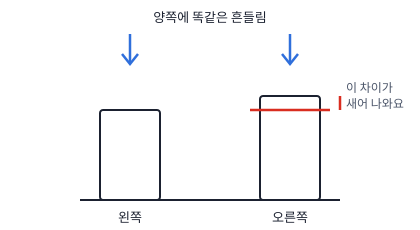

*두 막대를 똑같이 흔들어도 한쪽이 조금 더 높이 올라가면, 그 높이 차이만큼 흔들림이 결과에 섞여요.*

**정확히 말하면**

실제 차동쌍(differential pair)이 이상과 다른 점은 두 가지예요. 하나는 테일 전류원의 출력저항 $R_{SS}$가 유한하다는 것이고, 다른 하나는 두 쪽이 완전히 대칭이 아니라는 것이에요.

물리적으로 100% 같은 소자는 없어요. 반도체 공정으로 만든 저항은 ±20%까지 차이가 날 수 있고, 트랜지스터의 $(W/L)_1$과 $(W/L)_2$도 완전히 같지 않아요. 이런 차이를 미스매치(mismatch)라고 해요. 두 영향이 비슷하므로 여기서는 트랜지스터는 같다고 두고 부하 저항의 미스매치 $\Delta R_D$만 봐요.

±20%는 집적 저항 값 자체(절댓값)가 설계값에서 벗어나는 정도예요. 같은 칩 안에서 나란히 만든 두 저항 사이의 미스매치는 보통 이보다 훨씬 작아요. 교재 예제 10.28도 미스매치를 1% 정도로 가정해요.

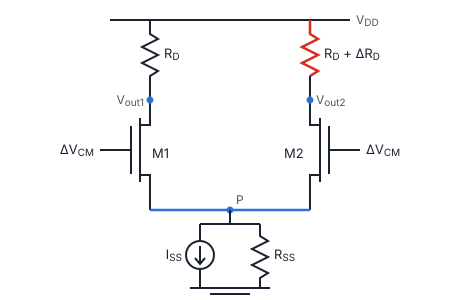

*교재 그림 10.47과 같은 회로예요. 오른쪽 부하만 $\Delta R_D$만큼 커요.*

두 게이트에 같은 입력 CM 변화 $\Delta V_{in,CM}$을 넣고, CM 하프 서킷(소스에 $2R_{SS}$)으로 풀어요.

1. 소스가 노드 P로 묶여 있어서 $\Delta V_{GS1} = \Delta V_{GS2}$예요.
2. 그래서 $\Delta I_{D1} = \Delta I_{D2} = \Delta I_D$이고, $R_{SS}$에는 $2\Delta I_D$가 흘러요.
3. CM 하프 서킷에서 소스 쪽 저항은 $1/g_m + 2R_{SS}$이므로

   $$
   \Delta I_D = \frac{\Delta V_{in,CM}}{1/g_m + 2R_{SS}}
   $$
4. 교재 식 10.188처럼 각 출력 변화를 같은 $\Delta I_D$로 쓰면

   $$
   \Delta V_{out1} = \Delta I_D R_D
   $$

   $$
   \Delta V_{out2} = \Delta I_D (R_D + \Delta R_D)
   $$
5. 차동 출력은 $\Delta V_{out} = \Delta V_{out1} - \Delta V_{out2}$이므로

   $$
   \Delta V_{out} = \Delta I_D R_D - \Delta I_D (R_D + \Delta R_D)
   $$

   $$
   \Delta V_{out} = -\Delta I_D \Delta R_D
   $$
6. 3번을 넣으면

   $$
   \Delta V_{out} = -\frac{\Delta R_D}{1/g_m + 2R_{SS}}\,\Delta V_{in,CM}
   $$

부호는 교재 식 10.188의 관례를 따르며, 의미 있는 것은 크기 $|\Delta V_{out}| = \Delta I_D \Delta R_D$예요.

입력 CM 변화가 차동 출력을 만들어요. 이 크기를 CM-to-DM 이득(정확히는 CM input to DM output gain)이라고 해요(교재 식 10.191–10.192).

$$
\left|\frac{\Delta V_{out}}{\Delta V_{in,CM}}\right| = A_{CM-DM}
$$

$$
A_{CM-DM} = \frac{\Delta R_D}{1/g_m + 2R_{SS}}
$$

$2R_{SS} \gg 1/g_m$일 때는 다음과 같아요.

$$
A_{CM-DM} \approx \frac{\Delta R_D}{2R_{SS}}
$$

$R_{SS}$는 매우 크고 $\Delta R_D$는 $R_D$보다 작아서 이 값은 매우 작아요. CM 리젝션은 유지되지만 완전하지는 않아요. 유한한 $R_{SS}$와 비대칭이 함께 있으면 차동 출력에 입력 CM 신호의 일부가 섞여요(s36). 그래도 싱글엔디드 구조보다는 훨씬 나아요.

| 이름 | 입력 | 출력 | 값 |
|---|---|---|---|
| CM 이득(common-mode gain) | 입력 CM 변화 | 각 출력 노드의 같은 변화 | $-\dfrac{R_D}{1/g_m + 2R_{SS}}$ |
| CM-to-DM 이득 | 입력 CM 변화 | 차동 출력 $\Delta V_{out1} - \Delta V_{out2}$ | $\dfrac{\Delta R_D}{1/g_m + 2R_{SS}}$ |

최종 출력은 차동 출력이므로 실제로 더 중요한 것은 CM-to-DM 이득이에요. 목표는 $A_{CM-DM} \to 0$이에요. $\Delta R_D$는 공정의 랜덤 미스매치라 설계자가 정할 수 없어요. 설계자가 할 수 있는 일은 캐스코드 전류원처럼 $R_{SS}$를 키우는 것이에요.

**교수님 말씀**

교수님이 "특성을 좋게 하려면 어떻게 하면 되죠?"라고 묻자 학생들이 "$R_{SS}$를 크게"라고 답했어요. 교수님은 그 방법으로 캐스코드 전류원을 덧붙였어요.

> $\Delta R_D$는 설계자가 할 수 있는 게 아니에요. … 설계자가 할 수 있는 거는 $R_{SS}$를 키우는 (1007 Part 04)

저항 오차를 말하다가 처음에는 W, L을 예로 들었고, 곧 집적 저항의 ±20%로 고쳐 말했어요.

**꼭 기억해요**

> 요게 사실은 더 중요하죠. … 노이즈가 들어왔을 때 차동 출력이 어떻게 나타나는가 (1007 Part 04)

> 커먼 모드 리젝션 특성을 이상적인 값에 가깝도록 설계하는 게 굉장히 중요해요. (1007 Part 04)

> 커먼 모드 리젝션 특성 이해가 굉장히 중요합니다. (1007 Part 04)

**페이지 요약**

부하 미스매치 $\Delta R_D$ 때문에 입력 CM 변화가 차동 출력에 새어 나와요. $R_{SS}$를 키우면 줄어요.

*핵심 식*

- 차동 출력(교재 식 10.188 부호 관례)

  $$
  \Delta V_{out} = -\Delta I_D \Delta R_D
  $$

  $$
  |\Delta V_{out}| = \Delta I_D \Delta R_D
  $$
- CM-to-DM 이득

  $$
  A_{CM-DM} = \frac{\Delta R_D}{1/g_m + 2R_{SS}}
  $$
- $2R_{SS} \gg 1/g_m$일 때

  $$
  A_{CM-DM} \approx \frac{\Delta R_D}{2R_{SS}}
  $$

*용어*

- **미스매치(mismatch)** — 똑같이 만들려던 두 소자 사이의 차이예요.
- **CM-to-DM 이득** — 입력 CM 변화가 차동 출력으로 바뀌는 비율이에요.

---

### 4. CMRR: 원하는 신호 대 원하지 않는 신호

*1007 수업 · L04 s37*

**쉽게 말하면**

노래와 소음이 같은 크기로 들어왔을 때, 나올 때 노래가 소음보다 몇 배 큰지 세는 숫자예요.

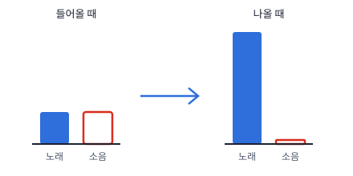

*노래는 크게 키우고 소음은 거의 지워서, 이 배수가 클수록 좋은 기계예요.*

**정확히 말하면**

데이터시트는 $A_{CM-DM}$ 대신 CMRR(common-mode rejection ratio, 공통 모드 제거비)로 성능을 적어요. 모든 증폭기 데이터시트에 CMRR 값이 나와 있어요.

$$
\mathrm{CMRR} = \frac{A_{DM}}{A_{CM-DM}}
$$

- 분자 $A_{DM}$은 원하는 신호의 이득(차동 이득)이에요. 교수님은 $A_{diff}$, 다른 책은 $A_v$로도 써요. 클수록 좋아요.
- 분모 $A_{CM-DM}$은 원하지 않는 신호의 이득이에요. 0에 가까울수록 좋아요.
- 그래서 이상적인 CMRR은 무한대예요.

같은 크기의 원하는 차동 입력과 CM 잡음이 들어왔을 때, 출력에 나온 증폭된 원하는 신호와 변환된 원하지 않는 CM 잡음의 비가 CMRR이에요(s37).

저항 부하 차동쌍에서는 $A_{DM} = g_m R_D$이고, [3. 부하 미스매치와 CM-to-DM 이득](#s1-mismatch)의 $A_{CM-DM}$을 넣으면 다음과 같아요.

$$
\mathrm{CMRR} = \frac{g_m R_D}{\Delta R_D}\left(\frac{1}{g_m} + 2R_{SS}\right)
$$

$$
\mathrm{CMRR} \approx \frac{2 g_m R_D R_{SS}}{\Delta R_D}
$$

CMRR을 키우려면 $R_{SS}$를 키워요. $\Delta R_D$를 줄여도 좋지만 그것은 공정에 달려 있어요.

CMRR은 값이 커서 보통 dB(로그 눈금)로 적어요.

$$
\mathrm{CMRR}_{dB} = 20\log_{10}\mathrm{CMRR}
$$

예를 들어 $20\log_{10}(1000) = 60$ dB이므로 60 dB는 1,000배예요.

차동 증폭기의 장점은 잡음을 최대한 없애고 원하는 신호만 크게 키운다는 것이에요. 단점은 전류를 2배로 쓰고, 차동 신호를 따로 만들어야 한다는 것이에요.

#### 직접 해 보기: 테일 저항과 미스매치가 CMRR을 어떻게 바꿀까 *(정적 스냅샷 — 직접 조작은 HTML 버전)*

테일 저항과 부하 미스매치를 움직이면, 원하는 신호 이득과 잡음이 차동 출력으로 바뀌는 이득의 차이(CMRR)가 로그 눈금 막대로 바뀌어요. 고정값은 gm = 5 mS, RD = 2 kΩ예요.

ADM = **10**, 각 노드 ACM = **…**, ACM-DM = **…**, CMRR = **…**

범례: 원하는 신호 이득 (색칠된 막대) · 각 노드 CM 이득 (테두리 막대) · CM-to-DM 이득 (경고색 테두리 막대)

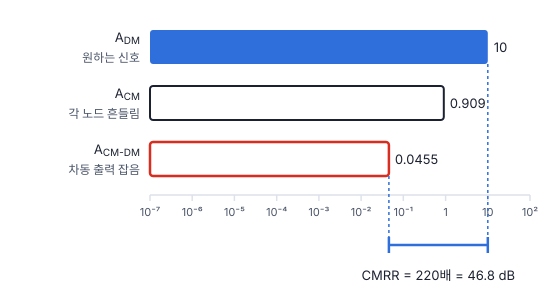

*대표 설정 1: 테일 저항 1 kΩ, 미스매치 5%*

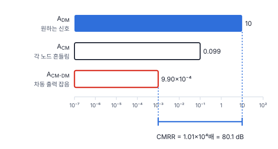

*대표 설정 2: 테일 저항 10 kΩ, 미스매치 1%*

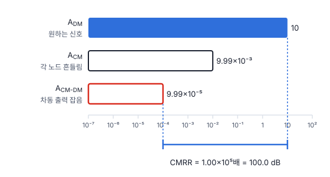

*대표 설정 3: 테일 저항 100 kΩ, 미스매치 1%*

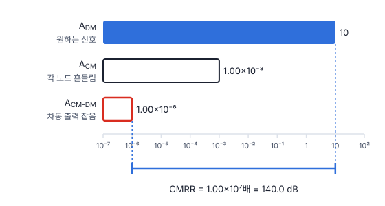

*대표 설정 4: 테일 저항 1 MΩ, 미스매치 0.1%*

| 설정 (테일 저항, ΔR/R) | ΔRD | ADM | 각 노드 ACM | ACM-DM | CMRR |
|---|---|---|---|---|---|
| 1 kΩ, 5% | 100 Ω | 10 | 0.909 | 0.0455 | 220배 (46.8 dB) |
| 10 kΩ, 1% | 20 Ω | 10 | 0.099 | 9.90×10⁻⁴ | 1.01×10⁴배 (80.1 dB) |
| 100 kΩ, 1% | 20 Ω | 10 | 9.99×10⁻³ | 9.99×10⁻⁵ | 1.00×10⁵배 (100.0 dB) |
| 1 MΩ, 0.1% | 2 Ω | 10 | 1.00×10⁻³ | 1.00×10⁻⁶ | 1.00×10⁷배 (140.0 dB) |

고정값 gm = 5 mS, RD = 2 kΩ.

테일 저항을 10배 키우면 CMRR도 거의 10배(20 dB) 커져요. 미스매치를 10배 줄여도 같은 효과가 나요.

**교수님 말씀**

교수님은 CMRR이 크다는 것을 "SNR이 크다는 의미"에 빗댔어요. 원하는 것 대 원하지 않는 것의 비라는 점이 닮았다는 비유예요. CMRR은 원하는 차동 이득 대 CM→DM 변환 이득의 비이고, 잡음 전력의 비인 SNR 자체는 아니에요.

> 용어를 알아야지 … 어떤 개념을 이해하는 데 좀 도움이 되니까 (1007 Part 05)

CMRR을 $g_m$, $R_D$, $R_{SS}$, $\Delta R_D$로 넓힌 식은 "복잡하지는 않을 것 같아요"라며 결과만 보였어요(1007 Part 04).

**꼭 기억해요**

> 차동 증폭기에서는 굉장히 중요한 개념이 되겠습니다. (1007 Part 05)

> 커먼 모드 게인을 구하시오, 커먼 투 디퍼렌셜 모드 게인을 구하시오, CMRR을 구하시오 … 답을 할 수 있어야 (1007 Part 08)

시험에는 CM 이득, CM-to-DM 이득, CMRR 계산과 CM 리젝션의 의미 설명이 나올 수 있어요.

**보충 · 수업에서 유도하진 않았어요**

CMRR 확장식을 한 줄씩 대입해 봐요. $\Delta R_D \ll R_D$라서 차동 이득은 $A_{DM} = g_m R_D$로 둬요.

1. 정의:

   $$
   \mathrm{CMRR} = \frac{A_{DM}}{A_{CM-DM}}
   $$
2. 분자에 $A_{DM} = g_m R_D$, 분모에 $A_{CM-DM} = \frac{\Delta R_D}{1/g_m + 2R_{SS}}$를 넣어요:

   $$
   \mathrm{CMRR} = g_m R_D \div \frac{\Delta R_D}{1/g_m + 2R_{SS}}
   $$
3. 분수로 나누기는 뒤집어 곱하기예요:

   $$
   \mathrm{CMRR} = \frac{g_m R_D}{\Delta R_D}\left(\frac{1}{g_m} + 2R_{SS}\right)
   $$
4. 괄호를 풀어요:

   $$
   \mathrm{CMRR} = \frac{R_D}{\Delta R_D} + \frac{2 g_m R_D R_{SS}}{\Delta R_D}
   $$
5. 둘째 항은 첫째 항의 $2 g_m R_{SS}$배예요. $2 g_m R_{SS} \gg 1$일 때 첫째 항을 버려요:

   $$
   \mathrm{CMRR} \approx \frac{2 g_m R_D R_{SS}}{\Delta R_D}
   $$

예: $g_m = 5$ mS, $R_D = 2$ kΩ, $R_{SS} = 100$ kΩ, $\Delta R_D/R_D = 1\%$이면 $\Delta R_D = 20$ Ω이에요. 그러면 $\mathrm{CMRR} = 100 + 100000 \approx 1.0\times10^5$, 곧 약 100 dB예요.

**페이지 요약**

CMRR은 원하는 차동 이득을 CM-to-DM 이득으로 나눈 값이고, $R_{SS}$를 키우면 커져요.

*핵심 식*

- 정의

  $$
  \mathrm{CMRR} = \frac{A_{DM}}{A_{CM-DM}}
  $$
- 저항 부하 차동쌍

  $$
  A_{DM} = g_m R_D
  $$

  $$
  \mathrm{CMRR} \approx \frac{2 g_m R_D R_{SS}}{\Delta R_D}
  $$
- dB 표시

  $$
  \mathrm{CMRR}_{dB} = 20\log_{10}\mathrm{CMRR}
  $$

*용어*

- **CMRR(common-mode rejection ratio)** — 원하는 신호 이득 대 CM 잡음이 차동 출력으로 바뀌는 이득의 비예요.
- **dB** — $20\log_{10}$으로 나타낸 로그 눈금이에요. 60 dB는 1,000배예요.

---

## 3. 싱글엔디드 출력과 능동 부하

### 5. 한쪽 출력만 쓰면 생기는 두 가지 손해

*1007 수업 · L04 s38*

**쉽게 말하면**

두 컵의 물높이 차이를 보던 것을 한 컵만 보게 바꾸면, 보이는 변화는 반으로 줄어요.

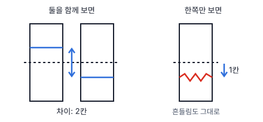

*게다가 두 컵을 똑같이 흔드는 흔들림이 한 컵만 볼 때는 지워지지 않고 그대로 보여요.*

**정확히 말하면**

**왜 필요한가.** 회로 안에서는 차동으로 신호를 다루더라도, 출력은 싱글엔디드(single-ended)여야 할 때가 있어요. 대표적인 예가 op-amp예요. op-amp는 입력이 차동이고 출력은 하나예요. 차동으로 처리하던 신호를 다시 싱글엔디드로 내보내야 할 때도 같아요. 그래서 차동→싱글엔디드 변환(differential to single-ended conversion) 회로가 필요해요.

**가장 쉬운 방법.** 두 출력 가운데 한쪽 노드만 출력으로 쓰는 거예요(그림에서 Y만 쓰고 X는 버려요).

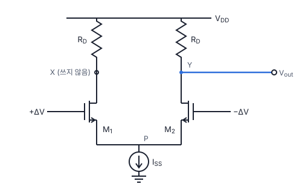

*저항 부하 차동쌍에서 Y 노드만 출력으로 꺼낸 모습이에요. X의 신호는 쓰지 않아요.*

이 방법은 실제로 쓰지 않아요. 손해가 두 가지예요.

**손해 1. 이득이 절반이 돼요.** 차동 입력 $+\Delta V$, $-\Delta V$를 넣었을 때를 봐요.

1. 차동 입력: $V_{in1}-V_{in2}=\Delta V-(-\Delta V)=2\Delta V$
2. 두 출력: $\Delta V_{out1}=-g_mR_D\Delta V$, $\Delta V_{out2}=+g_mR_D\Delta V$
3. 차동 출력: $\Delta V_{out1}-\Delta V_{out2}=-2g_mR_D\Delta V$
4. 차동 이득의 크기: $\dfrac{2g_mR_D\Delta V}{2\Delta V}=g_mR_D$ (입력도 2배, 출력도 2배라서 하프 서킷 이득과 같아요)
5. 한쪽(Y)만 쓰면 출력은 $g_mR_D\Delta V$뿐이고 입력은 그대로 $2\Delta V$예요.

   $$
   |A_v|=\frac{g_mR_D\Delta V}{2\Delta V}=\frac{g_mR_D}{2}
   $$

출력이 절반이니 이득도 절반이에요.

**손해 2. 커먼 모드 리젝션(common-mode rejection)이 크게 나빠져요.** 두 출력의 차이를 취하면 같은 위상의 CM 잡음이 서로 지워지고, 남는 것은 CM-to-DM 이득 $A_{CM-DM}\approx\dfrac{\Delta R_D}{2R_{SS}}$만큼이에요(미스매치가 없으면 0이에요). 한쪽 노드만 보면 그 노드의 CM 이득이 그대로 출력에 나타나요.

$$
\frac{\Delta V_{out,CM}}{\Delta V_{in,CM}}=-\frac{R_D}{1/g_m+2R_{SS}}
$$

이 값은 1보다 훨씬 작아요. 그래서 한쪽만 써도 차동 구조가 아닌 싱글엔디드 단보다는 잡음이 많이 줄어요. 그래도 두 출력의 차이를 취할 때보다는 훨씬 커요. 차동 증폭기를 쓰는 가장 큰 이유가 커먼 모드 리젝션이니, 이득보다 이쪽이 더 큰 손해예요.

그래서 실제로는 부하를 바꿔서, 싱글엔디드 출력이면서 이득도 잃지 않는 회로를 써요. [6. MOS 능동 부하 차동쌍](#s2-mos-active)이 그 방법이에요.

**교수님 말씀**

한쪽만 뽑는 회로를 보여 주고 "왜 안 쓸까요?"라고 물은 뒤, 스스로 잡음 제거 이야기로 답하셨어요.

> "노이즈 제거가 안 되잖아요." (1007 Part 05)

이득이 절반이 되는 것도 짚으셨지만, 더 큰 문제는 커먼 모드 리젝션이라고 하셨어요.

> "이득이 문제가 아니라 … 커먼 모드 리젝션 특성이 굉장히 떨어지는" (1007 Part 05)

다만 커먼 모드 리젝션이 완전히 없어지는 것은 아니라고 덧붙이셨어요. 한쪽 노드의 커먼 모드 게인도 1보다 훨씬 작아서 싱글엔디드 구조보다는 낫다고 하셨어요.

**페이지 요약**

차동쌍에서 한쪽 출력만 쓰면 이득이 절반이 되고, 커먼 모드 리젝션도 크게 나빠져요.

*핵심 식*

- 한쪽만 쓸 때 이득

  $$
  |A_v|=\frac{g_mR_D\Delta V}{2\Delta V}=\frac{g_mR_D}{2}
  $$
- 한 노드의 CM 이득

  $$
  \frac{\Delta V_{out,CM}}{\Delta V_{in,CM}}
  $$

  $$
  =-\frac{R_D}{1/g_m+2R_{SS}}
  $$

*용어*

- **싱글엔디드(single-ended) 출력** — 접지를 기준으로 한 노드 하나로 내보내는 출력
- **차동→싱글엔디드 변환(differential to single-ended conversion)** — 차동 신호를 출력 하나로 바꾸는 일. op-amp 출력단이 예

---

### 6. MOS 능동 부하 차동쌍

*1007 수업 · L04 s39*

**쉽게 말하면**

왼쪽 길이 하나 더 받으면 거울이 그걸 따라 해서 오른쪽 길에도 하나를 보태 줘요.

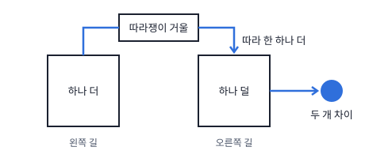

*오른쪽은 원래 하나 덜인데 하나를 더 받으니, 출구에서는 두 개만큼 차이가 나요.*

**정확히 말하면**

**능동 부하(active load).** 저항 같은 패시브 부하와 달리 트랜지스터로 만든 부하예요. 여기서는 PMOS 전류 거울(current mirror)을 부하로 써요. M3는 다이오드 연결(diode-connected)이고, M3와 M4는 게이트끼리, 소스끼리($V_{DD}$) 묶여 있어요. 전류 거울은 캐스코드를 다룰 때 배웠어요([PMOS 전류 거울 복습](../0918/정리노트_0918_Current_Mirrors.html#s1-cmos-mirror)).

**연결.** M1 드레인 = M3 드레인 = M3·M4 게이트(노드 A). M2 드레인 = M4 드레인 = 출력 $V_{out}$. M1·M2 소스(노드 P)에 테일 $I_{SS}$가 달려요.

*강조색 선 화살표는 전류의 변화예요. M1의 $+\Delta I$가 M3를 거쳐 M4로 복사되고, M2의 $-\Delta I$와 합쳐져 출력에 $2\Delta I$가 나타나요.*

**DC 바이어스.** 두 게이트에 같은 $V_{CM}$을 걸면 $V_{GS1}=V_{GS2}$라서 각 가지에 $I_{SS}/2$가 흘러요. 거울은 M3의 DC 전류 $I_{SS}/2$도 M4로 그대로 복사해요.

**소신호 동작.** M1 게이트에 $+\Delta V$, M2 게이트에 $-\Delta V$를 걸어요.

1. 입력 쌍의 전류 변화: $\Delta I_{D1}=+\Delta I$, $\Delta I_{D2}=-\Delta I$, $\Delta I=g_m\Delta V$
2. M3 전류: $I_{SS}/2+\Delta I$
3. 전류 거울이 복사: M4 전류도 $I_{SS}/2+\Delta I$
4. 출력 노드 KCL: M4가 넣는 전류에서 M2가 빼 가는 전류를 빼요.

   $$
   (I_{SS}/2+\Delta I)-(I_{SS}/2-\Delta I)=2\Delta I
   $$
5. 출력 전압 변화: $\Delta V_{out}=2\Delta I\cdot R_{out}=2g_m\Delta V\cdot R_{out}$
6. 차동 입력: $\Delta V-(-\Delta V)=2\Delta V$
7. 이득:

   $$
   A_v=\frac{\Delta V_{out}}{2\Delta V}=g_mR_{out}
   $$

두 가지의 전류 변화는 위상이 반대예요. 거울이 한쪽을 복사해 넘기니 출력에서 서로 지워지지 않고 **더해져요**. 그래서 출력은 하나인데도 원래 차동 이득을 그대로 유지해요.

**출력저항.** 출력 노드에서 아래로 M2의 드레인을 봐요. 차동 입력이라 P는 AC 접지(근사)이고 게이트 입력도 0으로 두니 $r_{O2}$가 보여요. 위로는 M4의 드레인을 보니 $r_{O4}$가 보여요.

$$
R_{out} = r_{O2} \parallel r_{O4}
$$

$$
A_v = g_m (r_{O2} \parallel r_{O4})
$$

$R_L$이 없을 때 출력저항은 무한대가 아니에요. 채널 길이 변조(channel-length modulation) 때문에 $r_{O2}\parallel r_{O4}$가 남아요. 출력에 $R_L$을 달면 병렬로 더해져요.

$$
A_v=g_m(r_{O2}\parallel r_{O4}\parallel R_L)
$$

$R_L\ll r_{O2}\parallel r_{O4}$일 때만 $A_v\approx g_mR_L$이에요. 일반적인 경우에는 병렬 식 전체로 써야 정확해요. 부호는 양(+)이에요. M1에 $+\Delta V$를 넣으면 복사된 전류가 출력 노드로 흘러 들어가 $V_{out}$이 올라가요(교재 식 10.214: $\dfrac{v_{out}}{v_{in1}-v_{in2}}=g_{mN}(r_{ON}\parallel r_{OP})$).

**대칭이 아니에요.** M3는 다이오드 연결이고 M4는 아니에요. 그래서 이 회로는 대칭선으로 잘라 하프 서킷으로 풀 수 없어요. 전류 거울은 한쪽 전류의 변화를 복사해 출력으로 전달하는 역할을 해요.

**거울을 끊으면.** M4 게이트를 M3에서 떼어 DC 바이어스 $V_b$에 묶어 봐요.

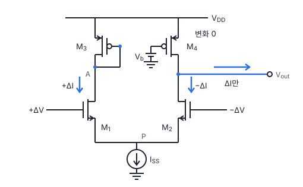

*M4 게이트가 DC 전압에 묶이면 M4는 DC 전류만 흘려요. 출력에는 M2의 전류 변화 하나만 남아요.*

1. M4의 게이트와 소스가 모두 AC 접지예요: $\Delta V_{GS4}=0$
2. M4 전류 변화가 없어요(DC만 흘러요).
3. 출력에는 M2의 $-\Delta I$만 나타나요: $\Delta V_{out}=-\Delta I_{D2}R_{out}$, 크기는 $\Delta I\cdot R_{out}$
4. 입력은 그대로 $2\Delta V$이니 이득의 크기는 $g_mR_{out}/2$, 절반이에요.

거울을 이으면 노드 A의 전압 변화가 M4의 $\Delta V_{GS}$로 전달돼요. 그래서 M1의 전류 변화가 M4로 복사되고, 출력 전류 변화가 $2\Delta I$가 돼요.

**교수님 말씀**

두 전류 변화가 상쇄되는 게 아니라 더해진다는 점을 강조하셨어요.

> "두 개가 상쇄되는 게 아니라 … 두 개가 더해지는 거죠." (1007 Part 06)

$R_L$이 없으면 출력저항이 무한대냐고 물으신 뒤, 채널 길이 변조가 있으니 $r_{O2}$와 $r_{O4}$의 병렬이 보인다고 답하셨어요.

이 구조가 왜 중요한지는 op-amp로 설명하셨어요. op-amp도 차동 입력, 싱글 출력을 가진 회로예요. 저항으로 피드백을 걸어 증폭기를 만들고, 출력을 입력에 그대로 이으면 유니티 게인 버퍼가 돼요.

> "이거는 사실은 굉장히 많이 쓰는 구조예요." (1007 Part 06)

**꼭 기억해요**

> "이거 완전 대칭인 회로는 아니에요, 기본적으로." (1007 Part 06)

M3만 다이오드 연결이라 대칭이 아니에요. 하프 서킷 대신 "거울이 전류 변화를 복사한다"로 풀어요.

> "싱글 엔디드 구조로 구현하는 대표적인 방법이 되겠어요." (1007 Part 07)

> "중요한 부분입니다. 다시 한번 보세요." (1007 Part 07)

**페이지 요약**

전류 거울이 한쪽 전류 변화를 복사해 출력에 $2\Delta I$를 만들어, 싱글엔디드인데도 차동 이득을 그대로 지켜요.

*핵심 식*

- 출력 전류 변화

  $$
  (I_{SS}/2+\Delta I)-(I_{SS}/2-\Delta I)=2\Delta I
  $$
- 출력저항

  $$
  R_{out} = r_{O2} \parallel r_{O4}
  $$
- 이득

  $$
  A_v = g_m (r_{O2} \parallel r_{O4})
  $$

*용어*

- **능동 부하(active load)** — 저항 대신 트랜지스터로 만든 부하
- **다이오드 연결(diode-connected)** — 게이트를 자기 드레인에 이은 연결. 여기서는 M3

---

### 7. BJT 능동 부하 차동쌍

*1007 수업 · L04 s40*

**쉽게 말하면**

왼쪽 길의 변화를 오른쪽 길이 따라 하게 만드는 거울은, 다른 종류의 부품으로 만들어도 하는 일이 똑같아요.

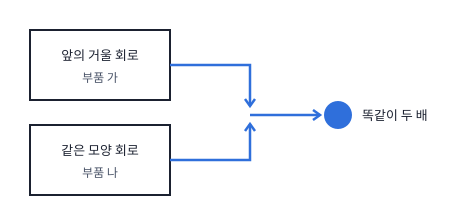

*어느 부품으로 만들든 출구에서는 똑같이 두 배를 받아요.*

**정확히 말하면**

**구성.** 원리는 [6. MOS 능동 부하 차동쌍](#s2-mos-active)과 같아요. Q1, Q2는 npn 차동쌍이고 테일 전류원은 $I_{EE}$예요. 부하 Q3, Q4는 pnp 전류 거울이에요. 이미터는 $V_{CC}$에, 베이스끼리 묶여 있어서 $V_{BE}$가 같고 전류도 같아요. Q3는 컬렉터를 베이스에 이은 다이오드 연결이에요([바이폴라 전류 거울 복습](../0918/정리노트_0918_Current_Mirrors.html#s2-bjt-mirror)).

*강조색 선 화살표는 전류의 변화예요. Q1의 $+\Delta I$가 pnp 거울로 Q4에 복사되고, Q2의 $-\Delta I$와 합쳐져 출력에 $2\Delta I$가 나타나요.*

**DC.** 두 베이스에 $V_{CM}$을 걸면 각 가지에 $I_{EE}/2$가 흐르고, 거울이 이것을 Q4로 복사해요.

**소신호.** 소신호 해석에서는 DC를 모두 0으로 두고 변화량만 봐요. 차동 입력이라 $v_{in2}=-v_{in1}$이에요.

1. $i_{c1}=g_mv_{in1}$
2. $i_{c2}=g_mv_{in2}=-g_mv_{in1}$
3. 거울이 $i_{c1}$을 Q4로 복사해요.
4. 출력 노드 KCL: $I_{out}=i_{c1}-i_{c2}$

   $$
   I_{out} = 2 g_m v_{in1}
   $$
5. 출력 전압: $v_{out}=I_{out}R_{out}=2g_mv_{in1}R_{out}$
6. 이득:

   $$
   \frac{v_{out}}{v_{in1}-v_{in2}}=\frac{2g_mv_{in1}R_{out}}{2v_{in1}}=g_m R_{out}
   $$

출력저항은 MOS와 같은 방법으로 봐요. 아래로 Q2의 컬렉터, 위로 Q4의 컬렉터가 보여요.

$$
R_{out}=r_{O2}\parallel r_{O4}
$$

출력에 $R_L$을 달면 $R_{out}=r_{O2}\parallel r_{O4}\parallel R_L$이고, $R_L\ll r_O$이면 $R_{out}\approx R_L$이에요. $v_{in2}$로 적어도 결과는 같아요($v_{in1}$과 크기가 같고 위상이 반대예요).

(수업 중 BJT 회로의 이득을 $-g_m R_{out}$으로 적었다가 정정: 거울로 복사된 전류가 출력 노드로 흘러 들어가므로 $+g_m R_{out}$이에요. 슬라이드 그림과 교재 식 10.214도 양(+)이에요.)

**거울을 끊으면.** Q4 쪽 전류 변화가 0이 돼서 출력 전류는 $\Delta I$ 하나뿐이에요. 입력은 똑같이 $2\Delta V$이니 이득이 1/2로 줄어요. 거울은 Q1 쪽 전류 변화를 출력으로 전달하는 역할을 해요.

**$r_{\pi 2}$는 왜 안 보이나.** 출력저항을 구할 때는 입력, 곧 Q2의 베이스를 접지로 둬요. $r_{\pi 2}$는 Q2의 베이스와 이미터 사이에 있어서 출력 노드(컬렉터)와 이어져 있지 않아요. 그래서 $r_{O4}$와 병렬로 보이지 않아요. 캐스코드에서 아래 트랜지스터의 $r_O$와 위 트랜지스터의 $r_\pi$가 병렬로 보였던 것은, 아래 컬렉터와 위 이미터가 직접 이어져 있었기 때문이에요.

**교수님 말씀**

BJT도 원리가 같아서 같은 설명을 반복한다고 하셨어요.

> "원리는 같기 때문에 뭐 다시 반복해서 좀 설명을 합니다." (1007 Part 07)

한 학생이 Q2의 $r_{\pi 2}$를 $r_{O4}$와 병렬로 봐야 하지 않느냐고 물었어요. 교수님은 출력저항을 구할 때 입력을 접지로 두니 $r_{\pi 2}$는 출력에 보이지 않는다고 답하셨어요. 학생이 떠올린 것은 캐스코드 경우라고 짚어 주셨고, 학생은 "헷갈린 것 같습니다"라고 했어요.

다른 학생이 소신호 모델을 다 그려 풀어도 같은 결과가 나오냐고 물었어요. 교수님은 앞의 $\Delta I$ 해석이 곧 소신호 해석이라고 답하고, 그 자리에서 $i_{c1}$, $i_{c2}$로 다시 풀어 보이셨어요.

> "아까는 그냥 DC만 더 추가해서 이제 한 거고" (1007 Part 08)

**페이지 요약**

pnp 전류 거울을 부하로 쓴 BJT 차동쌍도 출력 전류가 두 배가 되어, 이득이 $g_m R_{out}$으로 유지돼요.

*핵심 식*

- 출력 전류

  $$
  I_{out} = 2 g_m v_{in1}
  $$
- 이득

  $$
  \frac{v_{out}}{v_{in1}-v_{in2}}
  $$

  $$
  =\frac{2g_mv_{in1}R_{out}}{2v_{in1}}=g_m R_{out}
  $$
- 출력저항

  $$
  R_{out}=r_{O2}\parallel r_{O4}
  $$

*용어*

- **pnp 전류 거울(pnp current mirror)** — Q3, Q4. Q3의 전류 변화를 Q4로 복사하는 부하

---

## 4. 요약 · 예고

### 10장 핵심 정리

*1007 수업 · L04 s32–40*

이번 수업에 나온 식을 한 표에 모았어요. 기호는 본문 토픽과 같아요.

| 무엇 | 식 | 조건·메모 | 토픽 |
|---|---|---|---|
| CM 이득(커먼 모드 하프 서킷) | $\frac{\Delta V_{out,CM}}{\Delta V_{in,CM}} = -\frac{R_D}{1/g_m + 2R_{SS}}$ | 소스에 $2R_{SS}$가 달린 디제너레이션 CS 단으로 풀어요. | [1. 복습](#s0-cm-half-recap) |
| CM 이득 근사 | $-\frac{R_D}{2R_{SS}}$ | $R_{SS} \gg 1/g_m$일 때. $R_{SS}$가 크면 아주 작아져요. | [1. 복습](#s0-cm-half-recap) |
| 대칭일 때 차동 출력 | $v_{out1} - v_{out2} = 0$ (CM 성분) | 각 노드에는 잡음이 실려도 차이에서는 상쇄돼요. | [2. CM 잡음](#s0-cm-noise) |
| 미스매치가 만드는 차동 출력 | $\Delta V_{out} = -\Delta I_D \Delta R_D$ | 부하 $R_D$와 $R_D + \Delta R_D$. 부호는 교재 식 10.188 관례, 의미는 크기 $\Delta I_D \Delta R_D$예요. | [3. 미스매치](#s1-mismatch) |
| CM-to-DM 이득 | $A_{CM-DM} = \frac{\Delta R_D}{1/g_m + 2R_{SS}}$ | 입력 CM 변화가 차동 출력으로 새는 양이에요. | [3. 미스매치](#s1-mismatch) |
| CM-to-DM 이득 근사 | $A_{CM-DM} \approx \frac{\Delta R_D}{2R_{SS}}$ | $2R_{SS} \gg 1/g_m$일 때 | [3. 미스매치](#s1-mismatch) |
| 차동 이득(저항 부하) | $A_{DM} = g_m R_D$ | 하프 서킷 이득과 같아요. | [4. CMRR](#s1-cmrr) |
| CMRR 정의 | $\mathrm{CMRR} = \frac{A_{DM}}{A_{CM-DM}}$ | 이상적이면 무한대예요. 보통 dB로 써요(60 dB = 1000배). | [4. CMRR](#s1-cmrr) |
| CMRR(저항 부하 MOS 쌍) | $\mathrm{CMRR} \approx \frac{2 g_m R_D R_{SS}}{\Delta R_D}$ | 설계자가 키울 수 있는 것은 $R_{SS}$예요(캐스코드 전류원). | [4. CMRR](#s1-cmrr) |
| 한쪽 출력만 쓸 때 | 이득 절반, CM 이득 $-\frac{R_D}{1/g_m + 2R_{SS}}$이 그대로 출력에 나타남 | 싱글엔디드로 뽑으면 손해가 두 가지예요. | [5. 싱글엔디드](#s2-single-ended) |
| MOS 능동 부하 출력저항 | $R_{out} = r_{O2} \parallel r_{O4}$ | $R_L$이 있으면 $r_{O2} \parallel r_{O4} \parallel R_L$ | [6. MOS 능동 부하](#s2-mos-active) |
| MOS 능동 부하 이득 | $A_v = g_m (r_{O2} \parallel r_{O4})$ | 출력 전류 변화가 $2\Delta I$라서 원래 차동 이득을 유지해요. | [6. MOS 능동 부하](#s2-mos-active) |
| BJT 능동 부하 출력 전류 | $I_{out} = 2 g_m v_{in1}$ | $v_{in2} = -v_{in1}$일 때 | [7. BJT 능동 부하](#s2-bjt-active) |
| BJT 능동 부하 이득 | $\left\vert \frac{v_{out}}{v_{in1} - v_{in2}}\right\vert  = g_m R_{out}$ | $R_{out} = r_{O2} \parallel r_{O4}$ | [7. BJT 능동 부하](#s2-bjt-active) |

교수님이 수업 마지막에 10장 키포인트를 이렇게 정리했어요.

| 키포인트 | 내용 |
|---|---|
| 신호의 정의 | 신호는 두 라인 신호의 차예요. 이것이 싱글엔디드와 다른 점이에요. |
| 하프 서킷 · 가상 접지 | 차동 입력을 넣고 소신호 해석을 하면 테일 노드(대칭인 두 점의 가운데)가 가상 접지(AC 접지)가 돼요. 그래서 차동 이득은 하프 서킷의 이득과 같아요. |
| CM 하프 서킷 | CM 입력에서는 테일 노드가 접지가 아니에요. $R_{SS}$를 $2R_{SS}$ 두 개로 나눠 대칭을 만든 CM 하프 서킷으로 풀어요. |
| CM 리젝션 · CMRR · CM 이득 | CM 리젝션의 뜻, CM 이득과 $A_{CM-DM}$을 구하는 법, CMRR의 정의를 알아야 해요. |
| 싱글엔디드 능동 부하 | 하프 서킷만 알면 나머지는 싱글엔디드 해석과 같아요. 전류 거울 능동 부하로 차동을 싱글엔디드로 바꾸는 구조는 실제로 많이 쓰여요. |

교수님이 "이런 문제가 나오면 답을 할 수 있어야 된다"고 짚은 시험 유형이에요(1007 Part 08).

| 이렇게 물으면 | 답의 출발점 | 토픽 |
|---|---|---|
| 커먼 모드 게인을 구하시오 | CM 하프 서킷: $-\frac{R_D}{1/g_m + 2R_{SS}}$ | [1. 복습](#s0-cm-half-recap) |
| 커먼 투 디퍼렌셜 모드 게인을 구하시오 | $A_{CM-DM} = \frac{\Delta R_D}{1/g_m + 2R_{SS}}$ | [3. 미스매치](#s1-mismatch) |
| CMRR을 구하시오 | $\mathrm{CMRR} = \frac{A_{DM}}{A_{CM-DM}}$, $A_{DM} = g_m R_D$ 대입 | [4. CMRR](#s1-cmrr) |
| 커먼 모드 리젝션의 의미를 설명하시오 | 같은 위상으로 들어온 잡음이 차동 출력에서 상쇄되는 성질이에요. 유한한 $R_{SS}$와 미스매치 때문에 완전하지 않아요. | [2. CM 잡음](#s0-cm-noise) |

---

### 다음 시간 예고

*1007 수업 · L05 s1*

- 주파수 응답(Frequency Response) — L05, Razavi 11장
- 차동 증폭기 설계 과제 — 이번 주 공지

---

### 함께 보면 좋은 자료

*1007 수업 · L04 s32–40*

- [복습문제 10개 (PDF)](복습문제_1007_Differential_Amplifiers-문제.pdf)
- [답안 (PDF)](복습문제_1007_Differential_Amplifiers-답안.pdf)
- [10장 문제집 전체 (PDF)](../../workbook/pdf/ch10-문제.pdf)

복습문제 10개는 이렇게 골랐어요.

| 문제 | 무엇을 연습하나 |
|---|---|
| P10.67 | 테일 M3만 $\lambda \neq 0$일 때 $R_{SS} = r_{O3}$를 CM 하프 서킷에 넣어 CM 이득 식 (10.224)를 증명해요. |
| P10.68 | PMOS 전류원 부하와 테일 M5를 가진 차동쌍의 CM 이득을 CM 하프 서킷과 $A_v = -G_m R_{out}$으로 구해요. |
| P10.69 | (a) 캐스코드 테일은 $R_{SS}$를 키워 CM 이득을 줄이고, (b) 캐스코드 부하는 $R_{out}$을 키워 CM 이득을 키워요. 두 경우를 비교해요. |
| E10.27 | 부하 미스매치 $\Delta R_C$와 축퇴 테일 $R_{out3}$로 $A_{CM-DM}$ 식을 세워요. |
| 2021-1 중간 Q4 | 캐스코드 테일 MOS 차동쌍의 $A_{CM}$, 50 Ω 출력 저항 차이에서의 $A_{CM-DM}$, 차동 이득, CMRR을 수치로 계산해요. |
| E10.28 | $A_{DM} / A_{CM-DM}$으로 같은 회로의 CMRR을 구해요. |
| P10.70 | 단일 테일과 캐스코드 테일 두 단의 CMRR을 비교해요. $R_{SS}$를 키우면 CMRR이 커져요. |
| 2023-1 중간 Q4 | $\Delta R_D$가 있는 MOS 차동쌍의 입력 CM 범위(최대·최소), $A_{CM}$, $A_{CM-DM}$, CMRR을 수치로 계산해요(교수님이 말한 시험 유형 그대로). |
| P10.72 | $I_1$, $I_2$가 반대로 $\Delta I$만큼 변할 때 PMOS 전류 거울이 출력에 $2\Delta I$를 만드는 과정을 확인해요. |
| P10.75 | BJT 능동 부하 차동쌍 이득 $g_m (r_{O2} \parallel r_{O4}) = 100$에서 pnp Early 전압을 역산해요. |

---

출처: 권익진 교수님 강의자료(Lec4) · 수업 녹음 전사(1007) · B. Razavi, *Microelectronics*, 2nd ed. (Wiley) 10장.
