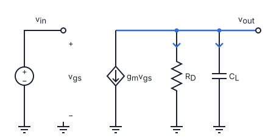
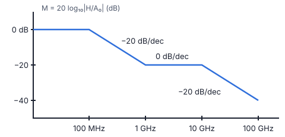

# 전자회로2 복습 1014 문제설명

주어진 조건을 읽고, 첫 줄을 쓰고, 이유를 따라가며 답을 확인해요.

문제의 첫 줄부터 검산까지 설명해요.

**목차**

- [문항별 설명](#problems)
  - [영상 시스템의 대역폭이 부족할 때 생기는 일](#p1)
  - [부하 커패시턴스를 가진 CS 단의 전달 함수와 주파수 응답](#p2)
  - [CS 증폭기(Fig 11.62)의 이득이 10% 떨어지는 주파수](#p3)
  - [1 GHz 대역폭, 2 mW 전력에서 CE 단(Fig 11.63)의 최대 이득](#p4)
  - [극점 두 개와 영점 한 개의 보데 선도](#p5)
  - [같은 CS 단 두 개 캐스케이드(Fig 11.65)의 보데 선도](#p6)
  - [입력 RC가 있는 CS 단의 극점](#p7)
  - [입력 RC가 있는 CG 단의 극점](#p8)
  - [출력 극점이 입력 극점의 10배가 되는 R_D (예제 11.9 변형)](#p9)
  - [소스에 기생 저항 R_p가 붙은 CG 단(Fig 11.67)의 입력·출력 극점](#p10)

## 문항별 설명

### 영상 시스템의 대역폭이 부족할 때 생기는 일

E11.03 · 예제 11.3 · [원 문제 보기](../%EB%B3%B5%EC%8A%B5%EB%AC%B8%EC%A0%9C_1014_Frequency_Response-%EB%AC%B8%EC%A0%9C.pdf)

#### 주어진 조건

- 영상 신호는 일반적으로 약 $5\ \text{MHz}$의 대역폭을 가짐
- 예: 컴퓨터 화면에 영상 신호를 전송하는 그래픽 카드는 최소한 $5\ \text{MHz}$ 대역폭을 지원해야 함

#### 구할 것

- 영상 시스템의 대역폭이 부족하다면 어떤 일이 생기는지 설명

원문 보기

영상 신호들은 일반적으로 약 $5\ \text{MHz}$의 대역폭을 갖는다. 예를 들어 컴퓨터의 화면에 영상 신호를 전송하는 그래픽 카드는 최소한 $5\ \text{MHz}$ 대역폭을 지원해야 한다. 만약 영상 시스템의 대역폭이 부족하다면 어떤 일이 생기는지 설명하라.

#### 문제를 내 말로 읽어요

밝기 정보가 시간에 따라 전압으로 전송돼요. 화면을 왼쪽에서 오른쪽으로 훑는 동안 흰 픽셀 다음에 검은 픽셀이 오면, 회로 출력도 짧은 시간 안에 바뀌어야 해요. 여기서는 소자 값을 구하는 대신 대역폭 부족이 화면에 남기는 모습을 설명해요.

#### 이 문제를 봤을 때 떠올릴 개념과 공식

“급격한 밝기 변화”는 고주파 성분을 떠올리는 단서예요. 대역폭(bandwidth)은 그 성분을 충분히 전달하는 주파수 범위예요. 교과서 보충으로 단일 극점 저역통과 모델 $H(s)=1/(1+s\tau)$를 쓰면 $\tau=1/(2\pi f_B)$예요. 이 모델은 영상 회로 전체의 정확한 회로도가 아니라 속도를 설명하는 예예요.

#### 종이에 쓰는 실제 첫 줄

흰색에서 검은색으로 바뀌는 경계를 계단 입력으로 두고 $\tau\,dy/dt+y=u(t)$부터 적어요.

#### 왜 이렇게 푸는지 함께 따라가요

고주파 성분은 계단의 날카로운 모서리를 만들어요. 저역통과 회로가 이 성분을 줄이면 정상 밝기는 결국 맞아도 경계를 지나는 동안 출력이 늦게 따라가요. 단위 계단에 대한 응답은 $y(t)=1-e^{-t/\tau}$예요. 따라서 경계 부근의 여러 픽셀이 중간 밝기를 거쳐 회색으로 보여요. **가로 스캔에서는 세로 테두리가 번져 영상이 흐려져요.**

#### 완성 답과 검산

$t=\tau$에서 $y=1-e^{-1}\approx0.632$이므로 아직 최종 밝기의 63.2%예요. 교과서 보충인 단일 극점 모델의 10–90% 상승시간은 $t_r=\tau\ln9\approx0.350/f_B$예요. $f_B=5\,\mathrm{MHz}$이면 약 $70\,\mathrm{ns}$, 더 좁은 대역폭이면 더 오래 걸려요. $f_B\to\infty$에서 $\tau\to0$이 되어 번짐이 사라지는 방향도 맞아요.

#### 여기서 조심해요

대역폭을 화면의 픽셀 개수나 밝기 자체로 해석하지 않아요. 고주파가 줄어도 균일한 흰 영역의 최종 밝기까지 반드시 감소하는 것은 아니에요.

#### 설명을 닫고 규칙을 적용해 봐요

1. 단일 극점 예시 모델에서 대역폭을 절반으로 줄이면 시간상수와 상승시간은 각각 어떻게 바뀌나요?
2. 사용한 규칙과 적용 조건을 한 문장으로 설명하고, 본문을 닫은 채 계산 또는 전류 경로를 보여 주세요.

**페이지 요약**

#### 핵심 개념·답

빠른 경계 → 고주파 성분 → 대역폭 부족 → 전이 지연과 세로 테두리 번짐

#### 첫 줄

흰색에서 검은색으로 바뀌는 경계를 계단 입력으로 두고 $\tau\,dy/dt+y=u(t)$부터 적어요.

#### 검산

$f_B\to\infty$이면 전이 시간은 0으로 가요. 단일 극점 예: $t_r\approx0.350/f_B$.

---

### 부하 커패시턴스를 가진 CS 단의 전달 함수와 주파수 응답

E11.04 · 예제 11.4 · [원 문제 보기](../%EB%B3%B5%EC%8A%B5%EB%AC%B8%EC%A0%9C_1014_Frequency_Response-%EB%AC%B8%EC%A0%9C.pdf)

#### 주어진 조건

- 채널길이 변조는 무시 (본문 식 (11.1)의 각주)
- 소자 값은 주어지지 않음 (답은 기호로)

#### 구할 것

- 전달 함수 $H(s) = \dfrac{V_{out}}{V_{in}}(s)$
- 주파수 응답

원문 보기

그림 11.5(a)에 보여진 공통 소스(CS) 단의 전달 함수와 주파수 응답을 결정하라.

#### 문제를 내 말로 읽어요

소스가 접지된 CS 단에서 드레인 전압을 출력으로 읽어요. $R_D$와 $C_L$은 출력에서 교류 접지로 병렬 연결돼요. 채널 길이 변조를 무시하므로 $r_o$는 무한대로 둬요.

#### 이 문제를 봤을 때 떠올릴 개념과 공식

“출력에 커패시터”라는 단서에서 임피던스 $Z_C=1/(sC_L)$와 출력 KCL을 떠올려요. $s$는 복소 주파수이고, $g_m$은 입력 전압을 드레인 전류로 바꾸는 트랜스컨덕턴스예요. 게이트 전류와 다른 기생 커패시턴스를 무시하므로 $v_{gs}=v_{in}$이고 출력 한 노드만 시간상수를 만들어요.

#### 종이에 쓰는 실제 첫 줄

$V_{DD}$를 교류 접지로 보내고 출력에서 나가는 전류를 더해 $(1/R_D+sC_L)v_o+g_mv_i=0$을 적어요.

#### 왜 이렇게 푸는지 함께 따라가요

KCL을 $v_i$로 나누면

$$
H(s)=\frac{-g_mR_D}{1+sR_DC_L}.
$$

분모를 0으로 만드는 극점은 $s_p=-1/(R_DC_L)$이에요. $s=j\omega$를 넣고 복소수 크기를 취하면

$$
|H(j\omega)|=\frac{g_mR_D}{\sqrt{1+(\omega R_DC_L)^2}}.
$$

저주파에서는 $g_mR_D$이고, 높은 주파수에서는 커패시터가 출력 전류를 접지로 우회시켜 크기가 줄어요. 반전 부호를 포함한 위상은 $\pi-\tan^{-1}(\omega R_DC_L)$로 잡을 수 있어요.

#### 완성 답과 검산

**전달 함수는 $-g_mR_D/(1+sR_DC_L)$, 각주파수 대역폭은 $\omega_B=1/(R_DC_L)$예요.** 이때 크기가 $g_mR_D/\sqrt2$여서 $20\log_{10}(1/\sqrt2)=-3.0103\,\mathrm{dB}$예요. $\omega\to0$이면 원래 저주파 CS 이득, $\omega\to\infty$이면 0이에요. $R_DC_L$ 단위는 초라 극점 단위도 맞아요.

#### 여기서 조심해요

$1/(R_DC_L)$는 rad/s예요. Hz로 답하려면 $f_B=1/(2\pi R_DC_L)$로 바꿔요. 전압 이득이 절반인 지점을 −3 dB로 잡지 않아요.

#### 설명을 닫고 규칙을 적용해 봐요

1. 다른 값을 유지하고 CL을 2배로 하면 저주파 이득과 극점 주파수는 각각 어떻게 바뀌나요?
2. 사용한 규칙과 적용 조건을 한 문장으로 설명하고, 본문을 닫은 채 계산 또는 전류 경로를 보여 주세요.

**페이지 요약**

#### 핵심 개념·답

KCL → $H=-g_mR_D/(1+sR_DC_L)$; $\omega_B=(R_DC_L)^{-1}$

#### 첫 줄

$V_{DD}$를 교류 접지로 보내고 출력에서 나가는 전류를 더해 $(1/R_D+sC_L)v_o+g_mv_i=0$을 적어요.

#### 검산

$\omega=\omega_B$에서 크기 비 $1/\sqrt2$, 즉 −3.01 dB예요.

---

### CS 증폭기(Fig 11.62)의 이득이 10% 떨어지는 주파수

P11.01 · 장말문제 11.1 · [원 문제 보기](../%EB%B3%B5%EC%8A%B5%EB%AC%B8%EC%A0%9C_1014_Frequency_Response-%EB%AC%B8%EC%A0%9C.pdf)

#### 주어진 조건

- $R_D = 1\ \text{k}\Omega$, $C_L = 1\ \text{pF}$
- 채널길이 변조와 다른 커패시턴스는 무시

#### 구할 것

- 이득이 10% ($\approx 1\ \text{dB}$) 떨어지는 주파수

원문 보기

In the amplifier of Fig. 11.62, $R_D = 1\ \text{k}\Omega$ and $C_L = 1\ \text{pF}$. Neglecting channel-length modulation and other capacitances, determine the frequency at which the gain falls by 10% ($\approx 1\ \text{dB}$).

#### 문제를 내 말로 읽어요

문제는 극점 자체가 아니라 저주파 이득에서 10% 감소하는 지점을 물어요. $g_m$은 주어지지 않았지만 정규화하면 없어져요.

#### 이 문제를 봤을 때 떠올릴 개념과 공식

부하 $R_D\parallel C_L$을 가진 CS 단은 단일 극점 저역통과 응답이에요. 크기 비 $|H|/|H(0)|=1/\sqrt{1+(\omega R_DC_L)^2}$를 사용해요. “10% 감소”는 비가 $0.9$라는 뜻이며, 기생 성분을 무시한다는 조건 때문에 이 한 극점 모델을 쓸 수 있어요.

#### 종이에 쓰는 실제 첫 줄

$1/\sqrt{1+(\omega R_DC_L)^2}=0.9$부터 적어요.

#### 왜 이렇게 푸는지 함께 따라가요

양변을 제곱하고 역수를 취해 $(\omega R_DC_L)^2=1/0.9^2-1$을 얻어요. $R_DC_L=10^3\cdot10^{-12}=10^{-9}\,\mathrm{s}$이므로

$$
\omega=10^9\sqrt{1/0.81-1}\approx4.8432\times10^8\,\mathrm{rad/s}.
$$

따라서

$$
f=\frac{\omega}{2\pi}\approx77.08\,\mathrm{MHz}.
$$

#### 완성 답과 검산

**$f\approx77.1\,\mathrm{MHz}$예요.** 다시 넣으면 $1/\sqrt{1+0.48432^2}=0.9000$이에요. 극점 $f_p=159.15\,\mathrm{MHz}$보다 낮은 것도, 10% 감소가 −3 dB보다 작다는 사실과 맞아요. dB 변화는 $20\log_{10}0.9=-0.9151\,\mathrm{dB}$예요.

#### 여기서 조심해요

10%를 0.1로 넣으면 90% 감소 주파수를 구하게 돼요. “약 1 dB” 대신 정확한 0.9로 계산한 값임을 구별해요.

#### 설명을 닫고 규칙을 적용해 봐요

1. 이득 10% 감소를 크기비로 쓰세요. 이것이 극점에서의 크기비와 같은가요?
2. 사용한 규칙과 적용 조건을 한 문장으로 설명하고, 본문을 닫은 채 계산 또는 전류 경로를 보여 주세요.

**페이지 요약**

#### 핵심 개념·답

정규화 크기 0.9 → $\omega=0.4843\omega_p$ → $77.1\,\mathrm{MHz}$

#### 첫 줄

$1/\sqrt{1+(\omega R_DC_L)^2}=0.9$부터 적어요.

#### 검산

$\omega/\omega_p=0.48432$를 넣으면 크기 비 0.9000이에요.

---

### 1 GHz 대역폭, 2 mW 전력에서 CE 단(Fig 11.63)의 최대 이득

P11.02 · 장말문제 11.2 · [원 문제 보기](../%EB%B3%B5%EC%8A%B5%EB%AC%B8%EC%A0%9C_1014_Frequency_Response-%EB%AC%B8%EC%A0%9C.pdf)

#### 주어진 조건

- 목표 −3 dB 대역폭 $1\ \text{GHz}$, 부하 커패시턴스 $2\ \text{pF}$
- 전력 소모 $2\ \text{mW}$
- $V_{CC} = 2.5\ \text{V}$
- 얼리 효과와 다른 커패시턴스는 무시

#### 구할 것

- 얻을 수 있는 최대 (저주파) 이득

원문 보기

In the circuit of Fig. 11.63, we wish to achieve a −3-dB bandwidth of $1\ \text{GHz}$ with a load capacitance of $2\ \text{pF}$. What is the maximum (low-frequency) gain that can be achieved with a power dissipation of $2\ \text{mW}$? Assume $V_{CC} = 2.5\ \text{V}$ and neglect the Early effect and other capacitances.

#### 문제를 내 말로 읽어요

CE 단의 저주파 이득을 키우고 싶지만, 전력은 $2\,\mathrm{mW}$, 대역폭은 $1\,\mathrm{GHz}$로 제한돼요. 이 최대값은 주어지지 않은 베이스 DC 전압을 적절히 정해 트랜지스터가 활성 영역에 머무는 설계 조건에서 구해요. 전력은 가능한 $g_m$, 대역폭은 가능한 부하 저항을 각각 제한해요.

#### 이 문제를 봤을 때 떠올릴 개념과 공식

“전력·대역폭에서 최대 이득”은 gain–bandwidth tradeoff의 단서예요. 능동 영역에서 $g_m=I_C/V_T$, $|A_0|=g_mR_1$이고, 출력 한 극점은 $f_B=1/(2\pi R_1C_L)$예요. 얼리 효과와 다른 커패시턴스, 베이스 전류를 무시하며 수치에는 교과서의 $V_T=26\,\mathrm{mV}$를 사용해요.

#### 종이에 쓰는 실제 첫 줄

$I_C\le P/V_{CC}$와 $R_1\le1/(2\pi f_BC_L)$ 두 제한을 나란히 적어요.

#### 왜 이렇게 푸는지 함께 따라가요

전력 제한에서 $I_{C,max}=2\,\mathrm{mW}/2.5\,\mathrm V=0.8\,\mathrm{mA}$이고 $g_{m,max}=0.030769\,\mathrm S$예요. 대역폭을 최소 $1\,\mathrm{GHz}$로 유지하려면

$$
R_{1,max}=\frac1{2\pi(10^9)(2\times10^{-12})}=79.577\,\Omega.
$$

베이스 DC 전압을 컬렉터 전압 약 2.436 V 이하로 정해 활성 영역을 확보한다고 놓아요. 이득은 두 양의 변수에 모두 비례하므로 두 상한을 동시에 사용해요.

$$
|A_{0,max}|=0.030769\cdot79.577=2.4485.
$$

CE의 부호까지 쓰면 $A_0\approx-2.45$예요.

#### 완성 답과 검산

**최대 이득 크기는 $2.45$ ($7.78\,\mathrm{dB}$)예요.** $I_CR_1=63.66\,\mathrm{mV}$이므로 컬렉터 전압은 약 $2.436\,\mathrm V$예요. 베이스 DC 전압은 주어지지 않았으므로, 베이스를 이 컬렉터 전압 이하로 바이어스하고 $V_{BE}$를 확보해 활성 영역을 유지하는 조건의 최대 이득이에요. $g_mR_1$은 $\mathrm S\cdot\Omega$로 무차원이고, 상한에서 $R_1C_L$을 되넣으면 정확히 $1\,\mathrm{GHz}$예요.

#### 여기서 조심해요

$1\,\mathrm{GHz}$를 $10^9\,\mathrm{rad/s}$로 쓰면 저항과 이득이 $2\pi$배 틀려요. 베이스 바이어스가 주어지지 않아 모든 DC 바이어스에서 2.45가 보장되는 것은 아니에요. 활성 영역을 유지하는 바이어스가 필요해요. 저항을 무조건 크게 고르면 대역폭 조건을 깨뜨려요.

#### 설명을 닫고 규칙을 적용해 봐요

1. 같은 전력·VCC에서 목표 대역폭을 2배로 높이면 허용 RC 상한과 최대 저주파 이득은 각각 어떻게 바뀌나요?
2. 사용한 규칙과 적용 조건을 한 문장으로 설명하고, 본문을 닫은 채 계산 또는 전류 경로를 보여 주세요.

**페이지 요약**

#### 핵심 개념·답

전력 → $I_C=0.8\,\mathrm{mA}$; 대역폭 → $R_1=79.6\,\Omega$; 활성 영역을 유지하는 베이스 바이어스에서 최대 $|A_0|=2.45$

#### 첫 줄

$I_C\le P/V_{CC}$와 $R_1\le1/(2\pi f_BC_L)$ 두 제한을 나란히 적어요.

#### 검산

$I_CR_1=63.7\,\mathrm{mV}$, $f_B=1\,\mathrm{GHz}$를 확인해요.

---

### 극점 두 개와 영점 한 개의 보데 선도

P11.06 · 장말문제 11.6 · [원 문제 보기](../%EB%B3%B5%EC%8A%B5%EB%AC%B8%EC%A0%9C_1014_Frequency_Response-%EB%AC%B8%EC%A0%9C.pdf)

#### 주어진 조건

- 증폭기의 극점 두 개: $100\ \text{MHz}$, $10\ \text{GHz}$
- 영점 한 개: $1\ \text{GHz}$

#### 구할 것

- $|V_{out}/V_{in}|$의 보데 선도

원문 보기

An amplifier exhibits two poles at $100\ \text{MHz}$ and $10\ \text{GHz}$ and a zero at $1\ \text{GHz}$. Construct the Bode plot of $|V_{out}/V_{in}|$.

#### 문제를 내 말로 읽어요

극점 두 개와 영점 한 개의 위치만 주어졌어요. 저주파 이득 $A_0$가 없으므로 절대 높이는 $20\log_{10}|A_0|$로 남기고, 그 높이에 대한 상대 보데 선도를 그려요.

#### 이 문제를 봤을 때 떠올릴 개념과 공식

극점(pole)은 통과한 뒤 기울기에 $-20\,\mathrm{dB/dec}$, 영점(zero)은 $+20\,\mathrm{dB/dec}$를 더해요. dec는 주파수가 10배가 되는 구간이에요. 크기 선도만 묻기 때문에 영점이 좌·우 반평면 어느 쪽인지는 크기에 영향을 주지 않아요. 여기서는 단순 1차 극점·영점으로 해석해요.

#### 종이에 쓰는 실제 첫 줄

$M(f)=20\log_{10}|H(f)/A_0|$로 정규화하고 코너를 $0.1,1,10\,\mathrm{GHz}$ 순으로 표시해요.

#### 왜 이렇게 푸는지 함께 따라가요

정확한 크기 비는

$$
\frac{|H|}{|A_0|}=\frac{\sqrt{1+(f/10^9)^2}}{\sqrt{1+(f/10^8)^2}\sqrt{1+(f/10^{10})^2}}.
$$

직선 근사는 $100\,\mathrm{MHz}$ 아래에서 $M=0$이에요. $100\,\mathrm{MHz}$에서 극점이 시작되어 $1\,\mathrm{GHz}$까지 −20 dB/dec로 내려가 $M=-20\,\mathrm{dB}$가 돼요. $1\,\mathrm{GHz}$의 영점은 그 기울기를 상쇄하므로 $10\,\mathrm{GHz}$까지 평평해요. 그 뒤 두 번째 극점 때문에 다시 −20 dB/dec예요. 따라서 실제 높이는 이 상대 선도 전체에 $20\log_{10}|A_0|$를 더해요.

*세로축은 저주파 이득 대비 dB예요. 실제 선도는 코너 부근에서 부드럽게 휘어요.*

#### 완성 답과 검산

**기울기는 차례로 $0,-20,0,-20\,\mathrm{dB/dec}$예요.** 정확한 식으로 코너 $100\,\mathrm{MHz},1\,\mathrm{GHz},10\,\mathrm{GHz}$에서 각각 약 $-2.97,-17.08,-22.97\,\mathrm{dB}$예요. 코너 부근에서는 직선 근사와 다르지만 고주파에서 극점 2개−영점 1개=순수 1개 극점이므로 최종 −20 기울기가 맞아요.

#### 여기서 조심해요

영점 이후 이득이 반드시 증가하는 것은 아니에요. 앞 극점의 −20과 더해 이 구간은 0이 돼요. $A_0$가 없는데 저주파 절대 높이를 0 dB로 확정하지 않아요.

#### 설명을 닫고 규칙을 적용해 봐요

1. 기존 기울기가 −20 dB/dec일 때 1차 영점을 하나 지나면 기울기는 얼마인가요? 극점이었다면요?
2. 사용한 규칙과 적용 조건을 한 문장으로 설명하고, 본문을 닫은 채 계산 또는 전류 경로를 보여 주세요.

**페이지 요약**

#### 핵심 개념·답

코너 $0.1,1,10\,\mathrm{GHz}$; 상대 기울기 $0,-20,0,-20$

#### 첫 줄

$M(f)=20\log_{10}|H(f)/A_0|$로 정규화하고 코너를 $0.1,1,10\,\mathrm{GHz}$ 순으로 표시해요.

#### 검산

극점2개−영점1개라 최종 기울기는 −20 dB/dec예요.

---

### 같은 CS 단 두 개 캐스케이드(Fig 11.65)의 보데 선도

P11.09 · 장말문제 11.9 · [원 문제 보기](../%EB%B3%B5%EC%8A%B5%EB%AC%B8%EC%A0%9C_1014_Frequency_Response-%EB%AC%B8%EC%A0%9C.pdf)

#### 주어진 조건

- 채널길이 변조와 다른 커패시턴스는 무시
- $V_{out}/V_{in} = (V_X/V_{in})(V_{out}/V_X)$임을 이용

#### 구할 것

- $|V_{out}/V_{in}|$의 보데 선도

원문 보기

Figure 11.65 illustrates a cascade of two identical CS stages. Neglecting channel-length modulation and other capacitances, construct the Bode plot of $|V_{out}/V_{in}|$. Note that $V_{out}/V_{in} = (V_X/V_{in})(V_{out}/V_X)$.

#### 문제를 내 말로 읽어요

같은 CS 단 두 개를 직렬로 이어 첫 출력 $X$가 두 번째 게이트를 구동해요. 다른 커패시턴스를 무시하여 게이트는 첫 단을 부하로 누르지 않으므로 각 단 전달 함수를 그대로 곱할 수 있어요.

#### 이 문제를 봤을 때 떠올릴 개념과 공식

“동일한 두 단”이라는 단서에서 cascade(종속 연결)의 전달 함수 곱을 떠올려요. $\tau=R_DC_L$, 한 단 $H_1=-g_mR_D/(1+s\tau)$예요. $\lambda=0$과 기생 입력 커패시턴스 무시가 출력 저항·입력 부하를 단순화하는 조건이에요. 두 극점이 같은 위치라 중복 극점이 돼요.

#### 종이에 쓰는 실제 첫 줄

$(1/R_D+sC_L)v_X+g_mv_{in}=0$, $(1/R_D+sC_L)v_o+g_mv_X=0$을 적어요.

#### 왜 이렇게 푸는지 함께 따라가요

첫 KCL에서 $v_X/v_{in}=-g_mR_D/(1+s\tau)$, 두 번째에서도 같은 인자를 얻어요.

$$
H(s)=\frac{(g_mR_D)^2}{(1+s\tau)^2}.
$$

두 번 반전되어 저주파 부호는 양수예요. 크기는

$$
|H(j\omega)|=\frac{(g_mR_D)^2}{1+(\omega\tau)^2}.
$$

dB로는 $40\log_{10}(g_mR_D)-20\log_{10}[1+(\omega\tau)^2]$예요. 따라서 $\omega_p=1/\tau$ 이전은 평평하고 이후는 −40 dB/dec 직선으로 그려요.

*같은 위치의 극점 두 개가 기울기를 각각 −20 dB/dec씩 바꿔요. 정확한 응답은 ωp에서 −6.02 dB예요.*

#### 완성 답과 검산

**저주파 높이 $40\log_{10}(g_mR_D)$, 코너 뒤 −40 dB/dec예요.** $\omega=\omega_p$에서는 각 단이 $1/\sqrt2$이므로 전체 크기 비는 $1/2$, 즉 −6.0206 dB예요. 전체 −3 dB 주파수는 보충으로 $\omega_B=\sqrt{\sqrt2-1}\,\omega_p\approx0.6436\omega_p$예요. 고주파 크기는 $\omega^{-2}$라 기울기도 맞아요.

#### 여기서 조심해요

두 단 전체의 −3 dB점을 한 단의 극점과 같다고 하지 않아요. dB는 더하지만 선형 크기는 곱해요.

#### 설명을 닫고 규칙을 적용해 봐요

1. 같은 위치의 극점이 두 개이면 코너 이후 기울기와 코너에서의 정확한 상대 크기는 각각 얼마인가요?
2. 사용한 규칙과 적용 조건을 한 문장으로 설명하고, 본문을 닫은 채 계산 또는 전류 경로를 보여 주세요.

**페이지 요약**

#### 핵심 개념·답

$H=(g_mR_D)^2/(1+s\tau)^2$; 중복 극점; 코너 −6.02 dB

#### 첫 줄

$(1/R_D+sC_L)v_X+g_mv_{in}=0$, $(1/R_D+sC_L)v_o+g_mv_X=0$을 적어요.

#### 검산

겹친 극점 위치에서 전체 크기 비 $1/2$, 즉 −6.02 dB예요.

---

### 입력 RC가 있는 CS 단의 극점

E11.08 · 예제 11.8 · [원 문제 보기](../%EB%B3%B5%EC%8A%B5%EB%AC%B8%EC%A0%9C_1014_Frequency_Response-%EB%AC%B8%EC%A0%9C.pdf)

#### 주어진 조건

- $\lambda = 0$
- 소자 값은 주어지지 않음 (답은 기호로)

#### 구할 것

- 회로의 극점

원문 보기

그림 11.11에 나타낸 회로의 극점을 결정하라. $\lambda = 0$으로 가정한다.

#### 문제를 내 말로 읽어요

입력 게이트에는 $R_S,C_{in}$, 드레인 출력에는 $R_D,C_L$이 있어요. 커패시터 두 개의 충방전 경로를 각각 찾아 극점을 구해요.

#### 이 문제를 봤을 때 떠올릴 개념과 공식

“노드와 극점”에서는 독립 전압원을 0으로 놓고 각 커패시터가 보는 저항을 찾아요. CS의 게이트 전류는 0이고, $\lambda=0$이라 드레인 전압은 입력 노드 전류에 되먹임되지 않아요. 따라서 두 노드의 방정식이 한 방향으로만 이어져 각 RC 시간상수를 분모 인자로 분리할 수 있어요.

#### 종이에 쓰는 실제 첫 줄

게이트 노드에서 $(v_g-v_i)/R_S+sC_{in}v_g=0$, 드레인에서 $(1/R_D+sC_L)v_o+g_mv_g=0$이에요.

#### 왜 이렇게 푸는지 함께 따라가요

첫 식에서 $v_g/v_i=1/(1+sR_SC_{in})$예요. 두 번째 식은 $v_o/v_g=-g_mR_D/(1+sR_DC_L)$이므로

$$
H(s)=\frac{-g_mR_D}{(1+sR_SC_{in})(1+sR_DC_L)}.
$$

따라서 복소 평면 극점은 $s_{p1}=-1/(R_SC_{in})$, $s_{p2}=-1/(R_DC_L)$이에요. 문제의 극점 주파수 크기는 각각 이 음수 위치의 절댓값이에요.

#### 완성 답과 검산

**$|\omega_{p1}|=1/(R_SC_{in})$, $|\omega_{p2}|=1/(R_DC_L)$예요.** $C_{in}\to0$이면 입력 극점이 무한대로 가고 단일 출력 극점만 남아요. $C_L\to0$이면 그 반대예요. 두 시간상수가 같으면 한 극점이 사라지는 게 아니라 같은 위치의 이중 극점이에요.

#### 여기서 조심해요

CS 게이트를 들여다보는 저항에 $1/g_m$을 넣지 않아요. 게이트에는 전류가 흐르지 않아요. 게이트–드레인 커패시턴스가 있으면 이 독립 노드 접근을 그대로 쓰기 어려워요.

#### 설명을 닫고 규칙을 적용해 봐요

1. λ=0이고 게이트 전류와 다른 기생을 무시할 때 RS만 2배로 하면 어느 극점만 움직이나요?
2. 사용한 규칙과 적용 조건을 한 문장으로 설명하고, 본문을 닫은 채 계산 또는 전류 경로를 보여 주세요.

**페이지 요약**

#### 핵심 개념·답

입력 $R_SC_{in}$; 출력 $R_DC_L$; 분모 인자 두 개

#### 첫 줄

게이트 노드에서 $(v_g-v_i)/R_S+sC_{in}v_g=0$, 드레인에서 $(1/R_D+sC_L)v_o+g_mv_g=0$이에요.

#### 검산

$C_{in}\to0$이면 입력 극점만 무한대로 가요.

---

### 입력 RC가 있는 CG 단의 극점

E11.09 · 예제 11.9 · [원 문제 보기](../%EB%B3%B5%EC%8A%B5%EB%AC%B8%EC%A0%9C_1014_Frequency_Response-%EB%AC%B8%EC%A0%9C.pdf)

#### 주어진 조건

- $\lambda = 0$
- 소자 값은 주어지지 않음 (답은 기호로)

#### 구할 것

- 회로의 극점들

원문 보기

그림 11.12에 나타낸 회로의 극점들을 계산하라. $\lambda = 0$으로 가정한다.

#### 문제를 내 말로 읽어요

CG 단은 입력이 게이트가 아니라 소스예요. 게이트 바이어스 $V_b$는 교류 접지이고, 입력 커패시터 $C_{in}$은 소스 노드에 있어요. $R_S$뿐 아니라 트랜지스터 쪽으로도 소스 전류가 빠져나가요.

#### 이 문제를 봤을 때 떠올릴 개념과 공식

“CG의 입력 극점”은 소스 입력 저항 $1/g_m$을 떠올리는 단서예요. $g_m$은 게이트–소스 전압이 만드는 드레인 전류의 계수예요. $\lambda=0$이고 몸체 효과를 무시하면 게이트가 고정된 소스 노드에서 트랜지스터로 들어가는 전류는 $g_mv_s$예요. 그래서 $R_S$와 $1/g_m$이 병렬이에요.

#### 종이에 쓰는 실제 첫 줄

소스 KCL $(v_s-v_i)/R_S+sC_{in}v_s+g_mv_s=0$을 적어요.

#### 왜 이렇게 푸는지 함께 따라가요

입력 식을 정리하면

$$
\frac{v_s}{v_i}=\frac1{1+g_mR_S+sR_SC_{in}}.
$$

드레인 KCL은 $(1/R_D+sC_L)v_o-g_mv_s=0$이므로

$$
H(s)=\frac{g_mR_D}{(1+g_mR_S+sR_SC_{in})(1+sR_DC_L)}.
$$

입력 인자를 상수로 정규화하면 $1+sR_SC_{in}/(1+g_mR_S)$예요. 따라서

$$
\omega_{p,in}=\frac{1+g_mR_S}{R_SC_{in}},\qquad\omega_{p,out}=\frac1{R_DC_L}.
$$

실제 $s$ 극점 위치는 이 값들의 음수예요.

#### 완성 답과 검산

**입력 극점 크기는 $1/[(R_S\parallel1/g_m)C_{in}]$, 출력은 $1/(R_DC_L)$예요.** $g_m\to0$이면 입력 값은 $1/(R_SC_{in})$로 돌아와요. $g_mR_S\gg1$이면 입력 극점은 $g_m/C_{in}$에 가까워져요. 소스 저항이 낮아 커패시터가 더 빨리 충방전되는 해석과 같아요.

#### 여기서 조심해요

입력에 $R_S+1/g_m$을 넣지 않아요. 전원을 0으로 두면 둘 다 같은 노드와 접지 사이예요. 극점을 구할 때 종속 전류원까지 꺼서는 안 돼요.

#### 설명을 닫고 규칙을 적용해 봐요

1. gm을 매우 크게 만들면 CG 입력의 RS∥1/gm은 어떻게 되고 입력 극점은 어느 방향으로 움직이나요?
2. 사용한 규칙과 적용 조건을 한 문장으로 설명하고, 본문을 닫은 채 계산 또는 전류 경로를 보여 주세요.

**페이지 요약**

#### 핵심 개념·답

CG 입력 $R_S\parallel1/g_m$; 출력 $R_D$; 각각 $1/(RC)$

#### 첫 줄

소스 KCL $(v_s-v_i)/R_S+sC_{in}v_s+g_mv_s=0$을 적어요.

#### 검산

$g_m\to0$이면 입력 극점은 $1/(R_SC_{in})$이에요.

---

### 출력 극점이 입력 극점의 10배가 되는 R_D (예제 11.9 변형)

X11.09 · 연습문제 11.9 · [원 문제 보기](../%EB%B3%B5%EC%8A%B5%EB%AC%B8%EC%A0%9C_1014_Frequency_Response-%EB%AC%B8%EC%A0%9C.pdf)

#### 주어진 조건

- 예제 11.9의 회로: Fig 11.12 CG 단 ($R_S$, $C_{in}$, $M_1$, $V_b$, $R_D$, $C_L$), $\lambda = 0$
- 출력 극점 주파수가 입력 극점 주파수의 10배

#### 구할 것

- $R_D$의 값을 어떻게 선택해야 하는가? (답은 기호로)

원문 보기

출력 극점 주파수가 입력 극점 주파수의 10배라면 $R_D$의 값을 어떻게 선택해야 하는가?

#### 문제를 내 말로 읽어요

앞 CG 회로에서 출력 극점을 입력 극점의 정확히 10배로 배치하고 싶어요. 나머지 값은 기호로 두고 $R_D$만 역산해요.

#### 이 문제를 봤을 때 떠올릴 개념과 공식

극점 배치(pole placement) 문제는 각 노드 시간상수를 먼저 쓰면 돼요. $\lambda=0$, 몸체 효과 무시에서 $R_{in}=R_S\parallel1/g_m$이고 $\omega_{in}=1/(R_{in}C_{in})$예요. $R_D$는 출력 시간상수만 바꾸므로 출력 극점 식에 목표 비율을 넣어요.

#### 종이에 쓰는 실제 첫 줄

$1/(R_DC_L)=10/[R_{in}C_{in}]$, $R_{in}=R_S\parallel1/g_m$부터 적어요.

#### 왜 이렇게 푸는지 함께 따라가요

양변을 교차 곱하면 $R_{in}C_{in}=10R_DC_L$이에요. 따라서

$$
R_D=\frac{C_{in}}{10C_L}(R_S\parallel1/g_m).
$$

출력 극점을 더 높이려면 이 값보다 작은 $R_D$를 택해요. 단, 저주파 CG 이득은 $g_mR_D/(1+g_mR_S)=R_D/(R_S+1/g_m)$이므로 저항을 줄이면 이득도 감소해요.

#### 완성 답과 검산

**$R_D=(C_{in}/10C_L)(R_S\parallel1/g_m)$예요.** 계산한 값을 출력 식에 넣으면 $1/(R_DC_L)=10/(R_{in}C_{in})$이 되어 비율 10을 되찾아요. 커패시턴스 비는 무차원이라 결과는 저항이에요. $C_L$이 2배이면 $R_D$를 절반으로 해야 같은 출력 극점을 지켜요.

#### 여기서 조심해요

주파수가 10배라는 조건을 시간상수가 10배로 바꾸면 안 돼요. 시간상수는 오히려 1/10이에요.

#### 설명을 닫고 규칙을 적용해 봐요

1. 다른 값을 유지하고 출력 극점을 입력 극점의 10배 대신 20배로 놓으려면 RD를 몇 배로 바꿔야 하나요?
2. 사용한 규칙과 적용 조건을 한 문장으로 설명하고, 본문을 닫은 채 계산 또는 전류 경로를 보여 주세요.

**페이지 요약**

#### 핵심 개념·답

$\omega_{out}=10\omega_{in}$ → $R_D=R_{in}C_{in}/(10C_L)$

#### 첫 줄

$1/(R_DC_L)=10/[R_{in}C_{in}]$, $R_{in}=R_S\parallel1/g_m$부터 적어요.

#### 검산

$R_D$를 되넣으면 출력/입력 극점 비가 10이에요.

---

### 소스에 기생 저항 R_p가 붙은 CG 단(Fig 11.67)의 입력·출력 극점

P11.12 · 장말문제 11.12 · [원 문제 보기](../%EB%B3%B5%EC%8A%B5%EB%AC%B8%EC%A0%9C_1014_Frequency_Response-%EB%AC%B8%EC%A0%9C.pdf)

#### 주어진 조건

- 제조 오류로 기생 저항 $R_p$가 $M_1$의 소스와 직렬로 생김 (그림 라벨은 $R_P$, 그림에 $M_1$ 라벨은 인쇄되지 않음)
- $\lambda = 0$, 다른 커패시턴스는 무시

#### 구할 것

- 회로의 입력 극점과 출력 극점

원문 보기

Due to a manufacturing error, a parasitic resistance $R_p$ has appeared in series with the source of $M_1$ in Fig. 11.67. Assuming $\lambda = 0$ and neglecting other capacitances, determine the input and output poles of the circuit.

#### 문제를 내 말로 읽어요

입력 노드는 $R_S,R_P,C_{in}$의 접점이에요. 그 노드와 트랜지스터 소스 사이에 기생 저항 $R_P$가 직렬로 생겼어요. 커패시터 위치를 실제 소스와 혼동하지 않고 저항을 봐야 해요.

#### 이 문제를 봤을 때 떠올릴 개념과 공식

“소스와 직렬인 기생 저항”은 CG의 입력 저항 $1/g_m$에 $R_P$가 더해진다는 단서예요. $\lambda=0$이면 드레인에서 소스 쪽으로의 소신호 되먹임이 없고 몸체 효과도 무시해요. 입력원을 0으로 놓으면 커패시터 노드에서 접지로 가는 길은 $R_S$와 $R_P+1/g_m$ 두 개예요.

#### 종이에 쓰는 실제 첫 줄

커패시터 노드 전압을 $v_x$, 실제 소스를 $v_s$라 두고 $(v_x-v_s)/R_P=g_mv_s$를 적어요.

#### 왜 이렇게 푸는지 함께 따라가요

위 식은 $v_s=v_x/(1+g_mR_P)$, 즉 트랜지스터 쪽으로 흐르는 전류가 $v_x/(R_P+1/g_m)$임을 뜻해요. 입력 노드 KCL은

$$
(v_x-v_i)/R_S+sC_{in}v_x+\frac{v_x}{R_P+1/g_m}=0.
$$

따라서

$$
\omega_{p,in}=\frac1{[R_S\parallel(R_P+1/g_m)]C_{in}}.
$$

드레인은 $\lambda=0$ 때문에 소스의 저항 변화가 드레인 출력 저항으로 전달되지 않아 $\omega_{p,out}=1/(R_DC_L)$이에요. 실제 $s$ 극점은 둘 다 음수예요.

#### 완성 답과 검산

**입력은 $1/\{[R_S\parallel(R_P+1/g_m)]C_{in}\}$, 출력은 $1/(R_DC_L)$예요.** $R_P\to0$이면 예제 11.9 CG 입력 식으로 돌아와요. $R_P\to\infty$이면 입력 저항은 $R_S$로 가서 입력 극점은 $1/(R_SC_{in})$예요. $R_P$가 커질수록 병렬 합 저항이 증가하므로 입력 극점이 내려가요. 출력 극점의 단위와 값은 그대로예요.

#### 여기서 조심해요

$R_P$를 $R_S$와 먼저 직렬로 합치지 않아요. $C_{in}$이 그 사이 접점에 있어 실제 두 갈래를 분리해야 해요. 출력 극점도 무조건 내려간다고 추정하지 않아요.

#### 설명을 닫고 규칙을 적용해 봐요

1. RP를 0으로 돌리면 입력 커패시터가 보는 저항은 무엇이 되나요? RP는 RS와 먼저 병렬인가요?
2. 사용한 규칙과 적용 조건을 한 문장으로 설명하고, 본문을 닫은 채 계산 또는 전류 경로를 보여 주세요.

**페이지 요약**

#### 핵심 개념·답

입력 $R_S\parallel(R_P+1/g_m)$; 출력 $R_D$; $R_P\to0$으로 원래 회로 복원

#### 첫 줄

커패시터 노드 전압을 $v_x$, 실제 소스를 $v_s$라 두고 $(v_x-v_s)/R_P=g_mv_s$를 적어요.

#### 검산

$R_P\to0$에서 원래 CG 단 입력 극점으로 돌아와요.

---

원 문제·정리노트·PDF는 보존해요.
