# 주파수 응답 — 5살도 이해하는 정리노트

권익진 교수님 전자회로2 · 1014 수업 (Lec5, Razavi 11장)

> `정리노트_1014_Frequency_Response.html`를 마크다운으로 옮겼어요. 그림은 `figures_1014/` 폴더의 SVG, 위젯은 대표 설정의 정적 그림으로 바꿨어요. 수식은 `$…$` / `$$…$$`라서 GitHub, Obsidian, Typora에서 보여요.

**목차**

- [들어가며: 왜 이런 회로를 쓸까](#why)
  - [왜 이런 회로를 쓸까](#why-circuit)
- [1. 이득이 떨어지는 이유: 커패시턴스](#s0)
  - [1. 속도와 대역폭, 그리고 저주파 모델](#s0-speed-bandwidth)
  - [2. RC 저역통과 필터](#s0-rc-lowpass)
  - [3. 부하 커패시턴스가 있는 CS 단](#s0-cs-cl)
  - [4. −3 dB 대역폭과 이득–대역폭 트레이드오프](#s0-3db)
- [2. 전달 함수와 보데 근사](#s1)
  - [5. 전달 함수: 극점과 영점](#s1-transfer)
  - [6. 보데 근사: 극점마다 기울기 −20 dB/dec](#s1-bode)
- [3. 노드마다 극점 하나](#s2)
  - [7. 입력 RC가 있는 CS 단의 두 극점](#s2-cs-two-poles)
  - [8. 노드마다 극점: 등가 저항과 등가 커패시턴스](#s2-node-rule)
  - [9. CG 단의 입력 극점](#s2-cg-poles)
  - [10. 부유 커패시터: 어느 노드에 넣을까](#s2-floating)
- [4. 요약 · 예고](#s3)
  - [11장 앞부분 핵심 정리](#s3-cheatsheet)
  - [다음 시간 예고](#s3-next)
  - [함께 보면 좋은 자료](#s3-links)

## 들어가며: 왜 이런 회로를 쓸까

### 왜 이런 회로를 쓸까

*1014 수업 · L05 s1–11*

**쉽게 말하면**

빠르게 바뀌는 신호를 키우려 해도, 회로 안의 커패시턴스 때문에 높은 주파수에서는 이득이 줄어요.

*어느 주파수부터 이득이 줄어드는지 알면 회로의 속도를 설계할 수 있어요.*

**정확히 말하면**

**1. 풀고 싶은 문제.** 무선 통신과 차량 레이더처럼 빠르게 바뀌는 신호를 증폭하려면, 이득이 어느 주파수까지 유지되는지 알아야 해요. 시간 영역의 속도를 주파수 영역에서는 대역폭으로 살펴봐요. 이번 수업의 주파수 응답은 그 범위를 해석하는 출발점이에요([1. 속도와 대역폭, 그리고 저주파 모델](#s0-speed-bandwidth)).

**2. 단순한 해법과 그 한계.** CS 단의 낮은 주파수 이득만 보고 저항을 키우면 신호를 더 크게 만들 수 있어요. 하지만 출력의 부하 커패시턴스가 높은 주파수 신호를 접지 쪽으로 흘려 이득을 떨어뜨려요. 일부러 달지 않아도 트랜지스터와 다음 단에는 커패시턴스가 있어요. 저항과 커패시턴스가 만든 [2. RC 저역통과 필터](#s0-rc-lowpass)의 성질이 [3. 부하 커패시턴스가 있는 CS 단](#s0-cs-cl)에서도 나타나요.

**3. 핵심 아이디어.** 입력과 출력의 [5. 전달 함수: 극점과 영점](#s1-transfer)에서 이득이 떨어지기 시작하는 극점을 찾고, [6. 보데 근사: 극점마다 기울기 −20 dB/dec](#s1-bode)로 변화 방향을 그려요. 접지로 연결된 커패시턴스가 있는 노드에서는 [8. 노드마다 극점: 등가 저항과 등가 커패시턴스](#s2-node-rule)으로 손쉽게 극점을 추정할 수 있어요. 같은 방법을 [9. CG 단의 입력 극점](#s2-cg-poles)에도 적용해요.

**4. 대가와 쓰이는 곳.** $g_m$과 $C_L$을 고정하고 $R_D$만 두 배로 하면 CS 단의 저주파 이득 크기 $g_mR_D$는 두 배가 되지만, 대역폭을 나타내는 $\omega_{3\mathrm{dB}}$는 절반이 돼요. 무선 통신이나 레이더용 증폭기를 설계할 때 이득과 속도를 함께 골라야 하는 이유예요([4. −3 dB 대역폭과 이득–대역폭 트레이드오프](#s0-3db)).

$$
\omega_{3\mathrm{dB}}=\frac{1}{R_DC_L}
$$

이 손계산은 커패시터가 각 노드에서 접지로 이어진 예제에 적용돼요. 두 신호 노드 사이의 커패시터는 어느 한 노드의 접지 커패시턴스로 곧바로 넣을 수 없어요([10. 부유 커패시터: 어느 노드에 넣을까](#s2-floating)).

**교수님 말씀**

고속 회로의 주파수 응답을 배우는 목적을 설계에 연결하셨어요.

> “해석하는 목표는 기본적으로 설계를 하기 위해서”

이득과 동작 속도 사이의 선택도 강조하셨어요.

> “무조건 게인을 크게 하는 게 좋은 설계는 아니에요.”

**페이지 요약**

커패시턴스가 높은 주파수의 이득을 떨어뜨리므로, 극점을 찾아 주파수 응답과 대역폭을 읽어요.

이득을 키우려고 $R_D$를 키우면, $g_m$과 $C_L$이 고정된 CS 단의 대역폭은 줄어요.

*핵심 식*

- CS 단의 대역폭

  $$
  \omega_{3\mathrm{dB}}=\frac{1}{R_DC_L}
  $$

*용어*

- **주파수 응답(frequency response)** — 주파수에 따라 이득이 어떻게 변하는지 보여 줘요.
- **대역폭(bandwidth)** — 이득이 유지되는 주파수 범위를 나타내요.

---

## 1. 이득이 떨어지는 이유: 커패시턴스

### 1. 속도와 대역폭, 그리고 저주파 모델

*1014 수업 · L05 s3*

**쉽게 말하면**

신호가 빠르게 바뀔수록 실제 증폭기의 이득은 작아져요.

예를 들어 같은 크기의 느린 신호는 10배로 키우더라도 빠른 신호는 10배보다 작게 키울 수 있어요.

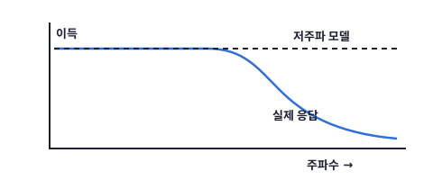

*점선은 커패시턴스를 무시한 모델, 곡선은 실제 고주파 응답이에요.*

**정확히 말하면**

같은 크기의 입력을 느릴 때 10배로 키우고 빠를 때 5배로 키운다면, 그 회로는 빠른 변화를 똑같이 증폭하지 못한 거예요.

속도(speed)는 회로가 빠른 신호 변화를 따라가는 능력이에요.

시간 영역에서 주기가 짧은 신호는 주파수 영역에서 높은 주파수에 해당해요.

대역폭(bandwidth)은 신호를 필요한 이득으로 처리할 수 있는 주파수 범위를 나타내요.

같은 크기의 두 정현파를 넣었을 때 고주파 성분의 출력이 더 작다면 그 주파수에서의 이득이 더 낮아요.

저주파 소신호 모델에서는 커패시턴스의 임피던스가 커서 이를 개방으로 근사했어요.

주파수가 높아지면 소자와 배선 사이의 커패시턴스가 더 이상 개방처럼 보이지 않으므로 주파수 응답을 따로 구해야 해요.

이 효과는 음성 전송, 스마트폰 무선 통신, 77 GHz 차량 레이더, GHz 디지털 클럭처럼 높은 주파수 성분을 다루는 회로에서 설계 조건이 돼요.

**교수님 말씀**

> “해석하는 목표는 기본적으로 설계를 하기 위해서”

회로의 동작 주파수가 무엇으로 정해지는지 알아야 설계에서 그 값을 조절할 수 있다고 설명하셨어요.

**페이지 요약**

커패시턴스 때문에 실제 증폭기의 고주파 이득이 줄어들어요.

대역폭은 회로가 빠른 신호를 다루는 범위를 보여 줘요.

*용어*

- **속도(speed)** — 빠른 신호 변화를 따라가는 능력
- **대역폭(bandwidth)** — 필요한 이득으로 신호를 처리하는 주파수 범위

---

### 2. RC 저역통과 필터

*1014 수업 · L05 s4*

**쉽게 말하면**

출력에서 접지로 이어진 커패시터는 빠른 신호를 더 쉽게 흘려보내 출력 크기를 줄여요.

같은 R과 C에서 주파수를 10배로 높이면 커패시터의 교류 저항인 임피던스 크기는 10분의 1이 돼요.

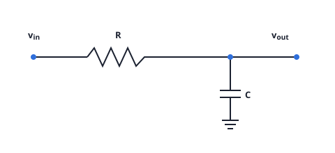

*R 뒤의 출력 노드에서 C가 접지로 이어지는 저역통과 필터예요.*

**정확히 말하면**

저역통과(low-pass)는 낮은 주파수를 잘 통과시키고 높은 주파수를 감쇠시키는 동작이에요.

임피던스(impedance)는 교류에서 전압과 전류의 비예요.

커패시터 C의 임피던스는 다음과 같아요.

$$
Z_C=\frac{1}{sC}=\frac{1}{j\omega C}
$$

주파수에 따른 크기는 다음과 같아요.

$$
|Z_C|=\frac{1}{\omega C}
$$

예를 들어 주파수만 10배가 되면 $|Z_C|$는 10분의 1이므로 출력 노드가 접지 쪽으로 더 강하게 끌려요.

1. 그림의 출력은 R과 C의 전압분배로 정해져요.

   $$
   \frac{v_{out}}{v_{in}}=\frac{Z_C}{R+Z_C}
   $$
2. $Z_C=1/(sC)$를 대입하고 분자와 분모에 $sC$를 곱해요.

   $$
   \frac{v_{out}}{v_{in}}=\frac{1}{1+sRC}
   $$
3. 주파수가 0에 가까우면 C는 개방처럼 보여 출력이 입력에 가까워요.

   주파수가 매우 높으면 C의 임피던스가 작아져 출력이 0에 가까워요.

실제 금속선 사이와 MOS 구조의 절연층도 커패시턴스를 만들기 때문에 같은 동작이 증폭기 노드에서 나타나요.

**교수님 말씀**

> “신호의 라인이 두 개만 지나가도 그 사이에는 커패시터가 생기는 거예요.”

**페이지 요약**

C의 임피던스는 주파수가 높아질수록 작아져 출력 신호가 접지로 더 쉽게 흘러요.

*핵심 식*

- 커패시터 임피던스

  $$
  Z_C=\frac{1}{sC}=\frac{1}{j\omega C}
  $$
- 저역통과 전달비

  $$
  \frac{v_{out}}{v_{in}}=\frac{1}{1+sRC}
  $$

*용어*

- **저역통과(low-pass)** — 낮은 주파수는 통과시키고 높은 주파수는 감쇠시키는 동작
- **임피던스(impedance)** — 교류에서 전압과 전류의 비

---

### 3. 부하 커패시턴스가 있는 CS 단

*1014 수업 · L05 s5*

**쉽게 말하면**

CS 단은 입력 변화로 출력 전류를 만들지만, 출력의 부하 커패시턴스가 빠른 신호의 전압 변화를 눌러요.

낮은 주파수에서는 $R_D$가 이득을 정하고, 높은 주파수에서는 $C_L$ 쪽으로 전류가 더 흐르게 돼요.

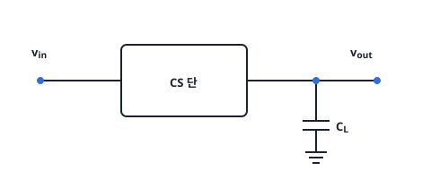

*다음 단과 배선이 출력에 더하는 부하를 $C_L$로 모아 보아요.*

**정확히 말하면**

소스와 바이어스 전압이 AC 접지이고 포화 영역의 $M_1$에서 채널 길이 변조와 몸체효과를 무시하고 외부 $C_L$만 남긴 CS 모델을 선택해요.

입력은 게이트 전압 $v_{in}$, 출력은 드레인 전압 $v_{out}$이며 $R_D$와 부하 커패시턴스 $C_L$이 출력에서 AC 접지로 연결돼요.

예를 들어 $C_L$을 늘리고 나머지를 고정하면 같은 높은 주파수에서 출력 전압의 크기가 더 작아져요.

1. 출력 단락으로 $v_{out}=0$을 만들고, 오른쪽 출력 단자에서 회로 안으로 들어오는 단락 전류를 $i_{out,sc}$의 양의 방향으로 정해요.

   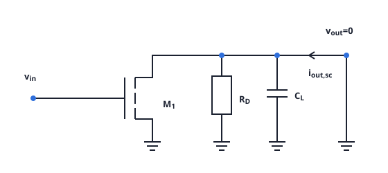

   *출력 단락에서는 $R_D$와 $C_L$의 양단 전압이 0이에요. 단락 전류는 오른쪽에서 회로 안쪽으로 들어오는 방향이에요.*

   소스가 AC 접지이므로 $v_{gs}=v_{in}$이에요.

   단락된 드레인으로 들어오는 전류는 $g_mv_{in}$이므로 단의 트랜스컨덕턴스를 바로 읽어요.

   $$
   i_{out,sc}=g_mv_{in}
   $$

   이 전류를 입력 전압으로 나누면 단의 트랜스컨덕턴스가 나와요.

   $$
   G_m=\frac{i_{out,sc}}{v_{in}}=g_m
   $$
2. 입력 독립 전압원을 0으로 두면 게이트가 AC 접지돼요.

   선택한 모델에서는 $v_{gs}=0$이므로 $M_1$의 소신호 드레인 전류는 0이에요.

   따라서 $R_D$와 외부 부하 $C_L$이 출력과 AC 접지 사이에서 병렬이에요.

   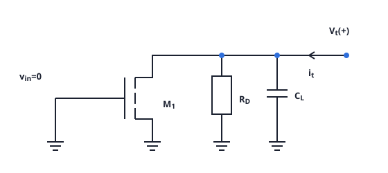

   *게이트와 소스는 AC 접지예요. 출력 끝에 시험전압을 가하고 $R_D$와 $C_L$의 병렬 연결을 읽어요.*

   먼저 저주파에서는 $C_L$을 개방으로 보아 부하 포함 출력저항을 $R_{out}\approx R_D$로 써요.

   주파수를 올리면 저항 $R_D$에 외부 부하 $1/(sC_L)$가 병렬로 붙어요.

   이 지정된 단순 모델의 부하 포함 출력 임피던스는 다음과 같아요.

   $$
   \begin{aligned}Z_{out}(s)&=\frac{V_t}{i_t}=R_D\parallel\frac{1}{sC_L}\\&=\frac{1}{1/R_D+sC_L}\\&=\frac{R_D}{1+sR_DC_L}\end{aligned}
   $$

   유한 $r_O$를 남기는 경우에는 증폭기 쪽 저항을 $R_{out}\approx R_D\parallel r_O$로 먼저 합성해요.

   그 저항과 같은 출력 노드에 연결된 $1/(sC_L)$을 마지막에 병렬로 묶어요.
3. 실제 출력은 단락을 풀고 $R_D$와 $C_L$을 연결한 상태예요.

   양의 입력은 $M_1$이 출력에서 끌어내리는 전류를 늘리므로 출력 전압은 내려가요.

   $$
   \begin{aligned}A_v(s)&=\frac{v_{out}}{v_{in}}=-G_mZ_{out}(s)\\&=-\frac{g_mR_D}{1+sR_DC_L}\end{aligned}
   $$

   저주파에서는 $A_v\approx-G_mR_{out}\approx-g_mR_D$예요.

**교수님 말씀**

커패시턴스는 따로 달지 않아도 트랜지스터와 연결선에 이미 존재하며, 느린 신호에서는 임피던스가 커서 무시할 수 있었다고 설명하셨어요.

**페이지 요약**

출력의 $C_L$은 고주파에서 부하 임피던스를 낮춰 CS 단의 반전 이득 크기를 줄여요.

아래 식은 채널 길이 변조를 무시하고 외부 $C_L$만 남긴 모델이에요.

*핵심 식*

- 출력 단락

  $$
  G_m=\frac{i_{out,sc}}{v_{in}}=g_m
  $$
- 부하 포함 임피던스

  $$
  Z_{out}(s)=\frac{R_D}{1+sR_DC_L}
  $$
- 전압이득

  $$
  \begin{aligned}A_v(s)&=-G_mZ_{out}(s)\\&=-\frac{g_mR_D}{1+sR_DC_L}\end{aligned}
  $$

*용어*

- **부하 커패시턴스(load capacitance)** — 출력 노드에서 접지로 보이는 커패시턴스

---

### 4. −3 dB 대역폭과 이득–대역폭 트레이드오프

*1014 수업 · L05 s6*

**쉽게 말하면**

CS 단에서 $R_D$를 키우면 낮은 주파수의 이득은 커지지만, 이득이 꺾이기 시작하는 주파수는 낮아져요.

같은 $C_L$에서 $R_D$를 2배로 하면 낮은 주파수 이득은 2배, −3 dB 주파수는 절반이 돼요.

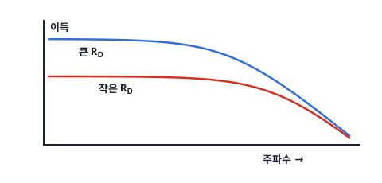

*다른 값이 같을 때 큰 $R_D$는 이득을 높이는 대신 대역폭을 줄여요.*

**정확히 말하면**

채널 길이 변조와 다른 커패시턴스를 무시하고 $g_m$과 $C_L$을 고정한 단일 출력 노드 모델을 써요.

이 조건에서 $R_D$만 2배가 되면 저주파 이득 크기 $g_mR_D$가 2배이고 코너 각주파수는 절반이에요.

[부하 커패시턴스가 있는 CS 단](#s0-cs-cl)의 반전 전달 함수에서 $s=j\omega$를 대입해 크기를 구해요.

분모 $1+j\omega R_DC_L$의 크기는 $\sqrt{1+(\omega R_DC_L)^2}$예요.

$$
|A_v(j\omega)|=\frac{g_mR_D}{\sqrt{1+(\omega R_DC_L)^2}}
$$

저주파 이득 크기는 $|A_0|=g_mR_D$예요.

1. −3 dB 지점에서는 크기가 저주파 값의 $1/\sqrt2$가 돼요.

   $$
   |A_v(j\omega_{3\mathrm{dB}})|=\frac{|A_0|}{\sqrt2}
   $$
2. 크기 식에 대입하면 제곱근 안의 두 항이 같아져요.

   $$
   1+(\omega_{3\mathrm{dB}}R_DC_L)^2=2
   $$
3. 양의 각주파수를 풀면 대역폭의 위쪽 경계가 나와요.

   $$
   \omega_{3\mathrm{dB}}=\frac{1}{R_DC_L}
   $$
4. 헤르츠 단위 주파수로 바꾸려면 $2\pi$로 나눠요.

   $$
   f_{3\mathrm{dB}}=\frac{1}{2\pi R_DC_L}
   $$

전압 이득을 dB로 쓰면 $20\log_{10}|A_v|$예요.

$$
20\log_{10}\frac{1}{\sqrt2}\approx-3.01\,\mathrm{dB}
$$

따라서 −3 dB는 전압 진폭이 절반이라는 뜻이 아니라 약 0.71배라는 뜻이에요.

$C_L$만 키우면 저주파 이득은 그대로이고 대역폭만 줄어요.

공정 축소로 면적성 커패시턴스가 줄 수 있지만 다른 기생 성분과 바이어스도 함께 달라져 속도 배율을 한 가지 면적비로 일반화할 수는 없어요.

**교수님 말씀**

> “게인을 키우다 보면 동작 속도는 줄어드는 트레이드오프 관계가 존재합니다.”

**꼭 기억해요**

> “무조건 게인을 크게 하는 게 좋은 설계는 아니에요.”

**페이지 요약**

$g_m$과 $C_L$이 고정되면 $R_D$ 증가로 저주파 이득은 커지고 대역폭은 줄어요.

*핵심 식*

- 3 dB 각주파수

  $$
  \omega_{3\mathrm{dB}}=\frac{1}{R_DC_L}
  $$
- 3 dB 주파수

  $$
  f_{3\mathrm{dB}}=\frac{1}{2\pi R_DC_L}
  $$

*용어*

- **−3 dB 대역폭** — 이득 크기가 저주파 값의 $1/\sqrt2$가 되는 주파수까지의 범위

---

## 2. 전달 함수와 보데 근사

### 5. 전달 함수: 극점과 영점

*1014 수업 · L05 s7*

**쉽게 말하면**

전달 함수는 입력 파형의 크기와 타이밍을 회로가 어떻게 바꾸는지 알려줘요.

예를 들어 출력에 커패시터가 있는 CS 단은 저주파에서 신호를 뒤집어 키우지만, 주파수가 올라가면 출력 크기가 작아져요.

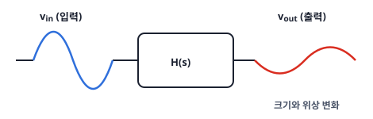

*출력의 크기 변화는 크기 응답, 파형이 뒤집히거나 밀리는 변화는 위상 응답이에요.*

**정확히 말하면**

부하 커패시턴스 $C_L$만 있는 CS 단을 먼저 볼게요. 이 단의 전달 함수(transfer function)는 출력과 입력의 복소 전압 비이며, 분모의 $1+sR_DC_L$이 주파수에 따라 이득을 바꿔요.

$$
H(s)=\frac{v_{out}(s)}{v_{in}(s)}=\frac{-g_mR_D}{1+sR_DC_L}
$$

분모가 0인 근은 극점(pole) $s=-1/(R_DC_L)$이에요. 보데 그림에 표시하는 **양의 코너 주파수**는 그 크기인 $\omega_p=1/(R_DC_L)\,\mathrm{rad/s}$예요. 이 예제의 분자는 상수라 유한한 영점은 없어요.

일반적으로 분모의 근을 극점, 분자의 근을 영점(zero)이라 해요. 좌반평면의 실수 근을 양의 코너 주파수로 나타내면 극점 인자는 $1+s/\omega_p$, 영점 인자는 $1+s/\omega_z$이고 실제 근은 각각 $s=-\omega_p$, $s=-\omega_z$예요.

$$
H(s)=A_0\frac{\prod_k(1+s/\omega_{zk})}{\prod_k(1+s/\omega_{pk})}
$$

여기서 $A_0=H(0)$는 부호까지 포함한 저주파 이득이에요. 이 표준 꼴은 유한한 양의 실수 코너 주파수를 가진 인자들에 적용해요. 복소 근이나 원점의 근은 별도로 취급해요.

입력이 $x(t)=A\cos\omega t$인 정현파 정상상태 응답은 $s=j\omega$를 넣어서 읽어요. $|H(j\omega)|$는 진폭 비인 크기 응답(magnitude response), $\angle H(j\omega)$는 위상 응답(phase response)이에요.

$$
y(t)=A|H(j\omega)|\cos\!\bigl(\omega t+\angle H(j\omega)\bigr)
$$

위 CS 단에서는 저주파 이득이 $A_0=-g_mR_D$이므로 출력이 반전돼요. 출력 크기와 극점의 추가 위상 지연은 서로 다른 정보예요.

$$
|H(j\omega)|=\frac{g_mR_D}{\sqrt{1+(\omega R_DC_L)^2}}
$$

$$
\angle H(j\omega)=-180^\circ-\tan^{-1}(\omega R_DC_L)
$$

위 위상식은 반전의 $-180^\circ$에서 연속적으로 이어 읽은 값이에요. $+180^\circ$를 택해도 같은 반전을 나타내며, 어느 쪽이든 극점의 추가 지연을 크기 감소와 혼동하지 않아요.

분자 차수가 분모 차수 이하이면 고주파에서 함수가 무한히 커지지 않는 적정(proper) 조건이에요. 이것만으로 안정성을 판단할 수 없어요. 연속시간의 단순한 전달 함수가 안정하려면 약분 후 남는 극점의 실수부가 모두 음수여야 해요.

**교수님 말씀**

극점과 영점의 부호를 설명하면서 근 자체와 양의 주파수 값을 구별하셨어요. 여기서는 슬라이드의 양의 코너 주파수 표기로 통일했어요.

주파수 응답에는 크기와 위상이 모두 있지만, 이번 손그림에서는 증폭기 이득의 크기가 어떻게 변하는지에 집중했어요.

**페이지 요약**

전달 함수의 분모 근은 극점, 분자 근은 영점이에요.

양의 코너 주파수 $\omega_p$에 해당하는 실제 극점은 $s=-\omega_p$예요.

적정 조건과 안정성은 다른 판단이에요.

*핵심 식*

- 크기 응답

  $$
  |H(j\omega)|=\frac{g_mR_D}{\sqrt{1+(\omega R_DC_L)^2}}
  $$

*용어*

- **극점(pole)** — 전달 함수 분모의 근이에요.
- **영점(zero)** — 전달 함수 분자의 근이에요.

---

### 6. 보데 근사: 극점마다 기울기 −20 dB/dec

*1014 수업 · L05 s8*

**쉽게 말하면**

보데 선도에서는 극점 하나를 지날 때마다 기존 기울기에 $-20\,\mathrm{dB/dec}$를 더해요.

저주파에서 평평하고 영점 영향이 없는 응답이라면 기울기가 $0\to-20\to-40\,\mathrm{dB/dec}$로 바뀌어요.

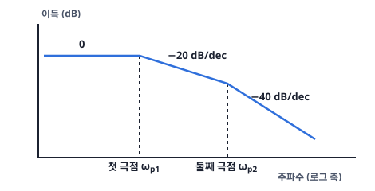

*극점에서 이득이 갑자기 20 dB 떨어지는 게 아니라 그 뒤의 기울기가 달라져요.*

**정확히 말하면**

먼저 그림의 규칙을 세 번째 극점까지 적용해 볼게요. 낮은 주파수에서 평평하고 관심 범위에 영점 영향이 없는 저역통과 응답이라면, 세 번째 실수 극점 뒤 기울기는 $-40-20=-60\,\mathrm{dB/dec}$예요. 여기서 dec는 주파수가 10배가 되는 구간이에요.

보데(Bode) 근사는 가로축을 로그 각주파수 $\omega$로, 세로축을 데시벨 이득 $20\log_{10}|H(j\omega)|$로 놓고 크기 응답을 직선으로 그려요. 직선의 기울기는 구간마다 더해요.

- 실수 극점의 양의 코너 주파수 $\omega_p$를 지나면 기존 기울기에서 $20\,\mathrm{dB/dec}$를 빼요.
- 실수 영점의 양의 코너 주파수 $\omega_z$를 지나면 기존 기울기에 $20\,\mathrm{dB/dec}$를 더해요. 예를 들어 한 극점 뒤 $-20$이었다면 그다음 영점 뒤에는 $0\,\mathrm{dB/dec}$가 돼요.

이 규칙은 $1+s/\omega_p$와 $1+s/\omega_z$ 꼴의 1차 실수 인자에 적용해요. 하나의 극점 인자는 크기가 분모의 $\sqrt{1+(\omega/\omega_p)^2}$만큼 줄어들어요.

$$
D_p(\omega)=-20\log_{10}\sqrt{1+(\omega/\omega_p)^2}
$$

$\omega\ll\omega_p$이면 $D_p\approx0\,\mathrm{dB}$라서 평평해요. $\omega\gg\omega_p$이면 다음처럼 주파수 10배마다 약 20 dB 더 낮아져요.

$$
D_p(\omega)\approx-20\log_{10}(\omega/\omega_p)
$$

영점은 같은 인자가 분자에 있으므로 부호가 반대예요. 저주파에서는 거의 기여하지 않다가 코너 위에서 주파수 10배당 약 20 dB만큼 기울기를 올려요.

$$
D_z(\omega)=20\log_{10}\sqrt{1+(\omega/\omega_z)^2}
$$

부하 커패시턴스 $C_L$이 있는 CS 단은 영점 없이 $\omega_p=1/(R_DC_L)$에 극점 하나가 있어요. 저주파 이득 $20\log_{10}(g_mR_D)$에서 시작해 그 코너 뒤 기울기가 $0\to-20\,\mathrm{dB/dec}$로 바뀌어요.

직선 근사는 코너에서 평평한 선과 내려가는 선이 만나요. 정확한 응답은 코너 부근에서 부드럽게 휘고, 단일 극점의 코너에서는 저주파 이득보다 $20\log_{10}\sqrt2\approx3.01\,\mathrm{dB}$ 낮아요. 이는 코너에서 기울기가 갑자기 바뀌는 근사와 구별해야 해요.

코너 위치를 알면 손으로 개략적인 이득 변화를 빨리 그릴 수 있어요. 회로에서 코너를 찾아내는 방법은 [노드마다 극점: 등가 저항과 등가 커패시턴스](#s2-node-rule)에서 다뤄요.

**교수님 말씀**

극점 뒤에 $\omega$를 10배, 100배, 1000배로 올리며 한 극점 인자의 dB 기여가 차례로 약 $-20$, $-40$, $-60\,\mathrm{dB}$가 되는 것을 보이셨어요.

실제 곡선은 시뮬레이션으로 그릴 수 있지만, 손으로는 극점과 영점을 찾아 보데 근사로 예측하는 일이 설계에 도움이 된다고 설명하셨어요.

**꼭 기억해요**

> “손으로 그릴 때는요, 보데 플롯으로 예측하면 충분히 정확”

극점·영점을 지날 때 더하는 값은 **기울기 변화량**이에요. 그 순간의 이득 변화량이 아니에요.

**페이지 요약**

극점 뒤 기울기에는 $-20\,\mathrm{dB/dec}$, 영점 뒤 기울기에는 $+20\,\mathrm{dB/dec}$를 더해요.

영점 영향 없이 평평하게 시작해 극점 세 개를 지나면 기울기는 $0\to-20\to-40\to-60\,\mathrm{dB/dec}$예요.

정확한 단일 극점 응답은 코너에서 부드럽게 휘고 약 $3.01\,\mathrm{dB}$ 낮아요.

*핵심 식*

- 극점 위 기여

  $$
  D_p(\omega)\approx-20\log_{10}(\omega/\omega_p)
  $$

*용어*

- **보데(Bode) 근사** — 로그 주파수와 dB 이득으로 크기 응답을 직선으로 그려요.
- **dB/dec** — 주파수가 10배 될 때 dB 이득이 변하는 양이에요.

---

## 3. 노드마다 극점 하나

### 7. 입력 RC가 있는 CS 단의 두 극점

*1014 수업 · L05 s9*

**쉽게 말하면**

입력과 출력에 커패시터가 하나씩 있으면, 신호를 늦추는 지점도 두 곳이 생겨요.

같은 회로에서 입력 커패시턴스만 2배로 하면 입력 코너 주파수는 절반이 돼요.

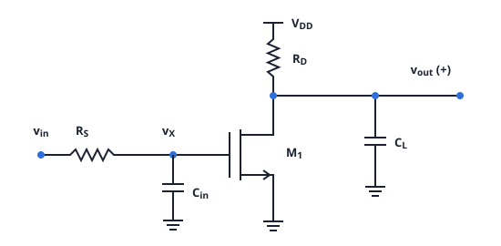

*게이트 노드의 $C_{in}$과 드레인 노드의 $C_L$은 각각 접지에 연결돼요.*

**정확히 말하면**

$R_S$는 앞단의 출력저항을 나타내요. $v_{in}$은 그 저항 앞의 신호이고, $v_X$는 실제 게이트 전압이에요. $C_{in}$과 $C_L$은 각각 입력과 출력 노드에 접지로 연결된 커패시턴스예요.

예를 들어 나머지 값을 고정하고 $C_{in}^*=2C_{in}$으로 바꾸면 입력의 RC 시간은 2배가 돼요.

$$
\omega_{p,in}^*=\frac{1}{R_S(2C_{in})}=\frac{\omega_{p,in}}2
$$

출력의 $R_DC_L$은 바뀌지 않으므로 출력 코너는 그대로예요. 이제 이 결과가 나오는 전달 함수를 단계별로 만들어요. MOS는 포화 영역의 소신호 동작이며, 수업 모델처럼 $\lambda=0$, 몸체효과와 게이트 전도 전류는 무시해요.

1. **출력 단락에서 전류를 만드는 크기.** 저주파에서는 두 커패시터를 개방하므로 게이트로 전도 전류가 흐르지 않아 $v_X=v_{in}$이에요.

   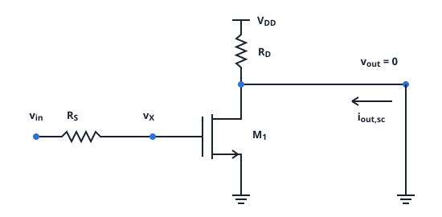

   *저주파 $G_m$ 측정은 출력 단락·입력 신호 유지 조건이에요; $i_{out,sc}$는 오른쪽에서 왼쪽으로 회로에 들어가는 방향이 양이에요.*

   게이트 전압이 양으로 오르면 드레인으로 빨아들이는 전류가 증가해요. 오른쪽 출력 단자에서 회로 안으로 들어가는 방향으로 단락전류를 정의해요.

   $$
   i_{out,sc}=g_mv_X
   $$

   $$
   G_m=\frac{i_{out,sc}}{v_X}=g_m
   $$
2. **입력 영점에서 출력 부하.** 독립 전압원 $v_{in}$을 0으로 두면 이상적인 전압원을 단락해요.

   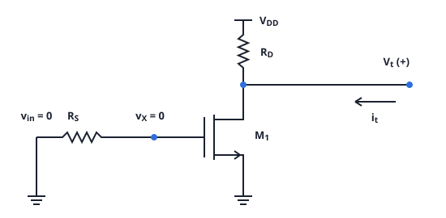

   *$R_{out}$ 측정에서는 독립 입력 전압을 0으로 두어 단락해요; 시험전류 $i_t$는 오른쪽 끝 $V_t$ 점 왼쪽에서 회로로 들어가요.*

   게이트와 소스가 AC 접지라 제어 전압은 0이고, $\lambda=0$에서 트랜지스터의 드레인 저항은 무한대예요. 출력에서 남는 저주파 부하는 $R_D$예요.

   $$
   R_{out}\approx R_D
   $$

   이 근사는 채널 길이 변조를 무시한 수업 모델의 결과예요. 이 모델 안에서는 저항 블록이 $R_D$와 같아요.
3. **출력 커패시터를 연결해 부호 있는 이득.** 같은 출력 노드의 저항과 커패시터를 병렬로 묶어요.

   $$
   Z_{out}(s)=R_D\parallel\frac1{sC_L}=\frac{R_D}{1+sR_DC_L}
   $$

   $$
   \frac{v_{out}}{v_X}=-G_mZ_{out}(s)=-\frac{g_mR_D}{1+sR_DC_L}
   $$

   음의 부호는 게이트 전압 상승이 드레인 전압 하강으로 이어지는 CS의 반전을 나타내요.
4. **입력 노드의 전압분배.** 게이트 전도 전류가 없으므로 $R_S$를 흐르는 전류는 $C_{in}$으로 들어가요.

   $$
   \frac{v_{in}-v_X}{R_S}=sC_{in}v_X
   $$

   $$
   v_{in}=(1+sR_SC_{in})v_X
   $$

   $$
   \frac{v_X}{v_{in}}=\frac1{1+sR_SC_{in}}
   $$
5. **두 전달비를 곱해요.** 출력에서 입력으로 되먹이는 가지가 없는 이 모델에서는 출력 부하가 게이트 전압분배를 바꾸지 않아요.

   $$
   H(s)=\frac{v_{out}}{v_X}\frac{v_X}{v_{in}}
   $$

   $$
   H(s)=-\frac{g_mR_D}{(1+sR_SC_{in})(1+sR_DC_L)}
   $$

   $$
   \omega_{p,in}=\frac1{R_SC_{in}}
   $$

   $$
   \omega_{p,out}=\frac1{R_DC_L}
   $$

   $\omega_p$는 양의 코너 각주파수이고 단위는 $\mathrm{rad/s}$예요. 실제 극점 위치는 각각 $s=-\omega_{p,in}$과 $s=-\omega_{p,out}$이에요.

   $s=j\omega$를 넣고 두 분모 인자의 크기를 각각 곱하면 크기 응답이에요.

   $$
   |H(j\omega)|=\frac{g_mR_D}{\sqrt{1+(\omega/\omega_{p,in})^2}\sqrt{1+(\omega/\omega_{p,out})^2}}
   $$

입력과 출력 중 어느 코너가 낮은지는 소자값으로 결정해요. 저주파에서 평평하게 시작하는 보데 크기 근사는 낮은 코너 뒤 $-20\,\mathrm{dB/dec}$, 높은 코너 뒤 $-40\,\mathrm{dB/dec}$이고, 정확한 곡선은 부드럽게 휘어요.

두 코너가 같으면 같은 위치에 극점이 겹쳐요. 이때도 차수는 2이며, 코너 하나의 위치를 전체 회로의 $-3\,\mathrm{dB}$ 대역폭이라고 바로 부르면 안 돼요.

**교수님 말씀**

앞단이 이상적인 전압원처럼 신호를 그대로 주는 것은 아니라고 설명하셨어요. 앞단 출력저항 $R_S$와 이 단의 입력 커패시턴스를 함께 봐야 실제 게이트에 들어오는 신호를 알 수 있어요.

전달 함수를 전부 전개하는 것보다, 각 노드의 저항과 커패시턴스를 읽어 극점을 찾으면 설계 변수가 무엇인지 보기 쉽다고 하셨어요.

**페이지 요약**

접지 커패시터가 입력과 출력에 따로 있는 이 CS 모델은 두 RC 인자를 가져요.

$\lambda=0$·몸체효과 무시·게이트 전도 전류 0인 모델이에요.

*핵심 식*

- 입력 코너

  $$
  \omega_{p,in}=\frac1{R_SC_{in}}
  $$
- 출력 코너

  $$
  \omega_{p,out}=\frac1{R_DC_L}
  $$

코너의 순서는 소자값이 정해요.

같은 위치에 극점이 겹쳐도 차수는 2예요.

---

### 8. 노드마다 극점: 등가 저항과 등가 커패시턴스

*1014 수업 · L05 s9–10*

**쉽게 말하면**

따로 동작하는 접지 RC 노드는 저항과 커패시턴스의 곱이 클수록 더 느리게 바뀌어요.

예를 들어 같은 커패시터에서 저항만 2배로 하면, 그 노드의 코너 주파수는 절반이 돼요.

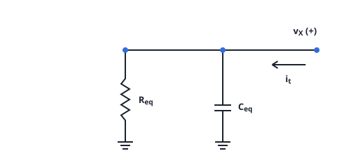

*이 노드에서 접지로 보이는 저항과 커패시턴스를 한 쌍으로 읽어요.*

**정확히 말하면**

등가 저항(equivalent resistance)은 독립 입력을 0으로 두고 해당 노드에서 AC 접지를 바라볼 때의 저항이에요. 등가 커패시턴스(equivalent capacitance)는 그 노드와 AC 접지 사이에 연결된 전체 커패시턴스예요. 같은 두 노드에 병렬로 놓인 커패시터는 더해요.

예를 들어 $R_{eq}=1\,\mathrm{k\Omega}$, $C_{eq}=1\,\mathrm{pF}$이면 $10^3\,\Omega\times10^{-12}\,\mathrm F=10^{-9}\,\mathrm s$예요.

$$
\omega_p=\frac1{R_{eq}C_{eq}}=10^9\,\mathrm{rad/s}
$$

커패시턴스를 고정하고 $R_{eq}^*=2R_{eq}$로 바꾸면 다음처럼 절반이 돼요.

$$
\omega_p^*=\frac1{(2R_{eq})C_{eq}}=\frac{\omega_p}{2}
$$

이 관계의 출발점은 단일 접지 RC 노드의 전류식이에요. 독립 전압원은 단락하고 독립 전류원은 개방하되, 트랜지스터의 제어 작용 같은 종속원은 유지해요. 저항을 찾을 때는 커패시터 자체를 개방하고 저항성 경로를 읽어요.

1. 노드에 들어오는 전류를 $i_t$로 정하면 저항 전류와 커패시터 전류가 나뉘어요.

   $$
   i_t=\frac{v_X}{R_{eq}}+sC_{eq}v_X
   $$
2. 노드 임피던스를 정리해요.

   $$
   \frac{v_X}{i_t}=\frac{R_{eq}}{1+sR_{eq}C_{eq}}
   $$
3. 분모가 0이 되는 위치와 양의 코너를 구별해요.

   $$
   s_p=-\frac1{R_{eq}C_{eq}}
   $$

   $$
   \omega_p=\frac1{R_{eq}C_{eq}}
   $$

[입력 RC가 있는 CS 단](#s2-cs-two-poles)은 접지된 두 커패시터를 갖고 출력에서 입력으로 되돌아가는 결합이 없으므로, 각 RC 인자를 순서대로 곱할 수 있어요. 이 선택 모델에서는 두 코너 식이 전달 함수의 극점과 정확히 대응해요.

수업에서 출력의 유한 $r_O$를 남기면 $R_D$와 같은 출력–접지 두 노드에 연결되므로 병렬로 합쳐요.

$$
R_{eq,out}=R_D\parallel r_O
$$

$$
\omega_{p,out}=\frac1{(R_D\parallel r_O)C_L}
$$

이는 단일 CS의 소스가 AC 접지인 연결에 대한 저항 블록이에요. 소스가 움직이는 다른 회로에 그대로 옮기지 않아요.

**교수님 말씀**

> “각 노드의 등가 저항과 등가 커패시턴스의 곱의 역수로 나타난다.”

복잡한 전달 함수를 전개하기 전에 어느 저항이나 커패시턴스를 바꾸면 어느 극점이 움직이는지 예측하는 도구로 강조하셨어요.

**꼭 기억해요**

**모든 회로의 모든 노드가 서로 다른 극점을 하나씩 만든다는 법칙은 아니에요.** 이 수업의 CS·CG는 접지 커패시터와 $\lambda=0$의 한 방향 전달 모델이라 노드별 RC 인자가 분리돼요.

같은 코너에 극점이 겹칠 수 있어요. 두 신호 노드를 커패시터가 연결하거나 노드의 움직임이 서로 영향을 주면, 각 노드의 $RC$만 따로 읽어 정확한 극점이라고 단정할 수 없어요.

**페이지 요약**

분리되는 접지 RC 노드는 등가 저항과 등가 커패시턴스의 곱으로 코너를 찾아요.

*핵심 식*

- 양의 코너 각주파수

  $$
  \omega_p=\frac1{R_{eq}C_{eq}}
  $$

등가 저항은 독립 입력을 0으로 두고 찾아요.

종속원의 제어 작용은 유지해요.

모든 노드가 서로 다른 극점을 만든다고 일반화하지 않아요.

---

### 9. CG 단의 입력 극점

*1014 수업 · L05 s10*

**쉽게 말하면**

CG의 입력 노드에는 전류가 빠져나갈 소스 쪽 경로가 하나 더 있어서 입력이 더 빨리 바뀌어요.

앞단 저항과 소스 쪽 저항이 같으면 병렬값은 절반이므로, 같은 입력 커패시터의 코너는 2배가 돼요.

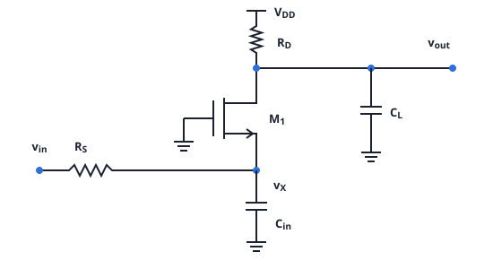

*CG(common gate)는 소스가 입력이고 게이트가 AC 접지예요.*

**정확히 말하면**

입력 극점에 필요한 것은 소스 노드에서 보는 저항이에요. $\lambda=0$이고 몸체효과를 무시하면, 게이트가 AC 접지인 MOS의 알려진 소스 입력저항은 $1/g_m$이에요. DC 바이어스 전류원은 수업 그림처럼 생략했어요.

예를 들어 $R_S=1\,\mathrm{k\Omega}$, $g_m=1\,\mathrm{mS}$이면 다음처럼 먼저 저항을 구해요.

$$
\frac1{g_m}=1\,\mathrm{k\Omega}
$$

$$
R_{eq,in}=R_S\parallel\frac1{g_m}=\frac12\,\mathrm{k\Omega}
$$

같은 $C_{in}$을 게이트에서 보던 CS와 비교하면 저항이 절반이므로 입력 코너는 2배예요. 이제 입력원을 0으로 놓고 그 병렬 연결을 확인해요.

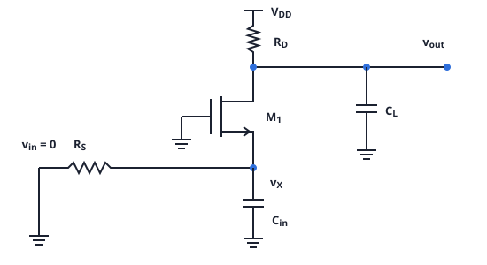

*입력원을 단락하면 소스 노드 X에 $R_S$와 알려진 소스 입력저항 $1/g_m$이 함께 보여요.*

1. **입력원을 영점화해요.** 독립 입력 전압원을 단락하면 $R_S$의 왼쪽이 AC 접지예요. 따라서 X에서 $R_S$가 접지로 보여요.
2. **소스를 바라보는 알려진 블록을 써요.** 게이트 전압이 0이므로 소스 전압이 오르면 게이트–소스 제어 전압은 반대로 변해요.

   $$
   v_{gs}=-v_X
   $$

   드레인에서 소스로 정한 전류는 $-g_mv_X$이고, 소스에서 소자 안으로 들어가는 전류 $i_S$는 그 반대 방향이에요.

   $$
   i_S=g_mv_X
   $$

   $$
   R_{in,S}=\frac{v_X}{i_S}=\frac1{g_m}
   $$

   $\lambda=0$에서 드레인 전압이 이 소스 전류를 바꾸지 않으므로 출력의 움직임이 입력 저항에 되돌아오지 않아요. 이 조건에서 직접 저항 블록으로 읽을 수 있어요.
3. **입력 노드의 두 경로를 병렬로 합쳐요.**

   $$
   R_{eq,in}=R_S\parallel\frac1{g_m}
   $$

   $$
   \omega_{p,in}=\frac1{(R_S\parallel1/g_m)C_{in}}
   $$
4. **출력은 별도로 읽어요.** 입력 신호가 0이고 $\lambda=0$인 저항 모델에서 드레인 쪽 소자 저항은 무한대이므로, 출력의 등가 저항과 커패시턴스는 $R_D$와 $C_L$이에요.

   $$
   \omega_{p,out}=\frac1{R_DC_L}
   $$

$R_S$와 $C_{in}$이 같은 CS보다 CG의 입력 코너는 높아요. 그래도 출력 코너보다 높을지는 $R_D$와 $C_L$까지 알아야 결정돼요. 낮은 코너가 어느 쪽이든, 영점 영향 없이 평평하게 시작하는 보데 근사의 기울기는 $0\to-20\to-40\,\mathrm{dB/dec}$예요.

게이트 전압이 0이라는 말은 게이트가 AC 접지라는 뜻이에요. 소스 신호 $v_X$까지 0으로 놓으라는 뜻은 아니에요. 저항을 찾을 때 0으로 놓는 것은 $R_S$ 앞의 독립 입력 전압이에요.

**교수님 말씀**

이 예제에서는 전달 함수를 길게 구하는 대신 극점을 구하자고 하셨어요. 입력의 등가 저항은 $R_S$만이 아니라 $1/g_m$이 병렬로 보인다는 차이를 짚으셨어요.

앞단에서 보면 이 연결 노드의 $C_{in}$은 앞단의 부하 커패시턴스예요. 뒷단에서 보면 입력 커패시턴스지만, 이름이 달라져도 같은 노드의 같은 극점이에요. 앞단의 극점이 뒷단에서 영점으로 바뀌는 것은 아니라고 답하셨어요.

**페이지 요약**

CG는 소스 쪽 $1/g_m$이 $R_S$와 병렬로 보여 입력 코너가 높아져요.

$\lambda=0$·몸체효과 무시·게이트 AC 접지인 모델이에요.

*핵심 식*

- 입력 코너

  $$
  \omega_{p,in}=\frac1{(R_S\parallel1/g_m)C_{in}}
  $$
- 출력 코너

  $$
  \omega_{p,out}=\frac1{R_DC_L}
  $$

어느 코너가 더 낮은지는 소자값으로 판단해요.

앞단의 출력 극점과 뒷단의 입력 극점은 같은 연결 노드의 현상이에요.

---

### 10. 부유 커패시터: 어느 노드에 넣을까

*1014 수업 · L05 s11*

**쉽게 말하면**

두 신호 노드 사이의 커패시터는 양쪽 전압이 함께 움직여서 어느 한쪽 몫으로 바로 넣기 어려워요.

게이트와 드레인 사이에 붙었다면, 입력과 출력에 절반씩 나누어 넣는다고 정할 수 없어요.

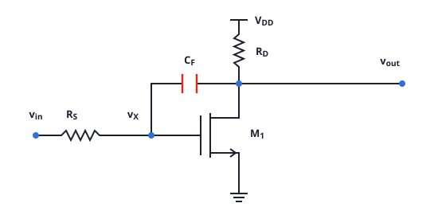

*$C_F$는 두 신호 노드 사이에 걸려 있어요.*

**정확히 말하면**

**부유 커패시터(floating capacitor)**는 여기서 두 단자 모두 AC 접지가 아닌 신호 노드에 연결된 커패시터예요. 한 단자가 AC 접지인 접지 커패시터(grounded capacitor)와 구분해요.

그림에서 $C_F$의 왼쪽 단자는 게이트 전압 $v_X$, 오른쪽 단자는 드레인 전압 $v_{out}$인 노드예요. 어느 쪽도 고정된 AC 접지가 아니므로 두 단자의 움직임을 함께 알아야 해요.

$C_{in}$처럼 입력–접지 한 쌍에 있거나 $C_L$처럼 출력–접지 한 쌍에 있는 경우와 연결이 달라요. 따라서 $C_F$ 전체를 입력에 더하거나, 출력에 더하거나, 양쪽에 절반씩 나누는 방법을 근거 없이 선택할 수 없어요.

[노드마다 극점: 등가 저항과 등가 커패시턴스](#s2-node-rule)에서 쓴 각 노드의 접지 RC 인자도 그대로 분리되지 않아요. 이번 수업은 이 연결이 만드는 해석의 어려움을 확인하는 데까지 다뤘어요.

**교수님 말씀**

입력 쪽 커패시턴스로 볼지, 출력 쪽으로 볼지, 반씩 나누어 볼지를 질문하셨어요. 그중 하나를 계산 규칙으로 정하지 않고, 두 노드 사이의 커패시턴스를 어떻게 다룰지가 새로운 문제라고 짚으셨어요.

구체적인 처리 방법과 계산은 다음 시간으로 미루셨어요.

**페이지 요약**

부유 커패시터 $C_F$는 두 움직이는 신호 노드 사이에 연결돼요.

두 단자 중 어느 쪽도 AC 접지가 아니에요.

입력과 출력에 절반씩 나누어 넣는다고 정할 수 없어요.

각 노드의 접지 RC 인자를 그대로 분리해 쓸 수 없어요.

---

## 4. 요약 · 예고

### 11장 앞부분 핵심 정리

*1014 수업 · L05 s3–11*

이번 수업의 대역폭과 극점 규칙을 적용 조건과 함께 모았어요.

| 핵심 | 식·판단 | 적용 조건 | 더 보기 |
|---|---|---|---|
| 커패시터의 임피던스 | $ Z_C=\frac{1}{sC}=\frac{1}{j\omega C} $$ \vert Z_C\vert =\frac{1}{\omega C} $ | $\omega$가 커지면 $\vert Z_C\vert $는 작아져요. | [RC 저역통과](#s0-rc-lowpass) |
| RC 저역통과 | $\frac{v_{out}}{v_{in}}=\frac{1}{1+sRC}$ | 출력을 접지 커패시터 양단에서 재요. | [RC 저역통과](#s0-rc-lowpass) |
| 부하 $C_L$이 있는 CS 단 | $H(s)=\frac{-g_mR_D}{1+sR_DC_L}$ | 채널 길이 변조와 다른 커패시턴스를 무시해요. 출력은 반전돼요. | [부하 커패시턴스가 있는 CS 단](#s0-cs-cl) |
| CS 크기 응답 | $\vert H(j\omega)\vert =\frac{g_mR_D}{\sqrt{1+(\omega R_DC_L)^2}}$ | $s=j\omega$를 대입한 진폭 비예요. 반전 여부는 크기에 나타나지 않아요. | [크기와 위상](#s1-transfer) |
| −3 dB 대역폭 | $ \vert H(j\omega_{3\mathrm{dB}})\vert =\frac{\vert A_0\vert }{\sqrt2} $$ \omega_{3\mathrm{dB}}=\frac{1}{R_DC_L} $$ f_{3\mathrm{dB}}=\frac{1}{2\pi R_DC_L} $ | 단일 극점 CS 모델에서 크기가 저주파 이득의 $1/\sqrt2$가 되는 위쪽 경계예요. | [−3 dB 대역폭](#s0-3db) |
| 이득과 대역폭의 대가 | $R_D$ 증가 → 저주파 이득 크기 증가, 대역폭 감소 | $g_m$과 $C_L$을 고정한 같은 단일 극점 CS 모델에서 비교해요. | [이득–대역폭](#s0-3db) |
| 전달 함수와 극점·영점 | 분모의 근은 극점, 분자의 근은 영점이에요. $s=j\omega$에서 크기와 위상을 읽어요. | $1+s/\omega_p$의 실제 근은 $s=-\omega_p$이고 코너 주파수 $\omega_p$는 양수예요. 적정 조건만으로 안정하다고 할 수 없어요. | [전달 함수](#s1-transfer) |
| 실수 극점·영점의 표준 꼴 | $H(s)=A_0\frac{\prod_k(1+s/\omega_{zk})}{\prod_k(1+s/\omega_{pk})}$ | 유한한 양의 코너 주파수로 적은 1차 실수 인자들이에요. $A_0$는 부호를 포함한 저주파 이득이에요. | [전달 함수](#s1-transfer) |
| 보데 근사의 기울기 | 실수 극점마다 $-20\,\mathrm{dB/dec}$, 실수 영점마다 $+20\,\mathrm{dB/dec}$를 기존 기울기에 더해요. | 가로축은 로그 주파수, 세로축은 dB 이득이에요. 정확한 단일 극점 응답은 코너에서 부드럽게 휘며 저주파보다 $\approx3.01\,\mathrm{dB}$ 낮아요. | [보데 근사](#s1-bode) |
| 접지 커패시터의 노드 극점 | $\omega_p=\frac{1}{R_{eq}C_{eq}}$ | 이번 수업의 $r_O$ 무시·일방향 CS/CG 모델처럼 입력과 출력이 독립이고 각 커패시터가 AC 접지에 연결될 때 직접 적용해요. 두 신호 노드를 잇는 $C_F$에는 곧바로 쓰지 않아요. | [노드마다 극점](#s2-node-rule) |
| CS 입력·출력 두 극점 | $ \begin{aligned}H(s)&=\frac{-g_mR_D}{1+sR_SC_{in}}\\&\cdot\frac{1}{1+sR_DC_L}\end{aligned} $$ \omega_{p,in}=\frac{1}{R_SC_{in}} $$ \omega_{p,out}=\frac{1}{R_DC_L} $ | $R_S$는 앞단의 출력저항이에요. 입력·출력 커패시터가 각각 AC 접지에 있고, 채널 길이 변조를 무시한 예제예요. | [CS 단의 두 극점](#s2-cs-two-poles) |
| CG 입력·출력 극점 | $ R_{eq,in}=R_S\parallel\frac{1}{g_m} $$ \omega_{p,in}=\frac{1}{(R_S\parallel1/g_m)C_{in}} $$ \omega_{p,out}=\frac{1}{R_DC_L} $ | 소스 입력, 게이트 AC 접지의 모델이에요. 몸체효과와 $r_O$를 무시해요. | [CG 단의 극점](#s2-cg-poles) |
| 부유 커패시터 | 두 신호 노드 사이의 $C_F$는 한 노드의 접지 커패시터로 바로 셀 수 없어요. | 어느 쪽도 AC 접지가 아닌 연결을 먼저 확인해요. | [부유 커패시터](#s2-floating) |

---

### 다음 시간 예고

*1014 수업 · L05 s12 이후*

- 밀러 정리
- 고역통과 필터와 AC 결합
- MOS·BJT 고주파 모델
- 트랜싯 주파수
- 증폭단별 주파수 응답

---

### 함께 보면 좋은 자료

*1014 수업 · L05 s3–11*

- [복습문제 13개 (PDF)](../복습문제_1014_Frequency_Response-문제.pdf)
- [복습문제 답안 (PDF)](../복습문제_1014_Frequency_Response-답안.pdf)
- [CS 이득과 대역폭 인터랙티브](../인터렉티브_01_CS_이득과_대역폭.html)
- [두 극점과 보데 근사 인터랙티브](../인터렉티브_02_두_극점과_보데_근사.html)
- [어떤 노드에서 극점이 생길까 인터랙티브](../인터렉티브_03_어떤_노드에서_극점이_생길까.html)

---

출처: 권익진 교수님 강의자료(Lec5) · 수업 녹음 전사(1014) · B. Razavi, *Microelectronics*, 2nd ed. (Wiley) 11장.
