# 주파수 응답 — 5살도 이해하는 정리노트

권익진 교수님 전자회로2 · 1014 수업 (Lec5, Razavi 11장)

> `정리노트_1014_Frequency_Response.html`를 마크다운으로 옮겼어요. 그림은 `figures_1014/` 폴더의 SVG, 위젯은 대표 설정의 정적 그림으로 바꿨어요. 수식은 `$…$` / `$$…$$`라서 GitHub, Obsidian, Typora에서 보여요.

**목차**

- [들어가며: 왜 이런 회로를 쓸까](#why)
  - [왜 이런 회로를 쓸까](#why-circuit)
- [1. 이득이 떨어지는 이유: 커패시턴스](#s0)
  - [1. 속도와 대역폭, 그리고 저주파 모델](#s0-speed-bandwidth)
  - [2. RC 저역통과 필터](#s0-rc-lowpass)
  - [3. 부하 커패시턴스가 있는 CS 단](#s0-cs-cl)
  - [4. −3 dB 대역폭과 이득–대역폭 트레이드오프](#s0-3db)
- [2. 전달 함수와 보데 근사](#s1)
  - [5. 전달 함수: 극점과 영점](#s1-transfer)
  - [6. 보데 근사: 극점마다 기울기 −20 dB/dec](#s1-bode)
- [3. 노드마다 극점 하나](#s2)
  - [7. 입력 RC가 있는 CS 단의 두 극점](#s2-cs-two-poles)
  - [8. 노드마다 극점: 등가 저항과 등가 커패시턴스](#s2-node-rule)
  - [9. CG 단의 입력 극점](#s2-cg-poles)
  - [10. 부유 커패시터: 어느 노드에 넣을까](#s2-floating)
- [4. 요약 · 예고](#s3)
  - [11장 앞부분 핵심 정리](#s3-cheatsheet)
  - [다음 시간 예고](#s3-next)
  - [함께 보면 좋은 자료](#s3-links)

## 들어가며: 왜 이런 회로를 쓸까

### 왜 이런 회로를 쓸까

*1014 수업 · L05 s1–3*

**쉽게 말하면**

길 곳곳에 작은 물통이 숨어 있으면, 물을 빨리 넣었다 뺐다 할 때 물통을 채우느라 끝까지 다 못 가요.

*물통마다 얼마나 느린지 하나씩 재 보면, 얼마나 빠른 흔들림까지 크게 할 수 있는지 알 수 있어요.*

**정확히 말하면**

**1. 풀고 싶은 문제.** 이번 장은 증폭기가 어느 주파수까지 동작하는지를 해석해요. 시간 영역에서는 동작 속도(speed), 주파수 영역에서는 대역폭(bandwidth)이라 부르지만 같은 이야기예요. 빨리 변하는 신호는 주기가 짧고, 주기가 짧으면 주파수가 높아요. 해석은 시간 영역에서도 할 수 있지만, 전자회로에서는 주파수 영역이 더 직관적이에요([1. 속도와 대역폭, 그리고 저주파 모델](#s0-speed-bandwidth)). 스마트폰 무선 통신은 2–5 GHz, 자율주행 차량 레이더는 77 GHz를 써요. 더 많은 데이터를 보내려고 대역폭을 넓히다 보니 주파수가 계속 올라가요. 이런 GHz 신호를 증폭하려면 증폭기 자체의 대역폭이 그만큼 넓어야 해요.

**2. 단순한 해법과 그 한계.** 지금까지 쓴 소신호 모델은 저주파 모델(low-frequency model)이에요. 커패시터의 임피던스 $1/(Cs)$가 저주파에서는 무한대에 가까워서 무시했어요. 주파수가 올라가면 이 임피던스가 작아져 더는 무시할 수 없고, 실제 증폭기는 고주파에서 이득이 떨어져요(roll-off). RC 저역통과 필터와 같은 꼴이에요([2. RC 저역통과 필터](#s0-rc-lowpass)). 커패시턴스는 일부러 달지 않아도 트랜지스터 안에, 그리고 다음 단의 입력에 이미 있어요. CS 단의 출력에 부하 커패시턴스(load capacitance) $C_L$을 넣기만 해도 이득이 주파수의 함수가 돼요([3. 부하 커패시턴스가 있는 CS 단](#s0-cs-cl)).

$$
\frac{V_{out}}{V_{in}}=-\frac{g_mR_D}{1+R_DC_Ls}
$$

노드가 하나 늘 때마다 전달 함수를 정직하게 구하면 노드 방정식이 길어지고, 극점(pole)과 영점(zero)을 찾기가 어려워요([6. 보데 근사: 극점마다 기울기 −20 dB/dec](#s1-bode)). 식이 복잡해지면 어떤 소자 값이 대역폭을 정하는지 보이지 않아요([8. 노드마다 극점: 등가 저항과 등가 커패시턴스](#s2-node-rule)).

**3. 핵심 아이디어.** 전달 함수를 다 풀지 않고, 노드마다 극점이 하나씩 생긴다고 보고 그 노드와 AC 접지 사이의 등가 저항과 등가 커패시턴스로 극점 주파수를 바로 구해요([8. 노드마다 극점: 등가 저항과 등가 커패시턴스](#s2-node-rule)).

$$
\omega_p=\frac{1}{R_{eq}C_{eq}}
$$

극점을 알면 보데 근사로 크기 응답을 그려요. 극점을 지날 때마다 기울기가 20 dB/dec씩 줄어요([6. 보데 근사: 극점마다 기울기 −20 dB/dec](#s1-bode)). 같은 규칙을 CG 단의 입력 노드에도 그대로 써요([9. CG 단의 입력 극점](#s2-cg-poles)).

**4. 대가와 쓰이는 곳.** 부하 커패시턴스가 있는 CS 단의 −3 dB 대역폭은 이득을 정하는 $R_D$에 반비례해요([4. −3 dB 대역폭과 이득–대역폭 트레이드오프](#s0-3db)).

$$
\omega_{-3dB}=\frac{1}{R_DC_L}
$$

이득 $g_mR_D$를 키우려고 $R_D$를 키우면 대역폭이 줄어요. 이 트레이드오프(trade-off) 때문에 이득을 무조건 크게 하는 게 좋은 설계가 아니에요. 반면 커패시턴스는 작을수록 좋아서, 공정이 미세해질수록 회로가 빨라져요. 노드–극점 규칙과 보데 근사는 약 10% 오차를 감수하는 손 해석이에요. 정확한 곡선은 SPICE 같은 툴로 구하고, 손 해석은 어떤 파라미터를 바꾸면 극점이 어떻게 움직이는지 보는 데 써요. 노드와 노드 사이에 걸린 부유 커패시터는 이 규칙에 바로 넣을 수 없어서 다음 도구가 필요해요([10. 부유 커패시터: 어느 노드에 넣을까](#s2-floating)). 이 해석법은 수십 GHz 무선 통신 회로와 77 GHz 차량 레이더처럼 고속 회로를 설계하는 출발점이에요.

**교수님 말씀**

교수님은 주파수가 계속 높아지는 이유를 대역폭에서 찾으셨어요.

> "대역폭을 넓히기 위해서 더 높은 주파수를 쓰고 있죠" (1014 P01·L17)

해석의 목표는 설계라고 하시며 77 GHz 차량 레이더와 수십 GHz 무선 통신 회로를 예로 드셨어요.

> "그 해석을 하는 목표는 기본적으로 설계를 하기 위해서" (1014 P01·L25)

지금까지 배운 모델의 한계를 이렇게 말씀하셨어요.

> "지금까지 살펴본 등가 모델은 저주파 모델이에요. 사실은 50%만 맞는" (1014 P01·L27–29)

속도를 떨어뜨리는 가장 큰 원인은 트랜지스터의 커패시턴스라고 강조하셨어요.

> "트랜지스터의 커패시턴스들이 실제로 동작 속도를 저해하는 … 가장 크리티컬한 요인" (1014 P02·L89)

이득과 속도는 함께 얻을 수 없다고 하셨어요.

> "무조건 게인을 크게 하는 게 좋은 설계는 아니에요." (1014 P03·L137)

손 근사를 쓰는 이유는 정확한 식이 관계를 가리기 때문이라고 하셨어요.

> "어떤 파라미터가 이것과 어떻게 연결되는지를 알기가 어려운 거예요." (1014 P06·L374)

**페이지 요약**

$R_D$를 키우면 저주파 이득은 커지지만 대역폭은 줄어요. 노드 RC와 보데는 파라미터 영향을 보는 손 근사이며, 부유 커패시터는 이 규칙에 바로 넣을 수 없어요.

저주파 모델이 무시한 커패시턴스가 고주파 이득을 떨어뜨리고, 노드마다 극점 하나를 등가 RC로 구해 대역폭을 빠르게 읽어요.

*핵심 식*

- 노드–극점 규칙

  $$
  \omega_p=\frac{1}{R_{eq}C_{eq}}
  $$
- CS 단 + 부하 커패시턴스

  $$
  \frac{V_{out}}{V_{in}}=-\frac{g_mR_D}{1+R_DC_Ls}
  $$
- −3 dB 대역폭

  $$
  \omega_{-3dB}=\frac{1}{R_DC_L}
  $$

*용어*

- **대역폭(bandwidth)** — 이득이 유지되는 주파수 범위로, 시간 영역의 동작 속도와 같은 말이에요.
- **저주파 모델(low-frequency model)** — 커패시턴스를 무시한 지금까지의 소신호 모델이에요.
- **극점(pole)** — 노드마다 하나씩 생기고, 지날 때마다 기울기가 20 dB/dec씩 줄어요.

---

## 1. 이득이 떨어지는 이유: 커패시턴스

### 1. 속도와 대역폭, 그리고 저주파 모델

*1014 수업 · L05 s1–3*

**쉽게 말하면**

증폭기는 천천히 변하는 신호는 잘 키우지만, 너무 빨리 변하는 신호는 잘 못 키워요.

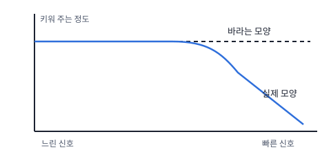

*빠른 신호 쪽으로 갈수록 실제 모양(강조색 선)이 바라는 평평한 점선보다 아래로 내려가요.*

**정확히 말하면**

이 장(Razavi 11장)은 회로가 어느 주파수까지 동작하는지를 분석해요.

- 시간 영역에서는 **동작 속도**(speed), 주파수 영역에서는 **대역폭**(bandwidth)이라고 불러요. 둘은 같은 이야기예요.
- 빨리 변하는 신호는 주기 $T$가 짧은 신호이고, 주기가 짧을수록 주파수가 높아요.

  $$
  f = \frac{1}{T}
  $$
- 시간 영역으로도 해석할 수 있지만, 전자회로에서는 주파수 영역이 더 직관적이고 편해서 **주파수 응답**(frequency response)으로 다뤄요.

**롤오프**(roll-off): 이상적인 증폭기는 주파수와 상관없이 이득이 일정해야 해요. 실제 증폭기는 저주파에서 잘 증폭하다가, 어느 주파수 이상에서 이득이 떨어져요. 이 현상을 롤오프라고 해요.

왜 지금 중요한가:

- 스마트폰 무선 통신은 주로 2–5 GHz, 자율주행 차량 레이더는 77 GHz를 써요.
- 더 많은 데이터를 보내려면 대역폭이 넓어야 해서, 쓰는 주파수가 계속 높아져요.
- 디지털 프로세서도 클럭이 GHz 대역이라, 0과 1이 아니라 연속적인 전압·전류로 해석해야 해요.

앞으로의 순서(L05 s2 목차):

1. 기본 개념(이득이 왜 떨어지나, 전달 함수와 보데 근사)
2. 속도를 떨어뜨리는 요인과 그 원인인 트랜지스터의 고주파 등가 모델(커패시턴스 포함)
3. 지금까지 배운 증폭기들의 주파수 응답

지금까지 쓴 소신호 모델은 커패시턴스를 뺀 **저주파 모델**(low-frequency model)이에요. 고주파에서는 고려할 소자가 더 있어요. 커패시턴스가 이득을 떨어뜨리는 과정은 [RC 저역통과 필터](#s0-rc-lowpass)와 [부하 커패시턴스가 있는 CS 단](#s0-cs-cl)에서 이어져요.

**교수님 말씀**

예전에는 전화·오디오 앰프처럼 음성 신호를 주로 다뤄서 속도가 크게 중요하지 않았어요. 지금은 무선 통신이 수 GHz에서 수십 GHz를 쓰고, 자동차 레이더는 77 GHz를 써요. 이 장의 해석은 결국 그런 고속 회로를 설계하기 위한 것이라고 하셨어요.

> "그 해석을 하는 목표는 기본적으로 설계를 하기 위해서" (1014 P01·L25)

(수업 중 음성 신호 대역을 "수십 Hz에서 수 MHz"라고 말했지만, 가청 대역은 대략 20 Hz–20 kHz예요.)

**꼭 기억해요**

> "지금까지 살펴본 등가 모델은 저주파 모델이에요. 사실은 50%만 맞는 회로다." (1014 P01·L27–29)

고주파에서는 커패시턴스를 넣은 모델로 다시 봐야 해요.

**페이지 요약**

동작 속도와 대역폭은 같은 이야기이고, 지금까지 쓴 소신호 모델은 커패시턴스를 뺀 저주파 모델이에요.

*핵심 식*

- 주기와 주파수

  $$
  f = \frac{1}{T}
  $$

*용어*

- **대역폭(bandwidth)** — 회로가 제대로 동작하는 주파수 범위, 동작 속도를 주파수 영역에서 본 것
- **롤오프(roll-off)** — 어느 주파수 이상에서 이득이 떨어지는 현상
- **저주파 모델(low-frequency model)** — 커패시턴스를 무시한, 지금까지 쓴 소신호 모델

---

### 2. RC 저역통과 필터

*1014 수업 · L05 s4*

**쉽게 말하면**

출력에 달린 작은 통은 느린 신호는 그냥 보내고, 빠른 신호는 땅으로 흘려보내요.

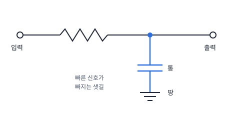

*신호가 빠를수록 강조색 샛길로 많이 새서, 출력에 남는 몫이 줄어요.*

**정확히 말하면**

회로: 입력 $V_{in}$ → 직렬 저항 $R$ → 출력 $V_{out}$, 출력과 접지 사이에 커패시터 $C$. 가장 단순한 **저역통과 필터**(low-pass filter)예요.

- 저항의 임피던스는 $R$로, 주파수와 무관해요.
- 커패시터의 임피던스는 주파수의 함수예요.

  $$
  Z_C = \frac{1}{Cs}
  $$

  $s = j\omega$를 넣으면 $Z_C = \frac{1}{j\omega C}$이고, 크기 $\frac{1}{\omega C}$는 주파수에 반비례해요.
- $\omega = 0$이면 $Z_C \to \infty$(개방)라서 입력이 그대로 출력으로 나가요. 이득은 1이에요.
- $\omega \to \infty$이면 $Z_C \to 0$(단락)이라 출력이 0이에요.

전달 함수(전압 분배):

1. $$
   \frac{V_{out}}{V_{in}} = \frac{Z_C}{R + Z_C}
   $$
2. $$
   = \frac{1/(Cs)}{R + 1/(Cs)}
   $$
3. 분모·분자에 $Cs$를 곱해요.

   $$
   \frac{V_{out}}{V_{in}} = \frac{1}{1 + RCs}
   $$
4. $s = j\omega$를 넣고 크기를 구해요.

   $$
   \left|\frac{V_{out}}{V_{in}}\right| = \frac{1}{\sqrt{1 + R^2C^2\omega^2}}
   $$

주파수가 올라갈수록 커패시터의 임피던스가 낮아져 출력 전압이, 곧 이득이 떨어져요. 증폭기에서도 같은 특성이 나타나고, 그 원인은 커패시턴스예요. 증폭기 쪽 이야기는 [부하 커패시턴스가 있는 CS 단](#s0-cs-cl)에서 이어져요.

인덕턴스도 주파수에 영향을 주지만, 도선을 감아 일부러 만들지 않는 한 잘 생기지 않아요. 커패시턴스는 흔해요. 금속 사이에 절연체가 있으면 그게 커패시터예요.

**교수님 말씀**

커패시터는 일부러 달지 않아도 어디에나 생긴다고 강조하셨어요.

> "신호의 라인이 두 개만 지나가도 그 사이에는 … 커패시터가 생기는 거예요." (1014 P01·L41)

인덕턴스는 도선을 감아서 만들어야 해서, 일부러 만들지 않는 이상 거의 없다고 하셨어요. (1014 P02·L71)

**페이지 요약**

$\omega=0$이면 커패시터가 개방되어 이득 1, $\omega\to\infty$이면 단락되어 출력 0으로 가요.

커패시터의 임피던스는 주파수에 반비례해서, 주파수가 오르면 출력이 접지로 새고 이득이 떨어져요.

*핵심 식*

- 커패시터 임피던스

  $$
  Z_C = \frac{1}{Cs}
  $$
- RC 저역통과 필터

  $$
  \frac{V_{out}}{V_{in}} = \frac{1}{1 + RCs}
  $$

*용어*

- **저역통과 필터(low-pass filter)** — 낮은 주파수는 통과시키고 높은 주파수는 줄이는 회로

---

### 3. 부하 커패시턴스가 있는 CS 단

*1014 수업 · L05 s5*

**쉽게 말하면**

증폭기 뒤에 다음 증폭기를 이으면, 그 입구에 작은 통이 숨어 있어요.

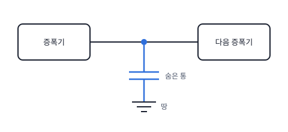

*이 숨은 통(강조색 선) 때문에 빠른 신호가 땅으로 새요.*

이 통은 일부러 달지 않아도 부품 안에 이미 들어 있어요.

**정확히 말하면**

**부하 커패시턴스**(load capacitance) $C_L$은 일부러 달 수도 있지만, 보통은 **다음 단**의 등가 입력 커패시턴스예요. 오디오 앰프라면 스피커가 부하이고, 증폭기가 여러 단이면 다음 단의 입력 임피던스가 부하예요.

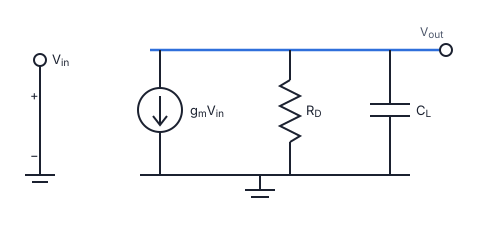

*소신호 등가회로: 출력 노드(강조색 선)와 AC 접지 사이에 전류원, $R_D$, $C_L$이 병렬로 있어요.*

소신호 해석($\lambda = 0$, Razavi 예제 11.4):

1. 입력 $V_{in}$은 게이트–소스에 걸리고, 종속 전류원 $g_m V_{in}$이 출력 노드에서 접지로 흘러요.
2. 출력 노드와 AC 접지 사이에 $R_D$와 $C_L$이 병렬로 보여요. 전류가 노드에서 빠져나가는 방향이라 부호가 반대예요.

   $$
   V_{out} = -g_m V_{in}\left(R_D \parallel \frac{1}{C_L s}\right)
   $$
3. 병렬을 풀어요.

   $$
   R_D \parallel \frac{1}{C_L s} = \frac{R_D}{1 + R_D C_L s}
   $$
4. $$
   \frac{V_{out}}{V_{in}} = -\frac{g_m R_D}{1 + R_D C_L s}
   $$

(수업 중 출력 임피던스를 "R_D와 C_L의 곱의 역수"라고 말했지만, 곱이 아니라 병렬 $R_D \parallel \frac{1}{C_L s}$가 맞아요.)

$C_L$이 없으면 이득 $g_m R_D$는 주파수와 무관해요. $C_L$이 있으면 이득이 주파수의 함수가 돼요. [RC 저역통과 필터](#s0-rc-lowpass)의 $\frac{1}{1 + RCs}$와 꼴이 같고, 다른 점은 저주파 이득이 1이 아니라 $g_m R_D$라는 것뿐이에요.

**커패시턴스는 어디서 오나**: 많은 경우 트랜지스터 안에 이미 들어 있어요.

- MOS는 Metal–Oxide–Semiconductor 구조예요. 채널이 생기면 반도체가 도체처럼 행동해요.
- 그러면 "도체–절연체–도체" 구조가 되고, 이것이 곧 커패시터예요. 그래서 **MOS 커패시터**라고도 불러요.
- 트랜지스터 내부 커패시턴스의 자세한 모델은 뒤 강의(L05 s18 이후)에서 다뤄요.

**왜 지금까지는 무시했나**: 저주파에서는 $\left|Z_C\right| = \frac{1}{\omega C}$가 무한대에 가까워 개방으로 볼 수 있었어요. 주파수가 오르면 임피던스가 떨어져 더는 무시할 수 없어요. 지금까지의 해석은 모두 저주파 해석이에요.

**교수님 말씀**

"MOS 구조가 무슨 구조예요?" 하고 물으시며, 금속과 금속 사이에 절연체가 있으면 커패시터라서 MOS를 MOS 커패시터라고도 부른다고 설명하셨어요. (1014 P02·L75–81)

"지금까지 커패시터를 고려 안 했는데 갑자기 왜 생겼나?"라는 물음에는, 갑자기 생긴 게 아니라 저주파에서 임피던스가 무한대에 가까워 무시했던 것이라고 답하셨어요. (1014 P02·L83–87)

**꼭 기억해요**

> "트랜지스터의 커패시턴스들이 실제로 동작 속도를 저해하는 … 가장 크리티컬한 요인" (1014 P02·L89)

> "커패시턴스를 달아주지 않더라도 커패시턴스가 존재하는 게 그 트랜지스터 때문에" (1014 P02·L91)

**페이지 요약**

채널 길이 변조를 무시한($\lambda=0$) 소신호 식이에요. 커패시턴스는 원래 소자 안에 있으며 저주파에서는 큰 임피던스라 개방으로 근사했던 거예요.

출력 노드의 $C_L$이 $R_D$와 병렬로 보여서, CS 단 이득이 저역통과 필터 꼴이 돼요.

*핵심 식*

- 출력 전압

  $$
  V_{out} = -g_m V_{in}
  $$

  $$
  \times\left(R_D \parallel \frac{1}{C_L s}\right)
  $$
- 전달 함수

  $$
  \frac{V_{out}}{V_{in}} = -\frac{g_m R_D}{1 + R_D C_L s}
  $$

*용어*

- **부하 커패시턴스(load capacitance)** — 출력 노드에 걸린 커패시턴스, 보통 다음 단의 입력 커패시턴스
- **MOS 커패시터** — 금속–산화막–반도체가 도체–절연체–도체를 이뤄 생기는 트랜지스터 안의 커패시터

---

### 4. −3 dB 대역폭과 이득–대역폭 트레이드오프

*1014 수업 · L05 s6*

**쉽게 말하면**

많이 키우려 할수록 일찍 꺾여서, 크게 키우기와 빠르게 일하기를 둘 다 갖기는 어려워요.

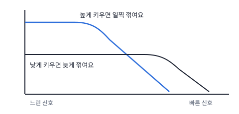

*강조색 선은 높지만 일찍 꺾이고, 기본색 선은 낮지만 더 멀리까지 평평해요.*

**정확히 말하면**

[부하 커패시턴스가 있는 CS 단](#s0-cs-cl)의 전달 함수 $\frac{V_{out}}{V_{in}} = -\frac{g_m R_D}{1 + R_D C_L s}$에 $s = j\omega$를 넣고 크기를 구해요(Razavi 식 11.6).

1. $$
   \left|1 + j\omega R_D C_L\right| = \sqrt{1 + R_D^2 C_L^2 \omega^2}
   $$
2. $$
   \left|\frac{V_{out}}{V_{in}}\right| = \frac{g_m R_D}{\sqrt{R_D^2 C_L^2 \omega^2 + 1}}
   $$
3. $\omega = \frac{1}{R_D C_L}$을 넣으면 분모가 $\sqrt{2}$예요.

   $$
   \left|\frac{V_{out}}{V_{in}}\right| = g_m R_D \cdot \frac{1}{\sqrt{2}}
   $$
4. $$
   20\log\frac{1}{\sqrt{2}} \approx -3\ \text{dB}
   $$

그래서 이 주파수를 **3 dB 주파수**, 저주파부터 여기까지를 **3 dB 대역폭**(−3 dB bandwidth)이라고 해요.

$$
\omega_{-3dB} = \frac{1}{R_D C_L}
$$

- 보통 "대역폭"이라고 하면 3 dB 대역폭을 뜻해요. 경우에 따라 10 dB 떨어지는 지점을 쓰기도 해요.
- Hz 단위로는 $f_{-3dB} = \frac{\omega_{-3dB}}{2\pi}$예요.
- $\omega \gg \omega_{-3dB}$이면 분모의 1을 무시해 $\left|\frac{V_{out}}{V_{in}}\right| \approx \frac{g_m}{C_L \omega}$이에요. 주파수에 반비례하니 약 −20 dB/dec로 떨어져요.
- 대역폭을 정하는 것은 $C_L$ 하나가 아니라 $R_D C_L$의 곱이에요. $R_D$가 클수록, $C_L$이 클수록 대역폭이 낮아져요.

**트레이드오프**(trade-off): 저주파 이득 $g_m R_D$를 키우려면 보통 $R_D$를 키워요. 그러면 $\omega_{-3dB} = \frac{1}{R_D C_L}$이 줄어요. 이득과 속도가 서로 맞바뀌니, 무조건 이득을 크게 하는 것이 좋은 설계는 아니에요. 반면 커패시턴스는 작을수록 좋아요.

#### 직접 해 보기: 이득과 대역폭 맞바꾸기 *(정적 스냅샷 — 직접 조작은 HTML 버전)*

$g_m$ = 2 mS로 고정하고 $R_D$를 키우면 평평한 높이(저주파 이득)는 올라가지만 꺾이는 점($f_{-3dB}$)은 왼쪽으로 가요. $C_L$을 키우면 높이는 그대로 두고 꺾이는 점만 왼쪽으로 가요.

저주파 이득 $g_m R_D$ = **20 (26.0 dB)**, $f_{-3dB}$ = **159.2 MHz**

범례: 현재 설정 · 처음 설정(10 kΩ, 100 fF) · −3 dB 지점

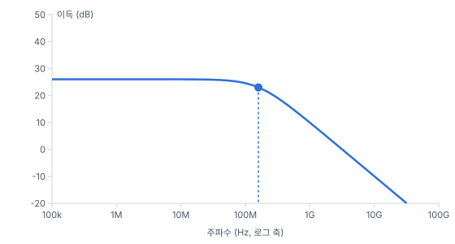

*처음 설정: $R_D$ = 10 kΩ, $C_L$ = 100 fF*

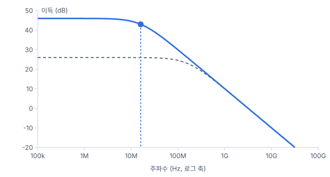

*$R_D$만 10배: $R_D$ = 100 kΩ, $C_L$ = 100 fF*

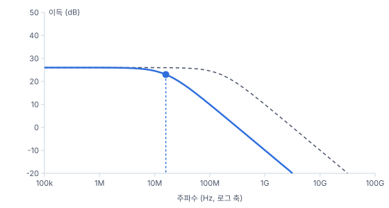

*$C_L$만 10배: $R_D$ = 10 kΩ, $C_L$ = 1 pF*

| 설정 | 저주파 이득 $g_m R_D$ | $f_{-3dB}$ |
|---|---|---|
| 처음 설정 ($R_D$ = 10 kΩ, $C_L$ = 100 fF) | 20 (26.0 dB) | 159.2 MHz |
| $R_D$만 10배 ($R_D$ = 100 kΩ, $C_L$ = 100 fF) | 200 (46.0 dB) | 15.9 MHz |
| $C_L$만 10배 ($R_D$ = 10 kΩ, $C_L$ = 1 pF) | 20 (26.0 dB) | 15.9 MHz |

**기술 스케일링**(technology scaling): 커패시턴스를 줄이려면 트랜지스터를 작게 만들면 돼요.

1. 채널 길이 $L$을 줄여요(10 nm → 5 nm → 3 nm → 2 nm 공정).
2. 전류가 $\frac{W}{L}$에 비례하므로 $W$도 같은 비율로 줄여요.
3. 커패시턴스는 면적 $WL$에 비례해요. $L$과 $W$를 각각 절반으로 줄이면 면적이, 곧 커패시턴스가 약 $\frac{1}{4}$이 돼요.
4. 그래서 속도가 약 4배 빨라지고, 같은 면적에 소자를 더 많이 넣을 수도 있어요.

저항과 커패시턴스를 바꾸며 이득·대역폭·출력 파형을 [CS 이득과 대역폭](../%EC%9D%B8%ED%84%B0%EB%A0%89%ED%8B%B0%EB%B8%8C_01_CS_%EC%9D%B4%EB%93%9D%EA%B3%BC_%EB%8C%80%EC%97%AD%ED%8F%AD.html)에서 함께 비교해 보세요.

**교수님 말씀**

> "게인을 키우다 보면 동작 속도는 줄어드는 이런 트레이드오프 관계가 존재합니다." (1014 P03·L135)

> "무조건 게인을 크게 하는 게 좋은 설계는 아니에요." (1014 P03·L137)

커패시터는 작을수록 좋고, 그래서 요즘 프로세서가 3 nm, 2 nm 공정을 쓰는 것처럼 트랜지스터를 계속 작게 만든다고 하셨어요. (1014 P03·L139–145)

**페이지 요약**

$f_{-3dB}=\omega_{-3dB}/(2\pi)$로 Hz로 바꿔요. 훨씬 높은 주파수에서는 약 −20 dB/dec이고, $C_L$만 키우면 저주파 이득은 그대로지만 대역폭은 줄어요.

같은 비율로 W와 L을 줄이는 수업의 단순 면적 모델에서 둘을 절반으로 하면 $WL$과 커패시턴스는 약 1/4이 되어 속도가 빨라져요.

CS 단의 이득은 $\omega_{-3dB} = \frac{1}{R_D C_L}$에서 $\frac{1}{\sqrt{2}}$배(−3 dB)가 되고, $R_D$를 키우면 이득은 늘지만 대역폭은 줄어요.

*핵심 식*

- 크기 응답

  $$
  \left|\frac{V_{out}}{V_{in}}\right|
  $$

  $$
  = \frac{g_m R_D}{\sqrt{R_D^2 C_L^2 \omega^2 + 1}}
  $$
- 3 dB 대역폭

  $$
  \omega_{-3dB} = \frac{1}{R_D C_L}
  $$

*용어*

- **3 dB 대역폭(−3 dB bandwidth)** — 이득이 저주파 값의 $\frac{1}{\sqrt{2}}$배로 떨어지는 주파수까지의 범위
- **트레이드오프(trade-off)** — $R_D$를 키우면 이득은 늘고 대역폭은 줄어드는 맞바꿈

---

## 2. 전달 함수와 보데 근사

### 5. 전달 함수: 극점과 영점

*1014 수업 · L05 s7*

**쉽게 말하면**

회로는 물결을 받아서 크기를 바꾸고 조금 늦게 내보내는 상자예요.

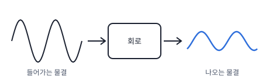

*나오는 물결은 더 작아지고 조금 늦어져요. 얼마나 작아지는지가 우리가 가장 궁금한 거예요.*

**정확히 말하면**

주파수 응답을 구하려면 먼저 회로의 전달 함수(transfer function) $H(s)$를 구해야 해요. 일반적인 꼴은 이래요.

$$
H(s)=A_0\,\frac{\left(1+\dfrac{s}{\omega_{z1}}\right)\left(1+\dfrac{s}{\omega_{z2}}\right)\cdots}{\left(1+\dfrac{s}{\omega_{p1}}\right)\left(1+\dfrac{s}{\omega_{p2}}\right)\cdots}
$$

곱 기호로 줄여 쓰면 $H(s)=A_0\,\dfrac{\prod_k(1+s/\omega_{zk})}{\prod_k(1+s/\omega_{pk})}$예요.

- $A_0$: DC 이득, 곧 저주파 이득(low-frequency gain)이에요. 지금까지 소신호 해석으로 구한 이득이 바로 이 $A_0$예요.
- 극점(pole): 분모를 0으로 만드는 $s$예요. 여러 개일 수 있어요.
- 영점(zero): 분자를 0으로 만드는 $s$예요. 여러 개일 수 있어요.

**부호 표기.** 분모 $1+s/\omega_{p1}$을 0으로 만드는 해는 $s=-\omega_{p1}$으로 음수예요. 위 식의 $\omega_{p}$, $\omega_{z}$는 극점·영점의 크기, 곧 극점 주파수·영점 주파수($\gt 0$)예요. 극점을 음수 값 그대로 $\omega_p$라 부르면 같은 식이 $(1-s/\omega_p)$ 꼴이 되고, Razavi 식 (11.2)는 이 표기를 써요. 두 표기는 같은 식이에요.

(수업 중 슬라이드의 + 를 − 로 고치는 게 더 정확하다고 정정했어요. 이 노트는 슬라이드처럼 양수인 극점 주파수와 + 표기를 써요.)

**예: 부하 커패시턴스가 있는 CS 단.** [CS 단과 부하 커패시턴스](#s0-cs-cl)의 전달 함수는 영점이 없고 극점이 하나예요.

$$
\frac{V_{out}}{V_{in}}=\frac{-g_mR_D}{1+R_DC_Ls},\qquad A_0=-g_mR_D
$$

극점은 $s=-1/(R_DC_L)$이고, 극점 주파수는 그 크기인 $\omega_{p1}=1/(R_DC_L)$이에요.

**극점 수와 영점 수.** 영점이 극점보다 많으면 $\omega\to\infty$에서 $|H|$가 끝없이 커져 발산해요. 그래서 실제 회로에서는 극점 수가 영점 수보다 같거나 많아요. 수업에서는 이를 "안정적인 시스템"이라고 불렀는데, 엄밀히는 적정(proper) 조건이고 안정성은 극점이 좌반 평면에 있는지로 정해져요.

**정현파 입력에 대한 출력.**

1. 입력 $x(t)=A\cos\omega t$를 넣어요.
2. $s=j\omega$를 대입해 복소수 $H(j\omega)$를 구해요.
3. 출력은 크기가 $|H(j\omega)|$배, 위상이 $\angle H(j\omega)$만큼 바뀐 정현파예요.

   $$
   y(t)=A\,|H(j\omega)|\cos\big(\omega t+\angle H(j\omega)\big)
   $$

- $|H(j\omega)|$: 크기 응답(magnitude response)
- $\angle H(j\omega)$: 위상 응답(phase response)

두 응답을 합쳐 주파수 응답(frequency response)이라 해요. 위 CS 단이면 크기 응답은 $|H(j\omega)|=\dfrac{g_mR_D}{\sqrt{R_D^2C_L^2\omega^2+1}}$이에요.

이 수업은 주로 크기 응답을 봐요. 크기 응답을 손으로 빨리 그리는 방법이 [보데 근사](#s1-bode)예요.

**교수님 말씀**

슬라이드의 전달 함수에서 분모·분자의 + 를 − 로 고쳐 쓰는 게 더 정확하다고 하셨어요. 극점·영점 자체는 음수이기 때문이에요. 책에 따라 절댓값(크기)을 써서 + 로 적기도 한다고 덧붙이셨어요. (1014 P03·L153–157)

앰프에서는 위상보다 이득의 크기가 주파수에 따라 어떻게 변하는지가 더 관심사라서, 크기 응답 위주로 해석하겠다고 하셨어요.

**꼭 기억해요**

> "앰프에서 중요한 거는 … 주파수에 따라서 이득의 크기가 어떻게 되느냐" (1014 P03·L177)

**페이지 요약**

이 식의 $\omega_p,\omega_z>0$는 주파수 크기예요. $1+s/\omega_p=0$의 실제 극점 위치는 $s=-\omega_p$예요.

극점 수가 영점 수 이상인 것은 적정(proper) 조건이고, 안정성은 극점이 좌반 평면에 있는지로 판단해요.

전달 함수의 분모를 0으로 만드는 극점, 분자를 0으로 만드는 영점이 주파수 응답을 정해요.

*핵심 식*

- 전달 함수

  $$
  H(s)=A_0\,\dfrac{\prod_k(1+s/\omega_{zk})}{\prod_k(1+s/\omega_{pk})}
  $$
- 정현파 출력

  $$
  y(t)=A\,|H(j\omega)|
  $$

  $$
  \times\cos\big(\omega t+\angle H(j\omega)\big)
  $$

*용어*

- **극점(pole)** — 분모를 0으로 만드는 $s$예요.
- **영점(zero)** — 분자를 0으로 만드는 $s$예요.
- **크기 응답(magnitude response)** — $|H(j\omega)|$, 주파수별 이득의 크기예요.

---

### 6. 보데 근사: 극점마다 기울기 −20 dB/dec

*1014 수업 · L05 s8*

**쉽게 말하면**

주파수를 높이며 pole(극점) 주파수를 하나 지날 때마다, 기존 기울기에 −20 dB/dec를 더해요.

dec는 주파수가 10배 되는 구간이고, −20 dB/dec는 그 구간마다 이득이 20 dB 내려간다는 뜻이에요.

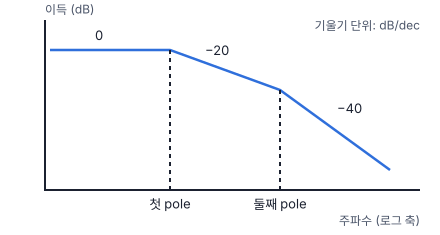

*pole에서 이득이 뚝 떨어지는 게 아니라 내려가는 기울기가 더 가팔라지고, 실제 곡선에서는 부드럽게 바뀌어요.*

**정확히 말하면**

**먼저 적용해 봐요.** 이 그림은 저주파에서 평평하고, 관심 주파수 범위에 실수 극점 두 개만 영향을 주는 저역통과 응답의 직선 근사예요. 기울기는 첫 극점 전 0, 첫 극점 뒤 −20, 둘째 극점 뒤 −40 dB/dec예요. 같은 조건에서 세 번째 극점을 더 지나면 기존 −40에 −20을 더해 −60 dB/dec가 돼요.

정확한 $|H(j\omega)|$는 매끈한 곡선이에요. 극점과 영점을 알면 직선 몇 개로 이은 근사 그림인 보데 플롯(Bode plot)으로 쉽게 그릴 수 있어요. 보데(Bode)는 사람 이름이에요.

**그리는 축.** 가로축 주파수 $\omega$는 로그 스케일, 세로축 크기는 dB 단위 $20\log|H(j\omega)|$로 그려요. 로그 스케일에서는 10배(decade, dec)마다 같은 간격이에요.

**보데 규칙.**

- $\omega$가 극점 주파수 $\omega_p$를 지날 때마다 dB 크기 그래프의 기존 기울기에 −20 dB/dec를 더해요.
- $\omega$가 영점 주파수 $\omega_z$를 지날 때마다 기울기가 20 dB/dec 증가해요.

**극점 항 하나의 유도.**

1. $s=j\omega$: $\left|1+\dfrac{j\omega}{\omega_p}\right|=\sqrt{1+\left(\dfrac{\omega}{\omega_p}\right)^2}$ (실수부 1, 허수부 $\omega/\omega_p$)
2. 분모에 있으므로 dB로는 $-20\log\sqrt{1+(\omega/\omega_p)^2}$
3. $\omega \ll \omega_p$일 때: $\approx -20\log 1 = 0$ dB, 곧 평평해요.
4. $\omega \gg \omega_p$일 때: 1을 무시하면 $\approx -20\log(\omega/\omega_p)$
5. $\omega=10\,\omega_p$이면 $-20$ dB, $100\,\omega_p$이면 $-40$ dB, $1000\,\omega_p$이면 $-60$ dB예요. 10배마다 20 dB씩 떨어지므로 기울기는 −20 dB/dec예요.
6. 영점 항은 분자에 있으므로 $+20\log\sqrt{1+(\omega/\omega_z)^2}\approx+20\log(\omega/\omega_z)$, 기울기는 +20 dB/dec예요.

**CS 단에 적용 (Razavi 예제 11.7).** 부하 커패시턴스가 있는 CS 단은 영점이 없고 극점이 하나예요.

$$
\frac{V_{out}}{V_{in}}=\frac{-g_mR_D}{1+\dfrac{s}{1/(R_DC_L)}},\qquad \omega_{p1}=\frac{1}{R_DC_L}
$$

$20\log(g_mR_D)$에서 평평하게 가다가 $\omega_{p1}$에서 기울기가 0에서 −20 dB/dec로 바뀌어요.

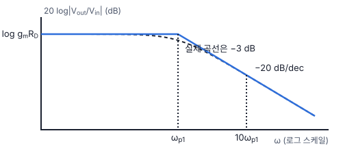

*강조선은 보데 근사, 점선은 실제 크기 응답이에요. $10\,\omega_{p1}$에서는 둘 다 $20\log(g_mR_D)$보다 약 20 dB 낮아요.*

**오차.** 실제 곡선은 극점 주파수에서 이미 3 dB 떨어져 있어요. 보데 근사는 극점까지 평평하다가 거기서 꺾이므로, 오차는 극점 근처에만 있어요. 대략적인 특성을 보기에는 충분해요.

**극점·영점이 여럿일 때.** 지날 때마다 기울기를 더해요.

| 지나는 순서 | 그 뒤 기울기 |
|---|---|
| 극점 하나 | −20 dB/dec |
| 극점 다음 영점 | −20 + 20 = 0 dB/dec (다시 평평) |
| 극점 다음 극점 | −20 − 20 = −40 dB/dec |

정확한 곡선이 필요하면 SPICE 같은 시뮬레이션 툴로 그려요. 손으로 그릴 때는 보데 근사로 충분해요.

**남은 문제: 극점 구하기.** 보데 플롯은 극점·영점만 알면 쉽게 그려요. 어려운 것은 전달 함수를 구해 극점·영점을 찾는 일이에요. 저주파 이득 $A_0$만 구해도 노드 방정식이 복잡한데, 커패시턴스까지 들어가면 더 어려워요. 앰프의 주파수 응답은 주로 극점이 좌우해요. 영점은 보통 극점보다 훨씬 높은 주파수에 있어서, 이득이 먼저 떨어진 뒤에야 기울기를 다시 올려요. 극점을 빨리 찾는 손 규칙은 [노드마다 극점 하나](#s2-node-rule)에서 다뤄요.

RC 값과 관찰 주파수를 바꾸며 pole마다 더해지는 기울기를 [어떤 노드에서 극점이 생길까](../%EC%9D%B8%ED%84%B0%EB%A0%89%ED%8B%B0%EB%B8%8C_03_%EC%96%B4%EB%96%A4_%EB%85%B8%EB%93%9C%EC%97%90%EC%84%9C_%EA%B7%B9%EC%A0%90%EC%9D%B4_%EC%83%9D%EA%B8%B8%EA%B9%8C.html)의 보데 화면에서 비교해 보세요.

정확한 곡선과 직선 근사가 극점 근처에서 얼마나 다른지 [두 극점과 보데 근사](../%EC%9D%B8%ED%84%B0%EB%A0%89%ED%8B%B0%EB%B8%8C_02_%EB%91%90_%EA%B7%B9%EC%A0%90%EA%B3%BC_%EB%B3%B4%EB%8D%B0_%EA%B7%BC%EC%82%AC.html)에서 비교해 보세요.

**교수님 말씀**

칠판에 $\omega=10\,\omega_p$, $100\,\omega_p$, $1000\,\omega_p$를 차례로 넣어 −20, −40, −60 dB가 되는 것을 보이셨어요. (1014 P04·L193–201)

"다음 폴이 나오면 어떻게 돼요?", "내려왔다가 올라가나요?" 하고 물으며 극점·영점 조합을 함께 그려 나가셨어요. (1014 P04·L221, P05·L238)

> "폴의 위치만 알고 있으면 … 쉽게 그릴 수가 있다는 거고요, 그게 장점이에요." (1014 P04·L221–223)

극점·영점을 구하는 것, 곧 전달 함수를 구하는 것이 어려운 부분이라고 하셨어요. (1014 P05·L249–250)

**꼭 기억해요**

> "손으로 그릴 때는요, 보드 플롯으로 예측하면 충분히 정확" (1014 P05·L244)

> "일반적으로 폴이 중요한데" (1014 P05·L255)

**페이지 요약**

극점 항의 로그 근사는 $\omega\gg\omega_p$에서 써요. 실제 응답은 코너에서 부드럽고, 단일 극점의 코너 크기는 직선 근사보다 약 3 dB 낮아요.

극점을 지날 때마다 기존 기울기에 −20 dB/dec를 더해요: 0 → −20 → −40. 영점은 +20 dB/dec를 더해요.

*핵심 식*

- 극점 항 근사

  $$
  -20\log\sqrt{1+(\omega/\omega_p)^2}
  $$

  $$
  \approx -20\log(\omega/\omega_p)
  $$
- CS 단 극점

  $$
  \omega_{p1}=\frac{1}{R_DC_L}
  $$

*용어*

- **보데 플롯(Bode plot)** — 극점·영점에서 꺾이는 직선으로 그린 크기 응답 근사예요.
- **dB/dec** — 주파수가 10배 될 때 바뀌는 dB예요.

---

## 3. 노드마다 극점 하나

### 7. 입력 RC가 있는 CS 단의 두 극점

*1014 수업 · L05 s9*

**쉽게 말하면**

저주파 이득은 그래프의 시작 높이이고, 두 pole(극점) 주파수는 꺾을 위치예요.

낮은 pole에서 기울기를 0에서 −20으로, 높은 pole에서 −40 dB/dec로 바꾸면 직선 근사를 그릴 수 있어요.

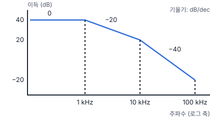

*시작 높이 40 dB, pole 주파수 1 kHz·10 kHz인 예시로, 10 kHz 이후에는 주파수 10배마다 40 dB씩 내려가요.*

**정확히 말하면**

**그래프부터 그려 봐요.** 위 예시는 이 회로에서 극점 두 개와 저주파 이득을 알았다고 가정한 직선 근사예요. 시작 높이 40 dB에서 첫 극점 1 kHz까지 평평하게, 다음 10 kHz까지 −20 dB/dec로, 그 뒤에는 −40 dB/dec로 이어요. dec는 주파수 10배 구간이므로 10 kHz에서는 20 dB, 100 kHz에서는 −20 dB예요. 실제 곡선은 극점 부근에서 둥글게 이어지고, 아래 유도는 이 회로의 두 극점과 시작 높이를 찾는 과정이에요.

부하 커패시턴스만 있던 CS 단([부하 커패시턴스가 있는 CS 단](#s0-cs-cl))에 입력 쪽 소자 두 개를 더해요. 입력 쪽 소자는 직렬 저항 $R_S$와, 게이트 노드 X와 접지 사이의 입력 등가 커패시턴스 $C_{in}$이에요.

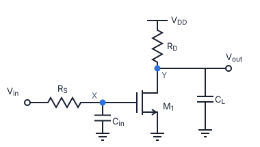

*입력 RC가 있는 CS 단(Razavi 그림 11.11). 색칠된 점이 입력 노드 X와 출력 노드 Y예요.*

- $R_S$는 소스 임피던스(source impedance)예요. 회로 하나만 보면 신호원(펑션 제너레이터)의 내부 임피던스이고, 단이 여럿 이어지면 바로 **앞단의 출력 임피던스**예요.
- $C_{in}$은 일부러 단 소자가 아니에요. 트랜지스터 커패시턴스가 입력에 등가적으로 나타난 것이에요(뒤에서 다뤄요).
- 소스는 접지이고, 출력 노드와 AC 접지 사이에 $R_D$와 $C_L$이 병렬로 보여요.

노드 X의 전압을 $V_X$라 두고 전달 함수를 두 조각으로 나눠 구해요.

1. 두 조각의 곱으로 써요.

   $$
   \frac{V_{out}}{V_{in}} = \frac{V_X}{V_{in}} \cdot \frac{V_{out}}{V_X}
   $$
2. 게이트로는 전류가 흐르지 않아요. 그래서 입력 쪽은 $R_S$와 $C_{in}$의 전압 분배예요.

   $$
   \frac{V_X}{V_{in}} = \frac{1/(C_{in}s)}{R_S + 1/(C_{in}s)}
   $$
3. 분자·분모에 $C_{in}s$를 곱해요.

   $$
   \frac{V_X}{V_{in}} = \frac{1}{1 + R_S C_{in} s}
   $$
4. 출력 쪽은 [부하 커패시턴스가 있는 CS 단](#s0-cs-cl)의 결과 그대로예요.

   $$
   \frac{V_{out}}{V_X} = -\frac{g_m R_D}{1 + R_D C_L s}
   $$
5. 둘을 곱해요.

   $$
   \frac{V_{out}}{V_{in}} = \frac{-g_m R_D}{(1 + R_S C_{in} s)(1 + R_D C_L s)}
   $$
6. 극점 주파수로 다시 써요.

   $$
   \frac{V_{out}}{V_{in}} = \frac{-g_m R_D}{\left(1 + \dfrac{s}{\omega_{p1}}\right)\left(1 + \dfrac{s}{\omega_{p2}}\right)}
   $$
7. 입력 극점과 출력 극점이에요.

   $$
   \omega_{p1} = \frac{1}{R_S C_{in}}
   $$

   $$
   \omega_{p2} = \frac{1}{R_D C_L}
   $$
8. $s = j\omega$를 넣으면 크기 응답이에요.

   $$
   \left|\frac{V_{out}}{V_{in}}\right| = \frac{g_m R_D}{\sqrt{\left(1 + \omega^2/\omega_{p1}^2\right)\left(1 + \omega^2/\omega_{p2}^2\right)}}
   $$

- 저주파 이득은 $A_0 = -g_m R_D$로 전과 같아요. 극점은 두 개(입력 극점, 출력 극점)이고 영점은 없어요.
- 극점 자체는 음수 $-1/(R_S C_{in})$, $-1/(R_D C_L)$이에요. 그 크기 $1/(R_S C_{in})$, $1/(R_D C_L)$이 극점 주파수예요.
- 정확한 크기 곡선을 그려도 되지만, 극점 두 개만 알면 [보데 근사](#s1-bode)로 그릴 수 있어요. 낮은 극점에서 기울기가 −20 dB/dec가 되고, 높은 극점을 지나면 −40 dB/dec가 돼요.

#### 직접 해 보기: 두 극점 따로 움직이기 *(정적 스냅샷 — 직접 조작은 HTML 버전)*

입력 쪽(RS, Cin)을 바꾸면 입력 극점만, 출력 쪽(RD, CL)을 바꾸면 출력 극점만 움직여요. RD는 저주파 이득 gmRD도 바꿔요(gm = 5 mS 고정).

입력 극점 ωp1 = 1/(RSCin) =  출력 극점 ωp2 = 1/(RDCL) =  저주파 이득 gmRD =  

범례: 정확한 크기 응답 · 보데 근사(0, −20, −40 dB/dec) · ωp1 입력 극점 · ωp2 출력 극점

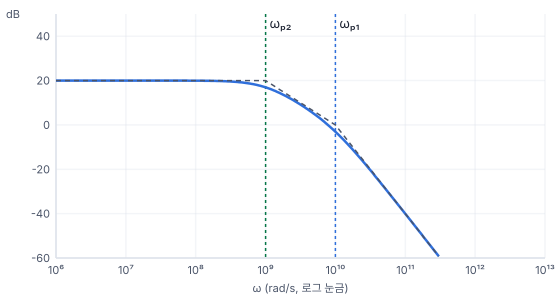

*설정 1: 기본*

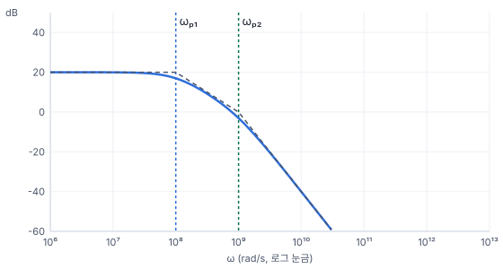

*설정 2: RS를 키움*

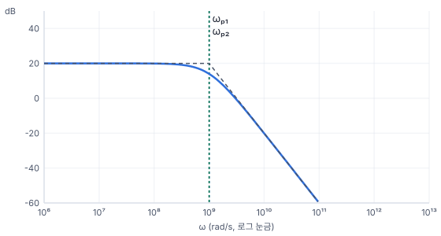

*설정 3: 두 극점이 겹침*

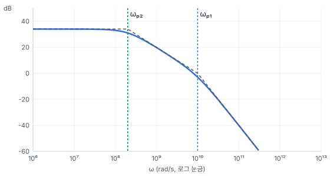

*설정 4: RD를 키움*

| 설정 | RS, Cin, RD, CL | 입력 극점 ωp1 | 출력 극점 ωp2 | 저주파 이득 gmRD |
|---|---|---|---|---|
| 1. 기본 | 1.00 kΩ, 100 fF, 2.00 kΩ, 501 fF | 1.00×10¹⁰ rad/s (1.59 GHz) | 1.00×10⁹ rad/s (159 MHz) | 10.0 (20.0 dB) |
| 2. RS를 키움 | 100 kΩ, 100 fF, 2.00 kΩ, 501 fF | 1.00×10⁸ rad/s (15.9 MHz) | 1.00×10⁹ rad/s (159 MHz) | 10.0 (20.0 dB) |
| 3. 두 극점이 겹침 | 2.00 kΩ, 501 fF, 2.00 kΩ, 501 fF | 1.00×10⁹ rad/s (159 MHz) | 1.00×10⁹ rad/s (159 MHz) | 10.0 (20.0 dB) |
| 4. RD를 키움 | 1.00 kΩ, 100 fF, 10.0 kΩ, 501 fF | 1.00×10¹⁰ rad/s (1.59 GHz) | 2.00×10⁸ rad/s (31.8 MHz) | 50.0 (34.0 dB) |

입력·출력 RC를 바꾸며 각 극점과 전체 대역폭의 차이를 [두 극점과 보데 근사](../%EC%9D%B8%ED%84%B0%EB%A0%89%ED%8B%B0%EB%B8%8C_02_%EB%91%90_%EA%B7%B9%EC%A0%90%EA%B3%BC_%EB%B3%B4%EB%8D%B0_%EA%B7%BC%EC%82%AC.html)에서 확인해 보세요.

**교수님 말씀**

$R_S$를 왜 넣는지 따로 짚으셨어요. 어떤 회로에 신호를 넣어 주는 소스는 대개 바로 앞단 회로예요. 그래서 소스 임피던스는 앞단의 출력 임피던스라는 뜻이에요.

> "RS는 일부러 달아준 게 아니라 그 전단의 출력 임피던스를 모델링해서 고려한 거예요." (1014 P06·L396)

입력 극점이 앞단의 출력 임피던스에 좌우돼요. 이를 무시하고 설계하면 나중에 단을 붙였을 때 극점 주파수가 달라져요(1014 P06·L393–399).

> "두 개의 폴을 알고 있으면 보드 플롯을 이용해서 매그니튜드 플롯을 그릴 수가 있겠죠" (1014 P06·L323–324)

**페이지 요약**

이 분리된 입력·출력 RC 모델은 영점이 없고 두 극점이 있어요. 두 극점이 같은 위치면 이중 극점이며 각각의 기울기를 더해요.

저주파 이득이 시작 높이, 두 극점 주파수가 꺾을 위치예요. 극점을 지날 때마다 기울기는 0 → −20 → −40 dB/dec로 바뀌어요.

*핵심 식*

- 전달 함수

  $$
  \frac{V_{out}}{V_{in}}
  $$

  $$
  = \frac{-g_m R_D}{(1 + R_S C_{in} s)(1 + R_D C_L s)}
  $$
- 입력 극점

  $$
  \omega_{p1} = \frac{1}{R_S C_{in}}
  $$
- 출력 극점

  $$
  \omega_{p2} = \frac{1}{R_D C_L}
  $$

*용어*

- **소스 임피던스(source impedance)** — 입력에 직렬로 보이는 $R_S$, 곧 앞단의 출력 임피던스
- **입력 등가 커패시턴스** — 트랜지스터 커패시턴스가 입력에 나타난 $C_{in}$

---

### 8. 노드마다 극점: 등가 저항과 등가 커패시턴스

*1014 수업 · L05 s9*

**쉽게 말하면**

물통마다 물이 차는 데 걸리는 시간이 정해져 있어요.

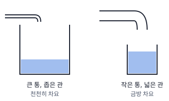

*통이 크고 관이 좁을수록 오래 걸리고, 오래 걸리는 통일수록 빨리 떨리는 신호를 못 따라가요.*

**정확히 말하면**

[입력 RC가 있는 CS 단의 두 극점](#s2-cs-two-poles)은 둘 다 "저항 × 커패시턴스"의 역수 꼴이에요. 그 저항과 커패시턴스가 어디서 보이는지 따져 봐요.

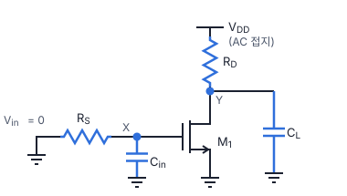

*$V_{in} = 0$으로 두면 노드마다 AC 접지 쪽으로 보이는 소자(강조색 선)가 정해져요.*

- **입력 노드 X**: $V_{in} = 0$으로 두면 X에서 접지 쪽으로 $R_S$가 보여요. 게이트 쪽은 임피던스가 무한대라 전류가 흐르지 않아요. 그래서 등가 저항은 $R_S$, 등가 커패시턴스는 $C_{in}$이에요.
- **출력 노드 Y**: $V_{DD}$는 AC 접지예요. 채널 길이 변조까지 보면 등가 저항은 $R_D \parallel r_O \approx R_D$이고, 등가 커패시턴스는 $C_L$이에요.
- 여기서 "등가"는 그 노드와 AC 접지 사이에 보이는 임피던스라는 뜻이에요.

이걸 일반화한 규칙이에요(슬라이드 s9 둘째 글머리). 노드마다 극점이 하나씩 생기고, 극점 주파수는 그 노드와 AC 접지 사이의 등가 저항과 등가 커패시턴스를 곱한 값의 역수예요.

$$
\omega_p = \frac{1}{R_{eq} C_{eq}}
$$

노드 방정식으로 전달 함수를 구하지 않고 이 순서로 크기 응답을 그려요.

1. 입력 신호원을 끄고($V_{in} = 0$) 전원도 AC 접지로 둬요.
2. 노드마다 AC 접지 쪽으로 보이는 등가 저항 $R_{eq}$와 등가 커패시턴스 $C_{eq}$를 찾아요.
3. 노드마다 $\omega_p = 1/(R_{eq} C_{eq})$를 계산해요.
4. 저주파 이득 $A_0$에서 출발해 극점마다 기울기를 20 dB/dec씩 낮추는 [보데 근사](#s1-bode)로 그려요.

- 이 방법은 근사예요. 정확한 값은 툴로 구하면 되고, 손 해석의 목적은 약 10% 오차 안에서 어떤 파라미터가 극점을 움직이는지 보는 것이에요.
- 영점은 구하지 않아요. 영점은 보통 극점보다 훨씬 높은 주파수에 있어요. 관심 있는 곳은 이득이 떨어지기 시작하는 지점이라 주로 극점이 영향을 줘요.

같은 도선의 두 점과 입력·출력 노드를 고르고 이상적 구동을 비교하며, 극점을 세는 기준을 [어떤 노드에서 극점이 생길까](../%EC%9D%B8%ED%84%B0%EB%A0%89%ED%8B%B0%EB%B8%8C_03_%EC%96%B4%EB%96%A4_%EB%85%B8%EB%93%9C%EC%97%90%EC%84%9C_%EA%B7%B9%EC%A0%90%EC%9D%B4_%EC%83%9D%EA%B8%B8%EA%B9%8C.html)에서 확인해 보세요.

**교수님 말씀**

> "폴을 확인해 보니까 … 저항과 커패시터의 곱의 역수로 나타나는 거죠." (1014 P06·L328–331)

왜 정확한 식 대신 근사를 쓰는지도 말씀하셨어요. 정확히 풀면 식이 복잡해져요.

> "식이 복잡해지면 … 어떤 파라미터가 이것과 어떻게 연결되는지를 알기가 어려운 거예요." (1014 P06·L374)

근사식을 쓰면 "이걸 조절하면 폴이 어떻게 변하겠구나" 하는 설계 힌트를 얻을 수 있다고 하셨어요(1014 P06·L375–376).

**꼭 기억해요**

> "각 노드마다 폴이 생긴다 … 각 노드의 등가 저항과 등가 커패시턴스의 곱의 역수로 나타난다." (1014 P08·L523)

> "폴을 구하는 게 이제 가장 키포인트고" (1014 P08·L529)

영점을 안 구하는 이유도 함께 기억해요. 영점은 "충분히 높은 주파수"에 있어서 관심 밖이라고 하셨어요(1014 P08·L525).

**페이지 요약**

약 10% 오차를 목표로 파라미터 영향을 읽는 손 근사이며 영점은 구하지 않아요. 출력에서 $r_O\gg R_D$일 때만 $R_D\parallel r_O\approx R_D$로 써요.

노드마다 극점이 하나씩 생기고, 그 노드에서 AC 접지 쪽으로 보이는 R과 C의 곱의 역수가 극점 주파수예요.

*핵심 식*

- 노드–극점 규칙

  $$
  \omega_p = \frac{1}{R_{eq} C_{eq}}
  $$
- 출력 노드 저항

  $$
  R_D \parallel r_O \approx R_D
  $$

*용어*

- **등가 저항(equivalent resistance)** — 그 노드와 AC 접지 사이에 보이는 저항
- **등가 커패시턴스(equivalent capacitance)** — 그 노드와 AC 접지 사이에 보이는 커패시턴스
- **AC 접지(AC ground)** — 소신호로는 0 V인 노드(꺼 둔 입력, 전원)

---

### 9. CG 단의 입력 극점

*1014 수업 · L05 s10*

**쉽게 말하면**

이번엔 물통에 큰 구멍이 하나 더 뚫려 있어요.

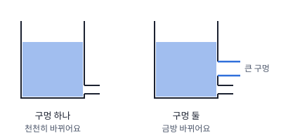

*구멍이 둘이면 물이 빨리 빠져서, 더 빨리 떨리는 신호까지 따라가요.*

**정확히 말하면**

[노드마다 극점 규칙](#s2-node-rule)을 CG 단에 써요. 입력은 소스로 넣고, 게이트는 DC 바이어스 $V_b$가 걸린 AC 접지이며, 출력은 드레인이에요. 소스에 DC 전류를 흘릴 바이어스 전류원은 그림에서 생략했어요.

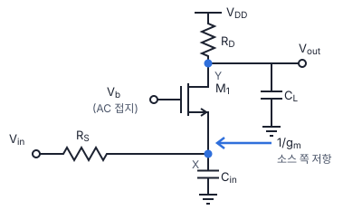

*입력 RC가 있는 CG 단(Razavi 그림 11.12). 강조색 화살표는 노드 X에서 트랜지스터 소스 쪽을 들여다본 저항이에요.*

- 입력 쪽에는 [CS 단](#s2-cs-two-poles)처럼 앞단의 출력 임피던스 $R_S$와 입력 등가 커패시턴스 $C_{in}$(노드 X–접지)을 둬요. $C_{in}$은 트랜지스터 커패시턴스가 입력에 등가적으로 나타난 것이에요.
- 노드가 X와 Y 두 개이므로 극점도 두 개라고 예측해요.

입력 노드 X의 등가 저항을 구해요($\lambda = 0$, 몸체 효과 무시).

1. $V_{in} = 0$으로 두면 X에서 접지 쪽으로 $R_S$가 보여요.
2. X에는 트랜지스터의 소스도 붙어 있어요. CS 단처럼 게이트(무한대)를 보는 게 아니라 소스를 들여다봐요.
3. 게이트가 AC 접지이므로 $V_{GS} = -V_X$예요.
4. $I_D = g_m V_{GS} = -g_m V_X$이므로 소스 쪽 저항의 크기는 $\left|V_X / I_D\right| = \frac{1}{g_m}$이에요.
5. 두 저항이 X와 AC 접지 사이에 병렬이에요. 등가 저항은 $R_S \parallel \frac{1}{g_m}$, 등가 커패시턴스는 $C_{in}$이에요.
6. 입력 극점이에요.

   $$
   \omega_{p,X} = \frac{1}{\left(R_S \parallel \frac{1}{g_m}\right) C_{in}}
   $$
7. 출력 노드 Y는 CS 단과 같아요. 등가 저항은 $R_D$($\lambda = 0$이면 $r_O$ 쪽은 무한대), 등가 커패시턴스는 $C_L$이에요.

   $$
   \omega_{p,Y} = \frac{1}{R_D C_L}
   $$

- 병렬 저항은 둘 중 작은 쪽보다 작아요. 그래서 같은 $R_S$, $C_{in}$이라도 CG 단의 입력 극점은 게이트를 보는 CS 단의 $1/(R_S C_{in})$보다 높아요.
- 보데 근사: 저주파 이득 $A_0$로 평평하다가 낮은 쪽 극점에서 −20 dB/dec, 높은 쪽 극점을 지나면 −40 dB/dec로 떨어져요.
- $\omega_{p,X}$와 $\omega_{p,Y}$ 중 어느 쪽이 낮은지는 소자 값에 따라 달라요. 순서가 바뀌어도 그림의 모양은 같아요.

**교수님 말씀**

이 예제에서 "전달 함수를 구하지 말고 폴을 구하세요"라고 하셨어요(1014 P07·L406–407).

수업 중 질문이 있었어요. 앞단에 극점이 있다는 게 영점으로 작용하느냐는 질문이었어요. 교수님 답은 영점이 아니라는 것이었어요.

- 앞단 출력이 실제 소스 전압이고, 이 단의 입력은 노드 X예요.
- 입력 커패시턴스가 있으면 주파수가 높아질수록 앞단이 보낸 신호가 감쇠되어 다 들어오지 못해요.
- 앞단에서 보면 이 $C_{in}$은 **앞단의 부하 커패시턴스**이고, 앞단의 출력 극점이에요. 이 단에서 보면 입력 극점이에요. 두 단을 붙이면 그 노드에 극점 하나로 나타나요.

> "제로가 아니고 정확하게는 이제 그 전단에서도 이제 그게 폴로 나타나는 거죠." (1014 P07·L487)

**꼭 기억해요**

> "등가 저항이 더 이상 RS만으로 표현되지 않고 … gm분의 1이 병렬로 보이더라." (1014 P07·L430–431)

> "우리는 각 노드의 등가 RC의 곱으로, RC의 곱의 역수로 구하자." (1014 P07·L461)

극점을 구한 뒤에는 보데 근사로 크기 응답을 그리는 게 "가장 기본적인 방법"이라고 하셨어요(1014 P07·L462–463).

**페이지 요약**

$\lambda=0$·몸체 효과 무시에서 게이트는 AC 접지라 $v_{gs}=-v_X$예요. 입력·출력 중 어느 극점이 낮은지는 소자 값에 따라 달라요.

CG 단의 입력 노드에는 $R_S$와 소스 쪽 $\frac{1}{g_m}$이 병렬로 보여서 입력 극점이 올라가요.

*핵심 식*

- 입력 극점

  $$
  \omega_{p,X}
  $$

  $$
  = \frac{1}{\left(R_S \parallel \frac{1}{g_m}\right) C_{in}}
  $$
- 출력 극점

  $$
  \omega_{p,Y} = \frac{1}{R_D C_L}
  $$

*용어*

- **소스 쪽 저항** — 게이트가 AC 접지일 때 소스를 들여다본 저항 $\frac{1}{g_m}$
- **앞단의 부하 커패시턴스** — 이 단의 $C_{in}$을 앞단에서 본 이름, 같은 노드의 극점 하나

---

### 10. 부유 커패시터: 어느 노드에 넣을까

*1014 수업 · L05 s11–12*

**쉽게 말하면**

두 물통 사이에 걸린 관은 어느 통 몫인지 정하기 어려워요.

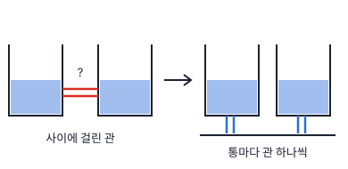

*그래서 사이에 걸린 관을 통마다 하나씩 달린 관 두 개로 바꿔 생각하려고 해요.*

**정확히 말하면**

- 노드와 노드 사이에 있는 커패시터를 **부유 커패시터(floating capacitor)**라고 해요.
- 노드와 접지 사이에 있는 커패시터를 **접지 커패시터(grounded capacitor)**라고 해요.

입력 RC가 있는 CS 단에서 게이트(노드 X)와 드레인(노드 Y) 사이에 $C_F$가 있다고 해 봐요.

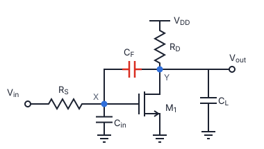

*경고색 선으로 그린 $C_F$는 두 단자 모두 접지에 닿지 않아요(슬라이드 s11).*

- 등가 저항은 바로 나와요. 입력 노드는 $R_S$(게이트 쪽은 무한대), 출력 노드는 $R_D \parallel r_O$예요.
- 등가 커패시턴스가 문제예요. $C_F$를 입력 노드에 넣을지, 출력 노드에 넣을지, 반씩 나눌지 분명하지 않아요.
- [노드마다 극점 규칙](#s2-node-rule)은 노드와 접지 사이 소자가 분명할 때만 바로 쓸 수 있어요. 부유 커패시터가 있으면 다시 노드 방정식을 풀어야 하는 처지가 돼요.

아이디어(슬라이드 s12): 노드 1과 노드 2 사이의 임피던스 $Z_F$를, 같은 효과를 내는 노드 1–접지 임피던스 $Z_1$과 노드 2–접지 임피던스 $Z_2$로 바꾸자는 거예요. 이렇게 나눌 수 있으면 노드마다 등가 임피던스를 분명히 구할 수 있어요. 이 변환이 **밀러 정리(Miller's theorem)**예요.

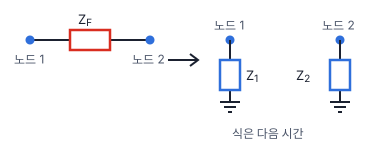

*노드 사이의 $Z_F$를 접지로 가는 $Z_1$, $Z_2$ 두 개로 바꾸는 아이디어예요. $Z_1$, $Z_2$를 어떻게 정하는지는 다음 시간에 다뤄요.*

**교수님 말씀**

> "노드와 노드 사이에 있는 이런 플로팅 커패시터 같은 경우에는 … 어떻게 해석해야 될지 어렵죠." (1014 P08·L511)

> "노드와 노드 사이에 있는 커패시턴스를 노드와 그라운드 사이의 커패시턴스로 등가적으로 변환을 하자." (1014 P08·L515)

여기서 이름만 밀러 정리라고 소개하고 수업을 마치셨어요. 변환식과 부유 커패시터를 넣은 극점 계산은 다음 시간에 이어서 해요(1014 P08·L521, L531).

**페이지 요약**

노드 사이에 걸린 부유 커패시터는 어느 노드의 등가 커패시턴스인지 정할 수 없어서, 접지로 가는 둘로 바꾸려는 게 밀러 정리예요.

*용어*

- **부유 커패시터(floating capacitor)** — 노드와 노드 사이에 있는 커패시터, 예: $C_F$
- **접지 커패시터(grounded capacitor)** — 노드와 접지 사이에 있는 커패시터
- **밀러 정리(Miller's theorem)** — 노드 사이 $Z_F$를 접지로 가는 $Z_1$, $Z_2$로 바꾸는 방법(식은 다음 시간)

---

## 4. 요약 · 예고

### 11장 앞부분 핵심 정리

*1014 수업 · L05 s3–11*

이번 수업에 나온 식과 규칙을 한 표에 모았어요. 기호는 본문 토픽과 같아요.

| 무엇 | 식·규칙 | 조건·메모 | 토픽 |
|---|---|---|---|
| 커패시터 임피던스 | $Z_C = \frac{1}{Cs}$, $s = j\omega$ | 저주파에서는 무한대에 가까워 무시했어요. 주파수가 오르면 작아져요. | [2. RC 저역통과](#s0-rc-lowpass) |
| RC 저역통과 필터 | $\frac{V_{out}}{V_{in}} = \frac{1}{1 + RCs}$ | 앰프 롤오프와 같은 꼴이에요. | [2. RC 저역통과](#s0-rc-lowpass) |
| CS 단 + 부하 커패시턴스 | $V_{out} = -g_m V_{in} \left(R_D \parallel \frac{1}{C_L s}\right)$ | 출력 노드에 $R_D$와 $C_L$이 병렬로 보여요. $C_L$은 보통 다음 단의 입력 커패시턴스예요. | [3. CS + $C_L$](#s0-cs-cl) |
| CS 단 전달 함수 | $\frac{V_{out}}{V_{in}} = -\frac{g_m R_D}{1 + R_D C_L s}$ | 저주파 이득 $g_m R_D$인 저역통과 꼴이에요. | [3. CS + $C_L$](#s0-cs-cl) |
| 크기 응답 | $\left\vert \frac{V_{out}}{V_{in}}\right\vert  = \frac{g_m R_D}{\sqrt{R_D^2 C_L^2 \omega^2 + 1}}$ | $s = j\omega$를 넣고 크기를 구해요. | [4. −3 dB 대역폭](#s0-3db) |
| −3 dB 대역폭 | $\omega_{-3dB} = \frac{1}{R_D C_L}$ | 이 주파수에서 크기가 $\frac{1}{\sqrt{2}}$배(약 −3 dB)예요. 그 위로는 −20 dB/dec로 떨어져요. | [4. −3 dB 대역폭](#s0-3db) |
| 이득–대역폭 트레이드오프 | $R_D$를 키우면 이득 $g_m R_D$는 커지고 $\omega_{-3dB}$는 작아짐 | 무조건 이득이 큰 것이 좋은 설계는 아니에요. 커패시턴스는 작을수록 좋아요. | [4. −3 dB 대역폭](#s0-3db) |
| 일반 전달 함수 | $H(s) = A_0 \frac{(1 + s/\omega_{z1})(1 + s/\omega_{z2}) \cdots}{(1 + s/\omega_{p1})(1 + s/\omega_{p2}) \cdots}$ | $A_0$는 DC(저주파) 이득이에요. $\omega_p$, $\omega_z$는 극점·영점 주파수(크기)예요. | [5. 전달 함수](#s1-transfer) |
| 정현파 출력 | $y(t) = A \left\vert H(j\omega)\right\vert  \cos(\omega t + \angle H(j\omega))$ | $\left\vert H(j\omega)\right\vert $는 크기 응답, $\angle H(j\omega)$는 위상 응답이에요. 앰프에서는 주로 크기를 봐요. | [5. 전달 함수](#s1-transfer) |
| 보데 규칙 | 극점 주파수를 지날 때마다 기울기 −20 dB/dec, 영점 주파수를 지날 때마다 +20 dB/dec | 가로축은 로그 스케일, 세로축은 dB예요. 오차는 극점 근처에만 있고, 극점 하나당 최대 3 dB예요(겹친 두 극점이면 6 dB). | [6. 보데 근사](#s1-bode) |
| 보데 근사의 근거 | $-20\log\sqrt{1 + (\omega/\omega_p)^2} \approx -20\log(\omega/\omega_p)$ | $\omega \gg \omega_p$일 때. 10배마다 20 dB씩 떨어져요. | [6. 보데 근사](#s1-bode) |
| 입력 RC가 있는 CS 단 | $\frac{V_{out}}{V_{in}} = \frac{-g_m R_D}{(1 + R_S C_{in} s)(1 + R_D C_L s)}$ | 입력 쪽 전압 분배와 출력 쪽 CS 이득을 곱해요. $R_S$는 앞단의 출력 임피던스예요. | [7. CS 두 극점](#s2-cs-two-poles) |
| 두 극점 | $\omega_{p1} = \frac{1}{R_S C_{in}}$, $\omega_{p2} = \frac{1}{R_D C_L}$ | 입력 극점과 출력 극점이에요. 영점은 없어요. | [7. CS 두 극점](#s2-cs-two-poles) |
| 노드–극점 규칙 | $\omega_p = \frac{1}{R_{eq} C_{eq}}$ | 노드마다 극점이 하나예요. $R_{eq}$, $C_{eq}$는 그 노드와 AC 접지 사이에 보이는 값이에요. 전달 함수 없이 약 10% 오차로 극점을 찾아요. | [8. 노드와 극점](#s2-node-rule) |
| 출력 노드 등가 저항 | $R_D \parallel r_O \approx R_D$ | $\lambda = 0$이면 $R_D$예요. | [8. 노드와 극점](#s2-node-rule) |
| CG 단 입력 극점 | $\omega_{p,X} = \frac{1}{\left(R_S \parallel \frac{1}{g_m}\right) C_{in}}$ | 소스 쪽을 들여다보면 $\frac{1}{g_m}$이 보여요($\lambda = 0$, 몸체 효과 무시). | [9. CG 극점](#s2-cg-poles) |
| CG 단 출력 극점 | $\omega_{p,Y} = \frac{1}{R_D C_L}$ | 낮은 극점에서 −20 dB/dec, 높은 극점에서 −40 dB/dec가 돼요. | [9. CG 극점](#s2-cg-poles) |
| 부유 커패시터 | 노드 사이의 $C_F$(임피던스 $Z_F$) | 어느 노드의 $C_{eq}$에 넣을지 분명하지 않아요. 밀러 정리로 접지 임피던스 두 개로 바꿔요(다음 시간). | [10. 부유 커패시터](#s2-floating) |

교수님이 수업 마지막에 이번 시간의 키포인트를 이렇게 정리했어요(1014 Part 08).

| 키포인트 | 내용 |
|---|---|
| 주파수 응답이란 | 전달 함수의 크기를 주파수에 따라 구하는 것이에요. |
| 극점 찾기 | 노드마다 극점이 하나 생기고, 극점 주파수는 그 노드의 등가 저항과 등가 커패시턴스를 곱한 값의 역수예요. 극점을 구하는 것이 가장 중요해요. |
| 그리기 | 극점을 알면 보데 근사로 크기 응답을 그려요. 손으로는 이것으로 충분해요. |
| 영점은 왜 덜 보나 | 영점은 보통 극점보다 훨씬 높은 주파수에 있어요. 이득이 떨어지기 시작하는 지점은 극점이 정해요. |

---

### 다음 시간 예고

*1014 수업 · L05 s12–26*

- 밀러 정리의 변환식과 부유 커패시터를 넣은 극점, 밀러 곱셈(Miller multiplication) — L05 s12–14
- 고역통과 필터와 AC 결합, 전형적인 주파수 응답 — L05 s15–17
- 트랜지스터 고주파 모델의 내부 커패시턴스($C_{GS}$, $C_{GD}$ 등) — L05 s18–23
- transit frequency $f_T$ — L05 s24
- 각 증폭단(CS, CG, 폴로어, 캐스코드, 차동쌍)의 주파수 응답 — L05 s26 이후
- 중간시험 — 다음 주, 범위는 배운 데까지(정확한 경계는 말하지 않았어요)

---

### 함께 보면 좋은 자료

*1014 수업 · L05 s3–11*

- [복습문제 10개 (PDF)](../복습문제_1014_Frequency_Response-문제.pdf)
- [답안 (PDF)](../복습문제_1014_Frequency_Response-답안.pdf)
- [11장 문제집 전체 (PDF)](../../../workbook/pdf/ch11-문제.pdf)
- [0904 정리노트: CS 단의 이득 $g_m R_D$ 복습](../../0904/정리노트_0904_MOS_Small_Signal_Model.html#s3-cs-gain)

복습문제 10개는 이렇게 골랐어요.

| 문제 | 무엇을 연습하나 |
|---|---|
| E11.03 | 영상 시스템의 대역폭이 부족하면 무슨 일이 생기는지 그림으로 확인해요. 속도와 대역폭은 같은 이야기예요. |
| E11.04 | 부하 커패시턴스가 있는 CS 단의 전달 함수와 크기 응답을 유도해요(수업 칠판 유도 그대로). |
| P11.01 | $R_D = 1\ \mathrm{k\Omega}$, $C_L = 1\ \mathrm{pF}$인 CS 단에서 이득이 10% 떨어지는 주파수를 계산해요. |
| P11.02 | 1 GHz 대역폭·2 mW 전력 조건에서 CE 단의 최대 이득을 구해요. 이득–대역폭 트레이드오프예요. |
| P11.06 | 극점 100 MHz·10 GHz, 영점 1 GHz의 보데 선도를 그려요. 기울기가 −20, 0, −20 dB/dec 순으로 바뀌어요. |
| P11.09 | 같은 CS 단 두 개를 이으면 극점이 겹쳐 −40 dB/dec가 돼요. 전달 함수를 곱하면 dB는 더해져요. |
| E11.08 | 입력 RC가 있는 CS 단의 두 극점 $\frac{1}{R_S C_{in}}$, $\frac{1}{R_D C_L}$을 구해요(슬라이드 s9). |
| E11.09 | CG 단의 입력 극점에서 소스 쪽 $\frac{1}{g_m}$이 $R_S$와 병렬로 들어가요(슬라이드 s10). |
| X11.09 | CG 단에서 출력 극점이 입력 극점의 10배가 되는 $R_D$를 역산해요. |
| P11.12 | 소스에 기생 저항 $R_p$가 붙은 CG 단이에요. 입력 노드 저항이 $R_S \parallel (R_p + \frac{1}{g_m})$로 바뀌어요. |

---

출처: 권익진 교수님 강의자료(Lec5) · 수업 녹음 전사(1014) · B. Razavi, *Microelectronics*, 2nd ed. (Wiley) 11장.
