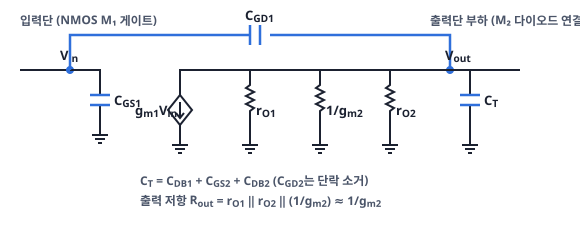
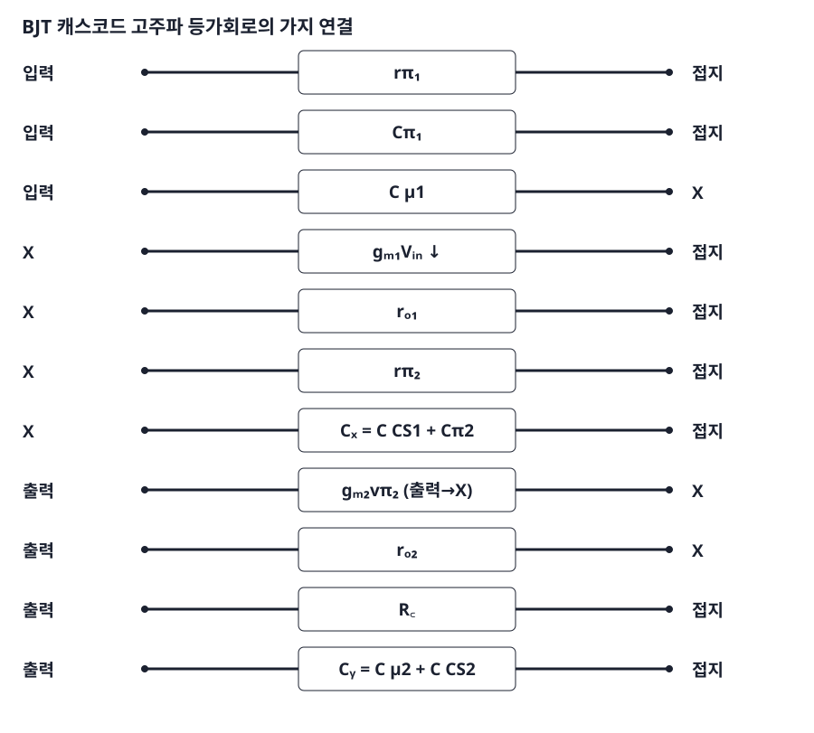

# 전자회로2 복습 1016 문제설명

주어진 조건을 읽고, 첫 줄을 쓰고, 이유를 따라가며 답을 확인해요.

문제의 첫 줄부터 검산까지 설명해요.

**목차**

- [문항별 설명](#problems)
  - [게이트–드레인 부유 커패시터가 있는 CS 단의 극점 (밀러 근사)](#p1)
  - [수치가 주어진 CS 단의 밀러 입력 커패시턴스 (예제 11.10 변형)](#p2)
  - [귀환 저항 R_F가 있는 CE 단(Fig 11.70)에 밀러 이론 적용](#p3)
  - [베이스–컬렉터 커패시터 C_F가 있는 CE 단(Fig 11.76)의 입력·출력 극점](#p4)
  - [오디오 증폭기용 소스 폴로어의 최소 C_i와 최대 C_L](#p5)
  - [I_1과 M_1의 폭을 반으로 줄인 소스 폴로어 (예제 11.11 변형)](#p6)
  - [다이오드 연결 PMOS 부하를 가진 CS 단의 모든 커패시턴스](#p7)
  - [다이오드 연결 부하 CS 단의 소신호 등가 회로 (예제 11.13 이어서)](#p8)
  - [바이폴라 캐스코드 단의 모든 커패시턴스](#p9)
  - [바이폴라 캐스코드의 소신호 등가 회로 (예제 11.12 이어서)](#p10)

## 문항별 설명

### 게이트–드레인 부유 커패시터가 있는 CS 단의 극점 (밀러 근사)

E11.10 · 예제 11.10 · [원 문제 보기](../%EB%B3%B5%EC%8A%B5%EB%AC%B8%EC%A0%9C_1016_Miller_High_Frequency_Models-%EB%AC%B8%EC%A0%9C.pdf)

#### 주어진 조건

- $\lambda = 0$
- 소자 값은 주어지지 않음 (답은 기호로)

#### 구할 것

- 회로의 극점 예측

원문 보기

그림 11.16(a)에 보인 회로의 극점을 예측하라. $\lambda = 0$을 가정한다.

#### 회로를 먼저 읽어요

입력 $V_{in}$은 $R_S$를 지나 $M_1$의 게이트에 들어가고, 드레인 전압이 출력 $V_{out}$이에요. $C_F$는 게이트와 드레인을 잇는 부유 커패시터예요. $\lambda=0$이므로 $M_1$의 출력 저항은 무한대로 보고, 밀러 근사로 입력과 출력의 RC 극점을 각각 예측해요.

#### 이 문제를 봤을 때 떠올릴 개념과 공식

두 신호 노드 사이에 $C_F$가 놓인 것이 밀러 정리(Miller's theorem)의 단서예요. $g_m$은 게이트 전압이 드레인 전류를 바꾸는 비율이고, $R_D$는 드레인 부하예요. 저주파에서 게이트→드레인 이득 $A=v_{out}/v_g=-g_mR_D$를 쓰면, $C_F$는 입력 접지 쪽 $(1-A)C_F$, 출력 접지 쪽 $(1-1/A)C_F$로 보입니다. 이 이득을 주파수와 무관한 상수로 놓는 단계가 밀러 근사(Miller approximation)예요.

입력 쪽 저항은 전압원을 0으로 했을 때의 $R_S$, 출력 쪽은 $\lambda=0$이므로 $R_D$예요. 각 접지 커패시터에 $\omega\approx1/(RC)$를 적용하는 까닭이에요.

#### 종이에 쓸 첫 줄

$V_{DD}$를 AC 접지로 놓고, 게이트 노드를 $v_g$, 드레인을 $v_o$라 써요. 커패시터를 잠시 열면 드레인 전류 변화는 $g_mv_g$이므로 $v_o=-g_mv_gR_D$예요. 따라서 밀러에 넣을 첫 값은 $A=v_o/v_g=-g_mR_D$예요.

게이트에서 $C_F$로 나가는 전류는 $sC_F(v_g-v_o)=sC_F(1-A)v_g$예요. 입력에서 접지로 향하는 등가 커패시터 전류 $sC_{in}v_g$와 맞추면 $C_{in}=(1-A)C_F$가 나와요.

#### 왜 이렇게 푸는지 함께 따라가요

#### 입력·출력 극점 추정

$A=-g_mR_D$를 입력식에 대입하면 $C_{in}=(1+g_mR_D)C_F$예요. 출력에서도 원래 전류 $sC_F(v_o-v_g)=sC_F(1-1/A)v_o$를 맞추므로 $C_{out}=(1+1/(g_mR_D))C_F$예요.

$V_{in}=0$일 때 게이트에서는 $R_S$와 $C_{in}$이 접지로, 드레인에서는 $R_D$와 $C_{out}$이 접지로 이어져요. 따라서 **$\omega_{in}\approx\dfrac{1}{R_S(1+g_mR_D)C_F}$**, **$\omega_{out}\approx\dfrac{1}{R_D(1+1/(g_mR_D))C_F}$**예요.

#### 완성 답과 검산

#### 근사 범위 확인

**입력 $1/[R_S(1+g_mR_D)C_F]$, 출력 $1/[R_D(1+1/(g_mR_D))C_F]$ rad/s**예요. 두 분모의 $RC$ 단위가 초이므로 역수는 rad/s예요. $g_mR_D$가 커지면 입력 등가 커패시턴스가 커져 입력 추정 극점이 내려가는 방향도 맞아요.

원래 회로에는 $C_F$ 하나만 있으므로 실제 전달 함수의 극점은 하나예요. 위 두 값은 저주파 이득으로 $C_F$를 둘로 분리한 모델의 RC 추정치이며, 실제 극점 두 개를 뜻하지 않아요.

#### 여기서 틀리기 쉬워요

출력 쪽에도 $(1+g_mR_D)C_F$를 쓰면 안 돼요. 출력 계수는 $1-1/A$예요. 또 $\lambda=0$은 출력 저항을 없앤다는 뜻이 아니라 무한대로 보아 $R_D$만 남긴다는 뜻이에요.

#### 설명을 닫고 다시 해 봐요

1. $g_mR_D$를 두 배로 키우면 어느 쪽 등가 커패시턴스가 크게 늘고, 어느 추정 극점이 내려가는지 말해 보세요.
2. 원래 $C_F$가 한 개인데 입력·출력 RC 추정치가 두 개인 이유를 설명해 보세요.

**페이지 요약**

$\lambda=0$은 $r_o\to\infty$라는 뜻이에요. 출력 등가 커패시턴스는 $(1+1/(g_mR_D))C_F$라 입력의 $(1+g_mR_D)C_F$와 달라요.

#### 떠올릴 개념·공식

밀러 근사: $A=-g_mR_D$, $C_{in}=(1-A)C_F$, $C_{out}=(1-1/A)C_F$.

#### 첫 줄

$v_o=-g_mv_gR_D$에서 두 노드의 저주파 이득을 정해요.

#### 핵심 판단

입력은 $R_SC_{in}$, 출력은 $R_DC_{out}$의 역수로 추정해요.

#### 검산

단위는 rad/s. 실제 $C_F$ 하나의 회로는 극점 하나예요.

---

### 수치가 주어진 CS 단의 밀러 입력 커패시턴스 (예제 11.10 변형)

X11.10 · 연습문제 11.10 · [원 문제 보기](../%EB%B3%B5%EC%8A%B5%EB%AC%B8%EC%A0%9C_1016_Miller_High_Frequency_Models-%EB%AC%B8%EC%A0%9C.pdf)

#### 주어진 조건

- 예제 11.10의 회로: Fig 11.16(a) CS 단 ($R_S$, $C_F$, $M_1$, $R_D$), $\lambda = 0$
- $g_m = (150\ \Omega)^{-1}$
- $R_D = 2\ \text{k}\Omega$
- $C_F = 80\ \text{fF}$

#### 구할 것

- $C_{in}$

원문 보기

$g_m = (150\ \Omega)^{-1}$, $R_D = 2\ \text{k}\Omega$, $C_F = 80\ \text{fF}$일 경우에 $C_{in}$을 계산하라.

#### 무엇을 계산하나요?

앞 문제의 CS 단에서 게이트와 드레인을 잇는 $C_F=80\,\mathrm{fF}$가 입력 게이트에서 얼마나 크게 보이는지 구해요. 필요한 것은 드레인 쪽 저주파 반전 이득이며, $R_S$ 값은 $C_{in}$ 계산에 쓰지 않아요.

#### 이 문제를 봤을 때 떠올릴 개념과 공식

$C_F$가 증폭기의 입력·출력 사이에 있다는 단서로 밀러 효과(Miller effect)를 떠올려요. $g_m$은 트랜스컨덕턴스, $R_D$는 드레인 저항이에요. $\lambda=0$인 CS 단의 저주파 게이트→드레인 이득은 $A=-g_mR_D$예요. 그 이득을 고정해 쓰는 밀러 근사에서 $C_{in}=(1-A)C_F$가 돼요. 출력이 입력과 반대 방향으로 움직여 $C_F$ 양단 전압 변화가 커지기 때문이에요.

#### 종이에 쓸 첫 줄

$V_{DD}$를 AC 접지로 두고 커패시터를 잠시 열면, 드레인 전류 변화 $g_mv_g$가 $R_D$를 지나며 $v_o=-g_mR_Dv_g$를 만들어요. 그러므로 $A=v_o/v_g=-g_mR_D$를 먼저 써요.

게이트에서 $C_F$로 흐르는 전류 $sC_F(v_g-v_o)=sC_F(1-A)v_g$를 입력 접지 커패시터의 전류 $sC_{in}v_g$와 같게 두어요.

#### 왜 이렇게 푸는지 함께 따라가요

#### 입력 등가 커패시턴스

$g_m=(150\,\Omega)^{-1}$이므로 $g_mR_D=(2000\,\Omega)/(150\,\Omega)=13.333\ldots$예요. 따라서 $A=-13.333\ldots$이고, $C_{in}=(1+g_mR_D)C_F$예요.

$C_{in}=(1+13.333\ldots)(80\,\mathrm{fF})=1146.7\,\mathrm{fF}\approx\mathbf{1.15\,\mathrm{pF}}$예요.

#### 완성 답과 검산

#### 크기와 단위

**$C_{in}\approx1.15\,\mathrm{pF}$**예요. $g_mR_D$는 $\mathrm{S}\cdot\Omega=1$인 무차원 값이라 결과 단위는 $C_F$와 같은 패럿이에요. $C_{in}/C_F=14.333\ldots$이므로 $80\,\mathrm{fF}$보다 약 14.3배 큰 값이 맞아요.

#### 여기서 틀리기 쉬워요

$g_mR_D=13.3$을 곧바로 배율로 쓰면 원래의 $1C_F$ 항을 빠뜨려요. $C_{in}$의 배율은 $1+g_mR_D$예요. $\mathrm{fF}$를 $\mathrm{pF}$로 바꿀 때는 1000으로 나눠요.

#### 설명을 닫고 다시 해 봐요

1. 같은 $g_m,R_D$에서 $C_F$를 절반으로 줄이면 $C_{in}$은 얼마인지 계산해 보세요.
2. $g_mR_D$가 0에 가까워지면 $C_{in}$이 어떤 값으로 돌아가는지 설명해 보세요.

**페이지 요약**

#### 떠올릴 개념·공식

밀러 효과: $C_{in}=(1+g_mR_D)C_F$.

#### 첫 줄

$A=-g_mR_D=-2000/150$.

#### 핵심 판단

$80\,\mathrm{fF}$에 $14.333\ldots$을 곱해요.

#### 검산

$C_{in}\approx1.15\,\mathrm{pF}$, 원래 값의 약 14.3배예요.

---

### 귀환 저항 R_F가 있는 CE 단(Fig 11.70)에 밀러 이론 적용

P11.16 · 장말문제 11.16 · [원 문제 보기](../%EB%B3%B5%EC%8A%B5%EB%AC%B8%EC%A0%9C_1016_Miller_High_Frequency_Models-%EB%AC%B8%EC%A0%9C.pdf)

#### 주어진 조건

- $V_A = \infty$
- $R_F$가 충분히 커서 $v_{out}/v_X = -g_m R_C$로 근사할 수 있음

#### 구할 것

- 저항 $R_F$에 밀러 이론을 적용해 회로의 전압 이득을 추정

원문 보기

Apply Miller's theorem to resistor $R_F$ in Fig. 11.70 and estimate the voltage gain of the circuit. Assume $V_A = \infty$ and $R_F$ is large enough to allow the approximation $v_{out}/v_X = -g_m R_C$.

#### 입력에서 출력까지의 길을 따라가요

$v_{in}$은 $R_B$를 지나 베이스 노드 $X$로 들어가고, $Q_1$의 컬렉터가 $v_{out}$이에요. $R_F$는 $X$와 출력을 이어 입력을 되먹여요. 주어진 $v_{out}/v_X\approx-g_mR_C$를 이용해 $R_F$가 $X$에서 보이는 저항을 구한 다음 전체 전압 이득을 추정해요.

#### 이 문제를 봤을 때 떠올릴 개념과 공식

입력·출력 사이의 $R_F$가 밀러 정리(Miller's theorem)의 단서예요. $g_m$은 $Q_1$의 트랜스컨덕턴스, $R_C$는 컬렉터 부하, $r_\pi$는 베이스–이미터 입력 저항이에요. $V_A=\infty$이므로 출력 저항 $r_o$는 무한대예요. 문제에서 허용한 $A=v_{out}/v_X\approx-g_mR_C$를 쓰면, $X$에서 보는 귀환 저항은 $R_{F,X}=R_F/(1-A)$예요.

$R_F$가 충분히 커 출력 쪽 밀러 저항이 $R_C$에 주는 부하를 무시할 수 있다는 가정 아래, $X$의 저항 분배와 $X\to v_{out}$ 이득을 곱할 수 있어요.

#### 종이에 쓸 첫 줄

$V_{CC}$를 AC 접지로 놓고 $Q_1$의 이미터도 접지예요. $X$에서 $R_F$로 나가는 전류를 $i_F=(v_X-v_{out})/R_F$라 써요. $v_{out}=Av_X$를 넣으면 $i_F=(1-A)v_X/R_F=v_X/R_{F,X}$이므로 $R_{F,X}=R_F/(1-A)$예요.

#### 왜 이렇게 푸는지 함께 따라가요

#### 저항 분배 뒤 반전 이득

$A\approx-g_mR_C$이므로 $R_{F,X}=R_F/(1+g_mR_C)$예요. $X$에서 접지로 향하는 길은 $r_\pi$와 $R_{F,X}$ 두 개라서 $R_X=r_\pi\parallel R_F/(1+g_mR_C)$예요.

$R_B$와 $R_X$의 분배로 $v_X/v_{in}=R_X/(R_B+R_X)$예요. 여기에 $v_{out}/v_X\approx-g_mR_C$를 곱하면 **$\dfrac{v_{out}}{v_{in}}\approx-g_mR_C\dfrac{r_\pi\parallel\dfrac{R_F}{1+g_mR_C}}{R_B+r_\pi\parallel\dfrac{R_F}{1+g_mR_C}}$**예요.

병렬항을 통분하면 $R_X=r_\pi R_F/[R_F+(1+g_mR_C)r_\pi]$예요. 따라서 같은 답을 $\dfrac{v_{out}}{v_{in}}\approx\dfrac{-g_mR_Cr_\pi R_F}{R_B[R_F+(1+g_mR_C)r_\pi]+r_\pi R_F}$로도 쓸 수 있어요.

#### 완성 답과 검산

#### 방향과 극한 확인

**$v_{out}/v_{in}\approx-g_mR_C\,R_X/(R_B+R_X)$, $R_X=r_\pi\parallel[R_F/(1+g_mR_C)]$**예요. 저항 분배는 0과 1 사이이므로 전체 이득은 음수이고 크기는 $g_mR_C$보다 작아요. $R_F\to\infty$이면 $R_X\to r_\pi$가 되어 일반 CE 입력 분배 $-g_mR_Cr_\pi/(R_B+r_\pi)$로 돌아가요. 분자와 분모는 모두 저항의 제곱 차수여서 이득은 무차원이에요.

#### 여기서 틀리기 쉬워요

$R_F$가 크다고 입력의 영향을 지우면 안 돼요. $X$에서는 $R_F/(1+g_mR_C)$로 작아져 $r_\pi$와 병렬이 돼요. $R_B$도 이 입력 부하와 전압을 나누므로 전체 이득에서 빠지면 안 돼요.

#### 설명을 닫고 다시 해 봐요

1. $R_F$를 매우 크게 만들면 $X$의 저항이 무엇으로 수렴하는지 말해 보세요.
2. $R_B$가 커질 때 $|v_{out}/v_{in}|$이 왜 줄어드는지 입력 전류 경로로 설명해 보세요.

**페이지 요약**

$V_A=\infty$이고 $R_F$가 충분히 커 출력 쪽 밀러 저항의 부하를 무시할 때의 추정이에요. 입력에서는 축소된 $R_F/(1+g_mR_C)$를 지우지 않아요.

#### 떠올릴 개념·공식

밀러 저항: $R_{F,X}=R_F/(1+g_mR_C)$.

#### 첫 줄

$i_F=(v_X-v_{out})/R_F$와 $v_{out}\approx-g_mR_Cv_X$.

#### 핵심 판단

$R_X=r_\pi\parallel R_{F,X}$를 $R_B$와 분배한 뒤 $-g_mR_C$를 곱해요.

#### 검산

$R_F\to\infty$이면 일반 CE의 입력 분배로 돌아가요.

---

### 베이스–컬렉터 커패시터 C_F가 있는 CE 단(Fig 11.76)의 입력·출력 극점

P11.22 · 장말문제 11.22 · [원 문제 보기](../%EB%B3%B5%EC%8A%B5%EB%AC%B8%EC%A0%9C_1016_Miller_High_Frequency_Models-%EB%AC%B8%EC%A0%9C.pdf)

#### 주어진 조건

- $V_A = \infty$
- 다른 커패시턴스는 무시
- 이 회로는 실제로는 극점이 하나뿐임에 유의

#### 구할 것

- 밀러 이론을 이용해 회로의 입력 극점과 출력 극점을 추정

원문 보기

Use Miller's theorem to estimate the input and output poles of the circuit shown in Fig. 11.76. Assume $V_A = \infty$ and neglect other capacitances. Note that the circuit in fact has only one pole.

#### 두 노드에서 속도를 추정해요

$v_{in}$은 $R_B$를 지나 $Q_1$ 베이스에, 출력은 컬렉터에 있어요. 베이스–컬렉터 사이 $C_F$를 밀러 근사로 두 접지 커패시터처럼 바꾸고 입력·출력 RC 극점을 추정해요. 원문도 실제 회로에는 극점이 하나뿐이라고 알려 줘요.

#### 이 문제를 봤을 때 떠올릴 개념과 공식

베이스와 컬렉터를 잇는 $C_F$가 밀러 정리(Miller's theorem)의 단서예요. $g_m$은 컬렉터 전류의 베이스 전압 민감도, $r_\pi$는 베이스 입력 저항, $R_C$는 컬렉터 부하예요. $V_A=\infty$라 $r_o\to\infty$이고, 다른 커패시턴스는 무시해요. 저주파 베이스→컬렉터 이득 $A=-g_mR_C$를 고정하면 $C_{in}=(1-A)C_F$, $C_{out}=(1-1/A)C_F$예요.

극점은 각 등가 커패시터가 보는 저항과의 $1/(RC)$로 추정해요. 입력 저항은 $R_B\parallel r_\pi$예요. $r_\pi$를 빠뜨리면 BJT 베이스 전류 경로를 없애는 셈이에요.

#### 종이에 쓸 첫 줄

$V_{CC}$와 $v_{in}$의 독립 전압원을 AC 접지로 놓고 베이스를 $v_b$, 컬렉터를 $v_o$라 해요. 커패시터를 잠시 열면 $v_o=-g_mv_bR_C$여서 $A=v_o/v_b=-g_mR_C$예요. $C_F$의 베이스 쪽 전류 $sC_F(v_b-v_o)=s(1-A)C_Fv_b$를 쓰면 첫 등가값이 $C_{in}=(1-A)C_F$임을 바로 알 수 있어요.

#### 왜 이렇게 푸는지 함께 따라가요

#### 입력과 출력의 RC 추정치

$A=-g_mR_C$를 대입하면 $C_{in}=(1+g_mR_C)C_F$예요. 출력 쪽도 $sC_F(v_o-v_b)=s(1-1/A)C_Fv_o$이므로 $C_{out}=(1+1/(g_mR_C))C_F$예요.

독립 입력을 0으로 둔 베이스에서 $R_B$와 $r_\pi$가 모두 접지로 향하므로 $R_{in,eq}=R_B\parallel r_\pi$예요. 출력에서는 $r_o\to\infty$여서 $R_{out,eq}=R_C$예요. 따라서 **$|\omega_{p,in}|\approx\dfrac{1}{(R_B\parallel r_\pi)(1+g_mR_C)C_F}$**, **$|\omega_{p,out}|\approx\dfrac{1}{R_C(1+1/(g_mR_C))C_F}=\dfrac{g_m}{(1+g_mR_C)C_F}$**예요.

#### 완성 답과 검산

#### 추정치와 실제 극점 구분

**밀러 입력 추정치는 $1/[(R_B\parallel r_\pi)(1+g_mR_C)C_F]$, 출력 추정치는 $g_m/[(1+g_mR_C)C_F]$ rad/s**예요. 출력식은 $R_C(1+1/(g_mR_C))=R_C+1/g_m$로 써도 같아 단위가 $\Omega\cdot\mathrm F=\mathrm s$인지 확인할 수 있어요.

교과서 보충 검산으로, $R=R_B\parallel r_\pi$라 놓고 입력을 0으로 해요. 베이스와 컬렉터에서 바깥으로 나가는 전류를 양수로 잡으면 각각 $v_b/R+sC_F(v_b-v_o)=0$, $v_o/R_C+g_mv_b+sC_F(v_o-v_b)=0$이에요. 두 식의 계수행렬식에 $RR_C$를 곱하면 $D(s)=1+sC_F[R_C+R(1+g_mR_C)]$가 돼요. $s^2C_F^2$ 항은 서로 상쇄되므로 이 모델의 실제 극점 크기는 **$\omega_p=1/\{C_F[R_C+R(1+g_mR_C)]\}$** 하나예요.

밀러 입력 추정치와 비교하면 $\omega_p/\omega_{p,in}=R(1+g_mR_C)/[R_C+R(1+g_mR_C)]$예요. 따라서 **$R_C\ll R(1+g_mR_C)$일 때에만** 실제 극점이 입력 추정치에 가까워져요. 이 조건이 없으면 단순히 “입력 극점에 가깝다”고 말할 수 없어요.

#### 여기서 틀리기 쉬워요

입력 저항을 $R_B$만으로 놓지 말고 $R_B\parallel r_\pi$로 잡아요. 밀러 분해 뒤의 두 극점을 실제 회로의 정확한 극점 개수로 해석하지 않아요. 실제 단일 극점이 입력 추정치에 가깝다는 말도 $R_C\ll(R_B\parallel r_\pi)(1+g_mR_C)$일 때에만 성립해요.

#### 설명을 닫고 다시 해 봐요

1. $r_\pi$가 $R_B$보다 매우 작다면 입력 RC 추정식의 저항은 어느 값에 가까운가요?
2. $C_F$ 한 개를 두 접지 커패시터로 바꾼 뒤 실제 극점 수를 두 개라고 단정하면 왜 틀릴까요?
3. $R=R_B\parallel r_\pi$일 때, 실제 극점이 밀러 입력 추정치에 가까우려면 $R_C$와 $R(1+g_mR_C)$ 사이에 어떤 크기 관계가 필요한가요?

**페이지 요약**

$V_A=\infty$·다른 커패시턴스 무시에서 저주파 $A=-g_mR_C$를 고정한 근사예요. 출력 등가값은 $C_{out}=(1+1/(g_mR_C))C_F$예요.

#### 떠올릴 개념·공식

밀러 근사: $A=-g_mR_C$, $C_{in}=(1-A)C_F$.

#### 첫 줄

$v_o=-g_mR_Cv_b$; 베이스에서는 $R_B\parallel r_\pi$가 보여요.

#### 핵심 판단

입력은 $(R_B\parallel r_\pi)C_{in}$, 출력은 $R_CC_{out}$.

#### 검산

실제 극점은 $1/[C_F(R_C+R(1+g_mR_C))]$ 하나예요. $R=R_B\parallel r_\pi$이고 $R_C\ll R(1+g_mR_C)$일 때 입력 추정치에 가까워요.

---

### 오디오 증폭기용 소스 폴로어의 최소 C_i와 최대 C_L

E11.11 · 예제 11.11 · [원 문제 보기](../%EB%B3%B5%EC%8A%B5%EB%AC%B8%EC%A0%9C_1016_Miller_High_Frequency_Models-%EB%AC%B8%EC%A0%9C.pdf)

#### 주어진 조건

- $R_i$는 $M_1$을 위해 $V_{DD}$와 같은 게이트 바이어스 전압을 형성
- $I_1$은 드레인 바이어스 전류를 정의
- $\lambda = 0$
- $g_m = 1/(200\ \Omega)$
- $R_1 = 100\ \text{k}\Omega$ (인쇄된 대로)

  - 그림에 $R_1$이라는 소자는 없고 $R_i$만 있음 → $R_i = 100\ \text{k}\Omega$로 읽음 (문맥과 맞지 않음(오식으로 보임), 풀이의 $C_i = 79.6\ \text{nF}$도 $R_i = 100\ \text{k}\Omega$일 때 맞음)
- 오디오 대역: 풀이는 저주파 끝 20 Hz, 고주파 끝 20 kHz를 씀

#### 구할 것

- 필요한 최소 $C_i$ 값
- 허용 가능한 최대 $C_L$ 값

원문 보기

그림 11.18은 고성능 오디오 증폭기에서 사용되는 소스 폴로어를 그린 것이다. 여기서 $R_i$는 $M_1$을 위해 $V_{DD}$와 같은 게이트 바이어스 전압을 형성하고, $I_1$은 드레인 바이어스 전류를 정의한다. $\lambda = 0$, $g_m = 1/(200\ \Omega)$, $R_1 = 100\ \text{k}\Omega$으로 가정한다. 필요한 최소 $C_i$ 값과 허용 가능한 최대 $C_L$ 값을 결정하라.

#### 오디오 대역의 두 끝을 지켜요

입력 결합 커패시터 $C_i$는 낮은 소리를 약하게 하고, 출력 부하 커패시터 $C_L$는 높은 소리를 약하게 해요. 따라서 $C_i$의 최소값과 $C_L$의 최대값을 찾아요. 원문의 $R_1=100\,\mathrm{k\Omega}$은 그림에 있는 $R_i$를 가리키는 오식으로 읽어요. 원문은 오디오 대역 수치를 직접 쓰지 않지만 교재 풀이의 관례인 20 Hz–20 kHz를 적용해요.

#### 이 문제를 봤을 때 떠올릴 개념과 공식

입력의 직렬 $C_i$와 게이트 바이어스 저항 $R_i$는 고역통과(high-pass) RC를 만들어요. 게이트는 전류를 거의 끌지 않으므로 입력 경계는 $\omega_{low}=1/(R_iC_i)$예요. 출력에서는 $\lambda=0$이고 전류원 $I_1$을 이상적으로 보아, 미리 배운 소스 폴로어(source follower)의 소스 저항 $1/g_m$과 외부 $C_L$만 써요. 이 저역통과 RC 경계는 $\omega_{high}=g_m/C_L$예요.

여기서 $g_m$은 게이트–소스 전압 변화에 대한 드레인 전류 변화율이에요. $C_i$는 저주파 경계를 아래로 내리려면 키우고, $C_L$은 고주파 경계를 위로 올리려면 줄여요.

#### 종이에 쓸 첫 줄

$V_{DD}$를 AC 접지로 두면 입력 신호는 $C_i$를 거쳐 게이트에 도달하고, 게이트에서 $R_i$가 접지로 가요. 따라서 $v_g/v_{in}=R_i/[R_i+1/(sC_i)]=sR_iC_i/(1+sR_iC_i)$가 첫 식이에요.

출력에서는 $C_L$을 잠시 제거하고 게이트를 AC 접지로 두어요. 소스 시험전압 $v_t$에 대한 작은 전류 변화가 $i_t=g_mv_t$이므로, 이상적 전류원과 $r_o\to\infty$ 조건에서 $R_{out}=v_t/i_t=1/g_m$예요.

#### 왜 이렇게 푸는지 함께 따라가요

#### 최소 $C_i$, 최대 $C_L$

20 Hz가 입력 고역통과 경계 이상이어야 하므로 $1/(R_iC_i)\le2\pi(20\,\mathrm{Hz})$예요. $R_i=100\,\mathrm{k\Omega}$를 넣으면 $C_i\ge1/[2\pi(20\,\mathrm{Hz})(100\,\mathrm{k\Omega})]=79.58\,\mathrm{nF}$예요.

출력 경계는 20 kHz 이상이어야 하므로 $g_m/C_L\ge2\pi(20\,\mathrm{kHz})$예요. $g_m=1/(200\,\Omega)=5\,\mathrm{mS}$를 넣으면 $C_L\le(5\,\mathrm{mS})/[2\pi(20\,\mathrm{kHz})]=39.79\,\mathrm{nF}$예요.

**따라서 최소 $C_i\approx79.6\,\mathrm{nF}$, 최대 $C_L\approx39.8\,\mathrm{nF}$**예요. 경계값을 정확히 대역 끝에 두면 그 끝에서 해당 1차 RC 응답은 통과 대역값보다 약 3 dB 낮아요. 더 작은 감쇠가 필요하면 $C_i$를 더 키우고 $C_L$을 더 줄여야 해요.

#### 완성 답과 검산

#### 경계와 단위 대입

**$C_{i,min}=79.6\,\mathrm{nF}$, $C_{L,max}=39.8\,\mathrm{nF}$**예요. $1/[2\pi R_iC_{i,min}]=20\,\mathrm{Hz}$, $g_m/[2\pi C_{L,max}]=20\,\mathrm{kHz}$로 경계가 되돌아와요. $1/(\Omega\cdot\mathrm{Hz})$와 $\mathrm S/\mathrm{Hz}$는 모두 패럿이에요.

이 수치는 교재가 채택한 오디오 대역과 이상적 전류원·$\lambda=0$·외부 $C_i,C_L$에 대한 결과예요.

#### 여기서 틀리기 쉬워요

Hz와 rad/s를 섞으면 $2\pi$가 빠져요. 입력은 $C_i$가 커질수록 저주파 경계가 내려가지만, 출력은 $C_L$이 커질수록 고주파 경계가 내려가므로 부등호 방향이 반대예요. $R_1$을 새 저항으로 추가하지 않아요.

#### 설명을 닫고 다시 해 봐요

1. 최저 주파수 조건을 10 Hz로 낮추면 필요한 $C_i$의 최소값이 몇 배가 되는지 말해 보세요.
2. $C_L$을 허용 최대값보다 두 배 크게 달면 출력 경계 주파수는 얼마가 되는지 계산해 보세요.

**페이지 요약**

이상적 전류원·$\lambda=0$·외부 $C_i,C_L$ 모델의 결과예요. 경계를 대역 끝에 맞추면 해당 1차 응답은 약 3 dB 낮으므로 감쇠를 더 줄이려면 $C_i$를 키우고 $C_L$을 줄여요.

#### 떠올릴 개념·공식

입력 고역통과 $1/(R_iC_i)$, 출력 외부 부하 RC $g_m/C_L$.

#### 첫 줄

$V_{DD}$를 AC 접지로: 입력 $C_i$–$R_i$, 출력 $1/g_m$–$C_L$.

#### 핵심 판단

교재의 20 Hz–20 kHz를 경계 조건으로 써요. 원문 $R_1$은 그림의 $R_i$로 읽어요.

#### 검산

$C_i\ge79.6\,\mathrm{nF}$, $C_L\le39.8\,\mathrm{nF}$; 경계 대입은 20 Hz와 20 kHz예요.

---

### I_1과 M_1의 폭을 반으로 줄인 소스 폴로어 (예제 11.11 변형)

X11.11 · 연습문제 11.11 · [원 문제 보기](../%EB%B3%B5%EC%8A%B5%EB%AC%B8%EC%A0%9C_1016_Miller_High_Frequency_Models-%EB%AC%B8%EC%A0%9C.pdf)

#### 주어진 조건

- 예제 11.11의 회로: Fig 11.18 소스 폴로어 ($C_i$, $R_i$, $M_1$, $I_1$, $C_L$)
- 예제 11.11의 값: $\lambda = 0$, $g_m = 1/(200\ \Omega)$, $R_i = 100\ \text{k}\Omega$ (예제에는 $R_1$로 인쇄됨, $R_i$로 읽음)
- 바뀐 점: $I_1$과 $M_1$의 폭이 반으로 줄어듦
- 즉 $g_m = \sqrt{2\mu_n C_{ox}(W/L)I_D}$가 반으로 줄어 $g_m = 1/(400\ \Omega)$
- 예제 11.11과 같이 오디오 대역 $20\ \text{Hz}$–$20\ \text{kHz}$를 통과시켜야 함

#### 구할 것

- 위의 예제 반복: 필요한 최소 $C_i$ 값과 허용 가능한 최대 $C_L$ 값

원문 보기

$I_1$과 $M_1$의 폭이 반으로 줄어들었을 때, 위의 예제를 반복하라.

#### 무엇이 바뀌고 무엇이 그대로일까요?

앞 소스 폴로어에서 $I_1$과 $M_1$의 폭을 반으로 줄여 같은 오디오 대역에 필요한 $C_i$와 $C_L$을 다시 구해요. 입력 바이어스 저항 $R_i=100\,\mathrm{k\Omega}$은 그대로예요. 앞 예제 원문의 $R_1$은 그림의 $R_i$로 읽고, 교재 풀이의 오디오 범위 20 Hz–20 kHz를 계속 적용해요.

#### 이 문제를 봤을 때 떠올릴 개념과 공식

폭과 바이어스 전류가 함께 바뀌므로 먼저 트랜스컨덕턴스 $g_m$을 다시 구해야 해요. 포화 MOS의 $g_m=\sqrt{2\mu_nC_{ox}(W/L)I_D}$에서 $W$와 $I_D$가 각각 절반이면 $g_m$은 절반이에요. 입력의 직렬 $C_i$–$R_i$ 고역통과(high-pass)는 $g_m$과 무관해요. 출력은 $\lambda=0$과 이상적 $I_1$ 아래, 미리 배운 소스 폴로어(source follower)의 $1/g_m$에 외부 $C_L$을 붙인 RC예요.

#### 종이에 쓸 첫 줄

새 $g_m$부터 써요: $g_{m,new}/g_{m,old}=\sqrt{(W_{new}/W_{old})(I_{D,new}/I_{D,old})}=\sqrt{(1/2)(1/2)}=1/2$예요. 따라서 $g_{m,new}=1/(400\,\Omega)$예요.

$V_{DD}$를 AC 접지로 놓으면 입력은 그대로 $C_i$–$R_i$의 $\omega_{low}=1/(R_iC_i)$예요. 출력에 $C_L$을 달기 전, 게이트를 AC 접지로 하고 소스 시험전압 $v_t$를 가하면 $i_t=g_{m,new}v_t$이므로 $R_{out}=1/g_{m,new}=400\,\Omega$예요.

#### 왜 이렇게 푸는지 함께 따라가요

#### 두 경계 조건 다시 적용

입력 조건은 그대로 $1/(R_iC_i)\le2\pi(20\,\mathrm{Hz})$예요. $R_i$가 변하지 않았으므로 $C_i\ge1/[2\pi(20\,\mathrm{Hz})(100\,\mathrm{k\Omega})]=79.58\,\mathrm{nF}$예요.

출력은 $g_{m,new}/C_L\ge2\pi(20\,\mathrm{kHz})$예요. $g_{m,new}=2.5\,\mathrm{mS}$를 넣으면 $C_L\le(2.5\,\mathrm{mS})/[2\pi(20\,\mathrm{kHz})]=19.89\,\mathrm{nF}$예요.

**최소 $C_i\approx79.6\,\mathrm{nF}$는 그대로, 최대 $C_L\approx19.9\,\mathrm{nF}$는 절반**이에요.

#### 완성 답과 검산

#### 앞 예제와 비율 확인

**$C_{i,min}=79.6\,\mathrm{nF}$, $C_{L,max}=19.9\,\mathrm{nF}$**예요. $R_i$와 20 Hz가 그대로라 $C_i$는 변하지 않아요. $g_m$이 절반이므로 $C_{L,max}=g_m/[2\pi(20\,\mathrm{kHz})]$도 절반이어야 하고, $39.8/2=19.9\,\mathrm{nF}$로 맞아요.

경계 대입도 $1/[2\pi R_iC_{i,min}]=20\,\mathrm{Hz}$, $g_{m,new}/[2\pi C_{L,max}]=20\,\mathrm{kHz}$예요. 이 결과는 교재의 오디오 범위와 외부 $C_i,C_L$에 한정한 계산이에요.

#### 여기서 틀리기 쉬워요

폭만 반으로 줄 때의 $\sqrt{1/2}$을 적용하면 안 돼요. 이 문항은 전류도 절반이라 $g_m$이 $1/2$배예요. $g_m$이 바뀌었다고 입력 $C_i$까지 바꾸지 않아요. $R_i$와 입력의 20 Hz 조건은 그대로예요.

#### 설명을 닫고 다시 해 봐요

1. $W$만 절반이고 $I_D$는 같다면 $g_m$의 비율은 얼마인지 식에서 구해 보세요.
2. $g_m$이 다시 두 배가 되면 20 kHz 조건에서 허용 $C_L$이 어떻게 바뀌는지 말해 보세요.

**페이지 요약**

$\lambda=0$·이상적 전류원의 외부 $C_i,C_L$ 모델이에요. 폭만 절반일 때의 $1/\sqrt2$와 달리 전류도 절반이라 $g_m$은 $1/2$이에요.

#### 떠올릴 개념·공식

$g_m\propto\sqrt{WI_D}$; 입력 $1/(R_iC_i)$, 출력 $g_m/C_L$.

#### 첫 줄

$g_{m,new}/g_{m,old}=\sqrt{(1/2)(1/2)}=1/2$.

#### 핵심 판단

교재의 20 Hz–20 kHz와 그림의 $R_i=100\,\mathrm{k\Omega}$를 유지해요.

#### 검산

$C_i\ge79.6\,\mathrm{nF}$ 그대로, $C_L\le19.9\,\mathrm{nF}$로 절반이에요.

---

### 다이오드 연결 PMOS 부하를 가진 CS 단의 모든 커패시턴스

E11.13 · 예제 11.13 · [원 문제 보기](../%EB%B3%B5%EC%8A%B5%EB%AC%B8%EC%A0%9C_1016_Miller_High_Frequency_Models-%EB%AC%B8%EC%A0%9C.pdf)

#### 주어진 조건

- 소자 값은 주어지지 않음 (답은 커패시턴스 기호로)

#### 구할 것

- 회로의 모든 커패시턴스 확인

원문 보기

그림 11.28(a)의 회로의 모든 커패시턴스들을 확인하라.

#### 어느 두 점 사이인가요?

아래 NMOS $M_1$의 게이트가 입력, 두 트랜지스터가 만나는 점이 출력이에요. 위 PMOS $M_2$는 게이트와 드레인이 그 출력에 함께 묶여 있어요. 각 소자의 네 커패시턴스를 모두 적은 뒤, 신호에서 같은 노드인 양 끝을 지우거나 병렬로 모으는 문제예요.

#### 이 문제를 봤을 때 떠올릴 개념과 공식

"모든 커패시턴스"와 "다이오드 연결"에서 MOS 고주파 소신호 모델(high-frequency small-signal model)과 AC 노드 지도를 떠올려요. 한 MOS의 $C_{GS}$는 게이트–소스, $C_{GD}$는 게이트–드레인, $C_{SB}$는 소스–벌크, $C_{DB}$는 드레인–벌크 사이예요.

독립 DC 전원 $V_{DD}$는 AC 접지로 바꾸고, 게이트·드레인 사이의 실제 단락은 출력 한 노드로 합쳐요. 소자 값이나 밀러 이득이 필요하지 않아요. 커패시터의 양 끝 전압이 항상 같으면 소신호 전류 $i_C=C\,d(v_a-v_b)/dt$가 0이라는 규칙으로 먼저 연결을 판정해요.

#### 종이에 쓸 첫 줄

$M_1$: $(G,D,S,B)=(V_{in},V_{out},0,0)$, $M_2$: $(G,D,S,B)=(V_{out},V_{out},0,0)$라고 AC 노드 이름을 적어요. 이 표기에서 $0$은 AC 접지이고, $M_2$의 소스·벌크는 DC로 $V_{DD}$에 연결되어 있어요. 다음으로 각 $C_{AB}$의 양 끝을 위 네 칸에서 그대로 읽어요.

#### 왜 이렇게 푸는지 함께 따라가요

#### 남는 커패시턴스

$M_1$은 $C_{GS1}:V_{in}$–$0$, $C_{GD1}:V_{in}$–$V_{out}$, $C_{DB1}:V_{out}$–$0$예요. $C_{SB1}:0$–$0$은 양 끝 전압 차가 항상 0이에요.

$M_2$는 $C_{GS2}:V_{out}$–$0$, $C_{GD2}:V_{out}$–$V_{out}$, $C_{DB2}:V_{out}$–$0$, $C_{SB2}:0$–$0$예요. 따라서 $C_{GD2}, C_{SB2}$는 신호에 영향을 주지 않아요.

출력과 접지 사이의 세 커패시터에는 똑같은 전압 $V_{out}$이 걸려 전류가 더해져요. $i_{out}=(C_{DB1}+C_{DB2}+C_{GS2})\,dV_{out}/dt$이므로 병렬 합 $C_{out,0}=C_{DB1}+C_{DB2}+C_{GS2}$로 그릴 수 있어요. $C_{GD1}$은 입력과 출력 사이에 그대로 남아요.

#### 완성 답과 검산

#### 노드로 검산

**$V_{in}$–접지: $C_{GS1}$; $V_{in}$–$V_{out}$: $C_{GD1}$; $V_{out}$–접지: $C_{DB1}+C_{DB2}+C_{GS2}$.** $M_1$의 네 가지 중 하나가 같은 노드, $M_2$의 네 가지 중 둘이 같은 노드라서 여덟 개 중 다섯 개가 남아요. 출력 커패시턴스 합의 단위도 F예요.

#### 이 문항에서 조심할 점

다이오드 연결은 $M_2$의 게이트와 드레인을 묶는다는 뜻이에요. 따라서 $C_{GD2}$를 출력–접지로 옮기면 안 돼요. 반대로 $C_{GS2}$는 출력–AC 접지 사이여서 남아요. 접지 전압은 0이어도 출력과 접지 사이 커패시터 전압까지 0인 것은 아니에요.

#### 설명을 닫고 다시 해 봐요

1. $M_2$의 다이오드 연결을 풀어 게이트를 별도 고정 DC 바이어스에 연결하면 $C_{GD2}$의 양 끝은 어떤 AC 노드가 되고, 계속 지울 수 있나요?
2. $M_1$의 벌크가 AC 접지가 아닌 별도 움직이는 노드 $v_b$라면 $C_{SB1}$을 왜 다시 그려야 하나요?

**페이지 요약**

#### 떠올릴 개념·공식

MOS 네 커패시턴스의 두 단자를 AC 노드에 대응해요. 같은 노드 양 끝이면 $i_C=0$이에요.

#### 첫 줄

$M_1:(G,D,S,B)=(V_{in},V_{out},0,0)$; $M_2:(V_{out},V_{out},0,0)$.

#### 핵심 판단

$C_{GS1}$ 입력 접지, $C_{GD1}$ 입력 출력, $C_{DB1}+C_{DB2}+C_{GS2}$ 출력 접지예요.

#### 검산

$C_{SB1}, C_{SB2}, C_{GD2}$는 같은 AC 노드 양 끝이라 빠져요.

---

### 다이오드 연결 부하 CS 단의 소신호 등가 회로 (예제 11.13 이어서)

X11.13 · 연습문제 11.13 · [원 문제 보기](../%EB%B3%B5%EC%8A%B5%EB%AC%B8%EC%A0%9C_1016_Miller_High_Frequency_Models-%EB%AC%B8%EC%A0%9C.pdf)

#### 주어진 조건

- 예제 11.13의 증폭기: Fig 11.28(a) (입력 NMOS $M_1$, 다이오드 연결 PMOS $M_2$ 부하)
- $M_2$가 다이오드 연결 소자임에 유념

#### 구할 것

- 위 증폭기의 소신호 등가 회로 그리기

  - 예제 11.13에서 찾은 커패시턴스를 포함한 고주파 등가 회로로 봄

원문 보기

$M_2$가 다이오드 연결 소자임을 유념하고, 위 증폭기의 소신호 등가 회로를 그려라.

#### 커패시터뿐 아니라 전류 길도 그려요

예제 11.13의 입력 NMOS와 다이오드 연결 PMOS를 고주파 소신호 회로로 바꾸는 문제예요. 입력 $V_{in}$, 출력 $V_{out}$, AC 접지 세 노드가 있고, 각 노드 사이의 커패시터·저항·종속 전류원을 모두 그려야 해요.

#### 이 문제를 봤을 때 떠올릴 개념과 공식

"소신호 등가 회로"와 "다이오드 연결"에서 MOS 고주파 모델(high-frequency MOS model)을 선택해요. 각 소자의 드레인–소스 사이에는 $r_O$와 제어 전류원이 있고, $C_{GS},C_{GD},C_{SB},C_{DB}$가 단자 사이에 붙어요. $g_m$은 게이트 제어 전압에 대한 드레인 전류 변화율, $r_O$는 유한 출력 저항이에요.

$V_{DD}$는 AC 접지이고 $M_2$의 게이트와 드레인은 출력으로 단락되어 있어요. $r_{O1},r_{O2}$를 무한대로 보내라는 조건은 없으므로 남겨요. PMOS 전류 방향을 NMOS의 $g_m v_{GS}$와 기계적으로 동일하게 적지 않고, 출력에서 접지로 빠지는 소신호 전류로 환산하면 $g_{m2}V_{out}$이에요.

#### 종이에 쓸 첫 줄

노드 표부터 써요: $M_1:(G,D,S,B)=(V_{in},V_{out},0,0)$, $M_2:(G,D,S,B)=(V_{out},V_{out},0,0)$. $M_1$의 $v_{GS1}=V_{in}$이고 출력→접지 종속 전류는 $g_{m1}V_{in}$이에요. $M_2$에서는 $v_{SG2}=0-V_{out}=-V_{out}$이에요. PMOS 소스→드레인 전류 변화 $g_{m2}v_{SG2}=-g_{m2}V_{out}$은 출력→접지로 환산하면 $+g_{m2}V_{out}$이므로 출력–접지의 양의 컨덕턴스 $g_{m2}$가 돼요.

#### 왜 이렇게 푸는지 함께 따라가요

#### 고주파 소신호 등가 회로

입력–접지에 $C_{GS1}$, 입력–출력에 $C_{GD1}$을 그려요. 출력–접지에는 $M_1$의 종속 전류원 $g_{m1}V_{in}$ (아래 방향), $r_{O1}$, $C_{DB1}$을 놓아요.

$M_2$의 드레인·게이트는 출력이고 소스는 AC 접지이므로 $r_{O2}$와 $g_{m2}V_{out}$에 해당하는 양의 컨덕턴스가 출력–접지에 놓여요. 후자는 $1/g_{m2}$ 저항과 동등해요. 같은 두 노드의 $C_{GS2}$와 $C_{DB2}$는 $C_{DB1}$과 합쳐 $C_T=C_{DB1}+C_{DB2}+C_{GS2}$예요. $C_{GD2}$와 두 $C_{SB}$는 양 끝이 같은 AC 노드여서 빠져요.

*같은 두 노드를 잇는 행의 소자들은 병렬이에요. $C_T=C_{DB1}+C_{DB2}+C_{GS2}$예요.*

#### 완성 답과 검산

#### 노드와 전류 방향 확인

**입력–접지 $C_{GS1}$, 입력–출력 $C_{GD1}$; 출력–접지 $g_{m1}V_{in}$ 전류원, $r_{O1}\parallel r_{O2}\parallel(1/g_{m2})$, $C_T=C_{DB1}+C_{DB2}+C_{GS2}$.** $V_{in}=0$일 때 출력에서 접지로 흐르는 저항성 전류는 $V_{out}(1/r_{O1}+1/r_{O2}+g_{m2})$예요. 모두 양의 컨덕턴스이므로 수동 다이오드 연결 부하의 방향과 맞아요. $1/g_m$은 Ω 단위예요.

#### 이 문항에서 조심할 점

$M_2$에 NMOS의 "드레인→소스 $g_m v_{GS}$" 화살표를 그대로 붙여 $g_{m2}V_{out}$이 위쪽으로 흐른다고 보면 부하가 음의 저항처럼 바뀌어요. PMOS는 $v_{SG2}=-V_{out}$와 소스→드레인 전류를 먼저 정의해야 해요. $C_{GD1}$도 두 움직이는 노드 사이이므로 출력 커패시턴스 합에 바로 넣지 않아요.

#### 설명을 닫고 다시 해 봐요

1. $M_2$의 $r_{O2}$가 무한대라면 등가회로에서 어느 가지만 지우며, $1/g_{m2}$는 왜 남나요?
2. $V_{out}$이 AC로 조금 증가할 때 다이오드 연결 PMOS의 출력→접지 소신호 전류 변화는 어느 방향인가요?

**페이지 요약**

입력–접지 $C_{GS1}$, 입력–출력 부유 $C_{GD1}$도 남겨요. $C_T=C_{DB1}+C_{DB2}+C_{GS2}$이며 $C_{GD1}$을 여기에 바로 합치지 않아요.

#### 떠올릴 개념·공식

MOS 고주파 모델과 다이오드 연결 PMOS의 양의 컨덕턴스 $g_{m2}$.

#### 첫 줄

$M_1:(V_{in},V_{out},0,0)$, $M_2:(V_{out},V_{out},0,0)$ 순서 $G,D,S,B$.

#### 핵심 판단

출력–접지에 $g_{m1}V_{in}$, $r_{O1}$, $r_{O2}$, $1/g_{m2}$, $C_T$가 병렬이에요.

#### 검산

$V_{in}=0$에서 출력 컨덕턴스는 $1/r_{O1}+1/r_{O2}+g_{m2}>0$이에요.

---

### 바이폴라 캐스코드 단의 모든 커패시턴스

E11.12 · 예제 11.12 · [원 문제 보기](../%EB%B3%B5%EC%8A%B5%EB%AC%B8%EC%A0%9C_1016_Miller_High_Frequency_Models-%EB%AC%B8%EC%A0%9C.pdf)

#### 주어진 조건

- 소자 값은 주어지지 않음 (답은 커패시턴스 기호로)

#### 구할 것

- 회로의 모든 커패시턴스 확인

원문 보기

그림 11.24(a)에 그려진 회로의 모든 커패시턴스를 확인하라.

#### 여섯 커패시터의 자리를 찾아요

아래 $Q_1$의 베이스가 입력이고, 위 $Q_2$의 컬렉터가 출력인 바이폴라 캐스코드예요. $Q_1$ 컬렉터와 $Q_2$ 이미터가 만나는 중간점 $X$도 신호가 움직이는 노드예요. 트랜지스터 두 개에 커패시터 세 개씩 붙이고 실제 연결 노드를 적어요.

#### 이 문제를 봤을 때 떠올릴 개념과 공식

"바이폴라 캐스코드의 모든 커패시턴스"에서 고주파 하이브리드 파이 모델(high-frequency hybrid-π model)을 떠올려요. 각 BJT의 $C_\pi$는 베이스–이미터, $C_\mu$는 베이스–컬렉터, $C_{CS}$는 컬렉터–기판 사이예요. 집적 회로의 기판은 AC 접지예요.

$V_{b1}$과 $V_{CC}$는 고정 DC 전압이므로 AC 접지로 바꿔요. $X$는 $Q_2$ 이미터이지만 접지가 아니에요. 따라서 모델 커패시터마다 원래 단자를 실제 회로의 입력·$X$·출력·접지에 대응하는 것이 첫 도구예요.

#### 종이에 쓸 첫 줄

$Q_1:(B,E,C,\text{기판})=(V_{in},0,X,0)$, $Q_2:(B,E,C,\text{기판})=(0,X,V_{out},0)$이라고 써요. $X=Q_1$ 컬렉터 $=Q_2$ 이미터예요. 예를 들어 $C_{\pi2}$의 두 끝 $B_2$–$E_2$를 이 표에 대입하면 $0$–$X$이므로 중간점–접지 가지예요.

#### 왜 이렇게 푸는지 함께 따라가요

#### 각 소자의 세 커패시턴스

$Q_1$: $C_{\pi1}$은 $V_{in}$–접지, $C_{\mu1}$은 $V_{in}$–$X$, $C_{CS1}$은 $X$–접지예요. $C_{\mu1}$만 입력과 중간점 사이에 떠 있어요.

$Q_2$: $C_{\pi2}$는 AC 접지된 베이스–$X$, $C_{\mu2}$는 AC 접지된 베이스–$V_{out}$, $C_{CS2}$는 $V_{out}$–접지예요. 따라서 중간점의 병렬 커패시턴스는 $C_X=C_{CS1}+C_{\pi2}$, 출력의 병렬 커패시턴스는 $C_Y=C_{\mu2}+C_{CS2}$예요. $C_{\mu1}$은 양쪽이 모두 움직이는 노드라 이 두 합에 넣지 않아요.

#### 완성 답과 검산

#### 여섯 개의 두 끝

**$V_{in}$–접지: $C_{\pi1}$; $V_{in}$–$X$: $C_{\mu1}$; $X$–접지: $C_{CS1}+C_{\pi2}$; $V_{out}$–접지: $C_{\mu2}+C_{CS2}$.** $Q_1$에서 세 개, $Q_2$에서 세 개로 총 여섯 개를 모두 배치했어요. $C_X,C_Y$는 각각 F 단위이고, 같은 두 노드에 걸린 것끼리만 합했어요.

#### 이 문항에서 조심할 점

베이스 $V_{b1}$을 접지로 바꾼다고 $Q_2$ 이미터 $X$까지 접지되는 것은 아니에요. 그러면 $C_{\pi2}$를 잘못 지우고 캐스코드의 중간점 커패시턴스를 놓쳐요. $C_{\mu1}$도 $Q_1$ 컬렉터가 최종 출력이 아니라 $X$이므로 입력–출력으로 그리면 안 돼요.

#### 설명을 닫고 다시 해 봐요

1. $Q_2$의 베이스 바이어스가 AC로도 움직이는 신호 $v_b$라면 $C_{\pi2}$와 $C_{\mu2}$는 각각 어느 두 노드 사이인가요?
2. $Q_1$의 컬렉터가 $X$ 대신 최종 출력에 직접 연결된 CE 단이라면 $C_{\mu1}$의 두 끝은 어떻게 바뀌나요?

**페이지 요약**

#### 떠올릴 개념·공식

BJT 고주파 모델의 $C_\pi$ B–E, $C_\mu$ B–C, $C_{CS}$ C–기판.

#### 첫 줄

$Q_1:(B,E,C)=(V_{in},0,X)$, $Q_2:(0,X,V_{out})$.

#### 핵심 판단

$C_{\pi1}$ 입력 접지, $C_{\mu1}$ 입력 $X$, $C_{CS1}+C_{\pi2}$는 $X$ 접지, $C_{\mu2}+C_{CS2}$는 출력 접지예요.

#### 검산

세 개씩 총 여섯 개이며 같은 노드 쌍끼리만 합해요.

---

### 바이폴라 캐스코드의 소신호 등가 회로 (예제 11.12 이어서)

X11.12 · 연습문제 11.12 · [원 문제 보기](../%EB%B3%B5%EC%8A%B5%EB%AC%B8%EC%A0%9C_1016_Miller_High_Frequency_Models-%EB%AC%B8%EC%A0%9C.pdf)

#### 주어진 조건

- 예제 11.12의 캐스코드: Fig 11.24(a) ($Q_1$, $Q_2$, $V_{b1}$, $R_C$)

#### 구할 것

- 위 캐스코드의 소신호 등가 회로 그리기

  - 예제 11.12에서 찾은 커패시턴스를 포함한 고주파 등가 회로로 봄

원문 보기

위 캐스코드의 소신호 등가 회로를 그려라.

#### 움직이는 노드 세 개를 연결해요

예제 11.12의 BJT 캐스코드를 고주파 소신호 등가회로로 그려요. $Q_1$ 베이스는 입력, $Q_1$ 컬렉터와 $Q_2$ 이미터의 접점은 $X$, $Q_2$ 컬렉터는 출력이에요. $V_{b1}$과 $V_{CC}$는 AC 접지로 바꾸고 저항·전류원·커패시터까지 빠짐없이 연결해요.

#### 이 문제를 봤을 때 떠올릴 개념과 공식

"캐스코드의 소신호 등가 회로"에서 BJT 고주파 하이브리드 파이 모델(high-frequency hybrid-π model)을 떠올려요. 한 BJT의 베이스–이미터에는 $r_\pi\parallel C_\pi$, 베이스–컬렉터에는 $C_\mu$, 컬렉터–이미터에는 $r_O$와 컬렉터→이미터 방향 종속 전류원 $g_m v_\pi$, 컬렉터–접지에는 $C_{CS}$를 놓아요. $v_\pi=v_B-v_E$이며 $g_m$은 이 전압에 대한 컬렉터 전류 변화율이에요.

$V_{b1}$과 $V_{CC}$는 고정 DC 전원이므로 AC 접지예요. $r_{O1},r_{O2}$를 버리는 조건은 없고, 두 BJT의 소자 값이 같다는 조건도 없으므로 아래첨자 1·2를 유지해요.

#### 종이에 쓸 첫 줄

$Q_1:(B,E,C)=(V_{in},0,X)$, $Q_2:(B,E,C)=(0,X,V_{out})$로 써요. 그러면 $v_{\pi1}=V_{in}-0=V_{in}$, $v_{\pi2}=0-V_X=-V_X$예요. 컬렉터→이미터 방향을 양의 기준으로 잡으면 $Q_1$의 제어 전류는 $X\to0$의 $g_{m1}V_{in}$, $Q_2$는 $V_{out}\to X$의 $g_{m2}v_{\pi2}$예요. $v_{\pi2}$가 음수이면 실제 증분 전류는 표시 화살표와 반대예요.

#### 왜 이렇게 푸는지 함께 따라가요

#### 고주파 하이브리드 파이 회로

입력–접지에는 $r_{\pi1}\parallel C_{\pi1}$, 입력–$X$에는 $C_{\mu1}$을 연결해요. $X$–접지에는 $Q_1$의 $g_{m1}V_{in}$ 전류원(아래 방향), $r_{O1}$, $C_{CS1}$과 $Q_2$의 $r_{\pi2},C_{\pi2}$를 놓아요. 두 커패시터는 $C_X=C_{CS1}+C_{\pi2}$로 합칠 수 있어요.

출력–$X$에는 $Q_2$의 $g_{m2}v_{\pi2}$ 전류원(출력→$X$ 기준)과 $r_{O2}$를 병렬로 놓아요. 출력–접지에는 $R_C$와 $C_{\mu2},C_{CS2}$를 놓아요. $C_Y=C_{\mu2}+C_{CS2}$예요.

*같은 두 노드를 잇는 행의 소자들은 병렬이에요. $C_X=C_{CS1}+C_{\pi2}$, $C_Y=C_{\mu2}+C_{CS2}$예요.*

#### 완성 답과 검산

#### 가지별 연결 검산

**입력–접지 $r_{\pi1}\parallel C_{\pi1}$; 입력–$X$ $C_{\mu1}$; $X$–접지 $g_{m1}V_{in}$, $r_{O1}$, $r_{\pi2}$, $C_{CS1}+C_{\pi2}$; 출력–$X$ $g_{m2}v_{\pi2}$, $r_{O2}$; 출력–접지 $R_C$, $C_{\mu2}+C_{CS2}$.** 입력을 0으로 놓으면 $Q_1$ 제어 전류가 0이고, $V_X=0$이면 $Q_2$ 제어 전류도 0이에요. $v_{\pi2}=0-V_X$이므로 부호가 반대로 들어가는 것이 맞아요. 커패시터도 $Q_1$ 세 개와 $Q_2$ 세 개가 모두 있어요.

#### 이 문항에서 조심할 점

$Q_2$ 베이스가 AC 접지라도 $v_{\pi2}=+V_X$가 아니에요. 정의는 베이스 전압 빼기 이미터 전압이므로 $-V_X$예요. $Q_2$의 $r_{O2}$는 출력–접지가 아니라 컬렉터–이미터인 출력–$X$ 사이예요. $C_{\mu1}$도 최종 출력까지 이어지지 않아요.

#### 설명을 닫고 다시 해 봐요

1. 중간 노드 $V_X$가 $+10\,\text{mV}$ 변하고 $Q_2$ 베이스는 AC 접지라면 $v_{\pi2}$는 얼마이며, 표시된 컬렉터→이미터 제어 전류의 부호는 무엇인가요?
2. $V_{b1}$이 AC 접지가 아닌 신호 $v_b$라면 $Q_2$의 $v_{\pi2}$와 $C_{\pi2}$의 두 끝을 어떻게 고쳐야 하나요?

**페이지 요약**

$r_{O1},r_{O2}$를 버리거나 두 BJT 값을 같게 둘 조건이 없으므로 1·2를 유지해요. Q2 베이스가 접지라도 중간 노드 X는 움직여요.

#### 떠올릴 개념·공식

고주파 하이브리드 파이: B–E $r_\pi,C_\pi$; B–C $C_\mu$; C–E $g_mv_\pi,r_O$; C–기판 $C_{CS}$.

#### 첫 줄

$Q_1:(B,E,C)=(V_{in},0,X)$; $Q_2:(0,X,V_{out})$. $v_{\pi2}=-V_X$.

#### 핵심 판단

출력–$X$에 $g_{m2}v_{\pi2},r_{O2}$. $X$–접지에 $C_{CS1}+C_{\pi2}$.

#### 검산

$C_{\mu1}$은 입력–$X$; $C_{\mu2}+C_{CS2}$는 출력–접지예요.

---

원 문제·정리노트·PDF는 보존해요.
