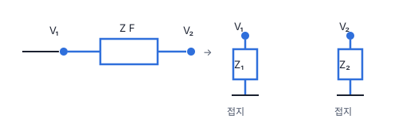
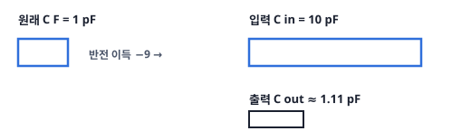
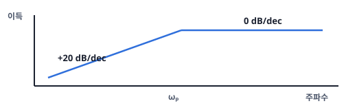
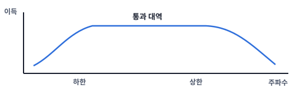
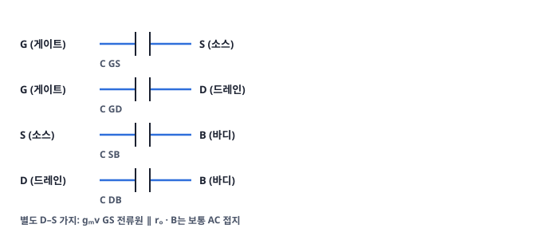
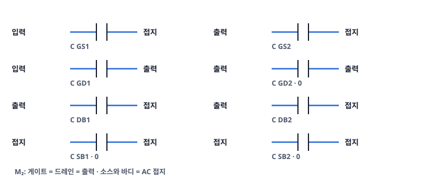
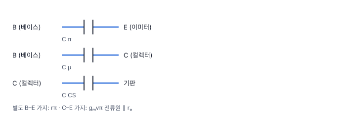
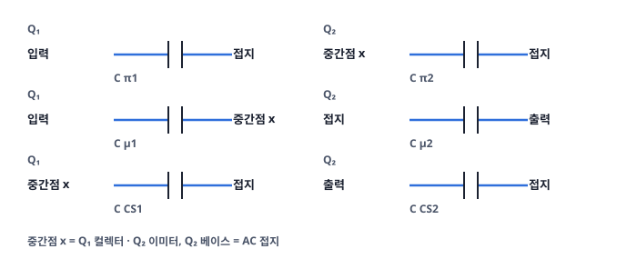

# 밀러 정리와 트랜지스터 고주파 모델 — 5살도 이해하는 정리노트

권익진 교수님 전자회로2 · 1016 수업 (Lec5 12–23쪽, Razavi 11장) · 시험범위 상한: Lec5 23쪽

> `정리노트_1016_Miller_High_Frequency_Models.html`를 마크다운으로 옮겼어요. 그림은 `figures_1016/` 폴더의 SVG, 위젯은 대표 설정의 정적 그림으로 바꿨어요. 수식은 `$…$` / `$$…$$`라서 GitHub, Obsidian, Typora에서 보여요.

**목차**

- [들어가며: 왜 이런 회로를 쓸까](#why)
  - [왜 이런 회로를 쓸까](#why-circuit)
- [1. 밀러 정리와 근사](#s0)
  - [떠 있는 임피던스를 접지로 옮기기](#s0-miller)
  - [반전 이득이 커패시턴스를 키워요](#s0-multiplication)
  - [CS 예제: 저주파 이득으로 극점을 추정하기](#s0-poles)
- [2. 저주파 끝과 AC 결합](#s1)
  - [직렬 커패시터는 저주파를 막아요](#s1-highpass)
  - [바이어스를 분리하면 저주파 대가가 생겨요](#s1-coupling)
  - [증폭기의 통과 대역은 두 끝으로 정해요](#s1-bandwidth)
- [3. MOS 고주파 모델](#s2)
  - [MOS의 네 커패시턴스](#s2-mos)
  - [다이오드 연결 부하: 두 끝의 노드부터 확인해요](#s2-mos-example)
- [4. BJT 고주파 모델](#s3)
  - [BJT에는 세 커패시턴스를 더해요](#s3-bjt)
  - [캐스코드: 여섯 커패시턴스의 자리](#s3-cascode)
- [5. 요약 · 예고](#s4)
  - [시험범위 핵심 식](#s4-cheatsheet)
  - [다음 시간 예고](#s4-next)
  - [함께 보면 좋은 자료](#s4-links)

## 들어가며: 왜 이런 회로를 쓸까

### 왜 이런 회로를 쓸까

*1016 수업 · L05 s11–23*

**쉽게 말하면**

빠른 신호를 얼마나 잘 증폭하는지 알려면, 회로 안에서 전하를 저장하는 커패시턴스까지 봐야 해요.

*이득이 커도 필요한 주파수까지 통과해야 쓸 수 있어요.*

**정확히 말하면**

**풀고 싶은 문제:** 증폭기의 저주파 이득뿐 아니라 주파수 응답과 대역폭을 알고 싶어요. 내부 커패시턴스는 주파수가 높아지면 전류를 흘려서 이득을 바꿔요. [MOS의 네 커패시턴스](#s2-mos)와 [BJT의 세 커패시턴스](#s3-bjt)에서 원인을 확인해요. [다이오드 연결 부하](#s2-mos-example)와 [BJT 캐스코드](#s3-cascode)에 적용해 어느 커패시터가 남는지도 확인해요.

**단순한 해법과 한계:** 각 노드의 저항과 접지 커패시턴스로 극점을 추정할 수 있지만, 입력과 출력 사이의 커패시터는 양 끝이 함께 움직여요. [밀러 정리](#s0-miller)가 이 부유 임피던스를 다뤄요.

**핵심 아이디어:** 같은 단자 전류를 만드는 접지 임피던스로 바꾼 뒤, 노드별 RC와 주파수 응답을 연결해요. 예를 들어 반전 이득 크기가 10이면 입력 쪽 커패시턴스는 원래의 11배로 보여요. [밀러 효과](#s0-multiplication)에서 작은 예시로 확인해요.

**대가와 쓰이는 곳:** 이득을 키우면 밀러 입력 커패시턴스가 커져 속도가 제한될 수 있어요. 여러 증폭단의 바이어스를 독립적으로 정하려고 쓰는 AC 결합은 저주파 신호를 줄이는 대가도 있어요. [AC 결합](#s1-coupling)과 [통과 대역](#s1-bandwidth)을 함께 봐요.

**교수님 말씀**

> “DC 바이어스를 분리하기 위해서.” (1016 Part 04)

AC 결합을 쓰는 목적이에요. 커패시턴스를 고려해 극점을 파악하는 것이 고주파 해석의 출발점이라는 설명도 이어졌어요(1016 Part 06).

**페이지 요약**

입력–출력 사이 부유 커패시터는 양 끝이 함께 움직이므로 같은 단자 전류의 밀러 접지 등가로 바꿔요. 반전 이득이 커지면 입력 등가 커패시턴스가 커져 속도·대역폭이 제한될 수 있어요.

AC 결합은 증폭단의 DC 바이어스를 따로 정하게 하지만 큰 결합 커패시터가 필요하고 저주파 신호가 약해져요.

커패시턴스의 자리와 밀러 효과를 알아야 쓸 수 있는 대역폭을 판단해요.

*용어*

- **주파수 응답** — 주파수에 따라 변하는 증폭 특성이에요.
- **대역폭** — 필요한 이득으로 신호를 전달하는 주파수 범위예요.

---

## 1. 밀러 정리와 근사

### 떠 있는 임피던스를 접지로 옮기기

*1016 수업 · L05 s11–12*

**쉽게 말하면**

두 노드를 잇는 $Z_F$를 각 노드에서 접지로 가는 두 임피던스로 바꾸면, 각 노드의 전류를 더 쉽게 살필 수 있어요.

예를 들어 두 노드 전압이 $V_1=1\,\mathrm{V}$, $V_2=-2\,\mathrm{V}$라면, 원래 연결에는 $3\,\mathrm{V}$가 걸려 입력 쪽에서 $3/Z_F$의 전류가 흘러요.

*같은 노드 전압과 그 임피던스로 흐르는 전류를 유지하도록 바꿔요.*

**정확히 말하면**

작은 예시에서 $A_v=V_2/V_1=-2$이므로 $Z_1=Z_F/(1-A_v)=Z_F/3$이에요. 그러면 입력의 접지 방향 전류 $V_1/Z_1=3/Z_F$가 원래 전류와 같아요. 이 변환이 밀러 정리(Miller's theorem)예요.

1. 원래 부유 임피던스(floating impedance)를 지나는 입력 쪽 전류는

   $$
   I_1=\frac{V_1-V_2}{Z_F}
   $$

   예요.
2. 입력 노드에서 접지로 바꾼 전류 $I_1=V_1/Z_1$과 같게 놓으면

   $$
   Z_1=\frac{V_1Z_F}{V_1-V_2}=\frac{Z_F}{1-A_v},\qquad A_v=\frac{V_2}{V_1}
   $$

   가 돼요.
3. 출력 쪽도 $I_2=(V_2-V_1)/Z_F=V_2/Z_2$로 놓으면

   $$
   Z_2=\frac{V_2Z_F}{V_2-V_1}=\frac{Z_F}{1-1/A_v}
   $$

   예요.

$A_v$는 두 노드의 실제 전압비예요. 주파수에 따른 $A_v$를 그대로 사용하면 이 노드 전류의 등가 관계가 성립해요. 이를 상수 저주파 이득으로 바꾸는 단계는 [CS 예제: 저주파 이득으로 극점을 추정하기](#s0-poles)의 밀러 근사예요.

**교수님 말씀**

교수님은 변환 뒤에도 전압과 전류가 같아야 한다고 강조했어요. 이를 입력과 출력 양쪽에서 각각 확인한 뒤 식을 세웠어요. (1016 Part 01–02)

**페이지 요약**

$A_v$는 두 노드의 실제 전압비이며 주파수에 따라 바뀔 수 있어요. 이를 저주파 상수로 대신하는 단계부터 밀러 근사예요.

부유 $Z_F$를 양쪽 노드에서 같은 전류가 흐르도록 접지 임피던스로 바꿔요.

*핵심 식*

- 입력

  $$
  Z_1=\frac{Z_F}{1-A_v}
  $$
- 출력

  $$
  Z_2=\frac{Z_F}{1-1/A_v}
  $$

*용어*

- **밀러 정리 (Miller's theorem)** — 두 노드 사이의 임피던스를 각 노드와 접지 사이의 임피던스로 바꾸는 등가 관계예요.
- **전압 이득 $A_v$** — 두 노드의 전압비 $V_2/V_1$예요.

---

### 반전 이득이 커패시턴스를 키워요

*1016 수업 · L05 s13*

**쉽게 말하면**

반전 증폭기의 입력과 출력 사이 커패시터는 입력에서 실제 값보다 크게 보이고, 입력이 반응할 수 있는 주파수 범위를 줄여요.

이득이 $-9$이고 $C_F=1\,\mathrm{pF}$이면 입력에서는 $10\,\mathrm{pF}$, 출력에서는 약 $1.11\,\mathrm{pF}$처럼 보여요.

*긴 입력 테두리는 등가 커패시턴스가 커졌다는 뜻이에요.*

**정확히 말하면**

예시의 $A_v=-9$를 대입하면 $C_{in}=(1-A_v)C_F=10C_F$, $C_{out}=(1-1/A_v)C_F=(10/9)C_F$예요. 입력 쪽 증가를 밀러 효과(Miller effect) 또는 밀러 증배(Miller multiplication)라고 해요.

1. 커패시터의 부유 임피던스는

   $$
   Z_F=\frac{1}{sC_F}
   $$

   예요.
2. [떠 있는 임피던스를 접지로 옮기기](#s0-miller)의 입력 식에 대입하면

   $$
   Z_1=\frac{1}{s(1-A_v)C_F}=\frac{1}{sC_{in}},\qquad C_{in}=(1-A_v)C_F
   $$

   예요.
3. 출력에서도

   $$
   Z_2=\frac{1}{s(1-1/A_v)C_F}=\frac{1}{sC_{out}},\qquad C_{out}=(1-1/A_v)C_F
   $$

   가 돼요.
4. 반전 이득을 $A_v=-A_0$ ($A_0\gt0$)로 쓰면

   $$
   C_{in}=(1+A_0)C_F,\qquad C_{out}=(1+1/A_0)C_F
   $$

   예요. $A_0\gg1$이면 입력은 약 $A_0C_F$, 출력은 약 $C_F$예요.

같은 입력 저항이라면 $C_{in}$이 커질수록 입력 RC 극점은 내려가요. 그래서 이득을 키우면 동작 속도와 대역폭이 줄 수 있어요. 실제 MOS에서는 게이트와 드레인 사이 커패시턴스가 $C_F$ 역할을 해요.

**교수님 말씀**

교수님은 “이득이 크면 클수록 커패시턴스가 더 크게 보이죠?”라고 물었어요. 이어 입력 극점이 내려가는 이득과 속도의 상충 관계를 강조했어요. (1016 Part 02–03)

**꼭 기억해요**

> “이득이 크면 클수록 커패시턴스가 더 크게 보이고 폴 주파수는 더 떨어집니다.” (1016 Part 03)

**페이지 요약**

$A_0=-A_v>0$이고 $A_0\gg1$이면 입력은 약 $A_0C_F$, 출력은 약 $C_F$예요. 같은 입력 저항에서 커패시턴스가 커지면 RC 극점이 내려가 대역폭이 줄 수 있어요.

반전 이득이 클수록 입력에서 보이는 커패시턴스가 커져요.

*핵심 식*

- 입력

  $$
  C_{in}=(1+A_0)C_F
  $$
- 출력

  $$
  C_{out}=(1+1/A_0)C_F
  $$

*용어*

- **밀러 효과 (Miller effect)** — 반전 이득 때문에 부유 커패시터가 입력에서 크게 보이는 현상이에요.

---

### CS 예제: 저주파 이득으로 극점을 추정하기

*1016 수업 · L05 s14*

**쉽게 말하면**

CS 증폭기에서는 앞단의 $R_S$와 커진 입력 커패시턴스가 입력 반응 속도를 정하고, 부하 $R_D$와 출력 커패시턴스가 출력 반응 속도를 정해요.

$g_mR_D=9$, $C_F=1\,\mathrm{pF}$, $R_S=1\,\mathrm{k\Omega}$이면 입력의 추정 각주파수는 $10^8\,\mathrm{rad/s}$예요.

*각 쪽의 저항과 등가 커패시턴스의 곱이 커지면 추정 극점이 내려가요.*

**정확히 말하면**

예시에서 저주파 $A_v\approx-g_mR_D=-9$를 넣으면 $C_{in}\approx10\,\mathrm{pF}$예요. 따라서 $\omega_{in}\approx1/(R_SC_{in})=10^8\,\mathrm{rad/s}$이고, $f_{in}\approx15.9\,\mathrm{MHz}$예요. 이것은 밀러 근사(Miller approximation)로 얻은 추정치예요.

1. CS의 소신호 등가회로에서 앞단 출력저항이 $R_S$, 출력 부하가 $R_D$이고, 게이트에서 드레인까지 $C_F$가 놓여요. $r_O$는 $R_D$에 비해 충분히 커서 이 예제에서는 무시해요.
2. 저주파 이득 $A_v\approx-g_mR_D$를 밀러 식에 넣으면

   $$
   C_{in}\approx(1+g_mR_D)C_F
   $$

   $$
   C_{out}\approx\left(1+\frac{1}{g_mR_D}\right)C_F
   $$

   예요.
3. 각 노드의 RC로부터

   $$
   \omega_{in}\approx\frac{1}{R_S(1+g_mR_D)C_F}
   $$

   $$
   \omega_{out}\approx\frac{1}{R_D\left(1+1/(g_mR_D)\right)C_F}
   $$

   를 추정해요.

실제 $A_v$는 주파수에 따라 바뀌어요. 그 값을 저주파 상수로 대신한 순간부터 근사이며, 고주파에서 오차가 커질 수 있어요. 특히 이 예제처럼 원래 부유 커패시터가 하나인 단순화 회로에서 위의 두 값은 편의를 위한 입력·출력 RC 추정치예요. 물리적 회로에 정확한 극점이 두 개 생겼다는 뜻은 아니에요. 이 근사는 고주파 영점도 예측하지 못해요.

**교수님 말씀**

교수님은 $R_S$가 앞단의 출력 임피던스라서 실제 연결 뒤 입력 극점을 구하려면 포함해야 한다고 했어요. “저주파 이득을 넣었죠”라고 짚으며 근사 오차도 강조했어요. (1016 Part 03–04)

**페이지 요약**

$r_O\gg R_D$로 무시한 예제예요. 원래 $C_F$ 하나에 대한 두 RC 값은 추정치이며 정확한 두 극점을 뜻하지 않고, 고주파 영점도 예측하지 못해요.

$R_S$, $R_D$와 밀러 등가 커패시턴스로 RC 극점을 추정해요.

*핵심 식*

- 입력 추정

  $$
  \omega_{in}\approx\frac{1}{R_SC_{in}}
  $$
- 출력 추정

  $$
  \omega_{out}\approx\frac{1}{R_DC_{out}}
  $$

*용어*

- **밀러 근사 (Miller approximation)** — 주파수에 따라 달라지는 이득을 저주파 이득으로 대신해 RC 극점을 추정해요.

---

## 2. 저주파 끝과 AC 결합

### 직렬 커패시터는 저주파를 막아요

*1016 수업 · L05 s15*

**쉽게 말하면**

커패시터를 신호 길에 직렬로 넣으면 DC와 낮은 주파수는 약해지고, 높은 주파수는 저항 $R_1$까지 전달돼요.

$R_1=1\,\mathrm{k\Omega}$, $C_1=1\,\mathrm{\mu F}$이면 경계는 약 $159\,\mathrm{Hz}$이고, 그 아래에서는 주파수가 10배 오를 때 이득의 dB 값이 약 $20\,\mathrm{dB}$ 올라요.

*원점의 영점이 기울기를 +20으로 만들고, 경계의 극점이 −20을 더해 이후 기울기를 0으로 만들어요.*

**정확히 말하면**

예시의 경계 각주파수는 $\omega_p=1/(R_1C_1)=1000\,\mathrm{rad/s}$이고, $f_p=\omega_p/(2\pi)\approx159\,\mathrm{Hz}$예요. $f=159\,\mathrm{Hz}$에서 이득의 크기는 통과 대역 값 1의 $1/\sqrt2$예요. 이때 이득 수준은 약 $-3\,\mathrm{dB}$이며, 기울기가 즉시 $20\,\mathrm{dB}$ 떨어진다는 뜻은 아니에요.

1. 입력 → 직렬 $C_1$ → 출력 노드 → $R_1$ → 접지 순으로 잇고, 출력은 $R_1$ 양단에서 재요. 전압 분배를 적용하면

   $$
   H(s)=\frac{V_{out}}{V_{in}}=\frac{R_1}{R_1+1/(sC_1)}=\frac{sR_1C_1}{1+sR_1C_1}
   $$

   예요.
2. 분자에 $s$가 있으므로 원점($s=0$)에 영점(zero)이 있어요. 분모의 극점은 $\omega_p=1/(R_1C_1)$예요.
3. 크기는

   $$
   |H(j\omega)|=\frac{\omega R_1C_1}{\sqrt{1+(\omega R_1C_1)^2}}
   $$

   예요. $\omega\to0$에서는 0, $\omega\to\infty$에서는 1이 돼 고역통과(high-pass)예요.
4. 직선 보드 근사에서 원점의 영점은 저주파 쪽 기울기를 $+20\,\mathrm{dB/dec}$로 만들어요. $\omega_p$를 지나면 극점이 기울기에 $-20\,\mathrm{dB/dec}$를 더해 $0\,\mathrm{dB/dec}$가 돼요. 실제 곡선은 경계 근처에서 부드럽게 이어져요.

**교수님 말씀**

교수님은 “제로가 0에 있으니까” 낮은 주파수에서 $+20\,\mathrm{dB/dec}$로 시작한다고 설명했어요. 극점을 만나면 이후 기울기가 0이 된다고 보드 선도를 따라 짚었어요. (1016 Part 04)

**페이지 요약**

원점 영점 때문에 저주파 기울기는 $+20\,\mathrm{dB/dec}$이고 극점 이후는 0이에요. 경계의 이득 수준이 약 −3 dB인 것이며 기울기가 20 dB만큼 즉시 떨어진다는 뜻은 아니에요.

직렬 커패시터와 $R_1$은 낮은 주파수를 줄이는 고역통과를 만들어요.

*핵심 식*

- 전달 함수

  $$
  H(s)=\frac{sR_1C_1}{1+sR_1C_1}
  $$
- 경계

  $$
  \omega_p=\frac{1}{R_1C_1}
  $$

*용어*

- **원점의 영점 (zero at origin)** — $s=0$에서 전달 함수가 0이에요.
- **고역통과 (high-pass)** — 저주파는 약하게, 고주파는 강하게 통과해요.

---

### 바이어스를 분리하면 저주파 대가가 생겨요

*1016 수업 · L05 s16*

**쉽게 말하면**

두 증폭기 사이에 커패시터를 끼우는 AC 결합은 신호를 넘기면서 두 단의 DC 바이어스를 따로 정하게 해요.

두 단을 선으로 직접 붙이면 앞단의 출력 DC 전압이 뒷단 입력에도 걸리지만, 커패시터를 끼우면 DC 전류 길이 끊겨요.

*AC 결합은 바이어스 독립성을 얻지만 큰 결합 커패시터와 각 단의 바이어스가 필요해요.*

**정확히 말하면**

예를 들어 CS 단의 드레인 출력 DC 전압이 $V_{DD}-I_DR_D$라면, 직접 결합(direct coupling)한 다음 단 게이트의 DC 전압도 그 값의 영향을 받아요. AC 결합(AC coupling)에서는 직렬 결합 커패시터가 DC에 개방회로로 보이므로 두 단이 각자의 바이어스(bias) 동작점을 정할 수 있어요.

신호 주파수에서는 $|Z_C|=1/(\omega C)$예요. 동작 대역에서 이 임피던스가 충분히 작도록 보통 큰 결합 커패시터를 써요. 그 대신 낮은 주파수에서는 $|Z_C|$가 커져 신호가 약해져요. [직렬 커패시터는 저주파를 막아요](#s1-highpass)의 고역통과가 단간 결합에서 나타나는 이유예요.

**교수님 말씀**

교수님은 두 사람이 각각 설계한 단을 아무 조율 없이 직접 붙이면 바이어스가 서로 영향을 줄 수 있다고 비유했어요. “DC 바이어스를 분리하기 위해서” 커패시터를 쓴다고 했어요. (1016 Part 04–05)

**페이지 요약**

동작 대역에서 $|Z_C|$가 충분히 작도록 큰 결합 커패시터를 쓰고 각 단에 자체 바이어스를 정해야 해요.

AC 결합은 단간 바이어스를 분리하지만 낮은 주파수의 신호를 약하게 해요.

*핵심 식*

- 커패시터 임피던스 크기

  $$
  |Z_C|=1/(\omega C)
  $$

*용어*

- **AC 결합 (AC coupling)** — 단 사이의 직렬 커패시터로 AC 신호를 넘기고 DC 바이어스를 분리해요.
- **직접 결합 (direct coupling)** — 단을 바로 이어 앞단 출력 DC 전압이 뒷단 입력에 걸려요.

---

### 증폭기의 통과 대역은 두 끝으로 정해요

*1016 수업 · L05 s17*

**쉽게 말하면**

결합 커패시터는 낮은 쪽에서, 트랜지스터 내부 커패시턴스는 높은 쪽에서 이득을 낮춰 증폭기가 쓸 수 있는 주파수 구간을 정해요.

하한이 $10\,\mathrm{Hz}$이고 상한이 $1\,\mathrm{MHz}$라면 그 사이가 통과 대역이며, 대역폭은 약 $1\,\mathrm{MHz}$예요.

*그림의 구부러진 선은 양 끝에서 이득이 부드럽게 줄어드는 모습을 나타내요.*

**정확히 말하면**

예시처럼 하한 주파수(lower corner) $f_L=10\,\mathrm{Hz}$, 상한 주파수(upper corner) $f_H=1\,\mathrm{MHz}$라면 통과 대역의 폭은 $BW=f_H-f_L\approx1\,\mathrm{MHz}$예요. 각 경계는 가운데 통과 대역의 이득보다 크기가 $1/\sqrt2$로 줄어드는 $-3\,\mathrm{dB}$ 지점을 뜻해요.

결합 커패시터를 크게 만들면 [직렬 커패시터는 저주파를 막아요](#s1-highpass)의 $1/(R_1C_1)$가 작아져 하한을 내릴 수 있어요. 반대로 상한을 올리려면 내부 커패시턴스의 영향이 작아져야 해요. 교수님은 이 내부 커패시턴스를 줄이기가 어렵고, 그래서 고주파 동작 한계가 더 중요한 설계 문제라고 설명했어요.

실제 회로의 여러 결합 커패시터와 내부 커패시터가 각각 주파수 응답에 기여할 수 있어요. 이 그림은 저주파 감소 → 가운데 통과 → 고주파 감소라는 전체 모양을 보여 줘요.

**교수님 말씀**

교수님은 큰 커패시터로 하한을 낮추는 쪽보다 “이걸 높이는 건 어려워요”라며 상한을 높이는 어려움을 강조했어요. (1016 Part 05)

**페이지 요약**

결합 커패시터가 저주파 하한을, 내부 커패시턴스가 고주파 상한을 제한해요. 결합 커패시터를 키우면 하한을 내릴 수 있지만 내부 커패시턴스 영향을 줄여 상한을 올리기는 어려워요.

하한과 상한 사이가 통과 대역이고, 두 경계의 차이가 대역폭이에요.

*핵심 식*

- 대역폭

  $$
  BW=f_H-f_L
  $$

*용어*

- **하한 (lower corner)** — 저주파 쪽에서 통과 대역 이득보다 $3\,\mathrm{dB}$ 낮아진 경계예요.
- **상한 (upper corner)** — 고주파 쪽에서 통과 대역 이득보다 $3\,\mathrm{dB}$ 낮아진 경계예요.
- **대역폭 (bandwidth)** — 하한부터 상한까지의 주파수 폭이에요.

---

## 3. MOS 고주파 모델

### MOS의 네 커패시턴스

*1016 수업 · L05 s18–19*

**쉽게 말하면**

MOS 안의 절연층과 접합부는 전하를 저장해서, 주파수가 높아질수록 신호가 지나갈 새 길을 만들어요.

게이트에서 소스·드레인으로 두 길, 소스·드레인에서 바디로 두 길을 먼저 찾으면 돼요.

*고주파 등가회로에서는 원래의 전류원·출력저항에 네 커패시터를 더해요.*

**정확히 말하면**

게이트 산화막(gate oxide)은 게이트와 채널 사이의 절연체예요. 게이트와 소스·드레인이 겹치는 영역에는 오버랩 커패시턴스(overlap capacitance)가 생겨요. 소스·드레인과 바디의 pn 접합에는 접합 커패시턴스(junction capacitance)가 생겨요. 바디(bulk, substrate)는 보통 AC 접지로 놓아요.

1. 포화 영역에서는 채널의 게이트 커패시턴스가 주로 소스 쪽에 배분되어 채널 성분 $C_{GS}\approx\frac{2}{3}C_{gate}$, 채널 성분 $C_{GD}\approx0$으로 보아요.
2. 그러나 게이트–드레인 오버랩 성분은 남아요. 따라서 전체 $C_{GD}$를 0으로 지우면 안 돼요. 전체 $C_{GS}$에는 채널 성분과 오버랩 성분이 함께 들어가요.
3. $C_{GS}$는 게이트–소스, $C_{GD}$는 게이트–드레인, $C_{SB}$는 소스–바디, $C_{DB}$는 드레인–바디 사이에 놓아요. $C_{SB}$와 $C_{DB}$는 접합 커패시턴스예요.

고주파 소신호 등가회로(high-frequency small-signal model)의 드레인–소스 가지에는 $r_O$와 드레인에서 소스로 향하는 종속 전류원 $g_mv_{GS}$가 병렬로 남아요. 여기에 네 커패시터를 각 노드 쌍에 연결해요. 낮은 주파수에서는 $|1/(j\omega C)|$가 커서 커패시터를 개방으로 근사했지만, 주파수가 올라가면 임피던스가 줄어 그 근사를 쓸 수 없어요. 이는 저주파 모델에 기생 커패시턴스를 포함한 더 일반적인 소신호 모델이에요.

공통 소스 증폭기의 입력 게이트와 출력 드레인 사이 $C_{GD}$는 부유 커패시터(floating capacitor)예요. 보통 $C_{GS}$가 큰 편이지만, $C_{GD}$는 [밀러 효과](#s0-multiplication)로 입력에서 증폭되어 보이므로 무시할 수 없어요. 정확한 극점 계산은 먼저 이런 커패시터의 연결을 빠짐없이 찾는 데서 시작해요.

**교수님 말씀**

> “말이 사실 High-Frequency지 사실 이게 이제 제너럴한 모델이에요.”

(1016 Part 06) 저주파 모델은 이 회로에서 커패시터의 임피던스가 큰 경우예요.

> “이거 고려하지 않고 폴을 구하면 사실 뭐 별 의미가 없는 거거든요.”

(1016 Part 06) 먼저 각 커패시터의 노드를 정확히 표시하라는 강조예요.

**꼭 기억해요**

> “트랜지스터의 커패시턴스를 정확하게 고려하는 게 폴을 구하는 데 있어서 가장 핵심이에요.” (1016 Part 06)

**페이지 요약**

$C_{GS}$는 G–S, $C_{GD}$는 G–D, $C_{SB}$는 S–바디, $C_{DB}$는 D–바디 사이예요. 바디는 보통 AC 접지예요.

포화에서 채널 성분 $C_{GD}\approx0$이어도 게이트–드레인 오버랩은 남아요. 전체 $C_{GD}$는 0이 아니며 밀러 효과 때문에 작아도 중요해요.

MOS 고주파 모델에는 원래의 전류원·출력저항과 네 기생 커패시턴스가 함께 있어요.

*핵심 식*

- 포화 영역 채널 성분

  $$
  C_{GS}\approx\frac{2}{3}C_{gate}
  $$

*용어*

- **$C_{GD}$** — 게이트와 드레인 사이의 전체 커패시턴스예요.
- **$C_{DB}$** — 드레인과 바디 사이의 접합 커패시턴스예요.

---

### 다이오드 연결 부하: 두 끝의 노드부터 확인해요

*1016 수업 · L05 s20*

**쉽게 말하면**

다이오드 연결된 위쪽 MOS는 게이트와 드레인이 한 점이라, 그 사이 커패시터에는 신호 전압이 걸리지 않아요.

아래쪽 MOS의 게이트와 드레인은 서로 움직여서, 그 사이 커패시터는 그대로 남아요.

*각 커패시터를 그리기 전에 단락된 점을 한 노드로 합쳐요.*

**정확히 말하면**

L05 s20의 공통 소스 M1과 다이오드 연결(diode-connected) PMOS M2를 살펴봐요. AC 소신호에서 $V_{DD}$와 M1의 소스·바디, M2의 소스·바디는 접지예요. M1 게이트는 입력 $v_{in}$, M1 드레인과 M2 게이트·드레인은 출력 $v_{out}$이에요. 먼저 노드를 합치고 커패시터의 양 끝을 표시해요.

1. M1: $C_{GS1}$은 입력–접지, $C_{GD1}$은 입력–출력, $C_{DB1}$은 출력–접지예요. $C_{SB1}$은 접지–접지라 소신호 영향이 없어요.
2. M2: $C_{GS2}$는 출력–접지, $C_{GD2}$는 출력–출력, $C_{DB2}$는 출력–접지, $C_{SB2}$는 접지–접지예요. 같은 노드 양단인 $C_{GD2}$와 $C_{SB2}$에는 AC 전압이 걸리지 않아요.
3. 따라서 영향을 주는 접지 커패시터는 입력의 $C_{GS1}$, 출력의 $C_{DB1}+C_{DB2}+C_{GS2}$예요. 입력과 출력 사이 부유 커패시터는 $C_{GD1}$이에요.

M2의 게이트·드레인이 단락되므로 저주파에서 부하의 소신호 저항은 $1/(g_{m2}+g_{o2})$이고, $r_{O2}$를 무시하면 약 $1/g_{m2}$예요. M1의 드레인 전류원 $g_{m1}v_{GS1}$와 $r_{O1}$은 출력–접지 사이에 놓이고, M2의 $g_{m2}v_{GS2}$와 $r_{O2}$도 출력–AC 접지 사이의 병렬 가지로 나타나요. $r_{O1},r_{O2}$를 무시하는 근사에서 저주파 전압 이득은 $A_v\approx-g_{m1}/g_{m2}$예요. 커패시턴스 배치와 이득 근사는 구분해 사용해요.

**교수님 말씀**

> “게이트와 드레인 사이에 Cgd가 있긴 한데 뭐 쇼트니까 사실 없는 거나 마찬가지죠.”

(1016 Part 06) 이 말은 M2의 $C_{GD2}$를 가리켜요. M1의 $C_{GD1}$은 입력–출력 사이에 남아요.

**페이지 요약**

$C_{GS1}$은 입력–접지, $C_{GD1}$은 입력–출력에 남아요. $-g_{m1}/g_{m2}$는 $r_{O1},r_{O2}$를 무시한 저주파 이득 근사이며 커패시터 배치와 구분해요.

단락된 노드를 먼저 합치면 M2의 $C_{GD2}$가 소거되는 이유가 보여요.

*핵심 식*

- 출력 접지 커패시턴스

  $$
  C_{DB1}+C_{DB2}+C_{GS2}
  $$
- 저주파 이득 근사

  $$
  A_v\approx-g_{m1}/g_{m2}
  $$

*용어*

- **다이오드 연결** — M2의 게이트와 드레인을 같은 노드에 연결해요.
- **$C_{GD2}$** — 양 끝이 출력이라 AC 전압이 0인 커패시터예요.

---

## 4. BJT 고주파 모델

### BJT에는 세 커패시턴스를 더해요

*1016 수업 · L05 s21–22*

**쉽게 말하면**

BJT가 빠르게 움직이는 신호를 다룰 때는 베이스–이미터, 베이스–컬렉터, 컬렉터–기판 사이의 전하 저장도 회로에 넣어요.

베이스–이미터 길은 입력 저항과 나란히, 컬렉터–기판 길은 접지 쪽에 놓여요.

*저주파 하이브리드 π 모델의 저항·전류원은 남기고 세 커패시터를 더해요.*

**정확히 말하면**

BJT의 고주파 하이브리드 π 모델(high-frequency hybrid-π model)에서 $r_\pi$는 베이스–이미터 사이, $r_O$와 컬렉터에서 이미터로 흐르는 종속 전류원 $g_mv_\pi$는 컬렉터–이미터 사이에 있어요. 여기에 $C_\pi$를 베이스–이미터, $C_\mu$를 베이스–컬렉터, $C_{CS}$를 컬렉터–기판 사이에 추가해요. 집적 BJT의 기판은 보통 AC 접지예요.

1. 베이스–이미터의 접합 커패시턴스 $C_{je}$와 베이스 전하(base charge)에 따른 $C_b$를 합쳐 $C_\pi=C_{je}+C_b$로 나타내요. $C_\pi$는 $r_\pi$와 병렬이에요.
2. 베이스–컬렉터의 역바이어스 접합 커패시턴스는 $C_\mu$예요. 입력과 출력 사이에 놓이면 부유 커패시터가 돼요.
3. 집적 회로의 컬렉터–기판 접합 커패시턴스는 $C_{CS}$예요. 기판이 AC 접지라면 컬렉터–접지 커패시터예요.

BJT는 MOS와 같은 소스·드레인 대칭 구조가 아니에요. 이 모델에는 별도의 이미터–기판 커패시터를 넣지 않아요. 고주파에서는 세 커패시터의 임피던스가 작아지므로 저주파 하이브리드 π 모델처럼 개방으로 두면 안 돼요. 회로 해석에서는 물리적 생성 원인보다 어느 두 노드 사이에 커패시터가 놓이는지를 먼저 확인해요.

**교수님 말씀**

> “노드와 노드 사이에 어떻게 이제 커패시턴스가 표현되는지만 정확히 알면은”

(1016 Part 07) 교수님은 물리적 원인을 깊게 유도하기보다 각 커패시턴스의 연결 위치를 익히라고 강조했어요.

> “Cπ, Cμ 이렇게 이해를 하시면 되고요.”

(1016 Part 07) 수업에서는 베이스–이미터를 $C_\pi$, 베이스–컬렉터를 $C_\mu$로 표기해요.

**꼭 기억해요**

> “노드와 노드 사이에 어떻게 이제 커패시턴스가 표현되는지만 정확히 알면은” (1016 Part 07)

**페이지 요약**

$C_\pi$는 B–E의 $r_\pi$와 병렬, $C_\mu$는 B–C, $C_{CS}$는 C–기판이에요. $r_O$와 C→E의 $g_mv_\pi$도 그대로 남겨요.

기판은 보통 AC 접지이고 이 모델에는 별도 이미터–기판 커패시터가 없어요. 고주파에서 세 커패시터를 저주파처럼 개방으로 두지 않아요.

BJT의 저항·전류원 모델에 세 노드 쌍의 커패시턴스를 더해요.

*핵심 식*

- 베이스–이미터

  $$
  C_\pi=C_{je}+C_b
  $$

*용어*

- **$C_\mu$** — 베이스와 컬렉터 사이의 접합 커패시턴스예요.
- **$C_{CS}$** — 컬렉터와 기판 사이의 접합 커패시턴스예요.

---

### 캐스코드: 여섯 커패시턴스의 자리

*1016 수업 · L05 s23*

**쉽게 말하면**

아래 Q1과 위 Q2에 커패시터 세 개씩을 넣으면, 어느 노드끼리 이어지는지에 따라 영향이 달라져요.

Q2의 베이스는 AC 접지여도 Q1 컬렉터와 Q2 이미터가 만나는 중간점은 움직이는 노드예요.

*Q2의 베이스가 접지여도 $C_{\pi 2}$는 중간점과 접지 사이에 남아요.*

**정확히 말하면**

L05 s23의 BJT 캐스코드(cascode)에서 Q1의 베이스는 $v_{in}$, 이미터는 AC 접지예요. Q1의 컬렉터와 Q2의 이미터가 만나는 노드를 $x$라 하고, Q2의 베이스 바이어스 $V_{b1}$은 AC 접지, Q2 컬렉터는 $v_{out}$이에요. $V_{CC}$도 AC 접지로 바꾸며 $R_C$는 출력–접지 사이에 남아요.

1. Q1의 $C_{\pi 1}$: 입력–접지. $C_{\mu 1}$: 입력–$x$. $C_{CS1}$: $x$–접지예요.
2. Q2의 $C_{\pi 2}$: Q2 베이스(AC 접지)–이미터($x$). $C_{\mu 2}$: Q2 베이스(AC 접지)–컬렉터(출력). $C_{CS2}$: 출력–기판(AC 접지)이에요.
3. 따라서 $x$에 접지된 커패시터로 $C_{CS1}$과 $C_{\pi 2}$가 보이고, 출력에서는 $C_{\mu 2}$와 $C_{CS2}$가 접지로 이어져요. 입력–$x$ 사이의 $C_{\mu 1}$은 부유 커패시터예요.

정식 소신호 등가회로에서는 Q1의 $r_{\pi1}$·$C_{\pi1}$이 입력–접지에 병렬이고, Q1의 $g_{m1}v_{\pi1}$ 전류원·$r_{O1}$은 $x$–접지에 병렬이에요. Q2의 $r_{\pi2}$·$C_{\pi2}$는 $x$–AC 접지에 병렬이고, Q2의 $g_{m2}v_{\pi2}$ 전류원·$r_{O2}$는 출력–$x$에 병렬이에요. Q2의 전류원 방향은 컬렉터(출력)에서 이미터($x$)이고 $v_{\pi2}=v_{b2}-v_{e2}=0-v_x$예요. $R_C$는 출력–AC 접지예요. 두 트랜지스터의 크기가 다를 수 있으므로 모든 소자에 1·2를 붙여 구별해요.

**교수님 말씀**

> “각각의 커패시턴스가 같지 않습니다. 왜냐하면 트랜지스터의 사이즈가 다르고”

(1016 Part 07) 그래서 Q1·Q2의 여섯 커패시턴스에 번호를 붙여요. 전체 전달함수는 식이 복잡해지므로, 이 시간에는 정확한 배치부터 익혔어요.

**페이지 요약**

입력–접지는 $C_{\pi1}$, 입력–$x$는 부유 $C_{\mu1}$, $x$–접지는 $C_{CS1}+C_{\pi2}$, 출력–접지는 $C_{\mu2}+C_{CS2}$예요. 두 소자의 크기가 다를 수 있어 1·2를 구별해요.

캐스코드에서는 Q1과 Q2의 여섯 커패시터를 각각의 두 노드에 놓아요.

*핵심 식*

- Q2 제어 전압

  $$
  v_{\pi2}=v_{b2}-v_{e2}=0-v_x
  $$

*용어*

- **$C_{\pi 2}$** — Q2의 AC 접지 베이스와 중간점 $x$ 사이예요.
- **$C_{\mu 1}$** — Q1의 입력과 중간점 $x$ 사이예요.
- **AC 접지** — 소신호 전압이 0으로 고정된 노드예요.

---

## 5. 요약 · 예고

### 시험범위 핵심 식

**중간시험 상한: Lec5 23쪽, 고주파 등가모델까지예요.** 이 노트는 1016에 새로 다룬 Lec5 12–23쪽을 정리해요. 이전 수업의 범위는 이전 복습팩을 함께 확인해요.

| 상황 | 규칙 | 조건·주의 |
|---|---|---|
| 밀러 정리 | $Z_1=Z_F/(1-A_v)$ $Z_2=Z_F/(1-1/A_v)$ | 두 노드 사이 실제 전압비를 써요. |
| 반전 이득 $-A_0$ | $C_{in}=(1+A_0)C_F$ $C_{out}=(1+1/A_0)C_F$ | 저주파 이득을 고정해서 쓰면 밀러 근사예요. |
| 노드별 극점 추정 | $\omega_p\approx 1/(R_{eq}C_{eq})$ $f_p=\omega_p/(2\pi)$ | 노드 결합을 무시하거나 분리한 근사인지 확인해요. |
| RC 고역통과 | $H(s)=sRC/(1+sRC)$ | 원점 영점, 기울기 +20 → 0 dB/dec예요. |
| MOS 커패시턴스 | $C_{GS}$, $C_{GD}$, $C_{SB}$, $C_{DB}$ | 포화에서도 겹침 때문에 전체 $C_{GD}$는 0이 아니에요. |
| BJT 커패시턴스 | $C_\pi=C_b+C_{je}$, $C_\mu$, $C_{CS}$ | $C_{CS}$는 컬렉터–기판 사이예요. |
| 커패시터 소거 | $i_C=C\,d(v_a-v_b)/dt$ | 양 끝이 같은 AC 노드면 전압차가 0이라 빠져요. |

---

### 다음 시간 예고

- Lec5 24쪽: 트랜싯 주파수. 교수님이 정의를 잠깐 소개했지만 이번 중간시험 범위에서 제외했어요.
- 이후: 실제 증폭 구조의 주파수 응답, 직접 해석과 주극점 근사. 여기서는 이름만 예고하고 풀이·복습문제에 넣지 않아요.

---

### 함께 보면 좋은 자료

- [복습문제 10개 (PDF)](../복습문제_1016_Miller_High_Frequency_Models-문제.pdf)
- [답안 (PDF)](../복습문제_1016_Miller_High_Frequency_Models-답안.pdf)

구성: 밀러 정리 4문항, 통과 대역 2문항, MOS 모델 2문항, BJT 모델 2문항이에요. 전제 예제와 이어지는 연습문제는 함께 실었어요.

---

출처: 권익진 교수님 강의자료 Lec5 11–23쪽 · 수업 녹음 전사 1016 · B. Razavi, *Microelectronics*, 2nd ed., 11장. 전사본에 시각이 없어 인용 위치는 Part 번호로 표시해요.
