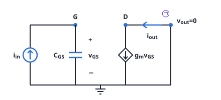
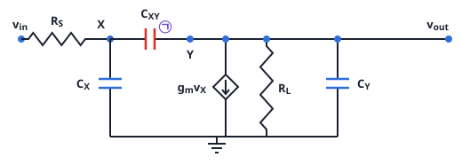
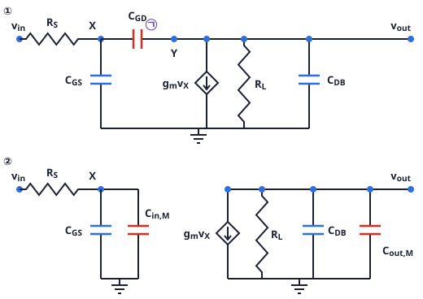
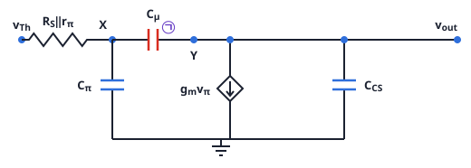

# 전자회로2 복습 1028 문제설명

주어진 조건을 읽고, 첫 줄을 쓰고, 이유를 따라가며 답을 확인해요.

문제의 첫 줄부터 검산까지 설명해요.

**목차**

- [문항별 설명](#problems)
  - [P1. MOSFET f_T의 정의와 ω_T 식 (2023-1 기말 6)](#p1)
  - [P2. 채널 길이·과구동 전압 축소에 따른 f_T 증가 배수](#p2)
  - [P3. 채널 길이를 2배로 늘린 MOSFET의 폭과 f_T](#p3)
  - [P4. 과구동 전압을 절반으로 줄일 때의 f_T 변화](#p4)
  - [P5. 폭과 바이어스 전류가 절반인 CS 단의 이득과 극점](#p5)
  - [P6. 부하가 다른 세 CS 단의 밀러 입력·출력 극점](#p6)
  - [P7. CE 단의 밀러 극점과 대역폭을 제한하는 노드](#p7)
  - [P8. pnp 전류원 부하 CE 단의 입력·출력 극점 (2021-1 기말 2)](#p8)
  - [P9. 입력 극점 500 MHz·출력 극점 2 GHz CE 단 설계](#p9)
  - [P10. 게이트를 묶은 NMOS·PMOS 단의 전달 함수 (직접 해석)](#p10)
  - [P11. CS 단: 밀러 근사·정확한 전달 함수·주극점 근사 비교](#p11)
  - [P12. 수치가 주어진 CS 단의 밀러 극점과 정확한 극점 비교](#p12)
  - [P13. 전류원 부하 CS 단의 주극점 근사](#p13)
  - [P14. 전류원 부하 CE 증폭기: 밀러 근사와 정확한 극점](#p14)
  - [P15. 전류원 부하 CE 증폭기의 주극점 근사 비교](#p15)

## 문항별 설명

### P1. MOSFET f_T의 정의와 ω_T 식 (2023-1 기말 6)

2023-1_기말-Q6 · 기출 6 · [원 문제 보기](../%EB%B3%B5%EC%8A%B5%EB%AC%B8%EC%A0%9C_1028_CS_Stage_Frequency_Response-%EB%AC%B8%EC%A0%9C.pdf)

#### 주어진 조건

- MOSFET은 saturation 영역에서 동작
- $C_{GD}$는 무시
- 둘째 식에서는 $C_{GS} = (2/3)WLC_{ox}$
- 식을 구하는 과정이 없으면 점수를 주지 않음

#### 구할 것

- MOSFET의 transit frequency ($f_T$)의 정의를 설명
- 그 정의를 이용해 $\omega_T\ (= 2\pi f_T)$의 식을 구함
- $C_{GS} = (2/3)WLC_{ox}$일 때 $\omega_T\ (= 2\pi f_T)$의 식을 $\mu_n$, $L$ (channel length), $V_{GS} - V_{TH}$로 나타냄

원문 보기

MOSFET에서 transit frequency($f_T$)의 정의를 설명하고, 이를 이용하여 $\omega_T\ (= 2\pi f_T)$의 식을 구하시오. 그리고, $C_{GS} = (2/3)WLC_{ox}$일 때, $\omega_T\ (= 2\pi f_T)$의 식을 $\mu_n$, $L$ (channel length), $V_{GS} - V_{TH}$에 관한 식으로 구하시오. 단, MOSFET은 saturation 영역에서 동작하고, $C_{GD}$는 무시한다. (식을 구하는 과정이 없으면 점수 미부여)

#### 문제를 읽어요

포화 영역의 MOSFET 하나만 놓고 "이 소자가 얼마나 빠른가"를 묻는 문제예요. 회로 그림은 없고, 우리가 직접 시험 회로를 정해야 해요.

구할 것은 세 가지예요. 첫째 $f_T$의 정의, 둘째 그 정의에서 나오는 $\omega_T=2\pi f_T$ 식, 셋째 $C_{GS}=(2/3)WLC_{ox}$를 넣어 $\mu_n$, $L$, $V_{GS}-V_{TH}$만 남긴 식이에요.

조건은 두 개예요. $C_{GD}$는 무시하고, 식을 구하는 과정이 없으면 점수가 없으니 첫 식부터 차례로 써야 해요.

#### 이 개념과 공식을 떠올려요

**단서:** "transit frequency"라는 말은 [트랜싯 주파수(transit frequency)](../%EC%A0%95%EB%A6%AC%EB%85%B8%ED%8A%B8_1028_CS_Stage_Frequency_Response.html#s0-ft-mos)를 불러요. 소자 하나의 속도를 재는 표준 실험이 있어요.

**개념:** 게이트에 소신호 전류 $i_{in}$을 넣고 드레인을 AC 접지에 단락한 채, 드레인 전류 $i_{out}$이 $i_{in}$보다 몇 배인지 봐요. 주파수가 오르면 게이트 커패시턴스가 전류를 많이 받아 가므로 전류 이득이 줄어요. 이 전류 이득의 크기가 1이 되는 주파수가 $f_T$예요.

**기호의 뜻:** $g_m$은 게이트–소스 전압 변화가 드레인 전류를 얼마나 바꾸는지(트랜스컨덕턴스), $C_{GS}$는 게이트–소스 커패시턴스, $\mu_n$은 전자 이동도, $C_{ox}$는 단위 면적당 산화막 커패시턴스예요.

**근사 조건:** 문제가 $C_{GD}$를 무시하라고 했으니 게이트 전류는 전부 $C_{GS}$로 흘러요. 드레인이 AC 접지라 $r_o$에는 전압이 걸리지 않아 결과에 나타나지 않아요. 포화 영역이므로 $g_m=\mu_nC_{ox}\dfrac{W}{L}(V_{GS}-V_{TH})$를 써요.

**선택 이유:** 정의가 "전류 이득 = 1"이므로 입력 전류와 출력 전류를 같은 $v_{GS}$로 쓰는 두 식이면 바로 비가 나와요. 등가회로 하나로 정의·식·대입을 모두 이어 갈 수 있어요.

#### 종이에 쓸 첫 줄

게이트에 소신호 전류원 $i_{in}$을 걸고, 드레인은 오른쪽에서 접지로 단락해요. 소스도 접지예요. $C_{GD}$는 문제 조건대로 빼요.

*소스는 접지, 드레인은 오른쪽 단락선으로 AC 접지해요. $C_{GD}$는 문제 조건대로 빼고 트랜지스터를 $C_{GS}$와 $g_mv_{GS}$로 바꿨어요.*

게이트 노드 G의 KCL: 들어온 전류는 모두 $C_{GS}$로 흘러요.

$$
I_{in}=sC_{GS}V_{GS}
$$

드레인 노드 D: 출력이 단락이라 $v_{out}=0$이고, 단락선으로 들어오는 전류가 종속원 전류와 같아요.

$$
I_{out}=g_mV_{GS}
$$

#### 이렇게 풀어요

드레인을 AC 접지에 단락하고 게이트에 소신호 전류를 넣었을 때, 소신호 전류 이득 $|I_{out}/I_{in}|$이 1로 떨어지는 주파수를 $f_T$라고 정의해요.

두 첫 식을 나누면 $V_{GS}$가 약분돼요.

$$
\frac{I_{out}}{I_{in}}=\frac{g_mV_{GS}}{sC_{GS}V_{GS}}=\frac{g_m}{sC_{GS}}
$$

$s=j\omega$를 넣고 크기를 보면 주파수에 반비례해요.

$$
\left|\frac{I_{out}}{I_{in}}\right|=\frac{g_m}{\omega C_{GS}}
$$

이 값이 1이 되는 각주파수가 $\omega_T$예요.

$$
\omega_T=2\pi f_T=\frac{g_m}{C_{GS}}
$$

포화 영역의 $g_m$과 주어진 $C_{GS}$를 넣어요.

$$
g_m=\mu_nC_{ox}\frac{W}{L}(V_{GS}-V_{TH})
$$

$$
C_{GS}=\frac{2}{3}WLC_{ox}
$$

분자의 $W/L$과 분모의 $WL$에서 $W$와 $C_{ox}$가 약분되고 $L$이 두 번 남아요.

$$
\omega_T=\frac{\mu_nC_{ox}(W/L)(V_{GS}-V_{TH})}{(2/3)WLC_{ox}}=\frac{3\mu_n(V_{GS}-V_{TH})}{2L^2}
$$

#### 완성 답과 검산

**정의:** 드레인을 AC 접지한 MOSFET에서 소신호 전류 이득 $|I_{out}/I_{in}|$이 1이 되는 주파수가 $f_T$예요.

**식:** $\omega_T=2\pi f_T=\dfrac{g_m}{C_{GS}}$ (포화, $C_{GD}$ 무시)

**대입:** $\omega_T=\dfrac{3\mu_n(V_{GS}-V_{TH})}{2L^2}$

**단위:** $\mu_n$은 $\mathrm{m^2/(V\cdot s)}$, $V_{GS}-V_{TH}$는 $\mathrm{V}$, $L^2$은 $\mathrm{m^2}$이라 $\left[\dfrac{\mathrm{m^2}}{\mathrm{V\cdot s}}\cdot\dfrac{\mathrm{V}}{\mathrm{m^2}}\right]=[1/\mathrm{s}]$로 각주파수 단위가 맞아요. 첫 식도 $[\mathrm{S}/\mathrm{F}]=[1/\mathrm{s}]$예요.

**극한:** $\omega\to0$이면 $|I_{out}/I_{in}|\to\infty$라 직류에서는 게이트 전류가 0인 MOS의 성질과 맞아요. $\omega=\omega_T$에서 정확히 1이에요.

**약분 확인:** 결과에 $W$와 $C_{ox}$가 없어요. 폭을 키우면 $g_m$과 $C_{GS}$가 같은 비율로 커지므로 속도는 그대로라는 뜻이라 물리적으로 맞아요.

#### 주의할 점

드레인에 부하 저항을 둔 채 전압 이득으로 정의하면 $f_T$가 아니에요. 정의의 출력은 **드레인 단락 전류**예요.

$g_m=2I_D/(V_{GS}-V_{TH})$로 넣으면 $I_D$가 남아 문제가 요구한 변수($\mu_n$, $L$, $V_{GS}-V_{TH}$)로 끝나지 않아요. 과구동 전압 형태의 $g_m$을 써야 $W$가 깨끗이 약분돼요.

$C_{GS}=(2/3)WLC_{ox}$의 $2/3$을 뒤집어 $\dfrac{2\mu_n(V_{GS}-V_{TH})}{3L^2}$로 쓰는 실수가 잦아요. $1/(2/3)=3/2$예요.

#### 조건을 바꾸어 생각해요

1. $C_{GD}$를 무시하지 않으면 게이트 전류는 $s(C_{GS}+C_{GD})V_{GS}$가 돼요. 이때 $\omega_T$ 식의 분모는 어떻게 바뀔까요?
2. 같은 $V_{GS}-V_{TH}$에서 $L$을 절반으로 줄이면 $\omega_T$는 몇 배가 될까요?

**페이지 요약**

$f_T$는 드레인을 AC 접지했을 때 전류 이득이 1이 되는 주파수예요.

$\omega_T=\dfrac{g_m}{C_{GS}}$

$\omega_T=\dfrac{3\mu_n(V_{GS}-V_{TH})}{2L^2}$

$W$와 $C_{ox}$는 약분되고 $L^2$에 반비례해요.

---

### P2. 채널 길이·과구동 전압 축소에 따른 f_T 증가 배수

E11.14 · 예제 11.14 · [원 문제 보기](../%EB%B3%B5%EC%8A%B5%EB%AC%B8%EC%A0%9C_1028_CS_Stage_Frequency_Response-%EB%AC%B8%EC%A0%9C.pdf)

#### 주어진 조건

- MOSFET의 최소 채널 길이: 1980년대 후반 $1\ \mu\text{m}$ → 오늘날 $65\ \text{nm}$
- 공급 전압 축소로 게이트–소스 과구동 전압: 약 $400\ \text{mV}$ → $100\ \text{mV}$
- 이동도 등 다른 값은 같다고 봄

#### 구할 것

- MOSFET의 $f_T$는 몇 배나 증가했는가?

원문 보기

MOSFET의 최소 채널 길이는 1980년대 후반 $1\ \mu\text{m}$에서 오늘날 $65\ \text{nm}$로 축소되어 왔다. 또한 피할 수 없는 공급 전압의 축소는 게이트-소스 과구동 전압을 약 $400\ \text{mV}$에서 $100\ \text{mV}$로 줄게 하였다. MOSFET의 $f_T$는 몇 배나 증가했는가?

#### 문제를 읽어요

MOSFET 세대가 바뀌면서 두 값이 함께 줄었어요. 최소 채널 길이는 $1\ \mu\mathrm{m}$에서 $65\ \mathrm{nm}$로, 과구동 전압 $V_{GS}-V_{TH}$는 약 $400\ \mathrm{mV}$에서 $100\ \mathrm{mV}$로요.

구할 것은 $f_T$가 "몇 배" 커졌는지, 즉 비율 하나예요. 소자 값이 주어지지 않으니 비례 관계로 풀어요. 이동도 같은 다른 값은 그대로라고 봐요.

#### 이 개념과 공식을 떠올려요

**단서:** "채널 길이"와 "과구동 전압"이 동시에 바뀌었다는 말에서 $f_T$를 이 두 변수로 쓴 식이 필요하다는 걸 알 수 있어요.

**개념:** [$f_T$와 채널 길이의 관계](../%EC%A0%95%EB%A6%AC%EB%85%B8%ED%8A%B8_1028_CS_Stage_Frequency_Response.html#s0-ft-scaling)예요. $2\pi f_T\approx g_m/C_{GS}$에 포화 영역 $g_m$과 $C_{GS}\approx\frac{2}{3}WLC_{ox}$를 넣으면 폭 $W$가 약분된 식이 나와요.

**기호의 뜻:** $\mu_n$은 전자 이동도, $L$은 채널 길이, $V_{GS}-V_{TH}$는 과구동 전압이에요. 바뀐 뒤의 값은 $f_T^*$, $L^*$처럼 별표로 구별해요.

**근사 조건:** 장채널 제곱 법칙 모델과 $C_{GS}\approx\frac{2}{3}WLC_{ox}$를 그대로 쓰고 $\mu_n$은 고정이라고 봐요. 이 모델 안에서의 배율이라는 점을 답에 함께 적어요.

**선택 이유:** 비율만 묻기 때문에 고정 인자 $\frac{3}{2}\mu_n$은 나누면 사라져요. 변하는 두 인자의 배율만 곱하면 끝나요.

#### 종이에 쓸 첫 줄

트랜싯 주파수 식에서 고정 인자와 변하는 인자를 나눠 적어요.

$$
2\pi f_T\approx\frac{3}{2}\frac{\mu_n}{L^2}(V_{GS}-V_{TH})
$$

$\mu_n$이 같으므로 바뀐 뒤와 앞의 비는 다음과 같아요.

$$
\frac{f_T^*}{f_T}=\left(\frac{L}{L^*}\right)^2\cdot\frac{(V_{GS}-V_{TH})^*}{V_{GS}-V_{TH}}
$$

#### 이렇게 풀어요

먼저 단위를 맞춰요. $1\ \mu\mathrm{m}=1000\ \mathrm{nm}$예요.

길이 인자: $L$이 줄면 $1/L^2$로 커지므로 제곱이 붙어요.

$$
\left(\frac{L}{L^*}\right)^2=\left(\frac{1000\ \mathrm{nm}}{65\ \mathrm{nm}}\right)^2\approx236.69
$$

과구동 전압 인자: $f_T$는 과구동 전압에 비례하므로 줄어든 만큼 손해를 봐요.

$$
\frac{(V_{GS}-V_{TH})^*}{V_{GS}-V_{TH}}=\frac{100\ \mathrm{mV}}{400\ \mathrm{mV}}=\frac{1}{4}
$$

두 배율을 곱해요. 반올림 전 값 $(1000/65)^2$를 그대로 써요.

$$
\frac{f_T^*}{f_T}=\left(\frac{1000}{65}\right)^2\times\frac{1}{4}\approx59.17
$$

즉 길이 축소로 약 237배 빨라질 것을 과구동 전압 축소가 1/4로 깎아서 약 59배가 돼요.

**교과서 보충(예시 값):** 교과서는 $\mu_n=400\ \mathrm{cm^2/(V\cdot s)}=0.04\ \mathrm{m^2/(V\cdot s)}$를 가정해 새 소자의 절대값도 보여 줘요. 문제에서 준 값이 아니므로 비율 답과 구별해요.

$$
2\pi f_T^*\approx\frac{3}{2}\cdot\frac{0.04\ \mathrm{m^2/(V\cdot s)}}{(65\times10^{-9}\ \mathrm{m})^2}\cdot0.1\ \mathrm{V}\approx1.42\times10^{12}\ \mathrm{rad/s}
$$

$$
f_T^*\approx226\ \mathrm{GHz}
$$

#### 완성 답과 검산

**$f_T$는 약 59배($\approx59.17$배) 증가했어요.** ($\mu_n$ 고정, 장채널 모델 $2\pi f_T\approx\frac{3}{2}\mu_n(V_{GS}-V_{TH})/L^2$ 기준)

**역순 확인:** 과구동 전압만 1/4이 되면 $f_T$도 1/4, 길이만 $1/15.38$이 되면 $f_T$는 $236.69$배예요. 두 효과는 곱으로 합쳐지므로 $236.69/4\approx59.17$로 같아요.

**단위:** 길이 비와 전압 비가 모두 무차원이라 답도 무차원 배율이에요. 보충 값은 $[\mathrm{m^2/(V\cdot s)}\cdot\mathrm{V}/\mathrm{m^2}]=[1/\mathrm{s}]$로 각주파수 단위가 맞아요.

#### 주의할 점

$f_T\propto1/L$로 착각해 $15.38/4\approx3.85$배라고 답하는 실수가 많아요. $g_m\propto1/L$이고 $C_{GS}\propto L$이라 두 효과가 겹쳐 $1/L^2$이에요.

$g_m=2I_D/(V_{GS}-V_{TH})$로 비례를 따지면 $I_D$가 고정인지 정해지지 않아 답이 흔들려요. 과구동 전압만 주어졌으니 과구동 전압 형태의 식을 써요.

#### 조건을 바꾸어 생각해요

1. 채널 길이는 $1\ \mu\mathrm{m}$ 그대로 두고 과구동 전압만 $400\ \mathrm{mV}$에서 $100\ \mathrm{mV}$로 줄이면 $f_T$는 몇 배가 될까요?
2. 과구동 전압을 그대로 $400\ \mathrm{mV}$로 유지할 수 있었다면 $65\ \mathrm{nm}$ 소자의 $f_T$는 $1\ \mu\mathrm{m}$ 소자의 몇 배였을까요?

**페이지 요약**

$f_T$는 과구동 전압에 비례하고 $L^2$에 반비례해요.

$2\pi f_T\approx\dfrac{3}{2}\dfrac{\mu_n}{L^2}(V_{GS}-V_{TH})$

$\dfrac{f_T^*}{f_T}=\left(\dfrac{1000}{65}\right)^2\times\dfrac{1}{4}\approx59.17$

길이는 제곱으로, 과구동 전압은 1승으로 들어가요.

---

### P3. 채널 길이를 2배로 늘린 MOSFET의 폭과 f_T

P11.33 · 장말문제 11.33 · [원 문제 보기](../%EB%B3%B5%EC%8A%B5%EB%AC%B8%EC%A0%9C_1028_CS_Stage_Frequency_Response-%EB%AC%B8%EC%A0%9C.pdf)

#### 주어진 조건

- MOSFET의 채널 길이 변조를 줄이기 위해 소자 길이를 2배로 늘림

#### 구할 것

- (a) 같은 과구동 전압과 같은 드레인 전류를 유지하려면 소자 폭을 어떻게 조정해야 하는가?
- (b) 이 변화들이 트랜지스터의 $f_T$에 어떤 영향을 주는가?

원문 보기

In order to lower channel-length modulation in a MOSFET, we double the device length.

(a) How should the device width be adjusted to maintain the same overdrive voltage and the same drain current?

(b) How do these changes affect the $f_T$ of the transistor?

#### 문제를 읽어요

채널 길이 변조(channel-length modulation)를 줄이려고 MOSFET의 길이 $L$을 2배로 늘렸어요. 길이를 늘리면 다른 값도 따라 변하니, 무엇을 고정하고 무엇을 바꿀지 정해야 해요.

(a)는 과구동 전압 $V_{GS}-V_{TH}$와 드레인 전류 $I_D$를 그대로 두려면 폭 $W$를 어떻게 바꿔야 하는지 묻고, (b)는 그렇게 바꾼 소자의 $f_T$가 어떻게 되는지 물어요.

#### 이 개념과 공식을 떠올려요

**단서:** "같은 과구동 전압과 같은 드레인 전류"는 제곱 법칙 전류식의 두 변수를 고정하라는 말이에요. "$f_T$에 미치는 영향"은 [트랜싯 주파수](../%EC%A0%95%EB%A6%AC%EB%85%B8%ED%8A%B8_1028_CS_Stage_Frequency_Response.html#s0-ft-mos) 식 $2\pi f_T\approx g_m/C_{GS}$를 부르죠.

**개념:** 포화 전류 $I_D=\frac{1}{2}\mu_nC_{ox}\frac{W}{L}(V_{GS}-V_{TH})^2$에서 전류를 정하는 소자 크기는 비 $W/L$뿐이에요. $g_m$은 같은 전류·과구동 전압이면 $2I_D/(V_{GS}-V_{TH})$로 고정되고, $C_{GS}\approx\frac{2}{3}WLC_{ox}$는 게이트 면적 $WL$에 비례해요.

**기호의 뜻:** 바뀐 뒤 값은 $W^*$, $L^*$, $f_T^*$처럼 별표로 써요. $C_{ox}$와 $\mu_n$은 공정 값이라 바뀌지 않아요.

**근사 조건:** 장채널 제곱 법칙과 $C_{GS}\approx\frac{2}{3}WLC_{ox}$(포화, $C_{GD}$ 무시)를 써요. 채널 길이 변조 자체는 전류식에서 무시하고, 길이를 늘린 목적($\lambda\propto1/L$이 줄어 $r_o$가 커짐)만 배경으로 봐요.

**선택 이유:** 고정 조건을 먼저 식에 넣으면 (a)는 비 하나로 끝나고, (b)는 $g_m$과 $C_{GS}$의 배율을 따로 구해 나누면 돼요.

#### 종이에 쓸 첫 줄

고정: $I_D$, $V_{GS}-V_{TH}$, $\mu_n$, $C_{ox}$. 변함: $L^*=2L$.

$$
I_D=\frac{1}{2}\mu_nC_{ox}\frac{W}{L}(V_{GS}-V_{TH})^2=\frac{1}{2}\mu_nC_{ox}\frac{W^*}{L^*}(V_{GS}-V_{TH})^2
$$

$$
2\pi f_T\approx\frac{g_m}{C_{GS}}
$$

$$
g_m=\frac{2I_D}{V_{GS}-V_{TH}}
$$

$$
C_{GS}\approx\frac{2}{3}WLC_{ox}
$$

#### 이렇게 풀어요

#### (a) 폭의 조정

첫 줄의 두 식에서 같은 인자를 지우면 비만 남아요.

$$
\frac{W^*}{L^*}=\frac{W}{L}
$$

$L^*=2L$을 넣어요.

$$
W^*=\frac{W}{L}\cdot2L=2W
$$

따라서 폭도 2배로 늘려야 같은 전류를 같은 과구동 전압에서 흘려요.

#### (b) $f_T$의 변화

$g_m$의 두 변수가 모두 고정이라 $g_m$은 그대로예요.

$$
g_m^*=\frac{2I_D}{V_{GS}-V_{TH}}=g_m
$$

게이트 면적은 폭과 길이가 모두 2배라 4배가 돼요.

$$
C_{GS}^*\approx\frac{2}{3}(2W)(2L)C_{ox}=4C_{GS}
$$

나누면 배율이 나와요.

$$
\frac{f_T^*}{f_T}=\frac{g_m^*/C_{GS}^*}{g_m/C_{GS}}=\frac{1}{4}
$$

#### 완성 답과 검산

#### (a) 검산

**폭도 2배($W^*=2W$)로 늘려 $W/L$을 유지해요.**

$W^*/L^*=2W/2L=W/L$이라 전류식에 그대로 넣으면 같은 $V_{GS}-V_{TH}$에서 같은 $I_D$가 나와요.

#### (b) 검산

**$g_m$은 그대로, $C_{GS}$는 4배라 $f_T$는 원래의 $1/4$로 줄어요.**

다른 길로도 확인해요. $2\pi f_T\approx\frac{3}{2}\mu_n(V_{GS}-V_{TH})/L^2$에서 과구동 전압은 고정이고 $L$만 2배이므로 $1/2^2=1/4$로 같아요.

단위: $g_m/C_{GS}$는 $[\mathrm{S}/\mathrm{F}]=[1/\mathrm{s}]$이고 배율은 무차원이에요.

#### 주의할 점

"폭은 그대로 두면 되지 않나"라고 생각하면 $W/L$이 절반이 돼 같은 과구동 전압에서 전류가 절반으로 줄어요. 문제는 두 값을 모두 유지하라고 했어요.

$g_m=\mu_nC_{ox}(W/L)(V_{GS}-V_{TH})$로 봐도 $W/L$과 과구동 전압이 그대로라 $g_m$은 변하지 않아요. $g_m$이 줄었다고 보면 (b)가 1/8 같은 틀린 값이 돼요.

$C_{GS}$는 비 $W/L$이 아니라 면적 $WL$에 비례해요. 이 차이 때문에 $r_o$를 키운 대가로 속도가 떨어져요.

#### 조건을 바꾸어 생각해요

1. 길이를 2배로 늘리되 폭은 그대로 두고 $I_D$만 유지한다면 과구동 전압은 몇 배가 될까요?
2. 그 경우 $f_T$는 원래의 몇 배일까요? $2\pi f_T\approx\frac{3}{2}\mu_n(V_{GS}-V_{TH})/L^2$로 판단해 보세요.

**페이지 요약**

같은 $I_D$와 과구동 전압을 유지하려면 $W/L$을 유지해요.

$L^*=2L$이면 $W^*=2W$예요.

$g_m=\dfrac{2I_D}{V_{GS}-V_{TH}}$는 그대로이고 $C_{GS}\propto WL$은 4배예요.

그래서 $f_T^*=f_T/4$예요.

---

### P4. 과구동 전압을 절반으로 줄일 때의 f_T 변화

P11.34 · 장말문제 11.34 · [원 문제 보기](../%EB%B3%B5%EC%8A%B5%EB%AC%B8%EC%A0%9C_1028_CS_Stage_Frequency_Response-%EB%AC%B8%EC%A0%9C.pdf)

#### 주어진 조건

- 회로에서 더 큰 전압 헤드룸을 주기 위해 트랜지스터의 과구동 전압을 절반으로 줄이려 함
- $L$은 일정하다고 가정

#### 구할 것

- 다음 각 경우 $f_T$의 변화

  - (a) $I_D$는 일정하고 $W$를 늘림
  - (b) $W$는 일정하고 $I_D$를 줄임

원문 보기

We wish to halve the overdrive voltage of a transistor so as to provide a greater voltage headroom in a circuit. Determine the change in the $f_T$ if (a) $I_D$ is constant and $W$ is increased, or (b) $W$ is constant and $I_D$ is decreased. Assume $L$ is constant.

#### 문제를 읽어요

회로의 전압 여유(headroom)를 늘리려고 과구동 전압 $V_{GS}-V_{TH}$를 절반으로 줄이려 해요. 길이 $L$은 고정이에요.

과구동 전압을 줄이는 방법이 두 가지예요. (a) $I_D$는 그대로 두고 폭 $W$를 늘리거나, (b) $W$는 그대로 두고 $I_D$를 줄여요. 각 경우 $f_T$가 어떻게 변하는지 구해요.

#### 이 개념과 공식을 떠올려요

**단서:** "$f_T$의 변화"와 "$I_D$ 또는 $W$ 중 하나만 고정"이라는 말에서 [$2\pi f_T\approx g_m/C_{GS}$](../%EC%A0%95%EB%A6%AC%EB%85%B8%ED%8A%B8_1028_CS_Stage_Frequency_Response.html#s0-ft-mos)와 제곱 법칙 전류식을 함께 쓰면 된다는 걸 알 수 있어요.

**개념:** 폭 $W$를 소거하면 $2\pi f_T\approx\frac{3}{2}\frac{\mu_n}{L^2}(V_{GS}-V_{TH})$가 돼요. [$L$이 고정](../%EC%A0%95%EB%A6%AC%EB%85%B8%ED%8A%B8_1028_CS_Stage_Frequency_Response.html#s0-ft-scaling)이면 $f_T$는 과구동 전압에만 비례해요.

**기호의 뜻:** $g_m=\dfrac{2I_D}{V_{GS}-V_{TH}}$는 전류와 과구동 전압으로 쓴 트랜스컨덕턴스, $C_{GS}\approx\frac{2}{3}WLC_{ox}$는 게이트 면적에 비례하는 커패시턴스예요. 바뀐 뒤 값은 별표($X^*$)로 써요.

**근사 조건:** 장채널 제곱 법칙, 포화, $C_{GD}$ 무시, $\mu_n$과 $C_{ox}$ 고정이에요.

**선택 이유:** 두 방법이 결국 같은 답이 되는지 확인하려면 $g_m$과 $C_{GS}$를 경우별로 따로 구해 나누는 것이 가장 분명해요. 마지막에 $W$를 소거한 식으로 교차 확인해요.

#### 종이에 쓸 첫 줄

목표: $(V_{GS}-V_{TH})^*=\frac{1}{2}(V_{GS}-V_{TH})$, $L$ 고정.

$$
I_D=\frac{1}{2}\mu_nC_{ox}\frac{W}{L}(V_{GS}-V_{TH})^2
$$

$$
2\pi f_T\approx\frac{g_m}{C_{GS}}=\frac{2I_D/(V_{GS}-V_{TH})}{\frac{2}{3}WLC_{ox}}
$$

#### 이렇게 풀어요

**(a)** 전류식에서 $I_D$와 $L$이 고정이면 $W\propto1/(V_{GS}-V_{TH})^2$이에요. 과구동 전압이 1/2이면 폭은 4배예요.

$$
W^*=\frac{W}{(1/2)^2}=4W
$$

$g_m$은 전류가 같고 과구동 전압이 절반이라 2배예요.

$$
g_m^*=\frac{2I_D}{(V_{GS}-V_{TH})/2}=2g_m
$$

$C_{GS}$는 $W$에 비례하므로 4배예요.

$$
C_{GS}^*=4C_{GS}
$$

$$
\frac{f_T^*}{f_T}=\frac{2}{4}=\frac{1}{2}
$$

**(b)** $W$와 $L$이 고정이면 $I_D\propto(V_{GS}-V_{TH})^2$이라 전류는 1/4이 돼요.

$$
I_D^*=\left(\frac{1}{2}\right)^2I_D=\frac{1}{4}I_D
$$

$g_m$은 전류 1/4을 과구동 전압 1/2로 나눠 1/2배예요.

$$
g_m^*=\frac{2(I_D/4)}{(V_{GS}-V_{TH})/2}=\frac{1}{2}g_m
$$

$C_{GS}$는 면적이 같아 그대로예요.

$$
\frac{f_T^*}{f_T}=\frac{1/2}{1}=\frac{1}{2}
$$

#### 완성 답과 검산

**(a) $f_T$는 절반이 돼요**($W$ 4배, $g_m$ 2배, $C_{GS}$ 4배). **(b) $f_T$는 역시 절반이 돼요**($I_D$ 1/4배, $g_m$ 1/2배, $C_{GS}$ 그대로). 어느 방법이든 $L$이 고정이면 $f_T\propto V_{GS}-V_{TH}$라 절반이에요.

**교차 확인:** $2\pi f_T\approx\frac{3}{2}\mu_n(V_{GS}-V_{TH})/L^2$에는 $W$도 $I_D$도 없어요. 과구동 전압이 1/2, $L$이 고정이니 두 경우 모두 $1/2$이에요.

**대칭 확인:** (a)와 (b)는 $g_m$과 $C_{GS}$의 배율이 서로 다르지만 비 $g_m/C_{GS}$는 같아요. 배율을 따로 구한 결과와 소거식이 일치해요.

#### 주의할 점

(a)에서 "$g_m$이 2배가 되니 $f_T$도 2배"라고 끝내면 틀려요. 폭을 4배로 키운 대가로 $C_{GS}$가 4배가 돼요.

(b)에서 $g_m=\mu_nC_{ox}(W/L)(V_{GS}-V_{TH})$로 보면 바로 1/2배예요. $g_m=\sqrt{2\mu_nC_{ox}(W/L)I_D}$로 보면 $\sqrt{1/4}=1/2$배로 같아요. 세 식 중 어떤 것을 써도 고정 조건을 맞게 넣으면 결과가 같아야 해요.

#### 조건을 바꾸어 생각해요

1. 과구동 전압을 그대로 두고 $L$만 절반으로 줄이면(전류는 유지) $f_T$는 몇 배가 될까요?
2. (a) 방법에서 과구동 전압을 1/3로 줄이려면 $W$는 몇 배가 되고 $f_T$는 몇 배가 될까요?

**페이지 요약**

$L$이 고정이면 $f_T\propto V_{GS}-V_{TH}$예요.

$2\pi f_T\approx\dfrac{3}{2}\dfrac{\mu_n}{L^2}(V_{GS}-V_{TH})$

(a) $W$ 4배, $g_m$ 2배, $C_{GS}$ 4배라 $f_T$는 1/2이에요.

(b) $I_D$ 1/4, $g_m$ 1/2배, $C_{GS}$ 그대로라 $f_T$는 1/2이에요.

---

### P5. 폭과 바이어스 전류가 절반인 CS 단의 이득과 극점

E11.16 · 예제 11.16 · [원 문제 보기](../%EB%B3%B5%EC%8A%B5%EB%AC%B8%EC%A0%9C_1028_CS_Stage_Frequency_Response-%EB%AC%B8%EC%A0%9C.pdf)

#### 주어진 조건

- 레이아웃 단계에서 본래 설계보다 폭이 절반인 MOSFET을 사용
- 바이어스 전류도 절반이라고 가정
- 소자 값은 주어지지 않음 (답은 본래 파라미터에 대한 기호로)

#### 구할 것

- 회로의 이득과 극점 결정

원문 보기

전기공학과 학생이 특정 저주파수 이득과 고주파수 응답을 갖는 그림 11.31(a)의 공통 소스(CS) 단을 설계하였다. 안타깝게도 레이아웃 단계에서 이 학생은 본래 설계보다 폭이 절반인 MOSFET를 사용하였다. 바이어스 전류 또한 절반이라고 가정하고, 회로의 이득과 극점을 결정하라.

#### 문제를 읽어요

그림 11.31(a)의 공통 소스(CS) 단이에요. 입력 $V_{in}$이 $R_S$를 거쳐 $M_1$ 게이트로 들어가고, 출력은 드레인 저항 $R_D$ 위의 드레인 노드예요.

설계할 때보다 폭이 절반인 MOSFET을 썼고 바이어스 전류도 절반이 됐어요. 소자 값은 없으니 답은 원래 설계의 기호($g_m$, $R_L=R_D$, $C_{in}=C_{GS}$, $C_{XY}=C_{GD}$, $C_{out}=C_{DB}$)로 써요.

구할 것은 새 회로의 저주파 이득과 두 극점이에요.

#### 이 개념과 공식을 떠올려요

**단서:** "폭이 절반"과 "전류도 절반"이 함께 나왔어요. 전류 밀도 $I_D/W$가 그대로라는 뜻이라, 원래 소자를 새 소자 두 개의 병렬로 볼 수 있어요.

**개념:** 그러면 과구동 전압은 그대로이고, $g_m$은 절반이에요. 세 커패시턴스 $C_{GS}$, $C_{GD}$, $C_{DB}$는 모두 게이트 면적·오버랩 폭·접합 크기처럼 $W$에 비례하는 기하 구조로 정해져요. 그래서 전류와 상관없이 $W$가 절반이면 절반이에요. 전류 절반이라는 조건은 $g_m=\sqrt{2\mu_nC_{ox}(W/L)I_D}$에만 들어가요. 극점은 [CS 단의 밀러 근사(Miller approximation)](../%EC%A0%95%EB%A6%AC%EB%85%B8%ED%8A%B8_1028_CS_Stage_Frequency_Response.html#s2-cs-miller)로 노드마다 구해요.

**기호의 뜻:** $g_m$은 원래 소자의 트랜스컨덕턴스, 별표($g_m^*$, $C_{in}^*$)은 새 소자의 값이에요. $C_{XY}=C_{GD}$는 입력 노드 X와 출력 노드 Y 사이에 떠 있는 커패시턴스예요.

**근사 조건:** 교과서 예제처럼 $\lambda=0$으로 출력 노드 저항을 $R_L=R_D$로 봐요. 밀러 근사에서는 $C_{GD}$를 나눌 때 저주파 이득 $-g_mR_L$을 써요. 게이트 전류가 없으니 입력 노드에서 본 저항은 $R_S$예요.

**선택 이유:** 소자 배율을 먼저 정하면 이득과 극점 식에 별표 값만 대입하면 돼요. 기존 극점 식을 그대로 재사용할 수 있어요.

#### 종이에 쓸 첫 줄

과구동 전압은 그대로예요: $I_D\propto W(V_{GS}-V_{TH})^2$에서 $I_D$와 $W$가 함께 절반이니까요.

$$
g_m^*=\sqrt{2\mu_nC_{ox}\frac{W/2}{L}\cdot\frac{I_D}{2}}=\frac{g_m}{2}
$$

$C_{in}=C_{GS}$는 포화 영역의 채널 성분과 오버랩 성분의 합이에요([정리노트의 $C_{GS}$](../%EC%A0%95%EB%A6%AC%EB%85%B8%ED%8A%B8_1028_CS_Stage_Frequency_Response.html#s0-ft-mos)). $W$가 절반이면 두 항이 모두 절반이에요.

$$
C_{in}=C_{GS}\approx\frac{2}{3}WLC_{ox}+WC_{ov}
$$

$$
C_{in}^*=\frac{2}{3}\frac{W}{2}LC_{ox}+\frac{W}{2}C_{ov}=\frac{C_{in}}{2}
$$

$C_{XY}=C_{GD}$는 포화 영역에서 거의 오버랩 성분뿐이에요. $C_{ov}$는 단위 폭당 오버랩 커패시턴스라 $W$를 곱해야 전체 값이 돼요.

$$
C_{XY}=C_{GD}\approx WC_{ov}
$$

$$
C_{XY}^*=\frac{W}{2}C_{ov}=\frac{C_{XY}}{2}
$$

$C_{out}=C_{DB}$는 드레인 접합의 바닥 면적 성분과 둘레 성분의 합이에요. $E$는 드레인 확산 영역의 길이, $C_j$·$C_{jsw}$는 단위 면적·단위 둘레당 접합 커패시턴스예요. 바닥 면적 $WE$는 정확히 절반이고, 둘레 $2(W+E)$도 $W\gg E$이면 거의 절반이에요.

$$
C_{out}=C_{DB}=WEC_j+2(W+E)C_{jsw}
$$

$$
C_{out}^*\approx\frac{C_{out}}{2}
$$

밀러 근사로 쓸 등가회로예요. ①의 떠 있는 $C_{XY}$를 ②처럼 두 접지 커패시턴스로 나눠요.

*$V_{DD}$는 AC 접지, $M_1$은 $C_{GS}$·$C_{GD}$·$C_{DB}$와 $g_mv_X$로 바꿨고 $\lambda=0$이라 $r_o$는 없어요. ①의 떠 있는 $C_{GD}$를 ②에서 $C_{in,M}=(1+g_mR_L)C_{GD}$, $C_{out,M}=(1+\frac{1}{g_mR_L})C_{GD}$로 나눠요. 새 소자에서는 모든 값에 별표($X^*$)를 붙여 절반으로 넣어요.*

#### 이렇게 풀어요

입력은 $V_{in}$, 출력은 드레인 노드 $V_{out}$이에요. 저주파에서는 커패시턴스를 모두 개방해요.

출력을 접지로 단락하면 축퇴가 없으니 단락 전류는 $g_m^*v_{gs}$이고 게이트 전류가 없어 $v_{gs}=v_{in}$이에요.

$$
G_m=g_m^*=\frac{g_m}{2}
$$

입력을 0으로 두면 $M_1$은 전류를 만들지 않고, $\lambda=0$이라 $r_o\to\infty$예요. 출력에서는 $R_D$만 보여요.

$$
R_{out}\approx R_D=R_L
$$

$$
A_v^*=-G_mR_{out}=-\frac{g_mR_L}{2}
$$

이득 크기는 원래의 절반이에요.

입력 노드 X에는 $C_{in}^*$과 밀러 커패시턴스 $(1+g_m^*R_L)C_{XY}^*$이 접지로 붙고, 저항은 $R_S$예요.

$$
|\omega_{p,in}^*|=\frac{1}{R_S\left[\dfrac{C_{in}}{2}+\left(1+\dfrac{g_mR_L}{2}\right)\dfrac{C_{XY}}{2}\right]}
$$

원래 $|\omega_{p,in}|=1/\{R_S[C_{in}+(1+g_mR_L)C_{XY}]\}$와 비교하면 커패시턴스가 절반이 되고 밀러 배수 $1+g_mR_L$도 줄었어요. 그래서 2배보다 더 커져요.

출력 노드 Y에는 $C_{out}^*$과 $\left(1+\dfrac{1}{g_m^*R_L}\right)C_{XY}^*$이 붙고, 저항은 $R_L$이에요.

$$
|\omega_{p,out}^*|=\frac{1}{R_L\left[\dfrac{C_{out}}{2}+\left(1+\dfrac{2}{g_mR_L}\right)\dfrac{C_{XY}}{2}\right]}
$$

$g_mR_L\gg2$이면 괄호의 $2/(g_mR_L)$을 무시할 수 있어 원래 출력 극점의 약 2배예요.

#### 완성 답과 검산

**이득:** $A_v^*=-\dfrac{g_mR_L}{2}$ (크기 절반)

**입력 극점:** $|\omega_{p,in}^*|=\dfrac{1}{R_S\left[\frac{C_{in}}{2}+\left(1+\frac{g_mR_L}{2}\right)\frac{C_{XY}}{2}\right]}$ (원래의 2배보다 큼)

**출력 극점:** $|\omega_{p,out}^*|=\dfrac{1}{R_L\left[\frac{C_{out}}{2}+\left(1+\frac{2}{g_mR_L}\right)\frac{C_{XY}}{2}\right]}$ ($g_mR_L\gg2$이면 약 2배)

대역폭은 약 2배가 되고 이득은 절반이라 이득-대역폭 곱은 거의 그대로예요.

**극한 확인:** $C_{XY}\to0$이면 두 극점이 정확히 $2/(R_SC_{in})$, $2/(R_LC_{out})$이라 원래의 2배예요. 모든 커패시턴스가 절반이 됐으니 맞아요.

**단위:** 괄호 안은 모두 $[\mathrm{F}]$, 앞의 저항이 $[\Omega]$라 $[1/(\Omega\cdot\mathrm{F})]=[1/\mathrm{s}]$예요. $g_mR_L$은 $[\mathrm{S}\cdot\Omega]$로 무차원이에요.

**입력 극점이 2배보다 큰 이유:** 원래 분모 $C_{in}+(1+g_mR_L)C_{XY}$의 절반은 $\frac{C_{in}}{2}+\left(\frac{1}{2}+\frac{g_mR_L}{2}\right)C_{XY}$예요. 새 분모는 $\frac{C_{in}}{2}+\left(\frac{1}{2}+\frac{g_mR_L}{4}\right)C_{XY}$라 더 작아요.

#### 주의할 점

폭만 절반이고 전류는 그대로라고 보면 $g_m$이 $1/\sqrt2$배가 돼 다른 답이 나와요. 문제는 전류도 절반이라고 했어요.

입력 극점에서 밀러 배수에도 새 $g_m^*=g_m/2$를 넣어야 해요. 커패시턴스만 절반으로 하고 $1+g_mR_L$을 그대로 두면 "정확히 2배"라는 틀린 결론이 나와요.

$C_{DB}$의 둘레 성분에는 폭과 무관한 $2E$ 몫이 있어서 엄밀히는 절반보다 조금 커요. 교과서처럼 $W\gg E$로 보고 절반으로 두되, 출력 커패시턴스를 원래 값 그대로 두지는 않아요.

#### 조건을 바꾸어 생각해요

1. 폭은 절반이지만 바이어스 전류는 원래대로라면 $g_m^*$은 원래의 몇 배일까요? (힌트: $g_m=\sqrt{2\mu_nC_{ox}(W/L)I_D}$)
2. 폭과 전류를 모두 2배로 키우면 이득과 출력 극점은 대략 어떻게 변할까요?

**페이지 요약**

폭과 전류를 함께 절반으로 하면 $g_m$과 모든 커패시턴스가 절반이에요.

$A_v^*=-\dfrac{g_mR_L}{2}$

$|\omega_{p,in}^*|=\dfrac{1}{R_S\left[\frac{C_{in}}{2}+\left(1+\frac{g_mR_L}{2}\right)\frac{C_{XY}}{2}\right]}$는 2배보다 커져요.

$|\omega_{p,out}^*|=\dfrac{1}{R_L\left[\frac{C_{out}}{2}+\left(1+\frac{2}{g_mR_L}\right)\frac{C_{XY}}{2}\right]}$는 약 2배예요.

---

### P6. 부하가 다른 세 CS 단의 밀러 입력·출력 극점

P11.38 · 장말문제 11.38 · [원 문제 보기](../%EB%B3%B5%EC%8A%B5%EB%AC%B8%EC%A0%9C_1028_CS_Stage_Frequency_Response-%EB%AC%B8%EC%A0%9C.pdf)

#### 주어진 조건

- $\lambda > 0$으로 가정

#### 구할 것

- 밀러 이론을 이용해 세 단 각각의 입력 극점과 출력 극점 구하기

원문 보기

Assuming $\lambda > 0$ and using Miller's theorem, determine the input and output poles of the stages depicted in Fig. 11.82.

#### 문제를 읽어요

그림 11.82의 세 단은 모두 한 트랜지스터가 입력을 받고 다른 트랜지스터가 부하인 공통 소스(CS) 구조예요. $\lambda>0$이라 모든 소자에 $r_O$가 있어요.

(a)는 $M_1$ 입력, PMOS $M_2$가 다이오드 접속(게이트–드레인 연결) 부하예요. (b)는 $M_1$ 입력, NMOS $M_2$가 게이트·드레인을 $V_{DD}$에 둔 채 소스가 출력에 붙은 부하예요. (c)는 입력이 $R_S$를 거쳐 PMOS $M_2$ 게이트로 들어가고, $M_1$은 게이트가 $V_b$인 전류원 부하예요.

구할 것은 세 단 각각의 입력 극점과 출력 극점이고, 밀러 정리(Miller's theorem)를 쓰라고 했어요.

#### 이 개념과 공식을 떠올려요

**단서:** 입력 트랜지스터의 게이트–드레인 커패시턴스가 입력과 출력 사이에 떠 있어요. "Miller's theorem"이라는 지시와 함께 [CS 단 밀러 근사](../%EC%A0%95%EB%A6%AC%EB%85%B8%ED%8A%B8_1028_CS_Stage_Frequency_Response.html#s2-cs-miller)를 떠올려요.

**개념:** 노드마다 극점 $|\omega_p|=1/(RC)$를 쓰는 [노드별 극점 전략](../%EC%A0%95%EB%A6%AC%EB%85%B8%ED%8A%B8_1028_CS_Stage_Frequency_Response.html#s1-strategy)이에요. 떠 있는 $C_{XY}$는 입력 쪽 $(1+g_mR_L)C_{XY}$, 출력 쪽 $(1+1/(g_mR_L))C_{XY}$로 나눠요.

**기호의 뜻:** $g_{mj}$, $r_{Oj}$, $C_{GSj}$, $C_{GDj}$, $C_{DBj}$, $C_{SBj}$는 $M_j$의 값이에요. $R_L$은 출력 노드에서 AC 접지로 본 저항, $C_{in}$은 입력 노드–접지, $C_{XY}$는 입력–출력 사이, $C_{out}$은 출력 노드–접지 커패시턴스예요.

**근사 조건:** 원문이 $\lambda>0$을 명시했으니 $r_O$를 남겨요. 다이오드 접속 MOS는 저주파·몸체 효과 무시 모델에서 $(1/g_m)\parallel r_O$ 블록으로 바로 치환해요. 게이트 전류가 없으므로 입력 노드 저항은 $R_S$예요. 양 끝이 같은 노드이거나 둘 다 AC 접지인 커패시턴스는 빠져요.

**선택 이유:** 세 회로 모두 통합 모델(입력 노드 X, 출력 노드 Y)로 바꾸면 같은 두 극점 공식을 쓸 수 있어요. 회로마다 $g_m$, $R_L$, 세 커패시턴스만 바꿔 넣으면 돼요.

#### 종이에 쓸 첫 줄

세 단을 같은 통합 모델로 보고, 회로별 대응만 따로 적어요.

*세 단 공통의 통합 모델이에요. $V_{DD}$·$V_b$는 AC 접지, 입력 소자는 $g_mv_X$, 출력 노드의 $r_O$와 부하 블록은 $R_L$ 하나로 합쳤어요. ②는 $C_{XY}$를 $C_{in,M}=(1+g_mR_L)C_{XY}$, $C_{out,M}=(1+\frac{1}{g_mR_L})C_{XY}$로 나눈 모습이에요.*

$$
|\omega_{p,in}|=\frac{1}{R_S\left[C_{in}+(1+g_mR_L)C_{XY}\right]}
$$

$$
|\omega_{p,out}|=\frac{1}{R_L\left[C_{out}+\left(1+\dfrac{1}{g_mR_L}\right)C_{XY}\right]}
$$

#### 이렇게 풀어요

**(a)** 입력은 $M_1$ 게이트, 출력은 두 드레인이 만나는 노드예요.

출력을 단락하면 $M_2$ 양 끝이 AC 접지라 전류를 만들지 않아요.

$$
G_m=g_{m1}
$$

입력을 0으로 두면 아래는 $r_{O1}$, 위는 다이오드 접속 $M_2$ 블록 $(1/g_{m2})\parallel r_{O2}$이고 같은 두 노드(출력–AC 접지) 사이에 있어요.

$$
R_{out}=R_L=\frac{1}{g_{m2}}\parallel r_{O1}\parallel r_{O2}
$$

$$
A_v=-G_mR_{out}=-g_{m1}R_L
$$

커패시턴스: $C_{in}=C_{GS1}$, $C_{XY}=C_{GD1}$. $C_{GS2}$는 출력(게이트=드레인)과 $V_{DD}$ 사이라 출력–접지로 가고, $C_{GD2}$는 양 끝이 같은 노드라 빠져요.

$$
C_{out}=C_{DB1}+C_{GS2}+C_{DB2}
$$

$$
|\omega_{p,in}|=\frac{1}{R_S\left[C_{GS1}+(1+g_{m1}R_L)C_{GD1}\right]}
$$

$$
|\omega_{p,out}|=\frac{1}{R_L\left[C_{DB1}+C_{GS2}+C_{DB2}+\left(1+\dfrac{1}{g_{m1}R_L}\right)C_{GD1}\right]}
$$

**(b)** $M_2$는 게이트·드레인이 $V_{DD}$(AC 접지)이고 소스가 출력이에요.

출력 단락 시 $M_2$의 세 단자가 모두 AC 접지라 기여가 없어요.

$$
G_m=g_{m1}
$$

소스 쪽에서 보면 게이트와 드레인이 AC 접지라 다이오드 접속과 같은 블록이에요(몸체 효과 무시, 넣으면 $1/(g_{m2}+g_{mb2})$).

$$
R_{out}=R_L=\frac{1}{g_{m2}}\parallel r_{O1}\parallel r_{O2}
$$

$$
A_v=-G_mR_{out}=-g_{m1}R_L
$$

커패시턴스: $C_{GS2}$는 게이트($V_{DD}$)–소스(출력), $C_{SB2}$는 소스(출력)–몸체(접지)라 둘 다 출력–접지예요. $C_{GD2}$와 $C_{DB2}$는 양 끝이 AC 접지라 빠져요.

$$
C_{out}=C_{DB1}+C_{GS2}+C_{SB2}
$$

$$
|\omega_{p,in}|=\frac{1}{R_S\left[C_{GS1}+(1+g_{m1}R_L)C_{GD1}\right]}
$$

$$
|\omega_{p,out}|=\frac{1}{R_L\left[C_{DB1}+C_{GS2}+C_{SB2}+\left(1+\dfrac{1}{g_{m1}R_L}\right)C_{GD1}\right]}
$$

**(c)** 입력은 PMOS $M_2$ 게이트, $M_1$은 게이트가 $V_b$(AC 접지)인 전류원 부하예요.

출력 단락 시 신호 전류는 $M_2$만 만들어요. 입력이 오르면 $v_{SG2}$가 줄어 출력으로 밀어 넣는 전류가 줄어요.

$$
G_m=g_{m2}
$$

입력을 0으로 두면 두 소자 모두 게이트·소스가 AC 접지라 $r_O$만 보여요.

$$
R_{out}=R_L=r_{O1}\parallel r_{O2}
$$

$$
A_v=-G_mR_{out}=-g_{m2}R_L
$$

커패시턴스: $C_{in}=C_{GS2}$(게이트–$V_{DD}$), $C_{XY}=C_{GD2}$. $C_{GD1}$은 $V_b$–출력이라 출력–접지로 가요.

$$
C_{out}=C_{DB1}+C_{GD1}+C_{DB2}
$$

$$
|\omega_{p,in}|=\frac{1}{R_S\left[C_{GS2}+(1+g_{m2}R_L)C_{GD2}\right]}
$$

$$
|\omega_{p,out}|=\frac{1}{R_L\left[C_{DB1}+C_{GD1}+C_{DB2}+\left(1+\dfrac{1}{g_{m2}R_L}\right)C_{GD2}\right]}
$$

#### 완성 답과 검산

**(a)**

$$
R_L=\frac{1}{g_{m2}}\parallel r_{O1}\parallel r_{O2}
$$

$$
|\omega_{p,in}|=\frac{1}{R_S[C_{GS1}+(1+g_{m1}R_L)C_{GD1}]}
$$

$$
|\omega_{p,out}|=\frac{1}{R_L[C_{DB1}+C_{GS2}+C_{DB2}+(1+\frac{1}{g_{m1}R_L})C_{GD1}]}
$$

**(b)** $R_L$과 $|\omega_{p,in}|$은 (a)와 같아요(몸체 효과 무시).

$$
|\omega_{p,out}|=\frac{1}{R_L[C_{DB1}+C_{GS2}+C_{SB2}+(1+\frac{1}{g_{m1}R_L})C_{GD1}]}
$$

**(c)**

$$
R_L=r_{O1}\parallel r_{O2}
$$

$$
|\omega_{p,in}|=\frac{1}{R_S[C_{GS2}+(1+g_{m2}R_L)C_{GD2}]}
$$

$$
|\omega_{p,out}|=\frac{1}{R_L[C_{DB1}+C_{GD1}+C_{DB2}+(1+\frac{1}{g_{m2}R_L})C_{GD2}]}
$$

**극한 확인:** $C_{GD}$의 밀러 항이 0이면($C_{XY}\to0$) 각 극점이 $1/(R_SC_{in})$, $1/(R_LC_{out})$로 돌아와요. 노드별 RC의 기본형과 같아요.

**이득 크기 비교:** $g_mr_O\gg1$이면 (a)·(b)의 $R_L\approx1/g_{m2}$라 $|A_v|\approx g_{m1}/g_{m2}$로 작고, (c)는 $g_{m2}(r_{O1}\parallel r_{O2})$로 커요. 그래서 같은 $R_S$에 입력 소자의 $C_{GS}$·$C_{GD}$가 비슷한 크기라면 (c)의 밀러 배수가 가장 커서 입력 극점이 가장 낮아져요.

**단위:** $g_mR_L$은 무차원, 괄호는 $[\mathrm{F}]$, 극점은 $[1/\mathrm{s}]$예요.

#### 주의할 점

(a)에서 $C_{GS2}$를 빠뜨리기 쉬워요. 다이오드 접속이라 게이트가 출력이고 소스가 $V_{DD}$라서 출력–접지 커패시턴스예요. 대신 $C_{GD2}$는 같은 노드끼리라 0이에요.

(b)의 NMOS 몸체는 접지라 $C_{SB2}$가 출력에 붙어요. PMOS (a)에서는 소스와 몸체가 모두 $V_{DD}$라 $C_{SB2}$가 없어요. 소자 종류에 따라 몸체 연결이 달라요.

(c)는 입력 소자가 $M_2$예요. 밀러 배수에 $g_{m1}$을 넣거나 $C_{GD1}$을 떠 있는 커패시턴스로 보면 틀려요. $M_1$ 게이트는 $V_b$라 AC 접지예요.

#### 조건을 바꾸어 생각해요

- (a)에서 $\lambda=0$이라면 $R_L$은 무엇이 되고 밀러 배수 $1+g_{m1}R_L$은 어떤 비로 쓸 수 있을까요?
- (c)에서 $M_1$의 게이트를 $V_b$ 대신 출력에 연결하면(다이오드 접속) $R_L$과 $C_{out}$은 어떻게 바뀔까요?

**페이지 요약**

세 단 모두 통합 모델로 바꾼 뒤 입력 소자의 $C_{GD}$를 밀러로 나눠요.

$|\omega_{p,in}|=\dfrac{1}{R_S[C_{in}+(1+g_mR_L)C_{XY}]}$

$|\omega_{p,out}|=\dfrac{1}{R_L[C_{out}+(1+\frac{1}{g_mR_L})C_{XY}]}$

(a)·(b)는 $R_L=\frac{1}{g_{m2}}\parallel r_{O1}\parallel r_{O2}$, (c)는 $R_L=r_{O1}\parallel r_{O2}$예요.

$C_{out}$은 (a) $C_{DB1}+C_{GS2}+C_{DB2}$, (b) $C_{DB1}+C_{GS2}+C_{SB2}$, (c) $C_{DB1}+C_{GD1}+C_{DB2}$예요.

---

### P7. CE 단의 밀러 극점과 대역폭을 제한하는 노드

E11.15 · 예제 11.15 · [원 문제 보기](../%EB%B3%B5%EC%8A%B5%EB%AC%B8%EC%A0%9C_1028_CS_Stage_Frequency_Response-%EB%AC%B8%EC%A0%9C.pdf)

#### 주어진 조건

- $R_S = 200\ \Omega$
- $I_C = 1\ \text{mA}$
- $\beta = 100$
- $C_\pi = 100\ \text{fF}$
- $C_\mu = 20\ \text{fF}$
- $C_{CS} = 30\ \text{fF}$
- (a)에서 $R_L = 2\ \text{k}\Omega$ ($R_L$은 그림의 $R_C$ 자리)

#### 구할 것

- (a) $R_L = 2\ \text{k}\Omega$일 경우, 입력과 출력 극점 계산. 어떤 노드가 (대역폭을 제한하는) 속도의 장애요인으로 나타나는가?
- (b) 출력 극점이 대역폭을 제한하도록 $R_L$을 선택하는 것이 가능한가?

원문 보기

그림 11.31(a)의 CE 단에서 $R_S = 200\ \Omega$, $I_C = 1\ \text{mA}$, $\beta = 100$, $C_\pi = 100\ \text{fF}$, $C_\mu = 20\ \text{fF}$, $C_{CS} = 30\ \text{fF}$이다.

(a) 만약 $R_L = 2\ \text{k}\Omega$일 경우, 입력과 출력 극점을 계산하라. 어떤 노드가 (대역폭을 제한하는) 속도의 장애요인으로 나타나는가?

(b) 출력 극점이 대역폭을 제한하도록 $R_L$을 선택하는 것이 가능한가?

#### 문제를 읽어요

그림 11.31(a)의 공통 이미터(CE) 단이에요. 입력은 $R_S$를 거쳐 $Q_1$ 베이스로, 출력은 컬렉터 저항 위 노드예요. 이 문제에서는 컬렉터 저항을 $R_L$이라고 불러요.

주어진 값은 $R_S=200\ \Omega$, $I_C=1\ \mathrm{mA}$, $\beta=100$, $C_\pi=100\ \mathrm{fF}$, $C_\mu=20\ \mathrm{fF}$, $C_{CS}=30\ \mathrm{fF}$예요. $V_A$는 주어지지 않아 $r_O$는 무시해요.

(a)는 $R_L=2\ \mathrm{k\Omega}$일 때 두 극점을 계산하고 어느 노드가 대역폭을 제한하는지, (b)는 $R_L$을 골라 출력 극점이 대역폭을 제한하게 만들 수 있는지 물어요.

#### 이 개념과 공식을 떠올려요

**단서:** 베이스–컬렉터 사이의 $C_\mu$가 입력과 출력 사이에 떠 있어요. "입력과 출력 극점"이라는 말에서 [CE 단 밀러 근사](../%EC%A0%95%EB%A6%AC%EB%85%B8%ED%8A%B8_1028_CS_Stage_Frequency_Response.html#s2-ce-miller)를 떠올려요.

**개념:** 밀러 정리로 $C_\mu$를 입력 쪽 $(1+g_mR_L)C_\mu$와 출력 쪽 $(1+1/(g_mR_L))C_\mu$로 나누고 노드마다 $1/(RC)$를 구해요.

**기호의 뜻:** $g_m=I_C/V_T$, $r_\pi=\beta/g_m$은 베이스–이미터 소신호 저항, $C_{CS}$는 컬렉터–기판 커패시턴스예요. 입력 노드 X의 전압이 $v_\pi$예요.

**근사 조건:** $V_T=26\ \mathrm{mV}$를 써요. 베이스 쪽에서 접지로 보이는 저항은 $R_S$만이 아니라 $R_S\parallel r_\pi$예요(유한 $r_\pi$ 유지). 밀러 배수에는 $C_\mu$ 양 끝 사이의 저주파 이득 $v_{out}/v_X=-g_mR_L$을 써요.

**선택 이유:** 두 노드에 각각 RC가 하나씩 남으므로 수치 대입이 간단해요. (b)는 두 극점 식을 부등식으로 세우면 $R_L$에 대한 1차 부등식이 돼요.

#### 종이에 쓸 첫 줄

먼저 소자 값을 구해요. $g_m$은 S 단위 분수로 두고 kΩ과 곱할 때 $10^3$을 붙여요.

$$
g_m=\frac{I_C}{V_T}=\frac{1\ \mathrm{mA}}{26\ \mathrm{mV}}=\frac{1}{26}\ \mathrm{S}\approx38.46\ \mathrm{mS}
$$

$$
r_\pi=\frac{\beta}{g_m}=100\times26\ \Omega=2.6\ \mathrm{k\Omega}
$$

$$
R_{Th}=R_S\parallel r_\pi=\frac{200\times2600}{2800}\ \Omega\approx185.71\ \Omega
$$

*$V_{CC}$는 AC 접지, $Q_1$은 $r_\pi$·$C_\pi$·$C_\mu$·$C_{CS}$와 $g_mv_\pi$로 바꿨고($V_A=\infty$), 입력은 $R_S$와 $r_\pi$의 테브난 등가($v_{Th}$, $R_S\parallel r_\pi$)로 묶었어요. ②는 $C_{in,M}=(1+g_mR_L)C_\mu$, $C_{out,M}=(1+\frac{1}{g_mR_L})C_\mu$예요.*

#### 이렇게 풀어요

#### (a) $R_L=2\ \mathrm{k\Omega}$의 두 극점

$C_\mu$ 양 끝, 즉 입력 노드 X($v_\pi$)에서 출력까지의 저주파 이득을 구해요.

출력을 단락하면 이미터가 접지라 전류는 $g_mv_\pi$예요.

$$
G_m=\frac{i_{out}}{v_X}=g_m=\frac{1}{26}\ \mathrm{S}
$$

입력을 0으로 두면 $V_A=\infty$라 출력에는 $R_L$만 보여요.

$$
R_{out}\approx R_L=2\ \mathrm{k\Omega}
$$

$$
\frac{v_{out}}{v_X}=-G_mR_{out}=-\frac{1000}{26}\times2\approx-76.92
$$

$$
(1+g_mR_L)C_\mu\approx77.92\times20\ \mathrm{fF}\approx1.56\ \mathrm{pF}
$$

$$
|\omega_{p,in}|=\frac{1}{R_{Th}[C_\pi+(1+g_mR_L)C_\mu]}\approx\frac{1}{185.71\ \Omega\times1.66\ \mathrm{pF}}\approx2\pi\times516.74\ \mathrm{MHz}
$$

$$
|\omega_{p,out}|=\frac{1}{R_L\left[C_{CS}+\left(1+\dfrac{1}{g_mR_L}\right)C_\mu\right]}\approx\frac{1}{2\ \mathrm{k\Omega}\times50.26\ \mathrm{fF}}\approx2\pi\times1.58\ \mathrm{GHz}
$$

두 극점 값은 반올림 전 $R_{Th}=1300/7\ \Omega$, $C_\pi+(1+g_mR_L)C_\mu=1658.46\ \mathrm{fF}$로 계산했어요(괄호의 표시값은 반올림). 입력 극점이 약 3배 낮아요. $C_\mu$가 밀러 효과로 약 78배가 되어 입력 노드가 속도의 장애요인이에요.

#### (b) 출력 극점이 지배하게 만들 수 있나

출력 극점이 더 낮으려면 출력 시정수가 입력 시정수보다 커야 해요.

$$
R_L\left[C_{CS}+\left(1+\frac{1}{g_mR_L}\right)C_\mu\right]>R_{Th}\left[C_\pi+(1+g_mR_L)C_\mu\right]
$$

괄호를 풀면 $R_L$이 들어간 항이 양변에 생겨요. 한쪽으로 모아요.

$$
R_L(C_{CS}+C_\mu)+\frac{C_\mu}{g_m}>R_{Th}(C_\pi+C_\mu)+g_mR_{Th}R_LC_\mu
$$

$$
R_L\left[C_{CS}+C_\mu-g_mR_{Th}C_\mu\right]>R_{Th}(C_\pi+C_\mu)-\frac{C_\mu}{g_m}
$$

$$
g_mR_{Th}=\frac{185.71}{26}\approx7.14
$$

$$
C_{CS}+C_\mu-g_mR_{Th}C_\mu\approx50\ \mathrm{fF}-142.86\ \mathrm{fF}\approx-92.86\ \mathrm{fF}
$$

$$
R_{Th}(C_\pi+C_\mu)-\frac{C_\mu}{g_m}\approx22.29\ \mathrm{ps}-0.52\ \mathrm{ps}\approx21.77\ \mathrm{ps}
$$

좌변은 $R_L>0$이면 항상 음수이고 우변은 양수라 부등식이 성립하지 않아요.

#### 완성 답과 검산

#### (a) 검산

**$|\omega_{p,in}|\approx2\pi\times516.74\ \mathrm{MHz}$, $|\omega_{p,out}|\approx2\pi\times1.58\ \mathrm{GHz}$이고 입력 노드가 대역폭을 제한해요.** ($V_T=26\ \mathrm{mV}$, $r_O$ 무시, 밀러 근사)

단위: $g_mR_L=[\mathrm{S}\cdot\Omega]$로 무차원, $R\cdot C=[\Omega\cdot\mathrm{F}]=[\mathrm{s}]$예요. $1/(185.71\times1.658\times10^{-12})\approx3.25\times10^9\ \mathrm{rad/s}$이고 $2\pi$로 나누면 $517\ \mathrm{MHz}$ 근처라 맞아요.

출력 쪽 계수 $1+1/(g_mR_L)\approx1.01$이라 출력 노드에는 $C_\mu$가 거의 그대로 붙어요.

#### (b) 검산

**불가능해요.** $C_{CS}+C_\mu-g_m(R_S\parallel r_\pi)C_\mu\approx-92.86\ \mathrm{fF}<0$이라 어떤 $R_L$로도 출력 극점이 입력 극점보다 낮아지지 않아요.

이유 확인: $R_L$을 키우면 출력 시정수도 늘지만 밀러 배수 $1+g_mR_L$도 같이 커져 입력 시정수가 더 빨리 늘어요. $R_L$의 계수만 비교하면 출력 쪽 $C_{CS}+C_\mu=50\ \mathrm{fF}$, 입력 쪽 $g_mR_{Th}C_\mu\approx142.86\ \mathrm{fF}$라 입력 쪽이 언제나 커요.

극한: $R_L\to0$이면 좌변이 0, 우변이 $21.77\ \mathrm{ps}>0$이라 역시 성립하지 않아요.

#### 주의할 점

입력 노드의 저항을 $R_S$만으로 두면 $r_\pi=2.6\ \mathrm{k\Omega}$를 빠뜨려요. MOS와 달리 베이스에는 $r_\pi$가 접지로 이어져 있어요.

(b)에서 "$R_L$을 크게 하면 출력 극점이 내려가니 가능하다"고 끝내면 틀려요. 입력 극점도 $R_L$에 따라 내려가므로 두 시정수의 $R_L$ 계수를 비교해야 해요.

$g_m=1/26\ \mathrm{S}$에 $2\ \mathrm{k\Omega}$을 곱할 때 $10^3$을 빼면 $g_mR_L$을 $0.077$로 잘못 써요.

#### 조건을 바꾸어 생각해요

1. $R_S$를 $20\ \Omega$로 줄이면 (b)의 $R_L$ 계수 $C_{CS}+C_\mu-g_mR_{Th}C_\mu$의 부호는 어떻게 될까요? (힌트: $R_{Th}\approx R_S$)
2. $C_\mu=0$이라면 두 극점은 각각 어떤 식이 되고 어느 쪽이 더 낮을까요?

**페이지 요약**

CE 단의 입력 노드 저항은 $R_S\parallel r_\pi$이고 $C_\mu$는 밀러로 $(1+g_mR_L)$배가 돼요.

$|\omega_{p,in}|=\dfrac{1}{(R_S\parallel r_\pi)[C_\pi+(1+g_mR_L)C_\mu]}\approx2\pi\times516.74\ \mathrm{MHz}$

$|\omega_{p,out}|=\dfrac{1}{R_L[C_{CS}+(1+\frac{1}{g_mR_L})C_\mu]}\approx2\pi\times1.58\ \mathrm{GHz}$

$R_L$의 계수 $C_{CS}+C_\mu-g_m(R_S\parallel r_\pi)C_\mu<0$이면 출력 극점이 지배할 수 없어요.

---

### P8. pnp 전류원 부하 CE 단의 입력·출력 극점 (2021-1 기말 2)

2021-1_기말-Q2 · 기출 2 · [원 문제 보기](../%EB%B3%B5%EC%8A%B5%EB%AC%B8%EC%A0%9C_1028_CS_Stage_Frequency_Response-%EB%AC%B8%EC%A0%9C.pdf)

#### 주어진 조건

- $R_S = 10\ \text{k}\Omega$
- $I_{D1} = 0.5\ \text{mA}$
- BJT 회로이므로 $I_{D1}$은 $Q_1$의 컬렉터 바이어스 전류로 보임
- $V_T = 25\ \text{mV}$, $\beta = 200$
- $V_{A,n} = V_{A,p} = 5\ \text{V}$
- 바이어스 전압 $V_b$와 $V_{CC}$ 값은 주어지지 않음

#### 구할 것

- 입력 노드의 극점 주파수와 출력 노드의 극점 주파수를 각각 $Q_1$, $Q_2$의 커패시턴스로 나타낸 식

원문 보기

다음 회로에 대해 주어진 조건을 이용하여, 입력과 출력 노드의 pole 주파수를 $Q_1$, $Q_2$의 capacitance들에 관한 식으로 각각 구하시오.

: $R_S = 10\ \text{K}\Omega$, $I_{D1} = 0.5\ \text{mA}$, $V_T = 25\ \text{mV}$, $\beta = 200$, $V_{A,n} = V_{A,p} = 5\ \text{V}$.

#### 문제를 읽어요

npn $Q_1$이 입력을 받는 공통 이미터(CE) 단이고, 위의 pnp $Q_2$는 베이스가 $V_b$, 이미터가 $V_{CC}$인 전류원 부하예요. 입력은 $R_S$를 거쳐 $Q_1$ 베이스로, 출력은 두 컬렉터가 만나는 노드예요.

값은 $R_S=10\ \mathrm{k\Omega}$, $I_{D1}=0.5\ \mathrm{mA}$, $V_T=25\ \mathrm{mV}$, $\beta=200$, $V_{A,n}=V_{A,p}=5\ \mathrm{V}$예요. BJT 회로라 $I_{D1}$은 $Q_1$의 컬렉터 바이어스 전류 $I_{C1}$로 읽어요. $Q_2$도 같은 전류를 흘려요.

구할 것은 입력 노드와 출력 노드의 극점 주파수를 $Q_1$, $Q_2$의 커패시턴스 기호로 쓴 식이에요.

#### 이 개념과 공식을 떠올려요

**단서:** "입력과 출력 노드의 pole"과 커패시턴스 기호로 답하라는 말에서 노드마다 RC를 구하는 [CE 단 밀러 근사](../%EC%A0%95%EB%A6%AC%EB%85%B8%ED%8A%B8_1028_CS_Stage_Frequency_Response.html#s2-ce-miller)를 떠올려요.

**개념:** 떠 있는 $C_{\mu1}$을 밀러로 나누고, 나머지 커패시턴스는 어느 노드와 AC 접지 사이에 있는지 따져 해당 노드에 더해요.

**기호의 뜻:** $g_{m1}=I_{C1}/V_T$, $r_{\pi1}=\beta/g_{m1}$, $r_{O}=V_A/I_C$예요. $C_{\pi j}$는 베이스–이미터, $C_{\mu j}$는 베이스–컬렉터, $C_{CSj}$는 컬렉터–기판 커패시턴스예요.

**근사 조건:** $V_A$가 주어졌으니 $r_{O1}$, $r_{O2}$를 유지해요. 입력 노드 저항은 유한 $r_{\pi1}$을 포함한 $R_S\parallel r_{\pi1}$이에요. $Q_2$는 베이스와 이미터가 모두 AC 접지라 출력에는 $r_{O2}$만 보여요.

**선택 이유:** 수치는 저항과 이득에만 넣고 커패시턴스는 기호로 남기면 답의 형태가 문제 요구와 같아요.

#### 종이에 쓸 첫 줄

$$
g_{m1}=\frac{I_{C1}}{V_T}=\frac{0.5\ \mathrm{mA}}{25\ \mathrm{mV}}=\frac{1}{50}\ \mathrm{S}=20\ \mathrm{mS}
$$

$$
r_{\pi1}=\frac{\beta}{g_{m1}}=200\times50\ \Omega=10\ \mathrm{k\Omega}
$$

$$
r_{O1}=r_{O2}=\frac{V_A}{I_C}=\frac{5\ \mathrm{V}}{0.5\ \mathrm{mA}}=10\ \mathrm{k\Omega}
$$

$C_{\pi2}$는 베이스($V_b$)–이미터($V_{CC}$)가 둘 다 AC 접지라 빠지고, $C_{\mu2}$와 $C_{CS2}$는 출력–AC 접지에 붙어요. 그래서 통합 모델의 출력 커패시턴스는 $C_{out}=C_{CS1}+C_{\mu2}+C_{CS2}$예요.

*$V_{CC}$·$V_b$는 AC 접지예요. $Q_1$은 $r_{\pi1}$·$C_{\pi1}$·$C_{\mu1}$·$C_{CS1}$·$g_{m1}v_{\pi1}$·$r_{O1}$로, $Q_2$는 $r_{O2}$와 출력–접지 $C_{\mu2}$·$C_{CS2}$로 바꿨어요. $R_{out}=r_{O1}\parallel r_{O2}$, $C_{out}=C_{CS1}+C_{\mu2}+C_{CS2}$이고 ②는 $C_{in,M}=101C_{\mu1}$, $C_{out,M}=1.01C_{\mu1}$이에요.*

#### 이렇게 풀어요

$C_{\mu1}$ 양 끝, 입력 노드 X($v_{\pi1}$)에서 출력까지의 저주파 이득이에요.

출력 단락: 이미터가 접지라 $i_{out}=g_{m1}v_X$예요. $Q_2$는 신호를 받지 않아요.

$$
G_m=g_{m1}=20\ \mathrm{mS}
$$

입력 영점: 아래는 $r_{O1}$, 위는 베이스·이미터가 AC 접지인 $Q_2$의 $r_{O2}$이고 둘 다 출력–AC 접지예요.

$$
R_{out}=r_{O1}\parallel r_{O2}=5\ \mathrm{k\Omega}
$$

$$
\frac{v_{out}}{v_X}=-G_mR_{out}=-20\ \mathrm{mS}\times5\ \mathrm{k\Omega}=-100
$$

입력 노드의 저항은 $R_S$와 $r_{\pi1}$의 병렬이에요.

$$
R_{Th}=R_S\parallel r_{\pi1}=10\ \mathrm{k\Omega}\parallel10\ \mathrm{k\Omega}=5\ \mathrm{k\Omega}
$$

$$
C_{in}=C_{\pi1}+(1+100)C_{\mu1}=C_{\pi1}+101C_{\mu1}
$$

$$
|\omega_{p,in}|=\frac{1}{5\ \mathrm{k\Omega}\,(C_{\pi1}+101C_{\mu1})}
$$

출력 쪽 밀러 계수는 $1+1/100=1.01$이에요.

$$
C_{out,tot}=1.01C_{\mu1}+C_{CS1}+C_{\mu2}+C_{CS2}
$$

$$
|\omega_{p,out}|=\frac{1}{5\ \mathrm{k\Omega}\,(1.01C_{\mu1}+C_{CS1}+C_{\mu2}+C_{CS2})}
$$

#### 완성 답과 검산

**입력:** $|\omega_{p,in}|=\dfrac{1}{5\ \mathrm{k\Omega}\,(C_{\pi1}+101C_{\mu1})}$, 즉 $f_{p,in}=\dfrac{1}{2\pi\cdot5\ \mathrm{k\Omega}\,(C_{\pi1}+101C_{\mu1})}$

**출력:** $|\omega_{p,out}|=\dfrac{1}{5\ \mathrm{k\Omega}\,(1.01C_{\mu1}+C_{CS1}+C_{\mu2}+C_{CS2})}$, 즉 $f_{p,out}=|\omega_{p,out}|/2\pi$

($I_{D1}$을 $I_{C1}$로 해석, 밀러 근사, 저주파 이득 $-100$ 사용)

**단위:** $20\ \mathrm{mS}\times5\ \mathrm{k\Omega}=100$으로 무차원이고 $[\mathrm{mS}\cdot\mathrm{k\Omega}]=1$이에요. 극점은 $[1/(\Omega\cdot\mathrm{F})]=[1/\mathrm{s}]$예요.

**극한 확인:** $C_{\mu1}\to0$이면 두 노드가 분리돼 각각 $1/(5\ \mathrm{k\Omega}\cdot C_{\pi1})$, $1/(5\ \mathrm{k\Omega}\cdot(C_{CS1}+C_{\mu2}+C_{CS2}))$로 돌아와요.

**커패시턴스 목록 확인:** 여섯 개 중 $C_{\pi2}$만 양 끝이 AC 접지라 빠졌고, 나머지 다섯은 한 번씩 들어갔어요.

#### 주의할 점

$Q_2$를 다이오드처럼 보고 $\frac{1}{g_{m2}}\parallel r_{O2}$를 붙이면 틀려요. 베이스와 이미터가 모두 AC 접지이고 컬렉터가 출력이라 $v_{be2}=0$이므로 $r_{O2}$만 보여요.

$C_{\mu2}$를 떠 있는 커패시턴스로 착각하기 쉬워요. 한쪽 끝인 베이스가 $V_b$라 AC 접지예요.

입력 노드 저항을 $R_S=10\ \mathrm{k\Omega}$로만 두면 $r_{\pi1}=10\ \mathrm{k\Omega}$과의 병렬을 빠뜨려 입력 극점을 절반으로 잘못 구해요.

#### 조건을 바꾸어 생각해요

1. $V_{A,n}=V_{A,p}=10\ \mathrm{V}$로 두 배가 되면 저주파 이득과 입력 쪽 밀러 계수는 얼마가 될까요?
2. $Q_2$를 이상적 전류원($V_{A,p}=\infty$)으로 바꾸면 $R_{out}$은 무엇이 될까요?

**페이지 요약**

전류원 부하 CE 단은 $R_{out}=r_{O1}\parallel r_{O2}$, 입력 저항은 $R_S\parallel r_{\pi1}$이에요.

$g_{m1}R_{out}=20\ \mathrm{mS}\times5\ \mathrm{k\Omega}=100$

$|\omega_{p,in}|=\dfrac{1}{5\ \mathrm{k\Omega}\,(C_{\pi1}+101C_{\mu1})}$

$|\omega_{p,out}|=\dfrac{1}{5\ \mathrm{k\Omega}\,(1.01C_{\mu1}+C_{CS1}+C_{\mu2}+C_{CS2})}$

$C_{\pi2}$는 양 끝이 AC 접지라 빠져요.

---

### P9. 입력 극점 500 MHz·출력 극점 2 GHz CE 단 설계

P11.53 · 장말문제 11.53 · [원 문제 보기](../%EB%B3%B5%EC%8A%B5%EB%AC%B8%EC%A0%9C_1028_CS_Stage_Frequency_Response-%EB%AC%B8%EC%A0%9C.pdf)

#### 주어진 조건

- 설계 대상: Fig 11.94의 CE 단
- 입력 극점 $500\ \text{MHz}$, 출력 극점 $2\ \text{GHz}$
- $I_C = 1\ \text{mA}$, $C_\pi = 20\ \text{fF}$, $C_\mu = 5\ \text{fF}$, $C_{CS} = 10\ \text{fF}$, $V_A = \infty$
- 밀러 이론을 이용
- 반복 계산이 필요할 수 있음
- $\beta$가 주어지지 않으므로 $r_\pi$는 무시함 ($r_\pi \to \infty$)

#### 구할 것

- (저주파) 전압 이득이 최대가 되도록 하는 $R_B$와 $R_C$ 값

원문 보기

We wish to design the CE stage of Fig. 11.94 for an input pole at $500\ \text{MHz}$ and an output pole at $2\ \text{GHz}$. Assuming $I_C = 1\ \text{mA}$, $C_\pi = 20\ \text{fF}$, $C_\mu = 5\ \text{fF}$, $C_{CS} = 10\ \text{fF}$, and $V_A = \infty$, and using Miller's theorem, determine the values of $R_B$ and $R_C$ such that the (low-frequency) voltage gain is maximized. You may need to use iteration.

#### 문제를 읽어요

그림 11.94의 공통 이미터(CE) 단을 설계해요. 입력은 $R_B$를 거쳐 $Q_1$ 베이스로, 출력은 컬렉터 저항 $R_C$ 위 노드예요.

목표는 입력 극점 $500\ \mathrm{MHz}$, 출력 극점 $2\ \mathrm{GHz}$이고, 그 안에서 저주파 전압 이득이 가장 크게 $R_B$와 $R_C$를 고르는 거예요. 값은 $I_C=1\ \mathrm{mA}$, $C_\pi=20\ \mathrm{fF}$, $C_\mu=5\ \mathrm{fF}$, $C_{CS}=10\ \mathrm{fF}$, $V_A=\infty$예요.

$\beta$가 주어지지 않았으니 $r_\pi\to\infty$로 보고, 밀러 정리를 써요.

#### 이 개념과 공식을 떠올려요

**단서:** 두 극점의 목표 주파수와 "이득 최대"가 함께 주어진 설계 문제예요. 극점은 [CE 단 밀러 근사](../%EC%A0%95%EB%A6%AC%EB%85%B8%ED%8A%B8_1028_CS_Stage_Frequency_Response.html#s2-ce-miller)로, 설계는 제약 → 허용 범위 → 선택 → 역산 → 검산 순서로 풀어요.

**개념:** 출력 시정수 $R_C[C_{CS}+(1+1/(g_mR_C))C_\mu]$는 $R_C$에만, 입력 시정수 $R_B[C_\pi+(1+g_mR_C)C_\mu]$는 $R_B$와 $R_C$ 둘 다에 걸려요. 그래서 $R_C$를 먼저 정하고 $R_B$를 역산해요.

**기호의 뜻:** $g_m=I_C/V_T$는 $Q_1$의 트랜스컨덕턴스, $C_{CS}$는 컬렉터–기판 커패시턴스예요.

**근사 조건:** $V_T=26\ \mathrm{mV}$, $r_\pi\to\infty$(베이스 쪽 저항은 $R_B$만), $V_A=\infty$($r_O\to\infty$)예요. 밀러 배수에는 저주파 이득 $-g_mR_C$를 써요.

**선택 이유:** $r_\pi$를 무시하면 이득은 $g_mR_C$라 $R_B$와 무관해요. 이득을 키우는 유일한 손잡이가 $R_C$이고, 그 상한을 출력 극점이 정해요.

#### 종이에 쓸 첫 줄

출력 단락, $r_\pi\to\infty$라 저주파에서 $v_\pi=v_{in}$이에요.

$$
G_m=g_m=\frac{1\ \mathrm{mA}}{26\ \mathrm{mV}}=\frac{1}{26}\ \mathrm{S}
$$

입력 영점, $V_A=\infty$라 출력에는 $R_C$만 보여요.

$$
R_{out}\approx R_C
$$

$$
A_v=-G_mR_{out}=-g_mR_C
$$

*$V_{CC}$는 AC 접지, $Q_1$은 $C_\pi$·$C_\mu$·$C_{CS}$와 $g_mv_\pi$로 바꿨어요. $r_\pi\to\infty$, $V_A=\infty$라 두 저항은 그리지 않았어요. ②는 $C_{in,M}=(1+g_mR_C)C_\mu$, $C_{out,M}=(1+\frac{1}{g_mR_C})C_\mu$예요.*

$$
\frac{1}{|\omega_{p,out}|}=R_C\left[C_{CS}+\left(1+\frac{1}{g_mR_C}\right)C_\mu\right]=R_C(C_{CS}+C_\mu)+\frac{C_\mu}{g_m}
$$

$$
\frac{1}{|\omega_{p,in}|}=R_B\left[C_\pi+(1+g_mR_C)C_\mu\right]
$$

#### 이렇게 풀어요

**제약:** 출력 극점이 $2\ \mathrm{GHz}$보다 낮아지면 안 되므로 출력 시정수에 상한이 있어요.

$$
R_C(C_{CS}+C_\mu)+\frac{C_\mu}{g_m}\le\frac{1}{2\pi\cdot2\ \mathrm{GHz}}
$$

**허용 범위:** 숫자를 넣어요. $C_\mu/g_m=5\ \mathrm{fF}\times26\ \Omega=0.13\ \mathrm{ps}$예요.

$$
R_C\le\frac{79.58\ \mathrm{ps}-0.13\ \mathrm{ps}}{15\ \mathrm{fF}}\approx5296.5\ \Omega\approx5.30\ \mathrm{k\Omega}
$$

**선택 이유:** 이득 $g_mR_C$는 $R_C$에 비례하니 상한에서 최대예요. 그래서 출력 극점을 정확히 $2\ \mathrm{GHz}$에 맞춰 $R_C\approx5.30\ \mathrm{k\Omega}$로 정해요. $R_C$에 대한 1차식이라 반복 계산이 필요 없어요.

반올림 전 $R_C\approx5296.5\ \Omega$를 그대로 써요(표시값 5.30 kΩ을 다시 넣으면 203.85처럼 끝자리가 달라져요).

$$
|A_v|=g_mR_C=\frac{1000}{26}\ \mathrm{mS}\times5.2965\ \mathrm{k\Omega}\approx203.71
$$

$$
C_{in}=C_\pi+(1+g_mR_C)C_\mu\approx20\ \mathrm{fF}+204.71\times5\ \mathrm{fF}\approx1043.56\ \mathrm{fF}
$$

입력 극점을 $500\ \mathrm{MHz}$에 맞춰요.

$$
R_B=\frac{1}{2\pi\cdot500\ \mathrm{MHz}\cdot C_{in}}\approx\frac{1}{2\pi\times5\times10^8\times1043.56\times10^{-15}}\ \Omega\approx305.02\ \Omega
$$

#### 완성 답과 검산

**$R_C\approx5.30\ \mathrm{k\Omega}$, $R_B\approx305.02\ \Omega$이고 이때 저주파 이득은 $|A_v|=g_mR_C\approx203.71$이에요.** ($V_T=26\ \mathrm{mV}$, $r_\pi\to\infty$, $V_A=\infty$, 밀러 근사)

**전체 제약 대입:** 출력 시정수 $5296.5\ \Omega\times15\ \mathrm{fF}+0.13\ \mathrm{ps}\approx79.58\ \mathrm{ps}$이라 $1/(2\pi\times79.58\ \mathrm{ps})\approx2\ \mathrm{GHz}$예요. 입력 시정수 $305.02\ \Omega\times1043.56\ \mathrm{fF}\approx318.31\ \mathrm{ps}$라 $500\ \mathrm{MHz}$예요.

**단위:** $[\mathrm{mS}\cdot\mathrm{k\Omega}]=1$이라 이득은 무차원이고, $[\mathrm{ps}/\mathrm{fF}]=[\mathrm{k\Omega}]$라 $R_C$ 단위가 맞아요.

**최대성 확인:** $R_C$를 조금이라도 키우면 출력 시정수가 늘어 출력 극점이 $2\ \mathrm{GHz}$ 아래로 내려가요. 줄이면 이득이 줄어요.

#### 주의할 점

출력 쪽 밀러 커패시턴스를 그냥 $C_\mu$로 두면 $C_\mu/g_m$ 항이 사라져 $R_C$가 조금 커져요. 식을 펼치면 $R_C$에 대해 1차식이라 정확히 풀 수 있어요.

$R_B$를 먼저 정하려 하면 $C_{in}$이 $R_C$에 따라 바뀌어 정해지지 않아요. 순서는 $R_C$ → 이득 → $C_{in}$ → $R_B$예요.

$R_B$를 키우면 이득이 줄 것 같지만 $r_\pi\to\infty$ 모델에서는 저주파 이득에 $R_B$가 들어가지 않아요. 유한 $r_\pi$라면 $r_\pi/(R_B+r_\pi)$ 분배가 생기니 모델 가정을 답에 함께 적어요.

#### 조건을 바꾸어 생각해요

1. 출력 극점 목표가 $1\ \mathrm{GHz}$로 완화되면 $R_C$의 상한은 대략 얼마가 될까요?
2. 그 경우 이득이 커지면 입력 쪽 밀러 커패시턴스도 커져요. 입력 극점 $500\ \mathrm{MHz}$를 지키려면 $R_B$는 커져야 할까요, 작아져야 할까요?

**페이지 요약**

이득 $g_mR_C$는 $R_C$에만 걸리므로 출력 극점으로 $R_C$ 상한을 먼저 정해요.

$\dfrac{1}{|\omega_{p,out}|}=R_C(C_{CS}+C_\mu)+\dfrac{C_\mu}{g_m}$

$R_C\approx5.30\ \mathrm{k\Omega}$, $|A_v|\approx203.71$

$R_B=\dfrac{1}{2\pi\cdot500\ \mathrm{MHz}\,[C_\pi+(1+g_mR_C)C_\mu]}\approx305.02\ \Omega$

---

### P10. 게이트를 묶은 NMOS·PMOS 단의 전달 함수 (직접 해석)

P11.44 · 장말문제 11.44 · [원 문제 보기](../%EB%B3%B5%EC%8A%B5%EB%AC%B8%EC%A0%9C_1028_CS_Stage_Frequency_Response-%EB%AC%B8%EC%A0%9C.pdf)

#### 주어진 조건

- $\lambda > 0$으로 가정

#### 구할 것

- 밀러 이론을 쓰지 않고 회로의 전달 함수 $V_{out}/V_{in}$ 계산

원문 보기

Compute the transfer function of the circuit shown in Fig. 11.86 without using Miller's theorem. Assume $\lambda > 0$.

#### 문제를 읽어요

그림 11.86은 NMOS $M_1$과 PMOS $M_2$의 게이트를 한 노드로 묶고, 두 드레인을 출력에 묶은 회로예요. 입력 $V_{in}$은 $R_S$를 거쳐 공통 게이트 노드로 들어가요. $M_1$ 소스는 접지, $M_2$ 소스는 $V_{DD}$예요.

구할 것은 밀러 정리를 쓰지 않은 전달 함수 $V_{out}/V_{in}$이에요. $\lambda>0$이라 두 소자 모두 $r_O$가 있어요.

#### 이 개념과 공식을 떠올려요

**단서:** "without using Miller's theorem"은 노드 방정식으로 직접 풀라는 뜻이에요. [직접 해석(KCL로 정확한 전달 함수 세우기)](../%EC%A0%95%EB%A6%AC%EB%85%B8%ED%8A%B8_1028_CS_Stage_Frequency_Response.html#s3-direct)을 떠올려요.

**개념:** 두 트랜지스터는 게이트 전압 $v_X$를 함께 받고 같은 출력에 전류를 보내요. 소신호에서 두 소스가 모두 AC 접지라 두 소자는 병렬로 합쳐져 하나의 CS 단처럼 행동해요.

**기호의 뜻:** $g_m=g_{m1}+g_{m2}$는 합친 트랜스컨덕턴스, $R_L=r_{O1}\parallel r_{O2}$는 출력 노드 저항, $C_X$는 게이트 노드–접지, $C_{XY}$는 게이트–출력, $C_Y$는 출력–접지 커패시턴스예요.

**근사 조건:** 저주파 모델에 기생 커패시턴스를 더한 모델이고, 몸체는 각 소스에 붙어 있어 $C_{SB}$는 양 끝이 AC 접지라 빠져요. 이 모델 안에서 근사 없이 풀어요.

**선택 이유:** 합친 회로는 노드가 X와 출력 두 개뿐이라 KCL 두 식으로 $V_X$를 소거하면 2차 분모가 나와요. 결과는 정리노트의 통합 CS 모델 식과 같은 꼴이라 검산도 쉬워요.

#### 종이에 쓸 첫 줄

$v_X$가 오르면 $M_1$은 출력에서 $g_{m1}v_X$를 더 끌어내리고, PMOS $M_2$는 $v_{SG2}=-v_X$가 되어 출력으로 밀어 넣던 전류를 $g_{m2}v_X$만큼 줄여요. 둘 다 출력에서 빠져나가는 방향이라 더해져요.

$$
g_m=g_{m1}+g_{m2}
$$

$$
R_L=r_{O1}\parallel r_{O2}
$$

$$
C_X=C_{GS1}+C_{GS2}
$$

$$
C_{XY}=C_{GD1}+C_{GD2}
$$

$$
C_Y=C_{DB1}+C_{DB2}
$$

*$V_{DD}$는 AC 접지예요. 병렬인 $M_1$·$M_2$를 $g_m=g_{m1}+g_{m2}$의 종속원 하나와 $R_L=r_{O1}\parallel r_{O2}$로 합치고, 커패시턴스를 $C_X$, $C_{XY}$, $C_Y$로 묶었어요. 종속원 전류는 출력 노드 Y에서 접지로 흐르는 방향이 양이에요.*

노드 X: $R_S$로 들어온 전류가 $C_X$와 $C_{XY}$로 나가요($C_{XY}$ 전류는 X→출력 방향을 양으로).

$$
\frac{V_{in}-V_X}{R_S}=sC_XV_X+sC_{XY}(V_X-V_{out})
$$

출력 노드: $C_{XY}$로 들어온 전류가 종속원·$R_L$·$C_Y$로 나가요.

$$
sC_{XY}(V_X-V_{out})=g_mV_X+\frac{V_{out}}{R_L}+sC_YV_{out}
$$

#### 이렇게 풀어요

출력 노드 식에서 $V_X$ 항을 왼쪽에 모아요.

$$
V_X(sC_{XY}-g_m)=V_{out}\left[\frac{1}{R_L}+s(C_Y+C_{XY})\right]
$$

$$
V_X=V_{out}\,\frac{1/R_L+s(C_Y+C_{XY})}{sC_{XY}-g_m}
$$

X 노드 식을 $V_X$와 $V_{out}$으로 정리해요.

$$
\frac{V_{in}}{R_S}=V_X\left[\frac{1}{R_S}+s(C_X+C_{XY})\right]-sC_{XY}V_{out}
$$

$V_X$를 넣고 양변에 $R_SR_L(sC_{XY}-g_m)$을 곱하면 분수가 사라져요.

$$
V_{in}R_L(sC_{XY}-g_m)=V_{out}\Big\{[1+sR_L(C_Y+C_{XY})][1+sR_S(C_X+C_{XY})]-sR_SR_LC_{XY}(sC_{XY}-g_m)\Big\}
$$

중괄호를 $s$ 차수별로 모아요. $s^2$ 항에서 $C_{XY}^2$이 서로 지워져요.

$$
s^2:\ R_SR_L\left[(C_Y+C_{XY})(C_X+C_{XY})-C_{XY}^2\right]=R_SR_L(C_XC_{XY}+C_YC_{XY}+C_XC_Y)
$$

$$
s^1:\ R_L(C_Y+C_{XY})+R_S(C_X+C_{XY})+g_mR_SR_LC_{XY}
$$

$$
\frac{V_{out}}{V_{in}}=\frac{(C_{XY}s-g_m)R_L}{as^2+bs+1}
$$

$$
a=R_SR_L(C_XC_{XY}+C_YC_{XY}+C_XC_Y)
$$

$$
b=(1+g_mR_L)C_{XY}R_S+R_SC_X+R_L(C_{XY}+C_Y)
$$

#### 완성 답과 검산

$$
\frac{V_{out}}{V_{in}}=\frac{(C_{XY}s-g_m)R_L}{as^2+bs+1}
$$

$$
a=R_SR_L(C_XC_{XY}+C_YC_{XY}+C_XC_Y)
$$

$$
b=(1+g_mR_L)C_{XY}R_S+R_SC_X+R_L(C_{XY}+C_Y)
$$

기호 대응은 다음과 같아요.

$$
g_m=g_{m1}+g_{m2}
$$

$$
R_L=r_{O1}\parallel r_{O2}
$$

$$
C_X=C_{GS1}+C_{GS2}
$$

$$
C_{XY}=C_{GD1}+C_{GD2}
$$

$$
C_Y=C_{DB1}+C_{DB2}
$$

**저주파 극한:** $s\to0$이면 $-g_mR_L=-(g_{m1}+g_{m2})(r_{O1}\parallel r_{O2})$로 반전 이득이 나와요. 두 소자가 함께 일하는 인버터 증폭기의 이득과 같아요.

**영점:** 분자가 0이 되는 $s=g_m/C_{XY}$는 우반면 영점이에요. 이 주파수에서 $C_{XY}$로 흐르는 전류가 $g_mV_X$와 같아 출력 전류가 0이 돼요.

**차원:** $a$는 $[\Omega^2\mathrm{F}^2]=[\mathrm{s}^2]$, $b$의 각 항은 $[\Omega\cdot\mathrm{F}]=[\mathrm{s}]$, 분자는 $[\mathrm{F}\cdot\mathrm{s^{-1}}\cdot\Omega]$와 $[\mathrm{S}\cdot\Omega]$로 무차원이에요.

**특수값:** $C_{XY}=0$이면 $a=R_SR_LC_XC_Y$, $b=R_SC_X+R_LC_Y$라 분모가 $(1+sR_SC_X)(1+sR_LC_Y)$로 인수분해돼 두 노드가 독립된 RC가 돼요.

#### 주의할 점

PMOS의 전류를 반대 부호로 넣어 $g_m=g_{m1}-g_{m2}$로 쓰면 틀려요. 게이트 전압이 오를 때 NMOS는 더 끌어내리고 PMOS는 덜 밀어 올리니 출력 노드 입장에서는 같은 방향이에요.

$C_{GS2}$를 게이트–출력 커패시턴스로 착각하기 쉬워요. $M_2$의 소스는 $V_{DD}$라 $C_{GS2}$는 X–AC 접지예요.

KCL에서 $C_{XY}$ 전류의 부호를 두 식에서 다르게 정의하면 분자의 $sC_{XY}$ 부호가 뒤집혀요. 한 방향(X→출력)을 정하고 두 식에 같은 항을 써요.

#### 조건을 바꾸어 생각해요

1. $M_2$를 빼고 그 자리에 저항 $R_D$를 두면 $g_m$, $R_L$, $C_X$, $C_{XY}$, $C_Y$는 각각 무엇이 될까요?
2. $C_{XY}\to0$일 때 분모가 두 RC 인수의 곱으로 나뉘는 이유를 노드 독립성으로 설명해 보세요.

**페이지 요약**

게이트와 드레인을 묶은 NMOS·PMOS는 하나의 CS 단으로 합쳐요.

합친 트랜스컨덕턴스는 $g_m=g_{m1}+g_{m2}$예요.

출력 노드 저항은 $R_L=r_{O1}\parallel r_{O2}$예요.

$\dfrac{V_{out}}{V_{in}}=\dfrac{(C_{XY}s-g_m)R_L}{as^2+bs+1}$

$a=R_SR_L(C_XC_{XY}+C_YC_{XY}+C_XC_Y)$

$b=(1+g_mR_L)C_{XY}R_S+R_SC_X+R_L(C_{XY}+C_Y)$

---

### P11. CS 단: 밀러 근사·정확한 전달 함수·주극점 근사 비교

E11.18 · 예제 11.18 · [원 문제 보기](../%EB%B3%B5%EC%8A%B5%EB%AC%B8%EC%A0%9C_1028_CS_Stage_Frequency_Response-%EB%AC%B8%EC%A0%9C.pdf)

#### 주어진 조건

- $R_S = 200\ \Omega$
- $C_{GS} = 250\ \text{fF}$
- $C_{GD} = 80\ \text{fF}$
- $C_{DB} = 100\ \text{fF}$
- $g_m = (150\ \Omega)^{-1}$
- $\lambda = 0$
- $R_L = 2\ \text{k}\Omega$ ($R_L$은 그림의 $R_D$ 자리)

#### 구할 것

- 다음 각각을 이용하여 주파수 응답 그리기

  - (a) 밀러 근사
  - (b) 정확한 전달 함수
  - (c) 주극점 근사

원문 보기

그림 11.31(a)의 공통 소스(CS) 단에서, $R_S = 200\ \Omega$, $C_{GS} = 250\ \text{fF}$, $C_{GD} = 80\ \text{fF}$, $C_{DB} = 100\ \text{fF}$, $g_m = (150\ \Omega)^{-1}$, $\lambda = 0$, $R_L = 2\ \text{k}\Omega$이다. (a) 밀러 근사, (b) 정확한 전달 함수, (c) 주극점 근사를 이용하여 주파수 응답을 각각 그려라.

#### 문제를 읽어요

그림 11.31(a)의 공통 소스(CS) 단에 수치가 주어졌어요. $R_S=200\ \Omega$, $C_{GS}=250\ \mathrm{fF}$, $C_{GD}=80\ \mathrm{fF}$, $C_{DB}=100\ \mathrm{fF}$, $g_m=(150\ \Omega)^{-1}$, $\lambda=0$, 드레인 저항 $R_L=2\ \mathrm{k\Omega}$이에요.

같은 회로의 주파수 응답을 (a) 밀러 근사, (b) 정확한 전달 함수, (c) 주극점 근사로 각각 구해 그리고 비교하라는 문제예요. 그리려면 저주파 이득, 극점(과 영점)의 위치, 높은 주파수에서의 크기가 필요해요.

#### 이 개념과 공식을 떠올려요

**단서:** 세 방법의 이름이 그대로 주어졌어요. 정리노트의 [밀러 근사](../%EC%A0%95%EB%A6%AC%EB%85%B8%ED%8A%B8_1028_CS_Stage_Frequency_Response.html#s2-cs-miller), [정확한 전달 함수의 계수 $a$, $b$](../%EC%A0%95%EB%A6%AC%EB%85%B8%ED%8A%B8_1028_CS_Stage_Frequency_Response.html#s3-coeffs), [주극점 근사 $1/b$, $b/a$](../%EC%A0%95%EB%A6%AC%EB%85%B8%ED%8A%B8_1028_CS_Stage_Frequency_Response.html#s4-dominant)를 차례로 써요.

**개념:** 밀러 근사는 $C_{GD}$를 저주파 이득으로 나눠 두 노드를 떼어 내요. 정확한 식은 두 노드 KCL에서 나온 2차 분모와 우반면 영점을 가져요. 주극점 근사는 두 극점이 멀리 떨어져 있을 때 2차식의 근을 $1/b$와 $b/a$로 어림해요.

**기호의 뜻:** $a=R_SR_L(C_{GS}C_{GD}+C_{DB}C_{GD}+C_{GS}C_{DB})$, $b=(1+g_mR_L)C_{GD}R_S+R_SC_{GS}+R_L(C_{GD}+C_{DB})$, 영점은 $\omega_z=g_m/C_{GD}$예요.

**근사 조건:** $\lambda=0$이라 출력 노드 저항은 $R_L$뿐이에요. 밀러 근사는 주파수에 따라 변하는 이득 대신 저주파 이득을 쓰고, 주극점 근사는 $|\omega_{p1}|\ll|\omega_{p2}|$일 때만 맞아요.

**선택 이유:** 세 방법을 같은 수치로 비교하면 어느 근사가 어디서 틀리는지가 보여요. 그림은 저주파 평탄 구간, 꺾이는 주파수, 고주파 기울기로 그려요.

#### 종이에 쓸 첫 줄

출력 단락: 축퇴가 없고 게이트 전류가 없으니 단락 전류는 $g_mv_{in}$이에요.

$$
G_m=g_m=\frac{1}{150}\ \mathrm{S}
$$

입력 영점: $\lambda=0$이라 출력에는 $R_L$만 보여요.

$$
R_{out}\approx R_L=2\ \mathrm{k\Omega}
$$

$$
A_v=-G_mR_{out}=-\frac{2000}{150}\approx-13.33
$$

크기는 $20\log_{10}13.33\approx22.5\ \mathrm{dB}$예요. 세 방법 모두 이 값에서 출발해요.

①은 (b)·(c)에 쓰는 통합 모델, ②는 (a)의 밀러 분리예요.

*$V_{DD}$는 AC 접지, $M_1$은 $C_{GS}$·$C_{GD}$·$C_{DB}$와 $g_mv_X$로 바꿨고 $\lambda=0$이에요. ①은 (b)·(c)의 통합 모델, ②는 (a)에서 $C_{GD}$를 $C_{in,M}=(1+g_mR_L)C_{GD}$, $C_{out,M}=(1+\frac{1}{g_mR_L})C_{GD}$로 나눈 모습이에요.*

#### 이렇게 풀어요

**(a)** $C_{GD}$를 입력 쪽 $(1+13.33)\times80\ \mathrm{fF}\approx1.15\ \mathrm{pF}$, 출력 쪽 $(1+1/13.33)\times80\ \mathrm{fF}=86\ \mathrm{fF}$로 나눠요.

$$
|\omega_{p,in}|=\frac{1}{R_S[C_{GS}+(1+g_mR_L)C_{GD}]}=\frac{1}{200\ \Omega\times1396.67\ \mathrm{fF}}\approx2\pi\times569.77\ \mathrm{MHz}
$$

$$
|\omega_{p,out}|=\frac{1}{R_L\left[C_{DB}+\left(1+\dfrac{1}{g_mR_L}\right)C_{GD}\right]}=\frac{1}{2\ \mathrm{k\Omega}\times186\ \mathrm{fF}}\approx2\pi\times427.84\ \mathrm{MHz}
$$

이 예에서는 출력 극점이 더 낮아 밀러의 지배극이에요. 두 극점이 가까워 꺾이는 점(−3 dB)은 약 $313\ \mathrm{MHz}$예요.

**(b)** 통합 모델의 KCL 결과식에 대입해요.

$$
\frac{V_{out}}{V_{in}}=\frac{(C_{GD}s-g_m)R_L}{as^2+bs+1}
$$

$$
a=200\times2000\times(250\cdot80+100\cdot80+250\cdot100)\times10^{-30}\ \mathrm{s^2}=2.12\times10^{-20}\ \mathrm{s^2}
$$

$$
b=229.33\ \mathrm{ps}+50\ \mathrm{ps}+360\ \mathrm{ps}\approx639.33\ \mathrm{ps}
$$

$as^2+bs+1=0$의 두 근과 분자의 영점이에요.

$$
|\omega_{p1}|\approx2\pi\times263.39\ \mathrm{MHz}
$$

$$
|\omega_{p2}|\approx2\pi\times4.54\ \mathrm{GHz}
$$

$$
\omega_z=\frac{g_m}{C_{GD}}=\frac{1}{150\ \Omega\times80\ \mathrm{fF}}\approx2\pi\times13.26\ \mathrm{GHz}
$$

**(c)** 두 정확 극점이 17배 이상 떨어져 있으니 $1/b$, $b/a$로 어림할 수 있어요.

$$
|\omega_{p1}|\approx\frac{1}{b}=\frac{1}{639.33\ \mathrm{ps}}\approx2\pi\times248.94\ \mathrm{MHz}
$$

$$
|\omega_{p2}|\approx\frac{b}{a}=\frac{639.33\ \mathrm{ps}}{2.12\times10^{-20}\ \mathrm{s^2}}\approx2\pi\times4.80\ \mathrm{GHz}
$$

세 곡선 모두 $22.5\ \mathrm{dB}$에서 평평하게 시작해요. 정확한 식과 주극점(영점 포함)은 약 $250\ \mathrm{MHz}$에서 꺾여 $-20\ \mathrm{dB/dec}$로 내려가다가 $4.5\ \mathrm{GHz}$ 근처에서 $-40\ \mathrm{dB/dec}$가 되고, $13\ \mathrm{GHz}$ 영점 뒤로 다시 $-20\ \mathrm{dB/dec}$에 가까워져요. 밀러는 $313\ \mathrm{MHz}$ 근처에서 꺾인 뒤 곧바로 $-40\ \mathrm{dB/dec}$로 떨어져요.

*세 방법의 크기 응답을 같은 축에 계산해 그렸어요. 정확(실선)과 주극점(점선)에는 우반면 영점 $g_m/C_{GD}$를 넣었고, 밀러(긴 점선)는 영점이 없어요.*

$10\ \mathrm{GHz}$에서 크기는 정확 $\approx-14.82\ \mathrm{dB}$, 주극점(영점 포함) $\approx-14.9\ \mathrm{dB}$, 밀러 $\approx-29.78\ \mathrm{dB}$예요.

#### 완성 답과 검산

**(a) 밀러:** $|\omega_{p,in}|\approx2\pi\times569.77\ \mathrm{MHz}$, $|\omega_{p,out}|\approx2\pi\times427.84\ \mathrm{MHz}$

**(b) 정확:** $|\omega_{p1}|\approx2\pi\times263.39\ \mathrm{MHz}$, $|\omega_{p2}|\approx2\pi\times4.54\ \mathrm{GHz}$, 우반면 영점 $\approx2\pi\times13.26\ \mathrm{GHz}$

**(c) 주극점:** $|\omega_{p1}|\approx2\pi\times248.94\ \mathrm{MHz}$, $|\omega_{p2}|\approx2\pi\times4.80\ \mathrm{GHz}$

저주파 이득 $22.5\ \mathrm{dB}$, 대역폭은 정확한 식 기준 약 $260\ \mathrm{MHz}$예요. 밀러는 대역폭을 약 $313\ \mathrm{MHz}$로 과대평가하고 고주파 감쇠를 크게 과장해요.

**근의 곱·합 확인:** $|\omega_{p1}\omega_{p2}|=1/a$, $|\omega_{p1}|+|\omega_{p2}|=b/a$여야 해요. $1.655\times10^9\times2.850\times10^{10}\approx4.72\times10^{19}\approx1/(2.12\times10^{-20})$, 합 $3.02\times10^{10}\approx639.33\ \mathrm{ps}/2.12\times10^{-20}\ \mathrm{s^2}$로 맞아요.

**주극점 오차:** $1/b$는 정확한 낮은 극점보다 약 5% 낮고, $b/a$는 높은 극점보다 약 6% 높아요. 극점 간격이 클수록 오차가 줄어요.

**밀러가 어긋나는 이유:** $b$의 세 항 중 $R_L(C_{GD}+C_{DB})=360\ \mathrm{ps}$가 가장 커서, 출력 노드를 무시할 수 없어요. 밀러는 두 노드의 상호작용을 놓쳐 낮은 극점을 약 1.62배 높게 잡아요.

#### 주의할 점

"밀러의 입력 극점이 지배극"이라고 습관적으로 쓰면 이 문제에서 틀려요. 여기서는 밀러의 출력 극점($427.84\ \mathrm{MHz}$)이 더 낮아요.

주극점 곡선을 그릴 때 영점을 빼면 $10\ \mathrm{GHz}$에서 $-16.86\ \mathrm{dB}$가 돼 정확한 식과 2 dB 차이가 나요. 비교하려면 같은 영점을 넣었는지 밝혀요.

$g_m=(150\ \Omega)^{-1}$을 $150\ \mathrm{mS}$로 읽으면 안 돼요. $1/150\ \mathrm{S}\approx6.67\ \mathrm{mS}$예요.

#### 조건을 바꾸어 생각해요

1. $R_L$을 $200\ \Omega$로 줄이면 $b$의 세 항 중 어느 것이 가장 커지고, 밀러 입력 극점과 $1/b$는 가까워질까요?
2. $C_{GD}=0$이면 정확한 전달 함수의 영점은 어디로 가고, 세 방법의 극점은 서로 같아질까요?

**페이지 요약**

저주파 이득은 $-g_mR_L\approx-13.33$($22.5\ \mathrm{dB}$)예요.

#### 극점

밀러: $2\pi\times569.77\ \mathrm{MHz}$(입력), $2\pi\times427.84\ \mathrm{MHz}$(출력)

정확: $2\pi\times263.39\ \mathrm{MHz}$, $2\pi\times4.54\ \mathrm{GHz}$, 영점 $2\pi\times13.26\ \mathrm{GHz}$

주극점: $1/b\approx2\pi\times248.94\ \mathrm{MHz}$, $b/a\approx2\pi\times4.80\ \mathrm{GHz}$

#### 판단

$R_L(C_{GD}+C_{DB})$가 크면 밀러 근사가 지배극을 크게 틀려요.

---

### P12. 수치가 주어진 CS 단의 밀러 극점과 정확한 극점 비교

P11.39 · 장말문제 11.39 · [원 문제 보기](../%EB%B3%B5%EC%8A%B5%EB%AC%B8%EC%A0%9C_1028_CS_Stage_Frequency_Response-%EB%AC%B8%EC%A0%9C.pdf)

#### 주어진 조건

- $R_S = 200\ \Omega$
- $R_D = 1\ \text{k}\Omega$
- $I_{D1} = 1\ \text{mA}$
- $C_{GS} = 50\ \text{fF}$
- $C_{GD} = 10\ \text{fF}$
- $C_{DB} = 15\ \text{fF}$
- $V_{GS} - V_{TH} = 200\ \text{mV}$
- $\lambda$ 값은 주어지지 않음. 본문 해석(각주 10)처럼 채널길이 변조를 무시하는 것으로 봄
- 식 (11.73)–(11.75): 통합 모델 $V_{Thev}$–$R_{Thev}$–노드 X, X–접지 $C_{in}$, X–Y 사이 $C_{XY}$, Y = $V_{out}$, Y–접지 $C_{out}$과 부하 $R_L$, 종속 전류원 $g_m V_X$에서 $\dfrac{V_{out}}{V_{Thev}}(s) = \dfrac{(C_{XY}s - g_m)R_L}{as^2 + bs + 1}$, $a = R_{Thev}R_L(C_{in}C_{XY} + C_{out}C_{XY} + C_{in}C_{out})$, $b = (1 + g_m R_L)C_{XY}R_{Thev} + R_{Thev}C_{in} + R_L(C_{XY} + C_{out})$
- CS 단 대응: $R_{Thev} = R_S$, $C_{in} = C_{GS}$, $C_{XY} = C_{GD}$, $C_{out} = C_{DB}$, $R_L = R_D$

#### 구할 것

- 회로의 극점 구하기

  - (a) 밀러 근사 이용
  - (b) 식 (11.73)의 전달 함수 이용
- 두 결과 비교

원문 보기

In the CS stage of Fig. 11.31(a), $R_S = 200\ \Omega$, $R_D = 1\ \text{k}\Omega$, $I_{D1} = 1\ \text{mA}$, $C_{GS} = 50\ \text{fF}$, $C_{GD} = 10\ \text{fF}$, $C_{DB} = 15\ \text{fF}$, and $V_{GS} - V_{TH} = 200\ \text{mV}$. Determine the poles of the circuit using (a) Miller's approximation, and (b) the transfer function given by Eq. (11.73). Compare the results.

#### 문제를 읽어요

그림 11.31(a)의 CS 단이에요. $R_S=200\ \Omega$, $R_D=1\ \mathrm{k\Omega}$, $I_{D1}=1\ \mathrm{mA}$, $C_{GS}=50\ \mathrm{fF}$, $C_{GD}=10\ \mathrm{fF}$, $C_{DB}=15\ \mathrm{fF}$, $V_{GS}-V_{TH}=200\ \mathrm{mV}$가 주어졌어요.

극점을 (a) 밀러 근사와 (b) 식 (11.73)의 전달 함수로 각각 구하고 두 결과를 비교해요. $\lambda$가 주어지지 않아 채널 길이 변조는 무시해요.

#### 이 개념과 공식을 떠올려요

**단서:** $g_m$이 직접 주어지지 않고 $I_D$와 과구동 전압이 주어졌어요. 극점 계산 전에 $g_m=2I_D/(V_{GS}-V_{TH})$부터 구해요.

**개념:** (a)는 [CS 밀러 극점](../%EC%A0%95%EB%A6%AC%EB%85%B8%ED%8A%B8_1028_CS_Stage_Frequency_Response.html#s2-cs-miller), (b)는 [식 (11.73)의 분모 $as^2+bs+1$](../%EC%A0%95%EB%A6%AC%EB%85%B8%ED%8A%B8_1028_CS_Stage_Frequency_Response.html#s3-coeffs)의 근이에요. 비교는 [세 방법 비교](../%EC%A0%95%EB%A6%AC%EB%85%B8%ED%8A%B8_1028_CS_Stage_Frequency_Response.html#s4-compare)처럼 낮은 극점끼리, 높은 극점끼리 해요.

**기호의 뜻:** 통합 모델 대응은 $R_{Thev}=R_S$, $C_{in}=C_{GS}$, $C_{XY}=C_{GD}$, $C_{out}=C_{DB}$, $R_L=R_D$예요.

**근사 조건:** 밀러 근사는 저주파 이득 $-g_mR_D$로 $C_{GD}$를 나눠요. 식 (11.73)은 같은 모델 안에서 근사 없이 두 노드의 결합을 반영해요.

**선택 이유:** 같은 수치를 두 방법에 넣으면 밀러 근사가 두 노드의 상호작용을 놓칠 때 얼마나 틀리는지 숫자로 보여요.

#### 종이에 쓸 첫 줄

출력 단락 시 전류는 $g_mv_{in}$이에요.

$$
G_m=g_m=\frac{2I_{D1}}{V_{GS}-V_{TH}}=\frac{2\times1\ \mathrm{mA}}{0.2\ \mathrm{V}}=10\ \mathrm{mS}
$$

입력 영점, $r_O\to\infty$라 출력에는 $R_D$만 보여요.

$$
R_{out}\approx R_D=1\ \mathrm{k\Omega}
$$

$$
A_v=-G_mR_{out}=-10\ \mathrm{mS}\times1\ \mathrm{k\Omega}=-10
$$

*$V_{DD}$는 AC 접지, $M_1$은 $C_{GS}$·$C_{GD}$·$C_{DB}$와 $g_mv_X$로 바꿨고 채널 길이 변조는 무시했어요. ①이 식 (11.73)의 통합 모델, ②가 (a)의 밀러 분리예요.*

#### 이렇게 풀어요

**(a)** 입력 쪽 밀러 커패시턴스는 $(1+10)\times10\ \mathrm{fF}=110\ \mathrm{fF}$예요.

$$
|\omega_{p,in}|=\frac{1}{R_S[C_{GS}+(1+g_mR_D)C_{GD}]}=\frac{1}{200\ \Omega\times160\ \mathrm{fF}}\approx3.13\times10^{10}\ \mathrm{rad/s}
$$

출력 쪽 계수는 $1+1/10=1.1$이에요.

$$
|\omega_{p,out}|=\frac{1}{R_D\left[C_{DB}+\left(1+\dfrac{1}{g_mR_D}\right)C_{GD}\right]}=\frac{1}{1\ \mathrm{k\Omega}\times26\ \mathrm{fF}}\approx3.85\times10^{10}\ \mathrm{rad/s}
$$

**(b)** 계수를 fF·Ω 단위로 정리해 넣어요.

$$
a=R_SR_D(C_{GS}C_{GD}+C_{DB}C_{GD}+C_{GS}C_{DB})=2\times10^5\times1400\times10^{-30}\ \mathrm{s^2}=2.8\times10^{-22}\ \mathrm{s^2}
$$

$$
b=(1+g_mR_D)C_{GD}R_S+R_SC_{GS}+R_D(C_{GD}+C_{DB})=22+10+25=57\ \mathrm{ps}
$$

$as^2+bs+1=0$을 풀어요.

$$
|\omega_{p1,2}|=\frac{b\mp\sqrt{b^2-4a}}{2a}
$$

$$
|\omega_{p1}|\approx1.94\times10^{10}\ \mathrm{rad/s}
$$

$$
|\omega_{p2}|\approx1.84\times10^{11}\ \mathrm{rad/s}
$$

낮은 극점끼리: 밀러의 입력 극점 $3.13\times10^{10}$은 정확한 $1.94\times10^{10}$의 약 1.61배예요. 높은 극점끼리: 밀러의 출력 극점 $3.85\times10^{10}$은 정확한 $1.84\times10^{11}$보다 약 4.79배 낮아요.

밀러로 구한 두 극점이 서로 가까워(1.23배) 한 노드씩 떼어 보는 가정이 맞지 않아요. 실제로는 두 노드가 결합돼 극점이 서로 밀어내며 멀어져요.

#### 완성 답과 검산

**(a) 밀러:** $|\omega_{p,in}|\approx3.13\times10^{10}\ \mathrm{rad/s}$($\approx2\pi\times4.97\ \mathrm{GHz}$), $|\omega_{p,out}|\approx3.85\times10^{10}\ \mathrm{rad/s}$($\approx2\pi\times6.12\ \mathrm{GHz}$)

**(b) 식 (11.73):** $|\omega_{p1}|\approx1.94\times10^{10}\ \mathrm{rad/s}$($\approx2\pi\times3.09\ \mathrm{GHz}$), $|\omega_{p2}|\approx1.84\times10^{11}\ \mathrm{rad/s}$($\approx2\pi\times29.31\ \mathrm{GHz}$)

**비교:** 두 극점이 가까워 밀러 근사가 맞지 않아요. 낮은 극점은 약 1.61배 높게, 높은 극점은 약 4.79배 낮게 잡아요($\lambda=0$ 가정).

**근의 곱·합:** $1.94\times10^{10}\times1.84\times10^{11}\approx3.57\times10^{21}=1/a$, 합 $2.04\times10^{11}\approx b/a=57\ \mathrm{ps}/2.8\times10^{-22}\ \mathrm{s^2}$로 맞아요.

**단위:** $[\Omega\cdot\mathrm{fF}]=[\mathrm{fs}]$라 $200\times160\ \mathrm{fF}\cdot\Omega=32\ \mathrm{ps}$, 역수 $3.125\times10^{10}\ \mathrm{rad/s}$예요. $g_mR_D=[\mathrm{mS}\cdot\mathrm{k\Omega}]=10$으로 무차원이에요.

#### 주의할 점

비교할 때 밀러 입력 극점을 정확한 높은 극점과 짝짓지 않아요. 크기 순서대로 낮은 것끼리, 높은 것끼리 비교해요.

$b$의 세 항(22, 10, 25 ps)이 비슷한 크기예요. 이렇게 출력 항 $R_D(C_{GD}+C_{DB})$가 작지 않으면 밀러 입력 극점이 지배극이라는 가정이 깨져요.

$g_m=\mu_nC_{ox}(W/L)(V_{GS}-V_{TH})$에는 $W/L$이 없으니 $I_D$와 과구동 전압으로 쓴 $2I_D/(V_{GS}-V_{TH})$를 써요.

#### 조건을 바꾸어 생각해요

1. $R_S$를 $2\ \mathrm{k\Omega}$로 10배 키우면 $b$에서 어느 항이 지배하고, 밀러 입력 극점은 정확한 낮은 극점에 가까워질까요?
2. $C_{GD}=0$이면 두 방법의 극점은 각각 무엇이 되고 서로 같아질까요?

**페이지 요약**

$g_m=2I_D/(V_{GS}-V_{TH})=10\ \mathrm{mS}$, $g_mR_D=10$이에요.

밀러: $3.13\times10^{10}$, $3.85\times10^{10}\ \mathrm{rad/s}$

식 (11.73): $1.94\times10^{10}$, $1.84\times10^{11}\ \mathrm{rad/s}$

밀러 극점이 서로 가까우면 노드 결합을 놓쳐 크게 틀려요.

---

### P13. 전류원 부하 CS 단의 주극점 근사

E11.17 · 예제 11.17 · [원 문제 보기](../%EB%B3%B5%EC%8A%B5%EB%AC%B8%EC%A0%9C_1028_CS_Stage_Frequency_Response-%EB%AC%B8%EC%A0%9C.pdf)

#### 주어진 조건

- 트랜지스터는 모두 포화 영역에서 동작
- $\lambda \neq 0$
- 소자 값은 주어지지 않음 (답은 기호로)

#### 구할 것

- 주극점 근사를 사용하여 회로의 극점들 계산

원문 보기

주극점 근사를 사용하여, 그림 11.33(a)에 보인 회로의 극점들을 계산하라. 트랜지스터들은 모두 포화 영역에서 동작하며 $\lambda \neq 0$이라고 가정한다.

#### 문제를 읽어요

그림 11.33(a)는 NMOS $M_1$이 입력을 받고, PMOS $M_2$가 게이트 $V_b$로 바이어스된 전류원 부하인 CS 단이에요. 입력은 $R_S$를 거쳐 $M_1$ 게이트로, 출력은 두 드레인이 만나는 노드예요.

모든 트랜지스터가 포화이고 $\lambda\neq0$이에요. 소자 값이 없으니 극점을 기호로, 주극점 근사(dominant-pole approximation)를 써서 구해요.

#### 이 개념과 공식을 떠올려요

**단서:** "주극점 근사"라는 지시와 두 노드(게이트, 출력)를 가진 CS 구조에서 [$|\omega_{p1}|\approx1/b$, $|\omega_{p2}|\approx b/a$](../%EC%A0%95%EB%A6%AC%EB%85%B8%ED%8A%B8_1028_CS_Stage_Frequency_Response.html#s4-dominant)를 떠올려요.

**개념:** 통합 모델의 분모 $as^2+bs+1$에서 두 극점이 멀리 떨어져 있으면 $a=1/(\omega_{p1}\omega_{p2})$, $b\approx1/\omega_{p1}$로 어림할 수 있어요. 회로를 통합 모델($R_{Thev}$, $C_{in}$, $C_{XY}$, $C_{out}$, $R_L$)로 바꾸는 일이 핵심이에요.

**기호의 뜻:** $g_{m1}$은 $M_1$의 트랜스컨덕턴스, $r_{O1}$, $r_{O2}$는 채널 길이 변조로 생기는 출력 저항이에요. $C_{out}$은 출력 노드–AC 접지 커패시턴스의 합이에요.

**근사 조건:** $\lambda\neq0$이라 $r_{O1}$, $r_{O2}$를 유지해요. $V_b$와 $V_{DD}$는 AC 접지라 $M_2$는 신호를 만들지 않고 $r_{O2}$와 커패시턴스로만 남아요. 주극점 근사는 $|\omega_{p2}|\gg|\omega_{p1}|$일 때만 써요.

**선택 이유:** 통합 모델의 $a$, $b$ 식을 이미 알고 있으니 대응만 정하면 극점 식이 바로 나와요.

#### 종이에 쓸 첫 줄

양 끝이 모두 AC 접지인 커패시턴스부터 지워요: $C_{SB1}$(소스·몸체 모두 접지), $C_{SB2}$(소스·몸체 모두 $V_{DD}$), $C_{GS2}$(게이트 $V_b$, 소스 $V_{DD}$).

$M_2$의 $C_{GD2}$는 $V_b$–출력, $C_{DB2}$는 출력–$V_{DD}$라 둘 다 출력–AC 접지예요.

$$
R_{Thev}=R_S
$$

$$
C_{in}=C_{GS1}
$$

$$
C_{XY}=C_{GD1}
$$

$$
C_{out}=C_{DB1}+C_{GD2}+C_{DB2}
$$

*$V_{DD}$·$V_b$는 AC 접지예요. $M_1$은 $C_{GS1}$·$C_{GD1}$과 $g_{m1}v_X$로, 출력 노드의 $r_{O1}\parallel r_{O2}$는 $R_L$, $C_{DB1}+C_{GD2}+C_{DB2}$는 $C_{out}$ 하나로 묶었어요.*

#### 이렇게 풀어요

입력을 0으로 두면 $M_1$은 게이트·소스가 AC 접지라 $r_{O1}$, $M_2$도 게이트·소스가 AC 접지라 $r_{O2}$로 보여요. 둘 다 출력과 AC 접지 사이라 병렬이에요.

$$
R_L=r_{O1}\parallel r_{O2}
$$

$$
b=\left[1+g_{m1}(r_{O1}\parallel r_{O2})\right]C_{XY}R_S+R_SC_{in}+(r_{O1}\parallel r_{O2})(C_{XY}+C_{out})
$$

$$
a=R_S(r_{O1}\parallel r_{O2})(C_{in}C_{XY}+C_{out}C_{XY}+C_{in}C_{out})
$$

$|\omega_{p2}|\gg|\omega_{p1}|$이면 분모를 $(1+s/\omega_{p1})(1+s/\omega_{p2})$로 보고 계수를 맞춰요.

$$
|\omega_{p1}|\approx\frac{1}{b}=\frac{1}{[1+g_{m1}(r_{O1}\parallel r_{O2})]C_{XY}R_S+R_SC_{in}+(r_{O1}\parallel r_{O2})(C_{XY}+C_{out})}
$$

$$
|\omega_{p2}|\approx\frac{b}{a}=\frac{[1+g_{m1}(r_{O1}\parallel r_{O2})]C_{XY}R_S+R_SC_{in}+(r_{O1}\parallel r_{O2})(C_{XY}+C_{out})}{R_S(r_{O1}\parallel r_{O2})(C_{in}C_{XY}+C_{out}C_{XY}+C_{in}C_{out})}
$$

#### 완성 답과 검산

$C_{in}=C_{GS1}$, $C_{XY}=C_{GD1}$, $C_{out}=C_{DB1}+C_{GD2}+C_{DB2}$, $R_L=r_{O1}\parallel r_{O2}$일 때

$|\omega_{p1}|\approx\dfrac{1}{[1+g_{m1}R_L]C_{XY}R_S+R_SC_{in}+R_L(C_{XY}+C_{out})}$

$|\omega_{p2}|\approx\dfrac{[1+g_{m1}R_L]C_{XY}R_S+R_SC_{in}+R_L(C_{XY}+C_{out})}{R_SR_L(C_{in}C_{XY}+C_{out}C_{XY}+C_{in}C_{out})}$ ($|\omega_{p2}|\gg|\omega_{p1}|$ 가정)

**극한 확인:** $C_{XY}\to0$이면 $b=R_SC_{in}+R_LC_{out}$, $a=R_SR_LC_{in}C_{out}$이에요. $R_SC_{in}\gg R_LC_{out}$이면 $1/b\approx1/(R_SC_{in})$, $b/a\approx1/(R_LC_{out})$으로 두 노드의 RC가 그대로 나와요.

**차원:** $b$의 세 항은 모두 $[\Omega\cdot\mathrm{F}]=[\mathrm{s}]$, $a$는 $[\mathrm{s^2}]$라 $1/b$와 $b/a$ 모두 $[1/\mathrm{s}]$예요.

**밀러와의 연결:** $R_L(C_{XY}+C_{out})\ll R_S[C_{in}+(1+g_{m1}R_L)C_{XY}]$이면 $1/b$는 밀러 입력 극점과 같아져요. 전류원 부하라 $R_L$이 커서 이 조건은 깨지기 쉬워요.

#### 주의할 점

$M_2$를 전류원이라고 $r_{O2}\to\infty$로 두면 안 돼요. 문제는 $\lambda\neq0$이라 했고, 출력 저항은 $r_{O1}\parallel r_{O2}$예요.

$C_{GD2}$를 떠 있는 커패시턴스로 보고 밀러 처리하면 틀려요. $M_2$의 게이트는 $V_b$라 AC 접지이므로 $C_{GD2}$는 그냥 출력–접지예요.

$C_{GS2}$를 출력 커패시턴스에 넣는 실수도 잦아요. 게이트와 소스가 모두 AC 접지라 신호 전류가 흐르지 않아요.

#### 조건을 바꾸어 생각해요

1. $M_2$를 다이오드 접속(게이트를 출력에 연결)으로 바꾸면 $R_L$과 $C_{out}$은 어떻게 바뀔까요?
2. $R_S\to0$이면 $1/b$는 어떤 식이 되고, 어느 노드가 지배극을 정할까요?

**페이지 요약**

전류원 부하 CS 단은 통합 모델로 바꾼 뒤 $1/b$, $b/a$로 극점을 어림해요.

$R_L=r_{O1}\parallel r_{O2}$

$C_{out}=C_{DB1}+C_{GD2}+C_{DB2}$

$|\omega_{p1}|\approx\dfrac{1}{b}$, $|\omega_{p2}|\approx\dfrac{b}{a}$ (두 극점이 멀 때)

$C_{SB1}$, $C_{SB2}$, $C_{GS2}$는 양 끝이 AC 접지라 빠져요.

---

### P14. 전류원 부하 CE 증폭기: 밀러 근사와 정확한 극점

P11.40 · 장말문제 11.40 · [원 문제 보기](../%EB%B3%B5%EC%8A%B5%EB%AC%B8%EC%A0%9C_1028_CS_Stage_Frequency_Response-%EB%AC%B8%EC%A0%9C.pdf)

#### 주어진 조건

- $V_A = \infty$
- 식 (11.73)–(11.75): 통합 모델 $V_{Thev}$–$R_{Thev}$–노드 X, X–접지 $C_{in}$, X–Y 사이 $C_{XY}$, Y = $V_{out}$, Y–접지 $C_{out}$과 부하 $R_L$, 종속 전류원 $g_m V_X$에서 $\dfrac{V_{out}}{V_{Thev}}(s) = \dfrac{(C_{XY}s - g_m)R_L}{as^2 + bs + 1}$, $a = R_{Thev}R_L(C_{in}C_{XY} + C_{out}C_{XY} + C_{in}C_{out})$, $b = (1 + g_m R_L)C_{XY}R_{Thev} + R_{Thev}C_{in} + R_L(C_{XY} + C_{out})$
- CE 단 대응: $R_{Thev} = R_S \parallel r_\pi$, $C_{in} = C_\pi$, $C_{XY} = C_\mu$, $C_{out} = C_{CS}$, 부하가 전류원뿐이고 $V_A = \infty$이므로 $R_L \to \infty$

#### 구할 것

- 회로의 극점 구하기

  - (a) 밀러 근사 이용
  - (b) 식 (11.73)으로 나타낸 전달 함수 이용
- 두 결과 비교

원문 보기

Consider the amplifier shown in Fig. 11.83, where $V_A = \infty$. Determine the poles of the circuit using (a) Miller's approximation, and (b) the transfer function expressed by Eq. (11.73). Compare the results.

#### 문제를 읽어요

그림 11.83은 입력이 $R_S$를 거쳐 $Q_1$ 베이스로 들어가고, 컬렉터가 $V_{CC}$에서 내려오는 이상적 전류원에 붙은 CE 증폭기예요. 출력은 컬렉터 노드예요.

$V_A=\infty$라 $Q_1$의 $r_O$도 무한대이고 전류원도 이상적이에요. 그래서 출력 노드에서 접지로 가는 저항이 없어요.

극점을 (a) 밀러 근사와 (b) 식 (11.73)의 전달 함수로 구하고 비교해요.

#### 이 개념과 공식을 떠올려요

**단서:** "$V_A=\infty$"와 "전류원 부하"가 함께 있으면 출력 노드 저항 $R_L\to\infty$예요. 이때 밀러 근사의 전제인 유한한 저주파 이득이 무너져요.

**개념:** (a)는 [CE 밀러 극점](../%EC%A0%95%EB%A6%AC%EB%85%B8%ED%8A%B8_1028_CS_Stage_Frequency_Response.html#s2-ce-miller)에 $R_L\to\infty$를 넣고, (b)는 [통합 모델 전달 함수](../%EC%A0%95%EB%A6%AC%EB%85%B8%ED%8A%B8_1028_CS_Stage_Frequency_Response.html#s3-coeffs)를 $R_L$로 나눈 뒤 극한을 취해요.

**기호의 뜻:** $R_{Th}=R_S\parallel r_\pi$는 베이스 노드에서 본 테브난 저항, $g_m$은 $Q_1$의 트랜스컨덕턴스, $C_\pi$, $C_\mu$, $C_{CS}$는 각각 베이스–이미터, 베이스–컬렉터, 컬렉터–기판 커패시턴스예요. CE 대응은 $C_{in}=C_\pi$, $C_{XY}=C_\mu$, $C_{out}=C_{CS}$예요.

**근사 조건:** 유한 $r_\pi$는 $R_{Th}$에 남겨요. $R_L\to\infty$ 극한은 원문 조건 그대로이고, 분자·분모의 $R_L$에 비례하는 항만 남겨요.

**선택 이유:** $R_L$이 분자·$a$·$b$에 모두 1차로 들어가 있어, $R_L$로 나누면 극한이 깔끔하게 정리돼요.

#### 종이에 쓸 첫 줄

$C_\mu$ 양 끝(베이스 노드 X에서 출력까지)의 저주파 이득을 봐요.

출력 단락 시 전류는 $g_mv_X$예요.

$$
G_m=g_m
$$

입력 영점에서 출력을 보면 $Q_1$은 $r_O=\infty$, 전류원도 이상적이라 열려 있어요.

$$
R_{out}=R_L\to\infty
$$

$$
\frac{v_{out}}{v_X}=-G_mR_{out}\to-\infty
$$

*$V_{CC}$는 AC 접지, $Q_1$은 $r_\pi$·$C_\pi$·$C_\mu$·$C_{CS}$와 $g_mv_\pi$로 바꿨어요. 이상적 전류원과 $V_A=\infty$라 출력 노드 저항 $R_L$은 무한대(개방)라 그림에 저항이 없어요. ②의 밀러 값은 $R_L\to\infty$에서 발산해요.*

#### 이렇게 풀어요

**(a)** 밀러 커패시턴스와 출력 저항이 모두 발산해요.

$$
|\omega_{p,in}|=\frac{1}{R_{Th}[C_\pi+(1+g_mR_L)C_\mu]}\to0
$$

$$
|\omega_{p,out}|=\frac{1}{R_L\left[C_{CS}+\left(1+\dfrac{1}{g_mR_L}\right)C_\mu\right]}\to0
$$

밀러 근사는 두 극점을 모두 원점에 놓아요.

**(b)** 통합 모델의 전달 함수예요.

$$
\frac{V_{out}}{V_{Thev}}=\frac{(C_\mu s-g_m)R_L}{as^2+bs+1}
$$

$$
a=R_{Th}R_L(C_\pi C_\mu+C_{CS}C_\mu+C_\pi C_{CS})
$$

$$
b=(1+g_mR_L)C_\mu R_{Th}+R_{Th}C_\pi+R_L(C_\mu+C_{CS})
$$

분자와 분모를 $R_L$로 나눠요. $1/R_L$이 붙은 항은 $R_L\to\infty$에서 0이 돼요.

$$
\frac{b}{R_L}\to g_mR_{Th}C_\mu+C_\mu+C_{CS}
$$

$$
\frac{V_{out}}{V_{Thev}}=\frac{C_\mu s-g_m}{s\left[R_{Th}(C_\pi C_\mu+C_{CS}C_\mu+C_\pi C_{CS})s+g_mR_{Th}C_\mu+C_\mu+C_{CS}\right]}
$$

분모가 $s$로 묶여 극점 하나는 원점이에요. 나머지 하나는 대괄호가 0이 되는 곳이에요.

$$
|\omega_{p2}|=\frac{g_mR_{Th}C_\mu+C_\mu+C_{CS}}{R_{Th}(C_\pi C_\mu+C_{CS}C_\mu+C_\pi C_{CS})}
$$

원점의 극점 하나는 두 방법이 같아요. 출력 전류가 저항 없이 커패시턴스만 충전하니 적분기처럼 동작하기 때문이에요. 그러나 밀러 근사는 유한한 둘째 극점 $|\omega_{p2}|$를 놓쳐요. 이득이 무한대라 "$C_\mu$를 저주파 이득으로 나눈다"는 밀러 분할 자체가 성립하지 않아요.

#### 완성 답과 검산

**(a) 밀러:** $|\omega_{p,in}|\to0$, $|\omega_{p,out}|\to0$ (두 극점 모두 원점)

**(b) 식 (11.73):** $|\omega_{p1}|=0$, $|\omega_{p2}|=\dfrac{g_mR_{Th}C_\mu+C_\mu+C_{CS}}{R_{Th}(C_\pi C_\mu+C_{CS}C_\mu+C_\pi C_{CS})}$, $R_{Th}=R_S\parallel r_\pi$

**비교:** 원점 극점은 같지만 밀러 근사는 유한한 높은 극점을 놓쳐요. 무한 이득에서는 밀러 분할이 성립하지 않아요.

**차원:** 분자는 $[\mathrm{F}]$, 분모는 $[\Omega\cdot\mathrm{F^2}]$라 $|\omega_{p2}|$는 $[1/(\Omega\cdot\mathrm{F})]=[1/\mathrm{s}]$예요. $g_mR_{Th}$는 무차원이에요.

**특수값:** $C_{CS}=0$이면 $|\omega_{p2}|=\dfrac{(1+g_mR_{Th})C_\mu}{R_{Th}C_\pi C_\mu}=\dfrac{1+g_mR_{Th}}{R_{Th}C_\pi}$예요. 출력이 $C_\mu$로만 베이스에 이어져 귀환이 걸린 꼴이고 유한한 값이에요.

**저주파 극한:** $s\to0$에서 $V_{out}/V_{Thev}\approx-g_m/[s(g_mR_{Th}C_\mu+C_\mu+C_{CS})]$로 $1/s$에 비례해요. 적분기라는 판단과 맞아요.

#### 주의할 점

밀러 결과만 보고 "이 회로의 대역폭은 0"이라고 끝내면 반쪽 답이에요. 정확한 식에는 유한한 둘째 극점이 있어요.

극한을 취하기 전에 $R_L$로 나누지 않으면 $\infty/\infty$ 꼴이 돼 극점을 읽을 수 없어요. $R_L$에 비례하는 항을 먼저 모아요.

테브난 저항을 $R_S$로만 쓰면 $r_\pi$를 빠뜨려요. 베이스에는 $r_\pi$가 접지로 이어져 있어요.

#### 조건을 바꾸어 생각해요

1. $V_A$가 유한해 $R_L=r_O$가 되면 원점의 극점은 어디로 옮겨 갈까요? (힌트: 분모 상수항 $1/R_L$)
2. $C_\mu=0$이면 식 (11.73)의 둘째 극점은 어떤 식이 될까요?

**페이지 요약**

$V_A=\infty$ 전류원 부하라 $R_L\to\infty$이고 밀러 분할이 깨져요.

밀러: 두 극점 모두 원점으로 가요.

식 (11.73): $|\omega_{p1}|=0$, $|\omega_{p2}|=\dfrac{g_mR_{Th}C_\mu+C_\mu+C_{CS}}{R_{Th}(C_\pi C_\mu+C_{CS}C_\mu+C_\pi C_{CS})}$

극한 전에 분자·분모를 $R_L$로 나눠요.

---

### P15. 전류원 부하 CE 증폭기의 주극점 근사 비교

P11.41 · 장말문제 11.41 · [원 문제 보기](../%EB%B3%B5%EC%8A%B5%EB%AC%B8%EC%A0%9C_1028_CS_Stage_Frequency_Response-%EB%AC%B8%EC%A0%9C.pdf)

#### 주어진 조건

- 문제 11.40의 가정을 이어받음: $V_A = \infty$
- 문제 11.40의 결과: 밀러 근사로는 두 극점 모두 원점으로 감. 식 (11.73)의 전달 함수로는 $|\omega_{p1}| = 0$, $|\omega_{p2}| = \dfrac{g_m R_{Th} C_\mu + C_\mu + C_{CS}}{R_{Th}(C_\pi C_\mu + C_{CS}C_\mu + C_\pi C_{CS})}$, $R_{Th} = R_S \parallel r_\pi$
- 식 (11.73)–(11.75): $\dfrac{V_{out}}{V_{Thev}}(s) = \dfrac{(C_{XY}s - g_m)R_L}{as^2 + bs + 1}$, $a = R_{Thev}R_L(C_{in}C_{XY} + C_{out}C_{XY} + C_{in}C_{out})$, $b = (1 + g_m R_L)C_{XY}R_{Thev} + R_{Thev}C_{in} + R_L(C_{XY} + C_{out})$. CE 단이면 $R_{Thev} = R_S \parallel r_\pi$, $C_{in} = C_\pi$, $C_{XY} = C_\mu$, $C_{out} = C_{CS}$
- 식 (11.80): 주극점 근사 $\omega_{p2} \gg \omega_{p1}$에서 $|\omega_{p1}| = 1/b$, $|\omega_{p2}| = b/a$

#### 구할 것

- 문제 11.40을 다시 풀되 주극점 근사를 이용해 극점 구하기
- 결과가 (문제 11.40의 결과와) 어떻게 비교되는가?

원문 보기

Repeat Problem 11.40 but use the dominant-pole approximation. How do the results compare?

#### 문제를 읽어요

문제 11.40의 회로(그림 11.83, $V_A=\infty$인 이상적 전류원 부하 CE 증폭기)를 이번에는 주극점 근사(dominant-pole approximation)로 풀어요.

구할 것은 두 극점과, 그 결과가 문제 11.40의 밀러 근사·정확한 극점과 어떻게 비교되는지예요.

#### 이 개념과 공식을 떠올려요

**단서:** "dominant-pole approximation"은 [$|\omega_{p1}|\approx1/b$, $|\omega_{p2}|\approx b/a$](../%EC%A0%95%EB%A6%AC%EB%85%B8%ED%8A%B8_1028_CS_Stage_Frequency_Response.html#s4-dominant)를 쓰라는 지시예요.

**개념:** 분모 $as^2+bs+1=(1+s/\omega_{p1})(1+s/\omega_{p2})$이면 $a=1/(\omega_{p1}\omega_{p2})$, $b=1/\omega_{p1}+1/\omega_{p2}$예요. $|\omega_{p2}|\gg|\omega_{p1}|$이면 $b\approx1/\omega_{p1}$이라 두 근을 쉽게 어림해요.

**기호의 뜻:** $R_{Th}=R_S\parallel r_\pi$, $g_m$은 $Q_1$의 트랜스컨덕턴스예요. CE 대응은 $C_{in}=C_\pi$, $C_{XY}=C_\mu$, $C_{out}=C_{CS}$, 출력 노드 저항 $R_L\to\infty$예요.

**근사 조건:** 주극점 근사는 두 극점이 멀리 떨어져 있을 때만 맞아요. 이 회로는 한 극점이 원점이라 이 조건이 극한에서 정확히 성립하는지 확인해야 해요.

**선택 이유:** 11.40에서 이미 $a$, $b$를 $R_L$로 나눠 정리했으니 같은 극한을 $1/b$, $b/a$에 적용하면 돼요.

#### 종이에 쓸 첫 줄

*문제 11.40과 같은 통합 모델이에요. $V_{CC}$는 AC 접지, 입력은 $R_{Th}=R_S\parallel r_\pi$로 묶었고 출력 노드 저항 $R_L$은 무한대(개방)라 그림에 저항이 없어요.*

$$
b=(1+g_mR_L)C_\mu R_{Th}+R_{Th}C_\pi+R_L(C_\mu+C_{CS})
$$

$$
a=R_{Th}R_L(C_\pi C_\mu+C_{CS}C_\mu+C_\pi C_{CS})
$$

$$
|\omega_{p1}|\approx\frac{1}{b}
$$

$$
|\omega_{p2}|\approx\frac{b}{a}
$$

#### 이렇게 풀어요

$V_A=\infty$라 $R_L\to\infty$이고, $b$에는 $R_L$에 비례하는 항이 있어 발산해요.

$$
|\omega_{p1}|\approx\frac{1}{b}\to0
$$

$b$와 $a$ 모두 $R_L$에 비례하니 나눈 뒤 극한을 취해요.

$$
\frac{b}{a}=\frac{b/R_L}{a/R_L}\to\frac{g_mR_{Th}C_\mu+C_\mu+C_{CS}}{R_{Th}(C_\pi C_\mu+C_{CS}C_\mu+C_\pi C_{CS})}
$$

$$
|\omega_{p2}|\approx\frac{g_mR_{Th}C_\mu+C_\mu+C_{CS}}{R_{Th}(C_\pi C_\mu+C_{CS}C_\mu+C_\pi C_{CS})}
$$

한 극점이 원점에 있으면 두 극점의 비 $|\omega_{p2}/\omega_{p1}|$가 무한대예요. 주극점 근사의 전제 $|\omega_{p2}|\gg|\omega_{p1}|$이 극한에서 정확히 성립하므로, 결과가 문제 11.40 (b)의 정확한 극점과 똑같아요.

반면 11.40 (a)의 밀러 근사는 두 극점을 모두 원점으로 보내 둘째 극점을 놓쳤어요.

#### 완성 답과 검산

$|\omega_{p1}|\to0$, $|\omega_{p2}|=\dfrac{g_mR_{Th}C_\mu+C_\mu+C_{CS}}{R_{Th}(C_\pi C_\mu+C_{CS}C_\mu+C_\pi C_{CS})}$, $R_{Th}=R_S\parallel r_\pi$

**비교:** 주극점 근사는 문제 11.40 (b)의 정확한 극점과 같아요(한 극점이 원점이라 간격이 무한대). 밀러 근사는 둘째 극점을 놓쳐요.

**정확한 근과의 대조:** 2차식의 근은 $\dfrac{b\mp\sqrt{b^2-4a}}{2a}$예요. $b^2\gg4a$이면 작은 근 $\approx1/b$, 큰 근 $\approx b/a$예요. $R_L\to\infty$에서 $4a/b^2\propto1/R_L\to0$이라 근사 오차가 0으로 가요.

**차원:** $b/a$는 $[\mathrm{s}]/[\mathrm{s^2}]=[1/\mathrm{s}]$예요.

#### 주의할 점

주극점 근사가 항상 "근사"라 정확한 식보다 덜 정확하다고 단정하지 않아요. 극점 간격이 무한대인 이 극한에서는 정확해요.

$b/a$를 계산할 때 $R_L\to\infty$를 먼저 넣으면 $\infty/\infty$가 돼요. $R_L$로 나눈 뒤 극한을 취해요.

#### 조건을 바꾸어 생각해요

1. $R_L$이 유한한 $r_O$라면 $|\omega_{p1}|\approx1/b$는 어떤 유한한 값이 되고, 주극점 근사의 오차는 무엇에 따라 커질까요?
2. $|\omega_{p1}|=|\omega_{p2}|$처럼 두 극점이 같다면 $1/b$는 실제 극점의 몇 배를 줄까요?

**페이지 요약**

한 극점이 원점이면 주극점 근사가 정확해져요.

$|\omega_{p1}|\approx1/b\to0$

$|\omega_{p2}|\approx\dfrac{b}{a}\to\dfrac{g_mR_{Th}C_\mu+C_\mu+C_{CS}}{R_{Th}(C_\pi C_\mu+C_{CS}C_\mu+C_\pi C_{CS})}$

밀러 근사만 둘째 극점을 놓쳐요.

---

원 문제·정리노트·PDF는 보존해요.
