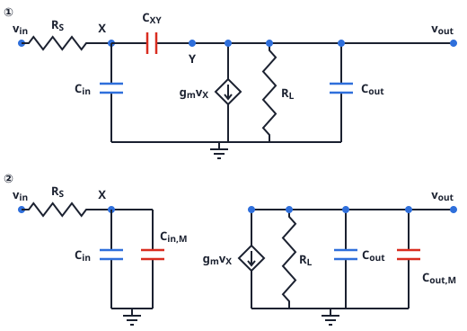
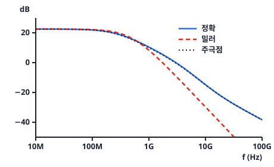
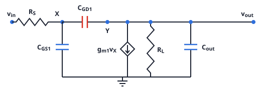

# 전자회로2 복습 1028 문제설명

회로와 첫 식을 짚고 핵심 계산으로 답을 구해요.

문제의 첫 줄부터 검산까지 설명해요.

**목차**

- [문항별 설명](#problems)
  - [P1. MOSFET f_T의 정의와 ω_T 식 (2023-1 기말 6)](#p1)
  - [P2. 채널 길이·과구동 전압 축소에 따른 f_T 증가 배수](#p2)
  - [P3. 채널 길이를 2배로 늘린 MOSFET의 폭과 f_T](#p3)
  - [P4. 과구동 전압을 절반으로 줄일 때의 f_T 변화](#p4)
  - [P5. 폭과 바이어스 전류가 절반인 CS 단의 이득과 극점](#p5)
  - [P6. 부하가 다른 세 CS 단의 밀러 입력·출력 극점](#p6)
  - [P7. CE 단의 밀러 극점과 대역폭을 제한하는 노드](#p7)
  - [P8. pnp 전류원 부하 CE 단의 입력·출력 극점 (2021-1 기말 2)](#p8)
  - [P9. 입력 극점 500 MHz·출력 극점 2 GHz CE 단 설계](#p9)
  - [P10. 게이트를 묶은 NMOS·PMOS 단의 전달 함수 (직접 해석)](#p10)
  - [P11. CS 단: 밀러 근사·정확한 전달 함수·주극점 근사 비교](#p11)
  - [P12. 수치가 주어진 CS 단의 밀러 극점과 정확한 극점 비교](#p12)
  - [P13. 전류원 부하 CS 단의 주극점 근사](#p13)
  - [P14. 전류원 부하 CE 증폭기: 밀러 근사와 정확한 극점](#p14)
  - [P15. 전류원 부하 CE 증폭기의 주극점 근사 비교](#p15)

## 문항별 설명

### P1. MOSFET f_T의 정의와 ω_T 식 (2023-1 기말 6)

2023-1_기말-Q6 · 기출 6 · [원 문제 보기](../%EB%B3%B5%EC%8A%B5%EB%AC%B8%EC%A0%9C_1028_CS_Stage_Frequency_Response-%EB%AC%B8%EC%A0%9C.pdf)

#### 주어진 조건

- MOSFET은 saturation 영역에서 동작
- $C_{GD}$는 무시
- 둘째 식에서는 $C_{GS} = (2/3)WLC_{ox}$
- 식을 구하는 과정이 없으면 점수를 주지 않음

#### 구할 것

- MOSFET의 transit frequency ($f_T$)의 정의를 설명
- 그 정의를 이용해 $\omega_T\ (= 2\pi f_T)$의 식을 구함
- $C_{GS} = (2/3)WLC_{ox}$일 때 $\omega_T\ (= 2\pi f_T)$의 식을 $\mu_n$, $L$ (channel length), $V_{GS} - V_{TH}$로 나타냄

원문 보기

MOSFET에서 transit frequency($f_T$)의 정의를 설명하고, 이를 이용하여 $\omega_T\ (= 2\pi f_T)$의 식을 구하시오. 그리고, $C_{GS} = (2/3)WLC_{ox}$일 때, $\omega_T\ (= 2\pi f_T)$의 식을 $\mu_n$, $L$ (channel length), $V_{GS} - V_{TH}$에 관한 식으로 구하시오. 단, MOSFET은 saturation 영역에서 동작하고, $C_{GD}$는 무시한다. (식을 구하는 과정이 없으면 점수 미부여)

*드레인 단락에서 게이트 전류와 드레인 전류를 비교해요.*

㉠ 드레인을 교류 단락했을 때 $|I_{out}/I_{in}|=1$이 되는 주파수가 $f_T$예요. $C_{GD}$를 생략하면 게이트 전류는 $C_{GS}$에만 흘러요.

$$
I_{in}=sC_{GS}V_{GS}
$$

$$
I_{out}=g_mV_{GS}
$$

$$
\left|\frac{I_{out}}{I_{in}}\right|_{\omega_T}=\frac{g_m}{\omega_T C_{GS}}=1
$$

$$
g_m=\mu_n C_{ox}(W/L)(V_{GS}-V_{TH})
$$

$$
C_{GS}=\tfrac23 WLC_{ox}
$$

$$
\omega_T=2\pi f_T=\frac{g_m}{C_{GS}}=\frac{3\mu_n(V_{GS}-V_{TH})}{2L^2}
$$

**페이지 요약**

트랜싯 주파수는 출력 단락 상태의 전류 이득에서 구해요.

---

### P2. 채널 길이·과구동 전압 축소에 따른 f_T 증가 배수

E11.14 · 예제 11.14 · [원 문제 보기](../%EB%B3%B5%EC%8A%B5%EB%AC%B8%EC%A0%9C_1028_CS_Stage_Frequency_Response-%EB%AC%B8%EC%A0%9C.pdf)

#### 주어진 조건

- MOSFET의 최소 채널 길이: 1980년대 후반 $1\ \mu\text{m}$ → 오늘날 $65\ \text{nm}$
- 공급 전압 축소로 게이트–소스 과구동 전압: 약 $400\ \text{mV}$ → $100\ \text{mV}$
- 이동도 등 다른 값은 같다고 봄

#### 구할 것

- MOSFET의 $f_T$는 몇 배나 증가했는가?

원문 보기

MOSFET의 최소 채널 길이는 1980년대 후반 $1\ \mu\text{m}$에서 오늘날 $65\ \text{nm}$로 축소되어 왔다. 또한 피할 수 없는 공급 전압의 축소는 게이트-소스 과구동 전압을 약 $400\ \text{mV}$에서 $100\ \text{mV}$로 줄게 하였다. MOSFET의 $f_T$는 몇 배나 증가했는가?

장채널 포화 모델에서 이동도가 같으면 $f_T\propto V_{ov}/L^2$예요. $1\,\mu\mathrm m=1000\,\mathrm{nm}$로 길이 단위를 맞춰요.

$$
\frac{f_T^*}{f_T}=\left(\frac{L}{L^*}\right)^2\frac{V_{ov}^*}{V_{ov}}=\left(\frac{1000}{65}\right)^2\frac{100}{400}\approx59.17
$$

**페이지 요약**

길이는 제곱으로, 과구동 전압은 일차로 트랜싯 주파수에 반영돼요.

---

### P3. 채널 길이를 2배로 늘린 MOSFET의 폭과 f_T

P11.33 · 장말문제 11.33 · [원 문제 보기](../%EB%B3%B5%EC%8A%B5%EB%AC%B8%EC%A0%9C_1028_CS_Stage_Frequency_Response-%EB%AC%B8%EC%A0%9C.pdf)

#### 주어진 조건

- MOSFET의 채널 길이 변조를 줄이기 위해 소자 길이를 2배로 늘림

#### 구할 것

- (a) 같은 과구동 전압과 같은 드레인 전류를 유지하려면 소자 폭을 어떻게 조정해야 하는가?
- (b) 이 변화들이 트랜지스터의 $f_T$에 어떤 영향을 주는가?

원문 보기

In order to lower channel-length modulation in a MOSFET, we double the device length.

(a) How should the device width be adjusted to maintain the same overdrive voltage and the same drain current?

(b) How do these changes affect the $f_T$ of the transistor?

#### (a) 같은 전류를 흘리는 폭

같은 공정에서 과구동 전압과 드레인 전류를 유지하려면 $W/L$이 일정해야 해요.

$$
I_D=\tfrac12\mu_nC_{ox}(W/L)V_{ov}^2
$$

$$
W^*=W\frac{L^*}{L}=2W
$$

#### (b) 트랜싯 주파수

$g_m=2I_D/V_{ov}$는 그대로이고 게이트 면적은 네 배예요.

$$
C_{GS}^*/C_{GS}=W^*L^*/(WL)=4
$$

$$
\frac{f_T^*}{f_T}\approx\frac{g_m^*/C_{GS}^*}{g_m/C_{GS}}=\frac14
$$

**페이지 요약**

전류와 과구동 전압을 유지하면 트랜스컨덕턴스는 같고 게이트 면적만 커져요.

---

### P4. 과구동 전압을 절반으로 줄일 때의 f_T 변화

P11.34 · 장말문제 11.34 · [원 문제 보기](../%EB%B3%B5%EC%8A%B5%EB%AC%B8%EC%A0%9C_1028_CS_Stage_Frequency_Response-%EB%AC%B8%EC%A0%9C.pdf)

#### 주어진 조건

- 회로에서 더 큰 전압 헤드룸을 주기 위해 트랜지스터의 과구동 전압을 절반으로 줄이려 함
- $L$은 일정하다고 가정

#### 구할 것

- 다음 각 경우 $f_T$의 변화

  - (a) $I_D$는 일정하고 $W$를 늘림
  - (b) $W$는 일정하고 $I_D$를 줄임

원문 보기

We wish to halve the overdrive voltage of a transistor so as to provide a greater voltage headroom in a circuit. Determine the change in the $f_T$ if (a) $I_D$ is constant and $W$ is increased, or (b) $W$ is constant and $I_D$ is decreased. Assume $L$ is constant.

$I_D\propto (W/L)V_{ov}^2$이고 과구동 전압은 절반이에요. (a) 전류를 유지하면 $W^*=4W$이고, (b) 폭을 유지하면 $I_D^*=I_D/4$예요.

두 경우 모두 길이와 이동도가 같으므로 장채널 포화 모델에서

$$
\frac{f_T^*}{f_T}\approx\frac{V_{ov}^*}{V_{ov}}=\frac12
$$

**페이지 요약**

같은 길이에서는 과구동 전압을 낮춘 비율만큼 트랜싯 주파수가 낮아져요.

---

### P5. 폭과 바이어스 전류가 절반인 CS 단의 이득과 극점

E11.16 · 예제 11.16 · [원 문제 보기](../%EB%B3%B5%EC%8A%B5%EB%AC%B8%EC%A0%9C_1028_CS_Stage_Frequency_Response-%EB%AC%B8%EC%A0%9C.pdf)

#### 주어진 조건

- 레이아웃 단계에서 본래 설계보다 폭이 절반인 MOSFET을 사용
- 바이어스 전류도 절반이라고 가정
- 소자 값은 주어지지 않음 (답은 본래 파라미터에 대한 기호로)

#### 구할 것

- 회로의 이득과 극점 결정

원문 보기

전기공학과 학생이 특정 저주파수 이득과 고주파수 응답을 갖는 그림 11.31(a)의 공통 소스(CS) 단을 설계하였다. 안타깝게도 레이아웃 단계에서 이 학생은 본래 설계보다 폭이 절반인 MOSFET를 사용하였다. 바이어스 전류 또한 절반이라고 가정하고, 회로의 이득과 극점을 결정하라.

*위는 원래 결합, 아래는 브리지 용량을 입력과 출력으로 분리한 회로예요.*

㉠ 같은 $L$에서 $W$와 $I_D$가 함께 절반이면 $V_{ov}$는 그대로예요. 접합 용량도 폭에 비례하는 교재 모델에서 $C_{GS},C_{GD},C_{DB}$는 각각 절반이에요.

$$
g_m^*=2I_D^*/V_{ov}=g_m/2
$$

채널 길이 변조를 무시하면 드레인의 저항은 그대로 $R_L$이에요. $A_v^*=-g_m^*R_L$을 브리지 양단 전압비로 사용해요.

$$
C_X^*=\tfrac12[C_{GS}+(1+g_mR_L/2)C_{GD}]
$$

$$
C_Y^*=\tfrac12[C_{DB}+(1+2/(g_mR_L))C_{GD}]
$$

$$
A_v^*=-g_mR_L/2=A_v/2
$$

$$
p_X^*\approx-1/(R_SC_X^*)
$$

$$
p_Y^*\approx-1/(R_LC_Y^*)
$$

입력 극점 크기는 원래의 두 배보다 커지고, $g_mR_L\gg2$이면 출력 극점 크기는 약 두 배예요.

**페이지 요약**

소자가 작아지면 기생 용량과 밀러 배수가 함께 변해요.

---

### P6. 부하가 다른 세 CS 단의 밀러 입력·출력 극점

P11.38 · 장말문제 11.38 · [원 문제 보기](../%EB%B3%B5%EC%8A%B5%EB%AC%B8%EC%A0%9C_1028_CS_Stage_Frequency_Response-%EB%AC%B8%EC%A0%9C.pdf)

#### 주어진 조건

- $\lambda > 0$으로 가정

#### 구할 것

- 밀러 이론을 이용해 세 단 각각의 입력 극점과 출력 극점 구하기

원문 보기

Assuming $\lambda > 0$ and using Miller's theorem, determine the input and output poles of the stages depicted in Fig. 11.82.

*각 부하를 $R_L$로 합친 공통 소스 모델. $C_{XY}$는 입력 소자의 게이트–드레인 용량이에요.*

㉠ 각 회로에서 입력 소자의 $C_{GD}$만 X–Y에 걸려요. 해당 소자를 $i$로 표시하고 몸체 효과를 생략해요. $\lambda>0$이므로 두 $r_o$를 남겨요.

(a) $i=1$. 다이오드 접속 PMOS의 게이트·드레인이 출력이므로

$$
R_{L,a}=r_{o1}\parallel r_{o2}\parallel(1/g_{m2})
$$

$$
C_{out,a}=C_{DB1}+C_{DB2}+C_{GS2}
$$

(b) $i=1$. 부하의 소스가 출력이므로

$$
R_{L,b}=R_{L,a}
$$

$$
C_{out,b}=C_{DB1}+C_{GS2}+C_{SB2}
$$

(c) $i=2$. 위의 PMOS가 입력을 받고 아래의 $M_1$은 바이어스된 전류원 부하예요.

$$
R_{L,c}=r_{o1}\parallel r_{o2}
$$

$$
C_{out,c}=C_{DB1}+C_{GD1}+C_{DB2}
$$

각 회로 $k=a,b,c$에서 공통 소스의 게이트–드레인 이득은

$$
A_k=-g_{mi}R_{L,k}
$$

$$
p_{X,k}\approx-\frac{1}{R_S[C_{GSi}+(1-A_k)C_{GDi}]}
$$

$$
p_{Y,k}\approx-\frac{1}{R_{L,k}[C_{out,k}+(1-1/A_k)C_{GDi}]}
$$

**페이지 요약**

게이트–드레인 브리지를 분리하기 전에 어느 소자가 입력을 받는지 정해요.

---

### P7. CE 단의 밀러 극점과 대역폭을 제한하는 노드

E11.15 · 예제 11.15 · [원 문제 보기](../%EB%B3%B5%EC%8A%B5%EB%AC%B8%EC%A0%9C_1028_CS_Stage_Frequency_Response-%EB%AC%B8%EC%A0%9C.pdf)

#### 주어진 조건

- $R_S = 200\ \Omega$
- $I_C = 1\ \text{mA}$
- $\beta = 100$
- $C_\pi = 100\ \text{fF}$
- $C_\mu = 20\ \text{fF}$
- $C_{CS} = 30\ \text{fF}$
- (a)에서 $R_L = 2\ \text{k}\Omega$ ($R_L$은 그림의 $R_C$ 자리)

#### 구할 것

- (a) $R_L = 2\ \text{k}\Omega$일 경우, 입력과 출력 극점 계산. 어떤 노드가 (대역폭을 제한하는) 속도의 장애요인으로 나타나는가?
- (b) 출력 극점이 대역폭을 제한하도록 $R_L$을 선택하는 것이 가능한가?

원문 보기

그림 11.31(a)의 CE 단에서 $R_S = 200\ \Omega$, $I_C = 1\ \text{mA}$, $\beta = 100$, $C_\pi = 100\ \text{fF}$, $C_\mu = 20\ \text{fF}$, $C_{CS} = 30\ \text{fF}$이다.

(a) 만약 $R_L = 2\ \text{k}\Omega$일 경우, 입력과 출력 극점을 계산하라. 어떤 노드가 (대역폭을 제한하는) 속도의 장애요인으로 나타나는가?

(b) 출력 극점이 대역폭을 제한하도록 $R_L$을 선택하는 것이 가능한가?

*베이스 입력을 테브난 등가로 바꾸고 베이스–컬렉터 용량을 분리해요.*

#### (a) 대역폭을 제한하는 노드

㉠ $V_T=26\,\mathrm{mV}$, $r_o\to\infty$인 교재 모델을 사용해요. $C_\mu$ 양단의 저주파 이득은 $-g_mR_L$이에요.

$$
g_m=I_C/V_T=1/(26\,\Omega)
$$

$$
r_\pi=\beta/g_m=2.6\,\mathrm{k}\Omega
$$

$$
R_{Th}=R_S\parallel r_\pi\approx185.71\,\Omega
$$

$$
\tau_X=R_{Th}[C_\pi+(1+g_m R_L)C_\mu]
$$

$$
\tau_Y=R_L(C_{CS}+C_\mu)+C_\mu/g_m
$$

$$
f_X\approx1/(2\pi\tau_X)\approx516.74\,\mathrm{MHz}
$$

$$
f_Y\approx1/(2\pi\tau_Y)\approx1.58\,\mathrm{GHz}
$$

입력 극점이 더 낮아 베이스에서 대역폭이 제한돼요.

#### (b) 부하 저항으로 지배극 바꾸기

$\tau_Y>\tau_X$가 되려면 다음 부등식을 만족해야 해요.

$$
R_L(C_{CS}+C_\mu-g_m R_{Th}C_\mu)>R_{Th}(C_\pi+C_\mu)-C_\mu/g_m
$$

왼쪽은 약 $(-92.86\,\mathrm{fF})R_L$이고 오른쪽은 약 $21.77\,\mathrm{ps}$예요. 양의 $R_L$로는 출력 극점이 대역폭을 제한하게 할 수 없어요.

**페이지 요약**

컬렉터 부하를 바꾸면 출력 시정수와 입력의 밀러 시정수가 함께 변해요.

---

### P8. pnp 전류원 부하 CE 단의 입력·출력 극점 (2021-1 기말 2)

2021-1_기말-Q2 · 기출 2 · [원 문제 보기](../%EB%B3%B5%EC%8A%B5%EB%AC%B8%EC%A0%9C_1028_CS_Stage_Frequency_Response-%EB%AC%B8%EC%A0%9C.pdf)

#### 주어진 조건

- $R_S = 10\ \text{k}\Omega$
- $I_{D1} = 0.5\ \text{mA}$
- BJT 회로이므로 $I_{D1}$은 $Q_1$의 컬렉터 바이어스 전류로 보임
- $V_T = 25\ \text{mV}$, $\beta = 200$
- $V_{A,n} = V_{A,p} = 5\ \text{V}$
- 바이어스 전압 $V_b$와 $V_{CC}$ 값은 주어지지 않음

#### 구할 것

- 입력 노드의 극점 주파수와 출력 노드의 극점 주파수를 각각 $Q_1$, $Q_2$의 커패시턴스로 나타낸 식

원문 보기

다음 회로에 대해 주어진 조건을 이용하여, 입력과 출력 노드의 pole 주파수를 $Q_1$, $Q_2$의 capacitance들에 관한 식으로 각각 구하시오.

: $R_S = 10\ \text{K}\Omega$, $I_{D1} = 0.5\ \text{mA}$, $V_T = 25\ \text{mV}$, $\beta = 200$, $V_{A,n} = V_{A,p} = 5\ \text{V}$.

*위는 실제 베이스–컬렉터 결합, 아래는 밀러 분리 후 각 노드에 보이는 가지예요.*

㉠ 원문의 $I_{D1}$을 BJT의 $I_{C1}$로 읽고 두 컬렉터 전류를 같은 $0.5\,\mathrm{mA}$로 둬요. 위쪽 $Q_2$의 베이스와 이미터는 교류 접지예요.

$$
g_{m1}=I_{C1}/V_T=20\,\mathrm{mS}
$$

$$
r_{\pi1}=\beta/g_{m1}=10\,\mathrm{k}\Omega
$$

$$
R_{Th}=R_S\parallel r_{\pi1}=5\,\mathrm{k}\Omega
$$

$$
r_{o1}=r_{o2}=V_A/I_C=10\,\mathrm{k}\Omega
$$

$$
R_{out}=r_{o1}\parallel r_{o2}=5\,\mathrm{k}\Omega
$$

$C_{\mu1}$의 양단 이득을 쓰면 $Q_2$의 베이스–컬렉터 및 컬렉터–기판 용량은 출력에 그대로 남아요.

$$
A_{XY}=-g_{m1}R_{out}=-100
$$

$$
f_X\approx\frac{1}{2\pi R_{Th}(C_{\pi1}+101C_{\mu1})}
$$

$$
f_Y\approx\frac{1}{2\pi R_{out}(C_{CS1}+C_{\mu2}+C_{CS2}+1.01C_{\mu1})}
$$

**페이지 요약**

실제로 입력과 출력을 잇는 용량에만 밀러 배수를 적용해요.

---

### P9. 입력 극점 500 MHz·출력 극점 2 GHz CE 단 설계

P11.53 · 장말문제 11.53 · [원 문제 보기](../%EB%B3%B5%EC%8A%B5%EB%AC%B8%EC%A0%9C_1028_CS_Stage_Frequency_Response-%EB%AC%B8%EC%A0%9C.pdf)

#### 주어진 조건

- 설계 대상: Fig 11.94의 CE 단
- 입력 극점 $500\ \text{MHz}$, 출력 극점 $2\ \text{GHz}$
- $I_C = 1\ \text{mA}$, $C_\pi = 20\ \text{fF}$, $C_\mu = 5\ \text{fF}$, $C_{CS} = 10\ \text{fF}$, $V_A = \infty$
- 밀러 이론을 이용
- 반복 계산이 필요할 수 있음
- $\beta$가 주어지지 않으므로 $r_\pi$는 무시함 ($r_\pi \to \infty$)

#### 구할 것

- (저주파) 전압 이득이 최대가 되도록 하는 $R_B$와 $R_C$ 값

원문 보기

We wish to design the CE stage of Fig. 11.94 for an input pole at $500\ \text{MHz}$ and an output pole at $2\ \text{GHz}$. Assuming $I_C = 1\ \text{mA}$, $C_\pi = 20\ \text{fF}$, $C_\mu = 5\ \text{fF}$, $C_{CS} = 10\ \text{fF}$, and $V_A = \infty$, and using Miller's theorem, determine the values of $R_B$ and $R_C$ such that the (low-frequency) voltage gain is maximized. You may need to use iteration.

*베이스 쪽 입력망의 테브난 등가. $v_{Th}=v_{in}r_\pi/(R_B+r_\pi)$이고 직렬 저항은 $K=R_B\parallel r_\pi$예요.*

㉠ $V_A=\infty$이므로 브리지 $C_\mu$가 보는 베이스–컬렉터 이득은 $-g_mR_C$예요. $V_T=26\,\mathrm{mV}$를 사용해요.

$$
g_m=I_C/V_T=1/(26\,\Omega)
$$

출력 극점 $f_Y=2\,\mathrm{GHz}$를 지정하면 $R_C$가 정해져요.

$$
1/(2\pi f_Y)=R_C(C_{CS}+C_\mu)+C_\mu/g_m
$$

$$
R_C\approx\frac{1/(2\pi f_Y)-C_\mu/g_m}{C_{CS}+C_\mu}\approx5.3\,\mathrm{k}\Omega
$$

입력 극점 $f_X=500\,\mathrm{MHz}$가 정하는 값은 베이스에서 본 병렬 저항이에요.

$$
C_X\approx C_\pi+(1+g_mR_C)C_\mu
$$

$$
K=R_B\parallel r_\pi\approx\frac{1}{2\pi f_XC_X}\approx305.02\,\Omega
$$

신호원 기준 저주파 이득에는 베이스 분압을 포함해요.

$$
A_v=\frac{v_X}{v_{in}}\frac{v_{out}}{v_X}=\frac{r_\pi}{R_B+r_\pi}(-g_mR_C)
$$

유한한 $r_\pi=\beta/g_m>K$에서 두 목표 극점을 만족시키는 양의 저항과 그때의 이득은

$$
R_B=\frac{K r_\pi}{r_\pi-K}
$$

$$
A_v=-g_mR_C\left(1-\frac{K}{r_\pi}\right)
$$

원문에 $\beta$가 없어 $R_B$와 신호원 기준 이득의 수치는 추가 가정에 따라 달라져요. $r_\pi\gg K$이면

$$
R_B\approx305.02\,\Omega
$$

$$
A_v\approx-203.71
$$

**페이지 요약**

출력 극점은 컬렉터 저항을 정하고, 입력 극점은 베이스에서 본 병렬 저항을 정해요.

---

### P10. 게이트를 묶은 NMOS·PMOS 단의 전달 함수 (직접 해석)

P11.44 · 장말문제 11.44 · [원 문제 보기](../%EB%B3%B5%EC%8A%B5%EB%AC%B8%EC%A0%9C_1028_CS_Stage_Frequency_Response-%EB%AC%B8%EC%A0%9C.pdf)

#### 주어진 조건

- $\lambda > 0$으로 가정

#### 구할 것

- 밀러 이론을 쓰지 않고 회로의 전달 함수 $V_{out}/V_{in}$ 계산

원문 보기

Compute the transfer function of the circuit shown in Fig. 11.86 without using Miller's theorem. Assume $\lambda > 0$.

*입력용량, X–Y 브리지, 출력용량을 분리한 상보 공통 소스 모델이에요.*

㉠ 입력 X가 오르면 NMOS가 끌어가는 전류는 늘고 PMOS가 밀어 넣는 전류는 줄어요. 출력에서 빠져나가는 방향으로 두 변화가 더해져요.

$$
g_m=g_{m1}+g_{m2}
$$

$$
R_L=r_{o1}\parallel r_{o2}
$$

$$
C_X=C_{GS1}+C_{GS2}
$$

$$
C_{XY}=C_{GD1}+C_{GD2}
$$

$$
C_Y=C_{DB1}+C_{DB2}
$$

브리지 전류를 X에서 출력 쪽으로 잡고 그대로 연립해요.

$$
(V_{in}-V_X)/R_S=sC_XV_X+sC_{XY}(V_X-V_{out})
$$

$$
sC_{XY}(V_X-V_{out})=g_m V_X+(1/R_L+sC_Y)V_{out}
$$

$$
\frac{V_{out}}{V_{in}}=\frac{R_L(sC_{XY}-g_m)}{as^2+bs+1}
$$

$$
a=R_SR_L[C_X C_Y+(C_X+C_Y)C_{XY}]
$$

$$
b=R_SC_X+R_L C_Y+(R_S+R_L+g_m R_S R_L)C_{XY}
$$

**페이지 요약**

브리지 전류를 한 번 정의해 두 노드의 KCL에 반대 부호로 넣어요.

---

### P11. CS 단: 밀러 근사·정확한 전달 함수·주극점 근사 비교

E11.18 · 예제 11.18 · [원 문제 보기](../%EB%B3%B5%EC%8A%B5%EB%AC%B8%EC%A0%9C_1028_CS_Stage_Frequency_Response-%EB%AC%B8%EC%A0%9C.pdf)

#### 주어진 조건

- $R_S = 200\ \Omega$
- $C_{GS} = 250\ \text{fF}$
- $C_{GD} = 80\ \text{fF}$
- $C_{DB} = 100\ \text{fF}$
- $g_m = (150\ \Omega)^{-1}$
- $\lambda = 0$
- $R_L = 2\ \text{k}\Omega$ ($R_L$은 그림의 $R_D$ 자리)

#### 구할 것

- 다음 각각을 이용하여 주파수 응답 그리기

  - (a) 밀러 근사
  - (b) 정확한 전달 함수
  - (c) 주극점 근사

원문 보기

그림 11.31(a)의 공통 소스(CS) 단에서, $R_S = 200\ \Omega$, $C_{GS} = 250\ \text{fF}$, $C_{GD} = 80\ \text{fF}$, $C_{DB} = 100\ \text{fF}$, $g_m = (150\ \Omega)^{-1}$, $\lambda = 0$, $R_L = 2\ \text{k}\Omega$이다. (a) 밀러 근사, (b) 정확한 전달 함수, (c) 주극점 근사를 이용하여 주파수 응답을 각각 그려라.

*위의 원래 브리지를 유지하면 정확식, 아래의 분리된 용량을 쓰면 밀러 근사예요.*

㉠ $\lambda=0$인 CS 단의 게이트–드레인 이득을 브리지 양단에 적용해요.

$$
A_0=-g_mR_L=-40/3
$$

$$
C_X\approx C_{GS}+(1-A_0)C_{GD}\approx1396.67\,\mathrm{fF}
$$

$$
C_Y\approx C_{DB}+(1-1/A_0)C_{GD}=186\,\mathrm{fF}
$$

브리지를 남긴 식 (11.73)은 분자에 우반면 영점을 가지며 분모는 $as^2+bs+1$이에요.

$$
H(s)=\frac{R_L(sC_{GD}-g_m)}{as^2+bs+1}
$$

$$
a=R_SR_L[C_{GS}C_{DB}+(C_{GS}+C_{DB})C_{GD}]=2.12\times10^{-20}\,\mathrm{s}^2
$$

$$
b=R_SC_{GS}+R_L C_{DB}+(R_S+R_L+g_mR_SR_L)C_{GD}\approx639.33\,\mathrm{ps}
$$

두 정확 극점이 약 17배 떨어져 있어 주극점 근사에는 $1/b$, $b/a$를 사용해요.

(a) 밀러 근사

$$
f_X\approx1/(2\pi R_SC_X)\approx569.77\,\mathrm{MHz}
$$

$$
f_Y\approx1/(2\pi R_L C_Y)\approx427.84\,\mathrm{MHz}
$$

(b) 정확한 전달함수

$$
f_1\approx263.39\,\mathrm{MHz}
$$

$$
f_2\approx4.54\,\mathrm{GHz}
$$

$$
f_z=g_m/(2\pi C_{GD})\approx13.26\,\mathrm{GHz}
$$

(c) 주극점 근사

$$
f_1\approx1/(2\pi b)\approx248.94\,\mathrm{MHz}
$$

$$
f_2\approx b/(2\pi a)\approx4.8\,\mathrm{GHz}
$$

*세 곡선은 약 $22.5\,\mathrm{dB}$에서 출발해요. 정확식과 주극점 곡선에는 우반면 영점을 포함해 높은 주파수에서 기울기가 $-20\,\mathrm{dB/dec}$로 돌아와요.*

**페이지 요약**

낮은 두 밀러 극점만으로는 정확한 고주파 응답의 영점 효과를 그릴 수 없어요.

---

### P12. 수치가 주어진 CS 단의 밀러 극점과 정확한 극점 비교

P11.39 · 장말문제 11.39 · [원 문제 보기](../%EB%B3%B5%EC%8A%B5%EB%AC%B8%EC%A0%9C_1028_CS_Stage_Frequency_Response-%EB%AC%B8%EC%A0%9C.pdf)

#### 주어진 조건

- $R_S = 200\ \Omega$
- $R_D = 1\ \text{k}\Omega$
- $I_{D1} = 1\ \text{mA}$
- $C_{GS} = 50\ \text{fF}$
- $C_{GD} = 10\ \text{fF}$
- $C_{DB} = 15\ \text{fF}$
- $V_{GS} - V_{TH} = 200\ \text{mV}$
- $\lambda$ 값은 주어지지 않음. 본문 해석(각주 10)처럼 채널길이 변조를 무시하는 것으로 봄
- 식 (11.73)–(11.75): 통합 모델 $V_{Thev}$–$R_{Thev}$–노드 X, X–접지 $C_{in}$, X–Y 사이 $C_{XY}$, Y = $V_{out}$, Y–접지 $C_{out}$과 부하 $R_L$, 종속 전류원 $g_m V_X$에서 $\dfrac{V_{out}}{V_{Thev}}(s) = \dfrac{(C_{XY}s - g_m)R_L}{as^2 + bs + 1}$, $a = R_{Thev}R_L(C_{in}C_{XY} + C_{out}C_{XY} + C_{in}C_{out})$, $b = (1 + g_m R_L)C_{XY}R_{Thev} + R_{Thev}C_{in} + R_L(C_{XY} + C_{out})$
- CS 단 대응: $R_{Thev} = R_S$, $C_{in} = C_{GS}$, $C_{XY} = C_{GD}$, $C_{out} = C_{DB}$, $R_L = R_D$

#### 구할 것

- 회로의 극점 구하기

  - (a) 밀러 근사 이용
  - (b) 식 (11.73)의 전달 함수 이용
- 두 결과 비교

원문 보기

In the CS stage of Fig. 11.31(a), $R_S = 200\ \Omega$, $R_D = 1\ \text{k}\Omega$, $I_{D1} = 1\ \text{mA}$, $C_{GS} = 50\ \text{fF}$, $C_{GD} = 10\ \text{fF}$, $C_{DB} = 15\ \text{fF}$, and $V_{GS} - V_{TH} = 200\ \text{mV}$. Determine the poles of the circuit using (a) Miller's approximation, and (b) the transfer function given by Eq. (11.73). Compare the results.

*위 회로의 X–Y 결합을 그대로 두거나 아래와 같이 밀러로 분리해 비교해요.*

㉠ 교재 모델처럼 $r_o\to\infty$로 놓고 CS 이득을 구해요.

$$
g_m=2I_D/V_{ov}=10\,\mathrm{mS}
$$

$$
A_{XY}=-g_mR_D=-10
$$

$$
\tau_X=R_S[C_{GS}+(1-A_{XY})C_{GD}]=32\,\mathrm{ps}
$$

$$
\tau_Y=R_D[C_{DB}+(1-1/A_{XY})C_{GD}]=26\,\mathrm{ps}
$$

원래 브리지를 유지한 분모는 $as^2+bs+1$이에요.

$$
a=R_SR_D[C_{GS}C_{DB}+(C_{GS}+C_{DB})C_{GD}]=2.8\times10^{-22}\,\mathrm{s}^2
$$

$$
b=R_SC_{GS}+R_D C_{DB}+(R_S+R_D+g_mR_SR_D)C_{GD}=57\,\mathrm{ps}
$$

$$
p_{1,2}=(-b\pm\sqrt{b^2-4a})/(2a)
$$

(a) 밀러 근사

$$
p_X\approx-1/\tau_X\approx-3.13\times10^{10}\,\mathrm{rad/s}
$$

$$
p_Y\approx-1/\tau_Y\approx-3.85\times10^{10}\,\mathrm{rad/s}
$$

(b) 식 (11.73)

$$
p_1\approx-1.94\times10^{10}\,\mathrm{rad/s}
$$

$$
p_2\approx-1.84\times10^{11}\,\mathrm{rad/s}
$$

밀러 근사는 낮은 극점의 크기를 약 1.61배 크게, 높은 극점의 크기를 약 4.79배 작게 잡아요.

**페이지 요약**

밀러 근사로 얻은 두 시정수가 비슷하면 결합된 두 노드의 실제 극점과 차이가 커져요.

---

### P13. 전류원 부하 CS 단의 주극점 근사

E11.17 · 예제 11.17 · [원 문제 보기](../%EB%B3%B5%EC%8A%B5%EB%AC%B8%EC%A0%9C_1028_CS_Stage_Frequency_Response-%EB%AC%B8%EC%A0%9C.pdf)

#### 주어진 조건

- 트랜지스터는 모두 포화 영역에서 동작
- $\lambda \neq 0$
- 소자 값은 주어지지 않음 (답은 기호로)

#### 구할 것

- 주극점 근사를 사용하여 회로의 극점들 계산

원문 보기

주극점 근사를 사용하여, 그림 11.33(a)에 보인 회로의 극점들을 계산하라. 트랜지스터들은 모두 포화 영역에서 동작하며 $\lambda \neq 0$이라고 가정한다.

*두 트랜지스터의 출력저항을 병렬로 묶은 공통 소스 고주파 모델이에요.*

㉠ $M_2$ 게이트와 소스는 교류 접지예요. $C_{GD2}$는 출력에 붙고, 실제로 두 신호 노드를 잇는 용량은 $C_{GD1}$뿐이에요.

$$
R_L=r_{o1}\parallel r_{o2}
$$

$$
C_{in}=C_{GS1}
$$

$$
C_{XY}=C_{GD1}
$$

$$
C_{out}=C_{DB1}+C_{GD2}+C_{DB2}
$$

결합을 유지한 분모 $1+bs+as^2$에서 두 계수를 읽어요.

$$
b=R_SC_{in}+R_L C_{out}+(R_S+R_L+g_{m1}R_SR_L)C_{XY}
$$

$$
a=R_SR_L[C_{in}C_{out}+(C_{in}+C_{out})C_{XY}]
$$

두 극점이 충분히 떨어져 $b^2\gg4a$이면

$$
p_1\approx-1/b
$$

$$
p_2\approx-b/a
$$

**페이지 요약**

부하 트랜지스터가 출력에서 보는 용량과 저항에 모두 기여해요.

---

### P14. 전류원 부하 CE 증폭기: 밀러 근사와 정확한 극점

P11.40 · 장말문제 11.40 · [원 문제 보기](../%EB%B3%B5%EC%8A%B5%EB%AC%B8%EC%A0%9C_1028_CS_Stage_Frequency_Response-%EB%AC%B8%EC%A0%9C.pdf)

#### 주어진 조건

- $V_A = \infty$
- 식 (11.73)–(11.75): 통합 모델 $V_{Thev}$–$R_{Thev}$–노드 X, X–접지 $C_{in}$, X–Y 사이 $C_{XY}$, Y = $V_{out}$, Y–접지 $C_{out}$과 부하 $R_L$, 종속 전류원 $g_m V_X$에서 $\dfrac{V_{out}}{V_{Thev}}(s) = \dfrac{(C_{XY}s - g_m)R_L}{as^2 + bs + 1}$, $a = R_{Thev}R_L(C_{in}C_{XY} + C_{out}C_{XY} + C_{in}C_{out})$, $b = (1 + g_m R_L)C_{XY}R_{Thev} + R_{Thev}C_{in} + R_L(C_{XY} + C_{out})$
- CE 단 대응: $R_{Thev} = R_S \parallel r_\pi$, $C_{in} = C_\pi$, $C_{XY} = C_\mu$, $C_{out} = C_{CS}$, 부하가 전류원뿐이고 $V_A = \infty$이므로 $R_L \to \infty$

#### 구할 것

- 회로의 극점 구하기

  - (a) 밀러 근사 이용
  - (b) 식 (11.73)으로 나타낸 전달 함수 이용
- 두 결과 비교

원문 보기

Consider the amplifier shown in Fig. 11.83, where $V_A = \infty$. Determine the poles of the circuit using (a) Miller's approximation, and (b) the transfer function expressed by Eq. (11.73). Compare the results.

*$C_\mu$를 남긴 회로와 밀러 분리를 비교해요. 실제 출력의 저항 가지는 개방이에요.*

㉠ 입력은 $R_{Th}=R_S\parallel r_\pi$로 보고 유한한 부하 $R_L$에서 출발해요. 이상적 전류원과 $V_A=\infty$ 조건은 마지막에 $R_L\to\infty$로 넣어요.

$$
\tau_X=R_{Th}[C_\pi+(1+g_mR_L)C_\mu]
$$

$$
\tau_Y=R_L(C_{CS}+C_\mu)+C_\mu/g_m
$$

식 (11.73)의 분모 $as^2+bs+1$을 $R_L$로 나누면 상수항만 0이 돼요.

$$
D=\lim_{R_L\to\infty}a/R_L=R_{Th}[C_\pi C_{CS}+(C_\pi+C_{CS})C_\mu]
$$

$$
N=\lim_{R_L\to\infty}b/R_L=g_mR_{Th}C_\mu+C_\mu+C_{CS}
$$

$$
\lim_{R_L\to\infty}\frac{as^2+bs+1}{R_L}=s(Ds+N)
$$

(a) 밀러 시정수가 둘 다 발산하므로 $p_{X,M}$과 $p_{Y,M}$은 모두 0으로 가요. (b) 결합 회로에서는

$$
p_1=0
$$

$$
p_2=-N/D
$$

유한한 저주파 이득이 없어 밀러 근사는 둘째 극점을 놓쳐요.

**페이지 요약**

이상적 전류원 부하에서는 유한한 부하로 식을 세운 다음 극한을 취해요.

---

### P15. 전류원 부하 CE 증폭기의 주극점 근사 비교

P11.41 · 장말문제 11.41 · [원 문제 보기](../%EB%B3%B5%EC%8A%B5%EB%AC%B8%EC%A0%9C_1028_CS_Stage_Frequency_Response-%EB%AC%B8%EC%A0%9C.pdf)

#### 주어진 조건

- 문제 11.40의 가정을 이어받음: $V_A = \infty$
- 문제 11.40의 결과: 밀러 근사로는 두 극점 모두 원점으로 감. 식 (11.73)의 전달 함수로는 $|\omega_{p1}| = 0$, $|\omega_{p2}| = \dfrac{g_m R_{Th} C_\mu + C_\mu + C_{CS}}{R_{Th}(C_\pi C_\mu + C_{CS}C_\mu + C_\pi C_{CS})}$, $R_{Th} = R_S \parallel r_\pi$
- 식 (11.73)–(11.75): $\dfrac{V_{out}}{V_{Thev}}(s) = \dfrac{(C_{XY}s - g_m)R_L}{as^2 + bs + 1}$, $a = R_{Thev}R_L(C_{in}C_{XY} + C_{out}C_{XY} + C_{in}C_{out})$, $b = (1 + g_m R_L)C_{XY}R_{Thev} + R_{Thev}C_{in} + R_L(C_{XY} + C_{out})$. CE 단이면 $R_{Thev} = R_S \parallel r_\pi$, $C_{in} = C_\pi$, $C_{XY} = C_\mu$, $C_{out} = C_{CS}$
- 식 (11.80): 주극점 근사 $\omega_{p2} \gg \omega_{p1}$에서 $|\omega_{p1}| = 1/b$, $|\omega_{p2}| = b/a$

#### 구할 것

- 문제 11.40을 다시 풀되 주극점 근사를 이용해 극점 구하기
- 결과가 (문제 11.40의 결과와) 어떻게 비교되는가?

원문 보기

Repeat Problem 11.40 but use the dominant-pole approximation. How do the results compare?

*베이스 입력은 테브난 등가로 바꾸고, $C_\mu$ 양단의 결합은 유지해요.*

㉠ $R_{Th}=R_S\parallel r_\pi$이고 출력은 이상적 전류원 부하예요. 유한한 $R_L$로 분모 $as^2+bs+1$을 쓴 뒤 극한을 취해요.

$$
a=R_{Th}R_L[C_\pi C_{CS}+(C_\pi+C_{CS})C_\mu]
$$

$$
b=R_{Th}(C_\pi+C_\mu)+R_L(g_mR_{Th}C_\mu+C_\mu+C_{CS})
$$

$R_L\to\infty$에서 $b$는 발산하지만 $b/a$에서는 부하 저항이 약분돼요. 두 극점의 간격이 무한히 커져 $p_1\approx-1/b$와 $p_2\approx-b/a$의 극한을 사용할 수 있어요.

$$
p_1=0
$$

$$
p_2=-\frac{g_mR_{Th}C_\mu+C_\mu+C_{CS}}{R_{Th}[C_\pi C_{CS}+(C_\pi+C_{CS})C_\mu]}
$$

11.40의 정확식과 두 극점이 모두 일치해요. 밀러 근사에서는 유한한 둘째 극점이 사라졌어요.

**페이지 요약**

저주파 극점이 원점에 다가가도 높은 극점은 두 계수의 비로 유한하게 남아요.

---

원 문제·정리노트·PDF는 보존해요.
