# CS 단의 주파수 응답과 트랜싯 주파수 — 5살도 이해하는 정리노트

권익진 교수님 전자회로2 · 1028 수업 (Lec5 24–34쪽, Razavi 11장)

> `정리노트_1028_CS_Stage_Frequency_Response.html`를 마크다운으로 옮겼어요. 그림은 `figures_1028/` 폴더의 SVG, 위젯은 대표 설정의 정적 그림으로 바꿨어요. 수식은 `$…$` / `$$…$$`라서 GitHub, Obsidian, Typora에서 보여요.

**목차**

- [들어가며: 왜 이런 회로를 쓸까](#why)
  - [왜 이런 회로를 쓸까](#why-circuit)
- [1. 트랜지스터의 속도 한계: 트랜싯 주파수](#s0)
  - [전류 이득이 1이 되는 주파수](#s0-ft-mos)
  - [L을 줄이면 빨라져요](#s0-ft-scaling)
  - [BJT에서는 베이스-이미터 커패시턴스가 자리를 바꿔요](#s0-ft-bjt)
- [2. 주파수 응답 해석 전략 다시 보기](#s1)
  - [극점은 노드마다, 떠 있는 C는 밀러로](#s1-strategy)
- [3. CS·CE 단: 밀러 근사로 극점 구하기](#s2)
  - [CS 단 고주파 모델 세우기](#s2-model)
  - [CS 단: 밀러 곱셈이 입력 극점을 끌어내려요](#s2-cs-miller)
  - [CE 단: 입력 저항은 신호원 저항과 베이스-이미터 소신호 저항의 병렬](#s2-ce-miller)
- [4. 직접 해석과 우반면 영점](#s3)
  - [노드 KCL로 정확한 전달 함수 세우기](#s3-direct)
  - [계수 a, b는 어디서 오나 (보충)](#s3-coeffs)
  - [우반면 영점: 출력이 0이 되는 순간](#s3-zero)
- [5. 주극점 근사와 세 방법 비교](#s4)
  - [주극점 근사: 1/b와 b/a](#s4-dominant)
  - [밀러 입력 극점과 같아지는 조건](#s4-miller-link)
  - [세 방법 비교: 숫자로 확인해요](#s4-compare)
- [6. 요약 · 예고](#s5)
  - [핵심 식 한눈에](#s5-cheatsheet)
  - [다음 시간 예고](#s5-next)
  - [함께 보면 좋은 자료](#s5-links)

## 들어가며: 왜 이런 회로를 쓸까

### 왜 이런 회로를 쓸까

*1028 수업 · L05 s24·s27–28·s34*

**쉽게 말하면**

CS 단은 이득이 크지만, 트랜지스터 안의 작은 기생 커패시턴스가 밀러 효과로 커 보여서 빠른 신호에서는 이득이 일찍 떨어져요.

예를 들어 반전 이득 크기가 10이면 게이트–드레인 사이의 작은 $C_{GD}$가 입력 쪽에서는 11배로 보여요.

*이득을 키울수록 입력 쪽 커패시턴스가 커져 이득이 떨어지기 시작하는 주파수가 낮아져요.*

**정확히 말하면**

**풀고 싶은 문제:** 증폭기가 얼마나 높은 주파수까지 이득을 지키는지, 즉 동작 속도를 알고 싶어요. 속도를 막는 것은 우리가 단 커패시터가 아니라 트랜지스터 자체의 기생 커패시턴스예요. 저주파에서는 열린 회로로 보던 $C_{GS}$, $C_{GD}$, $C_{DB}$가 주파수가 높아지면 임피던스가 작아져 신호 전류를 나눠 가져요. 트랜지스터 하나의 한계는 [전류 이득이 1이 되는 주파수](#s0-ft-mos) $f_T$이고, 회로는 이보다 빠를 수 없어요. 그 한계를 높이는 방법은 [L을 줄이면 빨라져요](#s0-ft-scaling)와 [BJT에서는 베이스-이미터 커패시턴스가 자리를 바꿔요](#s0-ft-bjt)에서 봐요.

**단순한 해법과 그 한계:** 가장 흔한 증폭기인 CS 단은 저주파에서 $A_v=-g_mR_L$로 큰 이득을 줘요. 그런데 $C_{GD}$는 입력과 출력 사이에 떠 있어서 [극점은 노드마다, 떠 있는 C는 밀러로](#s1-strategy)의 규칙에 따라 입력 쪽으로 옮기면 $(1+g_mR_L)C_{GD}$가 돼요. 작은 예시로, $|A_v|=10$이면 입력 쪽에서 $11C_{GD}$로 보여요. 그래서 밀러 근사의 입력 극점이 낮아지고, 이 값이 출력 극점보다 낮으면 입력 극점이 밀러 근사의 지배극이 돼요.

$$
|\omega_{p,in}|=\frac{1}{R_S\left[C_{GS}+(1+g_mR_L)C_{GD}\right]}
$$

이득을 키우는 $g_mR_L$이 바로 입력 커패시턴스를 키우는 인자예요. 모델은 [CS 단 고주파 모델 세우기](#s2-model), 극점 계산은 [CS 단: 밀러 곱셈이 입력 극점을 끌어내려요](#s2-cs-miller)와 [CE 단: 입력 저항은 신호원 저항과 베이스-이미터 소신호 저항의 병렬](#s2-ce-miller)에서 이어가요.

**핵심 아이디어:** 이번 수업은 새 회로를 더하는 것이 아니라, CS 단에서 이득이 떨어지기 시작하는 지배극을 손계산으로 예측하는 방법을 세워요. [노드 KCL로 정확한 전달 함수 세우기](#s3-direct)로 기준을 만들고, [우반면 영점: 출력이 0이 되는 순간](#s3-zero)과 [주극점 근사: 1/b와 b/a](#s4-dominant)로 밀러 근사가 놓치는 것을 확인해요. 두 방법이 언제 같아지는지는 [밀러 입력 극점과 같아지는 조건](#s4-miller-link)에서 봐요.

**대가와 쓰이는 곳:** CS 단은 큰 이득의 대가로 밀러 효과 때문에 동작 속도가 떨어져요. 밀러 근사도 대가가 있어요: 저주파 이득을 그대로 쓰므로 영점을 놓치고 높은 쪽 극점은 크게 틀릴 수 있어요. 수업 비교 예(L05 s34)에서 밀러 근사의 출력 극점은 $2\pi\times428\ \mathrm{MHz}$, 입력 극점은 $2\pi\times571\ \mathrm{MHz}$라서 밀러 근사의 지배극은 출력 극점이에요. 낮은 극점끼리 견주면 밀러 출력 극점 428 MHz 대 정확한 $|\omega_{p1}|=2\pi\times264\ \mathrm{MHz}$로 $428/264\approx1.62$배예요. 높은 극점끼리는 밀러 입력 극점 571 MHz 대 정확한 $|\omega_{p2}|=2\pi\times4.53\ \mathrm{GHz}$로 $4530/571\approx7.93$배나 벌어져요. 교수님의 대응식 비교인 밀러 입력 극점 571 MHz 대 정확한 지배극 $|\omega_{p1}|$ 264 MHz는 $571/264\approx2.16$배예요. 그래도 이득이 어디서부터 떨어지는지 감을 잡는 손계산에는 쓸 만하고, 정밀한 값은 시뮬레이션으로 확인해요. 숫자 비교는 [세 방법 비교: 숫자로 확인해요](#s4-compare)에 있어요.

**교수님 말씀**

> “특히 증폭기의 동작 속도, 동작 가능한 주파수를 결정하는데요.”

주파수 응답을 보는 이유를 이렇게 시작하셨어요.

> “커패시터를 달아줘서 생기는 문제가 아니라 … 트랜지스터에 커패시턴스가 존재하기 때문에”

그래서 회로는 트랜지스터 자체의 속도보다 빨라질 수 없다고 하셨어요.

> “밀러 이펙트에 의해서 동작 속도가 굉장히 떨어지는 구조가 되겠습니다.”

CS 단의 가장 중요한 특징으로 꼽으셨어요.

> “가장 중요한 거는 게인이 어디서부터 떨어지는가?”

밀러 근사는 오차가 있어도 지배극을 손계산으로 예측하는 데는 어느 정도 정확하다고 정리하셨어요.

**페이지 요약**

CS 단은 밀러 효과로 커 보인 $C_{GD}$가 밀러 근사의 입력 극점을 끌어내려 동작 속도를 떨어뜨려요.

*핵심 식*

- 밀러 입력 극점

  $$
  \begin{aligned}|\omega_{p,in}|&=1\big/\big\{R_S\big[C_{GS}\\&\qquad+(1+g_mR_L)C_{GD}\big]\big\}\end{aligned}
  $$

*용어*

- **기생 커패시턴스(parasitic capacitance)** — 일부러 달지 않아도 트랜지스터 안에 있는 커패시턴스예요.
- **밀러 효과(Miller effect)** — 입력과 출력 사이의 $C_{GD}$가 입력 쪽에서 $(1+g_mR_L)$배로 보이는 현상이에요.
- **지배극(dominant pole)** — 가장 낮은 주파수에 있어 이득이 떨어지기 시작하는 곳을 정하는 극점이에요.

---

## 1. 트랜지스터의 속도 한계: 트랜싯 주파수

### 전류 이득이 1이 되는 주파수

*1028 수업 · L05 s24 · s18–19*

**쉽게 말하면**

입력 전류는 전부 $C_{GS}$로 흐르는데, 주파수가 올라가면 같은 입력 전류가 만드는 $V_{GS}=I_{in}/(\omega C_{GS})$가 작아져서 출력 전류 $g_mV_{GS}$와 전류 이득(출력 전류/입력 전류)이 줄어들어요.

주파수를 10배 올리면 전류 이득은 1/10이 되고, 이 값이 1까지 떨어지는 주파수를 트랜싯 주파수 $f_T$라고 불러요.

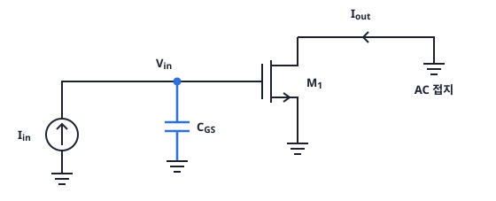

*입력은 전류원으로 넣고 출력은 AC 접지로 단락해 전류만 재며, $C_{GD}$는 $C_{GS}$보다 훨씬 작아서 그림에서 뺐어요.*

**정확히 말하면**

주파수 응답(frequency response)은 증폭기가 얼마나 빠르게, 어느 주파수까지 동작하는지를 정해요. 이를 제한하는 것은 커패시터예요. 인덕터도 주파수에 따라 임피던스가 바뀌지만, 일부러 만들지 않으면 회로에 거의 나타나지 않아요. 저항과 커패시터가 있으면 노드마다 극점(pole)이 생기고, 극점 주파수를 지나면 이득이 떨어져요. 영점(zero)은 이득을 다시 올릴 수 있지만 보통 더 높은 주파수에 있어서, 극점 때문에 이득이 먼저 떨어져요.

이 커패시턴스는 우리가 단 부품이 아니라 트랜지스터 자체의 기생 커패시턴스(parasitic capacitance)예요. 낮은 주파수에서는 임피던스가 매우 커서 개방으로 보았지만, 주파수가 높아지면 임피던스가 작아져 무시할 수 없어요. 그래서 고주파 해석에는 커패시턴스를 넣은 고주파 모델을 쓰며, 엄밀하게는 이것이 더 일반적인 모델이에요. 회로에는 저항과 다른 소자도 붙으므로 회로의 속도는 트랜지스터 자체의 속도보다 높아질 수 없어요. 트랜지스터의 이 궁극적인 속도를 나타내는 값이 트랜싯 주파수(transit frequency) $f_T$예요.

**정의:** $f_T$는 입력에서 출력으로의 전류 이득(current gain)이 1로 떨어지는 주파수예요. 전압 이득이 아니라 전류 이득으로 정한 이유는 트랜지스터의 출력이 기본적으로 전류이기 때문이에요.

**작은 예시 적용:** 이 측정에서 얻는 전류 이득 $\left|\frac{I_{out}}{I_{in}}\right|=\frac{g_m}{\omega C_{GS}}$에 $\omega=\omega_T/10$을 넣으면 전류 이득은 10이에요. 주파수를 10배 올려 $\omega=\omega_T$가 되면 같은 식이 1이 되어요.

**쓰는 커패시턴스:** 포화 영역에서 $C_{GS}\approx\frac{2}{3}WLC_{ox}$예요. 여기서 $C_{ox}$는 단위 면적당 산화막 커패시턴스이고, 오버랩 성분도 $C_{GS}$에 더해져요. 드레인 전압이 걸리면 채널이 비대칭이 되고 전자가 소스 쪽에 몰리므로 게이트 커패시턴스가 주로 $C_{GS}$에 나타나요. $C_{GD}$는 주로 오버랩 커패시턴스라 훨씬 작아서 여기서는 무시해요. 접합 커패시턴스 $C_{SB}$, $C_{DB}$는 바디가 AC 접지이므로 소스–접지, 드레인–접지 커패시턴스로 보아요. 이 측정에서는 소스와 드레인이 모두 AC 접지라 두 커패시턴스의 양 끝이 접지여서 전류 이득에 영향을 주지 않아요.

**측정 조건:** 입력에 전류원 $I_{in}$을 넣고 출력(드레인)은 AC 접지로 단락해 출력 전류 $I_{out}$을 재요. 크기만 비교하므로 $I_{out}$의 부호는 생략해요.

1. 입력 노드에는 $C_{in}\approx C_{GS}$ 하나만 보여요. 입력 전압은 입력 전류와 그 임피던스의 곱이에요.

   $$
   V_{GS}=V_{in}=I_{in}\cdot\frac{1}{sC_{in}}
   $$
2. 출력이 AC 접지이므로 출력 전류는 드레인 소신호 전류 그대로예요.

   $$
   I_{out}=I_{D1}=g_mV_{GS}
   $$
3. 두 식을 나누고 $s=j\omega$를 넣어 크기를 봐요.

   $$
   \left|\frac{I_{out}}{I_{in}}\right|=\frac{g_m}{\omega C_{in}}
   $$
4. 이 값이 1이 되는 각주파수가 $\omega_T$예요.

   $$
   \omega_T=\frac{g_m}{C_{in}}\approx\frac{g_m}{C_{GS}}
   $$
5. $\omega=2\pi f$이므로 슬라이드의 식이 나와요.

   $$
   2\pi f_T\approx\frac{g_m}{C_{GS}}
   $$

$\omega_T$의 단위는 rad/s이고 $f_T=\omega_T/(2\pi)$의 단위는 Hz예요. $g_m$이 클수록(전류가 클수록) $f_T$가 높고, $C_{GS}$가 클수록 $f_T$가 낮아요. 이 관계를 소자 크기로 바꾸어 보는 내용은 [L을 줄이면 빨라져요](#s0-ft-scaling)에서 이어져요.

**교수님 말씀**

> “트랜지스터는 기본적으로 출력이 전류죠.”

그래서 $f_T$를 전압 이득이 아닌 전류 이득으로 정의한다는 설명이에요.

> “커패시턴스를 포함한 모델이 제너럴한 모델이에요.”

저주파 모델은 커패시터의 임피던스가 매우 큰 특수한 경우라는 뜻이에요.

**꼭 기억해요**

> “트랜지스터 자체의 동작 속도보다는 회로가 동작 속도가 더 높아질 수는 없죠, 당연히.”

$f_T$는 전압 이득이 아니라 전류 이득이 1이 되는 주파수예요.

**페이지 요약**

트랜싯 주파수 $f_T$는 출력을 AC 접지로 두었을 때 전류 이득이 1로 떨어지는 주파수예요.

*핵심 식*

- 전류 이득의 크기

  $$
  \left|\frac{I_{out}}{I_{in}}\right|=\frac{g_m}{\omega C_{in}}
  $$
- 트랜싯 주파수

  $$
  \omega_T=\frac{g_m}{C_{in}}\approx\frac{g_m}{C_{GS}}
  $$

$C_{GD}$는 $C_{GS}$보다 훨씬 작아 무시한 근사예요.

*용어*

- **트랜싯 주파수(transit frequency)** — 트랜지스터 자체의 궁극적인 속도를 나타내는 주파수예요.
- **전류 이득(current gain)** — 입력 전류에 대한 출력 전류의 비예요.

---

### L을 줄이면 빨라져요

*1028 수업 · L05 s24*

**쉽게 말하면**

과구동 전압을 그대로 두고 채널 길이 L을 절반으로 줄이면 $f_T$는 4배로 올라가요.

$f_T$가 $1/L^2$에 비례하므로 L을 1/3로 줄이면 9배가 되어요.

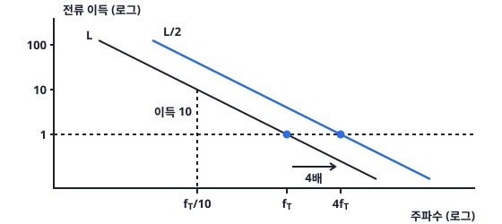

*단순 모델에서 전류 이득은 주파수에 반비례하는 직선이고, L을 절반으로 줄이면 이득 1을 지나는 점이 4배 높은 주파수로 옮겨 가요.*

**정확히 말하면**

**작은 예시 적용:** $\mu_n$과 $V_{GS}-V_{TH}$를 고정하고 $L$만 $L/2$로 바꾸면, 결과식 $2\pi f_T\approx\frac{3}{2}\frac{\mu_n(V_{GS}-V_{TH})}{L^2}$의 분모 $L^2$이 1/4이 되므로 $f_T$는 4배예요.

$f_T$를 큰 신호 파라미터로 바꾸어 써요. 포화 전류식 $I_D=\frac{1}{2}k(V_{GS}-V_{TH})^2$, $k=\mu_nC_{ox}\frac{W}{L}$를 미분하면 $g_m$이 나와요.

1. 입력 커패시턴스예요.

   $$
   C_{GS}\approx\frac{2}{3}WLC_{ox}
   $$
2. 트랜스컨덕턴스예요.

   $$
   g_m=\mu_nC_{ox}\frac{W}{L}(V_{GS}-V_{TH})
   $$
3. $2\pi f_T\approx\frac{g_m}{C_{GS}}$에 대입하면 $W$와 $C_{ox}$가 약분돼요.

   $$
   2\pi f_T\approx\frac{\mu_nC_{ox}\frac{W}{L}(V_{GS}-V_{TH})}{\frac{2}{3}WLC_{ox}}
   $$
4. 정리하면 $L^2$에 반비례해요.

   $$
   2\pi f_T=\omega_T\approx\frac{3}{2}\frac{\mu_n(V_{GS}-V_{TH})}{L^2}
   $$

**배율 정리:** 고정 인자는 $\mu_n$, $V_{GS}-V_{TH}$, $C_{ox}$예요. 변하는 인자는 $L\to L/2$이고, 수업 예처럼 폭도 $W\to W/2$로 함께 줄여요.

1. $g_m\propto W/L$이므로 $(W/2)/(L/2)$로 그대로예요.

   $$
   \frac{g_m^*}{g_m}=1
   $$
2. $C_{GS}\propto WL$이므로 1/4이 돼요.

   $$
   \frac{C_{GS}^*}{C_{GS}}=\frac{1}{4}
   $$
3. 두 배율을 합치면 4배예요.

   $$
   \frac{f_T^*}{f_T}=\frac{g_m^*/g_m}{C_{GS}^*/C_{GS}}=\frac{1}{1/4}=4
   $$

폭을 그대로 두어도 $g_m$이 2배, $C_{GS}$가 1/2배가 되어 결과는 같은 4배예요. 폭은 $g_m$과 $C_{GS}$에 같은 비율로 들어가 상쇄되므로, 4배의 이유는 $1/L^2$ 의존성이에요. $L$ 하나는 $C_{GS}$를 줄이고, 다른 하나는 $g_m$을 키우기 때문이에요.

**트레이드오프:** $g_m$은 전류가 클수록 커지므로 전류를 늘리면 $f_T$가 올라가요. 그러나 전류 소모는 적을수록 좋아서 전류와 속도 사이에는 트레이드오프(trade-off)가 있어요. 이 트레이드오프 없이 속도를 올리는 방법은 커패시턴스를 줄이는 것, 곧 $L$을 줄여 트랜지스터를 작게 만드는 것이에요. 이것이 테크놀로지 스케일링(technology scaling)이에요. $L$을 줄이는 목적은 집적도만이 아니라, 더 중요하게는 동작 속도를 높이는 것이에요.

**같은 속도에서 전력 절감:** $f_T$를 그대로 두면 필요한 $g_m$은 $C_{GS}$에 비례하고, $C_{GS}\propto WL$이에요. 전류는 $g_m=\sqrt{2kI_D}$를 거꾸로 푼 식으로 구해요.

$$
I_D=\frac{g_m^2}{2k}
$$

고정 인자는 $f_T$, $\mu_n$, $C_{ox}$, 그리고 폭 $W$예요. 변하는 인자는 $L\to L/2$ 하나예요.

1. $C_{GS}\propto WL$이 절반이 되므로 필요한 $g_m$도 절반이에요.

   $$
   \frac{g_m^*}{g_m}=\frac{C_{GS}^*}{C_{GS}}=\frac{1}{2}
   $$
2. $k=\mu_nC_{ox}\frac{W}{L}$는 $L$이 절반이라 2배가 돼요.

   $$
   \frac{k^*}{k}=2
   $$
3. 두 배율을 합치면 전류는 1/8이에요.

   $$
   \frac{I_D^*}{I_D}=\frac{(g_m^*/g_m)^2}{k^*/k}=\frac{1/4}{2}=\frac{1}{8}
   $$

폭도 함께 절반으로 줄여 $k$를 고정하면 $C_{GS}$가 1/4이 되어 필요한 $g_m$도 1/4이고, 전류는 $(1/4)^2=1/16$이에요. 이처럼 배율은 무엇을 고정하는지에 따라 달라지지만, 어느 경우든 같은 속도를 더 적은 전류로 얻어요. 수업에서는 이 이점을 "$g_m$을 절반으로, 전류를 1/4로"라고 말했지만, $k$ 고정과 $g_m$ 절반은 함께 성립하지 않아서 고정 인자를 하나씩 정해 바로잡았어요.

**쓸 수 있는 주파수:** $f_T$를 넘으면 전류 이득이 1보다 작아 트랜지스터가 증폭기로 동작하지 않아요. 증폭기는 1보다 충분히 큰 이득이 필요하므로 실제로는 $f_T$의 약 1/10까지 써요. 예를 들어 $f_T=100\ \mathrm{GHz}$이면 약 $10\ \mathrm{GHz}$까지 쓸 수 있어요. 현재 셀룰러 통신은 주로 10 GHz 이하이고, 5G·6G의 밀리미터파는 수십 GHz, 자동차 레이더는 77 GHz를 써요. 요즘 $f_T$는 수백 GHz 수준이에요.

**교수님 말씀**

> “사실은 더 중요한 것은 동작 속도를 높이기 위해서 L을 줄이는 겁니다.”

$L$ 축소는 단순히 트랜지스터를 작게 하는 것이 목적이 아니라는 강조예요.

> “L을 줄이는 게 굉장히 비용도 많이 들어요. … 그런데 이런 장점이 있기 때문에”

반도체 팹을 짓는 데 큰 비용이 들어도, 속도와 전력의 이점 때문에 테크놀로지 스케일링을 계속한다는 설명이에요.

**꼭 기억해요**

> “$C_{GS}$를 줄이는 게 가장 키 포인트겠죠.”

> “$f_T$까지 쓸 수 있다는 얘기와는 좀 다르고요. … 보통 $f_T$의 한 1/10 정도”

$f_T$는 사용 가능한 주파수가 아니라 전류 이득이 1이 되는 한계예요.

**페이지 요약**

과구동 전압을 고정하면 $f_T$는 $L^2$에 반비례해서, $L$을 절반으로 줄이면 4배가 돼요.

*핵심 식*

- 큰 신호 파라미터로 쓴 트랜싯 주파수

  $$
  2\pi f_T=\omega_T\approx\frac{3}{2}\frac{\mu_n(V_{GS}-V_{TH})}{L^2}
  $$

폭 $W$는 $g_m$과 $C_{GS}$에 같은 비율로 들어가 약분돼요.

실제로 쓰는 주파수는 $f_T$의 약 1/10이에요.

*용어*

- **테크놀로지 스케일링(technology scaling)** — $L$을 줄여 커패시턴스를 낮추고 속도를 높이는 공정 발전이에요.
- **트레이드오프(trade-off)** — 전류를 늘리면 빨라지지만 전력 소모도 늘어나는 관계예요.

---

### BJT에서는 베이스-이미터 커패시턴스가 자리를 바꿔요

*1028 수업 · L05 s24 · s21–22*

**쉽게 말하면**

BJT 입력에는 $r_\pi$와 $C_\pi$가 나란히 있지만, $f_T$ 근처의 높은 주파수에서는 입력 전류가 거의 다 $C_\pi$로 흘러요.

예를 들어 $\beta=100$이면 $f_T$에서 $C_\pi$의 임피던스가 $r_\pi$의 1/100이라, $r_\pi$로 가는 전류는 약 1/100뿐이어서 MOS 식의 $C_{GS}$ 자리에 $C_\pi$를 넣으면 돼요.

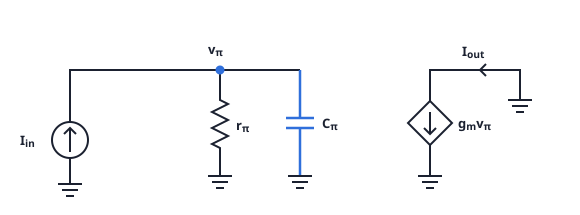

*출력이 AC 접지라 양 끝 전압이 0인 $r_o$와 작은 $C_\mu$, 양 끝이 접지인 $C_{CS}$는 그림에서 뺐어요.*

**정확히 말하면**

BJT의 커패시턴스는 베이스–이미터의 $C_\pi$, 베이스–컬렉터의 $C_\mu$, 컬렉터–기판(접지)의 $C_{CS}$예요. 입력 커패시턴스는 주로 $C_\pi$로 정해지고, $C_\pi$는 MOS의 $C_{GS}$에 대응해요. MOS에서 $C_{GD}$를 뺀 것처럼 작은 $C_\mu$는 빼요. 측정 조건도 [전류 이득이 1이 되는 주파수](#s0-ft-mos)와 같아서, 입력에 전류원을 넣고 컬렉터를 AC 접지로 단락해요.

MOS와 다른 점은 베이스–이미터 사이에 $r_\pi$가 $C_\pi$와 병렬로 있다는 것이에요.

**작은 예시 적용:** 결과 $\omega_T\approx g_m/C_\pi$에서는 $\frac{1}{\omega_TC_\pi}=\frac{1}{g_m}=\frac{r_\pi}{\beta}$예요. $\beta=100$이면 $C_\pi$의 임피던스가 $r_\pi$의 1/100이므로 입력 전류는 거의 $C_\pi$로 흘러요.

1. 입력 노드에서 보이는 임피던스는 두 소자의 병렬이에요.

   $$
   Z_{in}=r_\pi\parallel\frac{1}{sC_\pi}
   $$
2. $f_T$ 근처에서는 $\left|\frac{1}{j\omega C_\pi}\right|\ll r_\pi$이므로 $C_\pi$의 임피던스가 남아요.

   $$
   Z_{in}\approx\frac{1}{sC_\pi}
   $$
3. 입력 전압은 입력 전류와 이 임피던스의 곱이에요.

   $$
   V_\pi\approx I_{in}\cdot\frac{1}{sC_\pi}
   $$
4. 컬렉터가 AC 접지이므로 출력 전류는 종속 전류원 전류예요.

   $$
   I_{out}=g_mV_\pi
   $$
5. 크기가 1이 되는 각주파수를 구해요.

   $$
   \left|\frac{I_{out}}{I_{in}}\right|\approx\frac{g_m}{\omega C_\pi}=1
   $$
6. MOS 식의 $C_{GS}$ 자리에 $C_\pi$가 들어간 형태예요.

   $$
   2\pi f_T\approx\frac{g_m}{C_\pi}
   $$

주파수가 낮을 때는 $C_\pi$의 임피던스가 커서 입력에 $r_\pi$가 보여요. $f_T$를 정하는 높은 주파수에서만 $C_\pi$가 입력을 지배해요. 2단계의 근사는 $\beta\gg1$일 때 성립하고, $\frac{1}{\omega_TC_\pi}=\frac{r_\pi}{\beta}$이기 때문이에요.

**교수님 말씀**

> “BJT에서는 $C_{GS}$ 대신에 $C_\pi$가 들어간다, 그것이 차이가 있죠”

새로 유도하지 않아도 MOS 결과에서 입력 커패시턴스만 바꾸면 된다는 뜻이에요.

> “예전에는 주로 BJT가 많이 쓰였어요 … 동작 주파수가 훨씬 더 높았기 때문입니다.”

지금은 MOS가 계속 스케일링되어 수십 GHz 대역에서도 동작한다고 덧붙이셨어요.

**페이지 요약**

BJT의 $f_T$는 MOS 식의 $C_{GS}$ 자리에 $C_\pi$를 넣어 구해요.

*핵심 식*

- BJT 트랜싯 주파수

  $$
  2\pi f_T\approx\frac{g_m}{C_\pi}
  $$
- 입력 임피던스

  $$
  Z_{in}=r_\pi\parallel\frac{1}{sC_\pi}
  $$

$f_T$ 근처에서는 $\left|\frac{1}{j\omega C_\pi}\right|\ll r_\pi$라서 입력 전류가 거의 $C_\pi$로 흘러요.

*용어*

- **$C_\pi$** — 베이스–이미터 커패시턴스로, MOS의 $C_{GS}$에 대응해요.
- **$r_\pi$** — 낮은 주파수에서 입력에 보이는 베이스–이미터 소신호 저항이에요.

---

## 2. 주파수 응답 해석 전략 다시 보기

### 극점은 노드마다, 떠 있는 C는 밀러로

*1028 수업 · L05 s25–s26 · L05 s8–s13 복습*

**쉽게 말하면**

신호 경로의 노드마다 그 노드에서 본 저항과 커패시턴스의 곱의 역수로 극점이 하나씩 생기고, 이득 그래프는 극점을 지날 때마다 기울기가 −20 dB/dec씩 더 내려가요.

예를 들어 저주파 이득 $A_0$가 20 dB이고 두 극점이 $\omega_{p1}$과 $\omega_{p2}=100\,\omega_{p1}$이면, 기울기는 0 → −20 → −40 dB/dec로 바뀌고 $\omega_{p2}$에서 꺾은선 높이는 −20 dB예요.

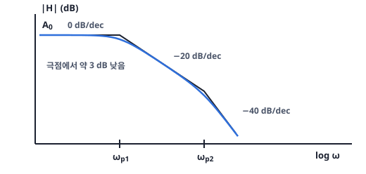

*영점이 관심 범위 밖인 저역통과 응답의 보데 근사(검은 꺾은선)이고, 실제 곡선(강조색)은 부드럽게 변하며 각 극점에서 약 3 dB 낮아요.*

**정확히 말하면**

작은 예시부터 적용해요. $A_0=20\,\mathrm{dB}$는 $10\,[\mathrm{V/V}]$예요. 꺾은선은 $\omega_{p1}$까지 20 dB로 평평하고, $\omega_{p1}$에서 $\omega_{p2}$까지 두 decade 동안 −20 dB/dec로 40 dB 내려가 $\omega_{p2}$에서 −20 dB가 돼요. 그 뒤로는 −40 dB/dec예요. 실제 값은 $\omega_{p1}$에서 약 17 dB(≈16.99 dB)예요.

1. 주파수 응답(frequency response)은 전달 함수(transfer function)의 크기 $|H(j\omega)|$예요. 저주파에서 상수였던 이득이 주파수의 함수가 되었기 때문에 전달 함수라고 불러요. 위상도 바뀌지만 여기서는 크기를 봐요.
2. 극점과 영점을 알면 전달 함수를 다음처럼 써요.

   $$
   H(s)=A_0\frac{(1+s/\omega_{z1})(1+s/\omega_{z2})}{(1+s/\omega_{p1})(1+s/\omega_{p2})}
   $$

   극점 $s=-\omega_p$는 음수예요. 그래서 주파수의 크기는 절댓값 $|\omega_p|$로 표기해요.
3. 보데 근사(Bode approximation)는 극점을 지날 때마다 기울기에 −20 dB/dec를, 영점을 지날 때마다 +20 dB/dec를 더해요. 정확한 곡선은 극점에서 꺾은선보다 약 3 dB 낮아요.

   $$
   \begin{aligned}20\log_{10}\left|\frac{1}{1+j}\right|&=-10\log_{10}2\\&\approx-3.01\,\mathrm{dB}\end{aligned}
   $$
4. 극점을 구하려면 원래 전달 함수가 필요해요. 대신 신호 경로의 노드 $k$마다 극점 하나를 대응시켜요. $R_k$는 그 노드에서 AC 접지까지 본 등가 저항, $C_k$는 그 노드와 접지 사이의 등가 커패시턴스예요.

   $$
   |\omega_{p,k}|=\frac{1}{R_kC_k}
   $$
5. 저주파 이득(low-frequency gain) $A_0$는 커패시터를 개방한 기존 저주파 해석으로 구해요. 영점을 무시할 수 있으면 극점과 $A_0$로 노드 방정식 없이 전달 함수를 거꾸로 세워요.

   $$
   H(s)\approx\frac{A_0}{(1+s/\omega_{p1})(1+s/\omega_{p2})}
   $$

   예를 들어 $R_L\ll r_o$라서 $r_o$를 생략한 CS 단은 $A_0\approx-g_mR_L$예요. 극점은 [CS 단: 밀러 곱셈이 입력 극점을 끌어내려요](#s2-cs-miller)에서 구해요.
6. 두 노드 사이에 걸린 플로팅 커패시턴스(floating capacitance) $C_F$는 어느 단자도 접지가 아니어서 4단계 규칙을 바로 쓸 수 없어요. 노드 1에서 노드 2까지의 이득을 $A_v$라 하면, 밀러 정리(Miller's theorem)로 각 노드에서 접지로 가는 두 커패시턴스로 바꿔요.

   $$
   C_1=(1-A_v)C_F
   $$

   $$
   C_2=\left(1-\frac{1}{A_v}\right)C_F
   $$
7. 실제 $A_v$는 주파수의 함수예요. 손계산에서는 이를 저주파 이득으로 대신하므로 밀러 근사(Miller approximation)라고 불러요. 예를 들어 저주파 이득이 $A_v=-9$이면 $C_1=10\,C_F$, $C_2=(10/9)\,C_F\approx1.11\,C_F$예요. 이 근사가 놓치는 것은 [우반면 영점: 출력이 0이 되는 순간](#s3-zero)과 [세 방법 비교: 숫자로 확인해요](#s4-compare)에서 확인해요.

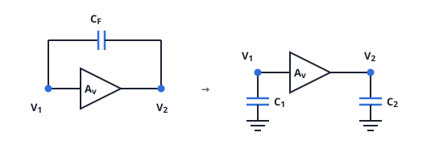

*떠 있는 $C_F$를 $C_1=(1-A_v)C_F$와 $C_2=(1-1/A_v)C_F$로 바꾸면 노드마다 $R_kC_k$로 극점을 구할 수 있어요.*

밀러 정리의 유도와 저주파 이득으로 극점을 추정하던 첫 예제는 [1016 정리노트: 떠 있는 임피던스를 접지로 옮기기](../../1016/정리노트_1016_Miller_High_Frequency_Models.html#s0-miller)에서 다시 볼 수 있어요.

**교수님 말씀**

교수님은 이득과 전달 함수의 크기는 같은 얘기이고, 주파수의 함수로 나타나서 전달 함수라고 부른다고 했어요.

이어서 극점을 얻는 지름길을 이렇게 물었어요.

> “전달 함수를 구하지 않고도 폴을 구할 수 있는 방법이 없을까?”

답은 노드마다 등가 R과 C의 곱으로 극점을 구하고, 저주파 해석으로 얻은 $A_0$를 붙여 전달 함수를 거꾸로 세우는 것이었어요. 지금까지 채운 기본 개념을 저주파에서 배운 단들의 고주파 해석에 적용하겠다고 했고, 첫 대상은 [CS 단 고주파 모델 세우기](#s2-model)예요.

**꼭 기억해요**

> “단! 단, 밀러 정리를 이용할 때 한계가 있습니다, 한계.”

> “한계를 알아야 … 결과가 이상하면 … 정확도가 떨어지는지를 알 수가 있을 텐데요.”

한계의 원인은 주파수에 따라 바뀌는 이득 대신 저주파 이득을 쓴다는 점이에요.

**페이지 요약**

노드마다 $R_kC_k$의 역수로 극점을 구하고 저주파 이득 $A_0$를 붙이면 전달 함수를 세울 수 있어요.

*핵심 식*

- 노드 극점

  $$
  |\omega_{p,k}|=\frac{1}{R_kC_k}
  $$
- 전달 함수 재구성

  $$
  H(s)\approx\frac{A_0}{(1+s/\omega_{p1})(1+s/\omega_{p2})}
  $$
- 밀러 입력 쪽

  $$
  C_1=(1-A_v)C_F
  $$

*용어*

- **보데 근사 (Bode approximation)** — 극점마다 −20 dB/dec, 영점마다 +20 dB/dec씩 기울기를 바꾸는 꺾은선이에요.
- **플로팅 커패시턴스 (floating capacitance)** — 두 단자가 모두 접지가 아니어서 밀러 정리로 나눠야 하는 커패시턴스예요.
- **밀러 근사 (Miller approximation)** — 주파수에 따라 바뀌는 $A_v$를 저주파 이득으로 대신한 밀러 정리예요.

---

## 3. CS·CE 단: 밀러 근사로 극점 구하기

### CS 단 고주파 모델 세우기

*1028 수업 · L05 s27–s28*

**쉽게 말하면**

CS 단에 트랜지스터 커패시턴스를 넣으면 $C_{GS}$와 $C_{DB}$는 노드와 접지 사이에 붙지만, $C_{GD}$는 입력 노드 X와 출력 노드 사이에 떠 있는 플로팅 커패시턴스예요.

예를 들어 소스–바디의 $C_{SB}$는 양 끝이 모두 접지라 모델에서 빠지고, 앞단의 출력 임피던스 $R_S$는 빼면 입력 노드 저항이 달라져 극점도 달라지므로 꼭 넣어요.

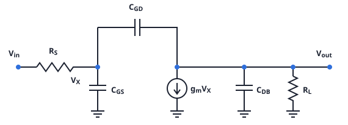

*노드 X에는 $R_S$와 $C_{GS}$, 출력에는 $g_mV_X$·$C_{DB}$·$R_L$이 붙고, $R_L\ll r_o$라서 $r_o\parallel R_L\approx R_L$로 보고 $r_o$는 그리지 않았어요.*

**정확히 말하면**

예시를 그림에 맞춰 보면, 소스와 바디가 모두 접지라서 $C_{SB}$의 두 끝 전압은 둘 다 0이에요. 전류가 흐를 수 없으므로 $C_{SB}$는 그리지 않아요.

$R_S$는 일부러 단 저항이 아니에요. 신호를 주는 소스, 즉 앞단의 출력 임피던스(output impedance)를 등가로 그린 것이에요. 이것을 빼고 입력 노드의 등가 저항을 구하면 실제로 앞단을 연결했을 때의 극점과 달라져요.

1. 원 회로는 $V_{in}$ → $R_S$ → 게이트(노드 X)이고, 소스는 접지, 드레인(출력)은 $R_L$을 거쳐 $V_{DD}$에 이어져요. 소신호에서 $V_{DD}$는 AC 접지예요.
2. $g_m$, $R_S$, $R_L$은 주파수와 무관해요. 이득이 주파수의 함수가 되는 원인은 트랜지스터 커패시턴스 $C_{GS}$(게이트–소스), $C_{GD}$(게이트–드레인), $C_{DB}$(드레인–바디)예요.
3. 노드 X는 $R_S$로 $V_{in}$에, $C_{GS}$로 접지에 이어져요. 소스가 접지이므로 $V_X$가 곧 게이트–소스 전압이에요.
4. 출력 노드에서 접지까지 제어 전류원 $g_mV_X$(출력 → 접지 방향), $C_{DB}$, $R_L$이 병렬이에요. $r_o$도 병렬로 있지만 $R_L\ll r_o$이면

   $$
   r_o\parallel R_L\approx R_L
   $$

   이라 생략해요. $r_o$를 넣을지는 병렬로 붙였을 때 $r_o$가 보이느냐로 판단해요.
5. $C_{GD}$는 X와 출력 사이에 걸려 어느 쪽 끝도 접지가 아닌 플로팅 커패시턴스예요. 노드마다 접지까지 본 R과 C의 곱으로 극점을 구하는 규칙을 그대로 쓸 수 없어서, 밀러 정리로 입력 쪽과 출력 쪽의 접지 커패시턴스로 나눠요.

이 모델로 노드 KCL을 바로 풀면 분모가 2차이고 계수가 복잡한 전달 함수가 나와요([노드 KCL로 정확한 전달 함수 세우기](#s3-direct)). 그래서 먼저 노드별 등가 R·C로 극점을 구해요([CS 단: 밀러 곱셈이 입력 극점을 끌어내려요](#s2-cs-miller)).

트랜지스터가 여러 개면 크기가 달라 커패시턴스 값도 다르므로 $C_{GS1}$, $C_{GS2}$처럼 번호를 붙여요. 각 커패시턴스가 어디서 생기는지는 [1016 정리노트: MOS의 네 커패시턴스](../../1016/정리노트_1016_Miller_High_Frequency_Models.html#s2-mos)에서 다시 볼 수 있어요.

**교수님 말씀**

교수님은 $R_S$가 일부러 다는 저항이 아니라 앞단의 출력 임피던스를 등가로 표현한 것이라고 했어요.

> “RS를 무시하고 … 폴을 구했다, 그럼 연결했을 경우의 폴과 달라진다”

$C_{SB}$는 접지와 접지 사이에 있어 의미가 없다고 했어요.

> “있으나 없으나 똑같죠”

$r_o$를 생략하는 기준도 짚었어요.

> “병렬로 보였을 때 ro가 보이느냐 안 보이느냐 이거의 차이”

**페이지 요약**

CS 단 고주파 모델에서는 $C_{GD}$만 입력 노드 X와 출력 사이에 뜬 플로팅 커패시턴스예요.

$R_S$는 앞단의 출력 임피던스라서 입력 극점 계산에 꼭 넣어요.

$C_{SB}$는 양 끝이 접지라서 모델에서 빠져요.

*핵심 식*

- $r_o$ 생략 ($R_L\ll r_o$)

  $$
  r_o\parallel R_L\approx R_L
  $$

*용어*

- **플로팅 커패시턴스 (floating capacitance)** — 두 끝이 모두 접지가 아닌 노드에 걸린 커패시턴스예요.
- **소스 임피던스 $R_S$ (source impedance)** — 앞단의 출력 임피던스를 등가로 나타낸 저항이에요.

---

### CS 단: 밀러 곱셈이 입력 극점을 끌어내려요

*1028 수업 · L05 s28*

**쉽게 말하면**

CS 단에서 $C_{GD}$는 입력 쪽에서 $(1+g_mR_L)$배로 커 보이고, 이 큰 커패시턴스가 입력 극점을 낮은 주파수로 끌어내려요.

$g_mR_L=10$이면 $C_{GD}=80\,\mathrm{fF}$가 입력에서 $11\times80=880\,\mathrm{fF}$로 보여 $C_{GS}=250\,\mathrm{fF}$보다 커지고, 출력 쪽에서는 $88\,\mathrm{fF}$로 거의 그대로예요.

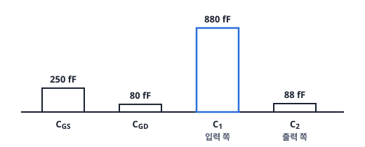

*같은 $C_{GD}$라도 $g_mR_L=10$일 때 입력 쪽 $C_1$은 11배, 출력 쪽 $C_2$는 1.1배로 보여요.*

**정확히 말하면**

예시 값 $g_mR_L=10$, $C_{GD}=80\,\mathrm{fF}$, $C_{GS}=250\,\mathrm{fF}$를 아래 식에 먼저 넣어 보면 다음과 같아요.

$$
C_1=(1+10)\times80\,\mathrm{fF}=880\,\mathrm{fF}
$$

$$
C_2=\left(1+\frac{1}{10}\right)\times80\,\mathrm{fF}=88\,\mathrm{fF}
$$

$$
C_{GS}+C_1=250\,\mathrm{fF}+880\,\mathrm{fF}=1130\,\mathrm{fF}
$$

입력 노드 커패시턴스가 $C_{GS}$만 있을 때의 $1130/250=4.52$배가 되므로, 같은 $R_S$에서 입력 극점은 그만큼 낮아져요.

밀러 변환에 넣을 노드 X → 출력의 저주파 이득을, 커패시터를 모두 개방한 모델에서 먼저 구해요.

출력을 접지에 단락하면 $g_mV_X$가 모두 단락선으로 흘러요. 출력 노드에서 드레인으로 끌려 들어가는 방향을 $i_{out}$의 양의 방향으로 잡으면

$$
G_m=\frac{i_{out}}{V_X}=g_m
$$

이에요.

입력을 영점($V_X=0$)으로 두면 제어 전류원이 꺼지고, $r_o$를 생략한 모델($R_L\ll r_o$)에서 출력에서 접지까지 보이는 저항은

$$
R_{out}\approx R_L
$$

이에요.

$i_{out}$이 출력 노드에서 빠져나가므로 $V_{out}=-i_{out}R_{out}$이고

$$
A_v=\frac{V_{out}}{V_X}=-G_mR_{out}\approx-g_mR_L
$$

이에요.

1. 밀러 정리로 플로팅 $C_{GD}$를 X–접지의 $C_1$과 출력–접지의 $C_2$로 바꿔요. $A_v$는 X에서 출력까지의 이득이에요.

   $$
   C_1=(1-A_v)C_{GD}
   $$

   $$
   C_2=\left(1-\frac{1}{A_v}\right)C_{GD}
   $$
2. 실제 $A_v$는 주파수의 함수예요. 그대로 쓰면 노드 방정식을 푸는 것과 같아지므로 저주파 이득 $A_v\approx-g_mR_L$로 바꿔요. 이 지점이 밀러 근사의 근사예요.
3. $A_v$가 음수라서 $1-A_v$는 실제로 더해져요.

   $$
   C_1=(1+g_mR_L)C_{GD}
   $$

   입력 쪽에 이득만큼 크게 보이는 이 커패시턴스를 밀러 커패시턴스(Miller capacitance)라 하고, 이렇게 커 보이는 현상을 밀러 효과(Miller effect)라고도 해요.
4. 출력 쪽은 $g_mR_L\gg1$일 때 거의 $C_{GD}$ 그대로예요.

   $$
   C_2=\left(1+\frac{1}{g_mR_L}\right)C_{GD}\approx C_{GD}
   $$
5. 입력 노드에서 $V_{in}$을 영점으로 두면 X에서 접지까지 저항은 $R_S$, 커패시턴스는 $C_{GS}$와 $C_1$의 병렬 합이에요.

   $$
   \begin{aligned}|\omega_{p,in}|&=1\Big/\Big(R_S\big[C_{GS}\\&\qquad+(1+g_mR_L)C_{GD}\big]\Big)\end{aligned}
   $$
6. 출력 노드의 저항은 $R_L$($R_L\ll r_o$), 커패시턴스는 $C_{DB}$와 $C_2$의 병렬 합이에요.

   $$
   \begin{aligned}|\omega_{p,out}|&=1\Big/\Big(R_L\Big[C_{DB}\\&\qquad+\Big(1+\frac{1}{g_mR_L}\Big)C_{GD}\Big]\Big)\end{aligned}
   $$
7. 극점은 원래 음수이므로 주파수 크기는 절댓값으로 써요. 저주파 이득에 두 극점을 붙이면 2차 전달 함수가 돼요.

   $$
   \frac{V_{out}}{V_{in}}(s)\approx\frac{-g_mR_L}{\left(1+\frac{s}{|\omega_{p,in}|}\right)\left(1+\frac{s}{|\omega_{p,out}|}\right)}
   $$

보통 $C_{GS}$가 가장 크고 밀러 항도 무시할 수 없어서 입력 노드의 RC 곱이 더 커요. 그러면 $\omega_{p,in}$이 더 낮은 주파수에 놓여 이득이 먼저 떨어지기 시작하는 지배극(dominant pole)이 돼요. 밀러 근사의 지배극은 언제나 두 노드 극점 중 더 낮은 쪽이고, 이 판단은 두 노드의 RC 곱을 비교한 결과예요. $R_S$가 작으면 출력 극점이 먼저 올 수 있어요. 예를 들어 슬라이드 s34 값($R_S=200\,\Omega$)에서는 밀러 출력 극점 428 MHz가 입력 극점 571 MHz보다 낮아서, 밀러가 예측한 지배극은 출력 극점이에요. 정확한 해와의 차이는 [세 방법 비교: 숫자로 확인해요](#s4-compare)에서 확인해요.

밀러 근사로 극점을 추정하는 기본 절차는 [1016 정리노트: CS 예제: 저주파 이득으로 극점을 추정하기](../../1016/정리노트_1016_Miller_High_Frequency_Models.html#s0-poles)에도 있어요.

#### 직접 해 보기: 밀러 증배가 입력 극점을 끌어내려요 *(정적 스냅샷 — 직접 조작은 HTML 버전)*

$g_mR_L$ 슬라이더를 움직이면 입력 등가 커패시턴스 $C_{GS}+(1+g_mR_L)C_{GD}$ 막대와 두 극점의 위치가 함께 움직여요. $R_S=1\,\mathrm{k\Omega}$, $R_L=2\,\mathrm{k\Omega}$, $C_{GS}=250\,\mathrm{fF}$, $C_{GD}=80\,\mathrm{fF}$, $C_{DB}=100\,\mathrm{fF}$로 고정하고, 밀러 근사의 두 극점만으로 크기 곡선을 그려요(영점은 넣지 않았어요).

현재 값: **입력 C ≈ 1130 fF · |fp,in| ≈ 140.85 MHz · |fp,out| ≈ 423.28 MHz · 밀러 지배극(더 낮은 쪽): 입력 극점**

범례: 크기 곡선 $|H|$ · 입력 극점 위치(점선) · 출력 극점 위치(점선)

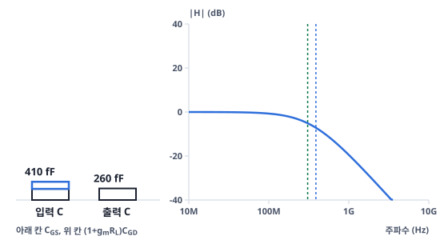

*$g_mR_L=1$*

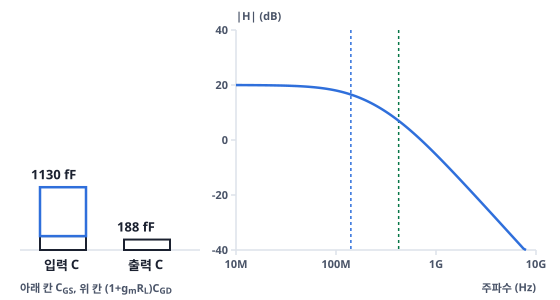

*$g_mR_L=10$*

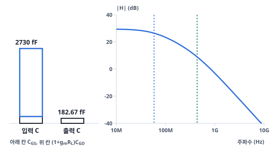

*$g_mR_L=30$*

| 설정 | 입력 등가 C | 입력 극점 $\vert f_{p,in}\vert $ | 출력 극점 $\vert f_{p,out}\vert $ | 밀러 지배극(더 낮은 쪽) |
|---|---|---|---|---|
| $g_mR_L=1$ | 410 fF | 388.18 MHz | 306.07 MHz | 출력 극점 |
| $g_mR_L=10$ | 1130 fF | 140.85 MHz | 423.28 MHz | 입력 극점 |
| $g_mR_L=30$ | 2730 fF | 58.3 MHz | 435.64 MHz | 입력 극점 |

**교수님 말씀**

교수님은 $C_{GD}$가 $C_{GS}$보다 훨씬 작아도 이득만큼 커지면 무시할 수 없다고 예를 들었어요(정확한 배수는 $1+g_mR_L$이에요).

> “이득이 예를 들어 10배라고 하면 원래 캡보다 10배가 증가”

이득을 저주파 값으로 두는 이유도 설명했어요.

> “주파수의 함수로 구하면 다시 노드 방정식을 구하는 거하고 같아지니까”

출력 쪽 $C_2$는 $g_mR_L$이 1보다 충분히 크면 뒤의 항이 거의 0이라 큰 차이가 없다고 했어요.

**꼭 기억해요**

> “밀러 이펙트가 굉장히 크게 영향을 준다. 이게 이제 CS의 특징”

> “밀러 이펙트에 의해서 동작 속도가 굉장히 떨어지는 구조”

CS 단의 입력 극점은 밀러 커패시턴스 때문에 낮아지고, 이것이 동작 주파수를 떨어뜨리는 주요 원인이에요.

**페이지 요약**

밀러 근사에서 $C_{GD}$는 입력 쪽에 $(1+g_mR_L)C_{GD}$로 크게 보여 입력 극점을 끌어내려요.

$A_v$ 자리에 저주파 이득 $-g_mR_L$을 넣는 것이 근사의 출발점이에요.

밀러 근사의 지배극은 두 노드 극점 중 더 낮은 쪽이며, 보통 입력 극점이지만 두 노드의 RC 곱을 비교해 확인해요.

슬라이드 s34 값에서는 출력 극점 428 MHz가 입력 극점 571 MHz보다 낮아 밀러의 지배극이에요.

*핵심 식*

- 입력 극점

  $$
  \begin{aligned}|\omega_{p,in}|&=1\Big/\Big(R_S\big[C_{GS}\\&\qquad+(1+g_mR_L)C_{GD}\big]\Big)\end{aligned}
  $$
- 출력 극점

  $$
  \begin{aligned}|\omega_{p,out}|&=1\Big/\Big(R_L\Big[C_{DB}\\&\qquad+\Big(1+\frac{1}{g_mR_L}\Big)C_{GD}\Big]\Big)\end{aligned}
  $$

*용어*

- **밀러 커패시턴스 (Miller capacitance)** — 플로팅 $C_{GD}$가 입력 쪽에 이득만큼 곱해져 보이는 커패시턴스예요.
- **지배극 (dominant pole)** — 가장 낮은 주파수에 있어 이득이 먼저 떨어지기 시작하는 극점이에요.

---

### CE 단: 입력 저항은 신호원 저항과 베이스-이미터 소신호 저항의 병렬

*1028 수업 · L05 s29*

**쉽게 말하면**

CE 단도 $C_\mu$가 입력 쪽에서 $(1+g_mR_L)$배로 커 보이는 것은 같지만, 입력 노드 저항은 $R_S$ 하나가 아니라 $R_S\parallel r_\pi$예요.

$R_S=1\,\mathrm{k\Omega}$, $r_\pi=2.6\,\mathrm{k\Omega}$이면 입력 노드 저항은 약 $0.72\,\mathrm{k\Omega}$이라서, $R_S$만 쓸 때보다 입력 극점이 약 1.38배 높아져요.

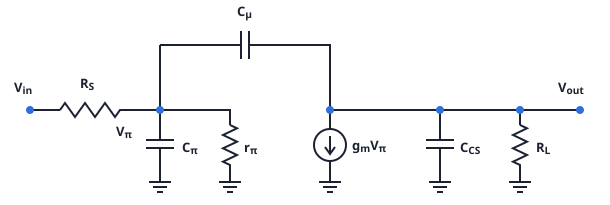

*베이스 노드에는 $C_\pi$와 $r_\pi$가 접지로, $C_\mu$는 입력과 출력 사이에 떠 있고, 출력에는 $g_mV_\pi$·$C_{CS}$·$R_L$이 붙으며 $R_L\ll r_o$라서 $r_o$는 그리지 않았어요.*

**정확히 말하면**

예시 값을 넣으면 입력 노드 저항은 다음과 같아요.

$$
R_S\parallel r_\pi=\frac{1\times2.6}{1+2.6}\,\mathrm{k\Omega}\approx0.72\,\mathrm{k\Omega}
$$

$R_S$만 쓰면 입력 RC를 $\frac{1+2.6}{2.6}\approx1.38$배 크게 잡아 입력 극점을 그만큼 낮게 예측해요. 반대로 $R_S=10\,\mathrm{k\Omega}$이면 $r_\pi$ 쪽이 입력 저항을 정해요.

$$
R_S\parallel r_\pi=\frac{10\times2.6}{10+2.6}\,\mathrm{k\Omega}\approx2.06\,\mathrm{k\Omega}
$$

1. 구조는 CS 단과 같고 BJT의 커패시턴스가 자리를 채워요. $C_\pi$(베이스–이미터)는 입력 노드–접지, $C_{CS}$(컬렉터–기판)는 출력–접지, $C_\mu$(베이스–컬렉터)는 입력과 출력 사이의 플로팅 커패시턴스예요. MOS와 다른 점은 입력의 $r_\pi$예요.
2. 저주파 이득은 커패시터를 개방한 모델에서 CS와 같은 순서로 구해요.

   출력을 단락하고 컬렉터로 끌려 들어가는 전류를 $i_{out}$으로 잡으면

   $$
   G_m=\frac{i_{out}}{V_\pi}=g_m
   $$

   이에요.

   입력을 영점($V_\pi=0$)으로 두면 $r_o$를 생략한 모델($R_L\ll r_o$)에서

   $$
   R_{out}\approx R_L
   $$

   이에요.

   같은 방향 정의에서 $V_{out}=-i_{out}R_{out}$이므로

   $$
   A_v=\frac{V_{out}}{V_\pi}=-G_mR_{out}\approx-g_mR_L
   $$

   이에요.
3. 밀러 정리에 이 저주파 이득을 넣어 $C_\mu$를 나눠요.

   $$
   C_1=(1+g_mR_L)C_\mu
   $$

   $$
   C_2=\left(1+\frac{1}{g_mR_L}\right)C_\mu
   $$
4. $V_{in}$을 영점으로 두면 베이스 노드에서 접지까지 $R_S$와 $r_\pi$ 두 가지가 병렬로 보여요. 그래서 입력 등가 저항은 $R_S\parallel r_\pi$예요. $r_\pi$가 비교적 커도 $R_S$는 경우마다 크거나 작을 수 있어서 무조건 $R_S$로 줄이지 않아요.
5. 입력 노드 커패시턴스는 $C_\pi$와 $C_1$의 병렬 합이에요.

   $$
   \begin{aligned}|\omega_{p,in}|&=1\Big/\Big((R_S\parallel r_\pi)\big[C_\pi\\&\qquad+(1+g_mR_L)C_\mu\big]\Big)\end{aligned}
   $$
6. 출력 노드의 저항은 $R_L$이고, 커패시턴스는 $C_{CS}$와 $C_2$의 병렬 합이에요.

   $$
   \begin{aligned}|\omega_{p,out}|&=1\Big/\Big(R_L\Big[C_{CS}\\&\qquad+\Big(1+\frac{1}{g_mR_L}\Big)C_\mu\Big]\Big)\end{aligned}
   $$

CS와 CE의 가장 중요한 공통 특징은 $C_{GD}$ 또는 $C_\mu$가 이득만큼 곱해져 입력 쪽에 큰 커패시턴스로 보이고, 그 때문에 입력 극점이 낮아져 동작 주파수를 떨어뜨린다는 점이에요. 트랜지스터가 여러 개면 $C_{\pi1}$, $C_{\pi2}$처럼 번호를 붙여요. BJT 커패시턴스의 출처는 [1016 정리노트: BJT에는 세 커패시턴스를 더해요](../../1016/정리노트_1016_Miller_High_Frequency_Models.html#s3-bjt)에서 다시 볼 수 있어요.

**교수님 말씀**

교수님은 BJT와 MOS의 차이를 입력의 $r_\pi$로 짚었어요.

> “r파이가 있냐 없냐는 차이”

여러 트랜지스터의 커패시턴스에는 번호를 붙이라고 했어요.

> “트랜지스터마다 사이즈가 다르고 커패시턴스 값이 다르기 때문에”

**꼭 기억해요**

> “이거를 무조건 RS라고 볼 수 있는 건 아니죠”

CE 단의 입력 등가 저항은 $R_S\parallel r_\pi$로 두고, $R_S$ 값에 따라 어느 쪽이 정하는지 판단해요.

> “입력 쪽으로 굉장히 큰 커패시턴스가 보인다”

CS와 CE 모두 입력 쪽 밀러 커패시턴스가 가장 중요한 특징이에요.

**페이지 요약**

CE 단의 입력 극점은 $R_S\parallel r_\pi$와 $C_\pi+(1+g_mR_L)C_\mu$의 곱으로 정해져요.

$r_\pi$가 커도 $R_S$ 크기에 따라 달라지므로 입력 저항을 $R_S$로만 줄이지 않아요.

*핵심 식*

- 입력 극점

  $$
  \begin{aligned}|\omega_{p,in}|&=1\Big/\Big((R_S\parallel r_\pi)\big[C_\pi\\&\qquad+(1+g_mR_L)C_\mu\big]\Big)\end{aligned}
  $$
- 출력 극점

  $$
  \begin{aligned}|\omega_{p,out}|&=1\Big/\Big(R_L\Big[C_{CS}\\&\qquad+\Big(1+\frac{1}{g_mR_L}\Big)C_\mu\Big]\Big)\end{aligned}
  $$

*용어*

- **$C_\mu$ (베이스–컬렉터 커패시턴스)** — CE 단에서 입력과 출력 사이에 뜬 커패시턴스로, 밀러 효과를 일으켜요.
- **$C_{CS}$ (컬렉터–기판 커패시턴스)** — 출력 노드와 접지 사이에 붙는 커패시턴스예요.

---

## 4. 직접 해석과 우반면 영점

### 노드 KCL로 정확한 전달 함수 세우기

*1028 수업 · L05 s30–s31*

**쉽게 말하면**

직접 해석(direct analysis)은 밀러 근사 없이 노드 X와 출력 노드에 KCL을 하나씩 세워 풀어서, 분자 $(C_{GD}s-g_m)R_L$과 분모 $as^2+bs+1$을 가진 정확한 전달 함수를 얻는 방법이에요.

확인으로 $s=0$을 넣으면 커패시터가 모두 개방되어 분자는 $-g_mR_L$, 분모는 1이 되므로 익숙한 저주파 이득 $-g_mR_L$로 돌아가요.

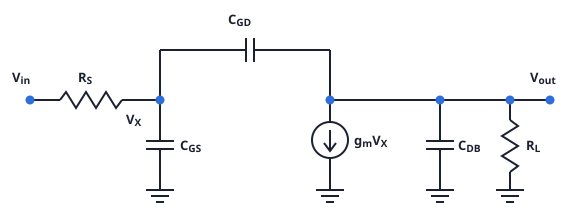

*$R_L\ll r_o$라서 $r_o$를 생략한 CS 단 고주파 모델이고, 미지수는 노드 전압 $V_X$와 $V_{out}$ 두 개예요.*

**정확히 말하면**

작은 예시부터 적용해요. $s=0$이면 $C_{GD}s$, $as^2$, $bs$가 모두 0이라 $\frac{V_{out}}{V_{in}}(0)=-g_mR_L$이에요. 이 값은 기존 저주파 해석의 세 단계와 같아요. 출력 단락에서 구한 트랜스컨덕턴스예요.

$$
G_m=g_m
$$

입력 영점에서 본 출력저항이에요.

$$
R_{out}=r_o\parallel R_L\approx R_L
$$

둘을 곱한 저주파 이득이에요.

$$
A_v=-G_mR_{out}\approx-g_mR_L
$$

커패시터가 있어도 저주파 극한은 기존 해석과 맞아야 해요.

1. 모델을 정해요. $R_L\ll r_o$이므로 $r_o\parallel R_L\approx R_L$로 보고 $r_o$를 생략해요. $C_{SB}$는 양 끝이 모두 접지라 없는 것과 같아요. 남는 소자는 앞단 출력 임피던스 $R_S$, $C_{GS}$, $C_{GD}$, $C_{DB}$, 종속원 $g_mV_{GS}$예요.
2. 미지수는 게이트 노드 전압 $V_X$와 출력 전압 $V_{out}$ 두 개예요. 소스가 접지이므로 $V_{GS}=V_X$예요.
3. 노드 X에 KCL(나가는 전류의 합 = 0)을 세워요. ① $C_{GD}$로 나가는 전류는 $(V_X-V_{out})C_{GD}s$예요. ② $C_{GS}$로 나가는 전류는 $V_XC_{GS}s$예요. ③ $R_S$로 나가는 전류는 $(V_X-V_{in})/R_S$예요. 세 전류를 더해요.

   $$
   \begin{aligned}&\frac{V_X-V_{in}}{R_S}+V_XC_{GS}s\\&\quad+(V_X-V_{out})C_{GD}s=0\end{aligned}
   $$
4. 출력 노드에도 KCL을 세워요. ① $C_{GD}$로 나가는 전류는 $(V_{out}-V_X)C_{GD}s$예요. ② 드레인에서 접지로 나가는 종속원 전류는 $g_mV_X$예요. ③ $R_L$과 $C_{DB}$의 병렬로 나가는 전류는 $V_{out}(1/R_L+C_{DB}s)$예요. 세 전류를 더해요.

   $$
   \begin{aligned}&(V_{out}-V_X)C_{GD}s+g_mV_X\\&\quad+V_{out}\left(\frac{1}{R_L}+C_{DB}s\right)=0\end{aligned}
   $$

   칠판에서는 출력 노드를 Y로 불렀는데, 슬라이드 표기의 $V_{out}$과 같은 노드예요. (수업 중 출력 노드 용량을 $C_L$로 적었다가 $C_{DB}$로 정정)
5. 첫 식에서 $V_X$를 $V_{in}$과 $V_{out}$으로 표현해 둘째 식에 대입하면 전달 함수가 나와요.

   $$
   \frac{V_{out}}{V_{in}}(s)=\frac{(C_{GD}s-g_m)R_L}{as^2+bs+1}
   $$

   계수는 다음과 같아요.

   $$
   \begin{aligned}a&=R_SR_L(C_{GS}C_{GD}\\&\quad+C_{GD}C_{DB}+C_{GS}C_{DB})\end{aligned}
   $$

   $$
   \begin{aligned}b&=(1+g_mR_L)C_{GD}R_S\\&\quad+R_SC_{GS}\\&\quad+R_L(C_{GD}+C_{DB})\end{aligned}
   $$

   대입 과정은 [계수 a, b는 어디서 오나 (보충)](#s3-coeffs)에서 한 줄씩 볼 수 있어요.
6. 분모가 $s$의 2차식이므로 극점은 2개예요. 밀러 근사로 얻은 극점 수와 같아요. 분자는 1차식이라 영점이 하나 있는데, 이것은 밀러 근사로는 나오지 않던 결과예요. 영점은 [우반면 영점: 출력이 0이 되는 순간](#s3-zero)에서, 낮은 극점 $|\omega_{p1}|$과 높은 극점 $|\omega_{p2}|$의 크기는 [주극점 근사: 1/b와 b/a](#s4-dominant)에서 구해요.

**교수님 말씀**

교수님은 밀러 근사로 풀었던 같은 CS 단을 이번에는 노드 방정식으로 풀어 보자고 했어요.

> “노드 이퀘이션을 이용해서 풀어서 … 다이렉트 어낼리시스라고 얘기해요.”

두 노드에 KCL을 세운 뒤 $V_X$를 소거하면 된다고 하고, 결과를 보며 이렇게 덧붙였어요.

> “간단해 보이지만 여기 계수를 보면 좀 복잡하죠.”

결론은 2차 함수라 극점이 2개인 점은 밀러 근사와 같고, 차이는 영점이 있다는 것이었어요. 그 차이가 곧 밀러 근사의 오차라고 정리했어요.

> “밀러 어프록시메이션은 제로를 못 구했는데 여기서는 제로가 있습니다.”

**페이지 요약**

노드 X와 출력 노드에 KCL을 세우면 극점 2개와 영점 1개를 가진 정확한 전달 함수가 나와요.

*핵심 식*

- 노드 X의 KCL

  $$
  \begin{aligned}&\frac{V_X-V_{in}}{R_S}+V_XC_{GS}s\\&\quad+(V_X-V_{out})C_{GD}s=0\end{aligned}
  $$
- 전달 함수

  $$
  \frac{V_{out}}{V_{in}}(s)=\frac{(C_{GD}s-g_m)R_L}{as^2+bs+1}
  $$

$s=0$을 넣으면 저주파 이득 $-g_mR_L$로 돌아가요.

*용어*

- **직접 해석 (direct analysis)** — 밀러 근사 없이 노드 KCL로 전달 함수를 구하는 방법이에요.

---

### 계수 a, b는 어디서 오나 (보충)

*1028 수업 · L05 s31*

**쉽게 말하면**

노드 X 식에서 $V_X$를 꺼내 출력 노드 식에 넣으면, 두 노드의 저항·커패시턴스가 곱해진 항은 $a$로, 더해진 항은 $b$로 모여요.

예를 들어 $C_{GD}=0$이면 두 노드가 끊어져 분모가 $(1+R_SC_{GS}s)(1+R_LC_{DB}s)$로 갈라지고, 계수는 다음처럼 줄어요.

$$
a=R_SR_LC_{GS}C_{DB}
$$

$$
b=R_SC_{GS}+R_LC_{DB}
$$

*노드 X 식에서 $V_X$를 꺼내 출력 노드 식에 대입하는 세 단계를 거치면 분모 $as^2+bs+1$이 나와요.*

**정확히 말하면**

작은 예시부터 적용해요. 아래 두 식에 $C_{GD}=0$을 넣으면 $a$에는 $C_{GS}C_{DB}$ 항만, $b$에는 $R_SC_{GS}$와 $R_LC_{DB}$만 남아요. 그러면 분모는 노드 X의 시정수(time constant) $R_SC_{GS}$와 출력 노드의 시정수 $R_LC_{DB}$로 따로 인수분해되고, 분자는 $-g_mR_L$이에요. 두 노드를 잇는 $C_{GD}$가 있어야 계수가 서로 섞여요.

슬라이드와 교과서의 계수는 다음과 같아요.

$$
\begin{aligned}a&=R_SR_L(C_{GS}C_{GD}\\&\quad+C_{GD}C_{DB}+C_{GS}C_{DB})\end{aligned}
$$

$$
\begin{aligned}b&=(1+g_mR_L)C_{GD}R_S\\&\quad+R_SC_{GS}\\&\quad+R_L(C_{GD}+C_{DB})\end{aligned}
$$

1. $a$는 $R_SR_L$에 세 커패시턴스를 두 개씩 곱한 합을 곱한 값이에요. 한 줄로 쓰면 $a=R_SR_L(C_{GS}C_{GD}+C_{GD}C_{DB}+C_{GS}C_{DB})$예요. 단위는 $\Omega\cdot\Omega\cdot\mathrm{F}\cdot\mathrm{F}=\mathrm{s}^2$예요.
2. $b$는 시정수 세 개의 합이에요. 한 줄로 쓰면 $b=(1+g_mR_L)C_{GD}R_S+R_SC_{GS}+R_L(C_{GD}+C_{DB})$예요. 첫째 항 $(1+g_mR_L)C_{GD}R_S$는 $R_S$가 보는 $C_{GD}$가 $(1+g_mR_L)$배로 커진 항이에요. 둘째 항 $R_SC_{GS}$는 $R_S$가 보는 $C_{GS}$예요. 셋째 항 $R_L(C_{GD}+C_{DB})$는 $R_L$이 보는 출력 쪽 커패시턴스예요. 단위는 $\mathrm{s}$예요.
3. 둘째 항은 밀러 근사의 입력 쪽 커패시턴스와 같은 모양이에요. $b$로 낮은 극점 $|\omega_{p1}|$(지배극)을 어떻게 근사하는지는 [주극점 근사: 1/b와 b/a](#s4-dominant)에서 다뤄요.
4. 슬라이드의 $a$ 식 둘째 항에 적힌 $C_{out}$은 이 모델의 출력 노드 용량 $C_{DB}$예요.

**교수님 말씀**

교수님은 구하려는 것이 $V_{out}/V_{in}$이고 미지수는 $V_X$라고 짚은 뒤 방법만 말했어요.

> “Vx를 Vin의 함수로 표현해서 또 Vout의 함수로 표현해서 … 대입”

대수 전개는 칠판에서 “정리하면 요러한 관계로 표현이 된다”로 넘어갔어요. 그래서 아래 보충에 한 줄씩 적었어요.

**보충 · 수업에서 유도하진 않았어요**

1. 노드 X 식을 $V_X$로 묶어요.

   $$
   \begin{aligned}&V_X\left[\frac{1}{R_S}+(C_{GS}+C_{GD})s\right]\\&=\frac{V_{in}}{R_S}+V_{out}C_{GD}s\end{aligned}
   $$

   $$
   V_X=\frac{V_{in}+R_SC_{GD}s\,V_{out}}{1+R_S(C_{GS}+C_{GD})s}
   $$
2. 출력 노드 식도 $V_X$로 묶어요.

   $$
   \begin{aligned}&V_X(g_m-C_{GD}s)\\&=-V_{out}\left[\frac{1}{R_L}+(C_{GD}+C_{DB})s\right]\end{aligned}
   $$

   $$
   V_X=\frac{V_{out}\left[1+R_L(C_{GD}+C_{DB})s\right]}{R_L(C_{GD}s-g_m)}
   $$
3. 두 $V_X$가 같다고 놓고 양변에 $R_L(C_{GD}s-g_m)[1+R_S(C_{GS}+C_{GD})s]$를 곱한 뒤 $V_{out}$ 항을 오른쪽으로 모아요.

   $$
   \begin{aligned}&R_L(C_{GD}s-g_m)V_{in}\\&=V_{out}\Big\{[1+R_L(C_{GD}+C_{DB})s]\\&\qquad\times[1+R_S(C_{GS}+C_{GD})s]\\&\qquad-R_SR_LC_{GD}s(C_{GD}s-g_m)\Big\}\end{aligned}
   $$
4. 중괄호의 $s^2$ 계수는 $R_SR_L[(C_{GD}+C_{DB})(C_{GS}+C_{GD})-C_{GD}^2]$예요. $C_{GD}^2$끼리 지워져서 $a$가 돼요.

   $$
   \begin{aligned}a&=R_SR_L(C_{GS}C_{GD}\\&\quad+C_{GD}C_{DB}+C_{GS}C_{DB})\end{aligned}
   $$
5. 중괄호의 $s$ 계수는 $R_L(C_{GD}+C_{DB})+R_S(C_{GS}+C_{GD})+g_mR_SR_LC_{GD}$예요. $R_SC_{GD}$와 $g_mR_LR_SC_{GD}$를 묶으면 $b$가 돼요.

   $$
   \begin{aligned}b&=(1+g_mR_L)C_{GD}R_S\\&\quad+R_SC_{GS}\\&\quad+R_L(C_{GD}+C_{DB})\end{aligned}
   $$
6. 상수항은 1이므로 양변을 $V_{in}$과 중괄호로 나누면 전달 함수가 나와요.

   $$
   \frac{V_{out}}{V_{in}}(s)=\frac{(C_{GD}s-g_m)R_L}{as^2+bs+1}
   $$

**페이지 요약**

$V_X$를 소거하면 두 노드의 RC가 곱해진 항은 $a$, 시정수의 합은 $b$로 모여요.

*핵심 식*

- 2차 계수

  $$
  \begin{aligned}a&=R_SR_L(C_{GS}C_{GD}\\&\quad+C_{GD}C_{DB}+C_{GS}C_{DB})\end{aligned}
  $$
- 1차 계수

  $$
  \begin{aligned}b&=(1+g_mR_L)C_{GD}R_S\\&\quad+R_SC_{GS}\\&\quad+R_L(C_{GD}+C_{DB})\end{aligned}
  $$

$C_{GD}=0$이면 분모는 $(1+R_SC_{GS}s)(1+R_LC_{DB}s)$로 갈라져요.

*용어*

- **시정수 (time constant)** — 저항과 그 저항이 보는 커패시턴스의 곱이에요.

---

### 우반면 영점: 출력이 0이 되는 순간

*1028 수업 · L05 s32*

**쉽게 말하면**

우반면 영점(right-half-plane zero)은 $V_{out}=0$이 되는 주파수로, 그 순간 $C_{GD}$를 지나온 전류가 종속원 전류 $g_mV_X$를 모두 채우므로 $\omega_z=\frac{g_m}{C_{GD}}$에서 생겨요.

예를 들어 슬라이드 비교 예제의 $g_m=(150\,\Omega)^{-1}$, $C_{GD}=80\,\mathrm{fF}$이면 $\omega_z\approx2\pi\times13.3\,\mathrm{GHz}$로, 같은 회로를 직접 해석한 지배극 $|\omega_{p1}|=2\pi\times264\,\mathrm{MHz}$보다 약 50배 높아요.

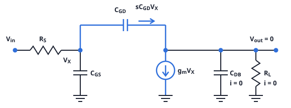

*$V_{out}=0$인 순간 $C_{DB}$와 $R_L$의 전류는 0이고, $C_{GD}$를 지나온 전류(강조색 경로)가 모두 종속 전류원으로 내려가요.*

**정확히 말하면**

작은 예시부터 적용해요. 단위는 $[\mathrm{S}/\mathrm{F}]=[1/\mathrm{s}]$예요.

$$
\begin{aligned}\omega_z&=\frac{g_m}{C_{GD}}\\&=\frac{(1/150)\,\mathrm{S}}{80\times10^{-15}\,\mathrm{F}}\\&\approx8.33\times10^{10}\,\mathrm{rad/s}\end{aligned}
$$

$$
f_z=\frac{\omega_z}{2\pi}\approx13.26\,\mathrm{GHz}
$$

교과서 예제의 13.3 GHz와 같은 값이에요. 같은 값에서 직접 해석의 지배극은 $|\omega_{p1}|=2\pi\times264\,\mathrm{MHz}$라서 영점은 약 50배 위에 있어요. 수치 비교 전체는 [세 방법 비교: 숫자로 확인해요](#s4-compare)에 있어요.

1. 전달 함수에서 구해요. 분자 $(C_{GD}s-g_m)R_L$이 0이 되는 곳이 영점이에요.

   $$
   s_z=+\frac{g_m}{C_{GD}}
   $$

   영점이 양의 실수라서 $s$ 평면의 오른쪽 절반에 놓여요. 그래서 우반면 영점이라고 불러요. 크기는 $\omega_z=\frac{g_m}{C_{GD}}$예요.
2. 정의로도 구할 수 있어요. 영점은 전달 함수가 0이 되는 주파수이므로 출력 조건 $V_{out}=0$을 걸어요.
3. $V_{out}=0$이면 $R_L$과 $C_{DB}$ 양단 전압이 0이라 두 가지로 흐르는 전류도 0이에요.
4. 그러면 출력 노드의 KCL에서 $C_{GD}$로 들어오는 전류가 종속원으로 나가는 전류 $g_mV_X$와 같아야 해요. $C_{GD}$ 양단 전압은 $V_X-0=V_X$이고, 소스가 접지이므로 $v_{gs}=V_X$예요.

   $$
   V_XC_{GD}s_z=g_mV_X
   $$
5. 양변의 $V_X$를 지우면 같은 결과가 나와요.

   $$
   s_z=\frac{g_m}{C_{GD}}
   $$

   출력 노드 KCL에 $V_{out}=0$을 넣은 $-V_XC_{GD}s+g_mV_X=0$과도 같아요.
6. 물리적인 그림은 이래요. 저주파에서는 $C_{GD}$ 임피던스가 커서 입력에서 넘어오는 전류가 거의 없어요. 주파수가 오르면 $C_{GD}$ 전류가 커지고, 그 전류가 $g_mV_X$와 같아지는 순간 $R_L$ 쪽으로 갈 전류가 남지 않아 출력이 0이 돼요.
7. $C_{GD}$는 주로 오버랩 커패시턴스라서 $C_{GS}$보다 훨씬 작아요. 그 $C_{GD}$가 분모에 있으니 $\omega_z$는 매우 높아요. 극점에서 이득이 이미 충분히 떨어진 뒤에 영점이 나타나므로 관심 대역에서는 영향이 작아요.
8. 밀러 근사는 $C_{GD}$를 저주파 이득으로 나눠 접지 커패시턴스로 바꾸므로 이 영점을 예측하지 못해요. 그래도 영점이 대역 밖 높은 주파수에 있어서, 영점을 놓친 것 자체는 이득이 떨어지기 시작하는 대역의 손계산에 큰 영향을 주지 않아요. 밀러 근사의 두 극점(입력 극점·출력 극점)을 정확한 $|\omega_{p1}|$·$|\omega_{p2}|$와 비교할 때는 낮은 극점끼리, 높은 극점끼리 짝지어야 하고, 그 수치는 [세 방법 비교: 숫자로 확인해요](#s4-compare)에서 따로 확인해요.

**교수님 말씀**

교수님은 전달 함수를 쓰지 않고 영점의 정의로 구하는 방법을 칠판에 따로 보였어요. 슬라이드에는 없는 유도예요.

> “제로의 의미는 뭐예요? … 전달 함수가 0이 되는 거.”

출력이 0이면 $R_L$ 쪽으로 전류가 흐르지 않으니, 종속원 전류가 전부 커패시터를 통해 온다고 설명했어요.

> “주파수가 높아지게 되면 커패시터를 통해서 … 전류가 흐르죠.”

$C_{GD}$로 흐르는 전류와 드레인–소스 전류가 같아질 때 출력이 0이 되고, 거기서 $v_{gs}$가 지워져 $s_z=g_m/C_{GD}$가 나온다고 정리했어요.

**꼭 기억해요**

> “밀러 어프록시메이션은 제로를 예측하기가 어렵다는 게 하나의 단점”

> “대단히 높은 주파수이기 때문에 그렇게 큰 영향을 주지 않는다.”

영점은 분모가 아니라 분자 $(C_{GD}s-g_m)$을 0으로 만드는 양의 $s$예요.

**페이지 요약**

$V_{out}=0$이 되려면 $C_{GD}$ 전류가 $g_mV_X$를 모두 채워야 하고, 그 주파수가 우반면 영점이에요.

*핵심 식*

- 출력 0 조건

  $$
  V_XC_{GD}s_z=g_mV_X
  $$
- 영점

  $$
  \omega_z=\frac{g_m}{C_{GD}}
  $$

밀러 근사는 이 영점을 예측하지 못해요.

$C_{GD}$가 작아 영점이 매우 높으므로 관심 대역에서는 영향이 작아요.

*용어*

- **우반면 영점 (right-half-plane zero)** — 분자를 0으로 만드는 $s$가 양의 실수인 영점이에요.

---

## 5. 주극점 근사와 세 방법 비교

### 주극점 근사: 1/b와 b/a

*1028 수업 · L05 s33*

**쉽게 말하면**

두 극점이 멀리 떨어져 있으면 분모의 1차 계수 $b$를 낮은 극점 하나가 거의 다 정하므로, 지배극은 $|\omega_{p1}|\approx\frac{1}{b}$, 높은 극점은 $|\omega_{p2}|\approx\frac{b}{a}$로 바로 읽어요.

예를 들어 $|\omega_{p2}|=10|\omega_{p1}|$이면 $b=1.1/|\omega_{p1}|$이라서 $\frac{1}{b}\approx0.91|\omega_{p1}|$, 즉 실제 지배극보다 약 9%만 낮게 나와요.

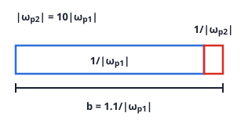

*$b$는 두 극점 역수의 합이라서, 높은 극점 쪽 조각 $1/|\omega_{p2}|$(빨간 테두리)가 짧을수록 $\frac{1}{b}$가 지배극에 가까워져요.*

**정확히 말하면**

작은 예시부터 적용해요. $|\omega_{p1}|=1\,\mathrm{Grad/s}$, $|\omega_{p2}|=10\,\mathrm{Grad/s}$이면 아래 3단계의 계수 비교로 $a=0.1\,\mathrm{ns^2}$, $b=1.1\,\mathrm{ns}$예요. 그러면 $\frac{1}{b}\approx0.91\,\mathrm{Grad/s}$로 실제 지배극보다 약 9% 낮고, $\frac{b}{a}=11\,\mathrm{Grad/s}$로 실제 두 번째 극점보다 10% 높아요. 두 극점이 100배 떨어져 있으면 두 오차는 약 1%로 줄어요.

1. [노드 KCL로 정확한 전달 함수 세우기](#s3-direct)에서 얻은 CS 단 전달 함수의 분모는 2차식이에요.

   $$
   \frac{V_{out}}{V_{in}}(s)=\frac{(C_{GD}s-g_m)R_L}{as^2+bs+1}
   $$

   $$
   \begin{aligned}a&=R_SR_L(C_{GS}C_{GD}\\&\quad+C_{GD}C_{DB}+C_{GS}C_{DB})\end{aligned}
   $$

   $$
   \begin{aligned}b&=(1+g_mR_L)C_{GD}R_S+R_SC_{GS}\\&\quad+R_L(C_{GD}+C_{DB})\end{aligned}
   $$

   극점은 분모를 0으로 만드는 두 해예요. 근의 공식으로 직접 풀면 식이 복잡해져요.
2. 두 극점의 크기를 양수 $\omega_{p1}$, $\omega_{p2}$로 두면 실제 극점은 $s=-\omega_{p1}$, $s=-\omega_{p2}$예요. 분모를 두 인수의 곱으로 쓰고 전개해요.

   $$
   \begin{aligned}as^2+bs+1&=\left(1+\frac{s}{\omega_{p1}}\right)\\&\quad\times\left(1+\frac{s}{\omega_{p2}}\right)\\&=\frac{s^2}{\omega_{p1}\omega_{p2}}\\&+\left(\frac{1}{\omega_{p1}}+\frac{1}{\omega_{p2}}\right)s+1\end{aligned}
   $$
3. 같은 차수의 계수를 비교해요. 2차항 계수는 두 극점 곱의 역수이고, 1차항 계수는 두 극점 역수의 합이에요.

   $$
   a=\frac{1}{\omega_{p1}\omega_{p2}}
   $$

   $$
   b=\frac{1}{\omega_{p1}}+\frac{1}{\omega_{p2}}
   $$
4. 지배극(dominant pole)은 가장 낮은 주파수에 있어서 이득이 떨어지기 시작하는 곳, 즉 동작 주파수를 정하는 극점이에요. 밀러 근사로 노드마다 극점을 보면, CS 단에서는 밀러 효과로 입력 노드의 커패시턴스가 커져 입력 극점이 지배극일 가능성이 높아요. 밀러의 출력 극점이 더 낮으면 출력 극점이 지배극이에요. 입력·출력이라는 노드 이름은 밀러 근사처럼 노드마다 극점을 구할 때 쓰는 말이에요. 직접 해석의 두 극점은 크기 순서로 낮은 쪽을 $\omega_{p1}$, 높은 쪽을 $\omega_{p2}$로 불러요.
5. 주극점 근사(dominant-pole approximation)는 두 극점이 멀리 떨어져 있다는 가정 $|\omega_{p1}|\ll|\omega_{p2}|$에서 출발해요. 그러면 $b$ 안의 $\frac{1}{\omega_{p2}}$는 $\frac{1}{\omega_{p1}}$보다 훨씬 작아서 버릴 수 있어요.

   $$
   b\approx\frac{1}{\omega_{p1}}
   $$

   $$
   |\omega_{p1}|\approx\frac{1}{b}
   $$
6. $a$의 식에 $\frac{1}{\omega_{p1}}\approx b$를 넣으면 두 번째 극점도 나와요. 극점은 원래 음수이므로 크기는 절댓값으로 써요.

   $$
   a=\frac{1}{\omega_{p1}}\cdot\frac{1}{\omega_{p2}}\approx\frac{b}{\omega_{p2}}
   $$

   $$
   |\omega_{p2}|\approx\frac{b}{a}
   $$
7. CS 단의 $a$, $b$를 넣으면 슬라이드의 두 식이 돼요.

   $$
   |\omega_{p1}|\approx\frac{1}{\begin{matrix}(1+g_mR_L)C_{GD}R_S\\+R_SC_{GS}\\+R_L(C_{GD}+C_{DB})\end{matrix}}
   $$

   $$
   |\omega_{p2}|\approx\frac{\begin{matrix}(1+g_mR_L)C_{GD}R_S\\+R_SC_{GS}\\+R_L(C_{GD}+C_{DB})\end{matrix}}{\begin{matrix}R_SR_L(C_{GS}C_{GD}\\+C_{GD}C_{DB}+C_{GS}C_{DB})\end{matrix}}
   $$

   첫 식이 밀러 입력 극점과 어떻게 대응하는지는 [밀러 입력 극점과 같아지는 조건](#s4-miller-link)에서, 실제 숫자는 [세 방법 비교: 숫자로 확인해요](#s4-compare)에서 확인해요.

(수업 중 출력 노드 용량을 $C_L$, $C_{out}$으로 적었다가 $C_{DB}$로 정정)

**교수님 말씀**

교수님은 2차 방정식을 근의 공식으로 풀지 않고, 두 극점의 곱과 합으로 계수를 맞추는 길을 택했어요.

> “폴의 곱의 역수가 이제 $s^2$ 항의 계수고, 두 폴의 역수의 합이 1차항의 계수예요.”

밀러 근사에서 입력 극점을 지배극으로 보는 이유는 밀러 효과였어요.

> “밀러 이펙트 때문에 낮은 주파수 위치에서 동작 주파수를 결정하는 폴이기 때문에”

> “만약에 출력 쪽의 폴이 낮은 주파수에 있으면 출력 쪽의 폴이 도미넌트 폴이 되는 거예요.”

두 번째 극점 식을 정리한 뒤에는 이렇게 말했어요.

> “복잡하죠? 복잡해질 수밖에 없어요.”

**꼭 기억해요**

> “도미넌트 폴은 동작 주파수를 결정하는 폴이 도미넌트 폴이에요.”

> “어느 하나의 폴이 다른 폴에 비해서 상당히 작다라고 가정을 해 봅시다.”

주극점 근사는 두 극점이 멀리 떨어져 있을 때만 써요. $b$에서 $\frac{1}{\omega_{p2}}$를 버린 근사이므로, 두 극점이 가까우면 $\frac{1}{b}$가 실제 지배극보다 눈에 띄게 낮게 나와요.

**페이지 요약**

두 극점이 멀리 떨어져 있으면 분모 계수 $a$, $b$로 지배극과 두 번째 극점을 바로 읽어요.

*핵심 식*

- 계수 비교

  $$
  \begin{aligned}a&=\frac{1}{\omega_{p1}\omega_{p2}}\\b&=\frac{1}{\omega_{p1}}+\frac{1}{\omega_{p2}}\end{aligned}
  $$
- 지배극

  $$
  |\omega_{p1}|\approx\frac{1}{b}
  $$
- 두 번째 극점

  $$
  |\omega_{p2}|\approx\frac{b}{a}
  $$

*판단 기준*

$|\omega_{p1}|\ll|\omega_{p2}|$일 때만 $b$에서 $\frac{1}{\omega_{p2}}$를 버려요.

*용어*

- **지배극 (dominant pole)** — 가장 낮은 주파수에 있어서 동작 주파수를 정하는 극점이에요.
- **주극점 근사 (dominant-pole approximation)** — 두 극점이 멀리 떨어졌다고 보고 $b\approx\frac{1}{\omega_{p1}}$로 두는 근사예요.

---

### 밀러 입력 극점과 같아지는 조건

*1028 수업 · L05 s33 · L05 s28*

**쉽게 말하면**

$\frac{1}{b}$의 분모는 시간 상수 세 개의 합이고, 세 번째 항 $R_L(C_{GD}+C_{DB})$을 빼면 남은 두 항이 밀러 입력 극점의 $R_S[C_{GS}+(1+g_mR_L)C_{GD}]$와 똑같아져요.

그래서 두 방법이 같다는 말은 세 번째 항이 작을 때만 맞는 조건부 근사인데, 슬라이드 비교 예제에서는 세 번째 항이 360 ps로 앞 두 항의 합 약 279.33 ps보다 커요.

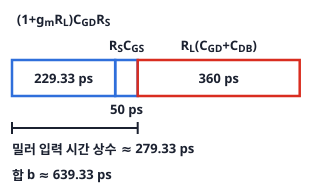

*슬라이드 비교 예제 값으로 그린 세 항의 길이이고, 강조색 테두리 두 막대가 밀러 입력 시간 상수, 빨간 테두리 막대가 세 번째 항이에요.*

**정확히 말하면**

작은 예시부터 적용해요. 슬라이드 비교 예제 값($R_S=200\,\Omega$, $g_m^{-1}=150\,\Omega$, $C_{GS}=250\,\mathrm{fF}$, $C_{GD}=80\,\mathrm{fF}$, $C_{DB}=100\,\mathrm{fF}$, $R_L=2\,\mathrm{k\Omega}$)으로 $b$의 세 항을 따로 계산해요. 단위는 $1\,\mathrm{k\Omega}\times1\,\mathrm{fF}=1\,\mathrm{ps}$로 맞춰요.

$$
g_mR_L=\frac{2\,\mathrm{k\Omega}}{0.15\,\mathrm{k\Omega}}=\frac{40}{3}\approx13.33
$$

$$
\begin{aligned}&(1+g_mR_L)C_{GD}R_S\\&=\frac{43}{3}\times80\,\mathrm{fF}\times0.2\,\mathrm{k\Omega}\\&\approx229.33\,\mathrm{ps}\end{aligned}
$$

$$
R_SC_{GS}=0.2\,\mathrm{k\Omega}\times250\,\mathrm{fF}=50\,\mathrm{ps}
$$

$$
\begin{aligned}R_L(C_{GD}+C_{DB})&=2\,\mathrm{k\Omega}\times180\,\mathrm{fF}\\&=360\,\mathrm{ps}\end{aligned}
$$

세 번째 항이 셋 중 가장 크고, 앞 두 항의 합 $\frac{838}{3}\,\mathrm{ps}\approx279.33\,\mathrm{ps}$의 약 1.29배예요.

1. [주극점 근사: 1/b와 b/a](#s4-dominant)의 지배극에서 앞 두 항을 $R_S$로 묶고 순서만 바꿔요.

   $$
   \begin{aligned}&(1+g_mR_L)C_{GD}R_S+R_SC_{GS}\\&=R_S[C_{GS}+(1+g_mR_L)C_{GD}]\end{aligned}
   $$

   $$
   \begin{aligned}\frac{1}{|\omega_{p1}|}&\approx b\\&=R_S[C_{GS}+(1+g_mR_L)C_{GD}]\\&\quad+R_L(C_{GD}+C_{DB})\end{aligned}
   $$
2. $R_L(C_{GD}+C_{DB})\ll R_S[C_{GS}+(1+g_mR_L)C_{GD}]$일 때만 세 번째 항을 버릴 수 있어요. 그러면 $\frac{1}{b}$가 [CS 단: 밀러 곱셈이 입력 극점을 끌어내려요](#s2-cs-miller)의 밀러 입력 극점과 같아져요.

   $$
   \begin{aligned}|\omega_{p1}|&\approx\frac{1}{R_S[C_{GS}+(1+g_mR_L)C_{GD}]}\\&=|\omega_{p,in}|\end{aligned}
   $$

   이 대응은 조건이 붙은 조건부 근사예요.
3. 세 번째 항은 밀러 근사의 출력 극점 시간 상수와 거의 같아요. $g_mR_L\gg1$이면

   $$
   \begin{aligned}&R_L\left[C_{DB}+\left(1+\frac{1}{g_mR_L}\right)C_{GD}\right]\\&\approx R_L(C_{GD}+C_{DB})\end{aligned}
   $$

   따라서 $b$는 밀러로 구한 입력 시간 상수와 출력 시간 상수의 합에 가까워요. 세 번째 항을 버려도 된다는 것은 밀러로 구한 출력 극점이 입력 극점보다 훨씬 높은 주파수에 있다는 뜻이에요.
4. 어떤 회로에서 조건이 깨지는지는 두 쪽의 비로 판단해요.

   $$
   \frac{R_L(C_{GD}+C_{DB})}{R_S[C_{GS}+(1+g_mR_L)C_{GD}]}
   $$

   이 비는 $R_S$가 작을수록, $R_L$이 클수록 커져요. $R_L$을 키우면 분모의 $g_mR_L$도 함께 커지므로 비는 $\frac{C_{GD}+C_{DB}}{g_mR_SC_{GD}}$에 다가가요. 슬라이드 예제처럼 앞단 출력 임피던스 $R_S=200\,\Omega$가 작으면 이 값이 약 1.69여서, 이득을 키우려고 $R_L$을 키울수록 세 번째 항을 무시하기 어려워져요.
5. 슬라이드 예제의 비는 약 1.29라서 조건이 성립하지 않아요. 세 번째 항을 버린 밀러 입력 극점은 $\frac{1}{2\pi\times279.33\,\mathrm{ps}}$로 약 569.77 MHz(슬라이드 값 571 MHz)이고, 세 항을 모두 넣은 $\frac{1}{b}$는 $\frac{1}{2\pi\times639.33\,\mathrm{ps}}$로 약 248.94 MHz(슬라이드 값 249 MHz)예요. 두 값은 약 2.29배 차이 나요. 정확한 극점과의 비교는 [세 방법 비교: 숫자로 확인해요](#s4-compare)에 있어요.

**교수님 말씀**

교수님은 $\frac{1}{b}$의 세 항을 비교하며 세 번째 항을 버렸어요.

> “세 번째 텀은 $C_{GS}$보다 작고 그리고 게인도 곱해지지 않고 하니까 … 상대적으로 작은 값이에요.”

첫째 항에는 이득 $g_mR_L$이 곱해지고, 둘째 항의 $C_{GS}$는 다른 커패시턴스보다 크다는 것이 이유였어요. 그 근사 아래에서는 두 방법의 지배극이 같다고 정리했어요.

> “밀러 어프록시메이션을 적용한 것과 다이렉트 어낼리시스를 이용해서 구한 폴이 … 요 어프록시메이션 하에서는 똑같다”

“이 근사 아래에서는”이라는 말이 핵심이에요. 세 번째 항이 작은지는 회로 값에 따라 달라서, 이 대응은 조건부 근사로 기억해요.

**페이지 요약**

지배극 $\frac{1}{b}$는 세 번째 항이 작을 때만 밀러 입력 극점과 같아지는 조건부 근사예요.

*핵심 식*

- 주극점 근사의 지배극

  $$
  \begin{aligned}\frac{1}{|\omega_{p1}|}&\approx R_S[C_{GS}+(1+g_mR_L)C_{GD}]\\&\quad+R_L(C_{GD}+C_{DB})\end{aligned}
  $$
- 밀러 입력 극점

  $$
  \begin{aligned}|\omega_{p1}|&\approx\frac{1}{R_S[C_{GS}+(1+g_mR_L)C_{GD}]}\\&=|\omega_{p,in}|\end{aligned}
  $$

*판단 기준*

$R_L(C_{GD}+C_{DB})\ll R_S[C_{GS}+(1+g_mR_L)C_{GD}]$일 때만 두 식이 같아요.

세 번째 항은 밀러 출력 극점의 시간 상수와 거의 같아요.

슬라이드 예제에서는 세 번째 항 360 ps가 앞 두 항의 합 약 279.33 ps보다 커요.

*용어*

- **세 번째 항** — $\frac{1}{b}$ 분모의 $R_L(C_{GD}+C_{DB})$로, 출력 노드의 시간 상수에 해당해요.
- **조건부 근사** — 세 번째 항이 작다는 조건이 있을 때만 성립하는 근사예요.

---

### 세 방법 비교: 숫자로 확인해요

*1028 수업 · L05 s34*

**쉽게 말하면**

같은 CS 단을 세 방법으로 풀면 슬라이드 값으로 밀러 근사는 입력 극점 571 MHz와 출력 극점 428 MHz를, 정확한 해는 $|\omega_{p1}|$ 264 MHz와 $|\omega_{p2}|$ 4.53 GHz를, 주극점 근사는 $|\omega_{p1}|$ 249 MHz와 $|\omega_{p2}|$ 4.79 GHz를 줘요.

가장 낮은 극점끼리는 밀러 428 MHz 대 정확 264 MHz로 한두 배 안이라, 손계산은 이득이 떨어지기 시작하는 곳을 가늠하는 데 쓰고 정밀한 값은 시뮬레이션으로 구해요.

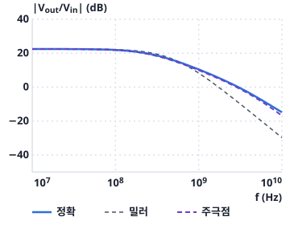

*슬라이드 비교 예제의 크기 응답으로, 세 곡선은 수백 MHz에서 함께 꺾이기 시작하지만 1 GHz 위에서는 밀러 곡선(회색 점선)이 더 빨리 떨어져요.*

**정확히 말하면**

작은 예시는 슬라이드 비교 예제(교과서 예제 11.18과 같은 값) 그 자체예요. $R_S=200\,\Omega$, $g_m^{-1}=150\,\Omega$, $C_{GS}=250\,\mathrm{fF}$, $C_{GD}=80\,\mathrm{fF}$, $C_{DB}=100\,\mathrm{fF}$, $R_L=2\,\mathrm{k\Omega}$, $\lambda=0$이에요. 저주파 이득부터 구해요.

$$
A_0=-g_mR_L=-\frac{40}{3}\approx-13.33\,[\mathrm{V/V}]
$$

$$
20\log_{10}\frac{40}{3}\approx22.5\,\mathrm{dB}
$$

| 방법 | 낮은 극점 | 높은 극점 | 영점 |
|---|---|---|---|
| 밀러 근사(노드마다) | 출력 극점 $2\pi\times428\,\mathrm{MHz}$ | 입력 극점 $2\pi\times571\,\mathrm{MHz}$ | 예측 못 함 |
| 정확(직접 해석) | $\vert \omega_{p1}\vert =2\pi\times264\,\mathrm{MHz}$ | $\vert \omega_{p2}\vert =2\pi\times4.53\,\mathrm{GHz}$ | $2\pi\times13.3\,\mathrm{GHz}$ (우반면) |
| 주극점 근사 | $\vert \omega_{p1}\vert \approx2\pi\times249\,\mathrm{MHz}$ | $\vert \omega_{p2}\vert \approx2\pi\times4.79\,\mathrm{GHz}$ | 극점만 구함 |

표의 숫자는 슬라이드 값이고, 아래 계산은 반올림 전 값을 써서 마지막 자리가 조금 다를 수 있어요.

슬라이드는 세 방법의 결과를 모두 원문 표기 $|\omega_{p,in}|$, $|\omega_{p,out}|$로 적었어요. 노드 이름이 뜻을 갖는 것은 노드마다 극점을 따로 구한 밀러 근사뿐이에요. 정확한 해와 주극점 근사의 두 극점은 2차 분모 $as^2+bs+1$의 두 해라서, [주극점 근사: 1/b와 b/a](#s4-dominant)처럼 낮은 극점 $|\omega_{p1}|$과 높은 극점 $|\omega_{p2}|$로 불러요. 실제로 이 예제에서 $\frac{1}{b}$의 가장 큰 항은 출력 노드 시간 상수 $R_L(C_{GD}+C_{DB})=360\,\mathrm{ps}$여서([밀러 입력 극점과 같아지는 조건](#s4-miller-link)), 264 MHz를 입력 노드만의 극점이라고 부를 근거가 없어요.

지배극은 가장 낮은 극점이에요. 정확한 해의 지배극은 $|\omega_{p1}|$ 264 MHz, 주극점 근사는 249 MHz예요. 밀러 근사에서는 출력 극점 428 MHz가 입력 극점 571 MHz보다 낮아서, 밀러가 예측한 지배극은 출력 극점이에요.

1. 밀러 근사는 노드마다 시간 상수를 구해요.

   $$
   \begin{aligned}&R_S[C_{GS}+(1+g_mR_L)C_{GD}]\\&=0.2\,\mathrm{k\Omega}\times\left(250+\frac{43}{3}\times80\right)\mathrm{fF}\\&=\frac{838}{3}\,\mathrm{ps}\approx279.33\,\mathrm{ps}\end{aligned}
   $$

   $$
   \begin{aligned}\frac{|\omega_{p,in}|}{2\pi}&=\frac{1}{2\pi\times279.33\,\mathrm{ps}}\\&\approx569.77\,\mathrm{MHz}\end{aligned}
   $$

   슬라이드의 571 MHz는 $g_mR_L$을 13.3으로 반올림해 계산한 값이에요.

   $$
   \begin{aligned}&R_L\left[C_{DB}+\left(1+\frac{1}{g_mR_L}\right)C_{GD}\right]\\&=2\,\mathrm{k\Omega}\times(100+1.075\times80)\,\mathrm{fF}\\&=372\,\mathrm{ps}\end{aligned}
   $$

   $$
   \begin{aligned}\frac{|\omega_{p,out}|}{2\pi}&=\frac{1}{2\pi\times372\,\mathrm{ps}}\\&\approx427.84\,\mathrm{MHz}\end{aligned}
   $$

   이 예제에서는 밀러의 출력 극점(약 427.84 MHz)이 입력 극점(약 569.77 MHz)보다 낮아요.
2. 주극점 근사는 $a$, $b$에서 바로 읽어요.

   $$
   \begin{aligned}b&=\frac{688}{3}+50+360\\&=\frac{1918}{3}\,\mathrm{ps}\approx639.33\,\mathrm{ps}\end{aligned}
   $$

   $$
   \begin{aligned}a&=0.2\,\mathrm{k\Omega}\times2\,\mathrm{k\Omega}\\&\quad\times(20000+8000+25000)\,\mathrm{fF^2}\\&=21200\,\mathrm{ps^2}\\&=2.12\times10^{-20}\,\mathrm{s^2}\end{aligned}
   $$

   $$
   \frac{1}{2\pi b}\approx248.94\,\mathrm{MHz}
   $$

   $$
   \frac{1}{2\pi}\cdot\frac{b}{a}\approx4.80\,\mathrm{GHz}
   $$

   슬라이드는 두 번째 값을 4.79 GHz로 적었어요.
3. 정확한 극점은 $as^2+bs+1=0$의 두 해예요. 반올림 전 값으로 풀면 $\frac{|\omega_{p1}|}{2\pi}\approx263.39\,\mathrm{MHz}$, $\frac{|\omega_{p2}|}{2\pi}\approx4.54\,\mathrm{GHz}$이고, 슬라이드 값 264 MHz, 4.53 GHz와 마지막 자리만 달라요. 반올림 전 값으로 두 극점은 약 17.22배 떨어져 있어요(슬라이드 값 4.53 GHz와 264 MHz의 비는 약 17.16배).
4. 주극점 근사의 오차는 계수 비교식으로 검산할 수 있어요. 두 극점이 실수이면 $b=\frac{1}{\omega_{p1}}+\frac{1}{\omega_{p2}}$와 $a=\frac{1}{\omega_{p1}\omega_{p2}}$는 근사 없이 성립해요.

   $$
   \frac{1}{b}=\frac{\omega_{p1}}{1+\omega_{p1}/\omega_{p2}}
   $$

   $$
   \frac{b}{a}=\omega_{p1}+\omega_{p2}
   $$

   그래서 $\frac{1}{b}$는 항상 실제 지배극보다 조금 낮고, $\frac{b}{a}$는 항상 조금 높아요. 슬라이드 값으로 확인하면 264 MHz를 $1+264/4530$으로 나눈 약 249.46 MHz가 249 MHz와 맞고, 4.53 GHz와 0.264 GHz의 합 약 4.79 GHz가 4.79 GHz와 맞아요.
5. 밀러 근사와 정확한 해는 비교 기준을 나눠서 봐요. 밀러 입력 극점 대 정확 지배극 $|\omega_{p1}|$은 슬라이드 값으로 약 2.16배($571/264$)이고, 반올림 전 값 569.77 MHz와 263.39 MHz로도 약 2.16배예요. 원인은 [밀러 입력 극점과 같아지는 조건](#s4-miller-link)의 세 번째 항 $R_L(C_{GD}+C_{DB})=360\,\mathrm{ps}$를 빼고 계산했기 때문이에요. 밀러가 예측한 최저 극점(출력 극점) 대 정확 지배극 $|\omega_{p1}|$은 슬라이드 값으로 약 1.62배($428/264$)이고, 반올림 전 값 427.84 MHz와 263.39 MHz로도 약 1.62배예요. 높은 쪽 극점끼리, 즉 밀러 입력 극점 571 MHz 대 정확한 $|\omega_{p2}|$ 4.53 GHz는 슬라이드 값으로 약 7.93배($4530/571$) 차이 나고, 반올림 전 값 4536.28 MHz와 569.77 MHz로는 약 7.96배예요. 아래 위젯의 대표 설정 3($R_S=50\,\Omega$, $R_L=5\,\mathrm{k\Omega}$)처럼 세 번째 항이 크면 밀러 입력 극점 대 정확 지배극은 약 6.92배로 벌어지지만, 밀러 최저 극점(출력 극점 약 174.51 MHz) 대 정확 지배극(약 153.47 MHz)은 약 1.14배로 오히려 가까워요. 밀러 근사는 $C_{GD}$에 곱하는 이득을 주파수에 따라 바뀌지 않는 저주파 이득으로 두었기 때문에 이런 오차가 생기고, 영점도 예측하지 못해요.
6. 정확한 전달 함수의 우반면 영점은 $\frac{g_m}{2\pi C_{GD}}=\frac{1}{2\pi\times150\,\Omega\times80\,\mathrm{fF}}\approx13.26\,\mathrm{GHz}$로 그래프 범위 끝(10 GHz)보다 높아요. 그래서 관심 대역에서는 영향이 작아요([우반면 영점: 출력이 0이 되는 순간](#s3-zero)).
7. 그래프에서 세 곡선은 수백 MHz에서 함께 꺾이기 시작하므로 이득이 떨어지는 위치는 세 방법 모두 비슷하게 보여요. 1 GHz 위에서는 밀러 곡선이 더 빨리 떨어져요. 밀러는 두 극점(약 427.84 MHz, 569.77 MHz)을 모두 1 GHz 아래에 두지만, 정확한 해의 높은 극점 $|\omega_{p2}|$는 4.53 GHz에 있기 때문이에요. 아래 위젯과 그림의 주극점 곡선은 두 극점만 쓰고 영점은 넣지 않았어요.

#### 직접 해 보기: 세 번째 항이 커지면 밀러 입력 극점이 정확 지배극에서 벗어나요 *(정적 스냅샷 — 직접 조작은 HTML 버전)*

$R_S$와 $R_L$을 움직이면 세 방법의 크기 응답과 $\frac{1}{b}$를 이루는 세 항의 길이가 함께 바뀌어요. 나머지 값은 슬라이드 비교 예제($g_m^{-1}=150\,\Omega$, $C_{GS}=250\,\mathrm{fF}$, $C_{GD}=80\,\mathrm{fF}$, $C_{DB}=100\,\mathrm{fF}$)로 고정했고, 반올림 전 값으로 계산해 슬라이드 숫자와 마지막 자리가 조금 달라요.

밀러 입력 극점 **569.77 MHz**, 밀러 출력 극점 **427.84 MHz**, 정확 지배극 $|\omega_{p1}|$ **263.39 MHz**, 주극점 근사 $\frac{1}{b}$ **248.94 MHz** · 밀러 입력 극점 ÷ 정확 지배극 **2.16배** · 밀러 최저 극점 ÷ 정확 지배극 **1.62배** · 세 번째 항 ÷ 앞 두 항 **1.29**

범례: 정확(직접 해석) · 밀러 근사 · 주극점 근사(두 극점만) · 빨간 테두리 막대: 세 번째 항

*대표 설정 1, 슬라이드 비교 예제 RS 200 옴, RL 2 킬로옴.*

*대표 설정 2, RS 2 킬로옴, RL 1 킬로옴으로 세 번째 항이 작은 경우.*

*대표 설정 3, RS 50 옴, RL 5 킬로옴으로 세 번째 항이 큰 경우.*

| 설정 | 세 번째 항 ÷ 앞 두 항 | 밀러 입력 극점 | 밀러 출력 극점 | 정확 지배극 $\vert \omega_{p1}\vert $ | 주극점 $\frac{1}{b}$ | 밀러 입력 극점 ÷ 정확 지배극 | 밀러 최저 극점 ÷ 정확 지배극 |
|---|---|---|---|---|---|---|---|
| $R_S=200\,\Omega$, $R_L=2\,\mathrm{k\Omega}$ | ≈1.29 | ≈569.77 MHz | ≈427.84 MHz | ≈263.39 MHz | ≈248.94 MHz | ≈2.16배 | ≈1.62배 |
| $R_S=2\,\mathrm{k\Omega}$, $R_L=1\,\mathrm{k\Omega}$ | ≈0.10 | ≈92.17 MHz | ≈828.93 MHz | ≈86.06 MHz | ≈83.47 MHz | ≈1.07배 | ≈1.07배 |
| $R_S=50\,\Omega$, $R_L=5\,\mathrm{k\Omega}$ | ≈6.01 | ≈1.06 GHz | ≈174.51 MHz | ≈153.47 MHz | ≈151.60 MHz | ≈6.92배 | ≈1.14배 |

**교수님 말씀**

교수님은 슬라이드의 수치를 하나씩 읽지 않고 그래프로 결론을 냈어요.

> “티피컬한 파라미터를 넣고 계산해 봤을 때 … 대략 한 두 배 정도.”

> “세 개의 플롯을 비교해보면 떨어지는 위치가 다 비슷하잖아요”

다만 두 번째 극점(교수님 표현으로는 출력 쪽 폴)은 차이가 있다고 했어요. 정밀한 값이 필요하면 시뮬레이션 툴을 쓰고, 밀러 근사는 손으로 예측할 수 있는 식을 얻는 데 쓴다고 했어요.

> “아주 정확하게 구해야 되는 거는 우리가 시뮬레이션 툴을 이용해서 정확하게 구하면 되겠죠”

> “밀러 어프록시메이션을 이용해서 구하면 우리가 조금 더 핸드 캘큘레이션 해서 좀 더 쉽게”

**꼭 기억해요**

> “사실 우리가 가장 중요한 거는 게인이 어디서부터 떨어지는가?”

> “도미넌트 폴을 예측하는 데 있어서 어느 정도 정확하다”

밀러 근사는 저주파 이득을 써서 영점을 예측하지 못하고, 높은 쪽 극점은 크게 틀릴 수 있어요(슬라이드 값으로 밀러 입력 극점 571 MHz 대 정확한 $|\omega_{p2}|$ 4.53 GHz). 밀러 입력 극점 대 정확 지배극은 세 번째 항이 크면 2배 넘게 벌어져요(571 MHz 대 264 MHz). 밀러가 예측한 최저 극점 대 정확 지배극은 이 예제에서 428 MHz 대 264 MHz로 약 1.62배예요. 어떤 두 값을 비교하는지 이름을 붙여 말해요.

**페이지 요약**

세 방법은 이득이 떨어지기 시작하는 곳을 한두 배 차이 안에서 가늠하지만, 밀러 근사는 높은 쪽 극점을 크게 틀려요.

*핵심 식*

- 주극점 근사의 검산

  $$
  \frac{b}{a}=\omega_{p1}+\omega_{p2}
  $$

*판단 기준*

슬라이드 값으로 밀러 근사는 입력 극점 571 MHz, 출력 극점 428 MHz예요.

슬라이드 값으로 정확한 해는 $|\omega_{p1}|$ 264 MHz, $|\omega_{p2}|$ 4.53 GHz예요.

슬라이드 값으로 주극점 근사는 $|\omega_{p1}|$ 249 MHz, $|\omega_{p2}|$ 4.79 GHz예요.

밀러 입력 극점 대 정확 지배극 $|\omega_{p1}|$은 약 2.16배예요.

밀러 최저 극점(출력 극점) 대 정확 지배극 $|\omega_{p1}|$은 약 1.62배예요.

높은 극점끼리(밀러 입력 극점 571 MHz 대 정확 $|\omega_{p2}|$ 4.53 GHz)는 약 7.93배예요.

정밀한 값은 시뮬레이션으로 구해요.

*용어*

- **직접 해석 (direct analysis)** — 노드 KCL로 근사 없이 전달 함수를 구하는 방법이에요.

---

## 6. 요약 · 예고

### 핵심 식 한눈에

*1028 수업 · L05 s24–s34*

이번 수업의 질문은 하나예요. 이득이 어디서부터 떨어지기 시작하나요?

| 상황과 식 | 조건·주의 |
|---|---|
| [트랜싯 주파수 $f_T$ (MOS)](#s0-ft-mos) $\omega_T=2\pi f_T\approx\frac{g_m}{C_{GS}}$ | 전류 이득이 1로 떨어지는 주파수예요. 실제로 쓰는 주파수는 $f_T$의 약 1/10이에요. |
| [$f_T$와 채널 길이](#s0-ft-scaling) $2\pi f_T\approx\frac{3}{2}\frac{\mu_n(V_{GS}-V_{TH})}{L^2}$ | $V_{GS}-V_{TH}$가 같으면 $f_T\propto1/L^2$이에요. |
| [$f_T$ (BJT)](#s0-ft-bjt) $2\pi f_T\approx\frac{g_m}{C_\pi}$ | $f_T$ 근처에서는 $1/(sC_\pi)\ll r_\pi$라 입력은 $C_\pi$가 정해요. |
| [노드마다 극점](#s1-strategy) $\vert \omega_{p,k}\vert =\frac{1}{R_kC_k}$ | 노드에서 AC 접지까지 본 등가 R과 C예요. 플로팅 C는 먼저 밀러로 나눠요. |
| [밀러 근사 (CS)](#s2-cs-miller) $C_1=(1+g_mR_L)C_{GD}$ $C_2=\left(1+\frac{1}{g_mR_L}\right)C_{GD}\approx C_{GD}$ | 주파수에 따라 변하는 이득 대신 저주파 이득 $A_v\approx-g_mR_L$을 써요. 그래서 영점을 놓쳐요. |
| [CS 밀러 극점](#s2-cs-miller) $\vert \omega_{p,in}\vert =\frac{1}{R_S\left[C_{GS}+(1+g_mR_L)C_{GD}\right]}$ $\vert \omega_{p,out}\vert =\frac{1}{R_L\left[C_{DB}+\left(1+\frac{1}{g_mR_L}\right)C_{GD}\right]}$ | $R_L\ll r_o$라 $r_o\parallel R_L\approx R_L$이에요. 보통 입력 극점이 더 낮아 지배극이 되지만, 출력 극점이 더 낮으면 출력 극점이 지배극이에요. |
| [CE 밀러 극점](#s2-ce-miller) $\vert \omega_{p,in}\vert =\frac{1}{(R_S\parallel r_\pi)\left[C_\pi+(1+g_mR_L)C_\mu\right]}$ $\vert \omega_{p,out}\vert =\frac{1}{R_L\left[C_{CS}+\left(1+\frac{1}{g_mR_L}\right)C_\mu\right]}$ | 입력 저항을 $R_S$로만 줄이지 않아요. |
| [직접 해석](#s3-direct) $\frac{V_{out}}{V_{in}}(s)=\frac{(C_{GD}s-g_m)R_L}{as^2+bs+1}$ | 노드 X와 출력 노드의 KCL 두 식에서 $V_X$를 소거해요. 극점 2개와 영점 1개가 나와요. |
| [계수 a, b](#s3-coeffs) $a=R_SR_L(C_{GS}C_{GD}+C_{GD}C_{DB}+C_{GS}C_{DB})$ $b=(1+g_mR_L)C_{GD}R_S+R_SC_{GS}+R_L(C_{GD}+C_{DB})$ | 출력 노드 용량은 $C_{DB}$예요. |
| [우반면 영점](#s3-zero) $\omega_z=\frac{g_m}{C_{GD}}$ | $V_{out}=0$이면 $C_{GD}$ 전류가 $g_mV_X$와 같아요. $C_{GD}$가 작아 매우 높은 주파수에 있어요. |
| [주극점 근사](#s4-dominant) $\vert \omega_{p1}\vert \approx\frac{1}{b}$ $\vert \omega_{p2}\vert \approx\frac{b}{a}$ | $\vert \omega_{p1}\vert \ll\vert \omega_{p2}\vert $일 때만 써요. $a=\frac{1}{\omega_{p1}\omega_{p2}}$, $b=\frac{1}{\omega_{p1}}+\frac{1}{\omega_{p2}}$에서 나와요. |
| [$1/b$와 밀러 입력 극점](#s4-miller-link) $\vert \omega_{p1}\vert \approx\frac{1}{R_S\left[C_{GS}+(1+g_mR_L)C_{GD}\right]}=\vert \omega_{p,in}\vert $ | $R_L(C_{GD}+C_{DB})\ll R_S[C_{GS}+(1+g_mR_L)C_{GD}]$일 때만 같아지는 조건부 근사예요. |
| [세 방법 비교 (s34 수치)](#s4-compare) 밀러: 입력 극점 $2\pi\times571\ \mathrm{MHz}$, 출력 극점 $2\pi\times428\ \mathrm{MHz}$ 직접 해석: $\vert \omega_{p1}\vert =2\pi\times264\ \mathrm{MHz}$, $\vert \omega_{p2}\vert =2\pi\times4.53\ \mathrm{GHz}$ 주극점: $\vert \omega_{p1}\vert =2\pi\times249\ \mathrm{MHz}$, $\vert \omega_{p2}\vert =2\pi\times4.79\ \mathrm{GHz}$ | 이 예에서 밀러의 지배극은 더 낮은 출력 극점 428 MHz예요. 입력 극점 571 MHz는 밀러의 높은 극점이에요. 낮은 극점끼리: 밀러 출력 극점 428 MHz 대 정확한 $\vert \omega_{p1}\vert $ 264 MHz는 약 1.62배예요. 높은 극점끼리: 밀러 입력 극점 571 MHz 대 정확한 $\vert \omega_{p2}\vert $ 4.53 GHz는 약 7.93배라 크게 틀려요. 교수님 대응식 비교: 밀러 입력 극점 571 MHz 대 정확한 $\vert \omega_{p1}\vert $ 264 MHz는 약 2.16배예요. 정밀한 값은 시뮬레이션으로 구해요. |

---

### 다음 시간 예고

*1028 수업 · L05 s26 · s35–s59*

교수님이 다음 시간에 이어서 보충한다고 했어요. 아직 시작하지 않은 슬라이드의 제목만 적어 둬요.

- L05 s35: CE·CS 단의 고주파 입력 임피던스
- L05 s36–s40: CG 단의 주파수 응답, CB 단의 주파수 응답
- L05 s41–s49: 폴로어의 주파수 응답
- L05 s50–s56: 캐스코드의 주파수 응답
- L05 s57–s59: 차동쌍의 주파수 응답

---

### 함께 보면 좋은 자료

*1028 수업*

- [복습문제 15개 (PDF)](../복습문제_1028_CS_Stage_Frequency_Response-문제.pdf)
- [답안 (PDF)](../복습문제_1028_CS_Stage_Frequency_Response-답안.pdf)
- [1016 정리노트: 밀러 정리와 고주파 모델](../../1016/정리노트_1016_Miller_High_Frequency_Models.html)
- [11장 workbook 문제 (PDF)](../../../workbook/pdf/ch11-문제.pdf)

복습문제는 기출 2문항, 교과서 예제 5문항, 장말문제 8문항으로 총 15문항이에요. 핵심 7문항과 추가 연습 8문항으로 나눴어요.

주제별로는 트랜싯 주파수 4문항, 밀러 근사 극점 5문항, 직접 해석 1문항, 주극점 근사와 세 방법 비교 5문항이에요.

---

출처: 권익진 교수님 강의자료(Lec5 24–34쪽) · 수업 녹음 전사(1028) · B. Razavi, *Microelectronics*, 2nd ed. (Wiley) 11장.
