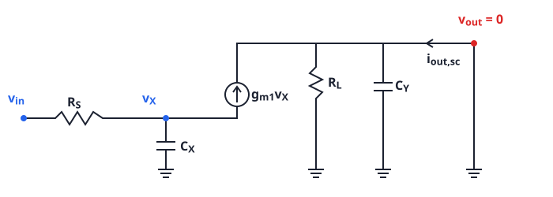
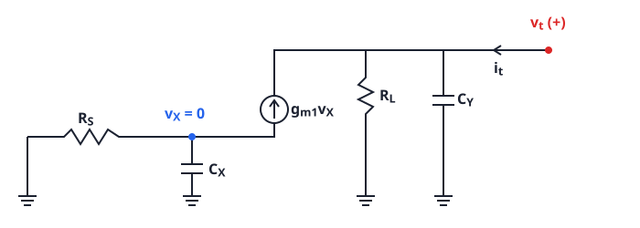
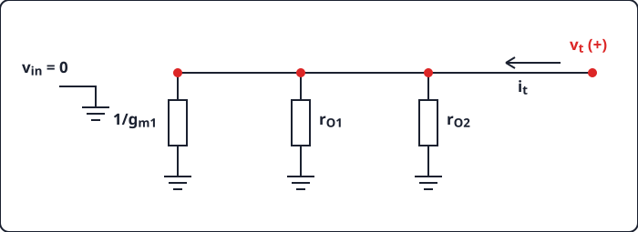
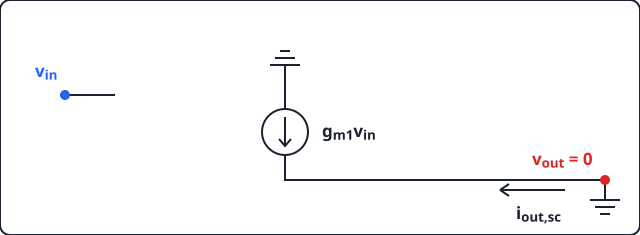
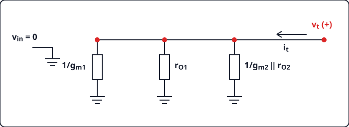

# 전자회로2 복습 1030 문제설명

주어진 조건을 읽고, 첫 줄을 쓰고, 이유를 따라가며 답을 확인해요.

문제의 첫 줄부터 검산까지 설명해요.

**목차**

- [문항별 설명](#problems)
  - [P1. 다이오드 부하 CG 단의 극점](#p1)
  - [P2. 세 가지 부하의 CG 단 전달함수](#p2)
  - [P3. 전류원 부하 팔로워의 입력 커패시턴스](#p3)
  - [P4. 다이오드 부하 팔로워의 입력 커패시턴스](#p4)

## 문항별 설명

### P1. 다이오드 부하 CG 단의 극점

E11.19 · 예제 11.19 · [원 문제 보기](../%EB%B3%B5%EC%8A%B5%EB%AC%B8%EC%A0%9C_1030_CG_CB_and_Follower_Frequency_Response-%EB%AC%B8%EC%A0%9C.pdf)

#### 주어진 조건

- $\lambda = 0$
- 소자 값은 주어지지 않음 (답은 기호로)

#### 구할 것

- 회로의 극점 계산

원문 보기

그림 11.38(a)의 회로의 극점을 계산하라. $\lambda = 0$으로 가정한다.

#### 문제를 읽어요

입력은 M1 소스의 X, 출력은 M1 드레인과 M2 게이트·드레인이 만나는 Y예요. 각 노드에서 저장되는 전하와 빠져나가는 경로를 찾아 두 극점을 구해요.

#### 이 개념과 공식을 떠올려요

게이트 바이어스와 전원은 교류 접지예요. 채널 길이 변조를 무시하면 M1의 출력저항은 무한대이고, 게이트도 접지이므로 X에서 Y로 신호를 되돌리는 수동 가지가 없어요. 두 노드의 시간상수는 각각 $RC$예요.

$g_m$은 게이트–소스 전압에 대한 드레인 전류의 변화율이며, 몸체 효과를 무시하는 교재 모델에서 접지된 게이트를 가진 소스의 입력저항은 $1/g_m$이에요. $s=-1/(RC)$가 극점이에요.

#### 종이에 쓸 첫 줄

전원과 $V_b$를 교류 접지로 놓고, 원 회로의 단자 연결을 따라 합쳐요.

$$
C_X=C_{GS1}+C_{SB1}
$$

$$
C_Y=C_{GD1}+C_{DB1}+C_{GS2}+C_{DB2}
$$

$C_{GD2}$는 양 끝이 Y이고 $C_{SB2}$는 양 끝이 교류 접지이므로 어느 쪽에도 전압이 걸리지 않아요.

#### 이렇게 풀어요

입력 전압원을 0으로 만들면 X에는 $R_S$와 M1 소스의 $1/g_{m1}$이 병렬이에요.

$$
R_X=R_S\parallel\frac{1}{g_{m1}}
$$

Y에서는 M1의 $r_{o1}$이 무한대이고, 다이오드 연결 M2의 저항만 남아요.

$$
R_Y=\frac{1}{g_{m2}}
$$

$$
p_X=-\frac{1}{R_XC_X}
$$

$$
p_Y=-\frac{1}{R_YC_Y}
$$

#### 완성 답과 검산

$$
p_X=-\frac{1}{(R_S\parallel 1/g_{m1})(C_{GS1}+C_{SB1})}
$$

$$
p_Y=-\frac{g_{m2}}{C_{GD1}+C_{DB1}+C_{GS2}+C_{DB2}}
$$

몸체 효과를 무시하고 두 소자의 $\lambda=0$인 소신호 모델의 결과이며 단위는 rad/s예요.

$R C$는 초이므로 역수는 초의 역수예요. $R_S\to0$이면 X가 이상적 전압원에 고정되어 입력 극점의 크기는 무한대로 가요. 교재 식 (11.101)의 $C_{GD1}$은 그림의 X에 연결되지 않아 $C_{GS1}$로 바로잡았어요.

#### 주의할 점

$C_{GD1}$은 게이트–드레인, 즉 교류 접지와 Y 사이예요. X의 $C_{GS1}$과 바꾸지 않아요. 극점 자체는 음수이고 크기만 표시하면 양수예요.

#### 조건을 바꾸어 생각해요

1. $R_S$를 매우 크게 하면 X의 저항은 무엇에 가까워지고 극점은 어떻게 되나요? 답: $1/g_{m1}$, $p_X\to-g_{m1}/C_X$예요.
2. M2의 $C_{GD2}$가 두 배가 되면 Y 극점은 바뀌나요? 답: 양 단자가 같은 Y이므로 바뀌지 않아요.

**페이지 요약**

몸체 효과를 무시하고 두 소자의 $\lambda=0$일 때:

$$
C_Y=C_{GD1}+C_{DB1}+C_{GS2}+C_{DB2}
$$

$$
p_X=-\frac{1}{(R_S\parallel1/g_{m1})(C_{GS1}+C_{SB1})}
$$

$$
p_Y=-\frac{g_{m2}}{C_Y}
$$

---

### P2. 세 가지 부하의 CG 단 전달함수

P11.46 · 장말문제 11.46 · [원 문제 보기](../%EB%B3%B5%EC%8A%B5%EB%AC%B8%EC%A0%9C_1030_CG_CB_and_Follower_Frequency_Response-%EB%AC%B8%EC%A0%9C.pdf)

#### 주어진 조건

- $M_1$에 대해 $\lambda = 0$으로 가정

#### 구할 것

- (a), (b), (c) 각 회로의 전달 함수 $V_{out}/V_{in}$

원문 보기

Determine the transfer function of the circuits shown in Fig. 11.88. Assume $\lambda = 0$ for $M_1$.

#### 문제를 읽어요

세 회로는 입력 $v_{in}$에서 $R_S$를 거쳐 M1 소스 X로 들어가고 드레인 Y에서 출력해요. 달라지는 M2 부하를 각각 구해 같은 전달함수에 넣어요.

#### 이 개념과 공식을 떠올려요

M1의 $\lambda=0$이면 $r_{o1}$은 무한대예요. 게이트와 전원은 교류 접지이므로 X와 Y 사이에 수동 피드백 가지가 없고, 각 노드의 접지 커패시턴스를 합칠 수 있어요. $g_m$은 제어 전압에 대한 전류 변화율, $r_o$는 유한 채널 길이 변조에 따른 저항이에요.

교재의 몸체 효과를 무시한 소신호 모델을 사용해요. M2의 $\lambda$는 0으로 주어지지 않았으므로 $r_{o2}$를 유지해요. $s$ 영역에서 커패시터의 어드미턴스는 $sC$예요.

#### 종이에 쓸 첫 줄

원 회로에서 X는 $C_{GS1}$과 $C_{SB1}$을 교류 접지에 연결해요. $R_L$은 해당 M2가 Y에서 접지까지 보이는 저항이고, $C_Y$는 Y에서 접지까지의 커패시턴스 합이에요.

$$
C_X=C_{GS1}+C_{SB1}
$$

$$
Z_X=\frac{1}{g_{m1}+sC_X}
$$

$$
\frac{v_X}{v_{in}}=\frac{Z_X}{R_S+Z_X}
$$

마지막 식은 $R_S$와 X의 접지 임피던스 $Z_X$에 적용한 전압 분배예요. $g_{m1}v_X$의 크기만큼 출력에 전류가 공급돼요.

#### 이렇게 풀어요

*출력을 단락하고 입력을 유지해요. M1의 제어 전류는 X에서 Y로 흐르고 $r_{o1}$은 무한대예요.*

출력 전류를 Y에서 증폭기 쪽으로 들어가는 방향으로 정의하고 Y를 단락하면, M1이 Y에 공급하는 전류의 부호는 음수예요.

$$
G_m(s)=\frac{i_{out,sc}}{v_{in}}=-\frac{g_{m1}}{1+g_{m1}R_S+sR_SC_X}
$$

*입력 영점, 오른쪽 시험전압과 유입 시험전류로 $R_{out}=v_t/i_t$를 측정해요. $v_X=0$이라 제어 전류는 0이에요.*

입력을 0으로 하면 X도 0이고 M1 출력저항은 무한대예요. 따라서 몸체 효과를 무시하고 $r_{o1}\to\infty$로 둔 모델에서 M2의 저항과 Y의 커패시턴스가 병렬인 근사를 써요.

$$
R_{out}(s)\approx\frac{R_L}{1+sR_LC_Y}
$$

같은 출력 전류 방향에 대해 $A_v=-G_mR_{out}$에 위 출력 임피던스 근사를 적용해요.

$$
\frac{v_{out}}{v_{in}}\approx\frac{g_{m1}R_L}{1+g_{m1}R_S}\frac{1}{[1+s(R_S\parallel 1/g_{m1})C_X](1+sR_LC_Y)}
$$

(a) M2 게이트와 드레인은 교류 접지이고 소스가 Y예요.

$$
R_{L,a}=\frac{1}{g_{m2}}\parallel r_{o2}
$$

$$
C_{Y,a}=C_{GD1}+C_{DB1}+C_{GS2}+C_{SB2}
$$

(b) M2 게이트와 소스가 교류 접지이고 드레인이 Y예요.

$$
R_{L,b}=r_{o2}
$$

$$
C_{Y,b}=C_{GD1}+C_{DB1}+C_{GD2}+C_{DB2}
$$

(c) 이상적 전류원은 개방이고 M2의 게이트와 드레인이 Y예요.

$$
R_{L,c}=\frac{1}{g_{m2}}\parallel r_{o2}
$$

$$
C_{Y,c}=C_{GD1}+C_{DB1}+C_{GS2}+C_{DB2}
$$

#### 완성 답과 검산

$k=a,b,c$에 대해 다음 식에 위에서 구한 각 $R_{L,k}$와 $C_{Y,k}$를 대입해요.

$$
H_k(s)=\frac{v_{out}}{v_{in}}\approx\frac{g_{m1}R_{L,k}}{1+g_{m1}R_S}\frac{1}{[1+s(R_S\parallel1/g_{m1})C_X](1+sR_{L,k}C_{Y,k})}
$$

$C_X=C_{GS1}+C_{SB1}$이며 M1의 $\lambda=0$, 몸체 효과를 무시한 모델이에요.

$s=0$이면 양의 저주파 CG 이득이 되고, $R_S\to0$이면 입력 극점 인자가 1이 돼요. 두 $sRC$는 무차원이에요.

#### 주의할 점

(a)의 M2는 소스가 출력이라 $C_{SB2}$가 Y에 붙지만, (c)의 소스는 접지라 $C_{SB2}$ 양 끝이 접지예요. (c)의 $C_{GD2}$는 양 끝이 Y라 전압이 걸리지 않아요. M1에만 주어진 $\lambda=0$을 M2까지 확대하지 않아요.

#### 조건을 바꾸어 생각해요

- (b)에서 $r_{o2}$가 커지면 출력 극점의 크기는 어떻게 되나요? 답: $1/(r_{o2}C_{Y,b})$이므로 작아져요.
- (c)에서 $C_{GD2}$가 커지면 전달함수는 바뀌나요? 답: 두 단자가 Y로 연결되어 바뀌지 않아요.

**페이지 요약**

몸체 효과를 무시하고 M1의 $\lambda=0$이며 M2의 $r_{o2}$를 유지해요.

$$
C_X=C_{GS1}+C_{SB1}
$$

$$
\tau_X=(R_S\parallel 1/g_{m1})C_X
$$

$$
\tau_{Y,k}=R_{L,k}C_{Y,k}
$$

$$
H_k(s)\approx\frac{g_{m1}R_{L,k}}{1+g_{m1}R_S}\frac{1}{(1+s\tau_X)(1+s\tau_{Y,k})}
$$

$$
R_{L,a}=1/g_{m2}\parallel r_{o2}
$$

$$
C_{Y,a}=C_{GD1}+C_{DB1}+C_{GS2}+C_{SB2}
$$

$$
R_{L,b}=r_{o2}
$$

$$
C_{Y,b}=C_{GD1}+C_{DB1}+C_{GD2}+C_{DB2}
$$

$$
R_{L,c}=1/g_{m2}\parallel r_{o2}
$$

$$
C_{Y,c}=C_{GD1}+C_{DB1}+C_{GS2}+C_{DB2}
$$

---

### P3. 전류원 부하 팔로워의 입력 커패시턴스

E11.23 · 예제 11.23 · [원 문제 보기](../%EB%B3%B5%EC%8A%B5%EB%AC%B8%EC%A0%9C_1030_CG_CB_and_Follower_Frequency_Response-%EB%AC%B8%EC%A0%9C.pdf)

#### 주어진 조건

- $\lambda \neq 0$
- 소자 값은 주어지지 않음 (답은 기호로)

#### 구할 것

- 폴로어의 입력 커패시턴스

원문 보기

그림 11.45에 있는 폴로어의 입력 커패시턴스를 계산하라. $\lambda \neq 0$을 가정한다.

#### 문제를 읽어요

$M_1$의 게이트가 입력이고 소스가 출력이에요. 소스가 게이트를 따라 움직이면 두 단자 사이 $C_{GS1}$에 걸리는 변화가 줄어들어요. $C_{GD1}$의 반대쪽인 드레인은 AC 접지라 그 기여는 그대로 더해요.

#### 이 개념과 공식을 떠올려요

두 노드를 잇는 커패시터의 입력 전류는 두 단자의 전압 변화 차이로 정해져요. 저주파 소스 전압비를 $A_v=v_s/v_{in}$이라 하면 밀러 정리(Miller theorem)의 입력 성분은 $(1-A_v)C_{GS1}$이에요.

$g_{m1}$은 게이트–소스 전압에 대한 드레인 전류의 변화율이고, $r_{O1},r_{O2}$는 채널 길이 변조에 따른 출력저항이에요. 이 저주파 모델에서 몸체 효과는 무시해요. 실제 주파수에 따라 $A_v$도 달라지므로 아래 결과는 저주파 입력 커패시턴스예요.

#### 종이에 쓸 첫 줄

$V_{DD}$와 고정 바이어스는 AC 접지예요. 따라서 $M_1$의 $r_{O1}$은 소스와 접지 사이에 놓여요. 고정 바이어스 전류원 $M_2$의 게이트와 소스는 AC 접지이므로 그 출력저항 $r_{O2}$가 남아요.

$$
R_L=r_{O1}\parallel r_{O2}
$$

여기서 $R_L$은 소스 노드에서 접지로 보이는 저항 중 $M_1$의 제어 전류원을 제외한 병렬 합이에요. 입력 커패시턴스를 구할 저주파 전압비에는 커패시터를 개방해요.

#### 이렇게 풀어요

출력 전류를 소자 쪽으로 들어가는 방향으로 정의하고 소스를 단락하면 $v_{gs1}=v_{in}$이에요. 제어 전류는 출력에서 빠져나가므로 부호가 음수예요.

*출력 단락 시 소스와 드레인이 모두 AC 접지여서 두 출력저항과 부하에는 전압이 걸리지 않아요. 입력 게이트는 절연되어 있고 입력 전압 $v_{in}$은 접지를 기준으로 해요. 출력 소스가 단락되어 제어 전압은 $v_{gs1}=v_{in}$이에요.*

$$
G_m=\frac{i_{out,sc}}{v_{in}}=-g_{m1}
$$

입력을 영점으로 두면 소스에서 본 $M_1$ 쪽 저항은 $1/g_{m1}\parallel r_{O1}$이에요. 여기에 외부 부하를 병렬로 포함해요.

*입력 영점에서 $M_1$의 제어 전류원은 소스에서 $1/g_{m1}$로 보이며 $r_{O1}$ 및 부하와 병렬이에요. 시험전류는 오른쪽에서 회로로 들어가고 $R_{out}=v_t/i_t$예요.*

$$
R_{out}\approx\left(\frac1{g_{m1}}\parallel r_{O1}\right)\parallel r_{O2}
$$

같은 소스 출력에서 단락 전류와 저항을 연결하면 비반전 이득을 얻어요.

$$
A_v=-G_mR_{out}\approx\frac{g_{m1}R_L}{1+g_{m1}R_L}
$$

입력 전압이 $v_{in}$만큼 변할 때 소스는 $A_vv_{in}$만큼 따라가므로 $C_{GS1}$ 양단에는 $(1-A_v)v_{in}$만 걸려요. $C_{GD1}$의 반대쪽인 드레인은 AC 접지라 그 기여는 그대로 더해요.

따라서 입력에서 보이는 저주파 커패시턴스는

$$
C_{in}\approx C_{GD1}+\dfrac{C_{GS1}}{1+g_{m1}R_L}
$$

#### 완성 답과 검산

몸체 효과를 무시한 저주파 모델에서

$$
\boxed{C_{in}\approx C_{GD1}+\dfrac{C_{GS1}}{1+g_{m1}R_L}}
$$

$$
R_L=r_{O1}\parallel r_{O2}
$$

$R_L\to\infty$이면 $C_{GS1}$의 기여는 0이 되어 $C_{in}\to C_{GD1}$이에요. 또한 $g_{m1}R_L$은 무차원이므로 답의 단위는 커패시턴스예요.

#### 주의할 점

$r_{O1}$을 빠뜨리지 마세요. $M_1$의 드레인이 AC 접지이므로 이 저항도 소스 부하에 병렬로 들어가요. $C_{GD1}$은 접지에 직접 연결되어 있어 $(1-A_v)$를 곱하지 않아요.

#### 조건을 바꾸어 생각해요

1. $r_{O1},r_{O2}$가 모두 무한대로 커지면 $C_{GS1}$의 입력 기여는 어떻게 될까요?
2. 소스가 입력을 더 잘 따라가면 $C_{GS1}$ 양단 전압과 입력 기여는 각각 어떻게 변할까요?

**페이지 요약**

소스가 입력을 따라갈수록 $C_{GS1}$의 입력 기여가 줄어요.

저주파에서 $C_{in}\approx C_{GD1}+\dfrac{C_{GS1}}{1+g_{m1}R_L}$이에요.

$R_L=r_{O1}\parallel r_{O2}$이며 몸체 효과는 무시해요.

---

### P4. 다이오드 부하 팔로워의 입력 커패시턴스

P11.47 · 장말문제 11.47 · [원 문제 보기](../%EB%B3%B5%EC%8A%B5%EB%AC%B8%EC%A0%9C_1030_CG_CB_and_Follower_Frequency_Response-%EB%AC%B8%EC%A0%9C.pdf)

#### 주어진 조건

- 커패시턴스는 $C_{GS1}$만 고려
- $\lambda \neq 0$으로 가정

#### 구할 것

- 회로의 입력 커패시턴스 $C_{in}$

원문 보기

Consider the source follower shown in Fig. 11.89, where the current source is mistakenly replaced with a diode-connected device. Taking into account only $C_{GS1}$, compute the input capacitance of the circuit. Assume $\lambda \neq 0$.

#### 문제를 읽어요

$M_1$의 게이트가 입력이고 소스가 출력이에요. 소스가 게이트를 따라 움직이면 두 단자 사이 $C_{GS1}$에 걸리는 변화가 줄어들어요. 문제에서 지정한 $C_{GS1}$만 고려해요.

#### 이 개념과 공식을 떠올려요

두 노드를 잇는 커패시터의 입력 전류는 두 단자의 전압 변화 차이로 정해져요. 저주파 소스 전압비를 $A_v=v_s/v_{in}$이라 하면 밀러 정리(Miller theorem)의 입력 성분은 $(1-A_v)C_{GS1}$이에요.

$g_{m1}$은 게이트–소스 전압에 대한 드레인 전류의 변화율이고, $r_{O1},r_{O2}$는 채널 길이 변조에 따른 출력저항이에요. 이 저주파 모델에서 몸체 효과는 무시해요. 실제 주파수에 따라 $A_v$도 달라지므로 아래 결과는 저주파 입력 커패시턴스예요.

#### 종이에 쓸 첫 줄

$V_{DD}$와 고정 바이어스는 AC 접지예요. 따라서 $M_1$의 $r_{O1}$은 소스와 접지 사이에 놓여요. 다이오드 연결된 $M_2$는 몸체 효과를 무시하면 $1/g_{m2}\parallel r_{O2}$로 보여요.

$$
R_L=\dfrac{1}{g_{m2}}\parallel r_{O1}\parallel r_{O2}
$$

여기서 $R_L$은 소스 노드에서 접지로 보이는 저항 중 $M_1$의 제어 전류원을 제외한 병렬 합이에요. 입력 커패시턴스를 구할 저주파 전압비에는 커패시터를 개방해요.

#### 이렇게 풀어요

출력 전류를 소자 쪽으로 들어가는 방향으로 정의하고 소스를 단락하면 $v_{gs1}=v_{in}$이에요. 제어 전류는 출력에서 빠져나가므로 부호가 음수예요.

*출력 단락 시 소스와 드레인이 모두 AC 접지여서 두 출력저항과 부하에는 전압이 걸리지 않아요. 입력 게이트는 절연되어 있고 입력 전압 $v_{in}$은 접지를 기준으로 해요. 출력 소스가 단락되어 제어 전압은 $v_{gs1}=v_{in}$이에요.*

$$
G_m=\frac{i_{out,sc}}{v_{in}}=-g_{m1}
$$

입력을 영점으로 두면 소스에서 본 $M_1$ 쪽 저항은 $1/g_{m1}\parallel r_{O1}$이에요. 여기에 외부 부하를 병렬로 포함해요.

*입력 영점에서 $M_1$의 제어 전류원은 소스에서 $1/g_{m1}$로 보이며 $r_{O1}$ 및 부하와 병렬이에요. 시험전류는 오른쪽에서 회로로 들어가고 $R_{out}=v_t/i_t$예요.*

$$
R_{out}\approx\left(\frac1{g_{m1}}\parallel r_{O1}\right)\parallel \left(\dfrac{1}{g_{m2}}\parallel r_{O2}\right)
$$

같은 소스 출력에서 단락 전류와 저항을 연결하면 비반전 이득을 얻어요.

$$
A_v=-G_mR_{out}\approx\frac{g_{m1}R_L}{1+g_{m1}R_L}
$$

입력 전압이 $v_{in}$만큼 변할 때 소스는 $A_vv_{in}$만큼 따라가므로 $C_{GS1}$ 양단에는 $(1-A_v)v_{in}$만 걸려요. 문제에서 지정한 $C_{GS1}$만 고려해요.

따라서 입력에서 보이는 저주파 커패시턴스는

$$
C_{in}\approx\dfrac{C_{GS1}}{1+g_{m1}R_L}
$$

#### 완성 답과 검산

몸체 효과를 무시한 저주파 모델에서

$$
\boxed{C_{in}\approx\dfrac{C_{GS1}}{1+g_{m1}R_L}}
$$

$$
R_L=\dfrac{1}{g_{m2}}\parallel r_{O1}\parallel r_{O2}
$$

$g_{m2}\to0$이면 전류원 부하의 $C_{GS1}$ 기여로 돌아가요. 또한 $g_{m1}R_L$은 무차원이므로 답의 단위는 커패시턴스예요.

#### 주의할 점

$r_{O1}$을 빠뜨리지 마세요. $M_1$의 드레인이 AC 접지이므로 이 저항도 소스 부하에 병렬로 들어가요. 다이오드 연결 $M_2$를 이상적인 전류원으로 취급하면 $1/g_{m2}$ 가지를 놓쳐요.

#### 조건을 바꾸어 생각해요

1. 다이오드 연결이 사라져 $g_{m2}=0$이 되면 $R_L$과 $C_{in}$은 어떻게 변할까요?
2. 소스가 입력을 더 잘 따라가면 $C_{GS1}$ 양단 전압과 입력 기여는 각각 어떻게 변할까요?

**페이지 요약**

소스가 입력을 따라갈수록 $C_{GS1}$의 입력 기여가 줄어요.

저주파에서 $C_{in}\approx\dfrac{C_{GS1}}{1+g_{m1}R_L}$이에요.

$R_L=\dfrac{1}{g_{m2}}\parallel r_{O1}\parallel r_{O2}$이며 몸체 효과는 무시해요.

---

원 문제·정리노트·PDF는 보존해요.
