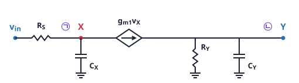
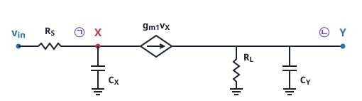
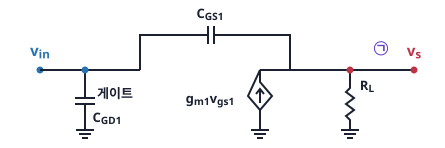
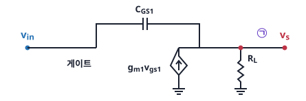

# 전자회로2 복습 1030 문제설명

회로와 첫 식을 짚고 핵심 계산으로 답을 구해요.

문제의 첫 줄부터 검산까지 설명해요.

**목차**

- [문항별 설명](#problems)
  - [P1. 다이오드 부하 CG 단의 극점](#p1)
  - [P2. 세 가지 부하의 CG 단 전달함수](#p2)
  - [P3. 전류원 부하 팔로워의 입력 커패시턴스](#p3)
  - [P4. 다이오드 부하 팔로워의 입력 커패시턴스](#p4)

## 문항별 설명

### P1. 다이오드 부하 CG 단의 극점

E11.19 · 예제 11.19 · [원 문제 보기](../%EB%B3%B5%EC%8A%B5%EB%AC%B8%EC%A0%9C_1030_CG_CB_and_Follower_Frequency_Response-%EB%AC%B8%EC%A0%9C.pdf)

#### 주어진 조건

- $\lambda = 0$
- 소자 값은 주어지지 않음 (답은 기호로)

#### 구할 것

- 회로의 극점 계산

원문 보기

그림 11.38(a)의 회로의 극점을 계산하라. $\lambda = 0$으로 가정한다.

*공통 게이트 소신호 모델. 종속 전류는 소스 X에서 드레인 Y로 흘러요.*

㉠ 입력원을 0으로 두면 X에서 $R_S$와 공통 게이트 입력저항이 병렬이에요. 게이트·벌크는 교류 접지예요.

$$
R_X=R_S\parallel 1/g_{m1}
$$

$$
C_X=C_{GS1}+C_{SB1}
$$

㉡ 두 소자의 $\lambda=0$이고 몸체 효과를 생략하면 Y에서 다이오드 접속 $M_2$의 저항만 보여요. $C_{GD2}$는 양쪽이 Y예요.

$$
R_Y=1/g_{m2}
$$

$$
C_Y=C_{GD1}+C_{DB1}+C_{GS2}+C_{DB2}
$$

$$
p_X=-1/(R_XC_X)
$$

$$
p_Y=-1/(R_YC_Y)
$$

교재 식 (11.101)의 입력 용량 표기는 그림에서 소스 X와 접지 사이에 연결된 $C_{GS1}$로 읽어요.

**페이지 요약**

소스 X와 드레인 Y에서 접지로 이어진 용량과 저항을 각각 모아요.

---

### P2. 세 가지 부하의 CG 단 전달함수

P11.46 · 장말문제 11.46 · [원 문제 보기](../%EB%B3%B5%EC%8A%B5%EB%AC%B8%EC%A0%9C_1030_CG_CB_and_Follower_Frequency_Response-%EB%AC%B8%EC%A0%9C.pdf)

#### 주어진 조건

- $M_1$에 대해 $\lambda = 0$으로 가정

#### 구할 것

- (a), (b), (c) 각 회로의 전달 함수 $V_{out}/V_{in}$

원문 보기

Determine the transfer function of the circuits shown in Fig. 11.88. Assume $\lambda = 0$ for $M_1$.

*공통 게이트 소신호 모델. 종속 전류는 소스 X에서 드레인 Y로 흘러요.*

㉠ $M_1$의 $r_{o1}\to\infty$이고 게이트가 교류 접지라 Y의 부하가 X로 되먹임되지 않아요. 몸체 효과는 생략해요.

$$
H_k(s)=\frac{v_X}{v_{in}}\frac{v_Y}{v_X}
$$

$$
C_X=C_{GS1}+C_{SB1}
$$

$$
\frac{v_X}{v_{in}}=\frac{1}{1+R_S(g_{m1}+sC_X)}
$$

㉡ Y에서는 $g_{m1}v_X$가 $R_{L,k}\parallel 1/(sC_{Y,k})$로 흘러요. $M_2$의 유한 $r_{o2}$를 유지해요.

$$
\frac{v_Y}{v_X}=\frac{g_{m1}R_{L,k}}{1+sR_{L,k}C_{Y,k}}
$$

(a) Y가 $M_2$의 소스예요.

$$
R_{L,a}=(1/g_{m2})\parallel r_{o2}
$$

$$
C_{Y,a}=C_{GD1}+C_{DB1}+C_{GS2}+C_{SB2}
$$

(b) Y가 $M_2$의 드레인이고 게이트와 소스는 교류 접지예요.

$$
R_{L,b}=r_{o2}
$$

$$
C_{Y,b}=C_{GD1}+C_{DB1}+C_{GD2}+C_{DB2}
$$

(c) Y가 다이오드 접속 $M_2$의 게이트·드레인이에요.

$$
R_{L,c}=(1/g_{m2})\parallel r_{o2}
$$

$$
C_{Y,c}=C_{GD1}+C_{DB1}+C_{GS2}+C_{DB2}
$$

각 회로 $k=a,b,c$에서

$$
H_k(s)=\frac{g_{m1}R_{L,k}}{[1+g_{m1}R_S+sR_SC_X](1+sR_{L,k}C_{Y,k})}
$$

**페이지 요약**

입력 분압은 세 회로에서 같고, 출력 저항과 용량은 M₂의 접속으로 정해져요.

---

### P3. 전류원 부하 팔로워의 입력 커패시턴스

E11.23 · 예제 11.23 · [원 문제 보기](../%EB%B3%B5%EC%8A%B5%EB%AC%B8%EC%A0%9C_1030_CG_CB_and_Follower_Frequency_Response-%EB%AC%B8%EC%A0%9C.pdf)

#### 주어진 조건

- $\lambda \neq 0$
- 소자 값은 주어지지 않음 (답은 기호로)

#### 구할 것

- 폴로어의 입력 커패시턴스

원문 보기

그림 11.45에 있는 폴로어의 입력 커패시턴스를 계산하라. $\lambda \neq 0$을 가정한다.

*소스에서 본 두 출력저항을 부하에 포함해요.*

㉠ 소스에서 $M_1$ 드레인과 $M_2$ 소스가 모두 교류 접지로 이어져 두 출력저항이 병렬이에요.

$$
R_L=r_{o1}\parallel r_{o2}
$$

몸체 효과를 생략하고 저주파에서 커패시터를 열면 소스에서 전류가 균형을 이뤄요.

$$
v_s/R_L=g_{m1}(v_{in}-v_s)
$$

$$
A_v=\frac{v_s}{v_{in}}=\frac{g_{m1}R_L}{1+g_{m1}R_L}
$$

드레인은 교류 접지라 $C_{GD1}$에는 입력 전압 전체가 걸려요. $C_{GS1}$ 양단에는 입력과 소스 전압의 차이만 걸려요.

$$
q_{in}=C_{GD1}v_{in}+C_{GS1}(v_{in}-v_s)
$$

$$
C_{in}=\frac{q_{in}}{v_{in}}\approx C_{GD1}+\frac{C_{GS1}}{1+g_{m1}R_L}
$$

**페이지 요약**

소스가 게이트를 따라갈수록 게이트–소스 전하 변화가 작아져요.

---

### P4. 다이오드 부하 팔로워의 입력 커패시턴스

P11.47 · 장말문제 11.47 · [원 문제 보기](../%EB%B3%B5%EC%8A%B5%EB%AC%B8%EC%A0%9C_1030_CG_CB_and_Follower_Frequency_Response-%EB%AC%B8%EC%A0%9C.pdf)

#### 주어진 조건

- 커패시턴스는 $C_{GS1}$만 고려
- $\lambda \neq 0$으로 가정

#### 구할 것

- 회로의 입력 커패시턴스 $C_{in}$

원문 보기

Consider the source follower shown in Fig. 11.89, where the current source is mistakenly replaced with a diode-connected device. Taking into account only $C_{GS1}$, compute the input capacitance of the circuit. Assume $\lambda \neq 0$.

*소스의 부하에는 다이오드 접속 부하의 컨덕턴스도 들어가요.*

㉠ 소스에서 다이오드 접속 $M_2$를 보므로 두 출력저항에 $1/g_{m2}$가 병렬로 붙어요.

$$
R_L=(1/g_{m2})\parallel r_{o1}\parallel r_{o2}
$$

몸체 효과를 생략하고 저주파에서 커패시터를 열면 소스에서 전류가 균형을 이뤄요.

$$
v_s/R_L=g_{m1}(v_{in}-v_s)
$$

$$
A_v=\frac{v_s}{v_{in}}=\frac{g_{m1}R_L}{1+g_{m1}R_L}
$$

$C_{GS1}$ 양단에는 입력과 소스 전압의 차이만 걸려요.

$$
q_{in}=C_{GS1}(v_{in}-v_s)
$$

$$
C_{in}=\frac{q_{in}}{v_{in}}\approx \frac{C_{GS1}}{1+g_{m1}R_L}
$$

**페이지 요약**

소스가 게이트를 따라갈수록 게이트–소스 전하 변화가 작아져요.

---

원 문제·정리노트·PDF는 보존해요.
