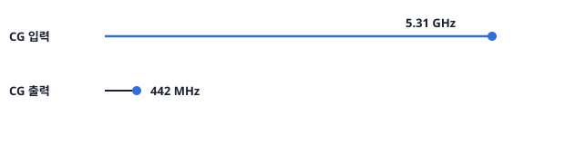
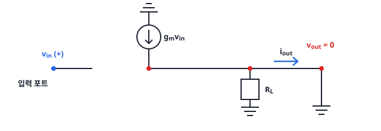
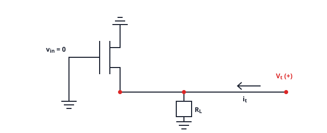

# CG·CB와 팔로워의 주파수 응답 — 5살도 이해하는 정리노트

권익진 교수님 전자회로2 · 1030 수업 (Lec5, Razavi 11장)

> `정리노트_1030_CG_CB_and_Follower_Frequency_Response.html`를 마크다운으로 옮겼어요. 그림은 `figures_1030/` 폴더의 SVG, 위젯은 대표 설정의 정적 그림으로 바꿨어요. 수식은 `$…$` / `$$…$$`라서 GitHub, Obsidian, Typora에서 보여요.

**목차**

- [들어가며: 왜 이런 회로를 쓸까](#why)
  - [왜 이런 회로를 쓸까](#why-circuit)
- [1. CE·CS의 입력 임피던스](#s0)
  - [밀러 효과와 입력 분압](#s0-miller)
- [2. CG·CB의 주파수 응답](#s1)
  - [접지된 게이트와 베이스](#s1-topology)
  - [입력과 출력의 두 극점](#s1-poles)
  - [CG 극점 수치 비교](#s1-example)
  - [다이오드 연결 부하의 극점](#s1-diode)
- [3. 팔로워의 대역폭과 입력 커패시턴스](#s2)
  - [팔로워와 버퍼](#s2-buffer)
  - [팔로워의 전달함수](#s2-transfer)
  - [출력이 따라오면 입력 커패시턴스가 작아진다](#s2-input-cap)
  - [전류원 부하와 이미터 팔로워](#s2-loads)
- [4. 요약 · 예고](#s3)
  - [한눈에 정리](#s3-cheatsheet)
  - [다음 시간 예고](#s3-next)
  - [함께 보면 좋은 자료](#s3-links)

## 들어가며: 왜 이런 회로를 쓸까

### 왜 이런 회로를 쓸까

*1030 수업 · L05 s35–46*

**쉽게 말하면**

빠른 신호를 전달하려면 증폭기의 속도와 앞뒤 회로의 연결을 함께 살펴봐요.

CG·CB는 속도를 높이는 대신 입력 전압을 받기 어렵고, 팔로워는 앞뒤 회로 사이에서 버퍼 역할을 해요.

*빠른 신호를 다루는 두 가지 선택을 살펴봐요.*

**정확히 말하면**

#### 풀고 싶은 문제

**주파수가 올라가도 신호가 잘 전달되도록 증폭기의 속도와 입력 임피던스를 함께 살펴봐요.** 예를 들어 출력저항이 1 kΩ인 전단에 5Ω 스피커를 직접 연결하면 부하 때문에 출력이 크게 줄어요. [밀러 효과와 입력 분압](#s0-miller)에서 연결의 영향을 먼저 확인해요.

#### 단순한 해법과 그 한계

CS·CE는 전압 증폭에 쓰이지만 입력과 출력 사이 커패시턴스의 밀러 효과가 입력에 크게 나타날 수 있어요. **높은 주파수에서 입력 임피던스가 작아지면 신호원과의 분압으로 입력 전압이 줄어요.** [밀러 효과와 입력 분압](#s0-miller)에서 확인해요.

#### 핵심 아이디어

**CG·CB는 밀러 효과를 줄이고 팔로워는 앞뒤 회로 사이에서 버퍼 역할을 해요.** CG·CB는 공통 단자를 교류 접지해 이 모델의 입력과 출력 사이 부유 커패시터를 없애요. 팔로워는 출력이 입력을 따라가게 하여 높은 입력 임피던스와 낮은 출력 임피던스를 가진 버퍼로 사용해요. 각각 [접지된 게이트와 베이스](#s1-topology)와 [팔로워와 버퍼](#s2-buffer)에서 살펴봐요.

#### 대가와 쓰이는 곳

**CG·CB는 낮은 입력 저항을, 팔로워는 실제 부하를 구동할 능력을 확인해야 해요.** CG·CB는 전압을 받기 어려울 수 있지만 전류 입력이나 50Ω 매칭에 쓸 수 있어요. 높은 출력저항의 전단과 낮은 저항의 부하 사이에는 팔로워 버퍼를 둘 수 있어요. [접지된 게이트와 베이스](#s1-topology)와 [팔로워와 버퍼](#s2-buffer)에서 자세히 알아봐요.

**교수님 말씀**

전단의 출력 임피던스와 부하를 함께 봐야 한다는 설명은 [팔로워와 버퍼](#s2-buffer)의 예시로 이어져요.

확인해 봐요. 출력저항이 큰 전단에서 낮은 저항 부하로 전압을 전달하려면 CG와 팔로워 중 어느 구조가 버퍼에 알맞나요?

답 보기

팔로워예요. 높은 입력 임피던스로 전단의 부하를 줄이고 낮은 출력 임피던스로 뒤의 부하를 구동해요.

**페이지 요약**

CG·CB는 밀러 효과를 줄이고 팔로워는 버퍼로 앞뒤 회로를 연결해요.

*판단 기준*

CG·CB는 낮은 입력 저항을 고려해요.

높은 출력저항의 전단과 낮은 저항의 부하 사이에는 팔로워 버퍼를 쓸 수 있어요.

---

## 1. CE·CS의 입력 임피던스

### 밀러 효과와 입력 분압

*1030 수업 · L05 s35*

**쉽게 말하면**

출력이 입력과 반대로 움직이면 사이의 작은 커패시터도 입력에서 크게 보여요.

예를 들어 출력이 입력의 반대 방향으로 4배 움직이면 그 커패시터는 입력에서 5배로 보여요.

*입력과 출력의 움직임 차이가 커패시터에 걸려요.*

**정확히 말하면**

#### 반전 이득이 용량을 키우는 예

먼저 저주파 전압 이득이 $A_v=-4$이고 $C_{GD}=1\,\mathrm{fF}$인 예를 볼게요. **밀러 등가 용량은 $(1-(-4))\times1=5\,\mathrm{fF}$예요.** $C_{GS}=2\,\mathrm{fF}$라면 입력의 전체 등가 용량은 $7\,\mathrm{fF}$예요.

#### 양단 전압에서 밀러 용량으로

공통 소스(CS) 단에서 게이트가 입력, 드레인이 출력이고 소스는 AC 접지예요. $C_{GD}$는 게이트와 드레인 사이, $C_{GS}$는 입력과 접지 사이에 있어요. $A_v=V_{out}/V_{in}$을 해당 주파수의 두 노드 이득이라고 두고 게이트로 흐르는 $C_{GD}$ 전류를 살펴봐요.

1. $$
   V_{in}-V_{out}=(1-A_v)V_{in}
   $$

   커패시터 양끝의 전압 차를 구해요.
2. $$
   I_{GD}=sC_{GD}(1-A_v)V_{in}
   $$

   커패시터 전류는 용량과 양단 전압에 비례해요.
3. $$
   C_{M,in}=(1-A_v)C_{GD}
   $$

   $I_{GD}=sC_{M,in}V_{in}$인 접지 용량으로 바꿔요.

**출력이 반전되면 $A_v$가 음수여서 입력 등가 용량이 커져요.**

#### CS와 CE의 입력 임피던스

저주파에 $r_O$를 무시하면 출력 단락의 $G_m=g_m$이고, 입력 영점에서 부하를 포함한 $R_{out}\approx R_D$예요. 이때 출력 단락에서 드레인으로 들어가는 전류를 양으로 잡아요. 두 값을 곱한 $A_v=-G_mR_{out}\approx-g_mR_D$를 사용하면 다음과 같아요. **이것은 주파수에 따라 변하는 이득을 저주파 값으로 대신한 밀러 근사예요.**

$$
C_{in,CS}\approx C_{GS}+(1+g_mR_D)C_{GD}
$$

$$
Z_{in,CS}\approx\frac{1}{s\left[C_{GS}+(1+g_mR_D)C_{GD}\right]}
$$

이 근사에서 $s=j\omega$이고 주파수가 높아지면 용량성 입력 임피던스의 크기가 작아져요. 공통 이미터(CE)에서는 $C_\pi$와 $C_\mu$가 각각 같은 역할을 하고, 베이스와 이미터 사이의 $r_\pi$도 입력에 병렬로 보여요.

$$
Z_{in,CE}\approx r_\pi\parallel\frac{1}{s\left[C_\pi+(1+g_mR_C)C_\mu\right]}
$$

#### 유한한 신호원 저항과 전압 분배

신호원 전압 $V_S$가 직렬 저항 $R_S$를 거쳐 입력에 연결되면 입력 전압은 임피던스 분압으로 정해져요.

$$
\frac{V_{in}}{V_S}=\frac{Z_{in}}{R_S+Z_{in}}
$$

CS의 저주파 입력은 이상적으로 무한대에 가까워 신호원 전압을 거의 모두 받아요. **주파수가 높아져 용량성 $Z_{in}$의 크기가 작아지면 유한한 $R_S$에 걸리는 전압이 커져 입력에 전달되는 전압이 줄어요.** 복소 임피던스이므로 크기만 단순 저항처럼 나누지 않아요.

**교수님 말씀**

> “C_GD 자체는 작지만 왜 중요한 영향을 미치죠? ... 밀러 이펙트에 의해서”

게이트–드레인 중첩 커패시턴스는 게이트–소스 산화막 커패시턴스보다 작아도, 반전 이득 때문에 입력에서 크게 나타나요.

> “임피던스가 커야지 전압을 잘 받을 수 있죠.”

전단의 출력 임피던스를 $R_S$로 나타내고 입력 임피던스와의 분압으로 설명했어요.

확인해 봐요. 저주파 이득이 $A_v=-3$, $C_{GD}=2\,\mathrm{fF}$, $C_{GS}=4\,\mathrm{fF}$라면 밀러 근사로 구한 전체 입력 용량은 얼마인가요?

답 보기

$12\,\mathrm{fF}$예요. $C_{in}\approx C_{GS}+(1-A_v)C_{GD}=4+(1+3)\times2=12\,\mathrm{fF}$예요.

**페이지 요약**

반전 이득은 입력에 보이는 밀러 용량을 키워요.

*핵심 식*

- CS 입력 용량

  $$
  C_{in,CS}\approx C_{GS}+(1+g_mR_D)C_{GD}
  $$
- 입력 분압

  $$
  \frac{V_{in}}{V_S}=\frac{Z_{in}}{R_S+Z_{in}}
  $$

첫 식은 저주파 이득을 사용하는 밀러 근사예요.

유한한 $R_S$에서 고주파 입력 임피던스가 작아지면 전달 전압이 줄어요.

---

## 2. CG·CB의 주파수 응답

### 접지된 게이트와 베이스

*1030 수업 · L05 s36–38*

**쉽게 말하면**

CG에서는 게이트가 교류 접지라 입력의 $C_{GS}$와 출력의 $C_{GD}$가 각각 접지에 연결돼 보여요.

*입력과 출력은 각각 교류 접지를 기준으로 커패시턴스를 봐요.*

**정확히 말하면**

#### 커패시터가 어느 노드에 붙는가

CG(common gate)는 소스 입력, 드레인 출력이고 게이트는 AC 접지예요. 예를 들어 $C_{GS}$는 입력과 접지 사이의 접지 커패시터가 되며 $C_{GD}$는 출력과 접지 사이에 있어요. **이 모델에는 입력과 출력을 직접 잇는 부유 커패시터가 없으므로 CS의 입력 밀러 증폭이 없어요.**

바디도 AC 접지일 때 $C_{SB}$는 입력에, $C_{DB}$는 출력에 붙어요. CB(common base)는 베이스가 AC 접지이고 이미터 입력, 컬렉터 출력이에요. $C_\pi$는 입력에, $C_\mu$와 $C_{CS}$는 출력에 붙어요.

#### 낮은 입력 저항과 바이어스의 대가

같은 부하와 소자 근사에서 CG의 소스 노드 기준 이득은 양수이고 CS는 음수예요. **입력 저항은 대략 $1/g_m$이므로 전압 신호는 신호원 저항과 분압돼요.** 대신 전류 입력이나 50Ω 매칭에 활용할 수 있어요. 실제 회로에는 DC 바이어스 전류 경로가 필요해요. 이상 전류원은 소신호에서 개방이며, AC 결합 커패시터는 동작 대역에서 거의 단락이면서 DC 바이어스를 분리해요.

**교수님 말씀**

> “게이트가 그라운드인 점을 감안하면 ... 그라운디드 캡이죠.”

입력 저항이 낮으면 전단에서 전압을 잘 받지 못해요.

확인해 봐요. CB에서 베이스가 교류 접지라면 베이스–컬렉터 사이 $C_\mu$는 입력 쪽과 출력 쪽 중 어디에 붙나요?

답 보기

출력 쪽이에요. 컬렉터가 출력이고 베이스가 교류 접지이므로 $C_\mu$는 출력과 접지 사이에 있어요.

**페이지 요약**

CG·CB의 접지 단자가 입력과 출력 커패시턴스를 나눠요.

입력 저항이 낮아 전압 분압이 생겨요.

---

### 입력과 출력의 두 극점

*1030 수업 · L05 s37–38*

**쉽게 말하면**

제로 영향이 없는 두 실수 극점 저역통과 응답에서는 기울기가 0 → −20 → −40 dB/dec로 바뀌어요.

*극점을 지날 때 이득이 갑자기 떨어지는 것이 아니라 기울기가 바뀌어요.*

**정확히 말하면**

#### 극점이 더해질 때의 변화

**제로의 영향이 없는 두 실수 극점 저역통과 응답에서 기울기는 처음에 0, 첫 극점 뒤에 −20, 두 번째 뒤에 −40 dB/dec가 돼요.** 이득이 순간적으로 20 dB 떨어진다는 뜻은 아니에요. 또 입력의 저항만 두 배가 되면, 다른 조건이 같을 때 입력 극점 크기는 절반이 돼요. 각 노드의 접지 커패시터와 그 노드에서 보는 저항을 곱해요.

#### 입력·출력 노드의 저항과 용량

CG에서 $r_O$와 바디 효과를 무시하고 게이트·바디가 AC 접지이면 다음과 같아요.

$$
C_X=C_{GS}+C_{SB}
$$

$$
R_X\approx R_S\parallel\frac{1}{g_m}
$$

$$
C_Y=C_{GD}+C_{DB}
$$

$$
R_Y\approx R_D
$$

$$
\omega_{pX}\approx\frac{1}{R_X C_X}
$$

$$
\omega_{pY}\approx\frac{1}{R_Y C_Y}
$$

**이 값은 양의 극점 크기이며 실제 실수 극점 위치는 각각 음수예요.** CB에서는 $C_X=C_\pi$, $C_Y=C_\mu+C_{CS}$, $R_Y\approx R_C$예요. 입력측 소자 저항은 큰 $\beta$에서 약 $1/g_m$이고, $r_\pi$를 유지하면 $r_\pi\parallel(1/g_m)$로 근사해요.

#### 두 극점으로 전달함수 읽기

제로를 무시할 수 있는 주파수 범위에서는 두 극점을 이용해 전달함수를 표현해요.

$$
H(s)\approx\frac{A_0}{(1+s/\omega_{pX})(1+s/\omega_{pY})}
$$

여기서 $A_0$는 신호원에서 출력까지의 저주파 이득이에요. CG의 저주파 이득을 구해 볼게요. 저주파 출력 단락에서 드레인으로 들어가는 전류를 양으로 잡으면 $G_m\approx-g_m/(1+g_mR_S)$예요. 입력 영점에서 부하를 포함한 $R_{out}\approx R_D$이므로 $A_0=-G_mR_{out}\approx g_m R_D/(1+g_m R_S)$예요. 분모에는 신호원 저항의 입력 분압이 반영돼요. **두 극점보다 아래에서 이득이 평평하고 제로의 영향이 없다면 첫 극점 이후 기울기는 약 −20 dB/dec, 두 번째 이후 약 −40 dB/dec가 돼요.** 실제 곡선은 모서리에서 부드럽게 변해요.

**교수님 말씀**

입력에 보이는 저항은 신호원 저항과 소스에서 바라본 저항의 병렬로 잡아요.

확인해 봐요. 제로 영향이 없는 저역통과 응답에서 기울기가 −20 dB/dec인 구간을 지나 실수 극점 하나를 더 넘으면 기울기는 어떻게 되나요?

답 보기

약 −40 dB/dec예요. 기존 −20에 극점 하나의 −20 dB/dec를 더해요. 실제 곡선은 극점 부근에서 부드럽게 변해요.

**페이지 요약**

각 노드의 저항과 커패시턴스로 극점 크기를 구해요.

*핵심 식*

- 입력 극점 크기

  $$
  \omega_{pX}\approx\frac{1}{R_X C_X}
  $$
- 출력 극점 크기

  $$
  \omega_{pY}\approx\frac{1}{R_Y C_Y}
  $$

실제 실수 극점은 음수예요.

---

### CG 극점 수치 비교

*1030 수업 · L05 s39*

**쉽게 말하면**

입력 쪽이 빨라져도 출력 쪽이 전체 속도를 제한할 수 있어요.

*같은 주파수 눈금에서 출력 극점이 먼저 나타나요.*

**정확히 말하면**

#### 낮은 극점을 먼저 고르기

**슬라이드에는 입력 극점 5.31 GHz, 출력 극점 442 MHz가 표시돼 출력이 지배적 극점이에요.** 원본 조건은 $R_S=200\ \Omega$, $1/g_m=150\ \Omega$, $R_D=2\ \mathrm{k}\Omega$, $\lambda=0$, $C_{GS}=250\ \mathrm{fF}$, $C_{GD}=80\ \mathrm{fF}$, $C_{DB}=100\ \mathrm{fF}$예요.

#### 원본 조건으로 출력 극점 계산하기

1. $$
   R_X=200\parallel150\ \Omega\approx85.71\ \Omega
   $$

   입력에서 신호원 저항과 소자 저항이 병렬이에요.
2. $$
   C_Y=80+100=180\ \mathrm{fF}
   $$

   출력에서 두 접지 커패시턴스를 더해요.
3. $$
   \begin{aligned}f_{pY}&\approx\frac{1}{2\pi(2\ \mathrm{k}\Omega)(180\ \mathrm{fF})}\\&\approx442.1\ \mathrm{MHz}\end{aligned}
   $$

   저항과 용량으로 각주파수를 구한 뒤 $2\pi$로 나눠요.

**출력 극점은 인쇄된 저항과 커패시턴스로 재현돼요.**

#### 미기재 입력 용량과 비교의 한계

입력에 $C_{SB}=100\ \mathrm{fF}$를 추가로 가정하면 $C_X=350\ \mathrm{fF}$이므로 표시된 5.31 GHz가 재현돼요. 다만 슬라이드에는 $C_{SB}$ 수치가 명시되지 않아 이 가정은 확정할 수 없어요. $C_{SB}=0$이라면 입력 극점은 약 7.43 GHz예요. 표시된 5.31 GHz와 앞서 계산한 CS 입력 극점의 밀러 근사 571 MHz를 비교하면 약 9.3배지만, **입력 극점의 비율을 전체 대역폭 비율로 일반화하지 않아요.**

**교수님 말씀**

입력 극점과 출력 극점을 따로 살펴보고 더 낮은 쪽이 전체 응답을 제한하는지 확인해요.

확인해 봐요. 입력 극점이 4 GHz, 출력 극점이 400 MHz인 두 실수 극점 저역통과 회로에서 제로를 무시할 수 있다면 어느 쪽이 지배적 극점인가요?

답 보기

출력 극점이에요. $4\,\mathrm{GHz}=4000\,\mathrm{MHz}$이므로 출력 극점이 입력 극점보다 10배 낮아 먼저 이득을 줄여요.

**페이지 요약**

입력 극점이 높아도 출력 극점이 응답을 제한할 수 있어요.

입력 극점 비율을 전체 대역폭 비율로 쓰지 않아요.

---

### 다이오드 연결 부하의 극점

*1030 수업 · L05 s40*

**쉽게 말하면**

다이오드 연결 부하는 출력 저항과 출력 쪽 커패시턴스를 함께 바꿔요.

*출력에는 입력 소자와 부하 소자의 접지 커패시턴스가 모여요.*

**정확히 말하면**

#### 단락된 커패시터를 제외하기

예를 들어 **$C_{GD2}$는 M2의 게이트와 드레인이 서로 연결돼 양단 전압이 0이므로 출력 커패시턴스에 더하지 않아요.** M1 게이트와 M2 소스는 AC 접지, M1 소스는 입력, M1 드레인과 M2 게이트·드레인은 출력이에요. M2 바디도 AC 접지라 $C_{SB2}$의 양단도 AC 접지예요.

#### 남은 용량과 저항으로 극점 구하기

$r_O$와 바디 효과를 무시하면 입력과 출력의 합성 커패시턴스는 다음과 같아요.

$$
C_X=C_{GS1}+C_{SB1}
$$

$$
C_Y=C_{GD1}+C_{DB1}+C_{GS2}+C_{DB2}
$$

**출력에서 다이오드 연결 M2를 보면 저항은 약 $1/g_{m2}$예요.** 신호원을 영점으로 두고 계산하면 $R_X\approx R_S\parallel(1/g_{m1})$이므로 각 극점 크기는 다음과 같아요.

$$
\omega_{pX}\approx\frac{1}{R_X C_X}
$$

$$
\omega_{pY}\approx\frac{g_{m2}}{C_Y}
$$

#### 트랜스컨덕턴스 비가 정하는 이득

저주파 출력 단락에서 드레인으로 들어가는 전류를 양으로 잡으면 $G_m\approx-g_{m1}/(1+g_{m1}R_S)$예요. 입력 영점에서 다이오드 연결 부하를 포함한 $R_{out}\approx1/g_{m2}$를 써요. 신호원에서 출력까지의 이득은 $A_0=-G_mR_{out}\approx(g_{m1}/g_{m2})/(1+g_{m1}R_S)$예요. **저항 대신 트랜지스터의 트랜스컨덕턴스 비를 이용하면 이득을 정하는 방법이 달라져요.**

**교수님 말씀**

저항의 공정 변동을 피하고 트랜지스터 특성의 비를 이용해 이득을 정하는 방식이에요.

확인해 봐요. 다이오드 연결 부하 M2의 $C_{GD2}=30\,\mathrm{fF}$라면 이 용량을 출력 합성 용량 $C_Y$에 얼마나 더하나요?

답 보기

더하는 기여는 0이에요. M2의 게이트와 드레인이 같은 노드이므로 $v_{GD2}=0$이고 $i_{GD2}=sC_{GD2}v_{GD2}=0$이에요.

**페이지 요약**

다이오드 연결 부하는 출력 저항을 약 $1/g_{m2}$로 정해요.

*핵심 식*

- 출력 극점 크기

  $$
  \omega_{pY}\approx\frac{g_{m2}}{C_Y}
  $$

$C_{GD2}$는 단락된 두 단자 사이에 있어 기여하지 않아요.

---

## 3. 팔로워의 대역폭과 입력 커패시턴스

### 팔로워와 버퍼

*1030 수업 · L05 s41–43*

**쉽게 말하면**

팔로워는 앞 회로의 전압을 받아 부하에 전달하는 버퍼예요.

출력저항이 1 kΩ인 전단에 5Ω 스피커를 직접 연결하면 전압이 크게 줄어요.

*버퍼는 전단과 낮은 저항 부하 사이에 놓아요.*

**정확히 말하면**

#### 버퍼가 부하 분압을 줄이는 예

소스 팔로워는 게이트 입력, 소스 출력, 드레인 교류 접지 구조예요. 이미터 팔로워는 대응하는 BJT 구조예요. **두 회로는 높은 입력 임피던스와 낮은 출력 임피던스를 이용해 전압 버퍼로 쓰여요.**

예를 들어 전단의 테브난 전압을 $V_s$, 출력저항을 $1\,\mathrm{k}\Omega$, 스피커를 $5\,\Omega$인 저항으로 모델링하면 직접 연결된 부하 전압은 $V_s\,5/(1000+5)=V_s/201$, 즉 개방 전압의 약 $0.5\%$예요. 버퍼의 입력이 전단을 적게 부하하고 출력이 스피커를 구동하면 이 손실을 줄일 수 있어요. 실제 전달은 버퍼의 출력 저항과 전류 구동 능력에 달려요.

#### 원하는 대역에서의 구동 조건

**고주파에서 입력 임피던스도 작아지므로 원하는 대역에서도 버퍼가 제 역할을 하는지 확인해야 해요.**

**교수님 말씀**

> “낮은 임피던스를 그대로 연결하면 이득이 확 떨어지죠.”

확인해 봐요. 출력저항이 $2\,\mathrm{k}\Omega$인 전단에 $20\,\Omega$ 저항 부하를 직접 연결하면 부하에는 개방 전압의 몇 %가 전달되나요?

답 보기

약 $0.99\%$예요. 저항 분압으로 $20/(2000+20)=1/101$이고, 이를 백분율로 바꾸면 약 $0.99\%$예요.

**페이지 요약**

팔로워 버퍼는 전단의 부하를 줄이고 낮은 저항 부하를 구동해요.

고주파에서는 입력 임피던스도 확인해요.

---

### 팔로워의 전달함수

*1030 수업 · L05 s41–43*

**쉽게 말하면**

큰 입력과 출력 사이 커패시터 때문에 팔로워의 주파수 응답은 전달함수로 살펴봐요.

예제에서는 두 극점이 복소수 쌍으로 나타나요.

*입출력의 상호작용을 전달함수에 함께 반영해요.*

**정확히 말하면**

#### 두 노드가 움직이는 작은 예

게이트가 $10\,\mathrm{mV}$, 소스가 같은 방향으로 $9\,\mathrm{mV}$ 변하면 $C_{GS}$ 양단은 $1\,\mathrm{mV}$만 변해요. 따라서 같은 게이트 변화라도 소스가 얼마나 따라오는지에 따라 커패시터 전류가 달라져요.

$C_{GS}$는 게이트 입력과 소스 출력 사이의 부유 커패시터예요. 크기가 커서 주파수가 올라가면 입출력이 서로 영향을 주고, **저주파 이득을 고정해 적용한 밀러 근사는 극점 예측에 큰 오차가 생길 수 있어요.**

#### 신호원 기준 전달함수와 계수

슬라이드의 모델은 $r_O$와 몸체 효과를 무시하고 다음 전달함수를 줘요. 출력에는 커패시턴스 부하를 두고 이상적 바이어스 전류원은 소신호에서 개방해요. **$V_{in}$은 $R_S$ 앞 신호원의 전압이고 게이트 노드 전압과 구별해요.** $R_S$는 신호원 저항, $C_L$은 출력 부하 커패시턴스예요.

$$
H(s)=\frac{V_{out}}{V_{in}}=\frac{1+sC_{GS}/g_m}{1+bs+as^2}
$$

$$
\begin{aligned}a=\frac{R_S}{g_m}\bigl(&C_{GD}C_{GS}+C_{GD}C_{SB}\\&+C_{GS}C_{SB}+C_LC_{GD}\\&+C_LC_{GS}\bigr)\end{aligned}
$$

$$
b=R_SC_{GD}+\frac{C_{GS}+C_{SB}+C_L}{g_m}
$$

#### 수업 예제의 결과와 미확정 조건

수업에서는 이 전달함수의 유도 대신 결과를 사용했어요. $R_S=200\,\Omega$, $1/g_m=150\,\Omega$, $C_L=100\,\mathrm{fF}$, $C_{GS}=250\,\mathrm{fF}$, $C_{GD}=80\,\mathrm{fF}$, $C_{DB}=100\,\mathrm{fF}$, $\lambda=0$인 예제에서 슬라이드는 두 복소 극점을 다음과 같이 제시해요. 드레인은 교류 접지이므로 $C_{DB}$ 양단이 접지에 놓여 응답에 기여하지 않아요. **슬라이드에는 $C_{SB}$ 수치가 명시되지 않아 이 극점의 수치 재현에는 추가 조건이 필요해요.**

$$
p_{1,2}=2\pi(-1.79\pm j2.57)\times10^9\ \mathrm{rad/s}
$$

다만 이 값은 위 계수와 인쇄된 조건으로 재현되지 않아요. 예를 들어 미기재 $C_{SB}$를 100 fF로 가정하면 위 전달함수에서 $p_{1,2}\approx2\pi(-2.58\pm j1.78)\times10^9\ \mathrm{rad/s}$예요. 이 가정은 슬라이드에 인쇄된 값이 아니며, 슬라이드 결과의 조건에는 추가 확인이 필요해요.

#### 대역폭 비교의 적용 범위

소스 팔로워는 보통 CS보다, 이미터 팔로워는 CE보다 넓은 대역폭을 제공해요. **구체적인 대역폭은 소자와 부하 조건에 달려요.**

**교수님 말씀**

> “전달 함수를 구해서 ... 커먼 소스 구조보다는 상대적으로 밴드위스가 상당히 크다.”

확인해 봐요. 팔로워에서 게이트가 $10\,\mathrm{mV}$ 변할 때 소스가 같은 방향으로 $8\,\mathrm{mV}$ 변한다면 $C_{GS}$ 양단의 전압 변화는 얼마인가요?

답 보기

$2\,\mathrm{mV}$예요. $\Delta v_{GS}=\Delta v_g-\Delta v_s=10-8=2\,\mathrm{mV}$로, 커패시터 전류에는 두 노드의 움직임이 함께 반영돼요.

**페이지 요약**

큰 부유 커패시터가 입출력을 결합하므로 팔로워 극점은 직접 전달함수로 살펴봐요.

*핵심 식*

- 소스 팔로워 전달함수

  $$
  H(s)=\frac{1+sC_{GS}/g_m}{1+bs+as^2}
  $$

$r_O$와 몸체 효과를 무시하고 출력 부하를 커패시턴스로 둔 모델이에요.

이상적 바이어스 전류원은 소신호에서 개방돼요.

---

### 출력이 따라오면 입력 커패시턴스가 작아진다

*1030 수업 · L05 s44*

**쉽게 말하면**

출력이 입력을 따라가면 두 단자 사이 전압 차가 줄어 입력 커패시턴스가 작아져요.

예를 들어 출력이 입력의 90%를 따라가면 그 커패시터의 입력 기여는 원래의 10%예요.

*두 단자의 변화가 비슷할수록 전압 차가 작아요.*

**정확히 말하면**

#### 출력이 90% 따라오는 작은 예

저주파 이득이 $A_v=0.9$라면 입력이 $10\,\mathrm{mV}$ 변할 때 출력은 $9\,\mathrm{mV}$ 변해요. **$C_{GS}$ 양단 변화가 입력의 10%이므로 입력 등가 기여도 $0.1C_{GS}$예요.** 이제 부하가 이득과 이 비율을 어떻게 정하는지 살펴봐요.

#### 출력 단락에서 전류 변환 구하기

게이트와 드레인 사이 $C_{GD}$는 드레인이 교류 접지라 입력에서 접지로 보이고, $C_{GS}$는 입력과 출력 사이에 있어요. $r_O$와 몸체 효과를 무시하고 소스의 저항 부하를 $R_L$로 둬요. 입력은 게이트 전압, 출력은 소스 전압이에요. 저주파에서 커패시터를 열어 놓고 아래 두 조건으로 이득을 구해요.

*왼쪽은 접지 기준 제어 입력 포트이고, 제어 전류원은 그 전압에 비례해요. 출력을 접지에 단락하면 소스 전압이 0이고 단락 출력전류는 오른쪽으로 흘러요.*

출력 단락에서는 $v_{gs}=v_{in}$이고 부하 전압도 0이므로 $i_{out}=g_mv_{in}$이에요. **전류를 단락으로 나가는 방향으로 정의하면 $G_m=-i_{out}/v_{in}=-g_m$이에요.**

#### 입력 영점에서 부하 포함 출력저항 구하기

*게이트 입력과 드레인을 교류 접지하고 소스 출력의 끝점에 시험 전압을 걸어요.*

**입력을 교류 접지하면 소스에서 트랜지스터 쪽으로 본 저항이 $1/g_m$이고, 같은 출력에서 부하 $R_L$과 병렬이에요.** 따라서 $i_t=V_t(g_m+1/R_L)$이고

$$
R_{out}=\frac{V_t}{i_t}\approx\frac{1}{g_m}\parallel R_L
$$

#### 이득을 입력 커패시턴스로 연결하기

위 방향으로 정의한 $G_m$과 부하를 포함한 $R_{out}$을 곱하면

$$
\begin{aligned}A_v&=-G_mR_{out}\\&\approx g_m\left(\frac{1}{g_m}\parallel R_L\right)\\&=\frac{g_mR_L}{1+g_mR_L}\end{aligned}
$$

입력과 출력 사이의 전압 차는 $v_{in}-v_{out}=(1-A_v)v_{in}$이므로 저주파 이득을 이용한 밀러 근사에서 $C_{GS}$의 입력 기여가 $(1-A_v)C_{GS}$가 돼요. $A_v=0.9$라면 그 기여는 $0.1C_{GS}$예요.

$$
C_{in}\approx C_{GD}+\frac{C_{GS}}{1+g_mR_L}
$$

이 범위에서 $Z_{in}\approx1/(sC_{in})$예요. 실제 이득은 주파수에 따라 달라지므로 이 식은 전체 주파수에 대한 정확한 입력 임피던스가 아니에요. **$R_L$이 커져 이득이 1에 가까워질수록 $C_{GS}$ 기여가 줄어요.** 다른 조건이 비슷하면 CS의 밀러 증배보다 입력 커패시턴스가 작아 높은 주파수에서 입력 임피던스가 더 클 수 있어요.

**교수님 말씀**

> “입력 쪽으로 보이는 등가 커패시턴스가 ... 감소돼요.”

확인해 봐요. 저주파 이득이 $A_v=0.8$이고 $C_{GS}=100\,\mathrm{fF}$라면 밀러 근사에서 $C_{GS}$의 입력 기여는 얼마인가요?

답 보기

$20\,\mathrm{fF}$예요. $(1-A_v)C_{GS}=(1-0.8)\times100=20\,\mathrm{fF}$이며, 전체 입력 용량에는 $C_{GD}$를 따로 더해요.

**페이지 요약**

출력이 따라올수록 입력에서 보이는 $C_{GS}$의 기여가 줄어요.

*핵심 식*

- 저주파 이득을 쓴 근사

  $$
  C_{in}\approx C_{GD}+\frac{C_{GS}}{1+g_mR_L}
  $$

$r_O$와 몸체 효과를 무시한 저항 부하 모델이에요.

---

### 전류원 부하와 이미터 팔로워

*1030 수업 · L05 s45–46*

**쉽게 말하면**

부하가 바뀌면 출력이 따라가는 정도도 바뀌어 입력 커패시턴스가 달라져요.

전류원 부하에서는 두 출력저항을 병렬로 합쳐 부하로 봐요.

*소스 노드에서 보이는 부하를 바꿔 같은 관계에 넣어요.*

**정확히 말하면**

#### 두 출력저항을 병렬로 합치는 예

예를 들어 두 출력저항이 각각 $20\,\mathrm{k}\Omega$라면 유효 부하는 $10\,\mathrm{k}\Omega$예요. **$g_{m1}=1\,\mathrm{mS}$이면 $C_{GS1}$ 기여는 $C_{GS1}/11$이에요.**

전류원으로 바이어스한 소스 팔로워에서는 소스 쪽 유효 부하가 $r_{O1}\parallel r_{O2}$예요. $r_{O1}$은 팔로워 트랜지스터의 출력저항, $r_{O2}$는 전류원 트랜지스터의 출력저항이에요. 몸체 효과를 무시한 저주파 이득 근사에서

$$
C_{in}\approx C_{GD1}+\frac{C_{GS1}}{1+g_{m1}(r_{O1}\parallel r_{O2})}
$$

#### 이미터 팔로워에서 달라지는 입력 경로

이미터 팔로워는 대응하는 커패시터가 $C_\pi$와 $C_\mu$예요. 큰 $\beta$와 $r_O$ 무시 근사로 $C_{in}\approx C_\mu+C_\pi/(1+g_mR_L)$를 얻어요. **$r_\pi$는 베이스와 움직이는 이미터 사이에 있으므로 입력에서 접지에 바로 병렬인 저항으로 단정하면 안 돼요.** 유한 $r_\pi$가 중요하면 입력과 이미터 양쪽 전압을 함께 고려해요.

**교수님 말씀**

> “정확하게는 두 개가 이제 바로 병렬연결이 아니고 ...”

확인해 봐요. 두 출력저항이 각각 $10\,\mathrm{k}\Omega$, $g_{m1}=1\,\mathrm{mS}$라면 저주파 근사에서 $C_{GS1}$의 입력 기여는 원래 용량의 몇 배인가요?

답 보기

$1/6$배예요. 유효 부하는 $10\parallel10=5\,\mathrm{k}\Omega$이고 $g_{m1}R_L=5$이므로 기여는 $C_{GS1}/(1+5)$예요.

**페이지 요약**

전류원 부하의 두 출력저항을 병렬로 넣어 입력 커패시턴스를 근사해요.

*핵심 식*

- 전류원 부하

  $$
  C_{in}\approx C_{GD1}+\frac{C_{GS1}}{1+g_{m1}(r_{O1}\parallel r_{O2})}
  $$

이미터 팔로워의 $r_\pi$는 베이스와 이미터 사이에 있어요.

---

## 4. 요약 · 예고

### 한눈에 정리

*1030 수업 · L05 s35–46*

이 식들은 표시된 소신호 모델과 근사 조건에서 사용해요.

| 구조와 핵심 판단 |
|---|
| **CS**$C_{in}\approx C_{GS}+(1+g_mR_D)C_{GD}$저주파 반전 이득을 쓴 밀러 근사예요. 주파수가 올라가면 입력 임피던스가 낮아져요. |
| **CE**$Z_{in}\approx r_\pi\parallel\dfrac{1}{s[C_\pi+(1+g_mR_C)C_\mu]}$밀러 등가 커패시턴스에 $r_\pi$가 병렬이에요. |
| **CG**$R_X\approx R_S\parallel(1/g_m)$, $C_X=C_{GS}+C_{SB}$게이트가 AC 접지라 입력과 출력 사이에 밀러 커패시터가 없어요. 낮은 입력 저항은 전압 입력에 불리해요. |
| **CB**$C_X=C_\pi$, $C_Y=C_\mu+C_{CS}$베이스가 AC 접지여서 같은 방식으로 밀러 효과를 피합니다. |
| **소스 팔로워**$C_{in}\approx C_{GD}+\dfrac{C_{GS}}{1+g_mR_L}$저주파 이득으로 구한 근사예요. 출력이 입력을 따라가면 $C_{GS}$의 입력 등가가 작아져요. |
| **이미터 팔로워**$C_{in}\approx C_\mu+\dfrac{C_\pi}{1+g_mR_L}$입력의 $r_\pi$는 베이스와 이미터 사이에 있어 단순 접지 병렬로 두지 않아요. |

CG와 CB의 각 극점 크기는 해당 노드의 등가 저항과 용량의 곱의 역수로 근사해요. 입력 저항과 출력 저항 모델 및 다른 소자들의 영향을 무시할 수 있는 조건을 확인해요.

---

### 다음 시간 예고

- 팔로워 출력 임피던스의 주파수 응답
- 캐스코드의 세 극점

---

### 함께 보면 좋은 자료

- [이전 정리노트: CS 주파수 응답](../../1028/정리노트_1028_CS_Stage_Frequency_Response.html)
- [복습문제 4개 (PDF)](../복습문제_1030_CG_CB_and_Follower_Frequency_Response-문제.pdf)
- [답안 (PDF)](../복습문제_1030_CG_CB_and_Follower_Frequency_Response-답안.pdf)

---

출처: 권익진 교수님 강의자료(Lec5) · 수업 녹음 전사(1030) · B. Razavi, *Microelectronics*, 2nd ed. (Wiley) 11장.
