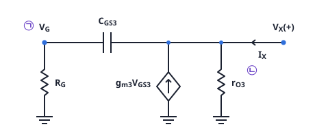
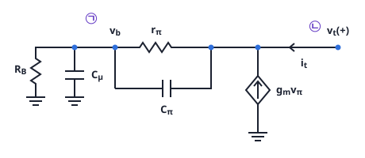
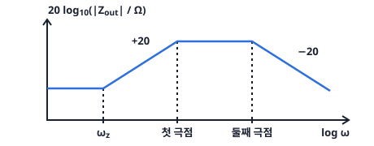
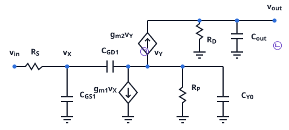
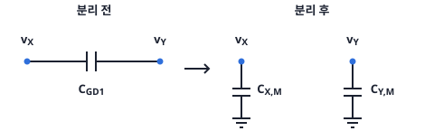
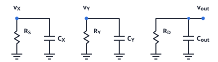
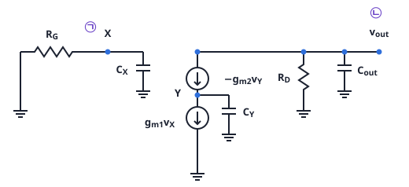
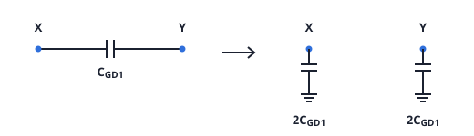

# 전자회로2 복습 1104 문제설명

회로와 첫 식을 짚고 핵심 계산으로 답을 구해요.

문제의 첫 줄부터 검산까지 설명해요.

**목차**

- [문항별 설명](#problems)
  - [P1. 공통 소스 뒤에 붙은 소스 팔로워의 출력 임피던스](#p1)
  - [P2. 유한 출력저항을 포함한 소스 팔로워의 출력 임피던스](#p2)
  - [P3. 베이스–컬렉터 커패시턴스가 있는 이미터 팔로워](#p3)
  - [P4. 중간 노드에 기생 저항이 생긴 MOS 캐스코드](#p4)
  - [P5. 입력과 출력 극 사양을 맞추는 MOS 캐스코드 설계](#p5)

## 문항별 설명

### P1. 공통 소스 뒤에 붙은 소스 팔로워의 출력 임피던스

E11.24 · 예제 11.24 · [원 문제 보기](../%EB%B3%B5%EC%8A%B5%EB%AC%B8%EC%A0%9C_1104_Cascode_Frequency_Response-%EB%AC%B8%EC%A0%9C.pdf)

#### 주어진 조건

- $M_1$과 $M_2$: $\lambda \neq 0$
- $M_3$: $\lambda = 0$
- $C_{GS3}$를 제외한 모든 커패시턴스 무시
- 소자 값은 주어지지 않음 (답은 기호로)

#### 구할 것

- 증폭기의 출력 임피던스

원문 보기

그림 11.49는 CS 회로와 소스 폴로어로 구성된 이단 증폭기를 나타낸다. $M_1$과 $M_2$에 대하여 $\lambda \neq 0$이고, 그러나 $M_3$의 $\lambda = 0$이라 가정하고, $C_{GS3}$를 제외한 모든 커패시턴스를 무시하면서, 증폭기의 출력 임피던스를 계산하라.

*입력을 0으로 둔 소스 팔로워의 출력 시험 회로*

㉠ 입력을 0으로 두면 $M_1,M_2$의 제어 전류가 사라져 게이트에는 두 출력저항만 남아요.

$$
R_G=r_{o1}\parallel r_{o2}
$$

$C_{GS3}$를 열면 $V_G=0$이고 $M_3$의 $\lambda=0$이므로

$$
Z_{out}(0)=1/g_{m3}
$$

게이트 종단이 저항 하나이고 제어 포트에만 용량이 있어요. 저주파 출력 컨덕턴스 $A$와 정규화 상수 $B$를 읽어요.

$$
A=g_{m3}
$$

$$
B=A Z_{out}(0)=1
$$

$$
Z_{out}(s)=\frac{R_G C_{GS3}s+B}{C_{GS3}s+A}=\frac{1+sR_GC_{GS3}}{g_{m3}+sC_{GS3}}
$$

고주파에서는 게이트와 소스가 단락되어 $Z_{out}\to R_G$예요.

**페이지 요약**

게이트 저항과 제어 포트 용량이 출력 임피던스의 저주파·고주파 한계를 정해요.

---

### P2. 유한 출력저항을 포함한 소스 팔로워의 출력 임피던스

X11.24 · 연습문제 11.24 · [원 문제 보기](../%EB%B3%B5%EC%8A%B5%EB%AC%B8%EC%A0%9C_1104_Cascode_Frequency_Response-%EB%AC%B8%EC%A0%9C.pdf)

#### 주어진 조건

- 예제 11.24의 회로: Fig 11.49(a) 이단 증폭기 (CS 단 $M_1$, $M_2$ + 소스 폴로어 $M_3$)
- 변경: $M_1$–$M_3$ 모두 $\lambda \neq 0$ (예제는 $M_3$의 $\lambda = 0$)
- 그 밖의 가정 ($C_{GS3}$를 제외한 모든 커패시턴스 무시)은 예제와 같다고 봄

#### 구할 것

- 예제 11.24의 회로에서 $Z_{out}$

원문 보기

$M_1 \sim M_3$에 대하여 $\lambda \neq 0$일 때, 위의 예제에서 $Z_{out}$을 결정하라.

*유한한 출력저항을 포함한 소스 팔로워 시험 회로*

㉠ 입력을 영점에 두면 게이트의 종단은 $R_G=r_{o1}\parallel r_{o2}$예요. $V_X$를 출력에 걸고 게이트 KCL을 써요.

$$
\frac{V_G}{R_G}+sC_{GS3}(V_G-V_X)=0
$$

$$
V_{GS3}=V_G-V_X=-\frac{V_X}{1+sR_GC_{GS3}}
$$

㉡ $r_{o3}$가 소스에서 접지로 이어져요. 출력으로 들어오는 시험전류에는 이 가지의 전류까지 더해요.

$$
I_X=V_X/r_{o3}-(g_{m3}+sC_{GS3})V_{GS3}
$$

$$
Z_{out}(s)=\frac{V_X}{I_X}=r_{o3}\parallel\frac{1+sR_G C_{GS3}}{g_{m3}+sC_{GS3}}
$$

저주파에서는 $r_{o3}\parallel(1/g_{m3})$, 고주파에서는 $r_{o3}\parallel R_G$로 수렴해요.

**페이지 요약**

세 번째 트랜지스터의 출력저항이 시험 단자에 병렬로 붙어요.

---

### P3. 베이스–컬렉터 커패시턴스가 있는 이미터 팔로워

P11.48 · 장말문제 11.48 · [원 문제 보기](../%EB%B3%B5%EC%8A%B5%EB%AC%B8%EC%A0%9C_1104_Cascode_Frequency_Response-%EB%AC%B8%EC%A0%9C.pdf)

#### 주어진 조건

- $C_\mu$를 포함해서 계산
- $V_A = \infty$로 가정

#### 구할 것

- 이미터 폴로어의 출력 임피던스 $Z_{out}$
- 주파수에 따른 $|Z_{out}|$의 개형 스케치

원문 보기

Determine the output impedance of the emitter follower depicted in Fig. 11.90, including $C_\mu$. Sketch $|Z_{out}|$ as a function of frequency. Assume $V_A = \infty$.

*컬렉터를 교류 접지로 두고 이미터를 시험하는 회로*

㉠ 입력 영점에서 $C_\mu$는 베이스와 접지 사이, $C_\pi$는 베이스와 이미터 사이예요. 두 용량이 서로 다른 가지에 있으므로 KCL을 써요.

$$
Z_B=R_B/(1+sR_BC_\mu)
$$

$$
Z_\pi=r_\pi/(1+sr_\pi C_\pi)
$$

㉡ $v_\pi=v_b-v_t$로 두면 베이스에서 나간 전류와 이미터에 들어온 전류는

$$
v_b/Z_B+v_\pi/Z_\pi=0
$$

$$
i_t=-v_\pi(1/Z_\pi+g_m)
$$

$$
\frac{v_t}{i_t}=\frac{Z_B+Z_\pi}{1+g_m Z_\pi}
$$

$\beta=g_m r_\pi$로 두면 영점과 두 극점의 각주파수 크기는

$$
\omega_z=\frac{1}{(R_B\parallel r_\pi)(C_\pi+C_\mu)}
$$

$$
\omega_B=1/(R_B C_\mu)
$$

$$
\omega_\pi=(\beta+1)/(r_\pi C_\pi)
$$

$$
Z_{out}(s)=\frac{r_\pi+R_B+s r_\pi R_B(C_\pi+C_\mu)}{(1+sR_B C_\mu)(\beta+1+s r_\pi C_\pi)}
$$

*저주파 크기는 $(r_\pi+R_B)/(\beta+1)$예요. 그림은 영점이 먼저인 경우예요. 첫 극점이 영점보다 낮으면 기울기는 차례로 $0,-20,0,-20\;\mathrm{dB/dec}$예요.*

**페이지 요약**

베이스–컬렉터 용량이 추가되면 이미터 출력 임피던스에 두 번째 극점이 생겨요.

---

### P4. 중간 노드에 기생 저항이 생긴 MOS 캐스코드

P11.50 · 장말문제 11.50 · [원 문제 보기](../%EB%B3%B5%EC%8A%B5%EB%AC%B8%EC%A0%9C_1104_Cascode_Frequency_Response-%EB%AC%B8%EC%A0%9C.pdf)

#### 주어진 조건

- $\lambda = 0$으로 가정
- 밀러 이론을 이용

#### 구할 것

- 회로의 극점

원문 보기

Due to manufacturing error, a parasitic resistor $R_p$ has appeared in the cascode stage of Fig. 11.92. Assuming $\lambda = 0$ and using Miller's theorem, determine the poles of the circuit.

*밀러 분리 전의 캐스코드. $C_{Y0}=C_{DB1}+C_{GS2}+C_{SB2}$예요.*

㉠ $\lambda=0$이고 몸체 효과를 생략하면 Y에서 $M_2$의 소스를 본 저항에 $R_P$가 병렬로 걸려요. $M_1$은 이 부하를 구동하는 공통 소스 단이에요.

$$
R_Y=R_P\parallel(1/g_{m2})
$$

$$
A_{XY}=v_Y/v_X=-g_{m1}R_Y
$$

*X–Y 사이의 $C_{GD1}$을 저주파 이득으로 양쪽 접지 가지에 나눠요.*

$$
C_X=C_{GS1}+(1-A_{XY})C_{GD1}
$$

$$
C_Y=C_{Y0}+(1-1/A_{XY})C_{GD1}
$$

㉡ $M_2$의 게이트·벌크는 교류 접지이므로 출력 두 용량이 병렬이에요. $r_{o2}$는 개방되어 출력 저항은 $R_D$예요.

$$
C_{out}=C_{DB2}+C_{GD2}
$$

*입력을 0으로 두었을 때 각 노드가 보는 저항과 용량*

$$
p_X\approx-1/(R_S C_X)
$$

$$
p_Y\approx-1/(R_Y C_Y)
$$

$$
p_{out}=-1/(R_D C_{out})
$$

**페이지 요약**

기생 저항이 중간 노드의 저항과 밀러 분배를 함께 바꿔요.

---

### P5. 입력과 출력 극 사양을 맞추는 MOS 캐스코드 설계

P11.58 · 장말문제 11.58 · [원 문제 보기](../%EB%B3%B5%EC%8A%B5%EB%AC%B8%EC%A0%9C_1104_Cascode_Frequency_Response-%EB%AC%B8%EC%A0%9C.pdf)

#### 주어진 조건

- 설계 대상: Fig 11.97의 MOS 캐스코드
- 입력 극점 $5\ \text{GHz}$, 출력 극점 $10\ \text{GHz}$
- $M_1$과 $M_2$는 동일, $I_D = 0.5\ \text{mA}$
- $C_{GS} = (2/3) W L C_{ox}$, $C_{ox} = 12\ \text{fF}/\mu\text{m}^2$, $\mu_n C_{ox} = 100\ \mu\text{A/V}^2$, $\lambda = 0$, $L = 0.18\ \mu\text{m}$
- $C_{GD} = C_0 W$, $C_0 = 0.2\ \text{fF}/\mu\text{m}$ (단위 폭당 게이트–드레인 커패시턴스)
- $C_{GD1}$에는 밀러 근사를 사용
- 각 트랜지스터의 과구동 전압 $200\ \text{mV}$

#### 구할 것

- 허용되는 $R_G$, $R_D$의 최댓값
- 전압 이득

원문 보기

We wish to design the MOS cascode of Fig. 11.97 for an input pole of $5\ \text{GHz}$ and an output pole of $10\ \text{GHz}$. Assume $M_1$ and $M_2$ are identical, $I_D = 0.5\ \text{mA}$, $C_{GS} = (2/3) W L C_{ox}$, $C_{ox} = 12\ \text{fF}/\mu\text{m}^2$, $\mu_n C_{ox} = 100\ \mu\text{A/V}^2$, $\lambda = 0$, $L = 0.18\ \mu\text{m}$ and $C_{GD} = C_0 W$, where $C_0 = 0.2\ \text{fF}/\mu\text{m}$ denotes the gate-drain capacitance per unit width. Determine the maximum allowable values of $R_G$, $R_D$, and the voltage gain. Use Miller's approximation for $C_{GD1}$. Assume an overdrive voltage of $200\ \text{mV}$ for each transistor.

*밀러 분리 후 입력 X, 중간 Y, 출력에 남는 용량과 저항*

㉠ 두 소자가 같고 $\lambda=0$이므로 Y의 공통 게이트 입력저항은 $1/g_{m2}$예요. 여기에 $M_1$이 전류를 흘려요.

$$
A_{XY}=-g_{m1}/g_{m2}=-1
$$

$$
W=\frac{2I_D L}{\mu_n C_{ox}V_{ov}^2}=45\,\mu\mathrm m
$$

$$
g_{m1}=g_{m2}=2I_D/V_{ov}=5\,\mathrm{mS}
$$

$$
C_{GS}=\tfrac23 WLC_{ox}=64.8\,\mathrm{fF}
$$

$$
C_{GD}=C_0W=9\,\mathrm{fF}
$$

*$A_{XY}=-1$이므로 $C_{GD1}$이 양쪽에서 각각 두 배로 보여요.*

$$
C_X\approx C_{GS1}+2C_{GD1}=82.8\,\mathrm{fF}
$$

㉡ 주어진 용량만 고려하면 출력에는 $C_{GD2}$가 접지로 이어져요. 각 극점 주파수가 목표값과 같을 때 허용 저항이 가장 커요. 저주파에서는 게이트 전류가 0이므로 $v_X=v_{in}$이에요.

$$
A_v=\frac{v_Y}{v_{in}}\frac{v_{out}}{v_Y}=\left(-\frac{g_{m1}}{g_{m2}}\right)g_{m2}R_D=-g_{m1}R_D
$$

$$
R_{G,\max}\approx\frac{1}{2\pi(5\,\mathrm{GHz})C_X}\approx384.43\,\Omega
$$

$$
R_{D,\max}=\frac{1}{2\pi(10\,\mathrm{GHz})C_{GD2}}\approx1.77\,\mathrm{k}\Omega
$$

$$
A_v\big|_{R_{D,\max}}\approx-8.84\,\mathrm{V/V}
$$

**페이지 요약**

입력은 밀러 용량을 포함하고, 출력은 위쪽 소자의 게이트–드레인 용량을 보아요.

---

원 문제·정리노트·PDF는 보존해요.
