# 전자회로2 복습 1104 문제설명

주어진 조건을 읽고, 첫 줄을 쓰고, 이유를 따라가며 답을 확인해요.

문제의 첫 줄부터 검산까지 설명해요.

**목차**

- [문항별 설명](#problems)
  - [P1. 공통 소스 뒤에 붙은 소스 팔로워의 출력 임피던스](#p1)
  - [P2. 유한 출력저항을 포함한 소스 팔로워의 출력 임피던스](#p2)
  - [P3. 베이스–컬렉터 커패시턴스가 있는 이미터 팔로워](#p3)
  - [P4. 중간 노드에 기생 저항이 생긴 MOS 캐스코드](#p4)
  - [P5. 입력과 출력 극 사양을 맞추는 MOS 캐스코드 설계](#p5)

## 문항별 설명

### P1. 공통 소스 뒤에 붙은 소스 팔로워의 출력 임피던스

E11.24 · 예제 11.24 · [원 문제 보기](../%EB%B3%B5%EC%8A%B5%EB%AC%B8%EC%A0%9C_1104_Cascode_Frequency_Response-%EB%AC%B8%EC%A0%9C.pdf)

#### 주어진 조건

- $M_1$과 $M_2$: $\lambda \neq 0$
- $M_3$: $\lambda = 0$
- $C_{GS3}$를 제외한 모든 커패시턴스 무시
- 소자 값은 주어지지 않음 (답은 기호로)

#### 구할 것

- 증폭기의 출력 임피던스

원문 보기

그림 11.49는 CS 회로와 소스 폴로어로 구성된 이단 증폭기를 나타낸다. $M_1$과 $M_2$에 대하여 $\lambda \neq 0$이고, 그러나 $M_3$의 $\lambda = 0$이라 가정하고, $C_{GS3}$를 제외한 모든 커패시턴스를 무시하면서, 증폭기의 출력 임피던스를 계산하라.

#### 문제를 읽어요

공통 소스(CS) 단의 드레인 전압이 소스 폴로어의 게이트를 구동해요. 출력은 폴로어의 소스에 있어요. 이 출력에 작은 시험 신호를 넣고, 주파수에 따라 얼마나 많은 전류가 들어가는지 살펴봐요.

#### 이 개념과 공식을 떠올려요

"출력은 폴로어의 소스"와 "$C_{GS3}$만 남겨요"라는 조건에서 소스 팔로워의 출력 임피던스(output impedance) $Z_{out}(s)$를 떠올려요. 출력 임피던스를 볼 때는 독립 입력을 0으로 두고 출력 단자에서 안쪽을 바라봐요. 그러면 CS 단은 폴로어의 게이트를 AC 접지에 이어 주는 저항 $R_G$로 줄어요. 강의 슬라이드의 게이트 쪽 저항 $R_S$ 자리에 이 $R_G$가 들어가요.

$g_{m3}$는 게이트–소스 전압을 제어 전류로 바꾸는 트랜스컨덕턴스예요. $C_{GS3}$는 그 제어 포트(게이트–소스) 사이에 걸린 커패시터이고 임피던스는 $1/(sC_{GS3})$예요.

소스 팔로워의 출력 임피던스는 커패시터를 뺀 저주파 값에서 바로 쓸 수 있어요. 저주파 값을 $B/A$로 놓아요. $A$는 출력 노드로 들어오는 총 컨덕턴스이고, $B=A\cdot Z_{out}(0)$은 무차원 수예요.

$$
Z_{out}(s)=\frac{R_SC_{GS}s+B}{C_{GS}s+A}
$$

이 꼴은 게이트 쪽이 입력 영점 뒤 저항 하나이고, 커패시터가 제어 포트에만 있고, $r_o$를 무시하는 모델에서만 바로 써요. $C_{GD}$나 $r_o$가 추가되면 KCL 유도로 돌아가고 이 꼴은 검산에 써요. 이 문제는 $M_3$가 $\lambda=0$이고 $C_{GS3}$만 남기므로 세 조건을 모두 만족해요. 그래서 KCL을 세우지 않고 저주파 값만 구하면 돼요([소스 팔로워 출력 임피던스](../%EC%A0%95%EB%A6%AC%EB%85%B8%ED%8A%B8_1104_Cascode_Frequency_Response.html#s0-source-impedance), [CS 단 뒤의 폴로어](../%EC%A0%95%EB%A6%AC%EB%85%B8%ED%8A%B8_1104_Cascode_Frequency_Response.html#s0-cs-buffer), [캡 없는 값에서 바로 쓰기](../%EC%A0%95%EB%A6%AC%EB%85%B8%ED%8A%B8_1104_Cascode_Frequency_Response.html#s0-emitter-impedance)).

#### 종이에 쓸 첫 줄

$v_{in}=0$으로 두면 CS 단의 $M_1,M_2$는 게이트와 소스가 각각 AC 접지여서 제어 전류가 0이에요. 두 드레인에서 접지로 이어지는 저항을 합쳐요.

$$
R_G=r_{o1}\parallel r_{o2}
$$

폴로어 $M_3$의 $r_{o3}$와 이상적 바이어스 전류원은 AC에서 열린 가지예요. 출력에 $V_X$를 걸고 회로 안으로 들어가는 전류를 $I_X$로 잡아요.

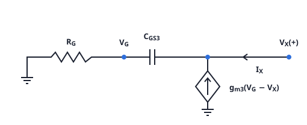

*$v_{in}$과 $V_{DD}$·$V_b$를 AC 접지로 보내 CS 단을 $R_G$로 바꾸고, $M_3$는 제어 전류원과 $C_{GS3}$로 바꿨어요($r_{o3}$·바이어스 전류원은 개방).*

먼저 $C_{GS3}$를 열어 저주파 값을 써요. $R_G$에 전류가 흐르지 않으니 $V_G=0$이고, 게이트가 AC 접지인 MOS의 소스를 바라보는 블록이 돼요.

$$
Z_{out}(0)=\frac{1}{g_{m3}}
$$

$r_{o3}$가 열린 가지라서 출력 노드로 들어오는 컨덕턴스는 $g_{m3}$ 하나예요. 이것을 $A$로 두고 $B$를 정규화해요.

$$
A=g_{m3}
$$

$$
B=A\cdot Z_{out}(0)=1
$$

#### 이렇게 풀어요

게이트 쪽은 $R_G$ 하나이고, 커패시터는 제어 포트의 $C_{GS3}$뿐이며, $r_{o3}$는 열려 있어요. 그래서 KCL 없이 저주파 값의 꼴에 커패시터 항을 바로 더해요.

$$
Z_{out}(s)=\frac{R_GC_{GS3}s+B}{C_{GS3}s+A}
$$

$A=g_{m3}$, $B=1$을 넣어요.

$$
Z_{out}(s)=\frac{R_GC_{GS3}s+1}{C_{GS3}s+g_{m3}}
$$

분모의 $C_{GS3}s$는 출력에서 커패시터로 새는 어드미턴스예요. 분자의 $R_GC_{GS3}s$는 주파수가 높아질수록 $C_{GS3}$가 게이트를 출력에 묶어 $R_G$가 보이게 만드는 항이에요. 마지막에 $R_G$를 원래 소자로 펼쳐요.

$$
Z_{out}(s)=\frac{(r_{o1}\parallel r_{o2})C_{GS3}s+1}{C_{GS3}s+g_{m3}}
$$

#### 완성 답과 검산

입력 영점에서 $C_{GS3}$만 남기고 $r_{o3}$를 열린 가지로 둔 모델의 출력 임피던스예요.

$$
Z_{out}(s)=\frac{1+sR_GC_{GS3}}{g_{m3}+sC_{GS3}}
$$

$$
R_G=r_{o1}\parallel r_{o2}
$$

분자는 무차원이고 분모의 두 항은 모두 지멘스(S)라서 결과는 옴($\Omega$)이에요.

저주파 극한에서는 $C_{GS3}$가 열려 처음에 쓴 캡 없는 값으로 돌아와요.

$$
Z_{out}(0)=\frac{B}{A}=\frac{1}{g_{m3}}
$$

고주파 극한에서는 $s$항만 남아 $C_{GS3}$가 약분돼요. 게이트와 소스가 함께 움직여 제어 전압이 0으로 가고 출력에서 $R_G$가 보여요.

$$
\lim_{s\to\infty}Z_{out}(s)=\frac{R_GC_{GS3}}{C_{GS3}}=R_G
$$

영점은 $1/(R_GC_{GS3})$, 극점은 $g_{m3}/C_{GS3}$에 있어요.

$$
\omega_z=\frac{1}{R_GC_{GS3}}
$$

$$
\omega_p=\frac{g_{m3}}{C_{GS3}}
$$

$R_G>1/g_{m3}$이면 $\omega_z<\omega_p$라 영점을 먼저 지나요. 그러면 크기가 $1/g_{m3}$에서 $R_G$로 주파수와 함께 올라가 출력이 유도성(inductive)으로 보여요. 보통 $r_{o1}\parallel r_{o2}$가 $1/g_{m3}$보다 커서 이 경우에 해당해요.

#### 주의할 점

입력 신호를 접지해도 폴로어 게이트는 $R_G$를 거쳐 접지돼요. 게이트를 바로 AC 접지로 보면 $R_G=0$이 되어 분자의 $R_GC_{GS3}s$ 항이 사라지고, 유도성으로 보이는 결과를 놓쳐요.

$Z_{out}(0)=1/g_{m3}$만 보고 $A=1$, $B=1/g_{m3}$로 두면 두 극한은 맞아도 분모 $C_{GS3}s+1$의 차원이 맞지 않아요. $A$는 출력 노드의 총 컨덕턴스 $g_{m3}$, $B$는 $A\cdot Z_{out}(0)=1$로 정규화해요.

이 꼴은 지름길 조건에서만 KCL 없이 써요. $C_{GD3}$나 $r_{o3}$가 남는 문제라면 KCL을 세우고 이 꼴은 검산에 써요.

#### 조건을 바꾸어 생각해요

1. CS 단이 이상적인 전압원처럼 폴로어를 구동한다고 가정해 $R_G=0$으로 바꿔 보세요. $A$와 $B$는 그대로인가요? 새 $Z_{out}(s)$와 크기가 주파수에 따라 오르는지 내리는지 판단해 보세요.
2. $M_3$의 $\lambda\neq0$이라 $r_{o3}$가 출력과 AC 접지 사이에 남는다면 지름길 꼴을 그대로 쓸 수 있나요? 결과가 위 답과 어떤 관계여야 하는지 말해 보세요.

**페이지 요약**

입력을 0으로 두고 CS 단을 폴로어 게이트에서 본 저항으로 합쳐요.

$$
R_G=r_{o1}\parallel r_{o2}
$$

$C_{GS3}$를 뺀 저주파 값에서 $A=g_{m3}$, $B=1$로 정규화해요.

$$
Z_{out}(0)=\frac{1}{g_{m3}}
$$

게이트 쪽이 $R_G$ 하나이고 $r_{o3}$가 열려 있어 KCL 없이 꼴에 바로 넣어요.

$$
Z_{out}=\frac{1+sR_GC_{GS3}}{g_{m3}+sC_{GS3}}
$$

저주파에서는 $1/g_{m3}$, 고주파에서는 $R_G$로 수렴해요.

$R_G>1/g_{m3}$이면 크기가 주파수와 함께 올라 유도성으로 보여요.

---

### P2. 유한 출력저항을 포함한 소스 팔로워의 출력 임피던스

X11.24 · 연습문제 11.24 · [원 문제 보기](../%EB%B3%B5%EC%8A%B5%EB%AC%B8%EC%A0%9C_1104_Cascode_Frequency_Response-%EB%AC%B8%EC%A0%9C.pdf)

#### 주어진 조건

- 예제 11.24의 회로: Fig 11.49(a) 이단 증폭기 (CS 단 $M_1$, $M_2$ + 소스 폴로어 $M_3$)
- 변경: $M_1$–$M_3$ 모두 $\lambda \neq 0$ (예제는 $M_3$의 $\lambda = 0$)
- 그 밖의 가정 ($C_{GS3}$를 제외한 모든 커패시턴스 무시)은 예제와 같다고 봄

#### 구할 것

- 예제 11.24의 회로에서 $Z_{out}$

원문 보기

$M_1 \sim M_3$에 대하여 $\lambda \neq 0$일 때, 위의 예제에서 $Z_{out}$을 결정하라.

#### 문제를 읽어요

앞단은 공통 소스(CS) 증폭기이고 뒤단은 소스 팔로워(source follower)예요. 앞단의 출력은 뒤단의 게이트로 들어가고, 전체 출력은 뒤단의 소스에서 나와요. 그 소스 단자에 작은 시험전압을 걸고 전류가 얼마나 들어가는지 봐요.

#### 이 개념과 공식을 떠올려요

출력 임피던스를 구할 때는 독립 입력을 0으로 두고 출력에 시험전압을 걸어요. 유한한 채널 길이 변조는 소신호 모델에 드레인과 소스 사이의 저항 $r_O$로 나타나요.

예제와 같이 $C_{GS3}$만 남겨요. 이 커패시터의 전류는 출력에서 게이트로 돌아가므로 출력과 게이트 사이에 그대로 두어요. 시험전압을 걸면 게이트도 움직이므로 한쪽 단자를 접지로 놓는 밀러 근사 없이 두 노드의 전압차로 전류를 구해요.

팔로워 부분은 커패시터를 뺀 저주파 값 $B/A$에 커패시터 항을 얹는 꼴이지만, 이 문제는 $r_{O3}$가 있어 KCL로 구하고 그 꼴과 마지막에 병렬로 붙는 $r_{O3}$는 검산에서 확인해요.

#### 종이에 쓸 첫 줄

$v_{in}=0$으로 놓고 $V_{DD}$와 $V_b$를 AC 접지로 두어요. 그러면 CS 단의 제어전류가 0이어서 게이트에서 본 저항은 $R_G=r_{O1}\parallel r_{O2}$예요. 이상적인 출력 바이어스 전류원은 소신호에서 열려요. 몸체 효과는 생략해요.

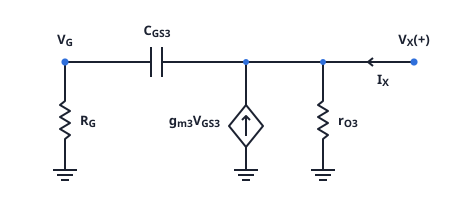

*시험전류 $I_X$는 오른쪽 출력 단자로 들어와요. 제어전류원의 기준 방향은 드레인(AC 접지)에서 소스($V_X$) 쪽이에요. 따라서 그 가지에서 출력 노드를 떠나는 전류는 $-g_{m3}V_{GS3}$예요.*

종이에는 먼저 $Z_{out}=V_X/I_X$를 쓰고, 게이트에서 나가는 두 전류의 합을 0으로 놓아요.

$$
\frac{V_G}{R_G}+(V_G-V_X)sC_{GS3}=0
$$

#### 이렇게 풀어요

$C_{GS3}$와 $R_G$는 시험 단자에서 접지까지 이어지는 직렬 경로예요. $r_{O3}$는 그 경로 전체와 병렬이에요. 제어전류는 커패시터 양단 전압으로 정해지므로 그 전압부터 구해요.

$$
V_G=V_X\frac{R_GsC_{GS3}}{1+R_GsC_{GS3}}
$$

$$
V_{GS3}=V_G-V_X=-\frac{V_X}{1+R_GsC_{GS3}}
$$

출력으로 들어온 시험전류는 $r_{O3}$, 제어전류원, $C_{GS3}$ 가지로 나뉘어요.

$$
I_X=\frac{V_X}{r_{O3}}-g_{m3}V_{GS3}+(V_X-V_G)sC_{GS3}
$$

$$
\frac{I_X}{V_X}=\frac{1}{r_{O3}}+\frac{g_{m3}+sC_{GS3}}{1+R_GsC_{GS3}}
$$

오른쪽 두 항이 어드미턴스(admittance)로 더해져요. 역수를 취하면 예제의 팔로워 출력 임피던스에 $r_{O3}$가 병렬로 붙는다는 뜻이에요.

#### 완성 답과 검산

$C_{GS3}$만 고려하고 몸체 효과를 생략한 소신호 모델에서 다음과 같아요.

$$
Z_{out}=r_{O3}\parallel\frac{1+R_GC_{GS3}s}{g_{m3}+C_{GS3}s}
$$

$$
Z_{out}=\frac{r_{O3}(1+R_GC_{GS3}s)}{1+g_{m3}r_{O3}+(r_{O3}+R_G)C_{GS3}s}
$$

$C_{GS3}s$와 $g_{m3}$는 모두 컨덕턴스라서 병렬식의 분수는 저항 단위를 가져요.

병렬식의 분수는 팔로워 출력 임피던스의 꼴과 그대로 맞아요.

$$
\frac{1+R_GC_{GS3}s}{g_{m3}+C_{GS3}s}=\frac{R_GC_{GS3}s+B}{C_{GS3}s+A}
$$

$$
A=g_{m3}
$$

$$
B=1
$$

따라서 커패시터를 뺀 저주파 값은 $B/A$예요.

$$
\frac{B}{A}=\frac{1}{g_{m3}}
$$

$r_{O3}\to\infty$로 $r_{O3}$를 지우면 이 분수만 남아 예제 11.24의 결과로 돌아가요.

$r_{O3}$는 이 꼴을 만든 뒤 마지막에 병렬로 붙어요. solve에서 $1/r_{O3}$가 어드미턴스로 따로 더해진 것과 같은 뜻이에요.

$$
Z_{out}=r_{O3}\parallel\frac{R_GC_{GS3}s+B}{C_{GS3}s+A}
$$

$1/r_{O3}$를 $A$에 넣으면 고주파 극한에 $r_{O3}$가 빠져 아래 극한과 맞지 않아요.

$s\to0$이면 커패시터가 열려 게이트가 AC 접지에 고정돼요. 합친 식에 넣으면 다음과 같아요.

$$
Z_{out}(0)=\frac{r_{O3}}{1+g_{m3}r_{O3}}
$$

$$
Z_{out}(0)=r_{O3}\parallel\frac{1}{g_{m3}}\approx\frac{1}{g_{m3}}
$$

마지막 근사는 $g_{m3}r_{O3}\gg1$을 써요. 분수의 저주파 값 $B/A$에 $r_{O3}$를 병렬로 붙인 값과 같아요.

$s\to\infty$이면 커패시터가 게이트와 소스를 잇고 $V_{GS3}\to0$이어서 제어전류가 사라져요. 합친 식에서 $s$가 붙은 항만 남아요.

$$
Z_{out}(\infty)=\frac{r_{O3}R_G}{r_{O3}+R_G}
$$

$$
Z_{out}(\infty)=r_{O3}\parallel R_G
$$

분수의 고주파 극한 $R_G$에 $r_{O3}$를 병렬로 붙인 값과 같아요. $R_G=r_{O1}\parallel r_{O2}$가 $1/g_{m3}$보다 크면 $|Z_{out}|$이 주파수와 함께 커져 유도성(inductive)으로 보여요.

#### 주의할 점

입력을 0으로 놓아도 출력 시험전압이 $C_{GS3}$를 통해 $M_3$의 게이트를 움직여요. 따라서 일반 주파수에서 $V_G=0$으로 두면 안 돼요.

#### 조건을 바꾸어 생각해요

1. 앞단의 출력저항이 매우 작아 $R_G\to0$이면, 시험 단자에서 어떤 가지들이 병렬로 보여요?

**페이지 요약**

입력을 0으로 놓으면 앞단이 $M_3$ 게이트를 $R_G$로 접지해요.

$$
R_G=r_{O1}\parallel r_{O2}
$$

$$
Z_{out}=r_{O3}\parallel\frac{1+R_GC_{GS3}s}{g_{m3}+C_{GS3}s}
$$

$C_{GS3}$만 남긴 모델에서 $r_{O3}$는 예제의 임피던스와 병렬이에요.

분수는 $A=g_{m3}$, $B=1$인 팔로워 꼴이라 저주파 값 $B/A=1/g_{m3}$에서 출발해요.

$s\to0$이면 $r_{O3}\parallel(1/g_{m3})$가 남아요.

$s\to\infty$이면 $r_{O3}\parallel R_G$가 남아요.

---

### P3. 베이스–컬렉터 커패시턴스가 있는 이미터 팔로워

P11.48 · 장말문제 11.48 · [원 문제 보기](../%EB%B3%B5%EC%8A%B5%EB%AC%B8%EC%A0%9C_1104_Cascode_Frequency_Response-%EB%AC%B8%EC%A0%9C.pdf)

#### 주어진 조건

- $C_\mu$를 포함해서 계산
- $V_A = \infty$로 가정

#### 구할 것

- 이미터 폴로어의 출력 임피던스 $Z_{out}$
- 주파수에 따른 $|Z_{out}|$의 개형 스케치

원문 보기

Determine the output impedance of the emitter follower depicted in Fig. 11.90, including $C_\mu$. Sketch $|Z_{out}|$ as a function of frequency. Assume $V_A = \infty$.

#### 문제를 읽어요

이미터 팔로워의 오른쪽 단자에서 회로 안을 들여다봐요. 시험 전류를 흘릴 때 단자 전압이 얼마나 변하는지 보면, 이 단자가 주파수에 따라 전류를 얼마나 쉽게 받아들이는지 알 수 있어요.

#### 이 개념과 공식을 떠올려요

출력 임피던스(output impedance)는 독립 입력의 소신호를 0으로 만든 뒤, 출력에 건 시험 전압을 회로로 들어가는 시험 전류로 나눈 값이에요. 베이스–컬렉터 사이의 $C_\mu$는 컬렉터가 AC 접지이므로 베이스–접지 커패시터로 그대로 놓아요. 밀러 이득을 따로 구할 필요가 없어요.

$r_\pi$는 유한한 베이스 전류를 나타내는 베이스–이미터 저항이고, $C_\pi$는 그 두 단자 사이의 커패시터예요. $g_m$은 $v_\pi=v_b-v_t$를 컬렉터에서 이미터로 향하는 제어 전류 $g_mv_\pi$로 바꾸는 비례 상수예요. $V_A=\infty$ 조건에서 $r_o$ 가지는 열려요.

기준점은 $C_\mu$를 뺀 [강의의 이미터 팔로워 출력 임피던스](../%EC%A0%95%EB%A6%AC%EB%85%B8%ED%8A%B8_1104_Cascode_Frequency_Response.html#s0-emitter-impedance)예요. 그 꼴은 베이스 쪽이 저항 하나일 때만 바로 쓰는데, 여기서는 $C_\mu$ 때문에 베이스 쪽이 $Z_B$로 바뀌므로 KCL로 유도하고 그 꼴은 검산에 써요.

#### 종이에 쓸 첫 줄

입력 전압원을 AC 접지로 바꾸고 이상적 바이어스 전류원을 개방해요. 이미터에 $v_t$를 걸고 오른쪽에서 들어가는 $i_t$를 구해요.

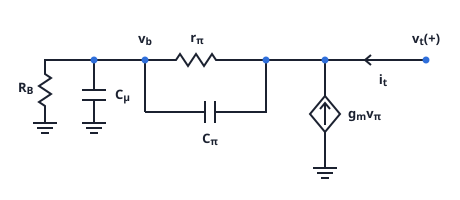

*$R_B$와 $C_\mu$는 베이스–접지, $r_\pi$와 $C_\pi$는 베이스–이미터에 각각 병렬로 연결돼요.*

$$
Z_B=R_B\parallel\frac{1}{sC_\mu}=\frac{R_B}{1+sR_BC_\mu}
$$

$$
Z_\pi=r_\pi\parallel\frac{1}{sC_\pi}=\frac{r_\pi}{1+sr_\pi C_\pi}
$$

#### 이렇게 풀어요

베이스에서 이미터로 향하는 전류는 $v_\pi/Z_\pi$예요. 베이스에서 접지로 나가는 전류와 더하면 0이므로 $v_b$를 $v_\pi$로 나타낼 수 있어요.

$$
\frac{v_b}{Z_B}+\frac{v_\pi}{Z_\pi}=0
$$

$$
v_t=v_b-v_\pi=-\left(1+\frac{Z_B}{Z_\pi}\right)v_\pi
$$

이미터에서는 시험 전류와 제어 전류의 합이 베이스 쪽으로 흘러요.

$$
i_t+g_mv_\pi=-\frac{v_\pi}{Z_\pi}
$$

$$
Z_{out}(s)=\frac{v_t}{i_t}=\frac{Z_B+Z_\pi}{1+g_mZ_\pi}
$$

두 식의 $v_\pi$가 소거돼요. $Z_B$와 $Z_\pi$를 대입하고 분자와 분모에 $(1+sR_BC_\mu)(1+sr_\pi C_\pi)$를 곱하면, $\beta=g_mr_\pi$로 정리할 수 있어요.

분자의 1차항은 영점 하나, 분모의 두 인수는 극점 두 개를 만들어요.

$$
\omega_z=\frac{1}{(R_B\parallel r_\pi)(C_\pi+C_\mu)}
$$

$$
\omega_B=\frac{1}{R_BC_\mu}
$$

$$
\omega_\pi=\frac{\beta+1}{r_\pi C_\pi}
$$

보드선도(Bode plot)에서 영점은 기울기에 $+20\,\mathrm{dB/dec}$, 각 극점은 $-20\,\mathrm{dB/dec}$를 더해요. $R_B>1/g_m$이면 $\omega_z<\omega_\pi$이고, $R_BC_\mu<r_\pi C_\pi$이면 $\omega_z<\omega_B$예요. 두 조건을 만족하면 영점이 두 극점보다 먼저 와요.

극점 하나가 영점보다 낮으면 저주파의 평탄한 구간 뒤에 하강, 평탄, 하강 순으로 바뀌어요. $\omega_z$는 두 극점보다 모두 높을 수 없어요. $\omega_B<\omega_z$이면 $R_BC_\mu>r_\pi C_\pi$이고, 이 경우 $R_B[\beta C_\pi+(\beta+1)C_\mu]>r_\pi C_\pi$여서 $\omega_z<\omega_\pi$예요. 영점과 극점이 같으면 서로 상쇄되고 두 극점이 같으면 그 자리에서 기울기가 한꺼번에 $40\,\mathrm{dB/dec}$ 줄어요.

#### 완성 답과 검산

**출력 임피던스**는 $V_A=\infty$이고 이상적 바이어스 전류원을 쓸 때 다음과 같아요.

$$
Z_{out}(s)=\frac{r_\pi+R_B+r_\pi R_B(C_\pi+C_\mu)s}{(1+R_BC_\mu s)(\beta+1+r_\pi C_\pi s)}
$$

$$
Z_{out}(0)=\frac{r_\pi+R_B}{\beta+1}
$$

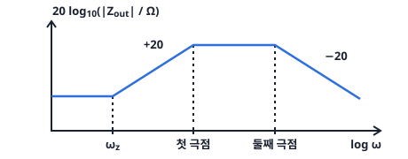

*영점이 먼저 오는 경우의 점근선이에요. 두 극점의 순서는 $\omega_B$와 $\omega_\pi$ 중 작은 값부터이며, 표기한 기울기의 단위는 $\mathrm{dB/dec}$예요.*

극점 하나가 영점보다 낮으면 첫 극점, 영점, 둘째 극점을 차례로 지나면서 기울기가 $0,-20,0,-20\,\mathrm{dB/dec}$로 바뀌어요. 주파수가 충분히 높으면 $|Z_{out}|\sim1/(\omega C_s)$이고 $C_s=C_\pi C_\mu/(C_\pi+C_\mu)$예요.

$C_\mu=0$으로 두면 $Z_B\to R_B$가 되어 강의의 이미터 팔로워 꼴로 돌아가야 해요. 출력 노드로 들어오는 총 컨덕턴스를 $A$로, 캡 없는 저주파 값에 $A$를 곱한 무차원 수를 $B$로 둬요.

$$
A=g_m+\frac{1}{r_\pi}=\frac{\beta+1}{r_\pi}
$$

$$
B=1+\frac{R_B}{r_\pi}
$$

완성 답에 $C_\mu=0$을 넣고 분자와 분모를 $r_\pi$로 나누면 같은 꼴이 나와요.

$$
Z_{out}(s)\Big|_{C_\mu=0}=\frac{R_BC_\pi s+B}{C_\pi s+A}
$$

$s=0$이면 두 커패시터가 열려서 $R_B$와 $r_\pi$만 남으므로, $C_\mu$가 있어도 저주파 값은 $B/A$예요. $\beta\gg1$이면 $1/g_m$이 보이는 꼴로 줄어요.

$$
\frac{B}{A}=\frac{r_\pi+R_B}{\beta+1}\approx\frac{1}{g_m}+\frac{R_B}{\beta+1}
$$

$C_\mu=0$ 꼴에서 $s\to\infty$이면 $R_B$가 남아요. $R_B$가 $B/A$보다 크면, 즉 $R_B>1/g_m$이면 크기가 주파수와 함께 올라가 유도성으로 보여요. 본문의 상승 구간과 같은 판단이고, $C_\mu$가 있으면 더 높은 주파수에서 $C_\mu$가 베이스를 접지로 단락해 다시 내려가요.

일반형에 $Y_c=sC_\pi+1/r_\pi=1/Z_\pi$를 넣으면 유도한 식의 분자와 분모를 $Z_\pi$로 나눈 것과 같아요.

$$
\frac{1+Z_BY_c}{g_m+Y_c}=\frac{Z_B+Z_\pi}{1+g_mZ_\pi}
$$

높은 주파수에서는 이미터에서 $C_\pi$를 지나 베이스에 도달한 뒤 $C_\mu$를 지나 접지로 가는 경로가 지배해요. 두 커패시터의 임피던스 합 $1/(sC_\pi)+1/(sC_\mu)$는 최종 식에서 분자·분모의 최고차항만 남겼을 때와 같아요.

#### 주의할 점

$C_\pi$와 $C_\mu$의 직렬 합성은 고주파 극한에서 써요. 그 전에는 두 커패시터가 공유하는 베이스 노드에 $R_B$도 연결되어 있어요.

상승 구간을 그리기 전에 영점과 두 극점을 비교해요. 각 꺾임의 단위는 $\mathrm{rad/s}$이며, $\mathrm{Hz}$로 그리려면 $2\pi$로 나눠요.

$C_\mu=0$ 꼴로 검산할 때 $A$는 컨덕턴스, $B$는 무차원이에요. 강의 식의 $\beta+1$과 $r_\pi+R_B$를 그대로 $A$, $B$에 넣으면 단위가 맞지 않고 상수항과 $s$항의 비가 $r_\pi$배 어긋나요.

#### 조건을 바꾸어 생각해요

1. $R_B$를 0으로 바꾸면 $C_\mu$의 두 단자 전압은 어떻게 되나요? 그때 이미터에서 본 $Z_{out}(s)$를 한 줄로 쓰고, 기울기가 바뀌는 주파수를 표시해 보세요.

**페이지 요약**

입력을 0으로 두면 $C_\mu$는 $R_B$와 병렬로 보여요.

$$
Z_{out}=\frac{Z_B+Z_\pi}{1+g_mZ_\pi}
$$

$$
\begin{aligned}Z_{out}(0)&=\frac{R_B+r_\pi}{\beta+1}\\&\approx\frac{1}{g_m}+\frac{R_B}{\beta+1}\end{aligned}
$$

저주파에서는 $Z_{out}(0)$에서 평탄해요.

$C_\mu=0$이면 $(R_BC_\pi s+B)/(C_\pi s+A)$ 꼴로 돌아가는지 검산해요.

영점이 먼저면 기울기는 $+20,0,-20\,\mathrm{dB/dec}$ 순서로 바뀌어요.

극점이 먼저면 첫 극점, 영점, 둘째 극점에서 기울기가 $-20,0,-20\,\mathrm{dB/dec}$로 바뀌어요.

고주파에서는 $C_\pi$와 $C_\mu$의 직렬 경로가 지배해요.

---

### P4. 중간 노드에 기생 저항이 생긴 MOS 캐스코드

P11.50 · 장말문제 11.50 · [원 문제 보기](../%EB%B3%B5%EC%8A%B5%EB%AC%B8%EC%A0%9C_1104_Cascode_Frequency_Response-%EB%AC%B8%EC%A0%9C.pdf)

#### 주어진 조건

- $\lambda = 0$으로 가정
- 밀러 이론을 이용

#### 구할 것

- 회로의 극점

원문 보기

Due to manufacturing error, a parasitic resistor $R_p$ has appeared in the cascode stage of Fig. 11.92. Assuming $\lambda = 0$ and using Miller's theorem, determine the poles of the circuit.

#### 문제를 읽어요

입력 전압은 $R_S$를 지나 $M_1$ 게이트 $X$에 들어와요. $M_1$ 드레인과 $M_2$ 소스가 만나는 점은 $Y$, $M_2$ 드레인은 출력이에요. $R_P$는 $Y$에서 접지로 이어지므로 중간 노드가 전류에 얼마나 크게 반응하는지부터 바꿔요.

#### 이 개념과 공식을 떠올려요

$C_{GD1}$은 $X$와 $Y$ 사이에 있어요. $X$가 조금 올라가면 $M_1$이 $Y$에서 더 많은 전류를 끌어가서 $Y$는 내려가요. 두 단자가 반대 방향으로 움직이므로 $X$의 변화만 볼 때보다 커패시터 양단 전압이 더 크게 변해요.

밀러 정리(Miller’s theorem)는 이 양단 전압으로 흐르는 전류를 각 노드와 접지 사이의 가지로 표현해요. 여기서는 두 단자의 전압비를 저주파 값으로 고정하는 밀러 근사(Miller approximation)를 써요. 그러면 각 노드의 병렬 $RC$로 극점을 추정할 수 있어요.

#### 종이에 쓸 첫 줄

소신호에서 $V_{DD}$, $V_b$, 벌크는 AC 접지예요. $\lambda=0$이므로 $r_o$ 가지는 열리고 교재 모델처럼 몸체 효과를 생략해요. 저주파 이득을 구할 때는 커패시터를 열어요. $X$가 입력이고 $Y$가 이 이득의 출력이에요.

$Y$를 단락하고 회로 안으로 들어가는 전류를 양으로 정하면 $M_1$이 $Y$에서 끌어가는 전류가 그대로 단락 전류가 돼요.

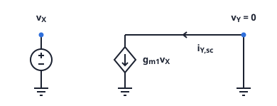

*$Y$를 접지에 단락하면 $R_P$ 양단과 $M_2$의 게이트–소스 전압이 모두 0이에요. 두 가지의 전류는 0이고, 왼쪽 입력 $v_X$는 유지돼요.*

$$
G_{m,XY}=\frac{i_{Y,\mathrm{sc}}}{v_X}=g_{m1}
$$

입력을 0으로 두고 $Y$를 보면 공통 게이트(CG) 단 $M_2$의 소스 쪽 $1/g_{m2}$와 $R_P$가 병렬이에요. $R_Y$를 이 모델의 병렬 저항으로 정의해요.

$$
R_Y=R_P\parallel\frac{1}{g_{m2}}=\frac{R_P}{1+g_{m2}R_P}
$$

$$
A_{XY}=\frac{v_Y}{v_X}=-G_{m,XY}R_Y=-g_{m1}R_Y
$$

#### 이렇게 풀어요

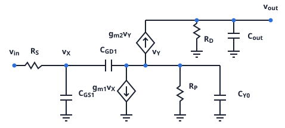

*분리 전 고주파 모델이에요. 전원과 바이어스는 AC 접지이고, $C_{Y0}=C_{DB1}+C_{GS2}+C_{SB2}$ 및 $C_{\mathrm{out}}=C_{DB2}+C_{GD2}$는 접지로 이어진 가지의 합이에요.*

$C_{GD1}$의 각 단자에서 커패시터로 들어가는 전류를 양으로 잡아요. $X$에서는 전압차 $v_X-v_Y$를 $v_X$의 배수로 바꿔요.

$$
i_{X,C}=sC_{GD1}(v_X-v_Y)\approx sv_X C_{GD1}(1-A_{XY})
$$

$Y$에서는 전압차의 순서를 뒤집고 $v_X\approx v_Y/A_{XY}$를 대입해요.

$$
i_{Y,C}=sC_{GD1}(v_Y-v_X)\approx sv_Y C_{GD1}(1-A_{XY}^{-1})
$$

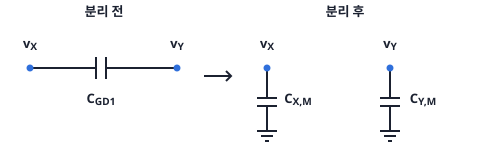

*$C_{X,M}=(1-A_{XY})C_{GD1}$이고 $C_{Y,M}=(1-A_{XY}^{-1})C_{GD1}$이에요. 두 가지 모두 접지로 이어져요.*

$X$의 $C_{GS1}$은 소스가 접지라 바로 더해요. $Y$에서는 $M_1$의 드레인–벌크와 $M_2$의 소스–게이트 및 소스–벌크 커패시턴스가 접지로 이어져요. 출력에는 $M_2$의 드레인–벌크와 드레인–게이트 커패시턴스를 더해요.

$$
C_X=C_{GS1}+(1+g_{m1}R_Y)C_{GD1}
$$

$$
C_Y=C_{DB1}+C_{GS2}+C_{SB2}+\left(1+\frac{1}{g_{m1}R_Y}\right)C_{GD1}
$$

$$
C_{\mathrm{out}}=C_{DB2}+C_{GD2}
$$

밀러 분리 후 입력원을 0으로 놓으면 $X$의 $R_S$가 접지로 이어져요. $Y$에는 위에서 구한 $R_Y$가 남아요. 출력에서 $M_2$ 드레인으로 되돌아가는 저항 경로가 없으므로 출력 저항은 $R_D$예요.

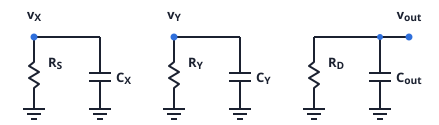

*밀러 분리 뒤 입력을 0으로 둔 각 노드의 자연응답 회로예요.*

각 노드의 자연응답은 $1+sRC=0$에서 정해져요.

#### 완성 답과 검산

몸체 효과를 생략하고 저주파 이득으로 밀러 근사를 적용한 결과예요. 아래 $s$는 극점의 위치이고 그 절댓값은 각주파수(rad/s)예요.

$$
s_{p,X}\approx-\frac{1}{R_SC_X}
$$

$$
s_{p,Y}\approx-\frac{1}{R_YC_Y}
$$

$$
s_{p,\mathrm{out}}=-\frac{1}{R_DC_{\mathrm{out}}}
$$

$RC$의 단위는 초예요. 각 저항과 커패시턴스가 양수라 극점의 부호는 음수예요. 출력 노드에는 $Y$로 되먹임하는 가지가 없으므로 출력 극점은 같은 소신호 모델에서 밀러 근사 없이도 같아요.

$R_P\to\infty$이면 $R_Y\to1/g_{m2}$라서 기생 저항이 없는 캐스코드의 식으로 돌아가요.

#### 주의할 점

$C_{GD1}$의 양 끝은 $X$와 $Y$예요. 따라서 밀러 계수에는 $v_Y/v_X$를 써요. $C_{GD2}$는 한쪽 단자인 $M_2$의 게이트가 이미 AC 접지라서 그대로 출력 커패시턴스에 더해요.

밀러 근사의 $X$, $Y$ 극점은 추정값이에요. 저주파 전압비를 고정했기 때문에 원래 두 노드의 결합을 포함한 정확한 극점과 달라질 수 있어요.

#### 조건을 바꾸어 생각해요

1. 바이어스와 소신호 파라미터를 고정한 채 유한한 $R_P$를 더 줄여 보세요. $Y$ 쪽 밀러 커패시턴스는 커져요. 그럼에도 $Y$의 밀러 근사 시정수가 작아지는 이유를 $R_YC_Y$를 펼쳐 확인해 보세요.

**페이지 요약**

$R_Y=R_P\parallel 1/g_{m2}$가 $A_{XY}=-g_{m1}R_Y$를 정해요.

$C_X$는 $C_{GS1}$과 $X$ 쪽 밀러 커패시턴스의 합이에요.

$$
s_{p,X}\approx-\frac{1}{R_SC_X}
$$

$C_Y$는 $C_{DB1}$, $C_{GS2}$, $C_{SB2}$와 $Y$ 쪽 밀러 커패시턴스의 합이에요.

$$
s_{p,Y}\approx-\frac{1}{R_YC_Y}
$$

$C_{GD1}$의 밀러 계수는 $X$ 쪽 $1-A_{XY}$와 $Y$ 쪽 $1-A_{XY}^{-1}$이에요.

$$
s_{p,\mathrm{out}}=-\frac{1}{R_D(C_{DB2}+C_{GD2})}
$$

같은 소신호 파라미터에서 출력 극점은 $R_P$와 무관해요.

---

### P5. 입력과 출력 극 사양을 맞추는 MOS 캐스코드 설계

P11.58 · 장말문제 11.58 · [원 문제 보기](../%EB%B3%B5%EC%8A%B5%EB%AC%B8%EC%A0%9C_1104_Cascode_Frequency_Response-%EB%AC%B8%EC%A0%9C.pdf)

#### 주어진 조건

- 설계 대상: Fig 11.97의 MOS 캐스코드
- 입력 극점 $5\ \text{GHz}$, 출력 극점 $10\ \text{GHz}$
- $M_1$과 $M_2$는 동일, $I_D = 0.5\ \text{mA}$
- $C_{GS} = (2/3) W L C_{ox}$, $C_{ox} = 12\ \text{fF}/\mu\text{m}^2$, $\mu_n C_{ox} = 100\ \mu\text{A/V}^2$, $\lambda = 0$, $L = 0.18\ \mu\text{m}$
- $C_{GD} = C_0 W$, $C_0 = 0.2\ \text{fF}/\mu\text{m}$ (단위 폭당 게이트–드레인 커패시턴스)
- $C_{GD1}$에는 밀러 근사를 사용
- 각 트랜지스터의 과구동 전압 $200\ \text{mV}$

#### 구할 것

- 허용되는 $R_G$, $R_D$의 최댓값
- 전압 이득

원문 보기

We wish to design the MOS cascode of Fig. 11.97 for an input pole of $5\ \text{GHz}$ and an output pole of $10\ \text{GHz}$. Assume $M_1$ and $M_2$ are identical, $I_D = 0.5\ \text{mA}$, $C_{GS} = (2/3) W L C_{ox}$, $C_{ox} = 12\ \text{fF}/\mu\text{m}^2$, $\mu_n C_{ox} = 100\ \mu\text{A/V}^2$, $\lambda = 0$, $L = 0.18\ \mu\text{m}$ and $C_{GD} = C_0 W$, where $C_0 = 0.2\ \text{fF}/\mu\text{m}$ denotes the gate-drain capacitance per unit width. Determine the maximum allowable values of $R_G$, $R_D$, and the voltage gain. Use Miller's approximation for $C_{GD1}$. Assume an overdrive voltage of $200\ \text{mV}$ for each transistor.

#### 문제를 읽어요

공통 소스(CS) 단 $M_1$의 게이트가 $X$, 공통 게이트(CG) 단 $M_2$의 소스가 $Y$예요. 신호는 입력원에서 $R_G$를 거쳐 $X$로 들어가고 $M_2$의 드레인에서 나와요. 두 저항을 키우면 해당 노드의 커패시터를 충전하는 시간이 길어져요. 지정한 극점 주파수를 유지할 수 있는 저항 한계를 찾고 그때의 저주파 이득을 구해요.

#### 이 개념과 공식을 떠올려요

$C_{GD1}$은 $X$와 $Y$를 잇기 때문에 양단의 전압차로 충전돼요. $X$가 올라갈 때 $Y$가 같은 크기로 내려가면 전압차의 변화는 두 배예요. 밀러 근사(Miller approximation)는 두 노드의 전압비를 저주파 값 $A_{XY}=v_Y/v_X$로 고정해 이 가지를 각 노드와 접지 사이의 커패시턴스로 바꿔요.

분리한 노드의 극점은 $f_p\approx1/(2\pi RC)$로 추정해요. $R$은 독립 입력원을 0으로 두고 해당 노드에서 본 저항이고, $C$는 그 노드에서 접지로 보이는 합성 커패시턴스예요.

#### 종이에 쓸 첫 줄

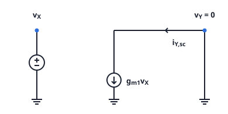

*$v_Y=0$이므로 $M_2$ 제어원 전류는 0이에요.*

$V_b$와 $V_{DD}$는 AC 접지예요. $\lambda=0$이어서 $r_o$는 열고, 교재의 모델을 따라 몸체 효과와 주어지지 않은 접합 커패시턴스는 생략해요. 저주파 이득을 구할 때는 커패시터 가지를 열어요.

밀러 이득의 출력 $Y$를 단락하면 $M_1$이 단락 쪽에서 회로 안으로 끌어가는 전류는 $g_{m1}v_X$예요.

$$
G_{m,XY}=\frac{i_{Y,\mathrm{sc}}}{v_X}=g_{m1}
$$

입력 영점에서 $Y$로 들어가 보는 저항은 CG 단의 소스 저항 $1/g_{m2}$예요. 이 저항을 $R_Y$로 쓰면 두 소자의 $g_m$이 같아서 다음과 같아요.

$$
R_Y=1/g_{m2}
$$

$$
A_{XY}=-G_{m,XY}R_Y=-\frac{g_{m1}}{g_{m2}}=-1
$$

#### 이렇게 풀어요

포화 영역 제곱 법칙에서 폭을 역산해요. 전류는 $500\,\mu\mathrm{A}$, 과구동 전압은 $0.2\,\mathrm{V}$로 바꿔 대입해요. 두 소자의 파라미터는 같아요.

$$
\frac WL=\frac{2I_D}{\mu_n C_{ox}V_{ov}^2}
$$

$$
\frac WL=\frac{2(500\,\mu\mathrm{A})}{(100\,\mu\mathrm{A/V^2})(0.2\,\mathrm{V})^2}=250
$$

$$
W=250L=250(0.18\,\mu\mathrm{m})=45\,\mu\mathrm{m}
$$

$$
g_m=\frac{2I_D}{V_{ov}}=\frac{2(0.5\,\mathrm{mA})}{0.2\,\mathrm{V}}=5\,\mathrm{mS}
$$

$$
C_{GS}=\frac23 WLC_{ox}
$$

$$
C_{GS}=\frac23(45\,\mu\mathrm{m})(0.18\,\mu\mathrm{m})(12\,\mathrm{fF/\mu m^2})=64.8\,\mathrm{fF}
$$

$$
C_{GD}=C_0W=(0.2\,\mathrm{fF/\mu m})(45\,\mu\mathrm{m})=9\,\mathrm{fF}
$$

$X$ 쪽에서 $C_{GD1}$로 흐르는 전류는 $sC_{GD1}(v_X-v_Y)$예요. $v_Y\approx A_{XY}v_X$를 넣으면 $v_X$에 곱해진 커패시턴스가 $(1-A_{XY})C_{GD1}$로 보여요. $Y$ 쪽에서는 전압차 순서를 바꾸고 $v_X\approx v_Y/A_{XY}$를 넣어 $(1-1/A_{XY})C_{GD1}$을 얻어요.

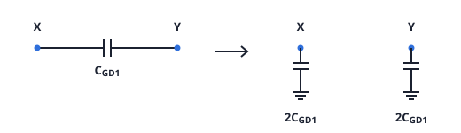

*왼쪽은 X와 Y 사이의 원래 가지예요. 오른쪽은 두 노드가 각각 접지로 보는 등가 가지예요.*

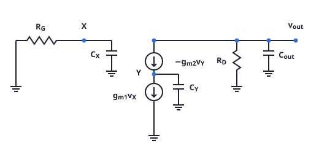

*입력 영점에서 $X$는 $R_G$와 $C_X$의 병렬, 출력은 $R_D$와 $C_{\mathrm{out}}$의 병렬이에요. 제어 전류원의 화살표는 각 MOS의 드레인에서 소스로 향해요.*

$C_{GS1}$과 밀러 분리로 생긴 $X$ 쪽 커패시턴스는 모두 $X$에서 AC 접지로 이어지므로 병렬 합산해요. 입력원을 0으로 두면 $X$에서 $R_G$가 접지로 이어져요.

$$
C_X\approx C_{GS1}+(1-A_{XY})C_{GD1}
$$

$$
C_X\approx64.8\,\mathrm{fF}+(1+1)(9\,\mathrm{fF})=82.8\,\mathrm{fF}
$$

목표가 극점 주파수의 하한이므로 $f_{p,X}\ge 5\,\mathrm{GHz}$에서 $R_G\le R_{G,\max}$예요. 허용 저항의 최댓값은 경계에서 구해요.

$$
R_{G,\max}\approx\frac{1}{2\pi f_{p,X}C_X}
$$

$$
R_{G,\max}\approx\frac{1}{2\pi(5\times10^{9}\,\mathrm{s^{-1}})(82.8\times10^{-15}\,\mathrm{F})}\approx384.43\,\Omega
$$

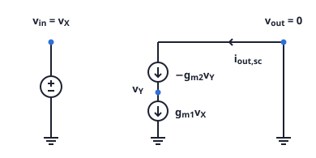

*저주파 출력 단락에서 $R_D$의 양단 전압은 0이에요.*

저주파에서 실제 출력인 $M_2$ 드레인을 단락해요. 게이트 전류가 0이므로 $v_X=v_{in}$이고, $M_1$의 전류 변화가 $M_2$에 그대로 흘러요. 단락 쪽에서 회로로 들어가는 전류를 양으로 잡아요.

$$
G_m=\frac{i_{\mathrm{out,sc}}}{v_{in}}=g_{m1}
$$

입력 영점에서 출력에 시험전압을 걸면 $r_{o2}$ 가지가 열려 있고 $M_2$의 제어 전압은 변하지 않아요. 드레인 안쪽은 이 모델에서 열려 있어요. $M_2$ 게이트가 AC 접지라 출력 커패시턴스는 $C_{\mathrm{out}}=C_{GD2}$예요.

$$
R_{\mathrm{out}}=R_D\parallel\infty=R_D
$$

$f_{p,\mathrm{out}}\ge 10\,\mathrm{GHz}$를 만족하려면 $R_D\le R_{D,\max}$여야 해요. 최대 저항과 이득은 이 경계에서 얻어요.

$$
R_{D,\max}\approx\frac{1}{2\pi f_{p,\mathrm{out}}C_{GD2}}
$$

$$
R_{D,\max}\approx\frac{1}{2\pi(10^{10}\,\mathrm{s^{-1}})(9\times10^{-15}\,\mathrm{F})}\approx1.77\,\mathrm{k\Omega}
$$

출력 단락을 풀면 $M_2$가 끌어가는 전류가 $R_D$에 전압 강하를 만들어요. 반올림 전의 $R_D$를 사용해 이득을 구해요.

$$
A_v=-G_mR_D\approx-(5\,\mathrm{mS})(1.768\,\mathrm{k\Omega})\approx-8.84\,\mathrm{V/V}
$$

#### 완성 답과 검산

밀러 근사로 구한 저항 한계와 그때의 저주파 전압 이득이에요.

$$
R_{G,\max}\approx384.43\,\Omega
$$

$$
R_{D,\max}\approx1.77\,\mathrm{k\Omega}
$$

$$
A_v\approx-8.84\,\mathrm{V/V}
$$

$\Omega\cdot\mathrm{F}$는 초예요. 반올림 전의 저항으로 계산하면 입력과 출력의 시정수는 각각 약 $31.83\,\mathrm{ps}$와 $15.92\,\mathrm{ps}$라서 출력 극점 주파수가 입력의 두 배예요. 같은 커패시턴스에서 저항을 더 키우면 해당 극점 주파수가 목표보다 낮아져요.

$Y$에도 $C_{GS2}$와 밀러 분리분이 병렬로 붙어요. 두 소자가 동일해서 합은 약 $82.8\,\mathrm{fF}$예요. $R_Y=1/g_{m2}=200\,\Omega$를 적용하면 중간 노드 극점은 약 $9.61\,\mathrm{GHz}$예요. 출력 극점과 가깝기 때문에 세 노드의 극점 추정치를 회로 전체의 정확한 대역폭으로 읽으면 안 돼요.

#### 주의할 점

$C_{GD1}$에 곱하는 밀러 계수는 그 커패시터의 두 단자 $X$와 $Y$ 사이에서 결정돼요. 최종 출력까지의 이득을 사용하면 입력 커패시턴스를 과대평가해요.

#### 조건을 바꾸어 생각해요

1. 소자와 입력 목표는 그대로 두고 출력 극점 목표만 두 배로 높이면 $R_{D,\max}$와 저주파 이득의 크기는 각각 몇 배가 될까요?

**페이지 요약**

$C_{GD1}$에는 $M_1$ 게이트에서 $M_2$ 소스까지의 이득을 써요.

$A_{XY}=-1$이므로 $C_X\approx C_{GS1}+2C_{GD1}$이에요.

$C_{\mathrm{out}}=C_{GD2}$이며 $R_{\mathrm{out}}=R_D$예요.

밀러 근사에서 $R_{G,\max}\approx384.43\,\Omega$예요.

출력 극점 조건에서 $R_{D,\max}\approx1.77\,\mathrm{k\Omega}$예요.

저항 한계에서 저주파 이득은 약 $-8.84\,\mathrm{V/V}$예요.

---

원 문제·정리노트·PDF는 보존해요.
