# 팔로워와 캐스코드의 주파수 응답 — 5살도 이해하는 정리노트

권익진 교수님 전자회로2 · 1104 수업 (Lec5, Razavi 11장)

> `정리노트_1104_Cascode_Frequency_Response.html`를 마크다운으로 옮겼어요. 그림은 `figures_1104/` 폴더의 SVG, 위젯은 대표 설정의 정적 그림으로 바꿨어요. 수식은 `$…$` / `$$…$$`라서 GitHub, Obsidian, Typora에서 보여요.

**목차**

- [들어가며: 왜 이런 회로를 쓸까](#why)
  - [왜 이런 회로를 쓸까](#why-circuit)
- [1. 팔로워의 출력 임피던스](#s0)
  - [소스 팔로워의 출력에 시험원을 연결해요](#s0-source-impedance)
  - [버퍼는 어느 주파수까지 쓸 수 있을까](#s0-buffer-limit)
  - [공통 소스 뒤에 팔로워를 붙여요](#s0-cs-buffer)
  - [이미터 팔로워에는 베이스 전류가 흘러요](#s0-emitter-impedance)
- [2. 캐스코드의 밀러 효과와 극점](#s1)
  - [캐스코드에서 커패시터 양단의 이득을 봐요](#s1-local-gain)
  - [X·Y·출력에 붙는 커패시터를 모아요](#s1-node-capacitance)
  - [가장 큰 시정수가 가장 낮은 극을 만들어요](#s1-dominant-pole)
- [3. 요약 · 예고](#s2)
  - [한눈에 다시 보기](#s2-cheatsheet)
  - [다음 시간 예고](#s2-next)
  - [함께 보면 좋은 자료](#s2-links)

## 들어가며: 왜 이런 회로를 쓸까

### 왜 이런 회로를 쓸까

*1104 수업 · L05 s47–51*

**쉽게 말하면**

팔로워는 스피커에 전압을 잘 전달하고, 캐스코드는 높은 주파수에서도 증폭이 잘 되도록 도와요.

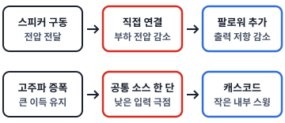

*스피커 구동에서는 출력 임피던스를 낮추고, 고주파 증폭에서는 회로 안쪽 노드의 전압 변화 폭을 줄여요.*

**정확히 말하면**

#### 1. 풀고 싶은 문제

스피커처럼 임피던스가 낮은 부하에도 신호 전압을 충분히 전달하고 싶어요. 그러려면 출력 임피던스(output impedance), 즉 부하 쪽에서 회로를 바라볼 때 보이는 임피던스가 작아야 해요. [소스 팔로워의 출력에 시험원을 연결해요](#s0-source-impedance)

#### 2. 단순한 해법과 그 한계

출력저항이 큰 공통 소스(common source)에 스피커를 직접 달면 전압이 나뉘어요. 저주파에서 스피커를 $8\,\mathrm{\Omega}$ 저항으로 보면, 출력저항이 $8\,\mathrm{\Omega}$일 때는 무부하 전압의 $1/2$만 걸려요. 같은 무부하 전압에서 출력저항을 $2\,\mathrm{\Omega}$으로 낮추면 $4/5$가 걸려요. [공통 소스 뒤에 팔로워를 붙여요](#s0-cs-buffer)

공통 소스 한 단으로 높은 주파수까지 증폭하기도 어려워요. 입력과 출력이 반대로 움직여 둘 사이의 커패시터 $C_{GD1}$에 걸리는 전압 변화가 커져요. 밀러 효과(Miller effect)로 입력에서 더 큰 커패시턴스처럼 보여요. 입력이 같은 속도로 움직이려면 더 많은 충전 전류가 필요해서, 이득이 줄기 시작하는 입력 극점(pole)의 주파수가 낮아져요. 공통 게이트 한 단은 입력 임피던스가 낮아서 신호원에서 전압을 받아 오는 데 불리해요.

#### 3. 핵심 아이디어

팔로워(follower)는 높은 입력 임피던스로 앞단의 전압을 받아요. 저주파에서 출력이 입력을 거의 따라가도록 설계하고, 낮은 출력 임피던스로 부하를 구동해요.

캐스코드(cascode)는 공통 소스 위에 공통 게이트를 쌓아 두 소자 사이 노드의 전압 변화 폭을 줄여요. 두 회로의 출력저항보다 충분히 작은 같은 저항 부하를 달면 전체 저주파 이득은 비슷해요. 그 조건에서도 $C_{GD1}$이 연결된 입력과 내부 노드 사이의 이득 크기는 작게 만들 수 있어요. 그래서 입력에서 보이는 밀러 커패시턴스가 줄어요. [캐스코드에서 커패시터 양단의 이득을 봐요](#s1-local-gain)

#### 4. 대가와 쓰이는 곳

팔로워의 저주파 전압 이득은 1보다 작아요. 이 구조는 스피커 같은 저임피던스 부하를 구동하는 출력 버퍼로 써요. 소스 팔로워는 목표 주파수에서 출력 임피던스가 부하보다 충분히 작을 때 이 역할을 해요. [버퍼는 어느 주파수까지 쓸 수 있을까](#s0-buffer-limit)

캐스코드는 큰 이득이 필요한 고주파 전압 증폭에 써요. 내부 노드가 하나 늘면서 강의 모델의 극점도 하나 늘어요. 새 극점이 충분히 높은 주파수에 있고 낮았던 입력 극점이 올라가면 대역폭을 넓힐 수 있어요. [가장 큰 시정수가 가장 낮은 극을 만들어요](#s1-dominant-pole)

**교수님 말씀**

> 버퍼는 왜 쓰는 거예요? 출력 임피던스를 낮추기 위해서.

> 같은 전압 이득을 가지지만 동작 주파수는 더 증가하게 되는 거죠.

**페이지 요약**

팔로워는 부하에 전압을 전달하고 캐스코드는 고주파 증폭에 쓰여요.

팔로워의 출력 임피던스는 목표 주파수에서 부하보다 충분히 작아야 해요.

캐스코드는 입력과 내부 노드 사이의 전압 이득을 줄여 밀러 효과를 줄여요.

새 내부 극점이 충분히 높고 낮았던 입력 극점이 올라가면 대역폭이 넓어질 수 있어요.

---

## 1. 팔로워의 출력 임피던스

### 소스 팔로워의 출력에 시험원을 연결해요

*1104 수업 · L05 s47*

**쉽게 말하면**

소스 팔로워는 느린 신호에서는 출력을 살짝 흔들어도 큰 전류가 드나들어서 출력 임피던스가 낮아요.

신호가 빨라져 게이트와 소스 사이 커패시터가 거의 도선처럼 되면, 두 전압이 함께 움직여 트랜지스터가 보태는 전류는 줄고 시험 전류는 입력 쪽 저항으로 흘러요.

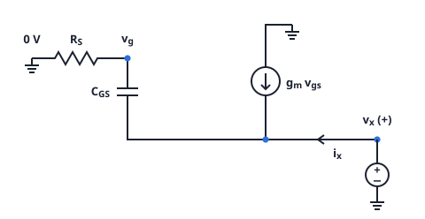

*입력 전압원을 0으로 두고 오른쪽 단자에서 전류가 얼마나 들어가는지 재요.*

**정확히 말하면**

게이트로 입력을 받고 소스에서 부하를 구동하는 공통 드레인 회로예요. 저주파에서 게이트 전류가 거의 없고 $g_m r_o\gg1$이며 몸체효과를 무시하면, 출력에서 본 저항은 $Z_{out}(0)\approx1/g_m$이에요.

예를 들어 $g_m=10\,\mathrm{mS}$이고 시험 전압을 $10\,\mathrm{mV}$만큼 올리면, 저주파에서는 게이트 전압이 고정돼 $v_{gs}$가 $10\,\mathrm{mV}$ 내려가요. 드레인에서 공급하는 소신호 전류가 $100\,\mu\mathrm{A}$ 줄어들어 시험원이 그만큼 보태요. 이때 출력에서 $100\,\Omega$를 봐요.

$$
Z_{out}(0)\approx\frac{10\,\mathrm{mV}}{100\,\mu\mathrm{A}}=100\,\Omega
$$

**입력 영점과 모델 선택** — 입력 독립 전압원을 단락하고 게이트에는 전단의 출력저항 $R_S$를 남겨요. 드레인 전원은 AC 접지, 이상적 바이어스 전류원은 개방이에요. 드레인에 연결된 $C_{GD}$는 게이트에서 AC 접지로 향하는 가지라 밀러 증폭이 없어요. 이 가지가 $C_{GS}$에 비해 작다고 보고 생략해요. 강의 모델은 이를 비롯해 $C_{GS}$ 외의 기생 커패시턴스와 몸체효과, 유한 $r_o$를 생략해요.

1. 소스에 시험 전압 $v_x$를 걸고, 시험 전류 $i_x$가 회로 안으로 들어가는 쪽을 양으로 잡아요. 게이트–소스 전압은 $v_{gs}=v_g-v_x$예요.
2. 소스로 들어오는 $i_x$와 드레인에서 오는 제어 전류를 더하면 소스에서 게이트로 흐르는 커패시터 전류가 돼요. 이 방향은 $v_{gs}$의 양의 방향과 반대라서 부호가 붙어요.

   $$
   i_x+g_m v_{gs}=-sC_{GS}v_{gs}
   $$
3. 게이트에 도착한 커패시터 전류는 그대로 $R_S$를 통해 접지로 흘러요.

   $$
   \frac{v_g}{R_S}=-sC_{GS}v_{gs}
   $$

   $$
   v_x=v_g-v_{gs}=-(1+R_SsC_{GS})v_{gs}
   $$
4. 소스의 식에서 $v_{gs}$를 풀어 대입하면 $v_x$와 $i_x$만 남아요. 출력 임피던스의 정의는 $Z_{out}(s)=v_x/i_x$예요.

   $$
   v_{gs}=-\frac{i_x}{g_m+sC_{GS}}
   $$

   $$
   Z_{out}(s)\approx\frac{1+R_SsC_{GS}}{g_m+sC_{GS}}
   $$

   이 비는 선택한 축약 모델에서 그대로 성립해요.

**극한 검산** — 저주파에는 $C_{GS}$가 열려 게이트가 AC 접지에 머물고 $1/g_m$가 보여요. 모델의 고주파 극한에서는 $C_{GS}$ 양단 전압 $v_{gs}$가 0으로 가서 제어 전류는 사라지고, 시험 전류가 $C_{GS}$와 $R_S$를 통해 접지로 가요.

$$
\lim_{\omega\to\infty} Z_{out}(j\omega)=R_S
$$

실제 고주파에서 생략했던 기생 경로가 중요해지면 이 극한도 바뀔 수 있어요.

수업 중 $sC_{GS}v_{gs}=i_x+g_mv_{gs}$로 적었다가 커패시터 전류의 부호를 정정했어요.

**교수님 말씀**

출력저항이 큰 공통 소스 단에 낮은 임피던스의 스피커를 바로 달면, 출력저항과 스피커가 전압을 나눠 가져서 스피커에 걸리는 전압이 크게 줄어요.

> 이상적인 볼티지 소스의 출력 임피던스는 얼마예요?

이상적이면 0이고, 팔로워는 소스에서 작은 임피던스를 만들어 그 조건에 가까워져요.

**꼭 기억해요**

> 식에, 식에 파묻히면 안 되고, 결국엔 이걸 구하기 위해서 지금 이제 노드 계산을 하는 거란 말이야.

> 항상 식이 맞는지는 뭐죠, 물리적으로 확인해 보면 되겠죠.

고주파에 $v_{gs}$가 0에 가까워져도 시험 전류는 $C_{GS}$를 통해 $R_S$로 흐를 수 있어요.

**페이지 요약**

입력을 영점화하고 소스에 시험원을 걸어 출력 임피던스를 구해요.

*핵심 식*

- 축약 모델

  $$
  Z_{out}(s)\approx\frac{1+R_SsC_{GS}}{g_m+sC_{GS}}
  $$

$C_{GS}$만 유지하고 유한 $r_o$와 몸체효과를 생략한 모델이에요.

저주파에 $C_{GS}$가 열리면 $1/g_m$가 보여요.

모델의 고주파 극한에 $C_{GS}$가 단락되면 $R_S$가 보여요.

---

### 버퍼는 어느 주파수까지 쓸 수 있을까

*1104 수업 · L05 s47*

**쉽게 말하면**

팔로워의 축약 모델에서 전단 저항 $R_S$가 저주파 출력저항 $1/g_m$보다 크면, 버퍼의 출력 임피던스 크기는 주파수와 함께 증가해 $R_S$에 가까워져요.

예를 들어 $100\,\Omega$에서 시작해 $600\,\Omega$로 오르는 버퍼에 $200\,\Omega$ 이하가 필요하면, 처음 $200\,\Omega$에 닿는 주파수까지 쓸 수 있어요.

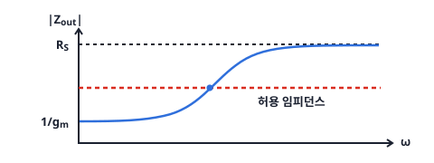

*허용 임피던스에 닿는 주파수가 사용 한계예요.*

**정확히 말하면**

부하가 허용하는 전압 오차가 작을수록 출력 임피던스를 더 낮게 유지해야 해요. 예시의 $200\,\Omega$는 전단 저항 $600\,\Omega$의 1/3이에요. 수업의 1/3이나 1/4은 예시이며 허용선은 부하와 목표 오차에 맞춰 정해요.

축약 모델에서 버퍼를 넣는 목적은 저주파 출력 임피던스 $1/g_m$를 전단 저항 $R_S$보다 낮추는 거예요. 그 조건이 $g_mR_S>1$이에요. $s=j\omega$를 넣으면 크기는 다음처럼 변해요.

$$
|Z_{out}(j\omega)|\approx\frac{\sqrt{1+(\omega R_SC_{GS})^2}}{\sqrt{g_m^2+(\omega C_{GS})^2}}
$$

분자의 변화가 먼저 시작해 크기가 $1/g_m$에서 $R_S$까지 부드럽게 올라가요. 두 꺾임 위치는 출력에서 바라본 임피던스의 영점과 극이 정해요.

$$
\omega_z=\frac{1}{R_SC_{GS}}
$$

$$
\omega_p=\frac{g_m}{C_{GS}}
$$

$g_mR_S>1$이면 $\omega_z\lt\omega_p$예요. 두 식의 단위는 $\mathrm{rad/s}$이고, $C_{GS}$가 작아지면 두 변화가 모두 높은 주파수로 이동해요.

**인덕터처럼 보이는 이유** — 분모의 켤레를 곱하면 $g_mR_S>1$인 이 모델에서 모든 $\omega>0$에 대해 임피던스의 허수부가 양수예요. 두 극한에서 허수부는 0으로 가고 중간 주파수에서 유도성이 두드러져요.

$$
\operatorname{Im} Z_{out}(j\omega)\approx\frac{\omega C_{GS}(g_mR_S-1)}{g_m^2+(\omega C_{GS})^2}
$$

인덕터도 양의 허수 임피던스 $j\omega L$을 가져요. 트랜지스터로 이 성질을 만들면 **능동 인덕터**로 쓸 수 있어요. 출력에 커패시터가 붙으면 유도성과 용량성이 만나 LC 공진이 가능해지고, 부하가 가볍고 감쇠가 작으면 특정 주파수에서 전압 이득이 솟는 피킹이 나타날 수 있어요.

입력에서는 게이트와 소스가 같은 방향으로 움직여 $C_{GS}$ 양단 전압 변화가 작아요. 같은 조건의 공통 소스 단과 비교하면 이 효과로 입력 임피던스가 높은 주파수까지 상대적으로 크게 유지될 수 있지만, 주파수가 오르면 커패시터 경로의 영향이 커져 입력 임피던스는 유한해요.

**교수님 말씀**

수업에서는 회로이론의 LC 탱크를 떠올렸어요. 칩 위에 수동 인덕터를 만드는 부담이 있을 때 트랜지스터 회로의 유도성으로 필요한 효과를 얻을 수 있어요.

> 버퍼는 왜 쓰는 거예요? 출력 임피던스를 낮추기 위해서.

**꼭 기억해요**

> 버퍼로서도 동작 주파수의 제한이 생긴다는 얘기예요.

임피던스의 극과 영점은 출력에 시험원을 걸어 구해요. 전압 전달함수의 극과 영점은 입력 신호에서 부하 전압까지의 별도 계산으로 구해요. 출력 커패시턴스와 감쇠에 따라 피킹의 크기도 달라져요.

**페이지 요약**

$g_mR_S>1$이면 출력 임피던스는 $1/g_m$에서 $R_S$로 올라가요.

부하에 필요한 허용 임피던스 이내의 주파수에서 버퍼로 써요.

유도성 출력에 커패시터가 붙고 감쇠가 작으면 이득이 솟을 수 있어요.

---

### 공통 소스 뒤에 팔로워를 붙여요

*1104 수업 · L05 s48*

**쉽게 말하면**

공통 소스 단은 전압을 크게 만들고, 그 뒤의 소스 팔로워는 낮은 임피던스로 부하를 구동해요.

저주파에서 팔로워의 게이트에는 전류가 거의 들지 않아 전단에서 만든 전압을 그대로 받아요.

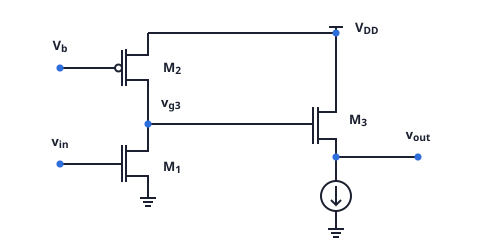

*왼쪽 공통 소스 단에서 전압을 키우고 오른쪽 소스 팔로워에서 부하에 전류를 보내요.*

**정확히 말하면**

전단의 출력저항과 부하가 모두 $1\,\mathrm{k}\Omega$이라면 부하를 전단에 직접 달았을 때 전압은 개방 출력의 절반이에요. 후단 팔로워가 전단을 거의 로딩하지 않고 출력저항을 $50\,\Omega$로 줄이면, 같은 부하에 팔로워의 개방 출력 전압 중 $20/21$이 걸려요. 이 분압은 팔로워 자체의 무부하 이득에 따로 곱해요.

1. $M_1$은 게이트 입력을 드레인 전류로 바꾸고, $M_2$는 고정 바이어스에 연결한 PMOS 전류원 부하예요. 저주파에는 $M_3$ 게이트 전류가 무시할 만큼 작으므로 전단만 떼어 볼 수 있어요. 입력 $v_{in}$을 유지하고 $M_2$ 게이트와 전단 공통 드레인 출력을 AC 접지에 연결해요.

   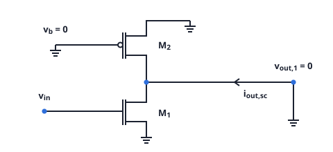

   *전단 출력을 교류 접지에 단락하고 오른쪽에서 들어오는 전류를 재요.*

   $i_{out,sc}$는 오른쪽 단락선에서 공통 드레인으로 유입되는 전류예요. 두 소자의 $r_o$ 양단이 AC 접지이고 $M_2$의 게이트와 소스도 AC 접지라서, $M_1$이 만드는 전류만 남아요.

   $$
   G_{m1}=\frac{i_{out,sc}}{v_{in}}\approx g_{m1}
   $$

   입력 영점에서는 두 드레인에서 전원 또는 접지로 보이는 저항이 병렬이에요. 저주파 팔로워의 게이트 전류는 무시할 수 있어요.

   $$
   R_S=r_{o1}\parallel r_{o2}
   $$

   공통 드레인 노드에서 본 전단 이득은 $A_{v1}\approx-G_{m1}R_S\approx-g_{m1}R_S$예요. 출력에 낮은 저항 부하를 바로 연결하면 $R_S$와 병렬이 되어 이득이 줄어요.
2. 슬라이드에서는 공통 드레인 노드가 $M_3$ 게이트에 직접 이어져요. $M_3$의 소스가 출력이고, 드레인 전원은 AC 접지이며 소스의 이상적 바이어스 전류원은 소신호에서 열려요. 따라서 입력 영점에서 $M_3$ 게이트 왼쪽에 남는 저항은 바로 $R_S$예요.
3. $M_3$의 유한 $r_{o3}$와 몸체효과를 생략하고 커패시턴스는 $C_{GS3}$만 유지하는 모델이에요. 저주파 출력은 $Z_{out}(0)\approx1/g_{m3}$예요. [소스 팔로워의 출력에 시험원을 연결해요](#s0-source-impedance)에서 구한 블록에 이 단의 $g_{m3}$와 $C_{GS3}$를 넣으면 주파수에 따른 출력 임피던스를 얻어요.

   $$
   Z_{out}(s)\approx\frac{1+(r_{o1}\parallel r_{o2})sC_{GS3}}{g_{m3}+sC_{GS3}}
   $$

   이 모델에서 저주파 부하 구동에는 $1/g_{m3}$가 충분히 작아야 해요. 모델의 고주파 극한은 $R_S$예요. $R_S C_{GS3}$가 작으면 임피던스의 첫 꺾임이 더 높은 주파수로 이동해요.

**복습문제 연결** — E11.24는 이 직접 결합 회로예요. X11.24에서는 $M_3$의 유한 출력저항을 유지하면 출력에서 보이는 경로가 어떻게 달라지는지 확인해요.

**교수님 말씀**

전단은 큰 출력저항을 이득에 활용하고, 후단은 작은 출력저항을 부하 구동에 활용해요. 단 사이를 커패시터로 AC 결합하는 경우도 있지만, 이 예제의 두 단은 직접 결합해요.

> 이득에 영향을 안 주죠, 그죠? 대신에 여기에 로드 저항은 낮은 출력 임피던스로, 1/gm의 임피던스로 구동을 하게 만들어 준 거죠, 그죠?

**페이지 요약**

공통 소스 단이 이득을 만들고 후단의 팔로워가 부하를 구동해요.

*핵심 식*

- 입력 영점에서 전단 저항

  $$
  R_S=r_{o1}\parallel r_{o2}
  $$

$C_{GS3}$만 유지하고 유한 $r_{o3}$와 몸체효과를 생략하면 저주파에는 $1/g_{m3}$가 보여요.

같은 모델의 고주파 극한은 전단의 $R_S$예요.

---

### 이미터 팔로워에는 베이스 전류가 흘러요

*1104 수업 · L05 s49*

**쉽게 말하면**

이미터 팔로워에서는 베이스 전류가 흘러서 저주파에도 전단의 저항이 출력에 조금 보여요.

베이스에서 본 전단 저항이 커질수록, 같은 이미터 전류를 흘리기 위해 출력에 더 큰 시험 전압이 필요해요.

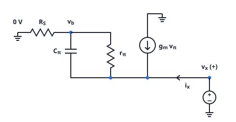

*입력 전압원을 0으로 두고 오른쪽 단자에서 전류가 얼마나 들어가는지 재요.*

**정확히 말하면**

베이스 입력, 이미터 출력, 컬렉터 AC 접지의 팔로워예요. $r_o$와 $C_\mu$를 생략한 강의 모델에서, 큰 $\beta$일 때 저주파 출력 임피던스는 $Z_{out}(0)\approx1/g_m+R_S/(\beta+1)$이에요.

예를 들어 $\beta=99$이고 다른 값이 같다면, $R_S$에 $10\,\mathrm{k}\Omega$를 더했을 때 이미터에서 보이는 저주파 임피던스는 $100\,\Omega$ 증가해요. 이미터 전류 $100$만큼 중 베이스 쪽 저항을 흐르는 전류는 $1$만큼이기 때문이에요.

1. 입력을 영점화하면 베이스 왼쪽에 $R_S$가 남아요. 베이스–이미터 사이에는 $C_\pi$와 $r_\pi$가 같은 두 노드에 연결돼요. 그래서 두 가지의 어드미턴스(임피던스의 역수)를 더해요.

   $$
   Y_{BE}=sC_\pi+1/r_\pi
   $$
2. 제어 전압은 $v_\pi=v_b-v_x$예요. 오른쪽에서 들어오는 시험 전류와 컬렉터에서 오는 제어 전류는 이미터에서 베이스로 흘러요.

   $$
   i_x+g_m v_\pi=-Y_{BE}v_\pi
   $$

   $$
   \frac{v_b}{R_S}=-Y_{BE}v_\pi
   $$

   $$
   v_x=v_b-v_\pi=-(1+R_SY_{BE})v_\pi
   $$
3. 소스 팔로워에서의 $sC_{GS}$를 $Y_{BE}$로 바꾼 것과 같은 구조예요. $v_\pi$를 소거하고 분자와 분모에 $r_\pi$를 곱해 $g_mr_\pi=\beta$를 넣어요.

   $$
   Z_{out}(s)\approx\frac{1+R_SY_{BE}}{g_m+Y_{BE}}
   $$

   $$
   Z_{out}(s)\approx\frac{R_Sr_\pi C_\pi s+r_\pi+R_S}{r_\pi C_\pi s+\beta+1}
   $$

저주파에는 $C_\pi$가 열리고, 유한 $\beta$를 유지한 모델에서는 다음 값이 나와요.

$$
Z_{out}(0)\approx\frac{r_\pi+R_S}{\beta+1}
$$

$R_S=0$이면 큰 $\beta$에서 익숙한 $1/g_m$가 남아요. 고주파 극한에는 $C_\pi$가 베이스와 이미터를 거의 연결하므로 모델에서 $R_S$가 보여요. 저주파 값보다 $R_S$가 클 때만 크기가 올라가요.

**복습문제 연결** — P11.48은 강의 모델에서 생략했던 베이스–컬렉터 커패시턴스 $C_\mu$를 포함하는 경우예요.

**교수님 말씀**

교수님은 소스 팔로워 식을 처음부터 다시 만들기보다 게이트–소스 사이 가지를 베이스–이미터의 병렬 가지로 바꿔 적용했어요.

> 베이스 전류가 있으니까, 그죠? 여기에 $r_\pi$가 이렇게 달려있죠.

**꼭 기억해요**

베이스 전류가 작아도 전단 저항이 충분히 크면 $R_S/(\beta+1)$의 기여를 유지해요.

> 경우에 따라서 $R_S$가 굉장히 클 수 있기 때문에 무시할 수는 없습니다.

**페이지 요약**

베이스 전류 때문에 $R_S$의 영향이 저주파에도 남아요.

*핵심 식*

- 유한 $\beta$의 저주파 모델

  $$
  Z_{out}(0)\approx\frac{r_\pi+R_S}{\beta+1}
  $$

$r_o$와 $C_\mu$를 생략한 모델이에요.

저주파에 $R_S/(\beta+1)$이 충분히 크면 유지해요.

같은 모델의 고주파 극한에는 $C_\pi$가 단락되어 $R_S$가 보여요.

---

## 2. 캐스코드의 밀러 효과와 극점

### 캐스코드에서 커패시터 양단의 이득을 봐요

*1104 수업 · L05 s50*

**쉽게 말하면**

캐스코드는 입력과 커패시터로 이어진 중간 노드 Y의 전압을 조금만 흔들어서, 큰 전체 이득을 유지하면서 입력의 밀러 효과(Miller effect)를 줄여요.

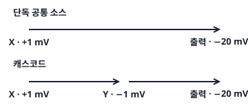

*저주파 예시에서 입력이 1 mV 오르면 두 회로의 출력은 20 mV 내려가고, 캐스코드의 Y는 1 mV만 내려가요.*

**정확히 말하면**

예시에서 단독 공통 소스의 게이트–드레인 커패시터 양단 전압은 21 mV 변해요. 캐스코드의 같은 커패시터 양단 전압은 2 mV만 변해요. 입력 변화량 1 mV에 대한 이 비가 입력 쪽 밀러 배율이에요.

두 회로에 같은 저항 부하 $R_L$를 달아요. 공통 소스(common source, CS)의 $M_1$ 위에 공통 게이트(common gate, CG)인 $M_2$를 쌓으면 캐스코드가 돼요. X는 $M_1$ 게이트, Y는 $M_1$ 드레인과 $M_2$ 소스의 접점, 출력은 $M_2$ 드레인이에요. 위쪽 게이트의 바이어스 전압은 고정이므로 소신호에서는 접지예요.

기생 커패시터를 열어 저주파 이득을 구해요. MOS 게이트로 전류가 흐르지 않아 $R_S$에 전압 강하가 없고 $v_X\approx v_{in}$이에요. 몸체효과를 무시하고 $g_mr_O\gg1$을 가정해요. 위쪽 소스에서 보는 저항은 $1/g_{m2}\ll r_{O1}$로 두어요. 국소 이득을 구할 때는 $R_L\ll r_{O2}$로 두어 위쪽 CG 소자의 유한 $r_{O2}$가 부하 변화를 Y에 되먹이는 효과도 생략해요.

1. **출력을 단락해 전류 전달을 봐요.** $v_{out}=0$으로 두고, 접지에서 출력 단자를 통해 증폭기 안으로 들어오는 전류를 $i_{out,sc}$로 정해요. $M_1$의 소스가 접지라서 입력 전압이 곧 제어 전압이고, 그 드레인 전류 변화가 $M_2$를 거쳐 출력 단락선에 나타나요.

   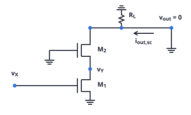

   *두 nMOS를 저주파 모델로 그렸어요. 출력이 단락돼 부하 저항에는 소신호 전류가 흐르지 않아요.*

   출력 단락 전류를 입력으로 나눈 단의 트랜스컨덕턴스(transconductance)는 $M_1$의 $g_{m1}$에 가까워요.

   $$
   G_m=\frac{i_{out,sc}}{v_{in}}\approx g_{m1}
   $$
2. **입력을 영점화하고 출력에서 저항을 봐요.** 입력 전압원을 접지로 바꾸면 $R_S$를 거쳐 X가 AC 접지예요. 단락을 풀고 출력에서 보면 위로 $R_L$, 아래로 캐스코드 자체의 큰 저항 $R_{\mathrm{cas}}$가 보여요. 아래 가지는 $M_1$의 $r_{O1}$에 캐스코드 소자 $M_2$의 $g_{m2}r_{O2}$를 곱한 주항으로 봐요.

   $$
   R_{\mathrm{cas}}\approx g_{m2}r_{O2}r_{O1}
   $$

   $R_L\ll R_{\mathrm{cas}}$이면 부하 포함 출력저항은 $R_L$에 가까워요.

   $$
   R_{out}\approx R_{\mathrm{cas}}\parallel R_L\approx R_L
   $$
3. **부호를 붙여 전체 이득을 구해요.** 입력이 오르면 출력에서 회로로 더 많은 전류가 들어가므로 부하 전압 강하가 커지고 출력은 내려가요.

   $$
   A_v\approx-G_mR_{out}\approx-g_{m1}R_L
   $$

   같은 $M_1$과 $R_L$을 쓰는 단독 CS에서도 $R_L\ll r_{O1}$이면 부하 포함 출력저항이 약 $R_L$이라 전체 이득이 같아요.
4. **Y를 출력으로 잡으면 다른 이득을 얻어요.** Y에서 아래로 보는 $r_{O1}$보다 위의 CG 소스로 보는 $1/g_{m2}$가 충분히 작다고 봐요. 그래서 Y에 걸리는 전압은 $M_1$이 만드는 전류와 이 작은 저항의 곱으로 정해져요.

   $$
   R_Y\approx r_{O1}\parallel\frac{1}{g_{m2}}\approx\frac{1}{g_{m2}}
   $$

   $$
   \begin{aligned} A_{v,XY} &=\frac{v_Y}{v_X}\\ &\approx-g_{m1}R_Y\approx-\frac{g_{m1}}{g_{m2}}\end{aligned}
   $$

   $M_2$ 게이트가 AC 접지이므로 $v_{gs2}=-v_Y$예요. $v_Y$가 오르면 위쪽 소자의 드레인 전류가 줄어 부하 전압 강하가 작아져요. 그래서 Y에서 최종 출력으로 가는 이득은 양수예요.

   $$
   A_{v,Yout}=\frac{v_{out}}{v_Y}\approx+g_{m2}R_L
   $$

   두 국소 이득의 곱에서도 전체 이득이 나와요. $g_{m2}$는 중간 이득을 나누는 역할을 해요.

   $$
   A_v\approx A_{v,XY}A_{v,Yout}\approx-g_{m1}R_L
   $$
5. **커패시터가 물린 두 노드의 이득을 넣어요.** 캐스코드의 $C_{GD1}$은 X와 Y를 이어요. X에서 커패시터로 들어가는 전류가 $sC_{GD1}(v_X-v_Y)$이므로, X에서 본 접지형 성분은 다음과 같아요.

   $$
   C_{GD1,X}=(1-A_{v,XY})C_{GD1}
   $$

   $$
   C_{GD1,X}\approx\left(1+\frac{g_{m1}}{g_{m2}}\right)C_{GD1}
   $$

   단독 CS에서는 $M_1$의 드레인이 최종 출력이에요. 따라서 그쪽 입력 밀러 성분은 약 $(1+g_{m1}R_L)C_{GD1}$이에요. $g_{m2}R_L$이 충분히 크면 캐스코드의 입력 커패시턴스가 줄어 같은 $R_S$에서 입력 극이 더 높은 주파수로 이동해요.

BJT 캐스코드에서는 $Q_1$의 베이스–컬렉터 사이 $C_{\mu1}$이 X와 Y를 이어요. 베이스 전류가 작고 두 소자의 온도가 같으면 두 컬렉터 전류가 거의 같아요. 열전압 $V_T=kT/q$로 $g_m=I_C/V_T$를 구하므로 두 $g_m$도 거의 같아요. 이때 X 쪽 밀러 성분은 약 $2C_{\mu1}$이에요.

MOS는 두 소자에 같은 드레인 전류가 흘러도 트랜지스터 크기, 특히 $W/L$에 따라 $g_m$이 달라져요. 장채널 제곱법칙 모델에서는 다음 관계를 써요.

$$
g_m=\sqrt{2\mu_n C_{ox}(W/L)I_D}
$$

같은 공정과 전류에서 $W/L$이 같아 두 $g_m$이 비슷할 때, MOS의 X 쪽 밀러 성분도 약 $2C_{GD1}$이에요.

**교수님 말씀**

> 같은 전압 이득을 가지지만 동작 주파수는 더 증가하게 되는 거죠.

이 비교는 부하를 같게 두고 밀러 효과가 지배적인 단독 CS의 입력 극을 캐스코드로 밀어 올리는 경우예요. 단독 CG는 고주파에서 유용하지만 소스 입력저항이 낮아요. 캐스코드는 전압을 받는 입력을 CS의 게이트에 둬요.

**꼭 기억해요**

> 일반적으로 두 트랜지스터 사이즈가 꼭 동일해야 할 필요는 없습니다.

입력 밀러 성분을 2배로 두기 전에 두 $g_m$의 비를 확인해요. $g_{m1}\approx g_{m2}$일 때 X에서 Y로 가는 이득은 약 $-1$이에요.

**페이지 요약**

캐스코드에서는 $C_{GD1}$ 양단인 X와 Y의 전압비로 입력 밀러 배율을 구해요.

*핵심 식*

- X에서 Y로 가는 이득

  $$
  \begin{aligned} A_{v,XY} &=\frac{v_Y}{v_X}\\ &\approx-g_{m1}R_Y\approx-\frac{g_{m1}}{g_{m2}}\end{aligned}
  $$
- 입력의 밀러 성분

  $$
  C_{GD1,X}=(1-A_{v,XY})C_{GD1}
  $$
- 전체 이득 · 부하가 지배할 때

  $$
  A_v\approx-G_mR_{out}\approx-g_{m1}R_L
  $$

$R_L\ll r_{O2}$이고 $1/g_{m2}\ll r_{O1}$이면 국소 이득과 입력 밀러 성분을 위 식으로 구해요.

전체 이득은 $R_L\ll R_{\mathrm{cas}}$일 때 위 식으로 근사해요.

같은 부하의 단독 CS와 이득을 비교할 때는 $R_L\ll r_{O1}$도 확인해요.

두 $g_m$이 비슷할 때 입력 밀러 성분이 약 2배가 돼요.

---

### X·Y·출력에 붙는 커패시터를 모아요

*1104 수업 · L05 s51*

**쉽게 말하면**

한쪽이 AC 접지인 커패시터는 그대로 더하고, X와 Y를 잇는 커패시터만 각 노드에서 보이는 값으로 나눠요.

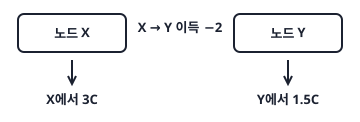

*X에서 Y로 가는 이득이 −2이면, 두 노드를 잇는 커패시터 $C$는 X에서 $3C$, Y에서 $1.5C$로 보여요.*

**정확히 말하면**

X를 1 mV 올렸을 때 Y가 2 mV 내려가면 두 단자의 전압 차는 3 mV 커져요. X 쪽에서 이 변화는 자기 전압 변화의 3배예요. Y 쪽에서는 자기 전압이 2 mV 내려갈 때 Y에서 X를 뺀 전압이 3 mV 내려가므로 1.5배예요.

한쪽이 AC 접지인 접지형 커패시터(grounded capacitor)는 노드 전압만큼 전압이 걸려요. 반대로 $C_{GD1}$의 두 끝 X와 Y는 둘 다 움직여요. 저주파에서 구한 국소 이득 $A_{v,XY}\approx-g_{m1}/g_{m2}$로 이 플로팅 커패시터(floating capacitor)의 양쪽 전류를 근사해요. 이 이득은 몸체효과를 무시하고 $R_L\ll r_{O2}$, $1/g_{m2}\ll r_{O1}$인 모델에서 써요.

1. **먼저 X에서 보는 전류를 써요.** X에서 Y로 들어가는 전류에서 $v_X$를 묶으면 X 쪽 접지형 등가 성분이 나와요.

   $$
   \begin{aligned} i_{XY} &=sC_{GD1}(v_X-v_Y)\\ &=sC_{GD1}(1-A_{v,XY})v_X \end{aligned}
   $$

   $$
   1-A_{v,XY}\approx 1+\frac{g_{m1}}{g_{m2}}
   $$
2. **Y에서는 전압 차의 순서가 바뀌어요.** Y에서 X로 들어가는 전류에서 $v_Y$를 묶어요. 이때 $v_X/v_Y$가 필요하므로 역이득을 넣어요.

   $$
   \begin{aligned} i_{YX} &=sC_{GD1}(v_Y-v_X)\\ &=sC_{GD1}(1-1/A_{v,XY})v_Y \end{aligned}
   $$

   $$
   1-1/A_{v,XY}\approx 1+\frac{g_{m2}}{g_{m1}}
   $$

   같은 커패시터를 두 관찰점에서 본 결과라 두 밀러 배율이 같을 필요는 없어요. 두 $g_m$이 비슷하면 양쪽 배율도 비슷해요.
3. **X에 붙는 성분을 더해요.** $M_1$ 소스가 접지여서 $C_{GS1}$이 그대로 보이고, 여기에 $C_{GD1}$의 X 쪽 등가 성분이 더해져요.

   $$
   \begin{aligned} C_X &\approx C_{GS1}\\ &\quad+\left(1+\frac{g_{m1}}{g_{m2}}\right)C_{GD1}\end{aligned}
   $$
4. **Y에서는 두 소자를 확인해요.** Y에 닿는 단자는 $M_1$ 드레인과 $M_2$ 소스예요. $M_1$에서 $C_{DB1}$과 $C_{GD1}$의 Y 쪽 성분을 가져와요. $M_2$에서는 게이트와 바디가 AC 접지이므로 $C_{GS2}$와 $C_{SB2}$를 그대로 더해요.

   $$
   \begin{aligned} C_Y &\approx C_{DB1}+C_{GS2}+C_{SB2}\\ &\quad+\left(1+\frac{g_{m2}}{g_{m1}}\right)C_{GD1} \end{aligned}
   $$
5. **출력에서는 $M_2$ 드레인을 확인해요.** $C_{GD2}$와 $C_{DB2}$의 반대쪽은 각각 AC 접지인 게이트와 바디예요. 그래서 두 커패시터를 접지형으로 그대로 더해요.

   $$
   C_{out}=C_{GD2}+C_{DB2}
   $$

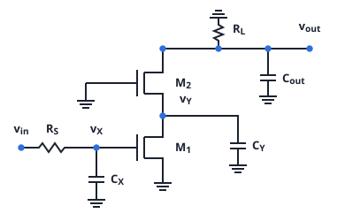

*밀러 근사를 적용한 뒤에는 X, Y, 출력에 등가 커패시터가 각각 접지로 이어져요.*

$M_1$의 소스–바디 커패시터는 두 단자가 AC 접지라 노드 전압 변화에 따른 전류가 없어요. 각 소자의 G·D·S·B 단자를 먼저 확인하면 같은 가지를 두 번 넣거나 빠뜨리는 일을 줄일 수 있어요.

**교수님 말씀**

> 여러분들이 커패시턴스를 정확하게 어, 고려를 해야 되겠죠.

Y는 한 소자의 드레인과 다른 소자의 소스가 만나는 곳이에요. 그래서 한쪽 트랜지스터만 보고 커패시턴스를 모으면 항이 빠져요.

**꼭 기억해요**

> 부호를 좀 이제 잘 여러분들이 헷갈리지 않으면 좋을 것 같고요.

$A_{v,XY}$는 음수이므로 X 쪽의 $1-A_{v,XY}$와 Y 쪽의 $1-1/A_{v,XY}$가 모두 1보다 커져요.

**페이지 요약**

X와 Y에서 보는 밀러 배율은 서로 다를 수 있어요.

*핵심 식*

- X · 게이트 쪽

  $$
  \begin{aligned} C_X &\approx C_{GS1}\\ &\quad+\left(1+\frac{g_{m1}}{g_{m2}}\right)C_{GD1}\end{aligned}
  $$
- Y · 두 소자가 만나는 쪽

  $$
  \begin{aligned} C_Y &\approx C_{DB1}+C_{GS2}+C_{SB2}\\ &\quad+\left(1+\frac{g_{m2}}{g_{m1}}\right)C_{GD1} \end{aligned}
  $$
- 출력 · 위쪽 드레인

  $$
  C_{out}=C_{GD2}+C_{DB2}
  $$

X와 Y의 밀러 배율에는 저주파 국소 이득 $A_{v,XY}\approx-g_{m1}/g_{m2}$를 적용해요.

반대쪽 단자가 AC 접지에 있으면 노드의 커패시턴스에 그대로 더해요.

---

### 가장 큰 시정수가 가장 낮은 극을 만들어요

*1104 수업 · L05 s51*

**쉽게 말하면**

저항과 커패시턴스의 곱인 시정수(time constant)가 큰 노드는 전압이 느리게 변해서 더 낮은 주파수부터 이득을 줄여요.

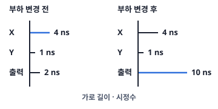

*출력의 시정수가 2 ns에서 10 ns로 커지면 가장 낮은 극을 만드는 노드가 X에서 출력으로 바뀌어요.*

**정확히 말하면**

예시에서 처음에는 X의 4 ns가 가장 커서 입력 극이 가장 낮아요. 부하 저항을 높여 출력의 시정수가 10 ns가 되면 출력 극이 가장 낮아져요. 예를 들어 출력 커패시턴스가 1 pF로 일정할 때 부하를 $2\,\mathrm{k\Omega}$에서 $10\,\mathrm{k\Omega}$로 바꾸면 출력의 곱이 2 ns에서 10 ns가 돼요. $\mathrm{k\Omega}\cdot\mathrm{pF}=\mathrm{ns}$예요.

두 부하 값 모두 $R_{out}\approx R_L$인 범위에서 골라요. $R_L\ll r_{O2}$인 모델로 X와 Y의 등가 커패시턴스 및 시정수를 같게 유지한 비교예요.

밀러 근사로 X와 Y 사이의 커패시터를 각 노드의 등가 커패시턴스에 포함시켜요. 그다음 저주파에서 입력 독립 전압원을 영점화하고 각 노드에서 바라본 저항을 구해요. 고정 전원과 바이어스 노드는 AC 접지로 봐요.

1. **X에서 왼쪽을 봐요.** MOS 게이트로 전류가 흐르지 않으므로 입력 전압원을 단락했을 때 X에서 접지로 이어지는 저항은 전단의 $R_S$예요.

   $$
   R_X=R_S
   $$
2. **Y에서 위와 아래를 봐요.** 아래로 $r_{O1}$, 위로 $M_2$의 소스 쪽 저항이 보여요. 몸체효과를 무시하고 $R_L\ll r_{O2}$로 두면 CG의 소스 쪽 저항은 약 $1/g_{m2}$예요. 이쪽이 $r_{O1}$보다 충분히 작을 때 Y의 저항을 다음처럼 근사해요.

   $$
   R_Y\approx r_{O1}\parallel\frac{1}{g_{m2}}\approx\frac{1}{g_{m2}}
   $$
3. **출력에서 부하와 캐스코드를 봐요.** 저항 부하 $R_L$은 전원 쪽으로 AC 접지에 연결돼요. 아래쪽의 캐스코드 자체 출력저항이 $R_L$보다 훨씬 크면 부하 포함 저항은 $R_L$이 지배해요.

   $$
   R_{out}\approx R_L
   $$
4. **저항과 커패시턴스를 곱한 뒤 극을 구해요.** 노드 하나를 저항과 커패시터가 병렬인 회로로 근사하면, 전압이 $v_k(t)$일 때 두 가지의 전류 합이 0인 자연응답 조건은 다음과 같아요.

   $$
   C_k\frac{dv_k}{dt}+\frac{v_k}{R_k}=0
   $$

   전압이 $e^{-t/(R_kC_k)}$에 비례해 줄어들어요. 따라서 시정수와 극의 각주파수 크기는 각각 다음과 같아요.

   $$
   \tau_k=R_kC_k
   $$

   $$
   \omega_{p,k}\approx1/(R_kC_k)
   $$

   $k$는 X, Y 또는 출력이에요. 각주파수 크기는 $\mathrm{rad/s}$로 쓰고, 복소평면의 극 위치는 음의 실수축에 표시해요.

   $$
   s_{p,k}\approx-\omega_{p,k}
   $$

   주파수를 Hz로 나타낼 때는 $2\pi$로 나눠요.

   $$
   f_{p,k}=\frac{\omega_{p,k}}{2\pi}
   $$

가장 큰 $RC$가 가장 낮은 극을 만들어요. 그 극이 나머지 극과 충분히 떨어져 있으면 전체 저역통과 응답의 대역폭을 주로 정하는 지배극(dominant pole)이 돼요. 관심 구간에서 영점의 영향이 작고 다른 극이 멀면 $-3\,\mathrm{dB}$ 대역폭을 그 극 주파수로 추정할 수 있어요. 여러 극이 가까우면 감쇠가 겹치므로 전달함수를 함께 확인해요.

Y에는 두 소자의 커패시턴스가 모이지만 저항이 낮아서, 보통 Y의 극은 높은 곳에 있어요. $R_S$와 $R_L$이 비슷하고 $C_X$가 $C_{out}$보다 크면 입력 극이 더 낮아요. $R_L$이 충분히 크거나 출력에 큰 커패시터가 붙으면 출력 극이 더 낮아질 수 있어요. 이 비교는 $R_{out}\approx R_L$이 유지되는 부하 범위에서 적용해요.

**교수님 말씀**

> 동작 주파수는 폴의 개수가 중요한 게 아니라 뭐에 의해서 결정되죠?

학생들은 각 노드의 $RC$라고 답했어요. 수업에서는 1 MHz에 있는 극과 100 MHz 부근의 극을 비교했어요. 1 MHz에 있는 극의 감쇠가 먼저 시작되듯, 새로 생긴 Y의 극이 충분히 높으면 기존 입력 극이 올라가면서 대역폭이 넓어질 수 있어요.

**꼭 기억해요**

> 도미넌트 폴이 꼭 입력 폴에서 생긴다고 볼 수는 없어요.

커패시턴스나 저항 하나만으로 지배극을 고르지 말고 세 노드의 시정수를 비교해요.

**페이지 요약**

가장 큰 시정수를 가진 노드의 극이 가장 낮아요.

*핵심 식*

- 시정수

  $$
  \tau_k=R_kC_k
  $$
- 극의 각주파수 크기

  $$
  \omega_{p,k}\approx1/(R_kC_k)
  $$

입력 극과 출력 극 중 어느 쪽이 낮은지는 두 노드의 $RC$에 달려 있어요.

다른 극이 충분히 멀고 관심 구간에서 영점의 영향이 작을 때 가장 낮은 극으로 대역폭을 추정해요.

---

## 3. 요약 · 예고

### 한눈에 다시 보기

| 무엇을 구하나요? | 어떤 조건에서 무엇을 쓰나요? |
|---|---|
| [소스 팔로워의 출력 임피던스](#s0-source-impedance) | 입력 전압원을 0으로 두고 소스에서 시험 전압과 전류의 비를 구해요. 기생 커패시턴스는 $C_{GS}$만 유지하고, 몸체효과와 유한 $r_o$의 영향은 생략해요. $Z_{out}(s)\approx\frac{1+R_SsC_{GS}}{g_m+sC_{GS}}$ 저주파에는 $Z_{out}(0)\approx1/g_m$가 보여요. 이 모델의 고주파 극한에는 전단 저항 $R_S$가 보여요. |
| [이미터 팔로워의 출력 임피던스](#s0-emitter-impedance) | 입력을 영점화하고 이미터에서 바라봐요. $r_o$와 $C_\mu$를 생략한 모델에서 베이스–이미터 사이의 $C_\pi$와 $r_\pi$는 병렬이에요. $Z_{out}(s)\approx\frac{R_Sr_\pi C_\pi s+r_\pi+R_S}{r_\pi C_\pi s+\beta+1}$ 저주파에는 베이스 전류 때문에 $R_S$의 영향이 남아요. $Z_{out}(0)\approx\frac{r_\pi+R_S}{\beta+1}$ 이 모델의 고주파 극한에는 $R_S$가 보여요. |
| [버퍼의 사용 범위](#s0-buffer-limit) | 부하에 비해 출력 임피던스의 크기가 충분히 작은 주파수 범위에서 전압을 잘 전달해요. 소스 팔로워의 축약 모델에서 $g_mR_S\gt1$이면 출력 임피던스의 크기가 주파수와 함께 올라가요. 이때 유도성이 나타나요. 출력에 커패시터까지 연결되면 피킹이 생길 수 있어요. |
| [캐스코드의 국소 이득](#s1-local-gain) | X는 아래 소자의 입력, Y는 두 소자 사이의 노드예요. 몸체효과를 무시하고 $R_L\ll r_{O2}$, $1/g_{m2}\ll r_{O1}$일 때 다음과 같이 근사해요. $\begin{aligned} A_{v,XY} &=\frac{v_Y}{v_X}\\ &\approx-g_{m1}R_Y\approx-\frac{g_{m1}}{g_{m2}}\end{aligned}$ |
| [밀러 배율](#s1-node-capacitance) | 두 끝이 움직이는 $C_{GD1}$에 X→Y 국소 이득을 적용해요. X 쪽 배율은 $1-A_{v,XY}$예요. Y 쪽 배율은 $1-1/A_{v,XY}$예요. 같은 근사에서 두 $g_m$이 같으면 $A_{v,XY}\approx-1$이어서 각 배율이 약 2예요. |
| [시정수와 지배극](#s1-dominant-pole) | 밀러 근사 뒤 X, Y, 출력에서 각각 저항과 등가 커패시턴스를 짝지어요. $\tau_k=R_kC_k$ $\omega_{p,k}\approx1/(R_kC_k)$ X, Y, 출력의 세 시정수를 모두 비교해요. 시정수가 가장 큰 노드의 극이 가장 낮아요. 나머지 극보다 충분히 낮으면 그 극이 응답을 주로 정하는 지배극이에요. Y의 저항이 작아서 입력이나 출력의 시정수가 가장 큰 경우가 많아요. |

---

### 다음 시간 예고

- MOS 차동쌍의 주파수 응답
- 바이폴라 차동쌍의 주파수 응답

---

### 함께 보면 좋은 자료

- [1030 정리노트 · 팔로워의 입력 커패시턴스](../../1030/정리노트_1030_CG_CB_and_Follower_Frequency_Response.html#s2-input-cap)
- [복습문제 5개 (PDF)](../복습문제_1104_Cascode_Frequency_Response-문제.pdf)
- [답안 (PDF)](../복습문제_1104_Cascode_Frequency_Response-답안.pdf)

---

출처: 권익진 교수님 강의자료(Lec5) · 수업 녹음 전사(1104) · B. Razavi, *Microelectronics*, 2nd ed. (Wiley) 11장.
