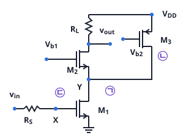
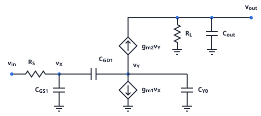
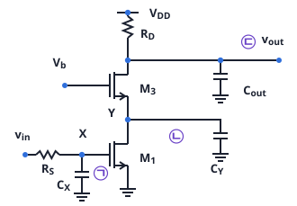
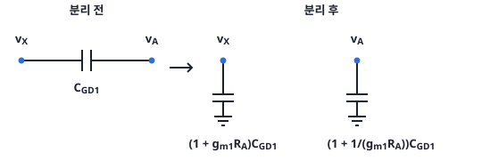
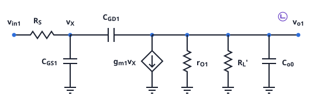
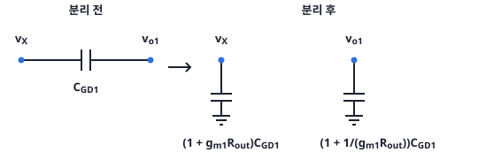
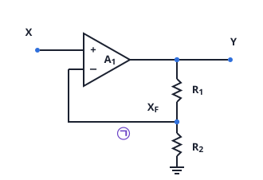

# 전자회로2 복습 1106 문제설명

회로와 첫 식을 짚고 핵심 계산으로 답을 구해요.

문제의 첫 줄부터 검산까지 설명해요.

**목차**

- [문항별 설명](#problems)
  - [P1. 보조 전류원 Q3가 바이어스의 75%를 대는 바이폴라 캐스코드의 극점](#p1)
  - [P2. 중간 노드에 전류원 M3가 붙은 MOS 캐스코드의 X·Y 극점](#p2)
  - [P3. 캐스코드 소자를 쓴 MOS 차동쌍의 극점](#p3)
  - [P4. 밀러 정리로 구하는 능동 가지 캐스코드와 차동 증폭기의 극점](#p4)
  - [P5. 비반전 증폭기의 출력 파형과 귀환 파형 진폭](#p5)
  - [P6. 루프 이득이 클 때 비반전 증폭기 이득이 1+R1/R2로 가는 이유](#p6)
  - [P7. 연산증폭기 귀환 회로 네 개의 루프 이득](#p7)
  - [P8. 연산증폭기 귀환 회로 네 개의 폐루프 이득](#p8)

## 문항별 설명

### P1. 보조 전류원 Q3가 바이어스의 75%를 대는 바이폴라 캐스코드의 극점

P11.49 · 장말문제 11.49 · [원 문제 보기](../%EB%B3%B5%EC%8A%B5%EB%AC%B8%EC%A0%9C_1106_Negative_Feedback-%EB%AC%B8%EC%A0%9C.pdf)

#### 주어진 조건

- 회로: Fig 11.91 — 바이폴라 캐스코드 ($Q_1$ 입력, $Q_2$ 캐스코드, 부하 $R_C$). $Q_3$는 $Q_1$ 컬렉터–$Q_2$ 이미터 노드에 연결된 일정 전류원으로 동작하며 $Q_1$ 바이어스 전류의 75%를 공급
- $V_A = \infty$로 가정
- 밀러 이론을 이용
- 참고 회로 (본문 Fig 11.50(a)): $Q_3$ 같은 보조 전류원이 없는 표준 바이폴라 캐스코드. $V_{in}$이 $R_S$를 거쳐 $Q_1$ 베이스로, $Q_1$ 컬렉터가 $Q_2$ 이미터, $Q_2$ 베이스는 $V_{b1}$, $Q_2$ 컬렉터가 출력이며 부하 $R_L$을 거쳐 $V_{CC}$. 이 구조에서 $A_{v,XY} = -g_{m1}/g_{m2} = -1$

#### 구할 것

- 회로의 극점
- 여기서 밀러 효과가 Fig 11.50(a)의 표준 캐스코드 구조보다 더 중요한지 덜 중요한지

원문 보기

In the cascode of Fig. 11.91, $Q_3$ serves as a constant current source, providing 75% of the bias current of $Q_1$. Assuming $V_A = \infty$ and using Miller's theorem, determine the poles of the circuit. Is Miller's effect more or less significant here than in the standard cascode topology of Fig. 11.50(a)?

*바이어스 전압을 AC 접지로 보낸 캐스코드. 내부 노드의 접지 커패시턴스는 그림에서 $C_{Y0}$로 묶었어요.*

#### 캐스코드 내부 노드의 이득과 밀러 극점

㉠ $Q_1$ 전류의 75%를 $Q_3$가 공급해요. 큰 $\beta$에서 $Q_2$의 컬렉터 전류를 이미터 전류로 근사하면 $g_m$도 전류와 같은 비로 나뉘어요.

$$
I_{C2}\simeq I_{C1}/4
$$

$$
g_{m2}\simeq g_{m1}/4
$$

㉡ $X$에서 생긴 $Q_1$의 전류가 ㉠ $Y$ 전압을 낮춰요. $V_A=\infty$이므로 $Y$의 부하는 $Q_2$ 이미터 쪽의 약 $1/g_{m2}$예요.

$$
A_{XY}=v_Y/v_X\simeq-g_{m1}/g_{m2}\simeq-4
$$

*내부 이득 $A_{XY}\simeq-4$를 적용한 밀러 분리.*

밀러 분리 후 $C_{\mu1}$은 $X$에서 $(1-A_{XY})$배, $Y$에서 $(1-1/A_{XY})$배예요. 바이어스가 고정된 $Q_3$의 컬렉터 기생 성분도 $Y$에 남아요.

$$
C_X=C_{\pi1}+5C_{\mu1}
$$

$$
C_Y=1.25C_{\mu1}+C_{CS1}+C_{\pi2}+C_{\mu3}+C_{CS3}
$$

$$
C_{\mathrm{out}}=C_{\mu2}+C_{CS2}
$$

*입력원을 영으로 둔 뒤, 각 노드의 전체 커패시턴스와 병렬로 남는 저항이에요.*

입력원을 영으로 두면 $X$에서는 $R_B\parallel r_{\pi1}$, 출력에서는 $R_C$를 봐요. 표준 캐스코드의 입력 밀러 성분은 $2C_{\mu1}$이므로 이 회로에서는 $5/2$배로 커져요.

$$
|\omega_{p,X}|\simeq 1/[(R_B\parallel r_{\pi1})C_X]
$$

$$
|\omega_{p,Y}|\simeq g_{m2}/C_Y
$$

$$
|\omega_{p,\mathrm{out}}|\simeq 1/(R_C C_{\mathrm{out}})
$$

**페이지 요약**

같은 입력 전류에서 캐스코드 소자의 전류가 줄면 내부 노드의 전압 변화가 커져요.

입력 밀러 성분은 약 $5C_{\mu1}$이고 표준형은 약 $2C_{\mu1}$예요.

---

### P2. 중간 노드에 전류원 M3가 붙은 MOS 캐스코드의 X·Y 극점

2021-1_기말-Q1 · 기출 1 · [원 문제 보기](../%EB%B3%B5%EC%8A%B5%EB%AC%B8%EC%A0%9C_1106_Negative_Feedback-%EB%AC%B8%EC%A0%9C.pdf)

#### 주어진 조건

- $I_{D1} = 2\ \text{mA}$, $I_{D3} = 1\ \text{mA}$
- $(W/L)_1 = 200/0.2$, $(W/L)_2 = 100/0.2$, $(W/L)_3 = 200/0.2$
- $R_S = 100\ \Omega$, $R_L = 500\ \Omega$
- $\mu_n C_{ox} = 100\ \mu\text{A/V}^2$, $\mu_p C_{ox} = 50\ \mu\text{A/V}^2$
- $\lambda_n = \lambda_p = 0$
- 바이어스 전압 $V_{b1}$, $V_{b2}$와 $V_{DD}$ 값은 주어지지 않음

#### 구할 것

- 노드 X의 극점 주파수와 노드 Y의 극점 주파수를 각각 $M_1$, $M_2$, $M_3$의 커패시턴스로 나타낸 식

원문 보기

다음 증폭기에 대해 주어진 조건을 이용하여, 노드 X와 노드 Y의 pole 주파수를 $M_1$, $M_2$, $M_3$의 capacitance들에 관한 식으로 각각 구하시오.

: $I_{D1} = 2\ \text{mA}$, $I_{D3} = 1\ \text{mA}$, $(W/L)_1 = 200/0.2$, $(W/L)_2 = 100/0.2$, $(W/L)_3 = 200/0.2$, $R_S = 100\ \Omega$, $R_L = 500\ \Omega$, $\mu_n C_{ox} = 100\ \mu\text{A/V}^2$, $\mu_p C_{ox} = 50\ \mu\text{A/V}^2$, $\lambda_n = \lambda_p = 0$.

*공통 게이트 소자 $M_2$와 전류원 $M_3$가 입력 소자 $M_1$의 전류를 나눠 공급해요.*

#### 바이어스에서 두 노드의 극점까지

㉠ $Y$에서 전류를 나누면 $I_{D2}=I_{D1}-I_{D3}=1\,\mathrm{mA}$예요. 장채널 포화식에 각 소자의 폭과 전류를 넣어요.

$$
g_{m1}=\sqrt{2\mu_n C_{ox}(W/L)_1 I_{D1}}=20\,\mathrm{mS}
$$

$$
g_{m2}=\sqrt{2\mu_n C_{ox}(W/L)_2 I_{D2}}=10\,\mathrm{mS}
$$

㉡ $M_3$는 게이트와 소스의 교류 전압이 고정되고 $\lambda=0$이므로 $Y$에 저주파 전류를 보태지 않아요. 몸체 효과를 무시하면 $Y$의 부하는 $1/g_{m2}$예요.

$$
A_{XY}=v_Y/v_X=-g_{m1}/g_{m2}=-2
$$

*내부 이득 $A_{XY}=-2$를 적용한 밀러 분리.*

㉢ $X$와 $Y$ 사이의 $C_{GD1}$에 밀러 정리를 적용해요. ㉡ $M_3$의 드레인에 붙은 $C_{GD3}$·$C_{DB3}$는 $Y$에서 접지로 이어져요.

$$
C_X=C_{GS1}+3C_{GD1}
$$

$$
C_Y=C_{DB1}+C_{GS2}+C_{SB2}+1.5C_{GD1}+C_{GD3}+C_{DB3}
$$

*입력원과 바이어스 전압을 영으로 둔 두 노드의 RC 경로예요.*

입력원을 영으로 두면 $R_X=R_S=100\,\Omega$이고 $R_Y=1/g_{m2}=100\,\Omega$예요. 노드별 극점의 크기는 rad/s 단위예요.

$$
|\omega_{p,X}|\simeq 1/(100\,\Omega\, C_X)
$$

$$
|\omega_{p,Y}|\simeq 1/(100\,\Omega\, C_Y)
$$

**페이지 요약**

내부 이득 $v_Y/v_X=-2$를 $C_{GD1}$의 양단에 적용해요.

입력에는 $3C_{GD1}$, 내부 노드에는 $1.5C_{GD1}$와 $M_3$의 드레인 기생 성분이 들어가요.

---

### P3. 캐스코드 소자를 쓴 MOS 차동쌍의 극점

E11.27 · 예제 11.27 · [원 문제 보기](../%EB%B3%B5%EC%8A%B5%EB%AC%B8%EC%A0%9C_1106_Negative_Feedback-%EB%AC%B8%EC%A0%9C.pdf)

#### 주어진 조건

- 밀러 효과를 낮추기 위해 캐스코드 소자 사용
- 소자 값은 주어지지 않음 (답은 기호로)

#### 구할 것

- 회로의 극점 어림 계산

원문 보기

차동쌍이 밀러 효과를 낮추기 위해서 캐스코드 소자를 사용한다[그림 11.56(a)]. 이 회로의 극점을 어림잡아 계산하라.

*순수 차동 입력에서 꼬리 노드를 AC 접지로 둔 반회로예요.*

#### 차동 반회로와 세 극점

대칭 회로에 반대 부호의 입력을 주면 꼬리 전압 변화가 상쇄돼요. ㉠ $M_1$ 게이트에서 ㉡ $M_3$ 소스까지는 공통 소스 단이 $1/g_{m3}$를 구동해요. 여기서는 $r_o$와 몸체 효과를 무시해요.

$$
A_{XY}=v_Y/v_X=-g_{m1}/g_{m3}
$$

*차동 반회로의 $A_{XY}=-g_{m1}/g_{m3}$로 분리한 밀러 성분이에요.*

㉠·㉡ 사이의 $C_{GD1}$에 밀러 정리를 적용해요. ㉢ 출력에서는 $M_3$의 게이트와 몸체가 모두 AC 접지예요.

$$
C_X=C_{GS1}+(1-A_{XY})C_{GD1}
$$

$$
C_Y=C_{DB1}+C_{GS3}+C_{SB3}+(1-1/A_{XY})C_{GD1}
$$

$$
C_{\mathrm{out}}=C_{DB3}+C_{GD3}
$$

*꼬리 가상 접지를 유지하고 입력원을 영으로 둔 반회로의 세 RC 경로예요.*

반회로의 입력원을 영으로 두면 각 커패시턴스에서 보이는 저항은 차례로 $R_S$, $1/g_{m3}$, $R_D$예요. 따라서 차동 응답의 극점 크기(rad/s)는 다음과 같아요.

$$
|\omega_{p,X}|\simeq 1/(R_S C_X)
$$

$$
|\omega_{p,Y}|\simeq g_{m3}/C_Y
$$

$$
|\omega_{p,\mathrm{out}}|\simeq 1/(R_D C_{\mathrm{out}})
$$

**페이지 요약**

꼬리 노드가 가상 접지이므로 차동 반회로 한쪽에서만 극점을 구해요.

밀러 분리 뒤 $X$, $Y$, 출력의 저항은 각각 $R_S$, $1/g_{m3}$, $R_D$예요.

---

### P4. 밀러 정리로 구하는 능동 가지 캐스코드와 차동 증폭기의 극점

2023-1_기말-Q1 · 기출 1 · [원 문제 보기](../%EB%B3%B5%EC%8A%B5%EB%AC%B8%EC%A0%9C_1106_Negative_Feedback-%EB%AC%B8%EC%A0%9C.pdf)

#### 주어진 조건

- Miller's theorem을 사용해 답함
- (1) 전용 (회로 (a)): $\lambda = 0$으로 가정
- (2) 전용 (회로 (b), 차동 증폭기): $\lambda \neq 0$으로 가정
- 소자 값과 커패시턴스 값은 주어지지 않음 (답은 기호로)
- (2)의 전달함수는 $V_{out}/V_{in}(s)$로 인쇄돼 있으나, 그림 (b)에는 $V_{in}$이 없고 입력이 $V_{in1}$, $V_{in2}$로 인쇄돼 있음

#### 구할 것

- (1) 회로 (a)의 pole 주파수들을 각각 구함
- (2) 차동 증폭기 회로 (b)의 pole 주파수들과 전달함수 $V_{out}/V_{in}(s)$를 각각 구함

원문 보기

다음 증폭기에서 Miller's theorem을 사용하여 질문에 답하시오.

(1) 회로 (a)의 pole 주파수들을 각각 구하시오. 단, $\lambda = 0$으로 가정한다.

(2) 차동 증폭기 회로 (b)의 pole 주파수들과 전달함수($V_{out}/V_{in}(s)$)를 각각 구하시오. 단, $\lambda \neq 0$으로 가정한다.

*(1) 회로 (a)의 소신호 회로. $C_{A0}$는 밀러 성분을 더하기 전 내부 노드의 접지 커패시턴스예요.*

#### (1) 두 공통 게이트 소스의 병렬 부하

㉠ $A$에서 보면 $M_2$와 $M_3$의 소스가 모두 AC 접지 쪽의 경로를 만들어요. $\lambda=0$이고 몸체 효과를 무시하면 두 입력 저항은 병렬이에요.

$$
R_A=(1/g_{m2})\parallel(1/g_{m3})=1/(g_{m2}+g_{m3})
$$

$$
A_{XA}=v_A/v_X=-g_{m1}R_A
$$

*(1) $A_{XA}=-g_{m1}R_A$이므로 내부 노드 쪽에는 역수 배율이 들어가요.*

$C_{GD1}$만 $X$와 $A$를 가로질러요. 출력의 다이오드 접속 $M_4$에서는 게이트와 드레인이 같아 $C_{GD4}$가 빠져요.

$$
C_{in}=C_{GS1}+(1-A_{XA})C_{GD1}
$$

$$
C_A=C_{DB1}+C_{GS2}+C_{SB2}+C_{GS3}+C_{SB3}+(1-1/A_{XA})C_{GD1}
$$

$$
C_{out}=C_{GD2}+C_{DB2}+C_{GS4}+C_{DB4}
$$

*(1) 각 노드의 RC 경로. 가운데 저항은 $R_A=1/(g_{m2}+g_{m3})$예요.*

입력원을 영으로 두면 세 노드가 보는 저항은 $R_G$, $R_A$, $1/g_{m4}$예요. 밀러 근사의 극점 크기(rad/s)를 써요.

$$
|\omega_{p,in}|\simeq1/(R_G C_{in})
$$

$$
|\omega_{p,A}|\simeq1/(R_A C_A)
$$

$$
|\omega_{p,out}|\simeq g_{m4}/C_{out}
$$

*(2) 회로 (b)의 차동 반회로. 출력의 부하 가지에 $M_3$와 $M_5$의 저항이 들어가요.*

#### (2) 유한 출력저항을 보존한 차동 반회로

㉡ 순수 차동 입력에서 꼬리 전압은 고정돼요. $M_3$의 게이트와 드레인은 AC 접지이고, $M_5$의 게이트와 소스도 AC 접지예요. 따라서 $M_3$ 소스 저항, $r_{O5}$, $r_{O1}$이 반회로 출력에 병렬로 걸려요.

$$
R_{out}=(1/g_{m3})\parallel r_{O3}\parallel r_{O5}\parallel r_{O1}
$$

$$
A_v=v_{o1}/v_{in1}=-g_{m1}R_{out}
$$

*(2) 유한한 반회로 출력저항을 포함한 $A_v=-g_{m1}R_{out}$으로 밀러 분리해요.*

양쪽 반회로에서 입력과 출력이 각각 반대 부호이므로 $V_{out}/V_{in}=v_{o1}/v_{in1}$예요. $C_{GD1}$을 이득 $A_v$로 나눠요.

$$
C_{in}=C_{GS1}+(1-A_v)C_{GD1}
$$

$$
C_{out}=C_{DB1}+(1-1/A_v)C_{GD1}+C_{GD5}+C_{DB5}+C_{GS3}+C_{SB3}
$$

*(2) 차동 반회로에서 입력원을 영으로 둘 때의 두 RC 경로예요.*

두 극점의 크기와 차동 전달함수는 밀러 근사에서 다음과 같아요.

$$
|\omega_{p,in}|\simeq1/(R_S C_{in})
$$

$$
|\omega_{p,out}|\simeq1/(R_{out} C_{out})
$$

$$
\frac{V_{out}}{V_{in}}(s)\simeq\frac{A_v}{(1+sR_S C_{in})(1+sR_{out}C_{out})}
$$

**페이지 요약**

밀러 정리에 넣는 이득은 $C_{GD1}$의 두 단자 사이에서 구해요.

(1)은 $M_2$와 $M_3$의 소스가 같은 노드에 연결돼요.

(2)는 차동 반회로의 출력에 유한한 $r_{O1}$, $r_{O3}$, $r_{O5}$가 남아요.

---

### P5. 비반전 증폭기의 출력 파형과 귀환 파형 진폭

P12.06 · 장말문제 12.6 · [원 문제 보기](../%EB%B3%B5%EC%8A%B5%EB%AC%B8%EC%A0%9C_1106_Negative_Feedback-%EB%AC%B8%EC%A0%9C.pdf)

#### 주어진 조건

- 입력 $X$: 피크 진폭 $2\ \text{mV}$인 사인파
- $A_1 = 500$
- $R_1/R_2 = 7$
- 귀환율 (본문 예제 12.1): $K = \dfrac{R_2}{R_1 + R_2}$
- 식 (12.3): $\dfrac{Y}{X} = \dfrac{A_1}{1 + \dfrac{R_2}{R_1 + R_2} A_1}$
- 귀환 파형은 $R_1$, $R_2$ 접속점의 신호 $X_F$로 봄
- 식 (12.4): $E = X - X_F = \dfrac{X}{1 + KA_1}$

#### 구할 것

- 출력 파형의 진폭
- 귀환 파형의 진폭

원문 보기

In the circuit of Fig. 12.3, the input is a sinusoid with a peak amplitude of 2 mV. If $A_1 = 500$ and $R_1/R_2 = 7$, determine the amplitude of the output waveform and the feedback waveform.

*출력 $Y$를 분배한 전압이 반전 입력으로 돌아가는 비반전 증폭기예요.*

#### 출력과 분배점의 피크 진폭

㉠ 반전 입력이 전류를 끌지 않으므로 $R_2$ 양단의 귀환 전압은 출력 진폭의 $K$배예요.

$$
K=R_2/(R_1+R_2)=1/8
$$

증폭기는 입력과 분배점 전압의 차를 증폭해요.

$$
Y=A_1(X-KY)
$$

$$
G=Y/X=A_1/(1+KA_1)=1000/127
$$

입력 피크 진폭 $2\,\mathrm{mV}$에 이득을 곱하고, 분배점에는 $K$를 한 번 더 곱해요.

$$
Y_{\mathrm{pk}}=G X_{\mathrm{pk}}=(2000/127)\,\mathrm{mV}\approx15.75\,\mathrm{mV}
$$

$$
X_{F,\mathrm{pk}}=K Y_{\mathrm{pk}}=(250/127)\,\mathrm{mV}\approx1.97\,\mathrm{mV}
$$

**페이지 요약**

출력 진폭에는 폐루프 이득을, 귀환 진폭에는 출력에서 본 분배비를 적용해요.

$X_{F,\mathrm{pk}}$가 입력 피크 진폭보다 조금 작은 것은 두 입력 사이에 유한한 오차가 남기 때문이에요.

---

### P6. 루프 이득이 클 때 비반전 증폭기 이득이 1+R1/R2로 가는 이유

E12.02 · 예제 12.2 · [원 문제 보기](../%EB%B3%B5%EC%8A%B5%EB%AC%B8%EC%A0%9C_1106_Negative_Feedback-%EB%AC%B8%EC%A0%9C.pdf)

#### 주어진 조건

- $[R_2/(R_1 + R_2)]A_1 \gg 1$로 커지는 경우
- 예제 12.1의 결과: 귀환율 $K = X_F/Y = R_2/(R_1 + R_2)$
- 식 (12.4): 오차 $E = X - X_F = \dfrac{X}{1 + KA_1}$

#### 구할 것

- $[R_2/(R_1 + R_2)]A_1 \gg 1$일 때 $Y/X \to 1 + R_1/R_2$가 되는 이유 설명

원문 보기

그림 12.2의 회로에서 $[R_2/(R_1+R_2)]A_1$이 1보다 훨씬 크게 됨에 따라 왜 $Y/X$가 $1+R_1/R_2$로 접근하는지 설명하라.

*출력 $Y$를 분배한 전압이 반전 입력으로 돌아가는 비반전 증폭기예요.*

#### 오차 전압에서 저항비 이득까지

㉠ 분배점 전압 $X_F=KY$가 반전 입력으로 돌아와요. $E=X-X_F$와 $Y=A_1E$를 합치면 오차의 상대 크기가 정해져요.

$$
E/X=1/(1+KA_1)
$$

$KA_1\gg1$이면 $E/X$가 작아져 분배점 전압이 입력을 따라가요. $KY\simeq X$를 출력에 대해 풀면 이득이 저항비로 정해져요.

$$
Y/X\simeq 1/K=1+R_1/R_2
$$

**페이지 요약**

루프 이득이 커질수록 두 입력의 차가 작아져요.

출력이 분배점 전압을 입력에 맞추므로 이득은 분배비의 역수에 가까워져요.

---

### P7. 연산증폭기 귀환 회로 네 개의 루프 이득

P12.04 · 장말문제 12.4 · [원 문제 보기](../%EB%B3%B5%EC%8A%B5%EB%AC%B8%EC%A0%9C_1106_Negative_Feedback-%EB%AC%B8%EC%A0%9C.pdf)

#### 주어진 조건

- 연산증폭기의 개루프 이득은 $A_1$이고, 그 밖에는 이상적
- $\lambda = 0$
- 소자 값은 주어지지 않음. 답은 $A_1$, $K$, $R_1$, $R_2$, $R_D$, $g_m$ 등 기호로 나타냄

#### 구할 것

- (a)–(d) 각 회로의 루프 이득

원문 보기

Calculate the loop gain of the circuits illustrated in Fig. 12.80. Assume the op amp exhibits an open-loop gain of $A_1$, but is otherwise ideal. Also, $\lambda = 0$.

*(a)의 개루프 시험 회로. $M$에 넣은 신호가 분배기와 귀환망을 지나 $N$으로 돌아와요.*

#### 시험 신호가 한 바퀴 도는 경로

외부 입력 $X=0$에서 $A_1$ 출력과 다음 단 사이를 끊어요. ㉠ 다음 단의 입력 $M$에 $V_{test}$를 넣고 ㉡ 열린 증폭기 출력 $N$에서 귀환 전압을 읽어요. 이상적 연산증폭기의 출력 저항은 0이어서 끊기 전의 구동 조건을 유지해요.

$$
T=-V_N/V_{test}
$$

(a)·(b)의 분배점은 전류를 끌지 않아요. (b)·(c)는 $M_3$ 공통 소스 단에서 반전되고, (d)는 $M_1$ 소스 팔로워를 거쳐 반전 입력으로 돌아와요. $\lambda=0$이고 몸체 효과를 무시해요.

$$
D=R_2/(R_1+R_2)
$$

$$
v_{d3}/v_{g3}=-g_mR_D
$$

$$
F=v_{s1}/v_{g1}=R_2/(1/g_m+R_2)
$$

각 줄은 시험점에서 출발하는 순서예요. 앞의 마이너스는 루프 이득의 정의, $\pm A_1$의 부호는 어느 입력으로 돌아오는지를 나타내요.

$$
T_a=-D\,K\,(-A_1)=DKA_1
$$

$$
T_b=-D\,(-g_mR_D)\,A_1=Dg_mR_DA_1
$$

$$
T_c=-(-g_mR_D)\,A_1=g_mR_DA_1
$$

$$
T_d=-F\,(-A_1)=FA_1
$$

**페이지 요약**

입력을 영으로 둔 뒤 시험점에서 귀환 전압까지 각 단의 부호 있는 이득을 곱해요.

(b)·(c)는 공통 소스 단에서, (a)·(d)는 연산증폭기의 반전 입력에서 부호가 바뀌어요.

---

### P8. 연산증폭기 귀환 회로 네 개의 폐루프 이득

P12.05 · 장말문제 12.5 · [원 문제 보기](../%EB%B3%B5%EC%8A%B5%EB%AC%B8%EC%A0%9C_1106_Negative_Feedback-%EB%AC%B8%EC%A0%9C.pdf)

#### 주어진 조건

- 문제 12.4의 결과(각 회로의 루프 이득)를 이용
- 문제 12.4에서 이어받는 가정: 연산증폭기의 개루프 이득은 $A_1$이고 그 밖에는 이상적, $\lambda = 0$
- 소자 값은 주어지지 않음. 답은 $A_1$, $K$, $R_1$, $R_2$, $R_D$, $g_m$ 등 기호로 나타냄
- 폐루프 이득은 입력 $X$에서 출력 $Y$까지의 이득 $Y/X$로 봄

#### 구할 것

- (a)–(d) 각 회로의 폐루프 이득

원문 보기

Using the results obtained in Problem 12.4, compute the closed-loop gain of the circuits shown in Fig. 12.80.

*(d)의 폐루프 회로. 소스 팔로워 출력이 $Y$이며 같은 전압이 반전 입력으로 돌아와요.*

#### 루프 이득과 순방향 분자 구분

12.4에서 얻은 $T$는 분모를 정해요. 분자는 귀환을 끊었을 때 외부 입력 $X$에서 원래 출력 $Y$까지의 이득이에요.

$$
G=Y/X=A_{\mathrm{fwd}}/(1+T)
$$

$$
D=R_2/(R_1+R_2)
$$

$$
F=g_mR_2/(1+g_mR_2)
$$

(a)에서는 $X$가 비반전 입력, (b)·(c)에서는 반전 입력이에요. ㉠ (d)의 출력은 $M_1$ 소스이므로 연산증폭기 뒤의 팔로워까지 순방향 곱에 넣어요.

$$
A_{\mathrm{fwd},d}=(v_{g1}/X)(Y/v_{g1})=A_1F
$$

$\lambda=0$이고 몸체 효과를 무시할 때, 각 회로의 폐루프 이득은 다음과 같아요.

$$
G_a=A_1/(1+KA_1D)
$$

$$
G_b=-A_1/(1+g_mR_DA_1D)
$$

$$
G_c=-A_1/(1+g_mR_DA_1)
$$

$$
G_d=A_1F/(1+A_1F)
$$

**페이지 요약**

같은 루프 이득이 분모에 있어도 순방향 경로에 따라 분자가 달라져요.

(d)는 팔로워가 순방향 경로에 있고 출력 전압이 그대로 귀환하므로 큰 루프 이득에서 폐루프 이득은 1에 가까워져요.

---

원 문제·정리노트·PDF는 보존해요.
