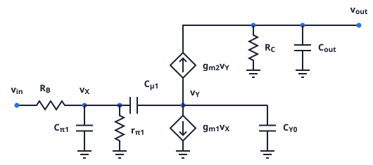
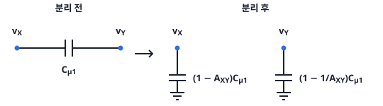
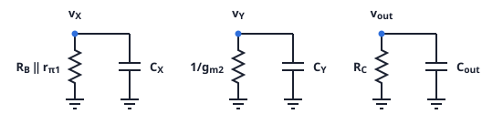
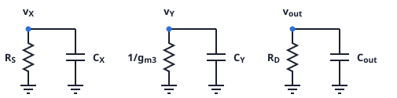
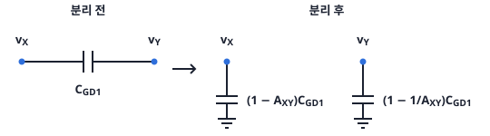
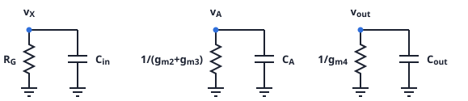
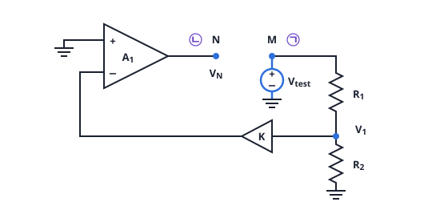
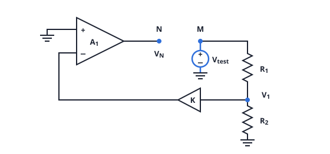

# 전자회로2 복습 1106 문제설명

주어진 조건을 읽고, 첫 줄을 쓰고, 이유를 따라가며 답을 확인해요.

문제의 첫 줄부터 검산까지 설명해요.

**목차**

- [문항별 설명](#problems)
  - [P1. 보조 전류원 Q3가 바이어스의 75%를 대는 바이폴라 캐스코드의 극점](#p1)
  - [P2. 중간 노드에 전류원 M3가 붙은 MOS 캐스코드의 X·Y 극점](#p2)
  - [P3. 캐스코드 소자를 쓴 MOS 차동쌍의 극점](#p3)
  - [P4. 밀러 정리로 구하는 능동 가지 캐스코드와 차동 증폭기의 극점](#p4)
  - [P5. 비반전 증폭기의 출력 파형과 귀환 파형 진폭](#p5)
  - [P6. 루프 이득이 클 때 비반전 증폭기 이득이 1+R1/R2로 가는 이유](#p6)
  - [P7. 연산증폭기 귀환 회로 네 개의 루프 이득](#p7)
  - [P8. 연산증폭기 귀환 회로 네 개의 폐루프 이득](#p8)

## 문항별 설명

### P1. 보조 전류원 Q3가 바이어스의 75%를 대는 바이폴라 캐스코드의 극점

P11.49 · 장말문제 11.49 · [원 문제 보기](../%EB%B3%B5%EC%8A%B5%EB%AC%B8%EC%A0%9C_1106_Negative_Feedback-%EB%AC%B8%EC%A0%9C.pdf)

#### 주어진 조건

- 회로: Fig 11.91 — 바이폴라 캐스코드 ($Q_1$ 입력, $Q_2$ 캐스코드, 부하 $R_C$). $Q_3$는 $Q_1$ 컬렉터–$Q_2$ 이미터 노드에 연결된 일정 전류원으로 동작하며 $Q_1$ 바이어스 전류의 75%를 공급
- $V_A = \infty$로 가정
- 밀러 이론을 이용
- 참고 회로 (본문 Fig 11.50(a)): $Q_3$ 같은 보조 전류원이 없는 표준 바이폴라 캐스코드. $V_{in}$이 $R_S$를 거쳐 $Q_1$ 베이스로, $Q_1$ 컬렉터가 $Q_2$ 이미터, $Q_2$ 베이스는 $V_{b1}$, $Q_2$ 컬렉터가 출력이며 부하 $R_L$을 거쳐 $V_{CC}$. 이 구조에서 $A_{v,XY} = -g_{m1}/g_{m2} = -1$

#### 구할 것

- 회로의 극점
- 여기서 밀러 효과가 Fig 11.50(a)의 표준 캐스코드 구조보다 더 중요한지 덜 중요한지

원문 보기

In the cascode of Fig. 11.91, $Q_3$ serves as a constant current source, providing 75% of the bias current of $Q_1$. Assuming $V_A = \infty$ and using Miller's theorem, determine the poles of the circuit. Is Miller's effect more or less significant here than in the standard cascode topology of Fig. 11.50(a)?

#### 문제를 읽어요

입력 $V_{in}$은 $R_B$를 지나 $Q_1$ 베이스로 들어가요. 그림에는 노드 이름이 없어서, 이 해설에서는 $Q_1$ 베이스를 $X$, $Q_1$ 컬렉터와 $Q_2$ 이미터가 만나는 점을 $Y$라고 불러요. 출력은 $Q_2$ 컬렉터와 $R_C$가 만나는 $V_{out}$이에요.

pnp $Q_3$는 컬렉터가 $Y$에 붙은 일정 전류원이에요. $Q_1$이 흘리는 바이어스 전류 중 75%를 $Q_3$가 대므로 $Q_2$에는 나머지만 흘러요. $V_A=\infty$라서 모든 트랜지스터의 $r_o$는 무한대예요.

구할 것은 두 가지예요. 밀러 정리로 $X$, $Y$, 출력 세 노드의 극점을 구하고, 밀러 효과가 $Q_3$가 없는 표준 캐스코드(Fig. 11.50(a))보다 큰지 작은지 판단해요.

#### 이 개념과 공식을 떠올려요

"using Miller's theorem"과 "$X$–$Y$ 사이에 걸린 $C_{\mu1}$"이 단서예요. $C_{\mu1}$은 $Q_1$의 베이스–컬렉터 커패시턴스라서 두 신호 노드 사이에 떠 있는 플로팅 커패시터(floating capacitor)예요. 밀러 정리(Miller's theorem)는 이 커패시터를 각 노드에서 접지로 가는 두 커패시터로 바꿔 줘요.

$$
C_{X,M}=(1-A_{XY})C_{\mu1}
$$

$$
C_{Y,M}=\left(1-\frac{1}{A_{XY}}\right)C_{\mu1}
$$

여기서 $A_{XY}=v_Y/v_X$는 입력→출력 이득이 아니라 $C_{\mu1}$ 양 끝 노드 사이의 저주파 이득이에요. 저주파 값으로 고정하는 것이 밀러 근사(Miller approximation)이고, 그 덕분에 노드마다 병렬 $RC$ 하나로 극점(pole)을 어림할 수 있어요([CS 단의 밀러 효과](../../1028/%EC%A0%95%EB%A6%AC%EB%85%B8%ED%8A%B8_1028_CS_Stage_Frequency_Response.html#s2-cs-miller)).

기호를 정리해요. $g_m=I_C/V_T$는 트랜스컨덕턴스, $r_{\pi1}=\beta/g_{m1}$은 $Q_1$ 베이스에서 이미터 쪽을 본 저항, $C_{\pi}$·$C_{\mu}$·$C_{CS}$는 베이스–이미터·베이스–컬렉터·컬렉터–기판 커패시턴스예요.

근사 조건은 $V_A=\infty$(모든 $r_o\to\infty$)와 큰 β예요. 큰 β에서는 베이스 전류를 무시해 $I_{E2}\approx I_{C2}$이고, $Q_2$ 이미터를 바라본 저항이 $1/g_{m2}$예요. 핵심은 $g_m$이 컬렉터 전류에 비례하므로 $Q_3$가 $Q_2$ 전류를 줄이면 $Y$ 저항이 커지고 $A_{XY}$가 커진다는 점이에요([바이폴라 캐스코드의 세 극점](../%EC%A0%95%EB%A6%AC%EB%85%B8%ED%8A%B8_1106_Negative_Feedback.html#s0-bjt-poles), [전류원 M3를 단 캐스코드](../%EC%A0%95%EB%A6%AC%EB%85%B8%ED%8A%B8_1106_Negative_Feedback.html#s0-m3-cascode)).

#### 종이에 쓸 첫 줄

노드 $Y$에서 DC KCL을 써요. $Q_1$이 $Y$에서 끌어내리는 전류는 $Q_2$와 $Q_3$가 나눠서 대요.

$$
I_{C1}=I_{C2}+I_{C3}
$$

$Q_3$가 75%를 대므로 $I_{C1}:I_{C3}:I_{C2}=4:3:1$이에요.

$$
I_{C2}=I_{C1}-0.75I_{C1}=\frac{I_{C1}}{4}
$$

$g_m=I_C/V_T$이고 $V_T$는 공통이라 $g_m$도 같은 비율로 줄어요.

$$
g_{m2}=\frac{g_{m1}}{4}
$$

밀러 배율에 넣을 $A_{XY}$를 $G_m$과 $R_{out}$으로 나눠 구해요. 입력은 $v_X$, 출력은 $v_Y$이고 커패시터는 저주파에서 열어요. $Y$를 접지에 단락하면 $Q_2$ 베이스–이미터 전압이 0이라 $Q_1$의 제어 전류가 모두 단락선으로 가요.

$Y$를 접지로 단락해 $v_Y=0$으로 두고, 접지에서 단락선을 지나 $Y$로 들어가는 전류를 $i_{Y,\mathrm{sc}}$의 양의 방향으로 둬요. $Q_1$이 $Y$에서 끌어내리는 $g_{m1}v_X$를 단락선이 그대로 대 주므로 $i_{Y,\mathrm{sc}}=g_{m1}v_X$예요.

$$
G_{m,XY}=\frac{i_{Y,\mathrm{sc}}}{v_X}=g_{m1}
$$

$v_X=0$으로 두고 $Y$에서 바라보면 아래 $Q_1$ 컬렉터와 왼쪽 $Q_3$ 컬렉터는 $V_A=\infty$라 개방이에요. 남는 것은 위쪽 $Q_2$ 이미터의 $1/g_{m2}$뿐이에요.

$$
R_Y\approx\frac{1}{g_{m2}}=\frac{4}{g_{m1}}
$$

$$
A_{XY}=-G_{m,XY}R_Y\approx-g_{m1}\cdot\frac{4}{g_{m1}}=-4
$$

#### 이렇게 풀어요

먼저 고주파 소신호 모델에서 커패시터가 어느 노드 사이에 있는지 확인해요. $Q_2$와 $Q_3$의 베이스가 AC 접지라서 $C_{\pi2}$, $C_{\mu3}$는 $Y$–접지, $C_{\mu2}$는 출력–접지 커패시터예요. $Q_3$의 $C_{\pi3}$는 베이스와 이미터가 둘 다 AC 접지라 양단 전압이 0이어서 빠져요. 떠 있는 것은 $X$와 $Y$ 사이의 $C_{\mu1}$ 하나예요.

*$V_{CC}$, $V_{b1}$, $V_{b2}$를 AC 접지로 보내고 $Q_1$은 $r_{\pi1}$·$C_{\pi1}$·제어 전류원, $Q_2$는 제어 전류원으로 바꿨어요($V_A=\infty$라 모든 $r_o$와 $Q_3$의 소신호 가지는 개방, 큰 β에서 $r_{\pi2}\gg1/g_{m2}$라 생략). $C_{Y0}=C_{CS1}+C_{\pi2}+C_{\mu3}+C_{CS3}$, $C_{\mathrm{out}}=C_{\mu2}+C_{CS2}$예요.*

$C_{\mu1}$의 각 단자에서 커패시터로 들어가는 전류를 양으로 잡고 $A_{XY}$로 반대쪽 전압을 바꿔요.

$$
i_{X,C}=sC_{\mu1}(v_X-v_Y)\approx sv_XC_{\mu1}(1-A_{XY})
$$

$$
i_{Y,C}=sC_{\mu1}(v_Y-v_X)\approx sv_YC_{\mu1}\left(1-\frac{1}{A_{XY}}\right)
$$

*$A_{XY}=v_Y/v_X=-4$를 넣으면 $X$ 쪽은 $(1-A_{XY})C_{\mu1}=5C_{\mu1}$, $Y$ 쪽은 $(1-1/A_{XY})C_{\mu1}=1.25\,C_{\mu1}$이고 두 가지 모두 접지로 이어져요.*

$A_{XY}=-4$를 넣어 밀러 커패시턴스를 구해요.

$$
C_{X,M}=(1+4)C_{\mu1}=5C_{\mu1}
$$

$$
C_{Y,M}=\left(1+\frac{1}{4}\right)C_{\mu1}=1.25\,C_{\mu1}
$$

노드마다 접지 커패시턴스를 모아요. $X$에는 $C_{\pi1}$, $Y$에는 $Q_1$의 $C_{CS1}$·$Q_2$의 $C_{\pi2}$·$Q_3$의 $C_{\mu3}$·$C_{CS3}$, 출력에는 $C_{\mu2}$·$C_{CS2}$가 더해져요.

$$
C_X=C_{\pi1}+5C_{\mu1}
$$

$$
C_Y=1.25\,C_{\mu1}+C_{CS1}+C_{\pi2}+C_{\mu3}+C_{CS3}
$$

$$
C_{\mathrm{out}}=C_{\mu2}+C_{CS2}
$$

입력원을 0으로 두면 $X$에서는 왼쪽 $R_B$와 오른쪽 $r_{\pi1}$이 모두 접지로 이어져 병렬이에요. $Y$는 앞에서 구한 $1/g_{m2}$예요. 출력에서 아래로 $Q_2$ 컬렉터를 보면 $V_A=\infty$라 무한대이므로 $R_C$만 남아요.

*밀러 분리 뒤 입력을 0으로 둔 각 노드의 자연응답 회로예요. 각 노드는 $1+sRC=0$에서 극점 하나를 줘요.*

$$
|\omega_{p,X}|=\frac{1}{(R_B\parallel r_{\pi1})(C_{\pi1}+5C_{\mu1})}
$$

$$
|\omega_{p,Y}|=\frac{g_{m2}}{C_Y}=\frac{g_{m1}/4}{1.25\,C_{\mu1}+C_{CS1}+C_{\pi2}+C_{\mu3}+C_{CS3}}
$$

$$
|\omega_{p,\mathrm{out}}|=\frac{1}{R_C(C_{\mu2}+C_{CS2})}
$$

표준 캐스코드(Fig. 11.50(a))는 $Q_1$, $Q_2$에 같은 전류가 흘러 $g_{m1}=g_{m2}$예요. 그래서 $A_{XY}=-1$이고 $X$ 쪽 밀러 커패시턴스는 $2C_{\mu1}$이에요.

$$
\frac{C_{X,M}(\text{여기})}{C_{X,M}(\text{표준})}=\frac{5C_{\mu1}}{2C_{\mu1}}=2.5
$$

$Q_3$가 $Q_2$ 전류를 1/4로 줄여 $Y$ 저항이 4배가 되므로 $|A_{XY}|$도 4배가 돼요. 그래서 밀러 효과는 표준 캐스코드보다 더 커요.

#### 완성 답과 검산

$V_A=\infty$, 큰 β, 저주파 이득 $A_{XY}=-4$로 밀러 근사를 적용한 세 극점(크기, rad/s)이에요.

$$
|\omega_{p,X}|=\frac{1}{(R_B\parallel r_{\pi1})(C_{\pi1}+5C_{\mu1})}
$$

$$
|\omega_{p,Y}|=\frac{g_{m1}/4}{1.25\,C_{\mu1}+C_{CS1}+C_{\pi2}+C_{\mu3}+C_{CS3}}
$$

$$
|\omega_{p,\mathrm{out}}|=\frac{1}{R_C(C_{\mu2}+C_{CS2})}
$$

**밀러 효과는 표준 캐스코드보다 더 커요.** $C_{\mu1}$이 입력에서 $2C_{\mu1}$ 대신 $5C_{\mu1}$로 보여요.

단위: $RC$는 초(s)이고 $g_m/C$도 S/F=1/s라서 세 식 모두 rad/s예요.

특수값: $Q_3$가 대는 비율을 $k$라 하면 $g_{m2}=(1-k)g_{m1}$이고 $A_{XY}=-1/(1-k)$예요. $k=0$이면 $A_{XY}=-1$로 표준 캐스코드의 $2C_{\mu1}$이 다시 나오고, $k=0.75$이면 $-4$로 위 결과와 같아요.

계수 확인: $X$ 쪽 $1+4=5$, $Y$ 쪽 $1+1/4=1.25$예요. 두 계수의 곱 $5\times1.25$와 합 $5+1.25$가 같은 6.25인 것도 $(1-A)(1-1/A)=2-A-1/A$ 관계와 맞아요.

#### 주의할 점

밀러 배율에 입력→출력 전체 이득을 넣으면 안 돼요. $C_{\mu1}$의 양 끝은 $X$와 $Y$이므로 $A_{XY}=-g_{m1}/g_{m2}$를 써요.

$Q_3$가 소신호 저항을 더한다고 생각하기 쉬워요. $V_A=\infty$라 $Q_3$의 소신호 가지는 개방이고, $Q_3$가 바꾸는 것은 $g_{m2}$(바이어스)와 $Y$의 커패시턴스($C_{\mu3}$, $C_{CS3}$)예요.

MOS와 달리 바이폴라 입력은 $r_{\pi1}$이 유한해요. $X$의 저항은 $R_B$만이 아니라 $R_B\parallel r_{\pi1}$이에요.

#### 조건을 바꾸어 생각해요

1. $Q_3$가 $Q_1$ 바이어스 전류의 50%만 댄다면 $A_{XY}$와 $X$ 쪽 밀러 커패시턴스는 각각 얼마인가요?
2. $Q_3$의 얼리 전압이 유한해 $r_{o3}$가 $Y$와 AC 접지 사이에 생긴다면 $Y$의 저항은 어떻게 바뀌고, $r_{o3}\gg1/g_{m2}$일 때 밀러 배율은 크게 달라지나요?

**페이지 요약**

$Q_3$가 바이어스의 75%를 대면 $g_{m2}=g_{m1}/4$가 돼요.

$$
A_{XY}=-\frac{g_{m1}}{g_{m2}}=-4
$$

$C_{\mu1}$은 $X$에서 $5C_{\mu1}$, $Y$에서 $1.25\,C_{\mu1}$로 보여요.

$$
|\omega_{p,X}|=\frac{1}{(R_B\parallel r_{\pi1})(C_{\pi1}+5C_{\mu1})}
$$

$Y$ 극점은 $g_{m2}/C_Y$이고 $C_Y$에는 $Q_3$의 $C_{\mu3}$, $C_{CS3}$도 들어가요.

출력 극점은 $1/[R_C(C_{\mu2}+C_{CS2})]$예요.

표준 캐스코드의 $2C_{\mu1}$보다 커서 밀러 효과가 더 커요.

---

### P2. 중간 노드에 전류원 M3가 붙은 MOS 캐스코드의 X·Y 극점

2021-1_기말-Q1 · 기출 1 · [원 문제 보기](../%EB%B3%B5%EC%8A%B5%EB%AC%B8%EC%A0%9C_1106_Negative_Feedback-%EB%AC%B8%EC%A0%9C.pdf)

#### 주어진 조건

- $I_{D1} = 2\ \text{mA}$, $I_{D3} = 1\ \text{mA}$
- $(W/L)_1 = 200/0.2$, $(W/L)_2 = 100/0.2$, $(W/L)_3 = 200/0.2$
- $R_S = 100\ \Omega$, $R_L = 500\ \Omega$
- $\mu_n C_{ox} = 100\ \mu\text{A/V}^2$, $\mu_p C_{ox} = 50\ \mu\text{A/V}^2$
- $\lambda_n = \lambda_p = 0$
- 바이어스 전압 $V_{b1}$, $V_{b2}$와 $V_{DD}$ 값은 주어지지 않음

#### 구할 것

- 노드 X의 극점 주파수와 노드 Y의 극점 주파수를 각각 $M_1$, $M_2$, $M_3$의 커패시턴스로 나타낸 식

원문 보기

다음 증폭기에 대해 주어진 조건을 이용하여, 노드 X와 노드 Y의 pole 주파수를 $M_1$, $M_2$, $M_3$의 capacitance들에 관한 식으로 각각 구하시오.

: $I_{D1} = 2\ \text{mA}$, $I_{D3} = 1\ \text{mA}$, $(W/L)_1 = 200/0.2$, $(W/L)_2 = 100/0.2$, $(W/L)_3 = 200/0.2$, $R_S = 100\ \Omega$, $R_L = 500\ \Omega$, $\mu_n C_{ox} = 100\ \mu\text{A/V}^2$, $\mu_p C_{ox} = 50\ \mu\text{A/V}^2$, $\lambda_n = \lambda_p = 0$.

#### 문제를 읽어요

입력은 $R_S=100\,\Omega$를 지나 $M_1$ 게이트 $X$로 들어가요. $M_1$ 드레인과 $M_2$ 소스가 만나는 점이 $Y$, $M_2$ 드레인이 $R_L$이 달린 출력이에요. PMOS $M_3$는 소스가 $V_{DD}$, 게이트가 $V_{b2}$, 드레인이 $Y$인 전류원으로 $Y$에 $I_{D3}=1\,\mathrm{mA}$를 넣어요.

$\lambda_n=\lambda_p=0$이라 모든 $r_o$는 무한대예요. 구할 것은 노드 $X$와 노드 $Y$의 극점을 $M_1$, $M_2$, $M_3$의 커패시턴스로 쓴 식이에요. 출력 노드 극점은 묻지 않아요.

#### 이 개념과 공식을 떠올려요

"노드 X와 Y의 pole"과 "$X$–$Y$ 사이의 $C_{GD1}$"이 단서예요. $C_{GD1}$은 두 신호 노드 사이에 떠 있으므로 밀러 정리(Miller's theorem)로 각 노드–접지 커패시터로 나눠요.

$$
C_{X,M}=(1-A_{XY})C_{GD1}
$$

$$
C_{Y,M}=\left(1-\frac{1}{A_{XY}}\right)C_{GD1}
$$

$A_{XY}=v_Y/v_X$는 $C_{GD1}$ 양 끝 사이의 저주파 이득이에요. 저주파 값으로 고정하는 밀러 근사(Miller approximation)를 쓰면 노드마다 병렬 $RC$로 극점을 어림해요([CS 단의 밀러 효과](../../1028/%EC%A0%95%EB%A6%AC%EB%85%B8%ED%8A%B8_1028_CS_Stage_Frequency_Response.html#s2-cs-miller)).

MOS 포화 영역의 트랜스컨덕턴스는 $g_m=\sqrt{2\mu_nC_{ox}(W/L)I_D}$예요. $M_3$가 $Y$에 전류를 넣으면 $M_2$로 가는 전류가 줄어 $g_{m2}$가 작아지고, $Y$ 저항 $1/g_{m2}$와 $|A_{XY}|$가 커져요. $\lambda=0$이면 $M_3$는 $Y$에 저항을 더하지 않고 커패시턴스만 더해요. 몸체 효과는 기존 풀이처럼 무시해요([전류원 M3를 단 캐스코드](../%EC%A0%95%EB%A6%AC%EB%85%B8%ED%8A%B8_1106_Negative_Feedback.html#s0-m3-cascode)).

#### 종이에 쓸 첫 줄

노드 $Y$에서 DC KCL을 써요. $M_1$ 전류는 $M_2$와 $M_3$가 나눠서 대요.

$$
I_{D1}=I_{D2}+I_{D3}
$$

$$
I_{D2}=2\,\mathrm{mA}-1\,\mathrm{mA}=1\,\mathrm{mA}
$$

단위를 맞춰요. $100\,\mu\mathrm{A/V^2}=0.1\,\mathrm{mA/V^2}$이고, $\sqrt{\mathrm{mA/V^2}\cdot\mathrm{mA}}=\mathrm{mA/V}=\mathrm{mS}$예요.

$$
g_{m1}=\sqrt{2\times0.1\times\frac{200}{0.2}\times2}\,\mathrm{mS}=\sqrt{400}\,\mathrm{mS}=20\,\mathrm{mS}
$$

$$
g_{m2}=\sqrt{2\times0.1\times\frac{100}{0.2}\times1}\,\mathrm{mS}=\sqrt{100}\,\mathrm{mS}=10\,\mathrm{mS}
$$

$M_3$의 $g_m$은 필요 없어요. 게이트와 소스가 모두 AC 접지라 제어 전압이 0이고, $\lambda=0$이라 출력 저항도 무한대예요. 그래서 $\mu_pC_{ox}$, $(W/L)_3$, 그리고 $X$·$Y$ 극점에 관여하지 않는 $R_L$은 쓰지 않아요.

입력 $v_X$, 출력 $v_Y$로 정하고 커패시터는 열어요. $Y$를 접지에 단락하면 $M_2$의 $v_{GS2}=0$이라 $M_1$ 제어 전류가 그대로 단락선으로 가요.

$Y$를 접지로 단락해 $v_Y=0$으로 두고, 접지에서 단락선을 지나 $Y$로 들어가는 전류를 $i_{Y,\mathrm{sc}}$의 양의 방향으로 둬요. $M_1$이 $Y$에서 끌어내리는 $g_{m1}v_X$를 단락선이 그대로 대 주므로 $i_{Y,\mathrm{sc}}=g_{m1}v_X$예요.

$$
G_{m,XY}=\frac{i_{Y,\mathrm{sc}}}{v_X}=g_{m1}=20\,\mathrm{mS}
$$

$v_X=0$으로 두고 $Y$에서 보면 $M_1$ 드레인과 $M_3$ 드레인은 $\lambda=0$이라 개방이고, $M_2$ 소스 쪽 $1/g_{m2}$만 남아요.

$$
R_Y=\frac{1}{g_{m2}}=\frac{1}{10\,\mathrm{mS}}=100\,\Omega
$$

$$
A_{XY}=-G_{m,XY}R_Y=-20\,\mathrm{mS}\times0.1\,\mathrm{k\Omega}=-2
$$

#### 이렇게 풀어요

고주파 소신호 모델에서 각 커패시터의 위치를 확인해요. $M_2$ 게이트는 $V_{b1}$이라 $C_{GS2}$는 $Y$–접지, $C_{SB2}$도 $Y$–몸체(접지)예요. $M_3$는 게이트($V_{b2}$)와 소스·몸체($V_{DD}$)가 AC 접지라 $C_{GD3}$, $C_{DB3}$만 $Y$–접지로 보이고 $C_{GS3}$, $C_{SB3}$는 양단이 모두 AC 접지라 빠져요.

*$V_{DD}$, $V_{b1}$, $V_{b2}$를 AC 접지로 보내고 $M_1$, $M_2$를 제어 전류원으로 바꿨어요($\lambda=0$이라 $r_o$와 $M_3$의 소신호 전류는 없음, 몸체 효과 무시). $C_{Y0}=C_{DB1}+C_{GS2}+C_{SB2}+C_{GD3}+C_{DB3}$, $C_{\mathrm{out}}=C_{GD2}+C_{DB2}$예요.*

떠 있는 $C_{GD1}$의 단자 전류를 $A_{XY}$로 각 노드 전압의 배수로 바꿔요.

$$
i_{X,C}=sC_{GD1}(v_X-v_Y)\approx sv_XC_{GD1}(1-A_{XY})
$$

$$
i_{Y,C}=sC_{GD1}(v_Y-v_X)\approx sv_YC_{GD1}\left(1-\frac{1}{A_{XY}}\right)
$$

*$A_{XY}=-2$이므로 $X$ 쪽은 $(1-A_{XY})C_{GD1}=3C_{GD1}$, $Y$ 쪽은 $(1-1/A_{XY})C_{GD1}=1.5\,C_{GD1}$이고 두 가지 모두 접지로 이어져요.*

$$
C_{X,M}=(1+2)C_{GD1}=3C_{GD1}
$$

$$
C_{Y,M}=\left(1+\frac{1}{2}\right)C_{GD1}=1.5\,C_{GD1}
$$

$$
C_X=C_{GS1}+3C_{GD1}
$$

$$
C_Y=C_{DB1}+C_{GS2}+C_{SB2}+1.5\,C_{GD1}+C_{GD3}+C_{DB3}
$$

입력을 0으로 두면 $X$는 $R_S$를 거쳐 접지로 이어져요. MOS 게이트 쪽 저주파 저항은 무한대라 $R_S$만 남아요. $Y$는 앞에서 구한 $1/g_{m2}=100\,\Omega$이에요.

*밀러 분리 뒤 입력을 0으로 둔 $X$, $Y$의 자연응답 회로예요. 두 저항이 모두 $100\,\Omega$이에요.*

$$
|\omega_{p,X}|=\frac{1}{R_SC_X}=\frac{1}{100\,\Omega\,(C_{GS1}+3C_{GD1})}
$$

$$
|\omega_{p,Y}|=\frac{g_{m2}}{C_Y}=\frac{1}{100\,\Omega\,(C_{DB1}+C_{GS2}+C_{SB2}+1.5\,C_{GD1}+C_{GD3}+C_{DB3})}
$$

#### 완성 답과 검산

$\lambda=0$, 몸체 효과 무시, 저주파 이득 $A_{XY}=-2$로 밀러 근사를 적용한 두 극점(크기, rad/s)이에요.

$$
|\omega_{p,X}|=\frac{1}{100\,\Omega\,(C_{GS1}+3C_{GD1})}
$$

$$
|\omega_{p,Y}|=\frac{1}{100\,\Omega\,(C_{DB1}+C_{GS2}+C_{SB2}+1.5\,C_{GD1}+C_{GD3}+C_{DB3})}
$$

단위: $\Omega\cdot\mathrm{F}=\mathrm{s}$라서 두 식 모두 rad/s예요.

비교 특수값: $M_3$를 떼어 $I_{D2}=I_{D1}=2\,\mathrm{mA}$라면 $g_{m2}=\sqrt{2\times0.1\times500\times2}\,\mathrm{mS}\approx14.14\,\mathrm{mS}$이고 $A_{XY}\approx-1.41$이에요. $M_3$가 $g_{m2}$를 줄여 $|A_{XY}|$가 2로 커졌으니 $X$ 쪽 계수가 3이 된 방향이 맞아요.

계수 확인: $X$ 쪽 $1+2=3$, $Y$ 쪽 $1+1/2=1.5$예요.

#### 주의할 점

$g_{m2}$를 $I_{D1}=2\,\mathrm{mA}$로 계산하면 안 돼요. $M_2$에는 $M_3$가 대고 남은 $I_{D2}=1\,\mathrm{mA}$만 흘러요.

$M_3$의 커패시턴스를 모두 $Y$에 더하면 안 돼요. 양 끝이 모두 AC 접지인 $C_{GS3}$, $C_{SB3}$는 빠지고 $C_{GD3}$, $C_{DB3}$만 $Y$에 붙어요.

주어진 $\mu_pC_{ox}$, $(W/L)_3$, $R_L$은 이 두 극점에 쓰이지 않아요. 값이 주어졌다고 억지로 넣지 않아요.

#### 조건을 바꾸어 생각해요

1. $I_{D3}=1.5\,\mathrm{mA}$로 바꾸면 $g_{m2}$, $A_{XY}$, $X$ 쪽 $C_{GD1}$ 계수는 각각 얼마인가요?
2. $\lambda_p\neq0$이라 $r_{o3}$가 $Y$에 붙는다면 $Y$의 저항은 어떤 병렬식이 되나요? $r_{o3}\gg100\,\Omega$이면 답이 크게 바뀌나요?

**페이지 요약**

$M_3$가 $Y$에 전류를 대면 $M_2$ 전류가 줄어 $g_{m2}$가 작아져요.

$$
I_{D2}=I_{D1}-I_{D3}=1\,\mathrm{mA}
$$

$g_{m1}=20\,\mathrm{mS}$, $g_{m2}=10\,\mathrm{mS}$라 $A_{XY}=-2$예요.

$$
|\omega_{p,X}|=\frac{1}{100\,\Omega\,(C_{GS1}+3C_{GD1})}
$$

$Y$에는 $M_3$의 $C_{GD3}$, $C_{DB3}$만 더해지고 저항은 $1/g_{m2}=100\,\Omega$이에요.

$$
|\omega_{p,Y}|=\frac{g_{m2}}{C_Y}
$$

$C_Y=C_{DB1}+C_{GS2}+C_{SB2}+1.5\,C_{GD1}+C_{GD3}+C_{DB3}$예요.

---

### P3. 캐스코드 소자를 쓴 MOS 차동쌍의 극점

E11.27 · 예제 11.27 · [원 문제 보기](../%EB%B3%B5%EC%8A%B5%EB%AC%B8%EC%A0%9C_1106_Negative_Feedback-%EB%AC%B8%EC%A0%9C.pdf)

#### 주어진 조건

- 밀러 효과를 낮추기 위해 캐스코드 소자 사용
- 소자 값은 주어지지 않음 (답은 기호로)

#### 구할 것

- 회로의 극점 어림 계산

원문 보기

차동쌍이 밀러 효과를 낮추기 위해서 캐스코드 소자를 사용한다[그림 11.56(a)]. 이 회로의 극점을 어림잡아 계산하라.

#### 문제를 읽어요

입력 소자 $M_1$, $M_2$의 소스가 꼬리 전류원 $I_{SS}$에 함께 붙은 차동쌍이에요. 각 입력은 $R_S$를 지나 게이트로 들어가고, 입력 소자 위에 게이트가 $V_b$인 캐스코드 소자 $M_3$, $M_4$가 얹혀 있어요. 부하는 $V_{DD}$에 달린 $R_D$이고 출력은 두 드레인 사이의 $V_{out}$이에요.

소자 값이 없으니 극점을 기호로 어림해요. 왼쪽 반쪽에서 $M_1$ 게이트를 $X$, $M_1$ 드레인과 $M_3$ 소스가 만나는 점을 $Y$라고 불러요(그림 (a)에는 이 이름이 없어요).

#### 이 개념과 공식을 떠올려요

"차동쌍"과 "좌우 대칭"이 단서예요. 순수 차동 입력($v_{in1}=+v_{id}/2$, $v_{in2}=-v_{id}/2$)이면 두 가지 전류 변화가 크기는 같고 방향이 반대라 꼬리 노드의 소신호 전압이 0이에요. 이 가상 접지(virtual ground) 덕분에 반회로(half circuit) 하나만 풀면 돼요. 커패시터가 있어도 대칭은 그대로라 반회로의 극점이 회로 전체의 극점이에요([차동쌍은 반회로와 같은 극점·영점을 가져요](../%EC%A0%95%EB%A6%AC%EB%85%B8%ED%8A%B8_1106_Negative_Feedback.html#s1-half-circuit)).

반회로는 $R_S$로 구동되는 $M_1$ 위에 $M_3$가 얹힌 캐스코드 단이에요. 캐스코드 단의 극점은 노드 $X$, $Y$, 출력마다 하나씩이고, $X$–$Y$ 사이에 떠 있는 $C_{GD1}$은 밀러 정리(Miller's theorem)로 나눠요([캐스코드 차동쌍의 세 극점](../%EC%A0%95%EB%A6%AC%EB%85%B8%ED%8A%B8_1106_Negative_Feedback.html#s1-cascode-diffpair)).

$$
C_{X,M}=(1-A_{XY})C_{GD1}
$$

$$
C_{Y,M}=\left(1-\frac{1}{A_{XY}}\right)C_{GD1}
$$

$A_{XY}=v_Y/v_X$는 저주파 이득이고, 교과서처럼 $\lambda=0$, 몸체 효과 무시 모델을 써요. 캐스코드 소자는 입력 소자가 보는 $Y$ 저항을 $1/g_{m3}$로 작게 만들어 $|A_{XY}|$를 줄이고 밀러 효과를 낮춰요.

#### 종이에 쓸 첫 줄

좌우 소자·$R_S$·$R_D$·바이어스가 같고 입력이 순수 차동이므로 꼬리 노드를 AC 접지로 바꿔요. 그러면 $M_1$ 소스가 접지된 왼쪽 반회로가 남아요. $V_{DD}$와 $V_b$도 AC 접지예요.

반회로: $v_{in1}\to R_S\to X$($M_1$ 게이트), $M_1$ 드레인 $=Y=M_3$ 소스, $M_3$ 드레인 $=$ 출력, 출력–$R_D$–AC 접지.

입력 $v_X$, 출력 $v_Y$로 정하고 커패시터는 열어요. $Y$를 단락하면 $M_3$의 $v_{GS3}=0$이라 $M_1$ 제어 전류가 그대로 단락선으로 가요.

$Y$를 접지로 단락해 $v_Y=0$으로 두고, 접지에서 단락선을 지나 $Y$로 들어가는 전류를 $i_{Y,\mathrm{sc}}$의 양의 방향으로 둬요. $M_1$이 $Y$에서 끌어내리는 $g_{m1}v_X$를 단락선이 그대로 대 주므로 $i_{Y,\mathrm{sc}}=g_{m1}v_X$예요.

$$
G_{m,XY}=\frac{i_{Y,\mathrm{sc}}}{v_X}=g_{m1}
$$

$v_X=0$으로 두고 $Y$에서 보면 $M_1$ 드레인은 $\lambda=0$이라 개방이고 $M_3$ 소스 쪽 $1/g_{m3}$만 남아요.

$$
R_Y=\frac{1}{g_{m3}}
$$

$$
A_{XY}=-G_{m,XY}R_Y=-\frac{g_{m1}}{g_{m3}}
$$

#### 이렇게 풀어요

반회로의 고주파 모델에서 커패시터 위치를 확인해요. $M_1$ 소스가 가상 접지라 $C_{GS1}$은 $X$–접지예요. $M_3$ 게이트가 $V_b$라 $C_{GS3}$는 $Y$–접지, $C_{GD3}$는 출력–접지예요. $C_{DB1}$, $C_{SB3}$는 $Y$–접지, $C_{DB3}$는 출력–접지예요. 떠 있는 것은 $C_{GD1}$뿐이에요.

*차동 입력이라 꼬리 노드를 가상 접지로 둔 왼쪽 반회로예요. $V_{DD}$, $V_b$를 AC 접지로 보내고 $M_1$, $M_3$를 제어 전류원으로 바꿨어요($\lambda=0$, 몸체 효과 무시). $C_{Y0}=C_{DB1}+C_{GS3}+C_{SB3}$, $C_{\mathrm{out}}=C_{DB3}+C_{GD3}$예요.*

$$
i_{X,C}=sC_{GD1}(v_X-v_Y)\approx sv_XC_{GD1}(1-A_{XY})
$$

$$
i_{Y,C}=sC_{GD1}(v_Y-v_X)\approx sv_YC_{GD1}\left(1-\frac{1}{A_{XY}}\right)
$$

*$A_{XY}=-g_{m1}/g_{m3}$이므로 $X$ 쪽은 $(1+g_{m1}/g_{m3})C_{GD1}$, $Y$ 쪽은 $(1+g_{m3}/g_{m1})C_{GD1}$이고 두 가지 모두 접지로 이어져요.*

$$
C_X=C_{GS1}+\left(1+\frac{g_{m1}}{g_{m3}}\right)C_{GD1}
$$

$$
C_Y=C_{DB1}+C_{GS3}+\left(1+\frac{g_{m3}}{g_{m1}}\right)C_{GD1}+C_{SB3}
$$

$$
C_{\mathrm{out}}=C_{DB3}+C_{GD3}
$$

입력을 0으로 두면 $X$는 $R_S$만 보고, $Y$는 $1/g_{m3}$을 봐요. 출력에서 아래로 $M_3$ 드레인을 보면 $\lambda=0$이라 무한대이므로 $R_D$만 남아요.

*밀러 분리 뒤 입력을 0으로 둔 반회로 각 노드의 자연응답 회로예요.*

$$
|\omega_{p,X}|=\frac{1}{R_S\left[C_{GS1}+\left(1+\dfrac{g_{m1}}{g_{m3}}\right)C_{GD1}\right]}
$$

$$
|\omega_{p,Y}|=\frac{g_{m3}}{C_{DB1}+C_{GS3}+\left(1+\dfrac{g_{m3}}{g_{m1}}\right)C_{GD1}+C_{SB3}}
$$

$$
|\omega_{p,\mathrm{out}}|=\frac{1}{R_D(C_{DB3}+C_{GD3})}
$$

교과서 식 (11.156)은 $C_{GD1}$과 $C_{SB3}$ 사이의 $+$가 빠져 인쇄돼 있어요. 위처럼 합으로 읽어요. 식 (11.157)의 $R_L$은 이 그림의 $R_D$예요.

#### 완성 답과 검산

순수 차동 입력, $\lambda=0$, 몸체 효과 무시, 저주파 이득 $A_{XY}=-g_{m1}/g_{m3}$로 밀러 근사를 적용한 세 극점(크기, rad/s)이에요. 두 반쪽이 같으므로 회로 전체의 극점도 이 세 개예요.

$$
|\omega_{p,X}|=\frac{1}{R_S\left[C_{GS1}+\left(1+\dfrac{g_{m1}}{g_{m3}}\right)C_{GD1}\right]}
$$

$$
|\omega_{p,Y}|=\frac{g_{m3}}{C_{DB1}+C_{GS3}+\left(1+\dfrac{g_{m3}}{g_{m1}}\right)C_{GD1}+C_{SB3}}
$$

$$
|\omega_{p,\mathrm{out}}|=\frac{1}{R_D(C_{DB3}+C_{GD3})}
$$

단위: $R\cdot C$는 s, $g_m/C$는 1/s라서 모두 rad/s예요.

특수값: $g_{m1}=g_{m3}$이면 $X$, $Y$ 쪽 계수가 모두 2가 되어 캐스코드의 "약 $-1$ 이득" 결과로 돌아가요. 캐스코드 없이 $M_1$ 드레인이 바로 $R_D$에 붙으면 $X$ 쪽 계수가 $1+g_{m1}R_D$로 커지므로 캐스코드가 밀러 효과를 줄인다는 결론과 맞아요.

#### 주의할 점

그림의 $M_2$는 반대쪽 입력 소자예요. 11.7절 캐스코드 식의 캐스코드 소자 자리에는 이 그림의 $M_3$가 들어가므로 $g_{m2}$가 아니라 $g_{m3}$를 써요.

꼬리 노드가 AC 접지인 것은 순수 차동 입력일 때예요. 공통 모드 입력에서는 꼬리 노드가 움직이므로 이 반회로를 그대로 쓰지 않아요.

교과서 $\omega_{p,Y}$ 식의 빠진 $+$를 곱으로 읽지 않아요. 커패시턴스끼리 곱하면 단위가 F²가 되어 맞지 않아요.

#### 조건을 바꾸어 생각해요

1. 캐스코드 소자 $M_3$, $M_4$를 없애고 $M_1$ 드레인을 바로 $R_D$에 붙이면 $X$의 밀러 계수와 극점 개수는 어떻게 바뀌나요?
2. $M_3$의 폭을 키워 $g_{m3}=2g_{m1}$로 만들면 $X$ 쪽과 $Y$ 쪽 $C_{GD1}$ 계수는 각각 얼마인가요?

**페이지 요약**

순수 차동 입력이면 꼬리 노드가 가상 접지라 캐스코드 반회로 하나만 풀어요.

$$
A_{XY}=-\frac{g_{m1}}{g_{m3}}
$$

$X$ 쪽은 $(1+g_{m1}/g_{m3})C_{GD1}$, $Y$ 쪽은 $(1+g_{m3}/g_{m1})C_{GD1}$이에요.

$$
|\omega_{p,X}|=\frac{1}{R_SC_X}
$$

$Y$ 극점은 $g_{m3}/C_Y$이고 $C_Y=C_{DB1}+C_{GS3}+(1+g_{m3}/g_{m1})C_{GD1}+C_{SB3}$예요.

출력 극점은 $1/[R_D(C_{DB3}+C_{GD3})]$예요.

교과서 $\omega_{p,Y}$ 식의 빠진 $+$는 합으로 읽어요.

---

### P4. 밀러 정리로 구하는 능동 가지 캐스코드와 차동 증폭기의 극점

2023-1_기말-Q1 · 기출 1 · [원 문제 보기](../%EB%B3%B5%EC%8A%B5%EB%AC%B8%EC%A0%9C_1106_Negative_Feedback-%EB%AC%B8%EC%A0%9C.pdf)

#### 주어진 조건

- Miller's theorem을 사용해 답함
- (1) 전용 (회로 (a)): $\lambda = 0$으로 가정
- (2) 전용 (회로 (b), 차동 증폭기): $\lambda \neq 0$으로 가정
- 소자 값과 커패시턴스 값은 주어지지 않음 (답은 기호로)
- (2)의 전달함수는 $V_{out}/V_{in}(s)$로 인쇄돼 있으나, 그림 (b)에는 $V_{in}$이 없고 입력이 $V_{in1}$, $V_{in2}$로 인쇄돼 있음

#### 구할 것

- (1) 회로 (a)의 pole 주파수들을 각각 구함
- (2) 차동 증폭기 회로 (b)의 pole 주파수들과 전달함수 $V_{out}/V_{in}(s)$를 각각 구함

원문 보기

다음 증폭기에서 Miller's theorem을 사용하여 질문에 답하시오.

(1) 회로 (a)의 pole 주파수들을 각각 구하시오. 단, $\lambda = 0$으로 가정한다.

(2) 차동 증폭기 회로 (b)의 pole 주파수들과 전달함수($V_{out}/V_{in}(s)$)를 각각 구하시오. 단, $\lambda \neq 0$으로 가정한다.

#### 문제를 읽어요

두 회로 모두 밀러 정리로 극점을 구하라는 문제예요. 값이 없으니 답은 기호로 써요.

(1) 회로 (a): 입력은 $R_G$를 지나 $M_1$ 게이트로 들어가요. 이 게이트를 $X$, $M_1$ 드레인을 $A$라고 불러요(그림에는 이름이 없어요). $A$에는 $M_2$ 소스와 NMOS $M_3$의 소스가 함께 붙어요. $M_3$는 드레인이 $V_{DD}$, 게이트가 $V_{b2}$예요. 출력은 $M_2$ 드레인이고, 위에는 게이트와 드레인을 묶은 다이오드 연결 PMOS $M_4$가 있어요. $\lambda=0$이에요.

(2) 회로 (b): $M_1$, $M_2$가 꼬리 소자 $M_{SS}$를 공유하는 차동 증폭기예요. 각 출력 노드에는 PMOS 전류원($M_5$, $M_6$)과 NMOS $M_3$, $M_4$가 붙어 있어요. $M_3$, $M_4$는 게이트와 드레인이 모두 $V_{DD}$이고 소스가 출력 노드예요. $\lambda\neq0$이라 $r_O$를 남겨요.

그림 (b)에는 $V_{in}$이 없고 $V_{in1}$, $V_{in2}$만 있어요. 그래서 $V_{in}=V_{in1}-V_{in2}$인 차동 입력, $V_{out}$은 두 출력 단자 사이의 차동 출력(왼쪽 출력 − 오른쪽 출력)으로 해석해요. 몸체 효과는 무시해요.

#### 이 개념과 공식을 떠올려요

"Miller's theorem을 사용하여"가 첫 단서예요. 두 신호 노드 사이에 떠 있는 $C_{GD1}$을 저주파 노드 이득 $A$로 각 노드–접지 커패시터로 나눠요([CS 단의 밀러 효과](../../1028/%EC%A0%95%EB%A6%AC%EB%85%B8%ED%8A%B8_1028_CS_Stage_Frequency_Response.html#s2-cs-miller)).

$$
C_{\mathrm{in},M}=(1-A)C_{GD1}
$$

$$
C_{\mathrm{out},M}=\left(1-\frac{1}{A}\right)C_{GD1}
$$

(1) "게이트가 AC 접지인 MOS의 소스"는 소스에서 보면 $1/g_m$이에요($\lambda=0$). $A$에 $M_2$와 $M_3$의 소스가 함께 붙으므로 두 $1/g_m$이 병렬이에요. 다이오드 연결 MOS는 $\lambda=0$에서 $1/g_m$ 블록이에요([캐스코드의 노드별 극점](../%EC%A0%95%EB%A6%AC%EB%85%B8%ED%8A%B8_1106_Negative_Feedback.html#s0-bjt-poles)).

(2) "차동 증폭기"와 좌우 대칭이 단서예요. 순수 차동 입력이면 꼬리 노드가 가상 접지라 반회로 하나만 풀면 되고, 차동 출력/차동 입력의 이득과 극점은 반회로와 같아요([차동쌍은 반회로와 같은 극점·영점을 가져요](../%EC%A0%95%EB%A6%AC%EB%85%B8%ED%8A%B8_1106_Negative_Feedback.html#s1-half-circuit)). 반회로는 소스 접지 CS 단이라 떠 있는 $C_{GD1}$이 입력 게이트와 출력 사이에 걸려요.

(2)의 $M_3$는 게이트와 드레인이 모두 $V_{DD}$(AC 접지)라 소스에서 보면 게이트–드레인 결선 MOS 블록 $(1/g_{m3})\parallel r_{O3}$예요. $\lambda\neq0$이 원문 조건이므로 $r_O$를 생략하지 않아요.

#### 종이에 쓸 첫 줄

$V_{DD}$, $V_{b1}$, $V_{b2}$를 AC 접지로 보내요. 극점 후보는 커패시터가 모이는 세 노드 $X$, $A$, 출력이에요. $C_{GD1}$만 $X$–$A$ 사이에 떠 있고, $M_4$의 $C_{GD4}$는 게이트와 드레인이 같은 노드라 양단 전압이 0이어서 빠져요.

좌우가 대칭이고 $V_{in1}=+V_{in}/2$, $V_{in2}=-V_{in}/2$이면 꼬리 노드(양쪽 소스)가 AC 접지예요. 왼쪽 반회로는 $V_{in1}\to R_S\to X$($M_1$ 게이트), $M_1$ 소스 접지, $M_1$ 드레인 $=$ 왼쪽 출력 $v_{o1}$이에요. 오른쪽 출력은 $v_{o2}=-v_{o1}$이므로 차동 출력은 다음과 같아요.

$$
\frac{V_{out}}{V_{in}}=\frac{v_{o1}-v_{o2}}{v_{in1}-v_{in2}}=\frac{2v_{o1}}{2v_{in1}}=\frac{v_{o1}}{v_{in1}}
$$

#### 이렇게 풀어요

#### (1) 회로 (a)의 극점

입력 $v_X$, 출력 $v_A$로 정하고 커패시터는 열어요. $A$를 단락하면 $M_2$, $M_3$의 게이트–소스 전압이 0이라 $M_1$ 제어 전류가 그대로 단락선으로 가요.

$A$를 접지로 단락해 $v_A=0$으로 두고, 접지에서 단락선을 지나 $A$로 들어가는 전류를 $i_{A,\mathrm{sc}}$의 양의 방향으로 둬요. $M_1$이 $A$에서 끌어내리는 $g_{m1}v_X$를 단락선이 그대로 대 주므로 $i_{A,\mathrm{sc}}=g_{m1}v_X$예요.

$$
G_{m,XA}=\frac{i_{A,\mathrm{sc}}}{v_X}=g_{m1}
$$

$v_X=0$으로 두고 $A$에서 보면 $M_1$ 드레인은 $\lambda=0$이라 개방이에요. 위로 $M_2$ 소스의 $1/g_{m2}$, 왼쪽으로 $M_3$ 소스의 $1/g_{m3}$이 같은 두 노드($A$와 AC 접지)에 붙어 병렬이에요.

$$
R_A=\frac{1}{g_{m2}}\parallel\frac{1}{g_{m3}}=\frac{1}{g_{m2}+g_{m3}}
$$

$$
A_{XA}=-G_{m,XA}R_A=-\frac{g_{m1}}{g_{m2}+g_{m3}}
$$

고주파 모델에서 커패시터 위치를 확인해요. $M_2$ 게이트가 $V_{b1}$이라 $C_{GS2}$는 $A$–접지, $C_{GD2}$는 출력–접지예요. $M_3$는 게이트·드레인이 AC 접지라 $C_{GS3}$, $C_{SB3}$가 $A$–접지이고 $C_{GD3}$, $C_{DB3}$는 양단이 모두 AC 접지라 빠져요. $M_4$는 소스·몸체가 $V_{DD}$이고 게이트가 출력이라 $C_{GS4}$, $C_{DB4}$가 출력–접지예요.

*$V_{DD}$, $V_{b1}$, $V_{b2}$를 AC 접지로 보내고 각 MOS를 제어 전류원으로 바꿨어요($\lambda=0$, 몸체 효과 무시). $M_3$는 드레인·게이트가 AC 접지라 $A$에서 접지로 $g_{m3}v_A$를 흘리고, 다이오드 연결 $M_4$는 $1/g_{m4}$예요. $C_{A0}=C_{DB1}+C_{GS2}+C_{SB2}+C_{GS3}+C_{SB3}$, $C_{\mathrm{out}}=C_{GD2}+C_{DB2}+C_{GS4}+C_{DB4}$예요.*

$$
i_{X,C}=sC_{GD1}(v_X-v_A)\approx sv_XC_{GD1}(1-A_{XA})
$$

$$
i_{A,C}=sC_{GD1}(v_A-v_X)\approx sv_AC_{GD1}\left(1-\frac{1}{A_{XA}}\right)
$$

*$A_{XA}=-g_{m1}/(g_{m2}+g_{m3})$이므로 $X$ 쪽은 $(1-A_{XA})C_{GD1}$, $A$ 쪽은 $(1-1/A_{XA})C_{GD1}$이고 두 가지 모두 접지로 이어져요.*

$$
C_{in}=C_{GS1}+\left(1+\frac{g_{m1}}{g_{m2}+g_{m3}}\right)C_{GD1}
$$

$$
C_A=C_{DB1}+C_{GS2}+C_{SB2}+C_{GS3}+C_{SB3}+\left(1+\frac{g_{m2}+g_{m3}}{g_{m1}}\right)C_{GD1}
$$

$$
C_{out}=C_{GD2}+C_{DB2}+C_{GS4}+C_{DB4}
$$

입력을 0으로 두면 $X$는 $R_G$만 봐요. $A$는 위에서 구한 $1/(g_{m2}+g_{m3})$예요. 출력에서는 위로 다이오드 연결 $M_4$의 $1/g_{m4}$, 아래로 $M_2$ 드레인($\lambda=0$이라 무한대)이 보여요.

$$
R_{out}=\frac{1}{g_{m4}}\parallel\infty=\frac{1}{g_{m4}}
$$

*밀러 분리 뒤 입력을 0으로 둔 회로 (a) 각 노드의 자연응답 회로예요.*

$$
|\omega_{p,in}|=\frac{1}{R_GC_{in}}
$$

$$
|\omega_{p,A}|=\frac{g_{m2}+g_{m3}}{C_A}
$$

$$
|\omega_{p,out}|=\frac{g_{m4}}{C_{out}}
$$

#### (2) 회로 (b)의 극점과 전달함수

입력 $v_{in1}$(저주파에서 $v_X=v_{in1}$), 출력 $v_{o1}$로 정해요. 출력을 단락하면 $r_{O1}$과 부하 가지 양단이 0이라 $M_1$ 제어 전류가 단락선으로 가요.

$$
G_m=\frac{i_{o1,\mathrm{sc}}}{v_{in1}}=g_{m1}
$$

입력을 0으로 두고 출력에서 바라봐요. 먼 쪽부터 블록을 정해요. $M_3$는 게이트와 드레인이 AC 접지라 $(1/g_{m3})\parallel r_{O3}$, $M_5$는 게이트($V_{b1}$)와 소스가 AC 접지라 $r_{O5}$, $M_1$은 게이트와 소스(가상 접지)가 AC 접지라 $r_{O1}$이에요. 셋 다 출력과 AC 접지 사이에 있으므로 마지막에 병렬로 묶어요.

$$
R_{out}=\frac{1}{g_{m3}}\parallel r_{O3}\parallel r_{O5}\parallel r_{O1}
$$

$$
A_v=\frac{v_{o1}}{v_{in1}}=-G_mR_{out}=-g_{m1}R_{out}
$$

반회로의 고주파 모델에서 $C_{GS1}$은 소스가 가상 접지라 $X$–접지예요. 출력에는 $C_{DB1}$, $M_5$의 $C_{GD5}$·$C_{DB5}$, $M_3$의 $C_{GS3}$·$C_{SB3}$가 접지로 붙어요. $M_3$의 $C_{GD3}$, $C_{DB3}$와 $M_5$의 $C_{GS5}$는 양단이 AC 접지라 빠져요. 꼬리 노드 커패시턴스도 양단 전압이 0이라 빠져요.

*꼬리 노드를 가상 접지로 둔 왼쪽 반회로예요. $V_{DD}$, $V_{b1}$을 AC 접지로 보내고 $M_1$은 제어 전류원과 $r_{O1}$, 부하는 $R_L'=(1/g_{m3})\parallel r_{O3}\parallel r_{O5}$로 바꿨어요(몸체 효과 무시). $C_{o0}=C_{DB1}+C_{GD5}+C_{DB5}+C_{GS3}+C_{SB3}$예요.*

$$
i_{X,C}=sC_{GD1}(v_X-v_{o1})\approx sv_XC_{GD1}(1-A_v)
$$

$$
i_{o1,C}=sC_{GD1}(v_{o1}-v_X)\approx sv_{o1}C_{GD1}\left(1-\frac{1}{A_v}\right)
$$

*$A_v=-g_{m1}R_{\mathrm{out}}$이므로 $X$ 쪽은 $(1+g_{m1}R_{\mathrm{out}})C_{GD1}$, 출력 쪽은 $[1+1/(g_{m1}R_{\mathrm{out}})]C_{GD1}$이고 두 가지 모두 접지로 이어져요.*

$$
C_{in}=C_{GS1}+(1+g_{m1}R_{out})C_{GD1}
$$

$$
C_{out}=C_{DB1}+\left(1+\frac{1}{g_{m1}R_{out}}\right)C_{GD1}+C_{GD5}+C_{DB5}+C_{GS3}+C_{SB3}
$$

입력을 0으로 두면 $X$는 $R_S$, 출력은 $R_{out}$을 봐요.

*밀러 분리 뒤 입력을 0으로 둔 반회로의 두 노드 자연응답 회로예요.*

$$
|\omega_{p,in}|=\frac{1}{R_SC_{in}}
$$

$$
|\omega_{p,out}|=\frac{1}{R_{out}C_{out}}
$$

밀러 분리로 두 노드가 독립된 $RC$가 되었으므로 저주파 이득에 두 1차 저역통과 인자를 곱해요. 차동 전달함수는 반회로 전달함수와 같아요.

$$
\frac{V_{out}}{V_{in}}(s)=\frac{-g_{m1}R_{out}}{\left(1+\dfrac{s}{|\omega_{p,in}|}\right)\left(1+\dfrac{s}{|\omega_{p,out}|}\right)}
$$

#### 완성 답과 검산

#### (1) 검산

$\lambda=0$, 몸체 효과 무시, $A_{XA}=-g_{m1}/(g_{m2}+g_{m3})$로 밀러 근사를 적용한 세 극점(크기, rad/s)이에요.

$$
|\omega_{p,in}|=\frac{1}{R_G\left[C_{GS1}+\left(1+\dfrac{g_{m1}}{g_{m2}+g_{m3}}\right)C_{GD1}\right]}
$$

$$
|\omega_{p,A}|=\frac{g_{m2}+g_{m3}}{C_{DB1}+C_{GS2}+C_{SB2}+C_{GS3}+C_{SB3}+\left(1+\dfrac{g_{m2}+g_{m3}}{g_{m1}}\right)C_{GD1}}
$$

$$
|\omega_{p,out}|=\frac{g_{m4}}{C_{GD2}+C_{DB2}+C_{GS4}+C_{DB4}}
$$

단위: $g_m/C$와 $1/(RC)$는 모두 1/s예요.

특수값: $M_3$를 떼어 $g_{m3}\to0$으로 두면 $A_{XA}=-g_{m1}/g_{m2}$, $|\omega_{p,A}|=g_{m2}/C_A$가 되어 일반 캐스코드의 결과로 돌아가요.

#### (2) 검산

순수 차동 입력 $V_{in}=V_{in1}-V_{in2}$, 차동 출력 $V_{out}$, $\lambda\neq0$, 밀러 근사의 결과예요. $R_{out}=(1/g_{m3})\parallel r_{O3}\parallel r_{O5}\parallel r_{O1}$이에요.

$$
|\omega_{p,in}|=\frac{1}{R_S\left[C_{GS1}+(1+g_{m1}R_{out})C_{GD1}\right]}
$$

$$
|\omega_{p,out}|=\frac{1}{R_{out}\left[C_{DB1}+\left(1+\dfrac{1}{g_{m1}R_{out}}\right)C_{GD1}+C_{GD5}+C_{DB5}+C_{GS3}+C_{SB3}\right]}
$$

$$
\frac{V_{out}}{V_{in}}(s)=\frac{-g_{m1}R_{out}}{\left(1+\dfrac{s}{|\omega_{p,in}|}\right)\left(1+\dfrac{s}{|\omega_{p,out}|}\right)}
$$

저주파 극한: $s\to0$이면 $V_{out}/V_{in}\to-g_{m1}R_{out}$으로 반회로 이득과 같아요.

$\lambda\to0$ 극한: 모든 $r_O\to\infty$이면 $R_{out}\to1/g_{m3}$이고 이득은 $-g_{m1}/g_{m3}$로 다이오드형 부하 증폭기 꼴이 돼요.

단위: $g_{m1}R_{out}$은 무차원, $R\cdot C$는 s라서 전달함수는 무차원이고 극점은 rad/s예요.

#### 주의할 점

(1)의 $M_3$를 PMOS 전류원처럼 보면 안 돼요. NMOS이고 소스가 $A$에 붙어 있어 $1/g_{m3}$이 $1/g_{m2}$와 병렬로 보여요. 그래서 $A$ 저항과 밀러 이득에 $g_{m2}+g_{m3}$가 들어가요.

(2)의 $M_3$, $M_4$를 개방 전류원으로 두면 안 돼요. 게이트와 드레인이 모두 $V_{DD}$라 소스에서 $(1/g_{m3})\parallel r_{O3}$로 보여요.

(2)에서 $V_{in}$을 한 입력만으로 읽으면 이득이 절반이 돼요. 차동 입력·차동 출력으로 정의하면 반회로 이득과 같아요.

밀러 근사는 저주파 이득으로 양쪽을 나눠서 $C_{GD1}$을 지나 앞으로 새는 전류가 만드는 영점 $g_{m1}/C_{GD1}$을 놓쳐요. 이 문제는 밀러 정리를 쓰라고 했으므로 위 두 극점 꼴이 요구한 답이에요.

#### 조건을 바꾸어 생각해요

1. 회로 (a)에서 $M_3$를 제거하면 $A$의 저항과 $X$ 쪽 $C_{GD1}$ 계수는 어떻게 바뀌나요?
2. 회로 (b)에서 $M_3$, $M_4$를 없애고 $M_5$, $M_6$ 전류원만 부하로 남기면 $R_{out}$은 무엇이 되고, 입력 쪽 밀러 커패시턴스는 커지나요 작아지나요?
3. 회로 (b)를 단일 출력 $V_{out1}/V_{in}$으로 정의하면 저주파 이득은 얼마인가요?

**페이지 요약**

#### (1) 회로 (a)

$A$ 노드는 $M_2$, $M_3$의 소스가 함께 붙어 $1/(g_{m2}+g_{m3})$를 봐요.

$$
A_{XA}=-\frac{g_{m1}}{g_{m2}+g_{m3}}
$$

세 극점은 $1/(R_GC_{in})$, $(g_{m2}+g_{m3})/C_A$, $g_{m4}/C_{out}$이에요.

#### (2) 회로 (b)

차동 입력이면 꼬리가 가상 접지라 CS 반회로로 풀어요.

$$
R_{out}=\frac{1}{g_{m3}}\parallel r_{O3}\parallel r_{O5}\parallel r_{O1}
$$

$C_{in}=C_{GS1}+(1+g_{m1}R_{out})C_{GD1}$이고 두 극점은 $1/(R_SC_{in})$, $1/(R_{out}C_{out})$이에요.

$$
\frac{V_{out}}{V_{in}}=\frac{-g_{m1}R_{out}}{(1+s/|\omega_{p,in}|)(1+s/|\omega_{p,out}|)}
$$

---

### P5. 비반전 증폭기의 출력 파형과 귀환 파형 진폭

P12.06 · 장말문제 12.6 · [원 문제 보기](../%EB%B3%B5%EC%8A%B5%EB%AC%B8%EC%A0%9C_1106_Negative_Feedback-%EB%AC%B8%EC%A0%9C.pdf)

#### 주어진 조건

- 입력 $X$: 피크 진폭 $2\ \text{mV}$인 사인파
- $A_1 = 500$
- $R_1/R_2 = 7$
- 귀환율 (본문 예제 12.1): $K = \dfrac{R_2}{R_1 + R_2}$
- 식 (12.3): $\dfrac{Y}{X} = \dfrac{A_1}{1 + \dfrac{R_2}{R_1 + R_2} A_1}$
- 귀환 파형은 $R_1$, $R_2$ 접속점의 신호 $X_F$로 봄
- 식 (12.4): $E = X - X_F = \dfrac{X}{1 + KA_1}$

#### 구할 것

- 출력 파형의 진폭
- 귀환 파형의 진폭

원문 보기

In the circuit of Fig. 12.3, the input is a sinusoid with a peak amplitude of 2 mV. If $A_1 = 500$ and $R_1/R_2 = 7$, determine the amplitude of the output waveform and the feedback waveform.

#### 문제를 읽어요

그림 12.3은 연산증폭기 $A_1$과 저항 분배기 $R_1$, $R_2$로 만든 비반전 증폭기예요. 입력 $X$는 + 입력에 들어가고, 출력 $Y$를 $R_1$, $R_2$로 나눈 접속점 전압 $X_F$가 − 입력으로 돌아가요.

입력은 피크 진폭 $2\,\mathrm{mV}$인 사인파이고 $A_1=500$, $R_1/R_2=7$이에요. 구할 것은 두 가지예요. 출력 $Y$의 진폭과, 분배기 접속점에서 되돌아가는 귀환 파형 $X_F$의 진폭이에요.

회로 전체가 선형이라 사인파는 같은 주파수의 사인파로 나와요. 그래서 진폭끼리의 비가 곧 이득이에요.

#### 이 개념과 공식을 떠올려요

"출력을 $R_1$, $R_2$로 나눠 − 입력에 되돌린다"는 그림에서 음귀환 시스템(negative feedback system)을 떠올려요. $A_1$이 뺄셈과 증폭을 함께 하는 순방향 시스템(feedforward system)이고, $R_1$, $R_2$가 출력을 감지해 귀환 신호를 만들어요([비반전 증폭기를 귀환으로 보기](../%EC%A0%95%EB%A6%AC%EB%85%B8%ED%8A%B8_1106_Negative_Feedback.html#s2-noninverting)).

귀환율(feedback factor) $K$는 출력 중 얼마가 되돌아가는지를 나타내요. 분배기에서 $X_F=KY$이므로 $K=R_2/(R_1+R_2)$예요.

입력과 귀환 신호의 차이 $E=X-X_F$를 $A_1$이 증폭해 $Y=A_1E$가 돼요. 두 관계를 합치면 폐루프 이득(closed-loop gain)과 오차(error)가 모두 같은 분모 $1+KA_1$을 가져요([폐루프 이득](../%EC%A0%95%EB%A6%AC%EB%85%B8%ED%8A%B8_1106_Negative_Feedback.html#s2-closed-loop), [오차 신호](../%EC%A0%95%EB%A6%AC%EB%85%B8%ED%8A%B8_1106_Negative_Feedback.html#s2-error-signal)).

$$
\frac{Y}{X}=\frac{A_1}{1+KA_1}
$$

$$
E=X-X_F=\frac{X}{1+KA_1}
$$

이 문제는 $A_1$이 유한한 값 500으로 주어졌어요. 그래서 $Y/X\approx1/K$로 바로 쓰지 않고 위 식에 그대로 넣어 유한 이득의 효과까지 계산해요.

#### 종이에 쓸 첫 줄

비 $R_1/R_2=7$만 주어졌으니 $K$를 그 비로 바꿔 써요. 분자·분모를 $R_2$로 나누면 돼요.

$$
K=\frac{R_2}{R_1+R_2}=\frac{1}{R_1/R_2+1}=\frac{1}{8}
$$

폐루프 식의 분모에 들어갈 $KA_1$을 먼저 구해요.

$$
KA_1=\frac{500}{8}=62.5
$$

$$
1+KA_1=63.5
$$

#### 이렇게 풀어요

사인파의 피크 진폭에 폐루프 이득을 곱하면 출력의 피크 진폭이에요. 분수 꼴을 유지하다가 마지막에 소수로 바꿔요.

$$
\frac{Y}{X}=\frac{A_1}{1+KA_1}=\frac{500}{63.5}=\frac{1000}{127}\approx7.87
$$

$$
|Y|=\frac{1000}{127}\times2\,\mathrm{mV}=\frac{2000}{127}\,\mathrm{mV}\approx15.75\,\mathrm{mV}
$$

귀환 파형은 분배기 접속점의 전압이라 출력의 $K$배예요. 반올림한 15.75를 다시 쓰지 않고 분수로 곱해요.

$$
|X_F|=K|Y|=\frac{1}{8}\times\frac{2000}{127}\,\mathrm{mV}=\frac{250}{127}\,\mathrm{mV}\approx1.97\,\mathrm{mV}
$$

모든 계수가 양의 실수라서 $Y$와 $X_F$는 입력과 같은 위상의 사인파예요. 귀환 파형은 입력 $2\,\mathrm{mV}$와 거의 같은 크기라서 교과서 그림의 "Good Replica"에 해당해요.

#### 완성 답과 검산

$K=1/8$, $KA_1=62.5$일 때 출력과 귀환 파형의 피크 진폭이에요.

$$
|Y|=\frac{2000}{127}\,\mathrm{mV}\approx15.75\,\mathrm{mV}
$$

$$
|X_F|=\frac{250}{127}\,\mathrm{mV}\approx1.97\,\mathrm{mV}
$$

오차 식으로 따로 확인해요. 오차는 입력을 $1+KA_1$로 나눈 값이에요.

$$
|E|=\frac{2\,\mathrm{mV}}{63.5}=\frac{4}{127}\,\mathrm{mV}\approx31.5\,\mu\mathrm{V}
$$

입력에서 오차를 빼면 귀환 파형과 같아요.

$$
|X|-|E|=\frac{254-4}{127}\,\mathrm{mV}=\frac{250}{127}\,\mathrm{mV}
$$

$A_1$에 오차를 곱하면 출력과도 같아요.

$$
A_1|E|=500\times\frac{4}{127}\,\mathrm{mV}=\frac{2000}{127}\,\mathrm{mV}
$$

극한도 맞아요. $A_1\to\infty$이면 $Y/X\to1/K=1+R_1/R_2=8$이라 출력은 $16\,\mathrm{mV}$, 귀환 파형은 $2\,\mathrm{mV}$가 돼요. 유한한 $A_1=500$ 때문에 출력이 그보다 조금 작은 $15.75\,\mathrm{mV}$로 나온 것이 자연스러워요.

#### 주의할 점

$R_1/R_2=7$을 보고 $K=1/7$로 두기 쉬워요. $K$는 $R_2$가 전체 $R_1+R_2$에서 차지하는 몫이라 $1/(7+1)=1/8$이에요.

귀환 파형을 오차 $E$와 헷갈리지 않아요. 귀환 파형 $X_F$는 입력과 거의 같은 약 $1.97\,\mathrm{mV}$이고, 아주 작은 약 $31.5\,\mu\mathrm{V}$는 두 신호의 차이 $E$예요.

$A_1$이 유한하게 주어졌는데 $Y/X=1+R_1/R_2$로 바로 쓰면 $16\,\mathrm{mV}$가 나와 문제의 의도인 유한 이득 효과를 놓쳐요.

#### 조건을 바꾸어 생각해요

1. $R_1/R_2=7$은 그대로 두고 $A_1$만 $5000$으로 키우면 출력 진폭은 $16\,\mathrm{mV}$에 더 가까워지나요, 멀어지나요? 오차 $E$는 몇 배쯤 줄어드는지 말해 보세요.
2. $A_1=500$은 그대로 두고 $R_1/R_2=0$(출력을 − 입력에 직접 연결)으로 바꾸면 $K$와 출력 진폭은 얼마인가요?

**페이지 요약**

비반전 증폭기는 $K=R_2/(R_1+R_2)$인 음귀환이라 진폭에 폐루프 이득을 곱해요.

$$
K=\frac{1}{R_1/R_2+1}=\frac18
$$

$$
\frac{Y}{X}=\frac{A_1}{1+KA_1}=\frac{500}{63.5}
$$

출력 진폭은 약 $15.75\,\mathrm{mV}$예요.

귀환 파형은 $X_F=KY$라서 약 $1.97\,\mathrm{mV}$로 입력과 거의 같아요.

오차는 $E=X/(1+KA_1)\approx31.5\,\mu\mathrm{V}$로 확인해요.

---

### P6. 루프 이득이 클 때 비반전 증폭기 이득이 1+R1/R2로 가는 이유

E12.02 · 예제 12.2 · [원 문제 보기](../%EB%B3%B5%EC%8A%B5%EB%AC%B8%EC%A0%9C_1106_Negative_Feedback-%EB%AC%B8%EC%A0%9C.pdf)

#### 주어진 조건

- $[R_2/(R_1 + R_2)]A_1 \gg 1$로 커지는 경우
- 예제 12.1의 결과: 귀환율 $K = X_F/Y = R_2/(R_1 + R_2)$
- 식 (12.4): 오차 $E = X - X_F = \dfrac{X}{1 + KA_1}$

#### 구할 것

- $[R_2/(R_1 + R_2)]A_1 \gg 1$일 때 $Y/X \to 1 + R_1/R_2$가 되는 이유 설명

원문 보기

그림 12.2의 회로에서 $[R_2/(R_1+R_2)]A_1$이 1보다 훨씬 크게 됨에 따라 왜 $Y/X$가 $1+R_1/R_2$로 접근하는지 설명하라.

#### 문제를 읽어요

그림 12.2의 비반전 증폭기에서 입력 $X$는 + 입력으로, 분배기 접속점 전압 $X_F$는 − 입력으로 들어가요. 출력은 $Y$예요.

숫자를 구하는 문제가 아니라 이유를 설명하는 문제예요. $[R_2/(R_1+R_2)]A_1$이 1보다 훨씬 커질 때 $Y/X$가 왜 $1+R_1/R_2$로 다가가는지, 회로가 실제로 어떻게 움직이는지와 식으로 함께 보여요.

#### 이 개념과 공식을 떠올려요

원문의 $[R_2/(R_1+R_2)]A_1$은 귀환율 $K=R_2/(R_1+R_2)$와 $A_1$의 곱, 즉 루프 이득(loop gain) $KA_1$이에요. "루프 이득이 1보다 훨씬 크다"는 단서에서 이득 둔감화(gain desensitization)를 떠올려요([폐루프 이득](../%EC%A0%95%EB%A6%AC%EB%85%B8%ED%8A%B8_1106_Negative_Feedback.html#s2-closed-loop)).

설명에 쓰는 관계는 세 개예요. 분배기가 정하는 귀환 신호, $A_1$이 정하는 출력, 그리고 둘에서 나오는 오차예요.

$$
X_F=KY
$$

$$
Y=A_1(X-X_F)
$$

$$
E=X-X_F=\frac{X}{1+KA_1}
$$

오차 식은 루프 이득이 클수록 입력과 귀환 신호의 차이가 작아진다는 뜻이에요. 그래서 귀환 신호가 입력의 복제(replica)에 가까워져요([오차 신호](../%EC%A0%95%EB%A6%AC%EB%85%B8%ED%8A%B8_1106_Negative_Feedback.html#s2-error-signal)). 이 문제는 이 사실에서 출발해 분배기 관계로 $Y$를 거꾸로 구하면 돼요.

#### 종이에 쓸 첫 줄

오차 식의 분모에 루프 이득이 있어요. $KA_1\gg1$이면 분모가 아주 커져 오차가 입력보다 훨씬 작아져요.

$$
E=\frac{X}{1+KA_1}\approx0
$$

오차가 거의 0이라는 말은 귀환 신호가 입력과 거의 같다는 뜻이에요.

$$
X_F\approx X
$$

#### 이렇게 풀어요

$X_F$는 분배기가 정한 출력의 $K$배예요. 그런데 위에서 $X_F\approx X$이므로, 분배기는 출력에 다음 조건을 걸어요.

$$
Y\frac{R_2}{R_1+R_2}\approx X
$$

양변을 $X$로 나누고 $R_2/(R_1+R_2)$를 뒤집으면 폐루프 이득이 나와요.

$$
\frac{Y}{X}\approx\frac{R_1+R_2}{R_2}=1+\frac{R_1}{R_2}
$$

회로가 움직이는 모습으로 보면 이래요. $A_1$이 매우 크면 유한한 출력을 내는 데 필요한 입력 차이 $E=Y/A_1$이 아주 작아요. 그래서 출력은 "분배한 값이 입력과 같아지는" 크기로 저절로 맞춰져요. 출력이 그보다 크면 $X_F$가 $X$를 넘어 $E$가 음수가 되고 출력이 줄어들며, 작으면 반대로 늘어나요.

같은 결론을 폐루프 식에서도 얻어요. 분자·분모를 $KA_1$로 나눠 루프 이득만 남는 꼴로 바꿔요.

$$
\frac{Y}{X}=\frac{A_1}{1+KA_1}=\frac{1}{K}\cdot\frac{KA_1}{1+KA_1}
$$

$KA_1\gg1$이면 두 번째 인자 $KA_1/(1+KA_1)$이 1에 다가가요.

$$
\frac{Y}{X}\approx\frac{1}{K}=1+\frac{R_1}{R_2}
$$

결과에는 $A_1$이 남지 않아요. $A_1$이 온도·공정에 따라 흔들려도 루프 이득이 충분히 크면 폐루프 이득은 저항비로만 정해져요. 이것이 이득 둔감화예요.

#### 완성 답과 검산

$KA_1=[R_2/(R_1+R_2)]A_1\gg1$이면 오차 $E=X/(1+KA_1)$이 0에 가까워져 $X_F\approx X$가 되고, 분배기 관계 $X_F=Y\,R_2/(R_1+R_2)$ 때문에 다음이 성립해요.

$$
\frac{Y}{X}\approx1+\frac{R_1}{R_2}
$$

정확한 값과의 상대 차이는 루프 이득으로 정해져요. 위의 두 번째 인자를 1에서 뺀 크기예요.

$$
1-\frac{KA_1}{1+KA_1}=\frac{1}{1+KA_1}
$$

이해를 위한 예시로 $KA_1=100$이면 $Y/X$는 $1/K$보다 약 $1\%$ 작고, $KA_1=1000$이면 약 $0.1\%$ 작아요. 루프 이득이 커질수록 $1+R_1/R_2$에 다가가는 것이 확인돼요.

반대 극한 $KA_1\to0$은 귀환이 없는 경우예요. 이때 $Y/X\to A_1$으로 개루프 이득이 돼요. $1+R_1/R_2$는 큰 루프 이득에서만 쓰는 근사라는 점이 드러나요.

$Y/X$와 $1+R_1/R_2$는 모두 저항비라 무차원이에요.

#### 주의할 점

조건은 $A_1\gg1$이 아니라 $KA_1\gg1$이에요. $A_1$이 커도 $R_1\gg R_2$라서 $K$가 아주 작으면 루프 이득이 크지 않아 근사가 맞지 않아요.

$X_F\approx X$는 오차가 입력에 비해 작다는 근사예요. $E$를 정확히 0으로 두면 $Y=A_1E$에서 출력도 0이 되는 모순이 생겨요. $E$는 작지만 $A_1$배 되어 유한한 출력을 만들어요.

폐루프 이득 $1+R_1/R_2$와 루프 이득 $KA_1$을 같은 양으로 보지 않아요([루프 이득과 폐루프 이득](../%EC%A0%95%EB%A6%AC%EB%85%B8%ED%8A%B8_1106_Negative_Feedback.html#s3-loop-vs-closed)).

#### 조건을 바꾸어 생각해요

1. $R_1=0$, $R_2$는 유한하게 바꾸면 $K$와 큰 루프 이득에서의 $Y/X$는 얼마인가요? 이 회로를 무엇이라고 부르는지도 말해 보세요.
2. $A_1$이 $20\%$ 줄어도 $KA_1$이 1000 정도로 크다면 폐루프 이득은 크게 바뀌나요? 어느 식으로 판단하는지 말해 보세요.

**페이지 요약**

루프 이득 $KA_1\gg1$이면 오차가 0에 가까워 귀환 신호가 입력을 따라가요.

$$
E=\frac{X}{1+KA_1}\approx0
$$

$X_F\approx X$와 분배기 관계 $X_F=KY$에서 출력을 거꾸로 구해요.

$$
\frac{Y}{X}\approx\frac1K=1+\frac{R_1}{R_2}
$$

조건은 $A_1$이 아니라 $KA_1$이 1보다 훨씬 큰 것이에요.

---

### P7. 연산증폭기 귀환 회로 네 개의 루프 이득

P12.04 · 장말문제 12.4 · [원 문제 보기](../%EB%B3%B5%EC%8A%B5%EB%AC%B8%EC%A0%9C_1106_Negative_Feedback-%EB%AC%B8%EC%A0%9C.pdf)

#### 주어진 조건

- 연산증폭기의 개루프 이득은 $A_1$이고, 그 밖에는 이상적
- $\lambda = 0$
- 소자 값은 주어지지 않음. 답은 $A_1$, $K$, $R_1$, $R_2$, $R_D$, $g_m$ 등 기호로 나타냄

#### 구할 것

- (a)–(d) 각 회로의 루프 이득

원문 보기

Calculate the loop gain of the circuits illustrated in Fig. 12.80. Assume the op amp exhibits an open-loop gain of $A_1$, but is otherwise ideal. Also, $\lambda = 0$.

#### 문제를 읽어요

그림 12.80의 네 회로는 모두 연산증폭기 $A_1$의 출력이 어떤 경로를 거쳐 다시 $A_1$의 입력으로 돌아오는 귀환 회로예요. 구할 것은 각 회로의 루프 이득(loop gain)이고, 입력 $X$에서 출력 $Y$까지의 이득이 아니에요.

연산증폭기는 개루프 이득이 $A_1$이고 나머지는 이상적이에요. 입력 단자로 전류가 들어가지 않고 출력 저항이 0이라는 뜻이에요. 또 $\lambda=0$이라 MOS의 $r_o$는 무한대예요.

네 회로의 귀환 경로는 이렇게 달라요.

- (a) 출력 $Y$ → 분배기 $R_1$, $R_2$ → 이득 $K$인 블록 → − 입력이에요. $X$는 + 입력이에요.
- (b) 출력 $Y$ → 분배기 → $M_3$ 게이트, $M_3$ 드레인($R_D$ 부하) → + 입력이에요. $X$는 − 입력이에요.
- (c) 출력 $Y$ → $M_3$ 게이트, $M_3$ 드레인($R_D$ 부하) → + 입력이에요. $X$는 − 입력이에요.
- (d) $A_1$ 출력 → $M_1$ 게이트, $M_1$ 소스($R_2$ 부하)가 출력 $Y$ → − 입력이에요. $X$는 + 입력이에요.

$M_1$, $M_3$는 포화 영역에서 동작하고 몸체효과(body effect)는 무시한다고 보고 풀어요. 소자 값이 없으니 답은 $A_1$, $K$, $R_1$, $R_2$, $R_D$, $g_m$으로 써요.

#### 이 개념과 공식을 떠올려요

"루프 이득을 구하라"는 말에서 수업의 측정 방법을 떠올려요. 입력을 $X=0$으로 두고, 루프를 한 곳에서 끊어 끊은 자리에 시험 신호 $V_{test}$를 넣은 뒤, 루프를 한 바퀴 돌아 끊은 반대쪽 노드 $N$에 나타난 전압 $V_N$을 구해요([루프를 끊고 시험 신호를 넣어요](../%EC%A0%95%EB%A6%AC%EB%85%B8%ED%8A%B8_1106_Negative_Feedback.html#s3-loop-gain)).

$$
\text{루프 이득}=-\frac{V_N}{V_{test}}
$$

음귀환에서는 한 바퀴 도는 동안 신호가 한 번 뒤집혀 $V_N/V_{test}$가 음수예요. 마이너스를 붙여 양수가 되게 정의한 값이 수업의 $KA_1$이에요. 이 문제에서도 이 부호 관례를 써서 각 회로의 루프 이득을 $T_a$, $T_b$, $T_c$, $T_d$로 적어요.

끊는 자리는 수업처럼 $A_1$의 출력(노드 $N$)과 그 출력이 구동하는 귀환 경로의 입력(노드 $M$) 사이로 잡아요. $A_1$의 출력 저항이 0이고, $M$ 쪽은 저항 분배기나 MOS 게이트라서, 끊어도 각 블록이 보는 부하가 바뀌지 않아요. 그래서 끊기 전과 같은 루프 이득이 나와요.

루프 안의 블록 이득은 이미 아는 블록으로 바로 써요. 저항 분배기는 $R_2/(R_1+R_2)$, 저항 부하 공통 소스(CS) 단은 $-g_mR_D$, 소스 팔로워(source follower)는 $g_mR_2/(1+g_mR_2)$예요. $\lambda=0$이고 연산증폭기 입력이 전류를 끌지 않아 다른 부하가 붙지 않아요. 마지막으로 $A_1$은 두 입력의 차 $v_+-v_-$를 증폭해요.

$$
V_N=A_1(v_+-v_-)
$$

#### 종이에 쓸 첫 줄

(a)를 예로 끊은 회로를 그려요. $X=0$이라 + 입력은 접지예요. $A_1$ 출력 노드 $N$은 열어 두고, 원래 거기에 붙어 있던 분배기 위쪽 끝 $M$에 $V_{test}$를 걸어요.

*입력 $X$를 0(접지)으로 두고 $A_1$ 출력 $N$과 분배기 위쪽 끝 $M$ 사이를 끊어 $M$에 $V_{test}$를 걸었어요. $V_1$은 분배기 접속점 전압이에요.*

(b)도 같은 자리, 즉 $A_1$ 출력과 분배기 위쪽 끝 사이를 끊어요. (c)는 $A_1$ 출력과 그 출력이 구동하는 $M_3$ 게이트 사이, (d)는 $A_1$ 출력과 $M_1$ 게이트 사이를 끊어요. 네 회로 모두 $M$에 $V_{test}$를 걸고 $N$의 전압을 구해요.

신호를 $M$에서 $N$까지 따라가며 블록 이득을 곱해요. (a)의 첫 식은 분배기 → $K$ → − 입력 → $A_1$이에요.

$$
V_1=\frac{R_2}{R_1+R_2}V_{test}
$$

$$
v_-=KV_1
$$

$$
V_N=A_1(0-v_-)=-A_1K\frac{R_2}{R_1+R_2}V_{test}
$$

#### 이렇게 풀어요

(a)는 첫 식에서 정의대로 마이너스를 붙이면 끝나요.

$$
T_a=-\frac{V_N}{V_{test}}=KA_1\frac{R_2}{R_1+R_2}
$$

(b)와 (c)에는 $M_3$와 $R_D$로 된 저항 부하 CS 단이 루프 안에 있어요. 입력은 $M_3$ 게이트 전압 $v_{g3}$, 출력은 드레인 전압 $v_{d3}$예요. 이 단의 전압 이득을 $G_m$과 $R_{out}$으로 나눠 구해요.

드레인을 단락하면 드레인에서 접지로 흐르는 단락 전류는 $g_mv_{g3}$예요.

$$
G_m=\frac{i_{d,\mathrm{sc}}}{v_{g3}}=g_m
$$

게이트 입력을 0으로 두면 $\lambda=0$이라 $r_{o3}\to\infty$이고, 연산증폭기 + 입력은 전류를 끌지 않아요. 드레인에서 보이는 저항은 $R_D$뿐이에요.

$$
R_{out}=R_D
$$

드레인으로 들어오는 전류를 양으로 잡았으니 이득은 반전이에요.

$$
\frac{v_{d3}}{v_{g3}}=-G_mR_{out}=-g_mR_D
$$

$M$의 $V_{test}$가 분배기를 지나 $M_3$ 게이트에 $V_1$로 들어가요.

$$
V_1=\frac{R_2}{R_1+R_2}V_{test}
$$

CS 단을 지나 드레인 전압이 되고, 그 드레인이 + 입력이에요. − 입력은 $X=0$이에요.

$$
v_+=-g_mR_DV_1
$$

$$
V_N=A_1(v_+-0)=-g_mR_DA_1\frac{R_2}{R_1+R_2}V_{test}
$$

$$
T_b=-\frac{V_N}{V_{test}}=g_mR_DA_1\frac{R_2}{R_1+R_2}
$$

(c)는 분배기 없이 $V_{test}$가 $M_3$ 게이트에 바로 걸려요.

$$
v_+=-g_mR_DV_{test}
$$

$$
V_N=A_1(v_+-0)=-g_mR_DA_1V_{test}
$$

$$
T_c=-\frac{V_N}{V_{test}}=g_mR_DA_1
$$

(d)는 $V_{test}$가 $M_1$ 게이트에 걸리고, 소스 노드가 $Y$이자 − 입력이에요. 이 팔로워의 이득도 $G_m$과 $R_{out}$으로 나눠 구해요.

소스를 단락하면 $v_{gs1}=V_{test}$라서, 소스에서 단락선으로 흘러 나가는 전류가 $g_mV_{test}$예요.

$$
G_m=\frac{i_{s,\mathrm{sc}}}{V_{test}}=g_m
$$

게이트 입력을 0으로 두면 소스에서 $M_1$ 쪽은 $1/g_m$($\lambda=0$, 몸체효과 무시), 아래쪽은 $R_2$예요. 두 가지는 같은 소스 노드와 AC 접지 사이에 있어 병렬이에요.

$$
R_{out}=\frac{1}{g_m}\parallel R_2=\frac{R_2}{1+g_mR_2}
$$

단락 전류를 소스에서 밖으로 나가는 방향으로 잡았으니, 그 전류가 $R_{out}$에 만드는 전압은 같은 부호예요. 그래서 팔로워 이득은 비반전이에요.

$$
\frac{v_{s1}}{V_{test}}=+G_mR_{out}=\frac{g_mR_2}{1+g_mR_2}
$$

소스 전압이 − 입력으로 들어가고 + 입력은 $X=0$이에요.

$$
V_N=A_1(0-v_{s1})=-A_1\frac{g_mR_2}{1+g_mR_2}V_{test}
$$

$$
T_d=-\frac{V_N}{V_{test}}=\frac{g_mR_2}{1+g_mR_2}A_1
$$

네 루프 이득이 모두 양수예요. 루프 안에서 신호가 정확히 한 번 뒤집히기 때문이에요. (a)와 (d)는 − 입력으로 돌아와서, (b)와 (c)는 + 입력으로 돌아오지만 CS 단이 한 번 뒤집어서 음귀환이 돼요.

#### 완성 답과 검산

$X=0$에서 $A_1$ 출력과 귀환 경로 입력 사이를 끊고 루프 이득 $=-V_N/V_{test}$로 정의한 결과예요($\lambda=0$, 몸체효과 무시).

$$
T_a=KA_1\frac{R_2}{R_1+R_2}
$$

$$
T_b=g_mR_DA_1\frac{R_2}{R_1+R_2}
$$

$$
T_c=g_mR_DA_1
$$

$$
T_d=\frac{g_mR_2}{1+g_mR_2}A_1
$$

차원을 확인해요. $R_2/(R_1+R_2)$와 $g_mR_D$, $g_mR_2$는 모두 무차원이고 $A_1$, $K$도 전압비라서 네 루프 이득은 모두 무차원이에요.

특수값을 넣어 봐요. (a)에서 $K=1$이면 $T_a=A_1R_2/(R_1+R_2)$로, 수업의 비반전 증폭기 루프 이득 $KA_1$과 같아져요. (b)에서 $R_1=0$이면 분배기가 사라져 $T_b=T_c$가 돼요.

(d)에서 $g_mR_2\gg1$이면 팔로워 이득이 1에 다가가 $T_d\approx A_1$이에요. 출력을 − 입력에 바로 연결한 전압 팔로워와 같아져요. 반대로 $R_2\to0$이면 소스가 접지되어 신호가 돌아오지 못하므로 $T_d\to0$이에요.

(b), (c)에서 $g_m\to0$이면 $M_3$가 신호를 전달하지 못해 루프 이득이 0이 되고 귀환이 사라져요.

#### 주의할 점

루프 이득을 구할 때는 반드시 $X=0$이에요. $X$를 남겨 두고 $Y/X$를 구하면 그것은 폐루프 이득이라 다른 양이에요.

(b), (c)는 귀환이 + 입력으로 돌아와서 양귀환처럼 보이지만, CS 단의 $-g_mR_D$가 한 번 뒤집어요. 부호를 따라가면 $V_N/V_{test}$가 음수라 음귀환이고 루프 이득은 양수예요.

(d)의 $M_1$ 팔로워 이득을 1로 두면 $T_d=A_1$이 되어 $g_mR_2$가 크지 않은 경우를 놓쳐요. 문제는 $g_m$, $R_2$를 기호로 남기라고 했으니 $g_mR_2/(1+g_mR_2)$를 유지해요.

마이너스를 빼고 $V_N/V_{test}$ 자체를 답으로 쓰면 네 답의 부호가 모두 뒤집혀요. 정의 $-V_N/V_{test}$를 먼저 적어 두어요.

#### 조건을 바꾸어 생각해요

- (c)에서 연산증폭기의 두 입력을 바꿔 $X$를 + 입력, $M_3$ 드레인을 − 입력에 연결하면 $-V_N/V_{test}$는 얼마인가요? 이 회로는 음귀환인가요?
- (c)에서 $M_3$의 $\lambda\neq0$이라 $r_{o3}$가 남는다면 CS 단의 $R_{out}$과 $T_c$는 어떻게 바뀌나요?
- (a)에서 루프를 $A_1$ 출력 대신 $K$ 블록 출력과 − 입력 사이에서 끊어도 같은 $T_a$가 나오나요? 그렇게 판단하는 이유를 말해 보세요.

**페이지 요약**

$X=0$에서 $A_1$ 출력 $N$과 귀환 경로 입력 $M$ 사이를 끊고 $M$에 $V_{test}$를 넣어요.

$$
T=-\frac{V_N}{V_{test}}
$$

분배기 $R_2/(R_1+R_2)$, CS 단 $-g_mR_D$, 팔로워 $g_mR_2/(1+g_mR_2)$, $A_1(v_+-v_-)$를 차례로 곱해요.

$$
T_a=KA_1\frac{R_2}{R_1+R_2}
$$

$$
T_b=g_mR_DA_1\frac{R_2}{R_1+R_2}
$$

$$
T_c=g_mR_DA_1
$$

$$
T_d=\frac{g_mR_2}{1+g_mR_2}A_1
$$

(b)·(c)는 + 입력으로 돌아오지만 CS 단이 한 번 뒤집어 음귀환이에요.

---

### P8. 연산증폭기 귀환 회로 네 개의 폐루프 이득

P12.05 · 장말문제 12.5 · [원 문제 보기](../%EB%B3%B5%EC%8A%B5%EB%AC%B8%EC%A0%9C_1106_Negative_Feedback-%EB%AC%B8%EC%A0%9C.pdf)

#### 주어진 조건

- 문제 12.4의 결과(각 회로의 루프 이득)를 이용
- 문제 12.4에서 이어받는 가정: 연산증폭기의 개루프 이득은 $A_1$이고 그 밖에는 이상적, $\lambda = 0$
- 소자 값은 주어지지 않음. 답은 $A_1$, $K$, $R_1$, $R_2$, $R_D$, $g_m$ 등 기호로 나타냄
- 폐루프 이득은 입력 $X$에서 출력 $Y$까지의 이득 $Y/X$로 봄

#### 구할 것

- (a)–(d) 각 회로의 폐루프 이득

원문 보기

Using the results obtained in Problem 12.4, compute the closed-loop gain of the circuits shown in Fig. 12.80.

#### 문제를 읽어요

그림 12.80의 네 회로를 다시 봐요. 이번에는 입력 $X$에서 출력 $Y$까지의 폐루프 이득(closed-loop gain) $Y/X$를 구해요. 문제 12.4에서 구한 루프 이득 $T_a$–$T_d$를 이용하라고 했어요.

가정은 문제 12.4와 같아요. 연산증폭기는 개루프 이득 $A_1$ 말고는 이상적이고 $\lambda=0$이에요. 문제 12.4와 마찬가지로 $M_1$, $M_3$는 포화 영역, 몸체효과는 무시해요.

입력 위치를 먼저 확인해요. (a)와 (d)는 $X$가 + 입력, (b)와 (c)는 $X$가 − 입력이에요. 그래서 (b), (c)는 반전 증폭기가 돼요.

#### 이 개념과 공식을 떠올려요

"루프 이득 결과를 이용해 폐루프 이득을 구하라"는 말에서 폐루프 이득의 분모가 $1+$루프 이득이라는 사실을 떠올려요. 수업의 기본 귀환 시스템에서 $Y/X=A_1/(1+KA_1)$이었고, 그 분모의 $KA_1$이 바로 루프 이득이었어요([루프 이득과 폐루프 이득](../%EC%A0%95%EB%A6%AC%EB%85%B8%ED%8A%B8_1106_Negative_Feedback.html#s3-loop-vs-closed)).

이 문제에서도 같은 구조가 나와요. $Y$를 미지수로 두고, $A_1$의 두 입력을 각각 $X$와 $Y$로 쓴 뒤, $Y=A_1(v_+-v_-)$을 정리하면 돼요. 이때 $Y$에 붙는 계수가 문제 12.4의 루프 이득과 같아요.

$$
Y=A_1(v_+-v_-)
$$

정리하면 모든 회로가 다음 꼴이 돼요. $A_{\mathrm{fwd}}$는 귀환 신호를 0으로 두었을 때 $X$에서 $Y$까지의 이득이에요. $T$는 문제 12.4에서와 같이 $-V_N/V_{test}$로 정의한 양의 루프 이득이에요.

$$
\frac{Y}{X}=\frac{A_{\mathrm{fwd}}}{1+T}
$$

$T\gg1$이면 분모의 1을 무시해 $Y/X\approx A_{\mathrm{fwd}}/T$로 근사할 수 있어요. 그러면 $A_1$이 약분되어 귀환 경로의 소자만 남아요.

#### 종이에 쓸 첫 줄

(a)를 예로 들어요. + 입력은 $X$, − 입력은 분배기와 $K$ 블록을 지난 $Y$예요. 문제 12.4에서 쓴 블록 이득을 그대로 써요.

$$
v_+=X
$$

$$
v_-=K\frac{R_2}{R_1+R_2}Y
$$

$$
Y=A_1\left(X-K\frac{R_2}{R_1+R_2}Y\right)
$$

$Y$ 항을 왼쪽으로 모으면 $Y$에 붙는 계수가 $1+T_a$가 돼요.

$$
Y\left(1+KA_1\frac{R_2}{R_1+R_2}\right)=A_1X
$$

#### 이렇게 풀어요

첫 줄의 괄호가 $1+T_a$예요. 양변을 나눠요.

$$
\frac{Y}{X}=\frac{A_1}{1+T_a}=\frac{A_1}{1+KA_1\dfrac{R_2}{R_1+R_2}}
$$

$T_a\gg1$이면 $A_1$이 약분돼요.

$$
\frac{Y}{X}\approx\frac{R_1+R_2}{KR_2}=\frac{1}{K}\left(1+\frac{R_1}{R_2}\right)
$$

(b)는 $X$가 − 입력, $M_3$ 드레인이 + 입력이에요. 드레인 전압은 분배기 → CS 단을 지난 값이에요.

$$
v_+=-g_mR_D\frac{R_2}{R_1+R_2}Y
$$

$$
Y=A_1\left(-g_mR_D\frac{R_2}{R_1+R_2}Y-X\right)
$$

$Y$ 항을 모으면 계수가 $1+T_b$이고, $X$ 앞에는 반전 부호가 남아요.

$$
\frac{Y}{X}=\frac{-A_1}{1+T_b}=-\frac{A_1}{1+g_mR_DA_1\dfrac{R_2}{R_1+R_2}}
$$

$T_b\gg1$이면 다음으로 다가가요.

$$
\frac{Y}{X}\approx-\frac{1}{g_mR_D}\left(1+\frac{R_1}{R_2}\right)
$$

(c)는 분배기 없이 $Y$가 바로 $M_3$ 게이트에 걸려요.

$$
v_+=-g_mR_DY
$$

$$
Y=A_1(-g_mR_DY-X)
$$

$$
\frac{Y}{X}=\frac{-A_1}{1+T_c}=-\frac{A_1}{1+g_mR_DA_1}
$$

$T_c\gg1$이면 다음으로 다가가요.

$$
\frac{Y}{X}\approx-\frac{1}{g_mR_D}
$$

(d)는 $A_1$ 출력이 $M_1$ 게이트를 구동하고, 팔로워의 소스가 $Y$예요. 그래서 $Y$는 $A_1$ 출력에 팔로워 이득을 곱한 값이고, − 입력은 $Y$ 자체예요.

$$
Y=\frac{g_mR_2}{1+g_mR_2}A_1(X-Y)
$$

귀환 신호가 없을 때의 순방향 이득은 $A_1$과 팔로워 이득의 곱이고, 이것이 바로 $T_d$와 같아요. 그래서 분자와 분모의 루프 이득이 같은 꼴이 돼요.

$$
\frac{Y}{X}=\frac{T_d}{1+T_d}=\frac{\dfrac{g_mR_2}{1+g_mR_2}A_1}{1+\dfrac{g_mR_2}{1+g_mR_2}A_1}
$$

$T_d\gg1$이면 다음으로 다가가요.

$$
\frac{Y}{X}\approx1
$$

네 회로 모두 분모가 $1+T$이고, 루프 이득이 크면 $A_1$이 사라져 귀환 경로만으로 이득이 정해져요. (b), (c)의 근사 이득은 $1/g_m$ 같은 MOS 파라미터에 의존한다는 점이 (a), (d)와 달라요.

#### 완성 답과 검산

문제 12.4의 $T_a$–$T_d$를 쓴 폐루프 이득 $Y/X$예요($\lambda=0$, 몸체효과 무시).

$$
\frac{Y}{X}\Big|_a=\frac{A_1}{1+KA_1\dfrac{R_2}{R_1+R_2}}
$$

$$
\frac{Y}{X}\Big|_b=-\frac{A_1}{1+g_mR_DA_1\dfrac{R_2}{R_1+R_2}}
$$

$$
\frac{Y}{X}\Big|_c=-\frac{A_1}{1+g_mR_DA_1}
$$

$$
\frac{Y}{X}\Big|_d=\frac{\dfrac{g_mR_2}{1+g_mR_2}A_1}{1+\dfrac{g_mR_2}{1+g_mR_2}A_1}
$$

루프 이득이 1보다 훨씬 크면 각각 $(1+R_1/R_2)/K$, $-(1+R_1/R_2)/(g_mR_D)$, $-1/(g_mR_D)$, $1$에 다가가요.

귀환을 끊는 극한으로 확인해요. (a)에서 $K=0$이면 귀환이 없어 $Y/X=A_1$이 되고, (b)·(c)에서 $g_m\to0$이면 $Y/X=-A_1$로 − 입력에서 본 개루프 이득이 돼요.

(a)에서 $K=1$이면 수업의 비반전 증폭기 결과 $A_1/[1+A_1R_2/(R_1+R_2)]$와 같고, 큰 루프 이득에서 $1+R_1/R_2$로 가요. (b)에서 $R_1=0$이면 (c)의 결과와 같아져요.

(c)는 근사 결과를 직접 확인할 수도 있어요. $A_1$이 크면 두 입력 전압이 거의 같아 $v_+\approx X$이고, $v_+=-g_mR_DY$이므로 $Y\approx-X/(g_mR_D)$예요. 위 근사와 같아요.

(d)에서 $g_mR_2\gg1$이면 $T_d\approx A_1$이라 $Y/X\approx A_1/(1+A_1)$, 즉 전압 팔로워의 결과와 같아요. 네 결과 모두 전압비라 무차원이에요.

#### 주의할 점

(b), (c)의 분자 부호를 놓치기 쉬워요. 루프 이득은 양수지만 $X$가 − 입력으로 들어가서 순방향 이득이 $-A_1$이에요. 폐루프 이득은 음수예요.

(d)의 분자를 $A_1$만으로 쓰면 틀려요. $X$에서 $Y$까지 가는 길에 팔로워가 들어 있으니 분자도 $T_d$예요. 분자와 분모의 분수 꼴을 함께 맞춰요.

근사 $Y/X\approx A_{\mathrm{fwd}}/T$는 $T\gg1$일 때만 써요. 원문은 정확한 폐루프 이득을 물었으니 $1+T$가 들어간 식을 답으로 먼저 쓰고, 근사는 의미 확인으로 덧붙여요.

#### 조건을 바꾸어 생각해요

- (a)에서 $K$ 블록을 도선($K=1$)으로 바꾸고 $R_1/R_2=7$, $A_1=500$이면 폐루프 이득은 얼마인가요? 어느 문항의 결과와 같은지 말해 보세요.
- (c)에서 $g_mR_D=2$, $A_1=1000$이면 폐루프 이득은 대략 얼마인가요? 부호는 어떤가요?
- (d)에서 $R_2$를 키우면 루프 이득과 폐루프 이득은 각각 커지나요, 작아지나요?

**페이지 요약**

$Y=A_1(v_+-v_-)$을 세우고 $Y$ 항을 모으면 분모가 $1+T$가 돼요.

$$
\frac{Y}{X}=\frac{A_{\mathrm{fwd}}}{1+T}
$$

(a)는 $A_{\mathrm{fwd}}=A_1$이라 $T_a\gg1$에서 $(1+R_1/R_2)/K$로 가요.

(b)·(c)는 $X$가 − 입력이라 $A_{\mathrm{fwd}}=-A_1$이고, 근사 이득은 $-(1+R_1/R_2)/(g_mR_D)$와 $-1/(g_mR_D)$예요.

(d)는 팔로워가 순방향에도 있어 $Y/X=T_d/(1+T_d)\approx1$이에요.

---

원 문제·정리노트·PDF는 보존해요.
