# 캐스코드·차동쌍 주파수 응답과 음귀환 — 5살도 이해하는 정리노트

권익진 교수님 전자회로2 · 1106 수업 (Lec5 52–59쪽 · Lec6 1–8쪽, Razavi 11·12장)

> `정리노트_1106_Negative_Feedback.html`를 마크다운으로 옮겼어요. 그림은 `figures_1106/` 폴더의 SVG, 위젯은 대표 설정의 정적 그림으로 바꿨어요. 수식은 `$…$` / `$$…$$`라서 GitHub, Obsidian, Typora에서 보여요.

**목차**

- [들어가며: 왜 이런 회로를 쓸까](#why)
  - [왜 이런 회로를 쓸까](#why-circuit)
- [1. 캐스코드 주파수 응답 마무리](#s0)
  - [바이폴라 캐스코드의 세 극점](#s0-bjt-poles)
  - [입출력 임피던스도 커패시턴스의 함수예요](#s0-io-impedance)
  - [전류원 M3를 단 캐스코드](#s0-m3-cascode)
- [2. 차동쌍의 주파수 응답](#s1)
  - [차동쌍은 반회로와 같은 극점·영점을 가져요](#s1-half-circuit)
  - [캐스코드 차동쌍의 세 극점](#s1-cascode-diffpair)
- [3. 귀환 시스템과 폐루프 이득](#s2)
  - [음귀환 시스템의 네 부분](#s2-feedback-system)
  - [폐루프 이득: 이득이 $1+KA_1$배 줄어요](#s2-closed-loop)
  - [비반전 증폭기를 귀환으로 보기](#s2-noninverting)
  - [오차 E와 가상 단락](#s2-error-signal)
- [4. 루프 이득](#s3)
  - [루프를 끊고 시험 신호를 넣어요](#s3-loop-gain)
  - [루프 이득과 폐루프 이득은 완전히 달라요](#s3-loop-vs-closed)
- [5. 요약 · 예고](#s4)
  - [한눈에 다시 보기](#s4-cheatsheet)
  - [다음 시간 예고](#s4-next)
  - [함께 보면 좋은 자료](#s4-links)

## 들어가며: 왜 이런 회로를 쓸까

### 왜 이런 회로를 쓸까

*1106 수업 · L05 s52 · L06 s3–4*

**쉽게 말하면**

캐스코드는 이득을 그대로 두고 동작 주파수를 높이고, 차동쌍은 반회로 하나로 극점을 읽고, 음귀환은 이득을 $1+KA_1$배 내주고 정확도를 얻어요.

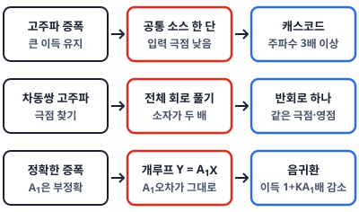

*반회로(half circuit)는 차동쌍의 한쪽 절반이고, 각 줄은 필요한 것 → 쉬운 방법이 막히는 곳 → 이번 회로 순서로 읽어요.*

**정확히 말하면**

#### 풀고 싶은 문제

주파수가 올라가면 트랜지스터 내부 커패시턴스의 임피던스 $\frac{1}{Cs}$가 작아져서 이득이 극점(pole)부터 떨어져요. **같은 전압 이득을 더 높은 동작 주파수까지 유지하는 증폭단이 필요해요.** [입출력 임피던스도 커패시턴스의 함수예요](#s0-io-impedance)

차동쌍(differential pair)도 고주파에서 이득이 어디서 떨어지는지, 즉 극점과 영점(zero)이 어디인지 알아야 해요. [차동쌍은 반회로와 같은 극점·영점을 가져요](#s1-half-circuit)

전방 증폭기 $A_1$은 그 자체로 정확도가 떨어지는(poorly controlled) 시스템일 수 있어요. 이런 시스템이 더 정교한 특성을 갖게 만들고 싶어요. [음귀환 시스템의 네 부분](#s2-feedback-system)

#### 단순한 해법과 그 한계

공통 소스(CS) 한 단은 입력과 출력이 반대 방향으로 크게 움직여요. 그래서 둘 사이의 $C_{GD1}$이 밀러 효과(Miller effect)로 입력에서 크게 보여요. $\lambda=0$이고 입력에서 출력까지의 이득이 $-g_{m1}R_L$인 밀러 근사에서 입력 쪽 커패시턴스는 다음과 같아요.

$$
C_{in}\approx C_{GS1}+(1+g_{m1}R_L)C_{GD1}
$$

이득 $g_{m1}R_L$을 키울수록 입력 커패시턴스도 커져서 입력 극점이 낮아져요. [CS 단: 밀러 곱셈이 입력 극점을 끌어내려요](../../1028/정리노트_1028_CS_Stage_Frequency_Response.html#s2-cs-miller)

차동쌍을 트랜지스터 두 개와 꼬리 노드까지 그대로 놓고 풀면, 다뤄야 할 커패시턴스와 노드가 한쪽 단의 두 배로 늘어 식이 복잡해져요. [차동쌍은 반회로와 같은 극점·영점을 가져요](#s1-half-circuit)

개루프(open loop)로 쓰면 출력이 $A_1$을 그대로 따라가요.

$$
Y=A_1X
$$

**$A_1$이 정확하지 않으면 출력 $Y$도 그만큼 정확하지 않아요.** [폐루프 이득: 이득이 $1+KA_1$배 줄어요](#s2-closed-loop)

#### 핵심 아이디어

캐스코드(cascode)는 $M_1$ 위에 공통 게이트 $M_2$를 쌓아요. 노드 Y에서 위로 보이는 저항이 $\frac{1}{g_{m2}}$로 작아서, $C_{GD1}$ 양단의 노드 X에서 노드 Y로의 이득이 $-\frac{g_{m1}}{g_{m2}}$ 정도로 작아져요($\lambda=0$일 때).

$$
C_{in}\approx C_{GS1}+\left(1+\frac{g_{m1}}{g_{m2}}\right)C_{GD1}
$$

예를 들어 $g_{m1}=g_{m2}$이면 계수가 $1+1=2$가 되어 $C_{GD1}$이 $2C_{GD1}$로만 보여요. $M_2$는 $M_1$이 만든 전류 변화를 출력으로 전달만 하므로 전체 이득은 CS와 같은 $-g_{m1}R_L$이에요. 강의 예제에서는 이득이 같으면서 동작 주파수가 CS보다 3배 이상 높았어요. [바이폴라 캐스코드의 세 극점](#s0-bjt-poles)

소자·바이어스가 대칭이고 순수 차동 입력이면 꼬리 노드가 AC 접지가 돼요. 그러면 반회로는 CS 단 하나이고, 전달함수가 같으므로 차동쌍은 반회로와 같은 극점·영점을 가져요. [차동쌍은 반회로와 같은 극점·영점을 가져요](#s1-half-circuit)

음귀환(negative feedback)은 출력을 감지해 귀환 회로망 $K$로 되돌리고, 입력에서 빼서 그 차이를 $A_1$에 넣어요. 그러면 입력–출력 관계는 다음 폐루프 이득(closed-loop gain)이 돼요.

$$
\frac{Y}{X}=\frac{A_1}{1+KA_1}
$$

예를 들어 $A_1=1000$, $K=0.1$이면 $\frac{1000}{1+100}=\frac{1000}{101}\approx9.90$이에요. **$KA_1$이 클수록 이 값은 $\frac{1}{K}=10$에 가까워져요.** 비반전 증폭기에서는 이 값이 저항비 $1+\frac{R_1}{R_2}$로 정해져요. [비반전 증폭기를 귀환으로 보기](#s2-noninverting) · [오차 E와 가상 단락](#s2-error-signal)

#### 대가와 쓰이는 곳

캐스코드는 트랜지스터가 하나 더 들고, 두 소자 사이 노드 Y가 생겨 극점이 하나 늘어요. 그래도 같은 이득으로 더 높은 주파수까지 쓸 수 있어서 CS보다 훨씬 많이 써요. 노드 Y에 전류원 $M_3$를 달면 $g_{m1}$과 $R_L$을 더 키우는 변형도 가능해요. [전류원 M3를 단 캐스코드](#s0-m3-cascode)

반회로는 대칭과 순수 차동 입력이 성립할 때만 써요. 공통 모드 신호에서는 꼬리 노드를 접지로 볼 수 없어요. 반회로가 캐스코드 단이면 캐스코드의 세 극점을 그대로 가져다 써요. [캐스코드 차동쌍의 세 극점](#s1-cascode-diffpair)

**음귀환의 대가는 이득이 $1+KA_1$배 줄어든다는 점이에요.** 위 예에서는 $1000$이던 이득이 $1+KA_1=101$배 줄어 약 $9.90$이 돼요. 그래도 op-amp의 비반전·반전 증폭기처럼 대부분의 증폭기는 음귀환으로 써요. 귀환 시스템의 여러 특성을 정하는 양은 루프 이득 $KA_1$이고, 폐루프 이득과는 다른 양이에요. [루프를 끊고 시험 신호를 넣어요](#s3-loop-gain) · [루프 이득과 폐루프 이득은 완전히 달라요](#s3-loop-vs-closed)

이득을 내주면서도 쓰는 이유는 다음 시간에 다뤄요. [다음 시간 예고](#s4-next)

**교수님 말씀**

> 이득은 커먼 소스 스테이지와 같으면서 동작 주파수는 세 배 이상 더 증가하는 장점

> 캐스코드 구조를 훨씬 더 많이 사용하죠.

> 전달 함수가 같다는 것은 폴도 같다는 거죠.

> 정확도가 떨어지는 시스템에 좀 더 정교한 특성을 갖도록 만드는 게 피드백의 효과

> 게인이 줄어드는데 왜 쓰느냐? 다른 장점이 있기 때문에 쓰겠죠?

교수님은 그냥 "피드백"이라고 하면 음귀환을 뜻한다고 했어요. 같은 위상 신호를 계속 더하는 양귀환은 발진기에 쓰며 전자회로2에서는 다루지 않아요.

확인해 봐요. 공통 소스 한 단 대신 캐스코드를 쓰고, 차동쌍 대신 반회로를 쓰고, 개루프 대신 음귀환을 쓰는 핵심 이유는 무엇이고 각 구조의 대가는 무엇인가요?

답 보기

캐스코드는 밀러 배율을 줄여 같은 이득에서 동작 주파수를 높이고, 대가로 소자가 하나 더 들며 노드 Y에 극점이 하나 늘어요. 반회로는 순수 차동·대칭에서 꼬리 노드가 AC 접지가 되어 한쪽만 풀어도 같은 극점·영점을 얻고, 대칭·순수 차동일 때만 쓸 수 있어요. 음귀환은 $KA_1$이 클수록 이득이 $\frac{1}{K}$에 가까워져 정확해지고, 대가로 이득이 $1+KA_1$배 줄어요.

**페이지 요약**

캐스코드는 같은 이득으로 동작 주파수를 높이고, 차동쌍은 반회로로 극점을 읽고, 음귀환은 이득을 내주고 정확도를 얻어요.

*핵심 식*

- CS 입력 커패시턴스

  $$
  C_{in}\approx C_{GS1}+(1+g_{m1}R_L)C_{GD1}
  $$
- 캐스코드 입력 커패시턴스

  $$
  C_{in}\approx C_{GS1}+\left(1+\frac{g_{m1}}{g_{m2}}\right)C_{GD1}
  $$
- 폐루프 이득

  $$
  \frac{Y}{X}=\frac{A_1}{1+KA_1}
  $$

캐스코드의 전체 이득은 CS와 같은 $-g_{m1}R_L$이에요.

차동쌍은 대칭·순수 차동 입력에서 반회로와 같은 극점·영점을 가져요.

음귀환을 걸면 이득이 $1+KA_1$배 줄어요.

*용어*

- **캐스코드(cascode)** — 공통 소스 위에 공통 게이트를 쌓은 증폭단
- **반회로(half circuit)** — 대칭 차동쌍의 한쪽 절반
- **음귀환(negative feedback)** — 출력을 되돌려 입력에서 빼는 구조

---

## 1. 캐스코드 주파수 응답 마무리

### 바이폴라 캐스코드의 세 극점

*1106 수업 · L05 s53*

**쉽게 말하면**

바이폴라 캐스코드도 X·Y·출력 세 노드마다 저항과 커패시턴스의 곱으로 극점(pole)이 하나씩 생겨요.

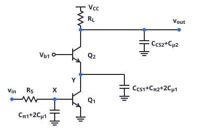

*$Q_1$과 $Q_2$에 같은 컬렉터 전류가 흘러 X에서 Y로 가는 이득이 약 −1이므로, 두 노드를 잇는 $C_{\mu1}$은 X와 Y에서 모두 $2C_{\mu1}$로 보여요.*

**정확히 말하면**

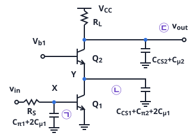

*㉠ 입력 X · ㉡ 내부 노드 Y · ㉢ 출력 (Lec5 53쪽)*

#### 숫자로 먼저 보는 밀러 배율

작은 예로 $C_{\mu1}=10\,\mathrm{fF}$이고 $g_{m1}=g_{m2}$라고 해요. X에서 Y로 가는 이득이 −1이면 X를 1 mV 올릴 때 Y는 1 mV 내려가요.

그러면 $C_{\mu1}$ 양단 전압은 2 mV 변해서 **X에서는 $2\times10=20\,\mathrm{fF}$, Y에서도 $2\times10=20\,\mathrm{fF}$로 보여요.** 같은 규칙으로 $g_{m1}/g_{m2}=4$인 MOS 캐스코드라면 X 쪽 배율은 $1+4=5$, Y 쪽 배율은 $1+1/4=1.25$가 돼요.

#### 노드 X · Y · 출력의 세 극점 유도

바이어스 전압 $V_{b1}$, 전원 $V_{CC}$는 AC 접지로 보고, 몸체·기판 쪽 단자도 AC 접지로 둬요. 각 노드의 저항과 커패시턴스를 따로 모아요.

1. **밀러 배율에 넣을 이득을 정해요.** $C_{\mu1}$은 $Q_1$의 베이스–컬렉터, 곧 X와 Y 사이의 플로팅 커패시터(floating capacitor)예요. 그래서 배율에는 입력→출력 이득이 아니라 노드 X에서 노드 Y로의 이득을 넣어요.

   Y에서 위로 $Q_2$ 이미터를 보면 β가 클 때 $1/g_{m2}$이고, 아래로 $Q_1$ 컬렉터를 보면 $r_{o1}$이에요. $r_{o1}\gg1/g_{m2}$이므로 Y의 저항은 $1/g_{m2}$로 봐요.

   $$
   A_{v,XY}=\frac{v_Y}{v_X}\approx-\frac{g_{m1}}{g_{m2}}
   $$
2. **BJT에서는 두 $g_m$이 같아요.** $g_m=I_C/V_T$이고 $Q_1$과 $Q_2$는 같은 컬렉터 전류 경로에 있어요. **베이스 전류를 무시하면 $I_{C1}=I_{C2}$이므로 $g_{m1}=g_{m2}$예요.**

   $$
   A_{v,XY}\approx-1
   $$
3. **㉠ X의 커패시턴스와 저항을 모아요.** $Q_1$ 이미터가 접지라 $C_{\pi1}$은 그대로 보이고, $C_{\mu1}$은 X 쪽 밀러 성분으로 보여요.

   $$
   \left(1-A_{v,XY}\right)C_{\mu1}\approx2C_{\mu1}
   $$

   X에서 왼쪽은 앞단의 출력 임피던스 $R_S$, 오른쪽 베이스로는 $r_{\pi1}$이 보여요. 입력 신호원을 0으로 두면 두 저항은 X와 AC 접지 사이에 있으므로 병렬 $R_S\parallel r_{\pi1}$이에요.

   $$
   \omega_{p,X}=\frac{1}{(R_S\parallel r_{\pi1})(C_{\pi1}+2C_{\mu1})}
   $$
4. **㉡ Y의 커패시턴스와 저항을 모아요.** $Q_1$의 컬렉터–기판 $C_{CS1}$, 베이스가 AC 접지인 $Q_2$의 $C_{\pi2}$, $C_{\mu1}$의 Y 쪽 밀러 성분이 보여요.

   $$
   \left(1-\frac{1}{A_{v,XY}}\right)C_{\mu1}\approx2C_{\mu1}
   $$

   $$
   \omega_{p,Y}=\frac{1}{\frac{1}{g_{m2}}(C_{CS1}+C_{\pi2}+2C_{\mu1})}
   $$
5. **㉢ 출력의 커패시턴스와 저항을 모아요.** $Q_2$의 베이스가 AC 접지이므로 $C_{\mu2}$는 플로팅이 아닌 접지형 커패시터(grounded capacitor)예요. 여기에 컬렉터–기판 $C_{CS2}$가 더해져요.

   출력에서 아래로 보이는 캐스코드 저항은 $R_{cas}\approx g_{m2}r_{o2}(r_{o1}\parallel r_{\pi2})$예요. 이 값이 $R_L$보다 훨씬 크므로 출력 저항은 $R_L\parallel R_{cas}\approx R_L$로 봐요.

   $$
   \omega_{p,out}=\frac{1}{R_L(C_{CS2}+C_{\mu2})}
   $$

#### MOS 캐스코드와 무엇이 다른가요

MOS 캐스코드와 해석 순서는 같고 기호만 $C_{GS}\leftrightarrow C_\pi$, $C_{GD}\leftrightarrow C_\mu$로 바뀌어요. 차이는 두 가지예요. **MOS는 저주파 입력저항이 무한대라 X의 저항에 $r_\pi$ 항이 없고, $g_{m1}$과 $g_{m2}$가 일반적으로 달라 밀러 배율이 $1+g_{m1}/g_{m2}$로 남아요.**

MOS 쪽 노드별 커패시턴스 정리는 [1104 정리노트의 X·Y·출력 커패시터 모으기](../../1104/정리노트_1104_Cascode_Frequency_Response.html#s1-node-capacitance)에 있어요.

**교수님 말씀**

> Q1과 Q2가 같은 IC 패스를 갖기 때문에 gm1과 gm2가 같습니다. MOSFET은 일반적으로 달라요.

BJT와 MOS의 극점 해석은 같고, $C_{GS}$가 $C_\pi$, $C_{GD}$가 $C_\mu$로 기호만 달라진다고 정리하셨어요. Y의 저항도 더 정확히는 $r_{o1}$, $r_{o2}$가 있지만 $1/g_{m2}$로 본다고 하셨어요.

**꼭 기억해요**

> 이게 이제 입력과 출력의 관계가 아니라 노드 X에서 노드 Y로의 이득입니다.

밀러 배율에 전체 이득 $-g_{m1}R_L$을 넣으면 X의 커패시턴스를 크게 잘못 구해요. 캐스코드에서는 $A_{v,XY}\approx-g_{m1}/g_{m2}$를 써요.

확인해 봐요. 바이폴라 캐스코드에서 $C_{\pi1}=100\,\mathrm{fF}$, $C_{\mu1}=15\,\mathrm{fF}$, $R_S\parallel r_{\pi1}=1\,\mathrm{k\Omega}$일 때 X 노드의 전체 커패시턴스와 극점 각주파수 $\omega_{p,X}$는 얼마인가요?

답 보기

전체 커패시턴스는 $130\,\mathrm{fF}$, $\omega_{p,X}\approx7.69\times10^9\,\mathrm{rad/s}$예요. BJT 캐스코드는 $g_{m1}=g_{m2}$이므로 $C_{\mu1}$이 $2C_{\mu1}=30\,\mathrm{fF}$로 보여 $C_{\pi1}+2C_{\mu1}=100+30=130\,\mathrm{fF}$이고, $\omega_{p,X}=\frac{1}{1\,\mathrm{k\Omega}\times130\,\mathrm{fF}}=\frac{1}{1.3\times10^{-10}}\approx7.69\times10^9\,\mathrm{rad/s}$예요.

**페이지 요약**

바이폴라 캐스코드는 X·Y·출력에 극점이 하나씩 있고, $C_{\mu1}$은 X와 Y에서 모두 $2C_{\mu1}$로 보여요.

*핵심 식*

- 입력 X

  $$
  \omega_{p,X}=\frac{1}{(R_S\parallel r_{\pi1})(C_{\pi1}+2C_{\mu1})}
  $$
- 중간 Y

  $$
  \omega_{p,Y}=\frac{1}{\frac{1}{g_{m2}}(C_{CS1}+C_{\pi2}+2C_{\mu1})}
  $$
- 출력

  $$
  \omega_{p,out}=\frac{1}{R_L(C_{CS2}+C_{\mu2})}
  $$

밀러 배율에는 노드 X에서 노드 Y로의 이득 $A_{v,XY}\approx-g_{m1}/g_{m2}$를 넣어요.

BJT 캐스코드는 같은 컬렉터 전류가 흘러 $g_{m1}=g_{m2}$이므로 배율이 2가 돼요.

*용어*

- **플로팅 커패시터(floating capacitor)** — 두 끝이 모두 움직이는 노드에 붙은 커패시터
- **접지형 커패시터(grounded capacitor)** — 한쪽 끝이 AC 접지에 붙은 커패시터

---

### 입출력 임피던스도 커패시턴스의 함수예요

*1106 수업 · L05 s54 · s56*

**쉽게 말하면**

저주파에서 무한대(MOS)나 $r_{\pi1}$(BJT)이던 입력 임피던스는 주파수가 오르면 커패시턴스가 보여서 점점 작아져요.

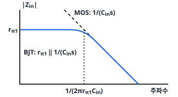

*같은 입력 커패시턴스 $C_{in}$이라고 두면, BJT는 $r_{\pi1}$에서 평평하다가 $1/(2\pi r_{\pi1}C_{in})$ 부근에서 꺾여 MOS와 같은 $1/(C_{in}s)$ 직선을 따라 내려가요.*

**정확히 말하면**

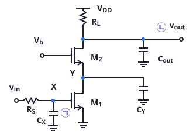

*㉠ MOS 입력 X · ㉡ MOS 출력 (Lec5 54쪽. 커패시터 합은 노드별 기호로 표기했어요)*

#### MOS 캐스코드의 입출력 임피던스

1. **㉠ MOS 캐스코드의 입력.** 저주파에서는 게이트로 전류가 흐르지 않아 $Z_{in}=\infty$예요. 그림에서 X에 붙은 $C_X$는 $C_{GS1}$과 X에서 Y로의 이득으로 밀러 변환한 $C_{GD1}$의 밀러 성분을 모은 값이에요.

   $$
   Z_{in}=\frac{1}{\left[C_{GS1}+\left(1+\frac{g_{m1}}{g_{m2}}\right)C_{GD1}\right]s}
   $$

   $\omega\to\infty$이면 $Z_{in}\to0$이에요. 그 사이에서는 커패시턴스의 임피던스가 주파수에 따라 바뀌어요.
2. **㉡ MOS 캐스코드의 출력.** 저주파에서는 아래로 보이는 캐스코드 저항이 $R_L$보다 훨씬 커서 $Z_{out}\approx R_L$이에요. 그림의 $C_{out}$은 게이트가 AC 접지인 $M_2$의 $C_{GD2}$와 $C_{DB2}$의 합이에요.

   $$
   Z_{out}=R_L\parallel\frac{1}{(C_{GD2}+C_{DB2})s}
   $$

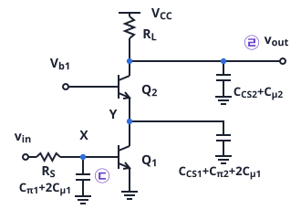

*㉢ BJT 입력 X · ㉣ BJT 출력 (Lec5 56쪽)*

#### 숫자로 보는 입력 임피던스의 꺾임

작은 예로 BJT 캐스코드에서 $r_{\pi1}=2.6\,\mathrm{k\Omega}$, 입력 쪽 커패시턴스 $C_{in}=C_{\pi1}+2C_{\mu1}=1\,\mathrm{pF}$라고 해요. $2.6\,\mathrm{k\Omega}\times1\,\mathrm{pF}=2.6\,\mathrm{ns}$이므로 꺾이는 주파수는 다음과 같아요.

$$
\begin{aligned}f_c&=\frac{1}{2\pi r_{\pi1}C_{in}}\\&=\frac{1}{2\pi\times2.6\,\mathrm{ns}}\\&\approx61.21\,\mathrm{MHz}\end{aligned}
$$

$$
|Z_{in}|=\frac{r_{\pi1}}{\sqrt{1+(f/f_c)^2}}
$$

$f=0.1f_c$이면 $|Z_{in}|\approx2.59\,\mathrm{k\Omega}$로 거의 $r_{\pi1}$이에요. $f=f_c$이면 $r_{\pi1}/\sqrt2\approx1.84\,\mathrm{k\Omega}$, $f=10f_c$이면 약 $0.26\,\mathrm{k\Omega}$예요. **꺾인 뒤에는 주파수가 10배 될 때마다 크기가 약 10배 작아져요.**

1. **㉢ 바이폴라 캐스코드의 입력.** 저주파 입력 임피던스는 무한대가 아니라 베이스–이미터의 $r_{\pi1}$이에요. 여기에 $C_{\pi1}$과 밀러 성분 $2C_{\mu1}$이 병렬로 붙어요.

   $$
   Z_{in}=r_{\pi1}\parallel\frac{1}{(C_{\pi1}+2C_{\mu1})s}
   $$

   이 $Z_{in}$은 베이스에서 본 값이라 앞단의 $R_S$는 들어 있지 않아요.
2. $$
   Z_{out}=R_L\parallel\frac{1}{(C_{\mu2}+C_{CS2})s}
   $$

   **㉣ 바이폴라 캐스코드의 출력.** 저주파의 $R_L$에 $C_{\mu2}$와 $C_{CS2}$가 병렬로 붙어요.
3. **극점과 같은 현상이에요.** ㉢ 노드 X에서 접지까지 보이는 임피던스는 $R_S$와 $Z_{in}$의 병렬이에요.

   $$
   \begin{aligned}R_S\parallel Z_{in}&=(R_S\parallel r_{\pi1})\\&\quad\parallel\frac{1}{(C_{\pi1}+2C_{\mu1})s}\end{aligned}
   $$

   이 임피던스가 꺾이는 각주파수 $1/[(R_S\parallel r_{\pi1})(C_{\pi1}+2C_{\mu1})]$이 바로 $\omega_{p,X}$예요. 출력의 $Z_{out}$이 꺾이는 각주파수도 $\omega_{p,out}$과 같아요.

그래서 이득이 극점에서 떨어지는 것과 입출력 임피던스가 커패시턴스의 함수가 되는 것은 별개가 아니에요. **각 노드의 임피던스가 커패시턴스의 함수라서 그 노드에 극점이 생겨요.**

**교수님 말씀**

> 임피던스가 커패시턴스의 함수로 나타나기 때문에 각각의 노드에서 폴이 생기는 겁니다.

주파수가 높아지면 $r_\pi$나 $R_L$ 같은 저주파 임피던스만 보이는 것이 아니라 커패시턴스의 임피던스가 병렬로 보인다고 정리하셨어요.

**꼭 기억해요**

> 정확하게 얘기하면 무한대는 반만 맞는 거죠.

"MOS 입력 임피던스는 무한대"는 저주파에서만 맞아요. 일반적인 답은 커패시턴스의 함수인 $Z_{in}(s)$예요.

확인해 봐요. BJT 캐스코드에서 $r_{\pi1}=2.6\,\mathrm{k\Omega}$, $C_{in}=C_{\pi1}+2C_{\mu1}=2\,\mathrm{pF}$일 때, 입력 임피던스가 꺾이는 주파수 $f_c$와 $f=f_c$에서의 $|Z_{in}|$은 얼마인가요?

답 보기

$f_c\approx30.61\,\mathrm{MHz}$, $|Z_{in}|\approx1.84\,\mathrm{k\Omega}$예요. $r_{\pi1}C_{in}=2.6\,\mathrm{k\Omega}\times2\,\mathrm{pF}=5.2\,\mathrm{ns}$이므로 $f_c=\frac{1}{2\pi\times5.2\,\mathrm{ns}}\approx30.61\,\mathrm{MHz}$이고, $f=f_c$에서는 $|Z_{in}|=\frac{2.6\,\mathrm{k\Omega}}{\sqrt{1+1^2}}\approx1.84\,\mathrm{k\Omega}$예요.

**페이지 요약**

입출력 임피던스는 저주파 값에 커패시턴스의 임피던스가 병렬로 붙은 커패시턴스의 함수예요.

*핵심 식*

- MOS 입력

  $$
  Z_{in}=\frac{1}{\left[C_{GS1}+\left(1+\frac{g_{m1}}{g_{m2}}\right)C_{GD1}\right]s}
  $$
- MOS 출력

  $$
  Z_{out}=R_L\parallel\frac{1}{(C_{GD2}+C_{DB2})s}
  $$
- BJT 입력

  $$
  Z_{in}=r_{\pi1}\parallel\frac{1}{(C_{\pi1}+2C_{\mu1})s}
  $$
- BJT 출력

  $$
  Z_{out}=R_L\parallel\frac{1}{(C_{\mu2}+C_{CS2})s}
  $$

입력 임피던스가 무한대라는 답은 저주파에서만 성립하는 반만 맞는 답이에요.

임피던스가 꺾이는 RC가 그 노드의 극점과 같아서 두 현상은 별개가 아니에요.

*용어*

- **입력 임피던스(input impedance)** — 입력 단자에서 본 전압 대 전류의 비로, 주파수에 따라 달라짐

---

### 전류원 M3를 단 캐스코드

*1106 수업 · L05 s55*

**쉽게 말하면**

노드 Y에 단 PMOS 전류원 $M_3$는 $M_1$에 바이어스 전류만 더 보태고, 소신호 전류는 거의 다 $M_2$로 가서 이득은 그대로예요.

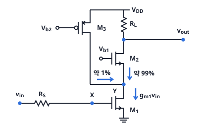

*예를 들어 $r_{o3}=20\,\mathrm{k\Omega}$이고 $1/g_{m2}=200\,\Omega$이면, $M_1$이 끌어내리는 소신호 전류의 약 99%는 $M_2$ 쪽에서 오고 $M_3$ 쪽은 약 1%예요.*

**정확히 말하면**

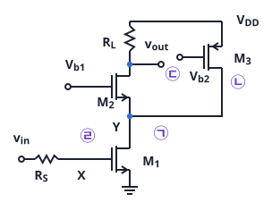

*㉠ 전류가 합쳐지는 Y · ㉡ PMOS 전류원 가지 · ㉢ 출력 · ㉣ 입력 노드 X (Lec5 55쪽)*

#### 바이어스와 소신호 전류 분배의 작은 예

작은 예로 $R_L=1\,\mathrm{k\Omega}$에 $0.5\,\mathrm{mA}$가 흐르면 IR 드롭은 $0.5\,\mathrm{V}$예요. $g_{m1}$을 키우려고 전류를 2배로 늘리면 $1\,\mathrm{V}$, 4배로 늘리면 $2\,\mathrm{V}$가 $R_L$에 걸려요.

**$M_3$가 $I_{D3}=1.5\,\mathrm{mA}$를 따로 흘리면 $I_{D1}=2\,\mathrm{mA}$로 4배가 되어도 $I_{D2}=0.5\,\mathrm{mA}$라서 IR 드롭은 $0.5\,\mathrm{V}$ 그대로예요.** 제곱 법칙 모델에서 $W/L$이 같으면 $g_m\propto\sqrt{I_D}$이므로 $g_{m1}$은 2배가 돼요.

소신호에서는 Y에서 위로 $r_{o3}=20\,\mathrm{k\Omega}$와 $1/g_{m2}=200\,\Omega$이 경쟁해요. $M_2$ 쪽 몫은 $20/(20+0.2)\approx0.99$예요.

#### 바이어스 · 이득 · 극점 해석

1. **바이어스 전류를 나눠요.** $M_3$는 게이트가 $V_{b2}$에 묶인 PMOS 전류원이에요. ㉠ 노드 Y에는 ㉡ PMOS 가지의 전류와 부하 쪽 전류가 모여요. 여기에 KCL을 쓰면 $M_1$ 전류는 $M_2$ 전류와 $M_3$ 전류의 합이에요.

   $$
   I_{D1}=I_{D2}+I_{D3}
   $$

   $R_L$에는 $I_{D2}$만 흐르므로 $R_L$의 IR 드롭은 $I_{D2}R_L$이에요. $I_{D1}$을 늘려 $g_{m1}$을 키우면서 IR 드롭은 늘리지 않을 수 있고, 같은 전압 여유에서 더 큰 $R_L$도 쓸 수 있어요.
2. **전압이득을 $G_m$과 $R_{out}$으로 나눠 구해요.** 입력 $v_{in}$은 ㉣ X를 거쳐 $M_1$ 게이트에 걸리고, ㉢ 출력은 $M_2$ 드레인에서 읽어요. 바이어스 전압 $V_{b1}$, $V_{b2}$, $V_{DD}$는 AC 접지로 두고 몸체효과는 무시해요.

   출력을 오른쪽에서 접지로 단락해 $v_{out}=0$으로 두고, 단락선에서 출력 단자를 거쳐 회로로 들어가는 $i_{out}$을 양으로 정해요. $M_1$이 Y에서 끌어내리는 $g_{m1}v_{in}$은 $M_2$ 소스($\approx1/g_{m2}$), $r_{o3}$, $r_{o1}$ 쪽에서 나뉘어 와요.

   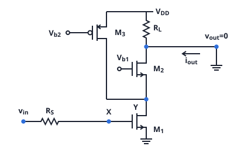

   *출력 단락에서는 $R_L$ 양끝이 모두 AC 접지라 $R_L$로는 소신호 전류가 흐르지 않아요. $M_2$ 소스에서 보는 저항은 $(1/g_{m2})\parallel r_{o2}$이고 $r_{o2}\gg1/g_{m2}$이므로 $r_{o2}$ 가지는 무시했어요.*

   $$
   G_m=\frac{i_{out}}{v_{in}}\approx g_{m1}\frac{r_{o1}\parallel r_{o3}}{(r_{o1}\parallel r_{o3})+1/g_{m2}}
   $$

   $r_{o1}\parallel r_{o3}\gg1/g_{m2}$이면 소신호 전류가 거의 다 $M_2$로 가요.

   $$
   G_m\approx g_{m1}
   $$

   입력을 0으로 두고 출력에서 바라봐요. 위로는 $R_L$, 아래로는 $M_2$가 Y의 저항 $r_{o1}\parallel r_{o3}$를 캐스코드로 키운 $R_{cas}$가 보여요.

   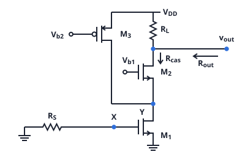

   *입력 쪽 $R_S$의 왼쪽 끝을 접지해 입력을 0으로 두고, 출력 노드에서 위의 $R_L$과 아래의 $R_{cas}$를 바라봐요.*

   $$
   R_{cas}\approx g_{m2}r_{o2}(r_{o1}\parallel r_{o3})
   $$

   $$
   R_{out}=R_L\parallel R_{cas}\approx R_L
   $$

   $R_{cas}\gg R_L$일 때의 근사예요. 슬라이드처럼 $\lambda=0$이면 $R_{cas}$는 무한대로 봐요.

   $v_{in}$이 오르면 $M_2$를 거쳐 출력에서 빠져나가는 전류가 늘어 $v_{out}$이 내려가요. 같은 입출력 정의로 두 값을 곱해요.

   $$
   A_v=-G_mR_{out}\approx-g_{m1}R_L
   $$

   **수업에서도 이 결과를 $A_v=-g_{m1}R_L$로 써서 $M_3$가 없는 캐스코드와 이득이 같다고 했어요.**
3. **PMOS 대신 NMOS를 달면 이득이 줄어요.** 노드 Y에 NMOS의 소스를 붙이면 그 소스로 보이는 저항은 $r_o$가 아니라 $1/g_m$이에요. 그 NMOS를 $M_3$라 하면 $1/g_{m3}$이 $1/g_{m2}$와 비슷해서 소신호 전류가 그쪽으로 새어요.

   $$
   G_m\approx g_{m1}\frac{g_{m2}}{g_{m2}+g_{m3}}
   $$

   바이어스 전류를 보태는 역할은 같지만 출력 전류와 이득이 줄어요. 일부러 이득을 줄이려는 경우가 아니면 쓰지 않아요.
4. **극점을 모아요.** 극점의 저항도 바이어스 값이 아니라 소신호의 전압 변화량/전류 변화량으로 구해요. ㉡ $M_3$는 ㉠ Y에 붙어요. ㉣ X와 ㉢ 출력의 극점 식은 앞의 캐스코드와 같은 형태예요.

   $$
   \begin{aligned}\omega_{p,X}&=\frac{1}{R_SC_X}\\C_X&=C_{GS1}+\left(1+\frac{g_{m1}}{g_{m2}}\right)C_{GD1}\end{aligned}
   $$

   $$
   \omega_{p,out}=\frac{1}{R_L(C_{GD2}+C_{DB2})}
   $$

   Y의 저항은 $(1/g_{m2})\parallel r_{o3}\parallel r_{o1}\approx1/g_{m2}$예요. 커패시턴스에는 $M_3$의 $C_{GD3}$(게이트가 AC 접지라 접지형)와 $C_{DB3}$ 두 개가 더해져요.

   $$
   \begin{aligned}\omega_{p,Y}&=\frac{1}{\frac{1}{g_{m2}}C_Y}\\C_Y&=C_{DB1}\\&\quad+\left(1+\frac{g_{m2}}{g_{m1}}\right)C_{GD1}\\&\quad+C_{GS2}+C_{SB2}\\&\quad+C_{GD3}+C_{DB3}\end{aligned}
   $$

   식의 꼴은 같아도 값은 달라질 수 있어요. 교과서 예제 11.26은 같은 크기의 $M_2$에서 $I_{D2}$가 줄면 $g_{m2}$도 줄어 $1+g_{m1}/g_{m2}$가 커지므로 $\omega_{p,X}$의 크기가 낮아진다고 설명해요.

**교수님 말씀**

> M3가 달려 있어도 전류의 변화에는 영향을 주지 않는다는 거니까 그냥 없는 거나 마찬가지예요.

$M_3$의 장점은 $g_{m1}$을 더 크게 만들면서 $R_L$도 더 크게 쓸 수 있다는 것이라고 하셨어요. PMOS 대신 NMOS를 쓰면 어떻게 되느냐는 질문에는 출력 전류가 줄어 이득이 줄어든다고 답하셨어요.

**꼭 기억해요**

> 지금 얘기하는 거는 스몰 시그널 전류를 얘기하는 겁니다. DC 바이어스 전류가 아니고

$M_3$는 DC 바이어스 전류는 크게 바꿔요($I_{D1}=I_{D2}+I_{D3}$). 소신호 전류에는 $r_{o3}\gg1/g_{m2}$이라서 거의 영향이 없어요.

확인해 봐요. 노드 Y에 PMOS 전류원 $M_3$가 달린 캐스코드에서 $I_{D2}=0.5\,\mathrm{mA}$, $I_{D3}=2.0\,\mathrm{mA}$, $R_L=1\,\mathrm{k\Omega}$일 때 $M_1$의 바이어스 전류 $I_{D1}$과 $R_L$의 IR 드롭은 얼마인가요? 또 $r_{o3}=20\,\mathrm{k\Omega}$, $1/g_{m2}=200\,\Omega$이고 $r_{o1}\gg r_{o3}$이면 $M_1$의 소신호 전류 중 $M_2$로 가는 비율은 약 몇 %인가요?

답 보기

$I_{D1}=I_{D2}+I_{D3}=0.5+2.0=2.5\,\mathrm{mA}$이고, $R_L$에는 $I_{D2}$만 흐르므로 IR 드롭은 $0.5\,\mathrm{mA}\times1\,\mathrm{k\Omega}=0.5\,\mathrm{V}$예요. 소신호에서는 $M_2$ 쪽 저항 $1/g_{m2}=0.2\,\mathrm{k\Omega}$와 $M_3$ 쪽 저항 $r_{o3}=20\,\mathrm{k\Omega}$가 병렬로 전류를 나누므로 $M_2$로 가는 비율은 $\frac{20}{20+0.2}\approx99\,\%$예요.

**페이지 요약**

$M_3$는 $M_1$에 바이어스 전류만 더 보태고, 소신호 전류는 거의 다 $M_2$로 가서 이득이 그대로예요.

*핵심 식*

- 바이어스 KCL

  $$
  I_{D1}=I_{D2}+I_{D3}
  $$
- 전압이득

  $$
  A_v=-G_mR_{out}\approx-g_{m1}R_L
  $$
- Y 극점

  $$
  \begin{aligned}\omega_{p,Y}&=\frac{1}{\frac{1}{g_{m2}}C_Y}\\C_Y&=C_{DB1}\\&\quad+\left(1+\frac{g_{m2}}{g_{m1}}\right)C_{GD1}\\&\quad+C_{GS2}+C_{SB2}\\&\quad+C_{GD3}+C_{DB3}\end{aligned}
  $$

$R_L$에는 $I_{D2}$만 흘러 IR 드롭을 늘리지 않고 $g_{m1}$을 키울 수 있어요.

$G_m\approx g_{m1}$은 $r_{o3}\gg1/g_{m2}$일 때 성립해요.

NMOS를 달면 Y에서 $1/g_m$ 쪽으로 소신호 전류가 새어 이득이 줄어요.

*용어*

- **IR 드롭(IR drop)** — 저항에 흐르는 전류와 저항의 곱만큼 생기는 전압 강하

---

## 2. 차동쌍의 주파수 응답

### 차동쌍은 반회로와 같은 극점·영점을 가져요

*1106 수업 · L05 s57 · L05 s59*

**쉽게 말하면**

차동 입력에서는 꼬리 노드가 움직이지 않는 가상 접지라서 차동쌍 한쪽이 MOS면 CS 단, 바이폴라면 CE 단인 반회로가 되고, 극점과 영점도 그 반회로와 같아요.

예를 들어 두 입력이 $+1\,\mathrm{mV}$와 $-1\,\mathrm{mV}$이면 한쪽 전류가 늘어난 만큼 다른 쪽이 줄어 꼬리 노드 P는 $0\,\mathrm{mV}$에 머물지만, 두 입력이 모두 $+1\,\mathrm{mV}$인 공통 모드에서는 P도 따라 움직여요.

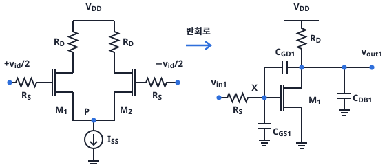

*차동 입력이면 P를 접지로 바꾼 오른쪽 반회로 하나만 풀면 돼요.*

**정확히 말하면**

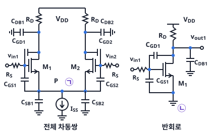

*㉠ 전체 회로의 꼬리 노드 P · ㉡ 왼쪽 반회로의 AC 접지 (Lec5 57쪽. 반회로의 C_SB1 양단은 AC 접지라 생략했어요)*

#### 차동 입력과 가상 접지

작은 예시를 먼저 식으로 적어요. 입력을 $v_{in1}=+v_{id}/2$, $v_{in2}=-v_{id}/2$로 넣으면 대칭 회로에서 두 가지 전류의 변화는 크기가 같고 방향이 반대예요. **㉠ 꼬리로 모이는 전류의 합이 변하지 않아 P의 소신호 전압은 0이에요. 그래서 ㉡ 반회로에서 $M_1$ 소스를 AC 접지에 연결해요.** 이것이 차동 증폭기에서 배운 [가상 접지](../../0923/정리노트_0923_Differential_Amplifiers.html#s3-virtual-ground)예요.

저주파 이득도 이 판단으로 반회로 하나에서 구했어요. $v_{out2}=-v_{out1}$이므로 차동 입력 대비 차동 출력 이득은 반회로 이득과 부호까지 같아요.

$$
\frac{v_{out1}-v_{out2}}{v_{in1}-v_{in2}}=\frac{2v_{out1}}{2v_{in1}}=\frac{v_{out1}}{v_{in1}}
$$

#### 고주파 반회로와 극점·영점

㉡ 반회로의 주파수 응답은 $R_S$로 구동하는 CS 단에서 구해요.

1. **조건** — 좌우의 소자, 바이어스, $R_D$, $R_S$가 대칭이고 입력은 순수 차동이에요. 그림의 커패시터는 따로 달아 준 소자가 아니라 트랜지스터에 내재된 커패시턴스를 표시한 것이고, $R_S$는 앞단의 소스 임피던스예요.
2. **꼬리 노드** — 커패시터가 있어도 좌우 대칭은 그대로라서 모든 주파수에서 $v_P=0$이에요. 그래서 꼬리 노드와 접지 사이의 $C_{SB1}$, $C_{SB2}$는 양단 전압이 0이 되어 반회로에서 빠져요.
3. **반회로** — 게이트에 입력이 들어가고 소스가 접지된 CS 단이에요. 노드 X에는 $R_S$와 $C_{GS1}$, 출력에는 $R_D$와 $C_{DB1}$이 있고, 두 노드 사이에 $C_{GD1}$이 떠 있어요.
4. **전달함수** — 차동 전달함수가 반회로 전달함수와 같아요.

   $$
   \begin{aligned}H_{DM}(s)&=\frac{V_{out1}(s)-V_{out2}(s)}{V_{in1}(s)-V_{in2}(s)}\\&=\frac{V_{out1}(s)}{V_{in1}(s)}=H_{half}(s)\end{aligned}
   $$

   **전달함수가 같으면 분모와 분자의 근, 즉 극점과 영점이 같아요.**

그래서 CS 단에서 구한 결과를 그대로 써요. $\lambda=0$이고 반회로의 저주파 이득이 $-g_{m1}R_D$일 때 밀러 근사의 두 극점은 다음과 같아요.

$$
\begin{aligned}|\omega_{p,in}|&=1\Big/\Big(R_S\big[C_{GS1}\\&\qquad+(1+g_{m1}R_D)C_{GD1}\big]\Big)\end{aligned}
$$

$$
\begin{aligned}|\omega_{p,out}|&=1\Big/\Big(R_D\Big[C_{DB1}\\&\qquad+\Big(1+\frac{1}{g_{m1}R_D}\Big)C_{GD1}\Big]\Big)\end{aligned}
$$

CS 단을 정확히 풀었을 때 $C_{GD1}$을 지나 앞으로 새는 전류가 만드는 영점 $g_{m1}/C_{GD1}$도 차동쌍에 그대로 있어요.

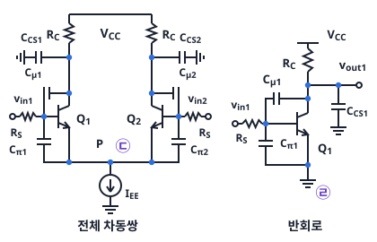

*㉢ 전체 회로의 꼬리 노드 P · ㉣ 왼쪽 반회로의 AC 접지 (Lec5 59쪽. Cπ 첨자를 각 트랜지스터 번호와 맞췄어요)*

#### 바이폴라 차동쌍의 극점

㉢ BJT 차동쌍도 차동 입력에서는 꼬리 P가 가상 접지예요. ㉣ 왼쪽 반회로는 이미터를 접지한 CE 단이에요. 기호는 $C_{GS}\to C_\pi$, $C_{GD}\to C_\mu$, $C_{DB}\to C_{CS}$, $R_D\to R_C$로 바뀌어요. **베이스로 $r_{\pi1}$이 보이므로 입력 노드의 저항은 $R_S\parallel r_{\pi1}$이에요.**

$$
\begin{aligned}|\omega_{p,in}|&=1\Big/\Big((R_S\parallel r_{\pi1})\big[C_{\pi1}\\&\qquad+(1+g_{m1}R_C)C_{\mu1}\big]\Big)\end{aligned}
$$

$$
\begin{aligned}|\omega_{p,out}|&=1\Big/\Big(R_C\Big[C_{CS1}\\&\qquad+\Big(1+\frac{1}{g_{m1}R_C}\Big)C_{\mu1}\Big]\Big)\end{aligned}
$$

#### 공통 모드 반회로

**공통 모드는 다르게 풀어요** — $v_{in1}=v_{in2}=v_{CM}$이면 두 가지 전류가 같은 방향으로 변해 꼬리 노드가 움직이므로 가상 접지를 쓰지 않아요. 꼬리 저항 $R_{EE}$를 $2R_{EE}$ 두 개의 병렬로 나눠 반쪽마다 하나씩 맡겨요. 가지 전류를 $i$라 하면 꼬리 전압은 다음과 같아요.

$$
v_P=(2i)R_{EE}=i(2R_{EE})
$$

**그래서 공통 모드 반회로는 이미터에 $2R_{EE}$가 달린 CE 단이에요.** 실제 꼬리는 트랜지스터 전류원으로 만들고, 그 출력저항이 $R_{EE}$ 역할을 해요.

**교수님 말씀**

저주파 이득을 반회로로 구했던 방법을 주파수 응답에도 그대로 가져왔어요. 반회로를 그려 보면 게이트에 입력이 들어가고 소스가 접지된 공통 소스 구조이고, 전달함수가 같다는 말은 극점과 영점이 같다는 뜻이라고 정리했어요.

> 같은 폴과 제로를 가진다고 보면 되겠습니다.

그림에 그린 커패시터는 회로에 달아 주는 소자가 아니라 트랜지스터 안에 내재된 커패시턴스를 표시한 것이라고 짚었어요.

**꼭 기억해요**

> 커먼 모드 신호에 대해서는 그라운드로 볼 수 없죠.

꼬리 노드를 접지로 바꾸는 것은 좌우가 대칭이고 입력이 순수 차동일 때만이에요. 공통 모드는 $2R_{EE}$ 반회로로 따로 풀어요.

확인해 봐요. 꼬리 저항이 $R_{EE}=5\,\mathrm{k\Omega}$인 대칭 BJT 차동쌍에서 (a) 순수 차동 입력을 넣을 때와 (b) 공통 모드 입력을 넣을 때, 한쪽 반회로의 이미터에는 각각 무엇이 연결되나요?

답 보기

(a) 순수 차동 입력에서는 꼬리 노드가 가상 접지이므로 이미터가 접지에 바로 연결된 CE 단이 돼요. (b) 공통 모드 입력에서는 꼬리 저항 $R_{EE}$를 $2R_{EE}$ 두 개의 병렬로 나누므로 이미터에 $2R_{EE}=10\,\mathrm{k\Omega}$가 달린 CE 단이 돼요.

**페이지 요약**

순수 차동 입력이면 꼬리 노드가 가상 접지라서 차동쌍의 극점과 영점은 반회로(CS 단·CE 단)와 같아요.

*핵심 식*

- 차동 전달함수

  $$
  \begin{aligned}&H_{DM}(s)\\&=\frac{V_{out1}(s)-V_{out2}(s)}{V_{in1}(s)-V_{in2}(s)}\\&=\frac{V_{out1}(s)}{V_{in1}(s)}=H_{half}(s)\end{aligned}
  $$
- 공통 모드 꼬리

  $$
  v_P=(2i)R_{EE}=i(2R_{EE})
  $$

공통 모드에서는 꼬리를 접지로 두지 않고 $2R_{EE}$ 반회로를 써요.

*용어*

- **반회로(half circuit)** — 대칭 차동쌍의 한쪽만 떼어 낸 회로
- **가상 접지(virtual ground)** — 순수 차동 입력에서 소신호 전압이 0인 꼬리 노드

---

### 캐스코드 차동쌍의 세 극점

*1106 수업 · L05 s58*

**쉽게 말하면**

캐스코드 차동쌍의 반회로는 캐스코드 단이라서 노드 X, Y, 출력마다 저항과 커패시터가 하나씩 모여 극점 세 개가 생겨요.

세 극점이 서로 멀리 떨어져 있고 영점은 훨씬 높은 곳에 있다면, 평평하던 이득 곡선의 기울기는 극점을 하나 지날 때마다 $-20\,\mathrm{dB/dec}$씩 더해져 $0\to-20\to-40\to-60\,\mathrm{dB/dec}$로 바뀌어요.

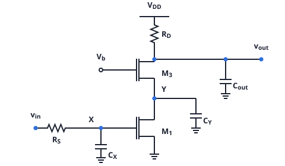

*각 노드의 커패시터를 접지로 모으면 노드마다 극점이 하나씩 보여요.*

**정확히 말하면**

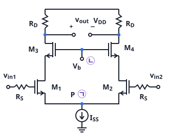

*㉠ 두 입력 소자가 공유하는 P · ㉡ 캐스코드 소자에 공통 바이어스를 거는 도선 (Lec5 58쪽 위. 꼬리 노드 이름과 차동 출력의 기준 극성을 덧붙였어요)*

#### 세 극점과 보드 선도의 기울기

㉠ 공통 꼬리 노드 P는 차동 입력에서 AC 접지가 돼요. ㉡ 공통 바이어스에 연결된 $M_3$, $M_4$가 두 가지의 캐스코드 소자예요. 저주파 이득에서 평평하게 시작하는 저역통과 응답이고, 영점은 관심 대역보다 훨씬 높아 영향이 없다고 둬요. **세 극점이 충분히 떨어져 있으면 점근선의 기울기는 극점을 지날 때마다 $-20\,\mathrm{dB/dec}$씩 더해져요.** 이득이 한 번에 20 dB 떨어지는 것이 아니라 기울기가 바뀌는 것이고, 실제 곡선은 각 극점 근처에서 부드럽게 휘어요.

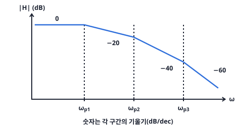

*세 극점을 크기 순으로 $\omega_{p1}\lt\omega_{p2}\lt\omega_{p3}$라 부르면 기울기가 0, −20, −40, −60 dB/dec로 바뀌어요.*

그림의 순서는 크기 순으로 다시 붙인 이름이에요. 노드 X, Y, 출력 중 어느 극점이 가장 낮은지는 소자 값에 따라 달라요.

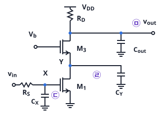

*㉢ 입력 X · ㉣ 내부 노드 Y · ㉤ 출력 (Lec5 58쪽 아래. 커패시터 합은 본문의 노드별 기호로 표기했어요)*

#### 저주파 이득 $A_0$ 구하기

이제 극점을 구해요. 순수 차동 입력에서는 꼬리 노드가 가상 접지이므로([차동쌍은 반회로와 같은 극점·영점을 가져요](#s1-half-circuit)), 반회로는 $R_S$로 구동되는 입력 소자 $M_1$ 위에 캐스코드 소자 $M_3$가 얹힌 캐스코드 단이에요. 반대쪽 $M_2$, $M_4$는 다른 반쪽에서 같은 역할을 해요. **그래서 캐스코드 단의 극점을 소자 번호만 바꿔 그대로 쓰고, 슬라이드처럼 $\lambda=0$ 모델을 써요.** 그림의 $C_X$, $C_Y$, $C_{out}$은 아래 각 단계에서 그 노드와 접지 사이에 모은 커패시턴스의 합이에요.

**㉤ 출력 단락의 $G_m$** — 저주파에서는 커패시터가 개방이고 게이트 전류가 없어 $v_X=v_{in}$이에요. 출력을 AC 접지에 단락하면 $M_1$이 만든 소신호 전류는 노드 Y에서 $M_3$ 소스 말고는 갈 곳이 없어 그대로 단락선까지 가요.

$$
G_m=\frac{i_{out}}{v_{in}}=g_{m1}
$$

**㉤ 출력에서 바라본 $R_{out}$** — 입력을 0으로 두고 출력에서 보면 위로 $R_D$, 아래로 캐스코드 저항이 보여요. 아래쪽은 $\lambda=0$이면 무한대이고, $r_o$를 넣어도 $g_{m3}r_{o3}r_{o1}$ 정도로 $R_D$보다 훨씬 커요.

$$
R_{out}\approx R_D\parallel(g_{m3}r_{o3}r_{o1})\approx R_D
$$

**저주파 이득** — 같은 입출력 정의로 곱해요.

$$
A_0=-G_mR_{out}\approx-g_{m1}R_D
$$

#### 노드 X · Y · 출력의 세 극점과 전달함수

1. **㉢ 노드 X** — 소스가 가상 접지라 $C_{GS1}$은 접지 커패시터예요. $C_{GD1}$은 X와 Y 사이에 떠 있어서 밀러 근사로 나눠요. Y에서 $M_3$ 소스로 보이는 저항이 $1/g_{m3}$이므로 X에서 Y로의 이득은 다음과 같아요.

   $$
   A_{v,XY}\approx-\frac{g_{m1}}{g_{m3}}
   $$

   X 쪽에는 $(1-A_{v,XY})C_{GD1}$이 보이고, X의 저항은 $R_S$예요(MOS 게이트의 저주파 입력저항은 무한대).

   $$
   \begin{aligned}\omega_{p,X}&=1\Big/\Big(R_S\Big[C_{GS1}\\&\qquad+\Big(1+\frac{g_{m1}}{g_{m3}}\Big)C_{GD1}\Big]\Big)\end{aligned}
   $$
2. **㉣ 노드 Y** — 저항은 $M_3$ 소스로 보이는 $1/g_{m3}$이에요. 커패시터는 $M_1$의 $C_{DB1}$, 게이트가 $V_b$로 AC 접지인 $M_3$의 $C_{GS3}$와 $C_{SB3}$, 그리고 $C_{GD1}$의 Y 쪽 몫이에요.

   $$
   \begin{aligned}&\left(1-\frac{1}{A_{v,XY}}\right)C_{GD1}\\&=\left(1+\frac{g_{m3}}{g_{m1}}\right)C_{GD1}\end{aligned}
   $$

   $$
   \begin{aligned}&\omega_{p,Y}=1\Big/\Big(\frac{1}{g_{m3}}\Big[C_{DB1}\\&\quad+\Big(1+\frac{g_{m3}}{g_{m1}}\Big)C_{GD1}\\&\quad+C_{GS3}+C_{SB3}\Big]\Big)\end{aligned}
   $$
3. **㉤ 출력 노드** — 저항은 $R_D$예요(아래의 캐스코드 저항은 훨씬 커요). $M_3$ 게이트가 AC 접지라 $C_{GD3}$도 접지 커패시터가 되어 $C_{DB3}$와 더해져요.

   $$
   \omega_{p,out}=\frac{1}{R_D(C_{DB3}+C_{GD3})}
   $$
4. **전달함수** — 세 노드의 극점을 곱으로 묶어요.

   $$
   \begin{aligned}H(s)&=\frac{A_0}{\left(1+\frac{s}{\omega_{p,X}}\right)\left(1+\frac{s}{\omega_{p,Y}}\right)}\\&\quad\times\frac{1}{1+\frac{s}{\omega_{p,out}}}\end{aligned}
   $$

   **여기서 $A_0=-g_{m1}R_D$는 저주파 이득이고, 분모에 극점 세 개가 있어요.**

#### 극점의 부호 · 영점 오차 · 캐스코드의 이점

**극점의 부호** — 실제 극점은 $s=-\omega_{p,X}$처럼 음수에 있어요. 극점 주파수는 그 크기라서 책에 따라 $|\omega_{p,X}|$처럼 절댓값을 씌워 쓰거나 두 표기를 섞어 써요. 극점이 음수로 나오면 절댓값을 씌워 주파수로 읽어요.

**밀러 근사의 오차** — 밀러 근사는 저주파 이득 $A_{v,XY}$로 $C_{GD1}$을 나눴기 때문에 영점을 구할 수 없고, 극점에도 약간의 오차가 생길 수 있어요. $C_{GD1}$을 지나 앞으로 새는 전류가 만드는 영점은 대략 $g_{m1}/C_{GD1}$이고, $C_{GD1}$이 작아 극점들보다 훨씬 높은 주파수에 있어요. 그래서 이득이 극점에서 떨어지는 관심 대역에서는 영점의 영향이 작아 위 근사 전달함수가 타당해요.

**캐스코드를 쓰는 이유** — 단순 CS 반회로에서 $C_{GD1}$의 입력 밀러 배수는 $1+g_{m1}R_D$였지만, 캐스코드 반회로에서는 $1+g_{m1}/g_{m3}$로 줄어요. **$g_{m1}\approx g_{m3}$이면 약 2라서 입력 극점이 높아지고, 대신 노드 Y에 극점이 하나 더 생겨요.**

**교수님 말씀**

캐스코드 차동쌍도 반회로의 극점을 구하는 것이 곧 차동쌍의 극점을 구하는 것이라서, 앞에서 구한 캐스코드 단의 극점을 그대로 쓰면 된다고 했어요. 전달함수는 극점 세 개의 함수이고, 분자는 저주파 이득 $-g_{m1}R_D$예요.

> 원래 폴은 네거티브 폴이에요.

> 제로는 상당히 높은 주파수에 있습니다, 폴들에 비해서.

확인해 봐요. 저주파 이득에서 평평하게 시작하고 영점이 극점보다 훨씬 높아 무시할 수 있는 캐스코드 차동쌍에서 세 극점이 충분히 떨어져 있을 때, 두 번째 극점 $\omega_{p2}$를 지난 구간 기울기가 $-40\,\mathrm{dB/dec}$이면 세 번째 극점 $\omega_{p3}$를 지난 뒤 기울기는 얼마인가요?

답 보기

$-60\,\mathrm{dB/dec}$예요. 실수 극점을 하나 지날 때마다 기존 기울기에 $-20\,\mathrm{dB/dec}$가 더해지므로 $-40+(-20)=-60\,\mathrm{dB/dec}$가 돼요.

**페이지 요약**

캐스코드 차동쌍은 반회로 캐스코드 단의 노드 X, Y, 출력에서 극점 세 개를 가져요.

*핵심 식*

- 전달함수

  $$
  \begin{aligned}H(s)&=\frac{A_0}{\left(1+\frac{s}{\omega_{p,X}}\right)\left(1+\frac{s}{\omega_{p,Y}}\right)}\\&\quad\times\frac{1}{1+\frac{s}{\omega_{p,out}}}\end{aligned}
  $$
- 저주파 이득

  $$
  A_0=-g_{m1}R_D
  $$
- 노드 Y

  $$
  \begin{aligned}&\omega_{p,Y}=1\Big/\Big(\frac{1}{g_{m3}}\Big[C_{DB1}\\&\quad+\Big(1+\frac{g_{m3}}{g_{m1}}\Big)C_{GD1}\\&\quad+C_{GS3}+C_{SB3}\Big]\Big)\end{aligned}
  $$
- 출력 노드

  $$
  \omega_{p,out}=\frac{1}{R_D(C_{DB3}+C_{GD3})}
  $$

노드 Y의 저항은 $M_3$ 소스로 보이는 $1/g_{m3}$이에요.

밀러 근사는 영점을 주지 않지만 영점이 극점보다 훨씬 높아 관심 대역에서는 무시해요.

*용어*

- **밀러 근사(Miller approximation)** — 저주파 노드 간 이득으로 떠 있는 커패시터를 양쪽 접지 커패시터로 나누는 근사
- **극점 주파수(pole frequency)** — 음수인 극점의 크기

---

## 3. 귀환 시스템과 폐루프 이득

### 음귀환 시스템의 네 부분

*1106 수업 · L06 s3*

**쉽게 말하면**

음귀환은 출력을 감지해 그 일부를 입력에서 빼고, 남은 차이만 증폭기에 넣는 구조예요.

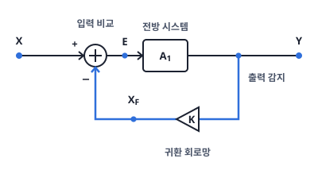

*op-amp 비반전 증폭기라면 op-amp가 전방 시스템 $A_1$, 저항 분배기가 출력 감지와 귀환 회로망 $K$, op-amp의 두 입력이 비교부예요.*

**정확히 말하면**

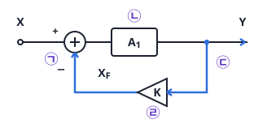

*㉠ 입력 비교 · ㉡ 전방 시스템 · ㉢ 출력 감지 · ㉣ 귀환 회로망 (Lec6 3쪽)*

#### 음귀환과 양귀환의 차이

귀환(feedback)은 출력을 다시 입력 쪽으로 되돌리는 구조예요. 되돌린 신호를 빼는지 더하는지에 따라 두 가지로 나뉘어요.

- **음귀환(negative feedback)**: 입력과 같은 위상의 귀환 신호를 입력에서 빼요. 차이가 줄어드는 안정한 시스템이고, 증폭기 같은 대부분의 회로에 써요. 그냥 "귀환"이라고 하면 음귀환을 뜻해요.
- **양귀환(positive feedback)**: 같은 위상의 출력을 입력에 계속 더해요. 증폭한 신호를 다시 더하면 출력이 점점 커지는 불안정한 시스템이에요. 일정한 주파수의 신호를 만드는 발진기(oscillator, 신호 발생기)에 쓰고, 전자회로2에서는 다루지 않아요.

**음귀환은 정확도가 떨어지는(poorly controlled) 시스템이 더 정교한 특성을 갖게 만드는 데 써요.**

#### 음귀환 시스템을 이루는 네 부분

지금까지 다룬 회로는 입력을 넣으면 출력이 그대로 나오는 개루프(open loop) 시스템이에요.

$$
Y=A_1X
$$

그림의 ㉠ 비교부에서 $X_F$를 빼면 ㉡ 전방 시스템이 그 차이를 증폭해요. ㉢ 출력의 감지점에서 갈라진 신호가 ㉣ 귀환 회로망 $K$를 지나 비교부의 (−) 입력으로 돌아와요.

| 부분 | 하는 일 | 비반전 증폭기에서 |
|---|---|---|
| 전방 시스템(feedforward system) $A_1$ | 들어온 신호를 증폭해요. 예: CS 단 | op-amp |
| 출력 감지(sense mechanism) | 출력 $Y$를 읽어요 | 출력에 붙은 $R_1$, $R_2$ |
| 귀환 회로망(feedback network) $K$ | 감지한 출력으로 귀환 신호 $X_F$를 만들어요 | 저항 분배기 $R_1$, $R_2$ |
| 입력 비교(comparison mechanism) | $X$에서 $X_F$를 빼서 $A_1$에 넣어요 | op-amp의 차동 입력 |

op-amp는 이미 배운 귀환 시스템이에요. op-amp를 그대로 쓰면 개루프이지만, 실제로는 출력에서 저항을 거쳐 입력으로 되돌려요. **비반전 증폭기든 반전 증폭기든 귀환은 항상 반전(−) 입력으로 들어가므로 음귀환이에요.** 자세한 대응은 [비반전 증폭기를 귀환으로 보기](#s2-noninverting)에서 다뤄요.

#### 개루프와 폐루프

귀환 회로망 $K$가 $0$이면 되돌아오는 신호가 없으니 개루프 시스템이에요. **$K\ne0$이면 루프가 닫혀 있다고 해서 폐루프(closed loop) 시스템이라고 해요.** 음귀환 시스템은 폐루프로 구성돼요.

**교수님 말씀**

> 회로에서는 둘 다 써요. ... 용도가 완전히 다르죠.

> 근데 여러분들이 그동안 피드백 시스템 배웠어요. 언제 배웠냐? Op-amp에서.

양귀환은 작은 신호를 증폭해 다시 더하는 일을 반복해 큰 신호를 만들어 낸다고 설명했어요. 신호 발생 회로는 아날로그 집적회로 같은 상위 과목에서 다룬다고 했어요.

확인해 봐요. 입력을 (+) 단자에 넣고, 출력에서 저항 분배기로 전압을 나눠 (−) 단자에 되돌리는 op-amp 회로에서 전방 시스템 $A_1$, 출력 감지·귀환 회로망 $K$, 입력 비교부는 각각 어디에 해당하고, 이 회로는 개루프와 폐루프 중 무엇인가요?

답 보기

op-amp가 전방 시스템 $A_1$, 출력에 연결된 저항 분배기가 출력 감지와 귀환 회로망 $K$, op-amp의 두 차동 입력 단자가 입력 비교부예요. $K\ne0$이므로 폐루프(음귀환) 시스템이에요.

**페이지 요약**

음귀환은 출력을 감지해 귀환 회로망 $K$로 만든 $X_F$를 입력에서 빼고 그 차이를 전방 시스템 $A_1$에 넣어요.

*핵심 식*

- 개루프

  $$
  Y=A_1X
  $$

*용어*

- **음귀환(negative feedback)** — 귀환 신호를 빼는 안정한 구조로, 증폭기에 써요.
- **양귀환(positive feedback)** — 출력을 더하는 불안정한 구조로, 발진기에 써요.
- **네 부분** — 전방 시스템, 출력 감지, 귀환 회로망, 입력 비교예요.
- **개루프 / 폐루프** — $K=0$이면 개루프, $K\ne0$이면 폐루프예요.

---

### 폐루프 이득: 이득이 $1+KA_1$배 줄어요

*1106 수업 · L06 s4*

**쉽게 말하면**

음귀환을 걸면 이득이 $A_1$에서 $\frac{A_1}{1+KA_1}$로 바뀌어, $1+KA_1$배 줄어요.

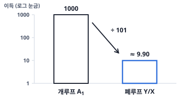

*$A_1=1000$, $K=0.1$이면 $1+KA_1=101$이라 이득이 1000에서 약 9.90으로 줄어요.*

**정확히 말하면**

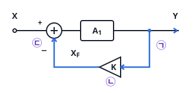

*㉠ 출력 감지점 · ㉡ 귀환 회로망 · ㉢ 입력을 비교하는 곳 (Lec6 4쪽)*

#### 숫자로 먼저 보는 폐루프 이득

먼저 작은 예에 적용해 봐요. $A_1=1000$, $K=0.1$이면 다음과 같아요.

$$
1+KA_1=1+0.1\times1000=101
$$

$$
\frac{Y}{X}=\frac{1000}{101}\approx9.90
$$

개루프 이득(open-loop gain)은 귀환이 없을 때 입력–출력 비 $A_1$이에요($Y=A_1X$).

㉠ 출력 $Y$를 감지해 ㉡ 귀환 회로망에서 $K$배 한 것이 귀환 신호 $X_F$예요.

$$
X_F=KY
$$

$$
K=\frac{X_F}{Y}
$$

**$K$를 귀환율(feedback factor)이라고 하고, "피드백 게인"이라고 부르기도 해요.** 어떤 교재는 $K$ 대신 $\beta$를 써서 $\beta A_1$처럼 적어요. $\beta$도 같은 귀환율이에요.

#### 폐루프 이득 유도하기

㉢ 비교부에서 입력 $X$에서 $X_F$를 빼고, 그 차이를 $A_1$에 넣어요. 칠판 유도는 이 순서예요.

1. $$
   Y=A_1(X-X_F)
   $$

   $A_1$의 입력은 $X-X_F$예요.
2. $$
   Y=A_1(X-KY)
   $$

   $X_F=KY$를 대입해요.
3. $$
   (1+KA_1)Y=A_1X
   $$

   $Y$ 항을 왼쪽으로 이항해요.
4. $$
   \frac{Y}{X}=\frac{A_1}{1+KA_1}
   $$

   양변을 $X$와 $1+KA_1$로 나누면 폐루프 이득(closed-loop gain)이에요.

$K=0$이면 분모가 1이라 개루프 식 $Y=A_1X$로 돌아가요. **음귀환에서는 $KA_1\gt0$이라 분모 $1+KA_1$이 1보다 커서, 이득이 개루프 이득보다 $1+KA_1$배 줄어요.**

#### $K$에 따른 이득 변화와 대가

$A_1=1000$을 고정하고 $K$를 키우면 분모가 커지는 만큼 이득이 줄어요.

| $K$ | $1+KA_1$ | $\frac{Y}{X}$ |
|---|---|---|
| $0$ (개루프) | $1$ | $1000$ |
| $0.01$ | $11$ | $\frac{1000}{11}\approx90.91$ |
| $0.1$ | $101$ | $\frac{1000}{101}\approx9.90$ |

**이득을 내주는 것은 일반적으로 보면 단점일 수 있어요.** 그런데도 음귀환을 쓰는 이유는 다른 장점 때문이고, 그 장점은 다음 시간에 다뤄요. [다음 시간 예고](#s4-next)

**교수님 말씀**

> 게인이 줄어드는데 왜, 왜 쓰느냐? 다른 장점이 있기 때문에 쓰겠죠?

교수님은 예전 교재가 귀환율을 $\beta$로 적었다고 했어요. "베타가 뭐지" 하지 말고 $K$와 같은 피드백 팩터로 이해하라고 했어요.

확인해 봐요. 개루프 이득이 $A_1=500$, 귀환율이 $K=0.04$인 음귀환 시스템에서 폐루프 이득 $\frac{Y}{X}$는 얼마인가요?

답 보기

$\frac{500}{21}\approx23.81$이에요. $1+KA_1=1+0.04\times500=21$이므로 $\frac{Y}{X}=\frac{500}{21}\approx23.81$이에요.

**페이지 요약**

음귀환을 걸면 개루프 이득 $A_1$이 폐루프 이득 $\frac{A_1}{1+KA_1}$로 $1+KA_1$배 줄어요.

*핵심 식*

- 귀환 신호

  $$
  X_F=KY
  $$
- 폐루프 이득

  $$
  \frac{Y}{X}=\frac{A_1}{1+KA_1}
  $$

$K=0$이면 개루프 식 $Y=A_1X$로 돌아가요.

*용어*

- **귀환율(feedback factor)** — $K=\frac{X_F}{Y}$이고, 교재에 따라 $\beta$로 적어요.

---

### 비반전 증폭기를 귀환으로 보기

*1106 수업 · L06 s5*

**쉽게 말하면**

비반전 증폭기는 op-amp가 $A_1$, 저항 분배기가 $K$인 귀환 시스템이라서, $A_1$이 아주 크면 이득이 $1+\frac{R_1}{R_2}$가 돼요.

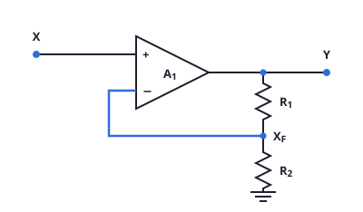

*$R_1=9\,\mathrm{k\Omega}$, $R_2=1\,\mathrm{k\Omega}$이면 $K=0.1$이고, $A_1$이 클수록 이득이 $1+\frac{9}{1}=10$에 가까워져요.*

**정확히 말하면**

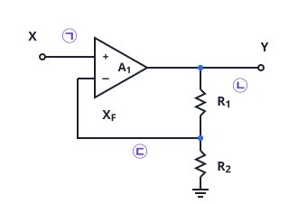

*㉠ 입력과 비교부 · ㉡ 출력 감지점 · ㉢ 분배점에서 돌아오는 귀환 경로 (Lec6 5쪽)*

#### 회로와 귀환 네 부분의 대응

귀환의 네 부분은 이 회로에서 다음과 같이 대응해요.

- 전방 시스템: op-amp $A_1$이에요.
- 출력 감지와 귀환 회로망은 ㉡ 출력 $Y$에서 접지까지 이어진 저항 분배기 $R_1$, $R_2$예요.
- ㉠ op-amp의 (+) 입력에는 $X$가 들어와요. ㉢ 분배점의 전압 $X_F$는 (−) 입력으로 돌아오므로 $A_1$에는 $X-X_F$가 걸려요.

**분배기가 없어서 (−) 입력이 접지되면 $X_F=0$이라 개루프이고, $Y=A_1X$예요.**

#### 숫자로 먼저 보는 비반전 증폭기

먼저 작은 예에 적용해 봐요. $R_1=9\,\mathrm{k\Omega}$, $R_2=1\,\mathrm{k\Omega}$, $A_1=1000$이면 다음과 같아요.

$$
K=\frac{1\,\mathrm{k\Omega}}{9\,\mathrm{k\Omega}+1\,\mathrm{k\Omega}}=0.1
$$

$$
\frac{Y}{X}=\frac{1000}{1+0.1\times1000}=\frac{1000}{101}\approx9.90
$$

**$A_1\to\infty$이면 이 값은 $\frac{1}{K}=10$으로 가요.**

#### 유한한 $A_1$과 무한대 $A_1$의 폐루프 이득

일반식은 이 순서로 구해요. op-amp 입력으로 전류가 흐르지 않는다고 보고 분배기를 써요.

1. $$
   X_F=\frac{R_2}{R_1+R_2}Y
   $$

   ㉡ 출력 전압은 $R_1+R_2$ 전체에 걸리고, ㉢ 분배점의 귀환 전압은 $R_2$에 걸려요.
2. $$
   K=\frac{R_2}{R_1+R_2}
   $$

   귀환율은 그 비율이에요.
3. $$
   \frac{Y}{X}=\frac{A_1}{1+\frac{R_2}{R_1+R_2}A_1}
   $$

   폐루프 이득 $\frac{A_1}{1+KA_1}$에 대입해요.
4. $$
   \frac{Y}{X}\to\frac{1}{K}=\frac{R_1+R_2}{R_2}=1+\frac{R_1}{R_2}
   $$

   이상적인 op-amp처럼 $A_1\to\infty$이면 분모의 1을 무시할 수 있어요.

4단계의 $1+\frac{R_1}{R_2}$가 op-amp에서 저항비로 구했던 비반전 증폭기의 이득이에요. **$A_1$이 무한대가 아니면 정확한 이득은 3단계 식이에요.**

이 회로의 $K$는 보통 1보다 작아요. 귀환이 없을 때($K=0$) 이득은 $A_1$이었고, $A_1=\infty$였다면 무한대에서 $1+\frac{R_1}{R_2}$로 이득이 줄어든 셈이에요.

그래서 op-amp는 무한대 이득의 개루프로 쓰지 않고 귀환 시스템으로 만들어 써요. 그 이유는 뒤에서 다시 설명해요.

**교수님 말씀**

> 근데 A1이 무한대가 아니면? 정확하게는 요런 공식이 돼요.

> op-amp는 오픈 루프로서는 사용을 안 합니다.

교수님은 저항 분배기로 출력을 일정 비율만큼 나눠 되돌리므로 여기서는 $K$가 보통 1보다 작다고 했어요.

확인해 봐요. 비반전 증폭기에서 $R_1=4\,\mathrm{k\Omega}$, $R_2=1\,\mathrm{k\Omega}$일 때 귀환율 $K$는 얼마이고, $A_1=500$일 때의 폐루프 이득과 $A_1\to\infty$일 때의 극한 이득은 각각 얼마인가요?

답 보기

$K=0.2$, $A_1=500$일 때 폐루프 이득은 $\frac{500}{101}\approx4.95$, $A_1\to\infty$일 때 극한 이득은 $5$예요. $K=\frac{1}{4+1}=0.2$, $1+KA_1=1+0.2\times500=101$이므로 $\frac{Y}{X}=\frac{500}{101}\approx4.95$이고, $A_1\to\infty$이면 $\frac{1}{K}=1+\frac{4}{1}=5$예요.

**페이지 요약**

비반전 증폭기는 op-amp $A_1$과 저항 분배기 $K$의 귀환 시스템이고, $A_1\to\infty$이면 이득이 $\frac{1}{K}=1+\frac{R_1}{R_2}$예요.

*핵심 식*

- 귀환율

  $$
  K=\frac{R_2}{R_1+R_2}
  $$
- op-amp 이득이 유한할 때

  $$
  \frac{Y}{X}=\frac{A_1}{1+\frac{R_2}{R_1+R_2}A_1}
  $$
- op-amp 이득이 무한대일 때

  $$
  \frac{Y}{X}\to\frac{1}{K}=1+\frac{R_1}{R_2}
  $$

*용어*

- **저항 분배기** — 출력을 감지하고 $K$를 정하는 $R_1$, $R_2$예요.

---

### 오차 E와 가상 단락

*1106 수업 · L06 s6–s7*

**쉽게 말하면**

오차 $E$는 입력과 귀환 신호의 차이인데, $KA_1$이 클수록 작아져서 귀환 신호가 입력을 거의 그대로 복제해요.

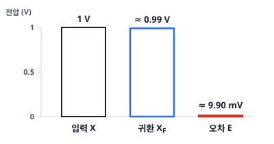

*$A_1=1000$, $K=0.1$, $X=1\,\mathrm{V}$이면 $E=\frac{1}{101}\,\mathrm{V}\approx9.90\,\mathrm{mV}$뿐이라 $X_F\approx0.99\,\mathrm{V}$가 입력과 거의 같아요.*

**정확히 말하면**

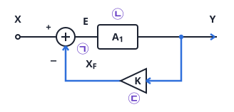

*㉠ 비교부 출력의 오차 · ㉡ 전방 증폭기 · ㉢ 귀환 회로망 (Lec6 6쪽)*

#### 오차 신호 $E$의 정의와 작은 예

㉠ 비교부에서 입력 $X$와 귀환 신호 $X_F$의 차이를 만들고, 그 차이를 ㉡ $A_1$에 넣어요. **이 차이를 오차 신호(error signal) $E$라고 해요.**

$$
E=X-X_F
$$

먼저 작은 예에 적용해 봐요. $X=1\,\mathrm{V}$, $A_1=1000$, $K=0.1$이면 $1+KA_1=101$이에요.

$$
E=\frac{1\,\mathrm{V}}{101}\approx9.90\,\mathrm{mV}
$$

$$
Y=A_1E=\frac{1000}{101}\,\mathrm{V}\approx9.90\,\mathrm{V}
$$

$$
X_F=KY=\frac{100}{101}\,\mathrm{V}\approx0.99\,\mathrm{V}
$$

#### 오차 $E=\frac{X}{1+KA_1}$ 유도하기

㉡ $A_1$이 오차 $E$를 증폭해 $Y$를 만들고, ㉢ 귀환 회로망이 $Y$를 $K$배 해서 비교부로 보내요. 이 관계를 $E=X-X_F$에 넣어요.

1. $$
   E=X-X_F
   $$

   오차의 정의에서 시작해요.
2. $$
   X_F=KA_1E
   $$

   $X_F=KY$이고 $Y=A_1E$예요.
3. $$
   E=X-KA_1E
   $$

   정의에 대입해요.
4. $$
   (1+KA_1)E=X
   $$

   $E$ 항을 모아요.
5. $$
   E=\frac{X}{1+KA_1}
   $$

   $E$에 대해 풀어요.

**입력 $X$가 $1+KA_1$배 줄어든 것이 실제로 $A_1$에 들어가는 신호예요.** $KA_1$을 키우면 이 비율이 계속 작아져요.

| $KA_1$ | $\frac{E}{X}=\frac{1}{1+KA_1}$ |
|---|---|
| $10$ | $\frac{1}{11}\approx9.09\,\%$ |
| $100$ | $\frac{1}{101}\approx0.99\,\%$ |
| $1000$ | $\frac{1}{1001}\approx0.10\,\%$ |

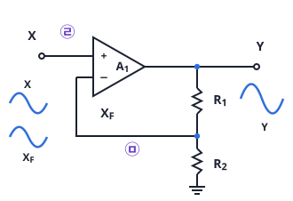

*㉣ op-amp의 두 입력 · ㉤ 입력을 따라가는 귀환 신호 (Lec6 7쪽)*

#### 가상 단락과 복제

$A_1\to\infty$이면 $E\to0$이에요. 하지만 $E$는 정확히 0이 아니에요. $E=0$이면 $Y=A_1E$도 0이 되어 아무 의미가 없어요. $A_1$이 아주 커도 작은 $E$가 들어가야 유한한 출력이 나와요.

그래서 $E$가 거의 0이라는 것은 입력과 귀환 신호가 거의 같다는 뜻이에요.

$$
X\approx X_F
$$

이것이 op-amp에서 배운 가상 단락(virtual short)이에요. ㉣ 두 입력 단자의 전압이 거의 같다는 근사예요.

**$KA_1$이 클수록 귀환 신호는 입력의 좋은 복제(replica)가 돼요.** 출력 $Y$는 커도 ㉤ 분배점의 $X_F$는 입력 파형을 거의 그대로 따라가요.

비반전 증폭기에서 $E\approx0$으로 두면 저항비 이득이 바로 나와요. [비반전 증폭기를 귀환으로 보기](#s2-noninverting)

$$
X_F=\frac{R_2}{R_1+R_2}Y\approx X
$$

$$
\frac{Y}{X}\approx1+\frac{R_1}{R_2}
$$

지금까지 비반전 증폭기의 이득을 저항비로 구할 수 있었던 원리가 이 $E$와 $KA_1$의 관계예요.

**교수님 말씀**

> op-amp 때 ... 두 개가 이 gain이 무한대면 이 두 개가 virtual short이라고 배웠잖아요

> A1이 크면 클수록 입력과 피드백 신호가 거의 같아진다라고, 이것도 피드백 시스템의 특징이에요.

**꼭 기억해요**

> 같지 않습니다. 같으면 출력이 0이에요, 그러면.

$E$는 0에 가깝지만 0은 아니에요. 아주 작은 $E$가 들어가야 유한한 출력이 나와요.

#### 직접 해 보기: 루프가 클수록 이득은 1/K로, 오차는 0으로 *(정적 스냅샷 — 직접 조작은 HTML 버전)*

$A_1$(로그 눈금)과 $K$를 움직이면 왼쪽 그래프의 폐루프 이득 $\frac{Y}{X}$가 $\frac{1}{K}$ 점선에 다가가고, 오른쪽 그래프의 $\frac{E}{X}=\frac{1}{1+KA_1}$이 0으로 줄어드는 것이 보여요. 회색 점선은 귀환이 없을 때의 개루프 이득 $A_1$이에요.

현재 값: **KA1 ≈ 100 · Y/X ≈ 9.90 (1/K = 10의 99.01 %) · E/X ≈ 0.99 %**

범례: 폐루프 이득과 오차 비 · 개루프 이득 $A_1$ 점선 · $\frac{1}{K}$ 수준 점선 · 현재 $A_1$ 위치 점선

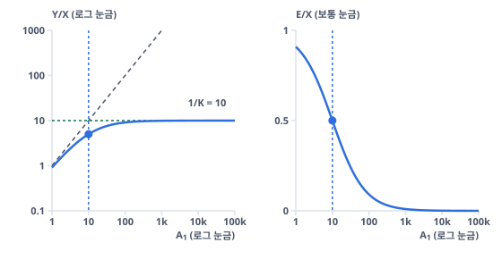

*$K=0.1$, $A_1=10$*

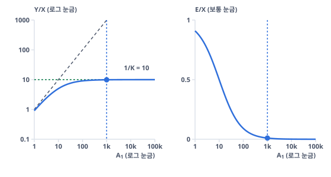

*$K=0.1$, $A_1=1000$*

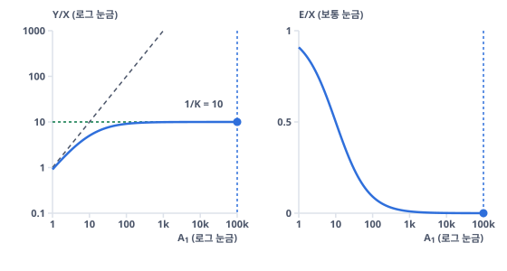

*$K=0.1$, $A_1=10^5$*

| 설정 | $KA_1$ | $\frac{Y}{X}$ | $\frac{1}{K}$ 대비 | $\frac{E}{X}$ |
|---|---|---|---|---|
| $K=0.1$, $A_1=10$ | $1$ | $5$ | $50\,\%$ | $50\,\%$ |
| $K=0.1$, $A_1=1000$ | $100$ | $\approx9.90$ | $\approx99.01\,\%$ | $\approx0.99\,\%$ |
| $K=0.1$, $A_1=10^5$ | $10^4$ | $\approx10$ | $\approx99.99\,\%$ | $\approx0.01\,\%$ |

확인해 봐요. $X=2\,\mathrm{V}$, $A_1=200$, $K=0.05$인 음귀환 시스템에서 오차 신호 $E$, 출력 $Y$, 귀환 신호 $X_F$는 각각 얼마인가요?

답 보기

$E=\frac{2}{11}\approx0.18\,\mathrm{V}$($181.8\,\mathrm{mV}$), $Y=\frac{400}{11}\approx36.36\,\mathrm{V}$, $X_F=\frac{20}{11}\approx1.82\,\mathrm{V}$예요. $1+KA_1=1+0.05\times200=11$이므로 $E=\frac{2}{11}\approx0.18\,\mathrm{V}$, $Y=A_1E=\frac{400}{11}\approx36.36\,\mathrm{V}$, $X_F=KY=\frac{20}{11}\approx1.82\,\mathrm{V}$예요($X-X_F=2-\frac{20}{11}=\frac{2}{11}=E$).

**페이지 요약**

오차 $E$는 $1+KA_1$배 줄어든 입력이라서, $KA_1$이 클수록 귀환 신호가 입력의 복제가 돼요.

*핵심 식*

- 오차 신호

  $$
  E=X-X_F
  $$
- 오차의 크기

  $$
  E=\frac{X}{1+KA_1}
  $$
- 가상 단락

  $$
  X\approx X_F
  $$

$E$는 0에 가깝지만 정확히 0이면 출력도 0이에요.

*용어*

- **가상 단락(virtual short)** — $E\approx0$이라 두 입력 전압이 거의 같다는 가정이에요.
- **복제(replica)** — $KA_1$이 클 때 $X_F$가 입력을 거의 그대로 따라가는 것이에요.

---

## 4. 루프 이득

### 루프를 끊고 시험 신호를 넣어요

*1106 수업 · L06 s8*

**쉽게 말하면**

루프 이득은 루프를 한 곳에서 끊고 입력을 $X=0$으로 둔 채 끊은 자리에 시험 신호 $V_{test}$를 넣어, 한 바퀴 돌아온 신호가 몇 배인지 잰 값이에요.

$K=0.1$, $A_1=1000$에서 $V_{test}=1\,\mathrm{mV}$를 넣으면 $K$ 뒤 $0.1\,\mathrm{mV}$ → 비교부 뒤 $-0.1\,\mathrm{mV}$ → $A_1$ 뒤 $-100\,\mathrm{mV}$로 돌아오니, 마이너스를 붙인 비 $100$이 루프 이득이에요.

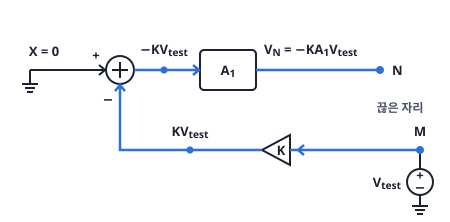

*$M$에 넣은 $V_{test}$가 $K$, 비교부, $A_1$을 차례로 지나 $N$에 $V_N=-KA_1V_{test}$로 돌아와요.*

**정확히 말하면**

*㉠ 시험 전압을 넣는 $M$ · ㉡ 돌아온 전압을 재는 $N$ (Lec6 8쪽 오른쪽)*

#### 숫자로 먼저 보는 루프 이득

먼저 작은 예에 적용해 봐요. $A_1=1000$, $K=0.1$이고 ㉠ $M$에 $V_{test}=1\,\mathrm{mV}$를 넣어요.

$$
KV_{test}=0.1\times1\,\mathrm{mV}=0.1\,\mathrm{mV}
$$

$$
0-KV_{test}=-0.1\,\mathrm{mV}
$$

$$
V_N=1000\times(-0.1\,\mathrm{mV})=-100\,\mathrm{mV}
$$

$$
-\frac{V_N}{V_{test}}=-\frac{-100\,\mathrm{mV}}{1\,\mathrm{mV}}=100=KA_1
$$

#### 루프를 끊고 $KA_1$ 정의하기

귀환 시스템의 루프 이득(loop gain)은 루프를 끊고, 시험 신호(test signal)를 넣고, 루프를 한 바퀴 돈 이득을 계산해서 얻어요. 칠판 유도는 이 순서예요.

1. **루프 끊기** — $A_1$ 출력과 $K$ 입력 사이를 끊어요. $A_1$ 출력 쪽 끝이 $N$, $K$ 입력 쪽 끝이 $M$이에요. 신호가 흐르는 방향은 바꾸지 않아요. $M$에서 $K$, 비교부, $A_1$을 거쳐 $N$으로 가요.
2. **입력 영점** — 입력을 접지해 $X=0$으로 둬요. 그래야 $N$에 돌아온 신호가 모두 $V_{test}$에서 온 것이에요.
3. **시험 신호** — ㉠ $K$ 입력 쪽 $M$에 $V_{test}$를 넣어요.
4. $$
   X_F=KV_{test}
   $$

   **귀환 회로망** — $K$를 지나면 귀환 신호가 돼요.
5. $$
   0-KV_{test}=-KV_{test}
   $$

   **비교부** — 입력 0에서 귀환 신호를 빼요.
6. $$
   V_N=-KA_1V_{test}
   $$

   **전방 시스템** — $A_1$을 지나 ㉡ 열린 단자 $N$에서 돌아온 전압을 읽어요.
7. **부호와 정의** — 한 바퀴 돈 비 $\frac{V_N}{V_{test}}=-KA_1$은 음수예요. 음귀환이라 비교부에서 한 번 빼기 때문이에요. **크기를 나타내려고 마이너스를 붙여 루프 이득으로 정의해요.**

   $$
   KA_1=-\frac{V_N}{V_{test}}
   $$

$K=0$이면 $M$에 넣은 신호가 비교부로 돌아오지 않아 $V_N=0$이고, 루프 이득도 0이에요. 귀환이 없는 개루프예요.

루프 이득과 폐루프 이득을 구별하는 이야기는 [루프 이득과 폐루프 이득은 완전히 달라요](#s3-loop-vs-closed)로 이어져요.

**교수님 말씀**

> 루프를 한 바퀴 돌아서 다시 끊은 자리까지 올 때까지 이득을 루프 게인으로 정의

교수님은 루프를 끊어도 신호의 방향은 그대로라고 짚었어요. 칠판에서는 $V_{test}$가 $K$를 지나 $KV_{test}$, 비교부에서 $-KV_{test}$, $A_1$을 지나 $-KA_1V_{test}$가 되는 순서를 따라 그렸어요.

> 마이너스 붙인 이유는 이게 크기를 나타내기 위해서

확인해 봐요. $A_1=500$, $K=0.04$인 음귀환 시스템에서 입력을 $X=0$으로 두고 끊은 자리 $M$에 $V_{test}=2\,\mathrm{mV}$를 넣었을 때, 한 바퀴 돌아온 $V_N$과 루프 이득 $KA_1$은 각각 얼마인가요?

답 보기

$V_N=-40\,\mathrm{mV}$, 루프 이득은 $KA_1=20$이에요. $KV_{test}=0.04\times2=0.08\,\mathrm{mV}$, 비교부 뒤 $-0.08\,\mathrm{mV}$, $A_1$ 뒤 $V_N=500\times(-0.08)=-40\,\mathrm{mV}$이고, $KA_1=-\frac{V_N}{V_{test}}=-\frac{-40}{2}=20$이에요.

**페이지 요약**

루프를 끊고 $X=0$에서 $V_{test}$를 넣어 한 바퀴 돌아온 신호의 비로 루프 이득을 구해요.

*핵심 식*

- 한 바퀴 돈 신호

  $$
  V_N=-KA_1V_{test}
  $$
- 루프 이득

  $$
  KA_1=-\frac{V_N}{V_{test}}
  $$

음귀환이라 돌아온 비가 음수여서 마이너스를 붙여 크기로 정의해요.

*용어*

- **루프 이득(loop gain)** — 루프를 끊고 입력을 0으로 둔 채 한 바퀴 돈 이득의 크기
- **시험 신호(test signal)** — 끊은 자리에 넣는 신호 $V_{test}$

---

### 루프 이득과 폐루프 이득은 완전히 달라요

*1106 수업 · L06 s8*

**쉽게 말하면**

루프 이득 $KA_1$은 입력을 0으로 두고 루프를 한 바퀴 돈 이득이고, 폐루프 이득 $\frac{A_1}{1+KA_1}$은 입력 $X$에서 출력 $Y$까지의 이득이라서 둘은 완전히 다른 양이에요.

$A_1=1000$, $K=0.1$이면 루프 이득은 $100$인데 폐루프 이득은 $\frac{1000}{101}\approx9.90$이에요.

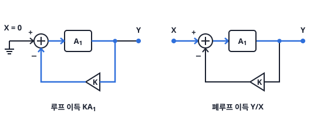

*왼쪽 강조선은 $X=0$에서 루프를 한 바퀴 도는 길이고, 오른쪽 강조선은 입력 $X$에서 출력 $Y$로 가는 길이에요.*

**정확히 말하면**

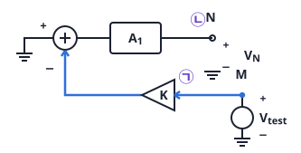

*㉠ 시험 전압을 넣는 $M$ · ㉡ 돌아온 전압을 재는 $N$ (Lec6 8쪽 오른쪽)*

#### 루프를 끊고 루프 이득 재기

입력을 0으로 두고 ㉠ $M$에 시험 전압을 걸어 ㉡ $N$에서 돌아온 전압을 재요. $A_1=1000$, $K=0.1$인 예에 적용해요.

$$
KA_1=0.1\times1000=100
$$

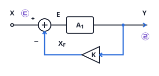

*㉢ 외부 입력 · ㉣ 외부 출력 (Lec6 6쪽)*

#### 루프를 닫고 폐루프 이득 재기

루프가 이어진 상태에서 ㉢ 입력 $X$를 넣고 ㉣ 출력 $Y$를 읽어요.

$$
\frac{Y}{X}=\frac{A_1}{1+KA_1}=\frac{1000}{101}\approx9.90
$$

**같은 $A_1$과 $K$로 만든 값인데 하나는 $100$, 하나는 약 $9.90$이에요.** 재는 대상이 다르기 때문이에요.

여기에 귀환이 없을 때의 [개루프 이득](#s2-closed-loop) $A_1=1000$까지 더하면 이름에 "루프"가 들어간 이득이 세 개예요. 한 표로 나란히 놓고 봐요.

| 구분 | 개루프 이득 | 루프 이득 | 폐루프 이득 |
|---|---|---|---|
| 무엇의 비 | 귀환 없이 출력 $Y$ ÷ 입력 $X$ | 끊은 자리로 돌아온 신호 ÷ 넣은 시험 신호 | 출력 $Y$ ÷ 입력 $X$ |
| 조건 | $K=0$, 귀환 없음 | 루프를 끊고 $X=0$ | 루프를 닫은 채 입력 $X$를 넣음 |
| 식 | $\frac{Y}{X}=A_1$ | $KA_1=-\frac{V_N}{V_{test}}$ | $\frac{Y}{X}=\frac{A_1}{1+KA_1}$ |
| 뜻 | 앞단 증폭기 자체의 이득 | 루프 한 바퀴의 이득, 입력·출력과 무관 | 입력과 출력의 관계(전달함수) |
| 예 ($A_1=1000$, $K=0.1$) | $1000$ | $100$ | $\approx9.90$ |

#### 세 이득을 잇는 식과 오차

세 이득은 하나의 식으로 이어져요. **폐루프 이득은 개루프 이득을 1 더하기 루프 이득으로 나눈 값이에요.**

$$
\frac{Y}{X}=\frac{A_1}{1+KA_1}
$$

$$
\begin{aligned}\text{폐루프 이득}&=\frac{\text{개루프 이득}}{1+\text{루프 이득}}\\&=\frac{1000}{1+100}\approx9.90\end{aligned}
$$

루프 이득과 폐루프 이득은 다르지만 이어져 있어요. [폐루프 이득](#s2-closed-loop)과 [오차 E](#s2-error-signal)의 분모에 모두 $1+KA_1$, 즉 1 더하기 루프 이득이 들어가요.

$$
E=\frac{X}{1+KA_1}
$$

#### $K$에 따른 변화와 루프 이득의 역할

$A_1=1000$을 고정하고 $K$를 키우면 루프 이득이 커지는 만큼 폐루프 이득과 오차가 함께 줄어요.

| $K$ | 루프 이득 $KA_1$ | 폐루프 이득 $\frac{Y}{X}$ | 오차 비율 $\frac{E}{X}$ |
|---|---|---|---|
| $0$ (개루프) | $0$ | $1000$ | $100\%$ |
| $0.01$ | $10$ | $\frac{1000}{11}\approx90.91$ | $\frac{1}{11}\approx9.09\%$ |
| $0.1$ | $100$ | $\frac{1000}{101}\approx9.90$ | $\frac{1}{101}\approx0.99\%$ |

루프 이득이 0이면 귀환이 없는 개루프예요. **루프 이득이 클수록 귀환이 많이 걸려 폐루프 이득도 줄고 입력과 귀환 신호의 차이인 오차도 줄어요.**

루프 이득을 따로 정의하는 이유는 이 값이 이득과 입출력 임피던스 같은 귀환 시스템의 여러 성질을 정하기 때문이에요. 루프 이득과 입출력 임피던스의 관계는 다음 시간에 다뤄요. [다음 시간 예고](#s4-next)

**교수님 말씀**

> 지금 얘기했던 루프 게인과 클로즈드 루프 게인은 완전히 다른 거예요.

> 요건 전달함수고 요거는 루프 게인. 입력과 출력과 아무 관계가 없네요.

교수님은 루프 이득에 따라 귀환 시스템의 여러 특성이 달라진다고 했어요. 그래서 이 용어를 먼저 잘 이해하라고 당부했어요.

**꼭 기억해요**

> 시험에서 문제로 내면 두 개를 반대로 쓰면 아깝게 틀리죠.

"폐루프 이득을 구하시오"에는 $\frac{A_1}{1+KA_1}$을, "루프 이득을 구하시오"에는 $KA_1$을 답해요.

확인해 봐요. $A_1=1000$을 고정하고 $K=0.05$로 두었을 때 개루프 이득, 루프 이득 $KA_1$, 폐루프 이득 $\frac{Y}{X}$, 오차 비율 $\frac{E}{X}$는 각각 얼마인가요?

답 보기

개루프 이득은 $1000$, 루프 이득은 $KA_1=0.05\times1000=50$, 폐루프 이득은 $\frac{1000}{1+50}=\frac{1000}{51}\approx19.61$, 오차 비율은 $\frac{1}{51}\approx1.96\,\%$예요.

**페이지 요약**

루프 이득 $KA_1$은 루프 한 바퀴의 이득이고 폐루프 이득 $\frac{A_1}{1+KA_1}$은 입력에서 출력까지의 이득이라 완전히 다른 양이에요.

*핵심 식*

- 루프 이득

  $$
  KA_1=-\frac{V_N}{V_{test}}
  $$
- 폐루프 이득

  $$
  \frac{Y}{X}=\frac{A_1}{1+KA_1}
  $$
- 세 이득의 관계

  $$
  \text{폐루프 이득}=\frac{\text{개루프 이득}}{1+\text{루프 이득}}
  $$

루프 이득이 클수록 폐루프 이득과 오차가 함께 줄어요.

루프 이득은 이득과 입출력 임피던스 같은 여러 성질을 정해요.

*용어*

- **개루프 이득(open-loop gain)** — 귀환이 없을 때 입력 대비 출력 $A_1$
- **루프 이득(loop gain)** — 루프를 끊고 $X=0$에서 한 바퀴 돈 이득, 입력·출력과 무관
- **폐루프 이득(closed-loop gain)** — 루프가 닫혔을 때 입력 대비 출력 $\frac{Y}{X}$

---

## 5. 요약 · 예고

### 한눈에 다시 보기

| 무엇을 구하나요? | 어떤 조건에서 무엇을 쓰나요? |
|---|---|
| [바이폴라 캐스코드의 밀러 배율](#s0-bjt-poles) | $C_{\mu1}$의 배율에는 입력→출력 이득이 아니라 노드 X에서 노드 Y로의 이득을 넣어요. $A_{v,XY}=\frac{v_Y}{v_X}\approx-\frac{g_{m1}}{g_{m2}}$ BJT 캐스코드는 두 소자에 같은 컬렉터 전류가 흘러 $g_{m1}=g_{m2}$이므로 $A_{v,XY}\approx-1$이에요. 그래서 $C_{\mu1}$은 X와 Y에서 모두 $2C_{\mu1}$로 보여요. |
| [바이폴라 캐스코드의 세 극점](#s0-bjt-poles) | X는 $R_S\parallel r_{\pi1}$, Y는 $1/g_{m2}$, 출력은 $R_L$을 그 노드의 커패시턴스와 짝지어요. $\omega_{p,X}=\frac{1}{(R_S\parallel r_{\pi1})(C_{\pi1}+2C_{\mu1})}$ $\omega_{p,Y}=\frac{1}{\frac{1}{g_{m2}}(C_{CS1}+C_{\pi2}+2C_{\mu1})}$ $\omega_{p,out}=\frac{1}{R_L(C_{CS2}+C_{\mu2})}$ Y는 $r_{o1}\gg1/g_{m2}$라서 $1/g_{m2}$로 봐요. 출력은 아래로 보이는 캐스코드 저항이 $R_L$보다 훨씬 커서 $R_L$로 봐요. |
| [캐스코드의 입출력 임피던스](#s0-io-impedance) | 저주파 값에 커패시턴스의 임피던스가 병렬로 붙어요. $Z_{in}=r_{\pi1}\parallel\frac{1}{(C_{\pi1}+2C_{\mu1})s}$ $Z_{out}=R_L\parallel\frac{1}{(C_{\mu2}+C_{CS2})s}$ MOS 입력 임피던스가 무한대라는 말은 저주파에서만 맞아요. 각 노드의 임피던스가 커패시턴스의 함수라서 그 노드에 극점이 생겨요. |
| [전류원 $M_3$를 단 캐스코드](#s0-m3-cascode) | $I_{D1}=I_{D2}+I_{D3}$ $R_L$에는 $I_{D2}$만 흘러서 IR 드롭을 늘리지 않고 $g_{m1}$을 키울 수 있어요. 출력 단락에서 $r_{o1}\parallel r_{o3}\gg1/g_{m2}$이면 소신호 전류가 거의 다 $M_2$로 가서 $G_m\approx g_{m1}$이에요. 입력 영점에서 출력을 보면 $R_{out}\approx R_L$이에요. $A_v=-G_mR_{out}\approx-g_{m1}R_L$ 극점 식은 노드 Y에만 $C_{GD3}$와 $C_{DB3}$가 더해져요. |
| [차동쌍의 주파수 응답](#s1-half-circuit) | 순수 차동 입력이면 꼬리 노드가 가상 접지라서 $H_{DM}(s)=H_{half}(s)$예요. 반회로는 MOS면 CS 단, 바이폴라면 CE 단이고 극점과 영점이 그 반회로와 같아요. 공통 모드에서는 가상 접지를 쓰지 않고, 꼬리 저항을 $2R_{EE}$로 나눈 반회로를 써요. |
| [캐스코드 차동쌍](#s1-cascode-diffpair) | 반회로가 캐스코드 단이라서 노드 X, Y, 출력에 극점이 하나씩 생겨요. 출력 단락에서 $G_m=g_{m1}$, 입력 영점에서 $R_{out}\approx R_D$예요. $\omega_{p,out}=\frac{1}{R_D(C_{DB3}+C_{GD3})}$ $\begin{aligned}H(s)&=\frac{A_0}{\left(1+\frac{s}{\omega_{p,X}}\right)\left(1+\frac{s}{\omega_{p,Y}}\right)}\\&\quad\times\frac{1}{1+\frac{s}{\omega_{p,out}}}\end{aligned}$ 여기서 $A_0=-g_{m1}R_D$는 저주파 이득이에요. 밀러 근사는 영점을 주지 않지만 영점이 극점보다 훨씬 높아 관심 대역에서는 무시해요. |
| [음귀환 시스템](#s2-feedback-system) | 전방 시스템 $A_1$, 출력 감지, 귀환 회로망 $K$, 입력 비교의 네 부분이에요. $K=0$이면 개루프, $K\ne0$이면 폐루프예요. |
| [폐루프 이득](#s2-closed-loop) | $X_F=KY$ $\frac{Y}{X}=\frac{A_1}{1+KA_1}$ 음귀환을 걸면 이득이 $1+KA_1$배 줄어요. 일부 교재는 귀환율 $K$를 $\beta$로 써요. |
| [비반전 증폭기](#s2-noninverting) | $K=\frac{R_2}{R_1+R_2}$ $\frac{Y}{X}\to\frac{1}{K}=1+\frac{R_1}{R_2}$ $A_1\to\infty$일 때의 극한이에요. $A_1$이 유한하면 폐루프 이득 식에 $K$를 그대로 넣어요. |
| [오차 신호](#s2-error-signal) | $E=X-X_F$ $E=\frac{X}{1+KA_1}$ $KA_1$이 클수록 $E$가 작아져 $X\approx X_F$, 곧 귀환 신호가 입력의 복제가 돼요. $E$가 정확히 0이면 출력도 0이므로 작은 $E$가 남아야 유한한 출력이 나와요. |
| [루프 이득](#s3-loop-gain) | 입력을 $X=0$으로 두고 $A_1$ 출력($N$)과 $K$ 입력($M$) 사이에서 루프를 끊어요. $M$에 시험 신호 $V_{test}$를 넣으면 $K$, 비교부, $A_1$을 지나 $N$으로 돌아와요. $V_N=-KA_1V_{test}$ $KA_1=-\frac{V_N}{V_{test}}$ 음귀환이라 돌아온 비가 음수여서 마이너스를 붙여 정의해요. |
| [루프 이득과 폐루프 이득](#s3-loop-vs-closed) | 루프 이득 $KA_1$은 루프를 한 바퀴 돈 이득이에요. 폐루프 이득 $\frac{A_1}{1+KA_1}$은 폐루프일 때 입력에서 출력까지의 이득이에요. 폐루프 이득은 개루프 이득 $A_1$을 1 더하기 루프 이득으로 나눈 값이에요. 루프 이득이 클수록 폐루프 이득과 오차가 함께 작아져요. |

---

### 다음 시간 예고

- 음귀환의 장점: 이득 둔감화(gain desensitization)
- 음귀환의 장점: 대역폭 확장(bandwidth extension)
- 음귀환의 장점: 입출력 임피던스 변화
- 귀환을 실제 회로로 구현하는 감지·반송 기법(sense and return techniques)

---

### 함께 보면 좋은 자료

- [1104 정리노트 · X·Y·출력에 붙는 커패시터를 모아요](../../1104/정리노트_1104_Cascode_Frequency_Response.html#s1-node-capacitance)
- [1028 정리노트 · CS 단: 밀러 곱셈이 입력 극점을 끌어내려요](../../1028/정리노트_1028_CS_Stage_Frequency_Response.html#s2-cs-miller)
- [0923 정리노트 · 노드 P는 차동 입력에서 가상 접지](../../0923/정리노트_0923_Differential_Amplifiers.html#s3-virtual-ground)
- [문제집 11장 문제 (PDF)](../../../workbook/pdf/ch11-문제.pdf)
- [문제집 12장 문제 (PDF)](../../../workbook/pdf/ch12-문제.pdf)
- [복습문제 8개 (PDF)](../복습문제_1106_Negative_Feedback-문제.pdf)
- [답안 (PDF)](../복습문제_1106_Negative_Feedback-답안.pdf)

---

출처: 권익진 교수님 강의자료(Lec5, Lec6) · 수업 녹음 전사(1106) · B. Razavi, *Microelectronics*, 2nd ed. (Wiley) 11·12장.
