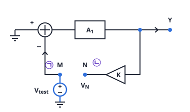
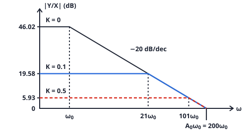
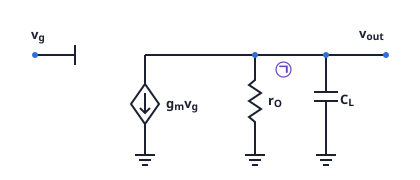
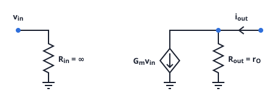
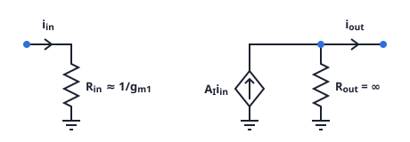
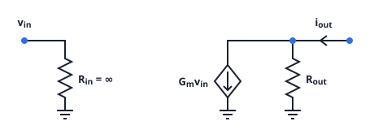

# 전자회로2 복습 1111 문제설명

주어진 조건을 읽고, 첫 줄을 쓰고, 이유를 따라가며 답을 확인해요.

문제의 첫 줄부터 검산까지 설명해요.

**목차**

- [문항별 설명](#problems)
  - [P1. A1 입력에서 끊어 구한 루프 이득](#p1)
  - [P2. 뺄셈기 입력에서 끊어 구한 루프 이득](#p2)
  - [P3. 공칭 이득 4 비반전 증폭기의 실제 이득과 % 변화율](#p3)
  - [P4. 개루프 이득 20% 변화에 폐루프 이득 변화 1% 미만인 최소 루프 이득](#p4)
  - [P5. 공통 소스 단 공정 편차에서 폐루프 이득 ±5%를 보장하는 루프 이득](#p5)
  - [P6. K = 0, 0.1, 0.5일 때 단일 극점 증폭기의 폐루프 주파수 응답](#p6)
  - [P7. 개루프·폐루프 1차 시스템의 −1 dB 대역폭](#p7)
  - [P8. 단일 이득 대역폭이 K와 무관함을 증명](#p8)
  - [P9. 폐루프 −3 dB 대역폭 B를 얻는 귀환율 K](#p9)
  - [P10. 네 가지 트랜지스터 단의 증폭기 모델](#p10)
  - [P11. NMOS 캐스코드의 증폭기 모델](#p11)
  - [P12. 전류 이득이 1인 공통 게이트 전류 증폭기의 장점](#p12)
  - [P13. 차동 입력 귀환 증폭기 여섯 개의 감지·반송 방식](#p13)
  - [P14. 공통 게이트 입력 귀환 증폭기 네 개의 감지·반송 방식](#p14)

## 문항별 설명

### P1. A1 입력에서 끊어 구한 루프 이득

E12.03 · 예제 12.3 · [원 문제 보기](../%EB%B3%B5%EC%8A%B5%EB%AC%B8%EC%A0%9C_1111_Sense_and_Return-%EB%AC%B8%EC%A0%9C.pdf)

#### 주어진 조건

- 루프를 끊는 위치: $A_1$의 입력
- 루프 이득 계산법: 입력 $X$를 0으로 놓고 루프를 끊은 뒤, 끊은 점의 한쪽(M)에 테스트 신호 $V_{test}$를 인가하고 다른 쪽(N)에서 신호 $V_N$을 얻음
- 식 (12.8): $KA_1 = -\dfrac{V_N}{V_{test}}$

#### 구할 것

- $A_1$의 입력에서 루프를 끊었을 때 루프 이득

원문 보기

$A_1$의 입력에서 루프를 끊음으로써 그림 12.1의 귀환 시스템의 루프 이득을 계산하라.

#### 문제를 읽어요

그림 12.1은 일반적인 귀환 시스템이에요. 입력 $X$가 뺄셈기(비교부)의 + 입력으로 들어가고, 뺄셈기 출력이 순방향 블록 $A_1$을 지나 출력 $Y$가 돼요. $Y$는 귀환 회로망 $K$를 거쳐 귀환 신호 $X_F$로 뺄셈기의 − 입력에 돌아가요.

구할 것은 루프 이득(loop gain)이에요. 입력 $X$에서 출력 $Y$까지의 폐루프 이득이 아니에요. 끊는 자리는 원문이 정해 줬어요. 뺄셈기 출력과 $A_1$ 입력 사이, 즉 $A_1$의 입력이에요.

블록 안의 소자 값은 없으니 답은 $A_1$과 $K$로 써요. 각 블록은 신호를 한 방향으로만 전달하고, 끊은 자리에서 다음 블록이 앞 블록에 부하를 주지 않는 이상적인 블록도라고 보고 풀어요. 이 이상적 블록 가정은 원문에 없는 가정이에요.

#### 이 개념과 공식을 떠올려요

"루프를 끊어서 루프 이득을 계산하라"는 말에서 수업의 루프 이득 측정법을 떠올려요([루프는 어디서 끊어도 루프 이득이 같아요](../%EC%A0%95%EB%A6%AC%EB%85%B8%ED%8A%B8_1111_Sense_and_Return.html#s0-break-anywhere)). 순서는 세 가지예요.

- 입력 영점: $X=0$으로 둬서 루프를 도는 신호가 모두 시험 신호에서 오게 해요.
- 끊기와 이름 붙이기: 끊은 두 끝 중 신호를 루프 안으로 내보내는 쪽(다음 블록의 입력)을 $M$, 루프를 돌아 신호가 도착하는 쪽을 $N$이라고 불러요.
- 시험 신호: $M$에 $V_{test}$를 넣고 $N$에 나타나는 $V_N$을 구해요.

$$
KA_1=-\frac{V_N}{V_{test}}
$$

마이너스가 붙는 이유는 음귀환(negative feedback)이기 때문이에요. 뺄셈기가 루프를 한 바퀴 도는 신호에 $-1$을 곱하므로 $V_N/V_{test}$는 음수로 나와요. 이것을 양수로 나타내려고 정의에 마이너스를 붙여요.

루프 한 바퀴의 이득은 루프 위의 $A_1$, $K$, 뺄셈기의 $-1$을 모두 곱한 값이에요. 곱셈은 순서를 바꿔도 같으므로 어디서 끊어도 결과는 같아야 해요. 지난 시간에는 $A_1$ 출력 쪽에서 끊었고([루프를 끊고 시험 신호를 넣어요](../../1106/%EC%A0%95%EB%A6%AC%EB%85%B8%ED%8A%B8_1106_Negative_Feedback.html#s3-loop-gain)), 이 문제는 같은 정의를 $A_1$ 입력 쪽에 적용하는 연습이에요.

#### 종이에 쓸 첫 줄

$X=0$이라 뺄셈기의 + 입력을 접지해요. 뺄셈기 출력 끝이 $N$, $A_1$ 입력 끝이 $M$이에요. 신호는 $M$에서 $A_1$로 나가 $K$와 뺄셈기를 거쳐 $N$으로 돌아오므로 $V_{test}$는 $M$에 걸어요.

*입력 $X$를 0(접지)으로 두고 뺄셈기 출력 $N$과 $A_1$ 입력 $M$ 사이를 끊었어요. $M$에는 $V_{test}$를 걸고 $N$에서 $V_N$을 읽어요.*

첫 줄은 $M$에서 출발해 신호 방향으로 한 블록을 지나는 식이에요. $A_1$의 입력이 바로 $V_{test}$예요.

$$
Y=A_1V_{test}
$$

#### 이렇게 풀어요

출력 $Y$를 귀환 회로망이 감지해 $K$배 해요. 이것이 뺄셈기의 − 입력으로 들어가는 귀환 신호예요.

$$
X_F=KY=KA_1V_{test}
$$

뺄셈기는 + 입력에서 − 입력을 빼요. + 입력은 $X=0$이라 0이에요. 뺄셈기 출력이 바로 끊은 끝 $N$이에요.

$$
V_N=0-X_F
$$

$$
V_N=-KA_1V_{test}
$$

루프 이득의 정의에 넣어요. $V_{test}$가 약분되어 블록 이득만 남아요.

$$
-\frac{V_N}{V_{test}}=-\frac{-KA_1V_{test}}{V_{test}}=KA_1
$$

$A_1$ 입력에서 끊어도 루프 이득은 $KA_1$이에요. 교과서 식 (12.9)와 같고, 출력 쪽에서 끊은 식 (12.7)의 결과와도 같아요.

#### 완성 답과 검산

$X=0$에서 $A_1$ 입력을 끊어 $V_{test}$를 넣으면 $V_N=-KA_1V_{test}$예요.

$$
\text{루프 이득}=-\frac{V_N}{V_{test}}=KA_1
$$

출력 쪽에서 끊은 경우와 비교해요. $K$ 입력에 $V_{test}$를 넣으면 $K$ → 뺄셈기 → $A_1$ 순서로 지나요. 같은 세 인자를 순서만 바꿔 곱하므로 결과가 같아요.

$$
V_N=A_1\bigl(0-KV_{test}\bigr)=-KA_1V_{test}
$$

단위도 맞아요. $V_N$과 $V_{test}$가 모두 전압이라 루프 이득은 무차원(V/V)이에요.

부호도 확인해요. 음귀환이라 $V_N$은 $V_{test}$와 반대 극성이고, 정의의 마이너스 덕분에 루프 이득은 $K$, $A_1$이 양수일 때 양수예요.

이해를 위한 예시로 $A_1=200$, $K=0.05$를 넣으면 $V_{test}=1\,\mathrm{mV}$에서 $Y=200\,\mathrm{mV}$, $X_F=10\,\mathrm{mV}$, $V_N=-10\,\mathrm{mV}$라 루프 이득은 $10$이에요. $KA_1=0.05\times200=10$과 같아요.

#### 주의할 점

루프 이득 $KA_1$을 폐루프 이득 $A_1/(1+KA_1)$과 헷갈리지 않아요. 폐루프 이득은 $X$에서 $Y$까지의 관계이고, 루프 이득은 $X=0$에서 루프를 한 바퀴 돈 이득이에요.

입력 $X$를 그대로 두면 $N$에 입력에서 온 신호까지 섞여요. 그러면 $V_N/V_{test}$가 루프만의 이득이 아니게 돼요.

$V_{test}$를 $N$(뺄셈기 출력) 쪽에 걸고 $M$에서 읽으면 신호를 거꾸로 보내는 셈이에요. 시험 신호는 항상 신호가 나아가는 방향의 다음 블록 입력에 걸어요.

정의의 마이너스를 빼먹으면 $-KA_1$이 나와요. 음귀환의 루프 이득은 양수로 나와야 해요.

#### 조건을 바꾸어 생각해요

1. 뺄셈기를 두 입력 모두 + 인 덧셈기로 바꾸고 같은 자리에서 끊으면 $-V_N/V_{test}$는 얼마인가요? 그 부호가 뜻하는 귀환의 종류도 말해 보세요.
2. $A_1=500$, $K=0.02$이면 루프 이득과 폐루프 이득은 각각 얼마인가요?
3. 이 문제에서 $X$를 0으로 두지 않고 $X=1\,\mathrm{mV}$를 그대로 넣은 채 측정하면 $V_N$에 어떤 항이 더해지나요?

**페이지 요약**

$X=0$에서 $A_1$ 입력을 끊어도 루프 이득은 $KA_1$이에요.

$$
V_N=-KA_1V_{test}
$$

$$
KA_1=-\frac{V_N}{V_{test}}
$$

$V_{test}$는 신호가 나가는 쪽 끝 $M$($A_1$ 입력)에 걸고, 돌아오는 끝 $N$(뺄셈기 출력)에서 읽어요.

음귀환이라 비가 음수로 나오므로 정의에 마이너스를 붙여요.

루프 이득 $KA_1$과 폐루프 이득 $A_1/(1+KA_1)$은 다른 양이에요.

---

### P2. 뺄셈기 입력에서 끊어 구한 루프 이득

X12.03 · 연습문제 12.3 · [원 문제 보기](../%EB%B3%B5%EC%8A%B5%EB%AC%B8%EC%A0%9C_1111_Sense_and_Return-%EB%AC%B8%EC%A0%9C.pdf)

#### 주어진 조건

- 예제 12.3과 같은 시스템: Fig 12.1 일반적인 귀환 시스템 (뺄셈기(덧셈기 ⊕, + $X$, − $X_F$), 순방향 블록 $A_1$, 귀환 회로망 $K$)
- 바뀐 점: 루프를 끊는 위치가 $A_1$의 입력이 아니라 뺄셈기의 입력
- 뺄셈기의 두 입력 중 루프 위에 있는 것은 귀환 신호 $X_F$가 들어가는 − 입력
- 루프 이득 계산법: 입력 $X$를 0으로 놓고 루프를 끊은 뒤, 끊은 점의 한쪽(M)에 테스트 신호 $V_{test}$를 인가하고 다른 쪽(N)에서 신호 $V_N$을 얻음
- 식 (12.8): $KA_1 = -\dfrac{V_N}{V_{test}}$

#### 구할 것

- 뺄셈기의 입력에서 루프를 끊었을 때 루프 이득

원문 보기

뺄셈기의 입력에서 루프를 끊을 때 루프 이득을 계산하라.

#### 문제를 읽어요

예제 12.3과 같은 그림 12.1의 귀환 시스템이에요. 입력 $X$는 뺄셈기의 + 입력, 귀환 회로망 $K$의 출력 $X_F$는 뺄셈기의 − 입력으로 들어가고, 뺄셈기 출력이 $A_1$을 지나 출력 $Y$가 돼요.

바뀐 것은 끊는 자리뿐이에요. 이번에는 뺄셈기의 입력에서 끊어요. 뺄셈기 입력은 두 개지만 루프 위에 있는 것은 귀환 신호가 들어가는 − 입력 하나예요. + 입력에는 외부 입력 $X$만 들어와서 그곳을 끊어도 루프가 끊어지지 않아요. 원문은 어느 입력인지 적지 않아서, $K$ 출력과 뺄셈기 − 입력 사이를 끊는다고 읽어요. 이것은 원문에 없는 해석이에요.

구할 것은 루프 이득이고, 답은 $A_1$과 $K$로 써요. 블록은 이상적이라 끊은 자리에서 부하 효과가 없다고 봐요. 이것도 원문에 없는 가정이에요.

#### 이 개념과 공식을 떠올려요

"루프를 끊을 때 루프 이득"이라는 말에서 루프 이득 측정법을 떠올려요([루프는 어디서 끊어도 루프 이득이 같아요](../%EC%A0%95%EB%A6%AC%EB%85%B8%ED%8A%B8_1111_Sense_and_Return.html#s0-break-anywhere)). $X=0$으로 두고, 끊은 두 끝 중 신호를 루프 안으로 내보내는 쪽 $M$에 $V_{test}$를 걸고, 한 바퀴 돌아 도착하는 쪽 $N$의 $V_N$을 읽어요.

$$
KA_1=-\frac{V_N}{V_{test}}
$$

이번 끊는 자리에서 신호 방향을 따져요. 귀환 신호는 $K$ 출력에서 뺄셈기 − 입력으로 흘러요. 그러니 뺄셈기 − 입력 쪽 끝이 $M$, $K$ 출력 쪽 끝이 $N$이에요.

이 자리를 고르면 뺄셈기의 빼기($-1$)가 루프의 맨 처음에 곱해져요. 예제 12.3에서는 맨 끝에 곱해졌어요. 루프 위 인자 $-1$, $A_1$, $K$는 그대로이고 곱하는 순서만 바뀌므로 루프 이득은 같아야 해요.

#### 종이에 쓸 첫 줄

$X=0$이라 뺄셈기의 + 입력을 접지해요. $K$ 출력에서 오는 귀환선을 뺄셈기 − 입력 앞에서 끊고, − 입력 쪽 끝 $M$에 $V_{test}$를 걸어요. $K$ 출력 쪽 끝 $N$은 열어 두고 $V_N$을 읽어요.

*입력 $X$를 0(접지)으로 두고 $K$ 출력 $N$과 뺄셈기 − 입력 쪽 끝 $M$ 사이를 끊었어요. $M$에는 $V_{test}$를 걸고 $N$에서 $V_N$을 읽어요.*

첫 줄은 $M$에서 출발한 신호가 처음 만나는 뺄셈기의 식이에요. + 입력은 0, − 입력은 $V_{test}$예요. 뺄셈기 출력을 $E$라고 부를게요.

$$
E=0-V_{test}=-V_{test}
$$

#### 이렇게 풀어요

뺄셈기 출력 $E$가 $A_1$을 지나 출력이 돼요.

$$
Y=A_1E=-A_1V_{test}
$$

귀환 회로망이 출력을 $K$배 해서 끊은 끝 $N$에 도착해요.

$$
V_N=KY=-KA_1V_{test}
$$

루프 이득의 정의에 넣으면 $V_{test}$가 약분돼요.

$$
-\frac{V_N}{V_{test}}=-\frac{-KA_1V_{test}}{V_{test}}=KA_1
$$

뺄셈기 입력에서 끊어도 루프 이득은 $KA_1$이에요. 이번에는 빼기의 $-1$이 루프의 처음에 곱해졌을 뿐, 예제 12.3과 같은 세 인자의 곱이에요.

#### 완성 답과 검산

$X=0$에서 $K$ 출력과 뺄셈기 − 입력 사이를 끊어 − 입력 쪽에 $V_{test}$를 넣으면 $V_N=-KA_1V_{test}$예요.

$$
\text{루프 이득}=-\frac{V_N}{V_{test}}=KA_1
$$

세 자리에서 끊은 결과를 나란히 놓아요. 인자 $(-1)$, $A_1$, $K$를 곱하는 순서만 달라요.

$A_1$ 출력에서 끊으면 $K$ → 빼기 → $A_1$ 순서예요.

$$
V_N=A_1\bigl(0-KV_{test}\bigr)=-KA_1V_{test}
$$

$A_1$ 입력에서 끊으면(예제 12.3) $A_1$ → $K$ → 빼기 순서예요.

$$
V_N=0-KA_1V_{test}=-KA_1V_{test}
$$

뺄셈기 입력에서 끊으면(이 문제) 빼기 → $A_1$ → $K$ 순서예요.

$$
V_N=K\cdot A_1\bigl(0-V_{test}\bigr)=-KA_1V_{test}
$$

단위는 V/V로 무차원이고, 음귀환이라 $V_N$이 $V_{test}$와 반대 극성이어서 루프 이득은 양수예요.

이해를 위한 예시로 $A_1=200$, $K=0.05$, $V_{test}=1\,\mathrm{mV}$이면 $E=-1\,\mathrm{mV}$, $Y=-200\,\mathrm{mV}$, $V_N=-10\,\mathrm{mV}$라 루프 이득은 $10=KA_1$이에요.

#### 주의할 점

뺄셈기의 + 입력($X$ 쪽)을 끊는 자리로 고르면 안 돼요. + 입력은 루프 위에 있지 않아서 거기에 $V_{test}$를 넣으면 루프 이득이 아니라 $X$에서 출력 쪽으로 가는 전달을 재게 돼요.

$M$과 $N$을 바꾸면 안 돼요. 이 자리에서는 신호가 $K$ 출력에서 뺄셈기로 흐르므로 $V_{test}$는 뺄셈기 − 입력 쪽 끝에 걸어요. $K$ 출력 쪽에 걸면 신호 흐름을 거스르는 측정(교과서 그림 12.6의 잘못된 방법)이 돼요.

빼기가 첫 단계라 $E=-V_{test}$로 시작해요. 이 부호를 놓치면 $V_N=+KA_1V_{test}$가 되어 루프 이득이 $-KA_1$로 잘못 나와요.

#### 조건을 바꾸어 생각해요

1. $Y$에서 $K$로 가는 선, 즉 $K$의 입력에서 끊는다면 $V_{test}$를 어느 쪽 끝에 걸고 $V_N$을 어디서 읽어야 하나요?
2. 이 문제처럼 $K$ 출력과 뺄셈기 − 입력 사이에서 끊었을 때 $A_1=1000$, $K=0.1$이면 $V_{test}=2\,\mathrm{mV}$에 대해 $V_N$은 얼마인가요?

**페이지 요약**

뺄셈기 입력에서 끊어도 루프 이득은 $KA_1$이에요.

$$
E=-V_{test}
$$

$$
V_N=KA_1E=-KA_1V_{test}
$$

끊는 자리는 루프 위에 있는 − 입력이고, + 입력($X$ 쪽)은 루프 밖이에요.

$V_{test}$는 신호가 나가는 뺄셈기 − 입력 쪽 끝 $M$에 걸고, $K$ 출력 쪽 끝 $N$에서 읽어요.

어디서 끊어도 $(-1)$, $A_1$, $K$의 곱이라 결과가 같아요.

---

### P3. 공칭 이득 4 비반전 증폭기의 실제 이득과 % 변화율

E12.04 · 예제 12.4 · [원 문제 보기](../%EB%B3%B5%EC%8A%B5%EB%AC%B8%EC%A0%9C_1111_Sense_and_Return-%EB%AC%B8%EC%A0%9C.pdf)

#### 주어진 조건

- 공칭값이 4가 되도록 설계됨 (인쇄는 "공칭 전압이 4")

  - 문맥과 맞지 않음(오식으로 보임): 전압이 아니라 공칭 (전압) 이득 $Y/X \approx 1 + R_1/R_2 = 4$로 읽어야 뜻이 통함. 풀이도 식 (12.15)에서 $R_1/R_2 = 3$으로 씀
- 식 (12.15): $KA_1 \gg 1$이면 $\dfrac{Y}{X} \approx \dfrac{1}{K} \approx 1 + \dfrac{R_1}{R_2}$
- 식 (12.2): $\dfrac{Y}{X} = \dfrac{A_1}{1 + KA_1}$, 귀환율 $K = R_2/(R_1 + R_2)$
- (a) $A_1 = 1000$
- (b) $A_1$이 $1000$에서 $500$으로 감소

#### 구할 것

- (a) $A_1 = 1000$일 때 실제 이득 $Y/X$
- (b) $A_1$이 500으로 감소할 때 이득의 % 변화율

원문 보기

공칭 전압이 4가 되도록 그림 12.2의 회로가 설계되었다. (a) $A_1 = 1000$일 때 실제 이득을 결정하라. (b) $A_1$이 500으로 감소할 때 이득의 % 변화율을 결정하라.

#### 문제를 읽어요

그림 12.2는 연산증폭기 $A_1$과 저항 분배기 $R_1$, $R_2$로 만든 비반전 증폭기예요. 입력 $X$는 + 입력으로 들어가고, 출력 $Y$를 $R_1$, $R_2$로 나눈 접속점 전압 $X_F$가 − 입력으로 돌아가요.

원문은 "공칭 전압이 4"라고 인쇄되어 있지만, 문맥상 공칭 전압 이득이 4라는 뜻으로 읽어요. 공칭(nominal) 이득은 $A_1$이 무한히 클 때의 이상적인 이득이에요. 교과서 풀이도 이 값으로 $R_1/R_2=3$을 정해요.

구할 것은 두 가지예요.

- (a) 실제 연산증폭기 이득이 $A_1=1000$일 때의 실제 이득 $Y/X$
- (b) $A_1$이 $1000$에서 $500$으로 반이 될 때 폐루프 이득이 (a)의 값에서 몇 % 바뀌는지

$R_1$, $R_2$의 비는 그대로이고 $A_1$만 바뀐다고 봐요. (b)에서 $A_1$이 (a)의 1000에서 출발해 500이 된다는 것과 이 가정은 원문에 없는 해석이에요.

#### 이 개념과 공식을 떠올려요

"출력을 $R_1$, $R_2$로 나눠 − 입력에 되돌린다"는 그림에서 음귀환 시스템을 떠올려요. 귀환율(feedback factor) $K$는 출력 중 되돌아가는 몫이라 분배비예요.

$$
K=\frac{R_2}{R_1+R_2}
$$

폐루프 이득(closed-loop gain)은 개루프 이득 $A_1$과 루프 이득 $KA_1$로 정해져요.

$$
\frac{Y}{X}=\frac{A_1}{1+KA_1}
$$

"공칭"이라는 말에서 이득 둔감화(gain desensitization)를 떠올려요. $KA_1\gg1$이면 분모의 1을 무시할 수 있어 이득이 $A_1$과 무관한 값이 돼요. 설계자가 목표로 잡는 이 값이 공칭 이득이에요([루프 이득이 크면 이득은 1/K가 돼요](../%EC%A0%95%EB%A6%AC%EB%85%B8%ED%8A%B8_1111_Sense_and_Return.html#s1-desensitization)).

$$
\frac{Y}{X}\approx\frac1K=1+\frac{R_1}{R_2}
$$

(b)의 "% 변화율"은 바뀐 뒤의 값에 $^*$를 붙여 $\dfrac{G^*-G}{G}$로 계산해요. 여기서 $G$는 (a)의 폐루프 이득이에요. $1/K$와의 차이인 오차(error)와는 다른 질문이에요([루프 이득이 커야 하고, 그 대가로 이득은 줄어요](../%EC%A0%95%EB%A6%AC%EB%85%B8%ED%8A%B8_1111_Sense_and_Return.html#s1-large-loop-gain)).

공칭값으로 $K$를 먼저 정하고, 그 $K$를 유한한 $A_1$의 폐루프 식에 넣는 순서로 풀어요.

#### 종이에 쓸 첫 줄

공칭 이득 4는 $A_1\to\infty$일 때의 값이라 $1/K$와 같아요. 이 한 줄이 첫 식이에요.

$$
\frac1K=1+\frac{R_1}{R_2}=4
$$

저항의 비와 귀환율로 바꿔 써요. $K$의 분자·분모를 $R_2$로 나누면 비만으로 쓸 수 있어요.

$$
\frac{R_1}{R_2}=3
$$

$$
K=\frac{1}{1+R_1/R_2}=\frac14
$$

#### 이렇게 풀어요

#### (a) $A_1=1000$일 때 실제 이득

분모에 들어갈 루프 이득을 먼저 구해요.

$$
KA_1=\frac{1000}{4}=250
$$

폐루프 식에 넣어요. 다음 소문항에서 다시 쓰므로 분수 꼴을 유지해요.

$$
G=\frac{A_1}{1+KA_1}=\frac{1000}{251}\approx3.98
$$

공칭값 4보다 조금 작아요. 유한한 $A_1$ 때문에 생긴 차이예요.

#### (b) $A_1$이 500으로 줄 때 % 변화율

$K=1/4$는 저항의 비라 그대로이고 $A_1$만 $A_1^*=500$으로 바뀌어요. 루프 이득도 반이 돼요.

$$
KA_1^*=\frac{500}{4}=125
$$

$$
G^*=\frac{A_1^*}{1+KA_1^*}=\frac{500}{126}=\frac{250}{63}\approx3.97
$$

변화율은 반올림한 소수가 아니라 두 분수의 비로 계산해요.

$$
\frac{G^*}{G}=\frac{250}{63}\times\frac{251}{1000}=\frac{251}{252}
$$

$$
\frac{G^*-G}{G}=\frac{251}{252}-1=-\frac{1}{252}\approx-0.40\,\%
$$

$A_1$은 50% 줄었는데 폐루프 이득은 약 0.40%만 줄었어요. 루프 이득 덕분에 변화가 약 $1/126$로 줄어든 거예요.

#### 완성 답과 검산

#### (a) 검산

$K=1/4$($R_1/R_2=3$), 루프 이득 $KA_1=250$일 때 실제 이득이에요.

$$
\frac{Y}{X}=\frac{1000}{251}\approx3.98
$$

공칭값 $1/K$ 대비 모자란 비율은 $1/(1+KA_1)$이어야 해요. 실제 이득을 공칭값으로 나눠 확인해요.

$$
KG=\frac14\times\frac{1000}{251}=\frac{250}{251}
$$

$$
1-KG=\frac{1}{251}=\frac{1}{1+KA_1}
$$

$A_1\to\infty$이면 $1000/251$ 자리의 값이 $1/K=4$로 돌아가고, 이득은 V/V로 무차원이에요.

#### (b) 검산

$A_1$이 1000에서 500으로 줄면 폐루프 이득은 $1000/251$에서 $250/63$으로 바뀌어요.

$$
\frac{G^*-G}{G}=-\frac{1}{252}\approx-0.40\,\%
$$

즉 이득이 약 0.40% 줄어요.

다른 길로 확인해요. 두 폐루프 식의 비를 먼저 써요.

$$
\frac{G^*}{G}=\frac{A_1^*}{A_1}\cdot\frac{1+KA_1}{1+KA_1^*}
$$

1을 빼고 분모 $A_1(1+KA_1^*)$로 통분하면 $KA_1A_1^*$ 항이 지워져요. 상대 변화는 개루프 이득의 상대 변화를 바뀐 뒤의 $1+KA_1^*$로 나눈 값이에요.

$$
\frac{G^*-G}{G}=\frac{(A_1^*-A_1)/A_1}{1+KA_1^*}=\frac{-0.5}{126}=-\frac{1}{252}
$$

교과서의 $(3.984-3.968)/3.984\approx0.4\,\%$와도 같아요.

#### 주의할 점

반올림한 $3.98$과 $3.97$로 변화율을 계산하면 $0.01/3.98\approx0.25\,\%$가 나와 틀려요. 두 값의 차이가 아주 작아서 반올림 오차가 결과를 바꿔요. 분수 $1000/251$, $250/63$을 끝까지 쓰거나 위의 상대 변화 식을 써요.

(a)의 $1/K$ 대비 오차 $1/251$과 (b)의 변화율 $1/252$는 크기가 비슷해도 다른 양이에요. 앞의 것은 이상값과의 차이, 뒤의 것은 $A_1$이 바뀌기 전후의 차이예요.

"공칭 전압이 4"를 출력 전압 4 V로 읽으면 풀 수 없어요. 문제의 공칭값은 이득 $1/K=1+R_1/R_2$예요.

$R_1/R_2=3$을 보고 $K=1/3$로 두기 쉬워요. $K$는 $R_2$가 전체에서 차지하는 몫이라 $1/(3+1)=1/4$이에요.

#### 조건을 바꾸어 생각해요

1. 같은 회로($K=1/4$)에서 $A_1$이 1000에서 200으로 줄면 폐루프 이득은 몇 % 바뀌나요?
2. 공칭 이득을 8로 바꾸고 $A_1$이 1000에서 500으로 줄면, 변화율이 이 문제의 약 0.40%보다 커지나요, 작아지나요? 값도 구해 보세요.

**페이지 요약**

공칭 이득 $1/K$로 $K$를 정하고, 유한한 $A_1$을 폐루프 식에 넣어요.

$$
K=\frac{1}{1+R_1/R_2}=\frac14
$$

$$
\frac{Y}{X}=\frac{A_1}{1+KA_1}=\frac{1000}{251}\approx3.98
$$

$$
\frac{G^*-G}{G}=\frac{(A_1^*-A_1)/A_1}{1+KA_1^*}=-\frac{1}{252}
$$

$A_1$이 50% 줄어도 폐루프 이득은 약 0.40%만 줄어요.

변화율은 반올림한 소수가 아니라 분수로 계산해요.

---

### P4. 개루프 이득 20% 변화에 폐루프 이득 변화 1% 미만인 최소 루프 이득

P12.07 · 장말문제 12.7 · [원 문제 보기](../%EB%B3%B5%EC%8A%B5%EB%AC%B8%EC%A0%9C_1111_Sense_and_Return-%EB%AC%B8%EC%A0%9C.pdf)

#### 주어진 조건

- 개루프 이득 $A_1$이 20% 변함
- 식 (12.2): $\dfrac{Y}{X} = \dfrac{A_1}{1 + KA_1}$, 루프 이득은 $KA_1$
- $K$는 변하지 않는다고 봄

#### 구할 것

- 폐루프 이득의 변화가 1% 미만이 되도록 하는 최소 루프 이득

원문 보기

Suppose the open-loop gain $A_1$ in Fig. 12.1 changes by 20%. Determine the minimum loop gain necessary to ensure the closed-loop gain changes by less than 1%.

#### 문제를 읽어요

그림 12.1의 일반 귀환 시스템이에요. 순방향 블록의 개루프 이득(open-loop gain) $A_1$이 20% 변해요. 귀환 회로망 $K$는 변하지 않는다고 봐요. 이것은 원문에 없는 가정이에요.

요구 조건은 폐루프 이득(closed-loop gain)의 변화가 1% 미만이에요. 구할 것은 이 조건을 보장하는 최소 루프 이득 $KA_1$이에요. 여기서 루프 이득은 $A_1$이 변하기 전, 설계한 공칭 $A_1$으로 잰 값이에요.

원문은 20%가 늘어나는 쪽인지 줄어드는 쪽인지 말하지 않아요. "보장"하려면 두 방향을 모두 따져서 더 엄격한 쪽을 답으로 골라요. 루프 이득을 공칭값으로 재는 것과 이 양방향 해석은 원문에 없는 해석이에요.

#### 이 개념과 공식을 떠올려요

"개루프 이득이 변해도 폐루프 이득은 조금만 변한다"는 말에서 이득 둔감화(gain desensitization)를 떠올려요([루프 이득이 크면 이득은 1/K가 돼요](../%EC%A0%95%EB%A6%AC%EB%85%B8%ED%8A%B8_1111_Sense_and_Return.html#s1-desensitization)).

출발 식은 폐루프 이득이에요.

$$
G=\frac{A_1}{1+KA_1}
$$

기호를 정해요. 루프 이득은 $T=KA_1$, 변한 뒤의 값에는 $^*$를 붙여 $A_1^*$, $G^*$로 써요. $A_1$의 상대 변화를 $\delta$로 두면 $A_1^*=(1+\delta)A_1$이고, 이 문제는 $\delta=\pm0.2$예요.

구할 양은 폐루프 이득의 상대 변화 $\dfrac{G^*-G}{G}$예요. 수업에서 "1% 오차에 루프 이득 약 100"이라고 한 것은 $1/K$와의 오차 $1/(1+KA_1)$ 기준이에요([루프 이득이 커야 하고, 그 대가로 이득은 줄어요](../%EC%A0%95%EB%A6%AC%EB%85%B8%ED%8A%B8_1111_Sense_and_Return.html#s1-large-loop-gain)). 변화율과는 다른 양이라 이 문제에 그대로 쓰지 않아요.

20%는 작은 변화가 아니에요. 그래서 미분으로 얻는 근사 대신 변하기 전후의 폐루프 식을 그대로 비교해요. 변화 전후의 비를 먼저 세우면 공통 인자가 약분되어 식이 짧아져요.

#### 종이에 쓸 첫 줄

$K$는 그대로이고 $A_1$만 $A_1^*$로 바뀌어요. 두 폐루프 이득의 비를 첫 줄로 써요.

$$
\frac{G^*}{G}=\frac{A_1^*}{A_1}\cdot\frac{1+KA_1}{1+KA_1^*}
$$

$A_1^*=(1+\delta)A_1$과 $T=KA_1$을 넣어요.

$$
\frac{G^*}{G}=\frac{(1+\delta)(1+T)}{1+(1+\delta)T}
$$

#### 이렇게 풀어요

비에서 1을 빼고 통분해요. 분자의 $(1+\delta)T$ 항이 서로 지워져요.

$$
\frac{G^*-G}{G}=\frac{(1+\delta)(1+T)-1-(1+\delta)T}{1+(1+\delta)T}
$$

$$
\frac{G^*-G}{G}=\frac{\delta}{1+(1+\delta)T}
$$

폐루프 이득의 변화율은 개루프 이득의 변화율 $\delta$를 변한 뒤의 $1+KA_1^*$로 나눈 값이에요. 루프 이득이 클수록 변화가 크게 줄어요.

$\delta=-0.2$이면 분모에 $0.8T$가 들어가요. 변화의 크기가 1% 미만이어야 해요.

$$
\frac{0.2}{1+0.8T}<0.01
$$

$$
1+0.8T>20
$$

$$
T>\frac{19}{0.8}=23.75
$$

$\delta=+0.2$이면 분모에 $1.2T$가 들어가요.

$$
\frac{0.2}{1+1.2T}<0.01
$$

$$
1+1.2T>20
$$

$$
T>\frac{19}{1.2}\approx15.83
$$

줄어드는 쪽은 변한 뒤 루프 이득이 작아져 둔감화가 약해지므로 더 엄격해요. 두 조건을 모두 만족하려면 큰 쪽을 골라요.

$$
KA_1>23.75
$$

#### 완성 답과 검산

$K$가 일정하고 $A_1$이 ±20% 변할 때, 폐루프 이득 변화를 1% 미만으로 보장하는 최소 루프 이득(변화 전 공칭값)이에요. $A_1$이 줄어드는 경우가 조건을 정해요.

$$
KA_1>23.75
$$

경계값 $T=23.75$를 비의 식에 넣으면 줄어드는 경우가 정확히 1%예요.

$$
\frac{G^*}{G}=\frac{0.8\times24.75}{1+0.8\times23.75}=\frac{19.8}{20}=0.99
$$

같은 $T$에서 늘어나는 경우는 1%보다 작아서 함께 만족해요.

$$
\frac{0.2}{1+1.2\times23.75}=\frac{0.2}{29.5}\approx0.68\,\%
$$

극한도 맞아요. $T=0$(귀환 없음)이면 변화율이 $\delta=20\,\%$ 그대로이고, $T\to\infty$이면 0으로 가요. 루프 이득과 변화율은 모두 무차원이에요.

변한 뒤의 루프 이득으로 말하면 $KA_1^*=0.8\times23.75=19$보다 커야 한다는 뜻이에요.

#### 주의할 점

$1/K$와의 오차 기준 $1/(1+KA_1)<1\,\%$를 쓰면 $KA_1>99$가 나와요. 이것은 이상값과의 차이 조건이고, 이 문제가 묻는 $A_1$ 변화 전후의 변화율 조건이 아니에요.

작은 변화의 근사 $\dfrac{\Delta G}{G}\approx\dfrac{\Delta A_1/A_1}{1+KA_1}$을 쓰면 $KA_1>19$가 나와요. 20%는 작지 않아서, 줄어드는 경우 이 값으로는 1%를 넘어요.

$A_1$이 늘어나는 쪽만 계산하면 $15.83$이 나와 보장이 안 돼요. 방향이 정해지지 않은 변화는 두 방향을 모두 확인해요.

#### 조건을 바꾸어 생각해요

1. $A_1$이 최대 50%까지 줄 수 있다면, 폐루프 변화 1% 미만을 보장하는 최소 루프 이득은 얼마인가요?
2. $A_1$은 20% 줄고 요구 정밀도를 0.1%로 높이면 최소 루프 이득은 몇 배쯤 커지나요?

**페이지 요약**

폐루프 변화율은 개루프 변화율을 변한 뒤의 $1+KA_1^*$로 나눈 값이에요.

$$
\frac{G^*-G}{G}=\frac{\delta}{1+(1+\delta)KA_1}
$$

$$
\frac{0.2}{1+0.8KA_1}<0.01\ \Rightarrow\ KA_1>23.75
$$

$A_1$이 줄어드는 쪽이 루프 이득도 줄여 더 엄격하므로 그쪽이 답을 정해요.

$1/K$ 대비 오차 기준($KA_1>99$)과 변화율 기준을 섞지 않아요.

---

### P5. 공통 소스 단 공정 편차에서 폐루프 이득 ±5%를 보장하는 루프 이득

P12.08 · 장말문제 12.8 · [원 문제 보기](../%EB%B3%B5%EC%8A%B5%EB%AC%B8%EC%A0%9C_1111_Sense_and_Return-%EB%AC%B8%EC%A0%9C.pdf)

#### 주어진 조건

- $\mu_n C_{ox}$는 $\pm 10\%$, $\lambda$는 $\pm 20\%$까지 변할 수 있음
- 식 (12.2): $\dfrac{Y}{X} = \dfrac{A_1}{1 + KA_1}$, 루프 이득은 $KA_1$
- 전류원은 이상적 전류원이고 바이어스 전류는 변하지 않는다고 봄

#### 구할 것

- 폐루프 이득의 변동을 $\pm 5\%$ 미만으로 보장하는 최소 루프 이득

원문 보기

Consider the feedback system shown in Fig. 12.81, where the common-source stage serves as the feedforward network. Assume $\mu_n C_{ox}$ may vary by $\pm 10\%$ and $\lambda$ by $\pm 20\%$. What is the minimum loop gain necessary to guarantee that the closed-loop gain varies by less than $\pm 5\%$?

#### 문제를 읽어요

그림 12.81은 귀환 시스템이에요. 입력 $V_{in}$이 뺄셈기의 + 입력으로 들어가고, 뺄셈기 출력이 $M_1$의 게이트를 구동해요. $M_1$은 위쪽 전류원을 부하로 쓰는 공통 소스(CS) 단이고, 드레인이 출력 $V_{out}$이에요. $V_{out}$을 귀환 회로망 $K$가 감지해 뺄셈기의 − 입력으로 돌려보내요.

CS 단이 순방향 회로망(feedforward network)이라 개루프 이득 $A_1$은 이 단의 전압 이득이에요. 공정 변화로 $\mu_nC_{ox}$는 ±10%, $\lambda$는 ±20%까지 변할 수 있어요. 구할 것은 폐루프 이득의 변동을 ±5% 미만으로 보장하는 최소 루프 이득이에요.

원문에 없는 가정을 밝혀 둘게요.

- 전류원은 이상적이라 드레인 바이어스 전류 $I_D$는 공정과 무관하게 일정하고, $W/L$도 그대로예요.
- $K$는 변하지 않고 $M_1$은 포화 영역에 있어요.
- 루프 이득은 공칭 파라미터로 잰 설계값 $KA_1$이에요.

CS 단은 반전 증폭기라 $A_1$은 음수예요. 음귀환이 되려면 루프 이득 $KA_1$이 양수여야 하므로 $K$ 블록도 부호를 맞춘다고 봐요. 이 문제는 크기의 상대 변화만 다루므로 부호는 결과에 영향을 주지 않아요.

#### 이 개념과 공식을 떠올려요

"공정 파라미터가 ±몇 % 변한다"는 말에서 부품 변동(component variation)을 귀환으로 줄이는 이득 둔감화를 떠올려요([증폭기 이득은 흔들리고 저항의 비는 정확해요](../%EC%A0%95%EB%A6%AC%EB%85%B8%ED%8A%B8_1111_Sense_and_Return.html#s1-precise-k)).

순서는 두 단계예요.

- 개루프 이득이 공정 변화로 최대 몇 % 흔들리는지 구해요.
- 그 흔들림이 폐루프에서 5% 미만으로 줄어들 루프 이득을 구해요.

첫 단계의 CS 단 이득은 전압 이득의 계산 순서대로 출력 단락의 $G_m$, 입력 영점의 $R_{out}$, 부호 있는 곱으로 구해요. 쓰이는 기호는 두 개예요.

$$
g_m=\sqrt{2\mu_nC_{ox}\frac{W}{L}I_D}
$$

$$
r_O=\frac{1}{\lambda I_D}
$$

$g_m$은 게이트 전압이 드레인 전류를 바꾸는 정도, $r_O$는 채널 길이 변조로 생기는 출력 저항이에요. $I_D$를 고정한 꼴로 써야 $\mu_nC_{ox}$가 제곱근으로 들어간다는 점이 이 문제의 단서예요.

둘째 단계는 폐루프 이득 $G=A_1/(1+KA_1)$의 변화 전후 비교예요. 변한 뒤의 값에 $^*$를 붙이고 $T=KA_1$로 쓰면 다음 식이 성립해요.

$$
\frac{G^*-G}{G}=\frac{A_1^*/A_1-1}{1+(A_1^*/A_1)\,T}
$$

이 식은 두 폐루프 식의 비 $\dfrac{G^*}{G}=\dfrac{A_1^*}{A_1}\cdot\dfrac{1+T}{1+(A_1^*/A_1)T}$에서 1을 빼고 통분하면 나와요. 개루프 변화율을 변한 뒤의 $1+KA_1^*$로 나눈 꼴이라, 루프 이득이 클수록 변화가 줄어드는 이득 둔감화를 수식으로 쓴 셈이에요([루프 이득이 크면 이득은 1/K가 돼요](../%EC%A0%95%EB%A6%AC%EB%85%B8%ED%8A%B8_1111_Sense_and_Return.html#s1-desensitization)).

#### 종이에 쓸 첫 줄

입력은 $M_1$ 게이트 전압 $v_{g}$, 출력은 드레인 전압 $v_{out}$이에요. 출력을 접지로 단락하고, 접지에서 단락선을 지나 출력 노드로 들어오는 단락 전류 $i_{out,sc}$를 양으로 잡아요. 게이트가 $v_g$만큼 오르면 $M_1$이 드레인에서 소스로 $g_mv_g$를 더 끌어내리고, 그 전류를 단락선이 출력 노드로 공급해요.

$$
G_m=\frac{i_{out,sc}}{v_g}=g_m
$$

입력 소신호를 0으로 두면 $M_1$은 $r_O$로 보여요. 이상적 전류원은 개방이라 드레인 노드에는 $r_O$만 남아요.

$$
R_{out}=r_O
$$

단락을 풀면 $M_1$이 끌어내리는 전류 $G_mv_g$를 단락선 대신 $R_{out}$이 공급해야 해서 출력 전압이 내려가요. 그래서 같은 전류 정의에서 이득은 반전이에요.

$$
A_1=-G_mR_{out}=-g_mr_O
$$

크기에 $g_m$, $r_O$를 넣으면 어떤 파라미터가 어떻게 들어가는지 보여요.

$$
|A_1|=\frac{1}{\lambda I_D}\sqrt{2\mu_nC_{ox}\frac{W}{L}I_D}=\frac{1}{\lambda}\sqrt{\frac{2\mu_nC_{ox}(W/L)}{I_D}}
$$

#### 이렇게 풀어요

고정 인자부터 지워요. $W/L$과 $I_D$는 일정하므로 변하는 인자만 남아요.

$$
|A_1|\propto\frac{\sqrt{\mu_nC_{ox}}}{\lambda}
$$

각 인자의 배율을 따로 봐요. $\mu_nC_{ox}$가 ±10% 변하면 $\sqrt{\mu_nC_{ox}}$는 $\sqrt{0.9}$배에서 $\sqrt{1.1}$배, $\lambda$가 ±20% 변하면 $1/\lambda$는 $1/1.2$배에서 $1/0.8$배예요.

가장 작은 이득은 $\mu_nC_{ox}$가 10% 줄고 $\lambda$가 20% 늘 때예요. 이 배율을 $a$라고 해요.

$$
a=\frac{\sqrt{0.9}}{1.2}\approx0.79
$$

가장 큰 이득은 $\mu_nC_{ox}$가 10% 늘고 $\lambda$가 20% 줄 때예요. 이 배율을 $b$라고 해요.

$$
b=\frac{\sqrt{1.1}}{0.8}\approx1.31
$$

개루프 이득은 약 20.94% 줄거나 약 31.10% 늘 수 있어요. 귀환이 없으면 이 변동이 그대로 나타나요.

$A_1^*/A_1=a$를 상대 변화 식에 넣고 크기가 5% 미만이 되게 해요. 수치는 마지막에 넣어요.

$$
\frac{1-a}{1+aT}<0.05
$$

$$
1+aT>20(1-a)
$$

$$
T>\frac{19}{a}-20=\frac{22.8}{\sqrt{0.9}}-20\approx4.03
$$

$A_1^*/A_1=b$일 때도 같은 방법이에요.

$$
\frac{b-1}{1+bT}<0.05
$$

$$
1+bT>20(b-1)
$$

$$
T>20-\frac{21}{b}=20-\frac{16.8}{\sqrt{1.1}}\approx3.98
$$

두 조건을 모두 만족해야 하므로 큰 쪽을 골라요. 이득이 줄어드는 경우가 정해요. 그 경우 변한 뒤의 루프 이득 $aT$도 작아져 둔감화가 약해지기 때문이에요.

$$
KA_1>\frac{19}{a}-20\approx4.03
$$

#### 완성 답과 검산

이상적 전류원으로 $I_D$가 고정되고 $K$가 일정할 때, $\mu_nC_{ox}$ ±10%·$\lambda$ ±20%에도 폐루프 이득 변동을 ±5% 미만으로 보장하는 최소 루프 이득(공칭값)이에요.

$$
KA_1>\frac{19\times1.2}{\sqrt{0.9}}-20\approx4.03
$$

경계값 $T=19/a-20$을 비의 식에 넣으면 이득이 줄어드는 경우가 정확히 5%예요.

$$
\frac{G^*}{G}=\frac{a(1+T)}{1+aT}=\frac{a(19/a-19)}{20(1-a)}=\frac{19(1-a)}{20(1-a)}=0.95
$$

같은 $T$에서 이득이 늘어나는 경우는 약 4.95%라 5% 안에 들어와요.

$$
\frac{b-1}{1+bT}\approx\frac{0.31}{6.29}\approx4.95\,\%
$$

극한도 맞아요. $T=0$이면 폐루프 변동이 개루프 변동 약 −20.94%·+31.10% 그대로이고, $T\to\infty$이면 0으로 가요. 루프 이득은 무차원이에요.

작은 변화의 근사로 대조해요. $|A_1|$의 상대 변화를 $\tfrac12(\pm10\,\%)$와 $\mp20\,\%$의 합 ±25%로 보고 $0.25/(1+T)<0.05$를 풀면 $T>4$예요. 정확한 값 4.03과 가깝지만, $T=4$를 넣으면 줄어드는 경우가 약 5.03%라 조금 모자라요.

#### 주의할 점

$I_D$가 전류원으로 고정되어 있으므로 $g_m$은 $\mu_nC_{ox}$에 비례하지 않고 제곱근에 비례해요. $\mu_nC_{ox}$ 10% 변화를 그대로 10%로 넣으면 최악 배율이 틀려요.

$r_O=1/(\lambda I_D)$라서 $\lambda$가 20% 늘면 $r_O$는 20%가 아니라 $1/1.2$배, 약 16.67% 줄어요. 늘어나는 쪽은 $1/0.8=1.25$배로 25% 늘어요.

최악의 경우는 두 파라미터가 같은 방향으로 이득을 바꿀 때예요. $\mu_nC_{ox}$가 줄고 $\lambda$가 느는 조합이 가장 작은 이득, 그 반대 조합이 가장 큰 이득이에요.

CS 단의 반전 부호 때문에 $A_1$을 음수로 넣고 $1+KA_1$을 계산하면 엉뚱한 값이 나와요. 음귀환의 루프 이득 $KA_1$은 양수로 다뤄요.

#### 조건을 바꾸어 생각해요

1. $\mu_nC_{ox}$는 정확하고 $\lambda$만 ±20% 변한다면, 줄어드는 경우와 늘어나는 경우 중 어느 쪽이 최소 루프 이득을 정하나요? 그 값도 구해 보세요.
2. $M_1$의 바이어스를 이상적 전류원이 아니라 고정된 $V_{GS}$로 정한다면 $|A_1|=g_mr_O$는 $\mu_nC_{ox}$에 어떻게 의존하나요?

**페이지 요약**

CS 단 개루프 이득의 최악 배율을 구한 뒤, 폐루프 변화율 식으로 루프 이득을 역산해요.

$$
|A_1|=G_mR_{out}=g_mr_O\propto\frac{\sqrt{\mu_nC_{ox}}}{\lambda}
$$

$$
\frac{G^*-G}{G}=\frac{A_1^*/A_1-1}{1+(A_1^*/A_1)\,KA_1}
$$

$I_D$가 고정이라 $\mu_nC_{ox}$는 제곱근으로, $\lambda$는 $r_O$를 통해 역수로 들어가요.

이득이 $\sqrt{0.9}/1.2$배로 줄어드는 경우가 정해서 $KA_1>4.03$이에요.

---

### P6. K = 0, 0.1, 0.5일 때 단일 극점 증폭기의 폐루프 주파수 응답

E12.05 · 예제 12.5 · [원 문제 보기](../%EB%B3%B5%EC%8A%B5%EB%AC%B8%EC%A0%9C_1111_Sense_and_Return-%EB%AC%B8%EC%A0%9C.pdf)

#### 주어진 조건

- 순방향 증폭기: 단일 극점 개루프 증폭기, 식 (12.19): $A_1(s) = \dfrac{A_0}{1 + \dfrac{s}{\omega_0}}$, $A_0$는 저주파 이득, $\omega_0$는 $-3\ \text{dB}$ 대역폭
- 식 (12.22): $\dfrac{Y}{X}(s) = \dfrac{\dfrac{A_0}{1 + KA_0}}{1 + \dfrac{s}{(1 + KA_0)\omega_0}}$
- $A_0 = 200$
- $K = 0$, $0.1$, $0.5$의 세 경우
- $\omega_0$ 값은 주어지지 않음 (응답 모양을 $\omega_0$ 기준으로 그림)

#### 구할 것

- $K = 0, 0.1, 0.5$일 때 식 (12.22)의 폐루프 주파수 응답 도시

원문 보기

$K = 0, 0.1, 0.5$일 때 식 (12.22)로 주어지는 폐루프 주파수 응답을 도시하라. $A_0 = 200$으로 가정하라.

#### 문제를 읽어요

회로가 아니라 식으로 주어진 시스템이에요. 순방향 증폭기는 저주파 이득 $A_0=200$, 극점 $\omega_0$ 하나뿐인 단일 극점 증폭기이고, 귀환율(feedback factor) $K$로 부귀환을 건 폐루프 전달 함수가 식 (12.22)예요.

할 일은 $K=0$, $0.1$, $0.5$ 세 경우의 폐루프 크기 응답을 한 그래프에 그리는 거예요. $\omega_0$의 값은 주어지지 않았으니 가로축은 $\omega_0$의 배수로 읽어요.

그래프 하나를 그리려면 숫자 두 개만 알면 돼요. 평탄한 저주파 이득의 높이와, 곡선이 꺾이는 극점의 위치예요.

#### 이 개념과 공식을 떠올려요

"식 (12.22)"와 "$K$를 0, 0.1, 0.5로 바꿔"라는 단서에서 대역폭 확장(bandwidth extension)을 떠올려요([극점이 (1+루프 이득)배 높아져요](../%EC%A0%95%EB%A6%AC%EB%85%B8%ED%8A%B8_1111_Sense_and_Return.html#s2-pole-shift)). 식 (12.22)는 다시 단일 극점 꼴이라서 두 값을 바로 읽을 수 있어요.

$$
\frac{Y}{X}(0)=\frac{A_0}{1+KA_0}
$$

$$
\omega_{p,\mathrm{closed}}=(1+KA_0)\omega_0
$$

기호를 정리해요. $KA_0$는 저주파 루프 이득(loop gain)이고, $1+KA_0$는 귀환이 이득을 나누는 배수예요. 극점(pole)은 분모를 0으로 만드는 $s$이고, 영점이 없는 단일 극점 응답에서는 그 크기가 −3 dB 대역폭이에요.

근사는 쓰지 않아요. 식 (12.22)는 단일 극점 개루프에서 정확히 나온 식이고, 그래프는 보데 근사(Bode approximation)로 그려요. 극점 전에는 평탄, 극점 뒤에는 기울기 $-20\,\mathrm{dB/dec}$예요([보데 근사](../../1014/%EC%A0%95%EB%A6%AC%EB%85%B8%ED%8A%B8_1014_Frequency_Response.html#s1-bode)).

이 도구를 고르는 이유는 세 곡선이 모두 같은 모양(단일 극점)이고 $1+KA_0$ 하나만 다르기 때문이에요. 그 배수 하나를 구하면 높이와 꺾이는 위치가 함께 정해져요.

#### 종이에 쓸 첫 줄

고정된 값은 $A_0=200$과 $\omega_0$이고, 바뀌는 것은 $K$뿐이에요. 그래서 경우마다 배수 $1+KA_0$부터 써요.

$$
K=0:\ 1+KA_0=1+0\times200=1
$$

$$
K=0.1:\ 1+KA_0=1+0.1\times200=21
$$

$$
K=0.5:\ 1+KA_0=1+0.5\times200=101
$$

이 배수로 저주파 이득은 나누고, 극점은 곱해요.

#### 이렇게 풀어요

$K=0$이면 귀환이 없어요. 식 (12.22)가 개루프 식 (12.19)로 돌아가요.

$$
\frac{Y}{X}(0)=200\ [\mathrm{V/V}]\approx46.02\ \mathrm{dB}
$$

$$
\omega_{p}=\omega_0
$$

$K=0.1$이면 이득은 21로 나누고 극점은 21배 해요. 간단한 분수 $200/21$을 유지하다가 마지막에 반올림해요.

$$
\frac{Y}{X}(0)=\frac{200}{21}\approx9.52\ [\mathrm{V/V}]\approx19.58\ \mathrm{dB}
$$

$$
\omega_{p}=21\omega_0
$$

$K=0.5$이면 배수가 101이에요.

$$
\frac{Y}{X}(0)=\frac{200}{101}\approx1.98\ [\mathrm{V/V}]\approx5.93\ \mathrm{dB}
$$

$$
\omega_{p}=101\omega_0
$$

dB 값은 크기에 $20\log_{10}$을 취한 거예요. 이득을 배수로 나누면 dB에서는 그 배수의 dB만큼 빼요.

$$
20\log_{10}21\approx26.44\,\mathrm{dB}
$$

$$
20\log_{10}101\approx40.09\,\mathrm{dB}
$$

극점보다 훨씬 높은 주파수 $\omega\gg(1+KA_0)\omega_0$에서는 분모의 1을 무시할 수 있어요. 남는 식에서 $1+KA_0$가 약분돼요.

$$
\left|\frac{Y}{X}(j\omega)\right|\approx\frac{A_0}{1+KA_0}\cdot\frac{(1+KA_0)\omega_0}{\omega}=\frac{A_0\omega_0}{\omega}
$$

결과에 $K$가 없어요. 그래서 세 곡선의 하강선은 모두 같은 직선 위에 있고, 그 직선은 $\omega=A_0\omega_0=200\omega_0$에서 0 dB에 닿아요. 이득을 나눈 만큼 극점을 곱했으니 평탄 이득 × 극점은 셋 다 $200\omega_0$예요.

*$A_0=200$일 때 식 (12.22)의 보데 직선 근사예요. 세로 점선은 각 경우의 극점 $\omega_0$, $21\omega_0$, $101\omega_0$이고, 꺾인 뒤의 하강선은 셋 다 같은 직선이라 겹쳐 보여요. 실제 곡선은 각 극점에서 평탄 이득보다 약 3 dB 낮게 부드럽게 꺾여요.*

#### 완성 답과 검산

$A_0=200$에서 폐루프 응답은 셋 다 단일 극점 저역통과 꼴이에요.

$$
K=0:\ \frac{Y}{X}(0)=200\ [\mathrm{V/V}]\approx46.02\,\mathrm{dB}
$$

$$
K=0:\ \omega_p=\omega_0
$$

$$
K=0.1:\ \frac{Y}{X}(0)\approx9.52\ [\mathrm{V/V}]\approx19.58\,\mathrm{dB}
$$

$$
K=0.1:\ \omega_p=21\omega_0
$$

$$
K=0.5:\ \frac{Y}{X}(0)\approx1.98\ [\mathrm{V/V}]\approx5.93\,\mathrm{dB}
$$

$$
K=0.5:\ \omega_p=101\omega_0
$$

**$K$가 커질수록 평탄 이득은 $1+KA_0$배 낮아지고 극점은 같은 배수로 오른쪽으로 가요.** 극점 뒤 $-20\,\mathrm{dB/dec}$ 하강선은 세 곡선이 같아 $200\omega_0$에서 0 dB에 닿아요.

이득–대역폭 곱을 경우마다 확인해요. 셋 다 $200\omega_0$예요.

$$
K=0:\ 200\times\omega_0=200\omega_0
$$

$$
K=0.1:\ \frac{200}{21}\times21\omega_0=200\omega_0
$$

$$
K=0.5:\ \frac{200}{101}\times101\omega_0=200\omega_0
$$

극한 확인: $K\to0$이면 배수가 1이라 개루프 응답 그대로예요. $K$가 커서 $KA_0\gg1$이면 평탄 이득은 $1/K$에 다가가요. $K=0.5$의 $1.98$은 $1/K=2$와 거의 같아요.

하강선 확인: 꺾이는 점을 $K=0$의 하강 직선 $46.02-20\log_{10}(\omega/\omega_0)$에 넣어 봐요. 두 값이 각 평탄 이득과 같아서 꺾이는 점이 그 직선 위에 있어요.

$$
\omega=21\omega_0:\ 46.02-26.44=19.58\,\mathrm{dB}
$$

$$
\omega=101\omega_0:\ 46.02-40.09=5.93\,\mathrm{dB}
$$

단위: 이득은 [V/V]이고 dB는 그 크기의 $20\log_{10}$이에요. 극점은 $\omega_0$와 같은 rad/s예요.

#### 주의할 점

귀환이 극점을 "더 낮게" 만든다고 거꾸로 읽기 쉬워요. 분모의 $s$ 항이 $s/[(1+KA_0)\omega_0]$이므로 극점은 $(1+KA_0)$배 높아져요.

극점에서 이득이 갑자기 20 dB 떨어지는 게 아니에요. 극점 뒤 기울기가 $-20\,\mathrm{dB/dec}$가 되고, 실제 곡선은 극점에서 약 3 dB만 낮아요.

$K=0.5$에서 $1+KA_0$를 $1.5$로 계산하는 실수가 흔해요. $K$에 $A_0=200$을 곱한 루프 이득 100에 1을 더해야 해요.

#### 조건을 바꾸어 생각해요

1. $A_0=200$에서 $K=0.05$로 바꾸면 평탄 이득(V/V와 dB)과 극점은 각각 얼마인가요?
2. $\omega=1000\omega_0$에서 $K=0$과 $K=0.1$의 이득 크기는 거의 같나요? 어느 식으로 판단하는지도 말해 보세요.

**페이지 요약**

경우마다 배수 $1+KA_0$를 먼저 구해 이득은 나누고 극점은 곱해요.

$$
\frac{Y}{X}(0)=\frac{A_0}{1+KA_0}
$$

$$
\omega_p=(1+KA_0)\omega_0
$$

$A_0=200$이면 배수는 $K=0,0.1,0.5$에서 1, 21, 101이에요.

평탄 이득은 약 46.02, 19.58, 5.93 dB이고 극점은 $\omega_0$, $21\omega_0$, $101\omega_0$예요.

고주파 하강선은 $A_0\omega_0/\omega$로 $K$와 무관해 세 곡선이 겹쳐요.

---

### P7. 개루프·폐루프 1차 시스템의 −1 dB 대역폭

P12.09 · 장말문제 12.9 · [원 문제 보기](../%EB%B3%B5%EC%8A%B5%EB%AC%B8%EC%A0%9C_1111_Sense_and_Return-%EB%AC%B8%EC%A0%9C.pdf)

#### 주어진 조건

- "$-1$ dB 대역폭": 이득이 10% 떨어지는 주파수로 정의
- 개루프 1차 시스템: 식 (12.19)
- 식 (12.19): $A_1(s) = \dfrac{A_0}{1 + \dfrac{s}{\omega_0}}$, $A_0$는 저주파 이득, $\omega_0$는 $-3$ dB 대역폭
- 폐루프 1차 시스템: 식 (12.22)
- 식 (12.22): $\dfrac{Y}{X}(s) = \dfrac{\dfrac{A_0}{1 + KA_0}}{1 + \dfrac{s}{(1 + KA_0)\,\omega_0}}$

#### 구할 것

- 개루프 시스템의 $-1$ dB 대역폭
- 폐루프 시스템의 $-1$ dB 대역폭
- 귀환으로 $-1$ dB 대역폭이 $1 + KA_0$배 늘어난다고 말할 수 있는가?

원문 보기

In some applications, we may define a “$-1$ dB bandwidth” as the frequency at which the gain falls by 10%. Determine the $-1$ dB bandwidth of the open-loop and closed-loop first-order systems described by Eqs. (12.19) and (12.22). Can we say the $-1$ dB bandwidth increases by $1 + KA_0$ as a result of feedback?

#### 문제를 읽어요

대역폭을 재는 기준을 바꾼 문제예요. 보통은 이득이 −3 dB(약 70.7%)로 떨어지는 주파수를 대역폭이라 부르지만, 여기서는 "이득이 10% 떨어지는 주파수", 즉 저주파 이득의 90%가 되는 주파수를 "−1 dB 대역폭"이라 정의해요.

대상은 두 시스템이에요. 개루프 식 (12.19)는 저주파 이득 $A_0$, 극점 $\omega_0$인 단일 극점 증폭기이고, 폐루프 식 (12.22)는 거기에 귀환율 $K$로 부귀환을 건 결과예요.

구할 것은 세 가지예요. 개루프의 −1 dB 대역폭, 폐루프의 −1 dB 대역폭, 그리고 귀환이 이 대역폭도 정확히 $1+KA_0$배 넓히는지에 대한 판단이에요.

#### 이 개념과 공식을 떠올려요

"gain falls by 10%"라는 단서는 크기 응답을 저주파 값의 0.9배로 놓으라는 뜻이에요. 단일 극점 저역통과 함수의 크기(magnitude)를 떠올려요.

$$
|H(j\omega)|=\frac{H_0}{\sqrt{1+(\omega/\omega_p)^2}}
$$

$H_0$는 저주파 이득, $\omega_p$는 극점(이 꼴에서는 −3 dB 대역폭)이에요. 크기를 $H_0$로 나누면 $\omega/\omega_p$만 남아요. 그래서 "몇 % 떨어지는 주파수"는 언제나 극점의 일정한 배수예요.

폐루프 식 (12.22)도 같은 단일 극점 꼴이에요. 저주파 이득만 $A_0/(1+KA_0)$로, 극점만 $(1+KA_0)\omega_0$로 바뀌어요([극점이 (1+루프 이득)배 높아져요](../%EC%A0%95%EB%A6%AC%EB%85%B8%ED%8A%B8_1111_Sense_and_Return.html#s2-pole-shift)).

근사는 쓰지 않아요. 식 (12.19)와 (12.22)를 그대로 써서 정확한 배수를 구해요. 이 도구를 고르는 이유는 두 시스템의 모양이 같아서, 한 번 구한 배수를 극점만 바꿔 그대로 쓸 수 있기 때문이에요.

#### 종이에 쓸 첫 줄

"10% 감소"는 각 시스템 자신의 저주파 이득에 대한 비율이에요. 개루프는 $A_0$의 0.9배가 되는 $\omega$를 찾아요.

$$
\frac{A_0}{\sqrt{1+(\omega_{-1}/\omega_0)^2}}=0.9A_0
$$

폐루프는 $A_0/(1+KA_0)$의 0.9배예요. 개루프 이득의 0.9배와 비교하지 않아요.

$$
\frac{A_0/(1+KA_0)}{\sqrt{1+\left[\dfrac{\omega_{-1,c}}{(1+KA_0)\omega_0}\right]^2}}=0.9\,\frac{A_0}{1+KA_0}
$$

#### 이렇게 풀어요

두 조건식 모두 저주파 이득이 양변에서 약분돼요. 남는 식을 $x=\omega/\omega_p$로 쓰면 하나로 정리돼요.

$$
\frac{1}{\sqrt{1+x^2}}=0.9
$$

양변을 제곱해 뒤집어요. $0.81=81/100$을 분수로 두면 계산이 깔끔해요.

$$
1+x^2=\frac{1}{0.81}=\frac{100}{81}
$$

$$
x^2=\frac{100}{81}-1=\frac{19}{81}
$$

$$
x=\frac{\sqrt{19}}{9}\approx0.48
$$

즉 이득이 10% 떨어지는 주파수는 어떤 단일 극점 시스템에서든 극점의 $\sqrt{19}/9$배예요.

개루프는 극점이 $\omega_0$예요.

$$
\omega_{-1,\mathrm{open}}=\frac{\sqrt{19}}{9}\,\omega_0\approx0.48\,\omega_0
$$

폐루프는 극점이 $(1+KA_0)\omega_0$예요.

$$
\omega_{-1,\mathrm{closed}}=\frac{\sqrt{19}}{9}(1+KA_0)\,\omega_0\approx0.48(1+KA_0)\,\omega_0
$$

두 결과의 비를 구하면 공통 배수 $\sqrt{19}/9$가 약분돼요.

$$
\frac{\omega_{-1,\mathrm{closed}}}{\omega_{-1,\mathrm{open}}}=1+KA_0
$$

그래서 −1 dB 대역폭도 귀환으로 정확히 $1+KA_0$배 늘어난다고 말할 수 있어요. 이유는 귀환이 단일 극점 응답의 모양을 바꾸지 않고 높이와 가로 위치만 옮기기 때문이에요. 같은 모양이면 "몇 % 떨어지는 주파수"는 극점과 같은 배율로 움직여요.

#### 완성 답과 검산

이득이 자신의 저주파 값의 90%가 되는 주파수로 정의한 −1 dB 대역폭은 다음과 같아요.

$$
\omega_{-1,\mathrm{open}}=\frac{\sqrt{19}}{9}\,\omega_0\approx0.48\,\omega_0
$$

$$
\omega_{-1,\mathrm{closed}}=\frac{\sqrt{19}}{9}(1+KA_0)\,\omega_0\approx0.48(1+KA_0)\,\omega_0
$$

**네, 말할 수 있어요.** 개루프와 폐루프가 모두 단일 극점 꼴이라 −1 dB 대역폭의 비는 정확히 $1+KA_0$예요.

대입 확인: $x=\sqrt{19}/9$를 넣으면 $1+x^2=1+19/81=100/81$이고, 크기는 $1/\sqrt{100/81}=9/10=0.9$예요.

순서 확인: 이득이 10%만 떨어지는 주파수는 −3 dB(약 29.3% 감소) 주파수보다 먼저 와야 해요. $0.48\,\omega_0\lt\omega_0$라서 맞아요.

극한 확인: $K=0$이면 $1+KA_0=1$이라 폐루프 결과가 개루프 결과와 같아져요.

dB 확인: $20\log_{10}0.9\approx-0.92\,\mathrm{dB}$라서 "−1 dB"는 반올림한 이름이에요. 정확히 −1 dB(크기 약 0.89배)로 정의해도 배수만 약 $0.51$로 바뀌고 두 시스템의 비는 그대로 $1+KA_0$예요.

#### 주의할 점

폐루프의 기준을 개루프 이득으로 잡으면 안 돼요. "10% 떨어진다"는 폐루프 자신의 저주파 이득 $A_0/(1+KA_0)$에 대한 말이에요. 폐루프 이득은 처음부터 $0.9A_0$보다 훨씬 작으니 그 기준으로는 답이 나오지 않아요.

$1/\sqrt{1+x^2}=0.9$를 $1+x^2=0.9$나 $x=0.1$로 바로 바꾸는 실수가 흔해요. 제곱한 뒤 역수를 취해 $x^2=19/81$을 얻어요.

"정확히 $1+KA_0$배"는 개루프가 단일 극점일 때의 결론이에요. 순방향 증폭기에 극점이 더 있으면 폐루프 응답의 모양이 $K$에 따라 달라져 같은 배율이 성립하지 않을 수 있어요.

#### 조건을 바꾸어 생각해요

1. 대역폭을 "이득이 1% 떨어지는 주파수"로 정의하면 개루프의 값은 $\omega_0$의 몇 배인가요? 폐루프와의 비는 여전히 $1+KA_0$인가요?
2. 순방향 증폭기에 극점이 두 개 있다면, −1 dB 대역폭이 귀환으로 정확히 $1+KA_0$배 넓어진다고 바로 말할 수 있나요? 이유를 말해 보세요.

**페이지 요약**

단일 극점에서 이득이 10% 떨어지는 주파수는 극점의 $\sqrt{19}/9\approx0.48$배예요.

$$
\frac{1}{\sqrt{1+x^2}}=0.9\ \Rightarrow\ x=\frac{\sqrt{19}}{9}
$$

개루프는 약 $0.48\,\omega_0$, 폐루프는 약 $0.48(1+KA_0)\,\omega_0$예요.

10%는 각 시스템 자신의 저주파 이득을 기준으로 재요.

두 시스템이 모두 단일 극점 꼴이라 비는 정확히 $1+KA_0$예요.

---

### P8. 단일 이득 대역폭이 K와 무관함을 증명

E12.06 · 예제 12.6 · [원 문제 보기](../%EB%B3%B5%EC%8A%B5%EB%AC%B8%EC%A0%9C_1111_Sense_and_Return-%EB%AC%B8%EC%A0%9C.pdf)

#### 주어진 조건

- "위 시스템": 단일 극점 개루프 증폭기 식 (12.19) $A_1(s) = \dfrac{A_0}{1 + s/\omega_0}$에 귀환율 $K$인 부귀환을 건 시스템 ($A_0$: 저주파 이득, $\omega_0$: $-3\ \text{dB}$ 대역폭)
- 식 (12.22): $\dfrac{Y}{X}(s) = \dfrac{\dfrac{A_0}{1 + KA_0}}{1 + \dfrac{s}{(1 + KA_0)\omega_0}}$
- 가정: $1 + KA_0 \gg 1$, $K^2 \ll 1$
- 단일 이득 대역폭 $\omega_u$: 폐루프 이득의 크기가 1이 되는 주파수

#### 구할 것

- 위 가정에서 단일 이득 대역폭이 $K$와 관계없이 일정함을 증명

원문 보기

$1+KA_0 \gg 1$과 $K^2 \ll 1$일 때 위 시스템의 단일 이득 대역폭이 $K$와 관계없이 일정하게 유지됨을 증명하라.

#### 문제를 읽어요

"위 시스템"은 예제 12.5의 시스템, 즉 단일 극점 증폭기 $A_0/(1+s/\omega_0)$에 귀환율 $K$로 부귀환을 건 폐루프 식 (12.22)예요. "위 시스템"을 이렇게 읽는 것과 아래의 $\omega_u$ 정의는 원문에 없는 해석이에요. 입력은 $X$, 출력은 $Y$예요.

단일 이득 대역폭(unity-gain bandwidth) $\omega_u$는 폐루프 이득의 크기가 1(0 dB)이 되는 주파수예요. 숫자를 구하는 문제가 아니라, 주어진 두 가정 $1+KA_0\gg1$과 $K^2\ll1$ 아래에서 $\omega_u$에 $K$가 남지 않음을 보이는 증명 문제예요.

그래서 할 일은 $\omega_u$를 정확한 식으로 먼저 구하고, 두 가정이 각각 어느 항을 지우는지 보이는 거예요.

#### 이 개념과 공식을 떠올려요

"이득의 크기가 1이 되는 주파수"라는 단서에서 크기 응답을 1로 놓는 방법을 떠올려요. 식 (12.22)는 저주파 이득 $A_0/(1+KA_0)$, 극점 $(1+KA_0)\omega_0$인 단일 극점 꼴이라 크기를 바로 쓸 수 있어요.

$$
\left|\frac{Y}{X}(j\omega)\right|=\frac{\dfrac{A_0}{1+KA_0}}{\sqrt{1+\dfrac{\omega^2}{(1+KA_0)^2\omega_0^2}}}
$$

떠올릴 두 번째 개념은 이득–대역폭 곱(gain-bandwidth product)이에요. 귀환은 이득을 $1+KA_0$배 나누고 극점을 같은 배수로 곱하므로, 평탄 이득 × 극점은 $A_0\omega_0$로 $K$와 무관해요([극점이 (1+루프 이득)배 높아져요](../%EC%A0%95%EB%A6%AC%EB%85%B8%ED%8A%B8_1111_Sense_and_Return.html#s2-pole-shift)). 증명의 결론이 이 값과 같아지는지가 목표예요.

원문의 근사 조건은 두 개예요. $1+KA_0\gg1$은 루프 이득 $KA_0$가 1보다 훨씬 크다는 뜻이고, $K^2\ll1$은 폐루프 이득 $\approx1/K$이 1보다 훨씬 크다는 뜻이에요. 정확식을 세운 뒤 이 두 조건을 마지막에 차례로 써요.

#### 종이에 쓸 첫 줄

$\omega=\omega_u$에서 크기를 1로 놓아요.

$$
\frac{\dfrac{A_0}{1+KA_0}}{\sqrt{1+\dfrac{\omega_u^2}{(1+KA_0)^2\omega_0^2}}}=1
$$

근호를 없애려고 분모를 넘기고 양변을 제곱해요.

$$
\left(\frac{A_0}{1+KA_0}\right)^2=1+\frac{\omega_u^2}{(1+KA_0)^2\omega_0^2}
$$

#### 이렇게 풀어요

양변에 $(1+KA_0)^2\omega_0^2$를 곱해 $\omega_u^2$만 남겨요.

$$
\omega_u^2=\omega_0^2\left[A_0^2-(1+KA_0)^2\right]
$$

$$
\omega_u=\omega_0\sqrt{A_0^2-(1+KA_0)^2}
$$

이 식은 아직 근사가 없는 정확한 결과예요. 근호 안이 양수여야 하므로 폐루프 저주파 이득 $A_0/(1+KA_0)$이 1보다 클 때만 $\omega_u$가 존재해요.

근호 안에서 $A_0^2$을 묶어 내요. 괄호 안에 $K$가 들어간 항이 하나로 모여요.

$$
\omega_u=A_0\omega_0\sqrt{1-\left(\frac{1+KA_0}{A_0}\right)^2}=A_0\omega_0\sqrt{1-\left(K+\frac{1}{A_0}\right)^2}
$$

첫째 가정 $1+KA_0\gg1$은 $KA_0\gg1$, 즉 $1/A_0\ll K$라는 뜻이에요. 그래서 괄호 안의 $1/A_0$를 버려요. 교재 식 (12.28)의 $(1+KA_0)^2\approx K^2A_0^2$와 같은 단계예요.

$$
\omega_u\approx A_0\omega_0\sqrt{1-K^2}
$$

둘째 가정 $K^2\ll1$이면 근호가 1에 가까워요.

$$
\omega_u\approx A_0\omega_0
$$

결과에 $K$가 없어요. 그리고 $A_0\omega_0$는 귀환 전 개루프의 이득–대역폭 곱이에요. 귀환을 얼마나 걸든 폐루프 이득이 1이 되는 주파수는 같다는 뜻이에요.

#### 완성 답과 검산

정확한 단일 이득 대역폭은 $\omega_u=\omega_0\sqrt{A_0^2-(1+KA_0)^2}$예요. $1+KA_0\gg1$(그래서 $1/A_0\ll K$)과 $K^2\ll1$이면 다음과 같아요.

$$
\omega_u\approx A_0\omega_0
$$

**$\omega_u$는 $K$와 관계없이 개루프 이득–대역폭 곱 $A_0\omega_0$로 일정해요.**

극한 확인: $K=0$이면 정확식이 $\omega_0\sqrt{A_0^2-1}$이 돼요. 개루프 $A_0/\sqrt{1+\omega^2/\omega_0^2}=1$을 직접 풀어도 같은 값이 나와요. $A_0\gg1$이면 이것도 $A_0\omega_0$예요.

고주파 하강선 확인: 극점보다 높은 주파수에서 폐루프 크기는 $A_0\omega_0/\omega$에 가까워요. 이것을 1로 놓으면 바로 $\omega\approx A_0\omega_0$이고, 이 직선에 $K$가 없어요.

이해를 위한 예시로 예제 12.5의 $A_0=200$을 정확식에 넣어 봐요.

$$
K=0.1:\ \omega_u=\omega_0\sqrt{200^2-21^2}\approx198.89\,\omega_0
$$

$$
K=0.5:\ \omega_u=\omega_0\sqrt{200^2-101^2}\approx172.62\,\omega_0
$$

$K=0.1$($K^2=0.01$)은 $200\omega_0$와 거의 같지만, $K=0.5$($K^2=0.25$)는 약 14% 작아요. $K^2\ll1$ 가정이 실제로 필요하다는 것이 보여요.

단위: 근호 안은 무차원이라 $\omega_u$는 $\omega_0$와 같은 rad/s예요.

#### 주의할 점

"단일 이득 대역폭"을 −3 dB 대역폭 $(1+KA_0)\omega_0$와 헷갈리면 안 돼요. −3 dB 대역폭은 $K$에 따라 늘어나고, 이득이 1이 되는 주파수 $\omega_u$는 거의 그대로예요.

두 가정의 역할을 섞지 않아요. $1+KA_0\gg1$은 $(1+KA_0)$의 1을 지우는 데, $K^2\ll1$은 $\sqrt{1-K^2}$를 1로 만드는 데 써요. $K$가 1에 가까우면 첫째 가정이 성립해도 결론이 맞지 않아요.

$K\ge1$이면 폐루프 이득 $\approx1/K$가 1 이하라 크기가 1을 넘은 적이 없어요. 이때는 $\omega_u$ 자체가 정의되지 않아요.

#### 조건을 바꾸어 생각해요

1. $A_0=1000$, $\omega_0=2\pi\times(10\,\mathrm{MHz})$, $K=0.5$이면 정확식 (12.27)과 근사식 (12.29)의 단일 이득 대역폭은 각각 얼마이고, 왜 차이가 크게 나나요?
2. $A_0=200$에서 $K=2$로 바꾸면 단일 이득 대역폭이 존재하나요? 어느 값으로 판단하는지 말해 보세요.

**페이지 요약**

폐루프 크기를 1로 놓고 제곱하면 정확한 $\omega_u$가 나와요.

$$
\omega_u=\omega_0\sqrt{A_0^2-(1+KA_0)^2}
$$

$1+KA_0\gg1$로 $1/A_0$를 버리고, $K^2\ll1$로 근호를 1로 만들어요.

$$
\omega_u\approx A_0\omega_0
$$

결과는 개루프 이득–대역폭 곱이라 $K$와 무관해요.

−3 dB 대역폭 $(1+KA_0)\omega_0$는 $K$에 따라 늘지만 $\omega_u$는 거의 그대로예요.

---

### P9. 폐루프 −3 dB 대역폭 B를 얻는 귀환율 K

P12.10 · 장말문제 12.10 · [원 문제 보기](../%EB%B3%B5%EC%8A%B5%EB%AC%B8%EC%A0%9C_1111_Sense_and_Return-%EB%AC%B8%EC%A0%9C.pdf)

#### 주어진 조건

- 폐루프 $-3$ dB 대역폭이 $B$가 되어야 함
- $C_L$ 외의 다른 커패시턴스는 무시
- $\lambda > 0$
- 전류원은 이상적 전류원으로 봄
- 답은 $B$, $C_L$, $g_m$, $r_O$ 등 기호로 나타냄

#### 구할 것

- 필요한 $K$ 값

원문 보기

The circuit of Fig. 12.82 must achieve a closed-loop $-3$ dB bandwidth of $B$. Determine the required value of $K$. Neglect other capacitances and assume $\lambda > 0$.

#### 문제를 읽어요

그림 12.82는 블록 귀환 시스템 안에 실제 트랜지스터 단을 넣은 회로예요. 덧셈기(⊕)가 $V_{in}$에서 $K$ 블록의 출력을 빼서 $M_1$ 게이트로 보내요. $M_1$은 소스가 접지인 공통 소스(CS) 단이고, 드레인 부하는 이상적 전류원, 출력 노드에는 $C_L$이 붙어 있어요. 출력 $V_{out}$은 $K$ 블록을 거쳐 덧셈기로 돌아가요.

$\lambda>0$이라 $M_1$의 출력 저항 $r_O$가 유한해요. $C_L$ 말고 다른 커패시턴스는 무시하라고 했으니 극점은 출력 노드 하나뿐이에요. 전류원이 이상적이라는 것과 $K$ 블록이 출력에 부하를 주지 않는 이상적 블록이라는 것은 원문에 없는 가정이에요.

구할 것은 폐루프 −3 dB 대역폭이 $B$가 되게 하는 $K$예요. 답은 $B$, $C_L$, $g_m$, $r_O$의 기호로 써요.

부호 하나를 미리 짚어요. CS 단은 반전 증폭기라 개루프 저주파 이득이 음수예요. 덧셈기가 귀환 신호를 빼는 이 그림에서 부귀환이 되려면 루프 이득 $KA_0$가 양수여야 하므로 $K$ 자체는 음수(반전 귀환 블록)여야 해요. 이 해설은 $K$를 부호까지 구하고 크기 $|K|$도 함께 적어요.

#### 이 개념과 공식을 떠올려요

"closed-loop −3 dB bandwidth"라는 단서에서 대역폭 확장 식을 떠올려요. 개루프가 단일 극점 $A_0/(1+s/\omega_0)$이면 폐루프도 단일 극점이고 극점이 $1+KA_0$배 높아져요([극점이 (1+루프 이득)배 높아져요](../%EC%A0%95%EB%A6%AC%EB%85%B8%ED%8A%B8_1111_Sense_and_Return.html#s2-pole-shift)).

$$
\omega_{-3\mathrm{dB,closed}}=(1+KA_0)\omega_0
$$

그러니 이 회로의 개루프 $A_0$와 $\omega_0$만 구하면 돼요. 개루프 이득은 $G_m$과 $R_{out}$으로 나눠 구해요. $g_m$은 게이트 전압 변화가 드레인 전류를 얼마나 바꾸는지, $r_O=1/(\lambda I_D)$는 채널 길이 변조로 생기는 출력 저항이에요.

$$
A_0=-G_mR_{out}
$$

극점은 노드마다 그 노드에서 본 저항과 커패시턴스의 곱으로 정해져요([부하 커패시턴스가 있는 CS 단](../../1014/%EC%A0%95%EB%A6%AC%EB%85%B8%ED%8A%B8_1014_Frequency_Response.html#s0-cs-cl)). 출력 노드의 저항은 위에서 구한 $R_{out}$이에요.

$$
\omega_0=\frac{1}{R_{out}C_L}
$$

근사 조건은 두 개예요. 전류원은 이상적이라 출력에 저항을 더하지 않고, $C_L$ 외의 커패시턴스가 없어 개루프가 정확히 단일 극점이에요. 그래서 폐루프 대역폭 식을 근사 없이 그대로 쓸 수 있어요.

#### 종이에 쓸 첫 줄

귀환을 끊고 순방향 CS 단만 봐요. 입력은 게이트 전압 $v_g$(덧셈기 출력), 출력은 $v_{out}$이에요. 저주파라 $C_L$은 열어 둬요.

출력을 접지로 단락해 $v_{out}=0$으로 두고, 접지에서 단락선을 지나 출력 노드로 들어가는 전류를 $i_{out,sc}$의 양의 방향으로 둬요. $M_1$이 출력 노드에서 끌어내리는 $g_mv_g$를 단락선이 그대로 대 주므로 $i_{out,sc}=g_mv_g$예요.

$$
G_m=\frac{i_{out,sc}}{v_g}=g_m
$$

이제 $v_g=0$으로 두고 출력에서 바라봐요. 제어 전류원은 꺼지고, 위쪽 이상적 전류원은 개방이라 아래쪽 $M_1$의 $r_O$만 남아요.

$$
R_{out}=r_O
$$

같은 입출력 정의로 곱하면 반전 이득이 나와요.

$$
A_0=-G_mR_{out}=-g_mr_O
$$

#### 이렇게 풀어요

출력 노드에서 $R_{out}=r_O$와 $C_L$이 병렬이에요. 그래서 개루프 전달 함수는 $G_m$에 이 병렬 임피던스를 곱한 꼴이에요.

$$
A_1(s)=-g_m\left(r_O\parallel\frac{1}{sC_L}\right)=\frac{-g_mr_O}{1+sr_OC_L}
$$

식 (12.19)의 꼴 $A_0/(1+s/\omega_0)$과 맞춰 읽으면 극점이 나와요.

$$
\omega_0=\frac{1}{r_OC_L}
$$

폐루프 −3 dB 대역폭을 $B$로 놓아요.

$$
B=(1+KA_0)\omega_0=\frac{1+KA_0}{r_OC_L}
$$

먼저 필요한 루프 이득을 구해요.

$$
KA_0=Br_OC_L-1
$$

$A_0=-g_mr_O$로 나눠 $K$를 구해요.

$$
K=\frac{Br_OC_L-1}{-g_mr_O}=-\frac{Br_OC_L-1}{g_mr_O}
$$

크기만 쓰면 다음과 같아요.

$$
|K|=\frac{Br_OC_L-1}{g_mr_O}
$$

귀환은 대역폭을 넓힐 뿐이므로 $B>1/(r_OC_L)$, 즉 목표 대역폭이 개루프 대역폭보다 커야 해요. 그래야 루프 이득 $Br_OC_L-1$이 양수인 부귀환이에요.

#### 완성 답과 검산

개루프 $A_0=-g_mr_O$, $\omega_0=1/(r_OC_L)$인 단일 극점이므로, 폐루프 −3 dB 대역폭 $B$(단, $B>1/(r_OC_L)$)에 필요한 귀환율은 다음과 같아요.

$$
K=-\frac{Br_OC_L-1}{g_mr_O}
$$

**크기는 $|K|=(Br_OC_L-1)/(g_mr_O)$이고, 반전 CS 단 때문에 부귀환이 되려면 $K$는 음수(반전 귀환)여야 해요.** 이때 루프 이득은 $KA_0=Br_OC_L-1$이에요.

대입 확인: 답을 $1+KA_0$에 넣으면 $1+(Br_OC_L-1)=Br_OC_L$이고, $\omega_0=1/(r_OC_L)$을 곱하면 정확히 $B$예요.

특수값 확인: $B=1/(r_OC_L)$이면 $K=0$이에요. 개루프 대역폭 그대로라 귀환이 필요 없다는 뜻이라 맞아요.

극한 확인: $\lambda\to0$이라 $r_O\to\infty$이면 $|K|\to BC_L/g_m$이에요. 이때 개루프는 적분기처럼 되고 폐루프 극점은 $|K|g_m/C_L$이므로 같은 결과예요.

이득–대역폭 확인: 폐루프 저주파 이득은 $A_0/(1+KA_0)=-g_m/(BC_L)$이에요. 크기에 $B$를 곱하면 $g_m/C_L=|A_0|\omega_0$로, 귀환 전후 이득–대역폭 곱이 같아요.

단위: $Br_OC_L$은 (1/s)·Ω·F로 무차원이고 $g_mr_O$도 S·Ω로 무차원이라 $K$는 무차원이에요.

#### 주의할 점

$\lambda>0$을 놓치고 $R_{out}=\infty$로 두면 $A_0$와 $\omega_0$가 정의되지 않아요. 이상적 전류원 부하에서 출력 저항을 정하는 것은 $M_1$의 $r_O$뿐이에요.

$1+KA_0$의 1을 빠뜨리면 $Br_OC_L\gg1$일 때만 맞는 근사 $K\approx-BC_L/g_m$(크기 $|K|\approx BC_L/g_m$)이 돼요. 원문은 정확한 $K$를 묻고 있으니 1을 남겨요. 이 근사에서도 $A_0=-g_mr_O$의 음의 부호를 빠뜨려 $K=+BC_L/g_m$으로 쓰지 않도록 해요.

부호를 무시하고 $K>0$인 블록을 그대로 쓰면 반전 CS 단과 덧셈기의 뺄셈이 겹쳐 정귀환이 돼요. 그러면 극점이 $(1-|K|g_mr_O)/(r_OC_L)$로 오히려 낮아져요.

#### 조건을 바꾸어 생각해요

1. $\lambda\to0$이라 $r_O\to\infty$인 경우에도 대역폭 $B$를 만들 수 있나요? 필요한 $|K|$는 어떤 식인가요?
2. 목표 대역폭을 $2B$로 바꾸면 필요한 루프 이득과 폐루프 저주파 이득의 크기는 각각 어떻게 되나요?
3. $K$ 블록이 양수(비반전)라면 극점은 어디로 가고, $|K|g_mr_O$가 1을 넘으면 무슨 일이 생기나요?

**페이지 요약**

개루프 $A_0$와 $\omega_0$를 구한 뒤 $B=(1+KA_0)\omega_0$에서 $K$를 역산해요.

$$
A_0=-G_mR_{out}=-g_mr_O
$$

$$
\omega_0=\frac{1}{r_OC_L}
$$

$$
K=-\frac{Br_OC_L-1}{g_mr_O}
$$

크기는 $(Br_OC_L-1)/(g_mr_O)$이고, 반전 CS 단이라 부귀환을 위해 $K$는 음수예요.

$B$는 개루프 대역폭 $1/(r_OC_L)$보다 커야 해요.

---

### P10. 네 가지 트랜지스터 단의 증폭기 모델

P12.15 · 장말문제 12.15 · [원 문제 보기](../%EB%B3%B5%EC%8A%B5%EB%AC%B8%EC%A0%9C_1111_Sense_and_Return-%EB%AC%B8%EC%A0%9C.pdf)

#### 주어진 조건

- 참고 모델 (본문 Fig 12.18): 입력 쪽은 $R_{in}$, 출력 쪽은 $R_{out}$과 종속 전원($A_0 v_{in}$, $R_0 i_{in}$, $G_m v_{in}$, $A_I i_{in}$)으로 나타낸 네 가지 증폭기의 실제 모델. 전압 출력은 종속 전압원에 $R_{out}$ 직렬, 전류 출력은 종속 전류원에 $R_{out}$ 병렬. 전압 입력은 $R_{in}$을 입력 포트에 병렬, 전류 입력은 $i_{in}$이 $R_{in}$으로 흘러 들어감
- 그림에 인쇄된 값: (a) $R_{in} = \infty$, $R_{out} = 1/g_{m2}$ / (b) $R_{in} = 1/g_{m1}$, $R_{out} = 1/g_{m2}$ / (c) $R_{in} = \infty$, $R_{out} = r_O$ / (d) $R_{in} = 1/g_{m1}$, $R_{out} = \infty$

#### 구할 것

- Fig 12.19의 각 단 (a)–(d)에 대한 증폭기 모델 그리기

원문 보기

Using the developments in Fig. 12.18, draw the amplifier model for each stage in Fig. 12.19.

#### 문제를 읽어요

그림 12.19의 네 회로는 수업에서 본 "네 가지 증폭기 형태를 트랜지스터로 만든 예"예요. 구할 것은 각 회로를 그림 12.18의 실제 증폭기 모델로 다시 그리는 것이에요. 모델은 입력 저항 $R_{in}$, 출력 저항 $R_{out}$, 그리고 이득을 가진 종속 전원 하나로 이루어져요.

네 회로의 입력과 출력을 먼저 읽어요.

- (a) 입력은 $M_1$ 게이트의 전압 $V_{in}$, 출력은 소스 팔로워 $M_2$ 소스의 전압 $V_{out}$이에요.
- (b) 입력은 $M_1$ 소스로 들어가는 전류 $I_{in}$, 출력은 $M_2$ 소스의 전압 $V_{out}$이에요. $M_1$ 게이트는 바이어스 $V_b$에 묶여 있어요.
- (c) 입력은 $M_1$ 게이트의 전압 $V_{in}$, 출력은 드레인으로 흐르는 전류 $I_{out}$이에요.
- (d) 입력은 $M_1$ 소스로 들어가는 전류 $I_{in}$, 출력은 드레인으로 흐르는 전류 $I_{out}$이에요.

그림에는 $R_{in}$, $R_{out}$ 값이 이미 적혀 있어요. 그래서 할 일은 형태를 고르고, 종속 전원의 이득을 구하고, 세 값을 모델 그림에 조립하는 것이에요. 이득은 교과서 12.3.2절처럼 $\lambda=0$, 몸체효과 무시, 이상적인 바이어스 전류원으로 구해요. 이 가정은 P12.15 원문에는 없고 교과서 본문에서 가져온 것이에요. (c)의 $R_{out}=r_O$만 $\lambda>0$을 남긴 그림의 값이에요.

#### 이 개념과 공식을 떠올려요

"입력이 게이트 전압이냐, 소스로 들어오는 전류냐", "출력이 $V_{out}$ 노드냐, $I_{out}$ 화살표냐"라는 단서에서 네 가지 증폭기 형태(amplifier types)를 떠올려요([입력과 출력이 전압이냐 전류냐](../%EC%A0%95%EB%A6%AC%EB%85%B8%ED%8A%B8_1111_Sense_and_Return.html#s4-four-types)). 입력과 출력의 종류 두 개가 형태를 정해요.

그림 12.18의 실제 모델은 이 규칙으로 그려요.

- 전압 입력은 입력 단자와 접지 사이에 $R_{in}$을 병렬로 둬요. 전류 입력은 $i_{in}$이 $R_{in}$으로 흘러 들어가요.
- 전압 출력은 종속 전압원에 $R_{out}$을 직렬로 붙인 테브난(Thevenin) 꼴이에요. 전류 출력은 종속 전류원에 $R_{out}$을 병렬로 붙인 노턴(Norton) 꼴이에요.

종속 전원의 이득은 출력의 종류에 맞는 조건에서 재요. 테브난 꼴은 출력을 열면 $R_{out}$에 전류가 흐르지 않아 종속 전압원 값이 그대로 나오고, 노턴 꼴은 출력을 단락하면 $R_{out}$ 양단이 0이라 종속 전류원 값이 그대로 단락선으로 나와요.

$$
A_0=\frac{v_{out}}{v_{in}}\Big|_{\text{출력 개방}}
$$

$$
R_0=\frac{v_{out}}{i_{in}}\Big|_{\text{출력 개방}}
$$

$$
G_m=\frac{i_{out}}{v_{in}}\Big|_{\text{출력 단락}}
$$

$$
A_I=\frac{i_{out}}{i_{in}}\Big|_{\text{출력 단락}}
$$

트랜지스터 단의 저항은 아는 블록으로 바로 써요([네 형태를 트랜지스터로 만들면](../%EC%A0%95%EB%A6%AC%EB%85%B8%ED%8A%B8_1111_Sense_and_Return.html#s4-examples)). 게이트 입력은 저주파에서 전류가 흐르지 않아 $R_{in}=\infty$예요. 게이트를 고정하고 소스로 받는 공통 게이트(common-gate, CG) 입력은 $R_{in}\approx1/g_{m1}$이에요. 소스 팔로워(source follower) 출력은 $R_{out}\approx1/g_{m2}$이고, 소스가 접지된 트랜지스터의 드레인 출력은 $R_{out}=r_O$예요. $1/g_m$ 꼴은 $\lambda=0$과 몸체효과를 무시한 값이에요.

$g_{m1}$, $g_{m2}$는 각 트랜지스터의 트랜스컨덕턴스이고, $r_O$는 채널 길이 변조로 생기는 출력 저항이에요. 형태의 이득 $G_m$(대문자)과 소자의 $g_m$, 트랜스임피던스 이득 $R_0$와 소자의 $r_O$는 다른 양이에요.

#### 종이에 쓸 첫 줄

종이에 먼저 네 회로의 입력·출력 종류로 형태를 정하고, 이득을 잴 출력 조건을 옆에 적어요.

| 회로 | 입력 | 출력 | 형태 | 이득과 측정 조건 |
|---|---|---|---|---|
| (a) | 게이트 전압 | 소스 팔로워 전압 | 전압 증폭기 | $A_0$, 출력 개방 |
| (b) | CG 소스 전류 | 소스 팔로워 전압 | 트랜스임피던스 증폭기 | $R_0$, 출력 개방 |
| (c) | 게이트 전압 | 드레인 전류 | 트랜스컨덕턴스 증폭기 | $G_m$, 출력 단락 |
| (d) | CG 소스 전류 | 드레인 전류 | 전류 증폭기 | $A_I$, 출력 단락 |

첫 식은 (a)의 $M_1$ 드레인 노드 $n_1$이에요. 팔로워 게이트는 전류를 끌지 않으니 $M_1$의 소신호 드레인 전류 $g_{m1}v_{in}$이 모두 $R_D$를 지나요. 드레인 전류가 늘면 $R_D$의 전압 강하가 커져 $n_1$이 내려가요.

$$
v_{n1}=-g_{m1}R_Dv_{in}
$$

#### 이렇게 풀어요

(a)의 입력은 게이트라서 $R_{in}=\infty$예요. 출력 전압 $A_0$는 이 단 전체의 단락 트랜스컨덕턴스와 출력 저항으로 나눠 구해요.

출력을 단락하면($v_{out}=0$) $M_2$의 소신호 게이트–소스 전압은 $v_{n1}$이에요. $M_2$ 소스에서 단락선으로 나가는 전류는 $g_{m2}v_{n1}$이므로, 단락선에서 출력 노드로 들어오는 방향을 양으로 잡은 단락 전류는 그 반대예요.

$$
i_{out,sc}=-g_{m2}v_{n1}=g_{m1}g_{m2}R_Dv_{in}
$$

$$
G_{m,a}=\frac{i_{out,sc}}{v_{in}}=g_{m1}g_{m2}R_D
$$

입력을 0으로 두면 $n_1$의 신호도 0이라 $M_2$ 게이트가 AC 접지예요. 아래 전류원이 이상적이므로 출력에서는 팔로워 소스 쪽 저항만 보여요.

$$
R_{out}\approx\frac{1}{g_{m2}}
$$

출력 노드로 들어오는 전류를 양으로 잡았으니 개방 전압 이득은 $-G_mR_{out}$이에요.

$$
A_0=-G_{m,a}R_{out}\approx-g_{m1}g_{m2}R_D\cdot\frac{1}{g_{m2}}=-g_{m1}R_D
$$

*(a) 전압 증폭기 모델이에요. $R_{in}=\infty$는 입력이 개방이라는 뜻이고, 종속 전압원은 $A_0v_{in}=-g_{m1}R_Dv_{in}$이에요.*

(b)의 입력은 게이트가 $V_b$로 고정된 CG 단의 소스예요. $\lambda=0$이라 드레인 쪽 $R_D$와 관계없이 소스에서 $1/g_{m1}$이 보여요.

$$
R_{in}\approx\frac{1}{g_{m1}}
$$

$R_0$는 출력을 열고 구해요. $M_1$ 소스 노드에는 입력 전류원 $I_{in}$과 $M_1$만 이어져 있고 게이트로는 전류가 흐르지 않아요. 그래서 소스로 들어온 $i_{in}$은 모두 $M_1$을 거쳐 $R_D$ 쪽으로 올라가요. 그래서 위에서 아래로 흐르는 $M_1$의 드레인 전류가 $i_{in}$만큼 줄어요.

$$
i_{d1}=-i_{in}
$$

$R_D$에 흐르는 전류가 줄면 전압 강하가 줄어 $n_1$이 올라가요. 소스 팔로워는 $\lambda=0$, 몸체효과 무시, 이상적 전류원에서 출력을 열면 이득이 1이라 $v_{out}=v_{n1}$이에요.

$$
v_{n1}=-R_Di_{d1}=R_Di_{in}
$$

$$
R_0=\frac{v_{out}}{i_{in}}=R_D
$$

출력 저항은 입력 전류원을 0(개방)으로 두고 봐요. $M_1$에 신호 전류가 없으니 $n_1$이 고정되고, (a)와 같은 팔로워 출력이 보여요.

$$
R_{out}\approx\frac{1}{g_{m2}}
$$

*(b) 트랜스임피던스 증폭기 모델이에요. 입력 전류가 작은 $R_{in}$으로 흘러 들어가고, 종속 전압원은 $R_0i_{in}=R_Di_{in}$이에요.*

(c)의 입력은 게이트라서 $R_{in}=\infty$예요. $G_m$은 출력을 단락하고 구해요. 드레인이 AC 접지이면 $r_O$ 양단 전압이 0이라 $r_O$로는 신호 전류가 흐르지 않아요. 그래서 $\lambda>0$이어도 제어 전류 전체가 단락선으로 나와요. 그림의 $I_{out}$처럼 드레인으로 들어가는 방향이 양이에요.

$$
i_{out}=g_{m1}v_{in}
$$

$$
G_m=\frac{i_{out}}{v_{in}}=g_{m1}
$$

입력을 0으로 두면 제어 전류도 0이라 드레인에서는 $r_O$만 보여요.

$$
R_{out}=r_O
$$

*(c) 트랜스컨덕턴스 증폭기 모델이에요. 종속 전류원 $G_mv_{in}=g_{m1}v_{in}$은 왼쪽, $R_{out}=r_O$는 오른쪽에 병렬이고, $i_{out}$은 출력 단자에서 회로로 들어가는 방향이에요.*

(d)의 입력은 (b)와 같은 CG 소스라서 $R_{in}\approx1/g_{m1}$이에요. $A_I$는 출력을 단락하고 구해요. 소스로 들어온 $i_{in}$은 (b)처럼 갈 곳이 $M_1$뿐이라, 그대로 $M_1$을 지나 드레인 밖으로 흘러 나가요. 출력 전류를 드레인에서 나가는 방향으로 잡으면 들어온 전류와 같아요.

$$
i_{out}=i_{in}
$$

$$
A_I=\frac{i_{out}}{i_{in}}=1
$$

출력 저항은 입력 전류원을 0(개방)으로 두고 드레인에서 봐요. 소스에 이어진 것이 열린 전류원뿐이라 소신호 전류가 지나갈 길이 없어요. 드레인 전압을 바꿔도 드레인 전류가 변할 수 없으므로 $R_{out}$은 무한대예요. $\lambda>0$이어도 소스 쪽이 열려 있으니 같은 결론이에요.

$$
R_{out}=\infty
$$

*(d) 전류 증폭기 모델이에요. 종속 전류원 $A_Ii_{in}=i_{in}$이 출력 단자 쪽으로 전류를 내보내고, $R_{out}=\infty$는 그 자리가 열려 있다는 뜻이에요.*

#### 완성 답과 검산

이득은 $\lambda=0$, 몸체효과 무시, 이상적 바이어스 전류원에서 구한 값이에요. (d)의 $A_I=1$은 출력 전류를 드레인에서 나가는 방향으로 잡은 값이에요.

| 회로 | 모델 | $R_{in}$ | 종속 전원 | $R_{out}$ |
|---|---|---|---|---|
| (a) | 전압 증폭기(전압원+직렬 $R_{out}$) | $\infty$ | $A_0=-g_{m1}R_D$ | $\approx1/g_{m2}$ |
| (b) | 트랜스임피던스 증폭기(전압원+직렬 $R_{out}$) | $\approx1/g_{m1}$ | $R_0=R_D$ | $\approx1/g_{m2}$ |
| (c) | 트랜스컨덕턴스 증폭기(전류원+병렬 $R_{out}$) | $\infty$ | $G_m=g_{m1}$ | $r_O$ |
| (d) | 전류 증폭기(전류원+병렬 $R_{out}$) | $\approx1/g_{m1}$ | $A_I=1$ | $\infty$ |

(a)를 다른 길로 확인해요. 공통 소스 단의 이득에 팔로워의 개방 이득 1을 곱해도 같은 값이에요.

$$
A_0=(-g_{m1}R_D)\times1=-g_{m1}R_D
$$

테브난 꼴과 노턴 꼴도 서로 맞아요. (a)의 단락 전류를 개방 전압과 $R_{out}$으로 다시 쓰면 앞에서 구한 $G_{m,a}$가 나와요.

$$
\frac{-A_0}{R_{out}}=g_{m1}R_D\cdot g_{m2}=G_{m,a}
$$

단위를 봐요. $A_0$는 $\mathrm{mS}\times\mathrm{k\Omega}=1$이라 무차원, $R_0=R_D$는 $\Omega$, $G_m=g_{m1}$은 $\mathrm{S}$, $A_I$는 무차원이에요. 네 이득 정의의 단위와 같아요.

이상적인 형태와도 비교해요. 전압 입력인 (a), (c)는 $R_{in}=\infty$, 전류 입력인 (b), (d)는 $R_{in}$이 작은 $1/g_{m1}$이에요. 전압 출력인 (a), (b)는 $R_{out}$이 작은 $1/g_{m2}$, 전류 출력인 (c), (d)는 $R_{out}$이 큰 $r_O$와 $\infty$예요. 네 회로 모두 자기 형태가 원하는 방향의 임피던스를 가져요.

극한도 맞아요. (c)에서 $\lambda\to0$이면 $r_O\to\infty$라 (d)처럼 이상적인 전류 출력이 돼요.

#### 주의할 점

그림 12.18에는 부정확한 모델도 섞여 있어요. 전압 출력에 $R_{out}$을 병렬로 붙이거나, 전압 입력의 $R_{in}$을 신호 경로에 직렬로 넣으면 안 돼요. 전압 입력은 $R_{in}$을 접지와 병렬로, 전압 출력은 $R_{out}$을 전압원과 직렬로 붙여요.

이득을 잴 때 출력 조건을 바꾸지 않아요. (b)의 출력을 단락하면 $v_{out}=0$이라 $R_0$를 잴 수 없고, (c)의 출력을 열면 제어 전류가 모두 $r_O$로 흘러 출력 단자로는 전류가 나오지 않아요.

(d)에서 그림의 $I_{out}$ 화살표는 드레인으로 들어가는 방향이에요. 그 방향을 그대로 쓰면 $i_{out}=-i_{in}$이 돼요. 교과서의 $A_I=1$은 입력 전류가 같은 방향으로 계속 흘러 드레인 밖으로 나간다는 뜻이라, 크기는 1이고 기준 방향만 다른 거예요.

(a)의 형태 이득 $A_0$를 $g_{m2}$까지 곱한 $G_{m,a}$와 헷갈리지 않아요. $G_{m,a}$는 전압 이득을 구하려고 잠깐 쓴 중간량이고, 모델에 그리는 종속 전원은 $A_0v_{in}$이에요.

#### 조건을 바꾸어 생각해요

- (a)에서 소스 팔로워 $M_2$를 빼고 $M_1$ 드레인 노드를 바로 출력으로 쓰면 $A_0$와 $R_{out}$은 어떻게 바뀌나요? ($\lambda=0$)
- (b)에서 $M_1$의 $g_{m1}$만 두 배로 키우면 $R_{in}$과 $R_0$는 각각 어떻게 되나요?
- (c)에서 출력이 전류인데도 출력에 부하 저항을 달아 전압을 꺼내면, 그 회로를 전압 증폭기 모델로 다시 그릴 때 개방 전압 이득은 얼마인가요? 부하 없이 $r_O$만 있는 경우로 답해요.

**페이지 요약**

입력이 전압이냐 전류냐, 출력이 전압이냐 전류냐로 형태를 고르고 그림 12.18의 모델에 $R_{in}$, 이득, $R_{out}$을 채워요.

#### 네 모델

(a) 전압 증폭기는 $R_{in}=\infty$, $A_0=-g_{m1}R_D$, $R_{out}\approx1/g_{m2}$예요.

(b) 트랜스임피던스 증폭기는 $R_{in}\approx1/g_{m1}$, $R_0=R_D$, $R_{out}\approx1/g_{m2}$예요.

(c) 트랜스컨덕턴스 증폭기는 $R_{in}=\infty$, $G_m=g_{m1}$, $R_{out}=r_O$예요.

(d) 전류 증폭기는 $R_{in}\approx1/g_{m1}$, $A_I=1$, $R_{out}=\infty$예요.

#### 판단 기준

전압 출력은 전압원과 직렬 $R_{out}$, 전류 출력은 전류원과 병렬 $R_{out}$으로 그려요.

전압 출력의 이득은 출력을 열고, 전류 출력의 이득은 출력을 단락하고 재요.

(d)의 $A_I=1$은 출력 전류를 드레인에서 나가는 방향으로 잡은 값이에요.

---

### P11. NMOS 캐스코드의 증폭기 모델

P12.16 · 장말문제 12.16 · [원 문제 보기](../%EB%B3%B5%EC%8A%B5%EB%AC%B8%EC%A0%9C_1111_Sense_and_Return-%EB%AC%B8%EC%A0%9C.pdf)

#### 주어진 조건

- $\lambda > 0$
- 증폭기 모델: 본문 Fig 12.18처럼 입력 저항 $R_{in}$, 출력 저항 $R_{out}$, 종속 전원 이득($A_0$, $R_0$, $G_m$, $A_I$ 중 해당하는 것)으로 나타낸 모델

#### 구할 것

- Fig 12.84 회로의 증폭기 모델

원문 보기

Determine the amplifier model for the circuit depicted in Fig. 12.84. Assume $\lambda > 0$.

#### 문제를 읽어요

그림 12.84는 NMOS 두 개를 쌓은 캐스코드(cascode)예요. 아래 $M_1$은 게이트로 입력 $V_{in}$을 받고 소스가 접지예요. 위 $M_2$는 게이트가 바이어스 $V_b$에 고정되고, 소스가 $M_1$ 드레인에 이어져요. 출력은 $M_2$ 드레인으로 흘러 들어가는 전류 $I_{out}$이에요.

구할 것은 이 회로의 증폭기 모델이에요. 입력·출력이 전압인지 전류인지로 형태를 정하고, 입력 저항 $R_{in}$, 이득, 출력 저항 $R_{out}$을 구해 그림 12.18의 모델로 그려요.

$\lambda>0$이라 두 트랜지스터 모두 유한한 $r_{O1}$, $r_{O2}$를 가져요. 저주파 소신호 모델에서 몸체효과는 무시하고, 수업 기본 근사 $g_mr_O\gg1$을 써요. 이 두 가정은 원문에 없는 보충 가정이에요.

#### 이 개념과 공식을 떠올려요

"게이트로 전압을 받고, 출력은 $I_{out}$ 화살표"라는 단서에서 트랜스컨덕턴스 증폭기(transconductance amplifier)를 떠올려요. 전압을 받아 전류를 내보내는 형태예요([입력과 출력이 전압이냐 전류냐](../%EC%A0%95%EB%A6%AC%EB%85%B8%ED%8A%B8_1111_Sense_and_Return.html#s4-four-types)).

그림 12.18(e)의 모델은 입력 단자와 접지 사이의 $R_{in}$, 출력 노드와 접지 사이에 병렬로 놓인 종속 전류원 $G_mv_{in}$과 $R_{out}$이에요. 이득 $G_m$은 출력을 단락하고 재요. 단락하면 $R_{out}$ 양단이 0이라 종속 전류원의 전류가 모두 단락선으로 나오기 때문이에요.

$$
G_m=\frac{i_{out}}{v_{in}}\Big|_{v_{out}=0}
$$

캐스코드에서 이미 아는 두 결과를 이 틀에 넣어요. 단락 트랜스컨덕턴스 $G_m$은 거의 $g_{m1}$이고([단락 트랜스컨덕턴스](../../0911/%EC%A0%95%EB%A6%AC%EB%85%B8%ED%8A%B8_0911_Cascode_Amplifier.html#s2-gm)), 출력 저항은 $M_1$의 $r_{O1}$을 $M_2$의 $g_{m2}r_{O2}$배로 키운 값이에요([캐스코드의 출력저항](../../0909/%EC%A0%95%EB%A6%AC%EB%85%B8%ED%8A%B8_0909_Cascode_Stage.html#s2-rout)). $r_{O1}$, $r_{O2}$는 각 트랜지스터의 채널 길이 변조 저항이고, $g_{m1}$, $g_{m2}$는 각 트랜지스터의 트랜스컨덕턴스예요.

$G_m$을 구할 때 출력 단락이면 $M_2$의 게이트와 드레인이 모두 AC 접지예요. 그래서 $M_2$의 소스 쪽에서 보면 다이오드 접속 블록과 같은 $(1/g_{m2})\parallel r_{O2}$가 보여요. 이 저항이 $r_{O1}$보다 훨씬 작으면 $M_1$이 만든 전류가 거의 다 $M_2$로 올라가요.

#### 종이에 쓸 첫 줄

입력은 게이트 전압, 출력은 드레인 전류라서 트랜스컨덕턴스 증폭기로 그려요. 저주파에서 게이트로는 전류가 흐르지 않으므로 입력 저항은 무한대예요.

$$
R_{in}=\infty
$$

$G_m$을 재려고 출력을 접지로 단락한 소신호 회로를 그려요. $M_1$은 제어 전류원 $g_{m1}v_{in}$과 $r_{O1}$로 바꾸고, $M_2$는 소스에서 본 저항으로 바꿔요.

$$
R_{up}=\frac{1}{g_{m2}}\parallel r_{O2}\approx\frac{1}{g_{m2}}
$$

*출력을 단락($v_{out}=0$)하고 $M_1$을 제어 전류원 $g_{m1}v_{in}$과 $r_{O1}$로, 게이트와 드레인이 모두 AC 접지인 $M_2$를 소스에서 본 저항 $(1/g_{m2})\parallel r_{O2}$로 바꿨어요. 이 치환은 드레인이 단락된 이 측정에서만 써요. $i_{out}$은 단락선에서 $M_2$ 드레인으로 들어가는 전류예요.*

노드 $X$의 전압을 $v_X$라 하고 KCL을 세워요. 위에서 들어오는 전류는 $i_{out}$이고, 아래로 나가는 전류는 제어 전류원의 $g_{m1}v_{in}$과 $r_{O1}$의 $v_X/r_{O1}$이에요.

$$
i_{out}=g_{m1}v_{in}+\frac{v_X}{r_{O1}}
$$

위쪽 가지는 접지(0 V)인 출력에서 $X$로 $R_{up}$을 지나는 전류예요.

$$
i_{out}=\frac{0-v_X}{R_{up}}
$$

#### 이렇게 풀어요

두 번째 식에서 $v_X=-i_{out}R_{up}$을 얻어 KCL 식에 넣고 $i_{out}$끼리 모아요.

$$
i_{out}\left(1+\frac{R_{up}}{r_{O1}}\right)=g_{m1}v_{in}
$$

양변을 정리하면 $M_1$의 전류가 $r_{O1}$과 $R_{up}$으로 나뉘는 전류 분배 꼴이 돼요. $R_{up}\approx1/g_{m2}$가 $r_{O1}$보다 훨씬 작으므로, 즉 $g_{m2}r_{O1}\gg1$이므로 거의 전부가 출력으로 나와요.

$$
G_m=\frac{i_{out}}{v_{in}}=g_{m1}\frac{r_{O1}}{r_{O1}+R_{up}}\approx g_{m1}
$$

$R_{out}$은 입력을 0으로 두고 출력에서 먼 쪽부터 합성해요. $v_{in}=0$이면 $M_1$의 제어 전류가 사라져 $M_2$ 소스 아래에는 $r_{O1}$만 남아요. 이 축퇴 저항 위에 $M_2$가 쌓였으니 캐스코드 규칙대로 $M_2$의 $g_{m2}r_{O2}$를 곱해요.

$$
R_{out}\approx g_{m2}r_{O2}r_{O1}
$$

이 모델에서 형태의 이득은 $G_m$ 자체예요. 같은 모델로 전압 이득도 바로 읽을 수 있어요. 드레인에 AC 접지로 이어진 부하 $R_L$을 달면, 드레인으로 들어가는 전류를 양으로 잡았으니 이득은 반전이에요. 부하가 이상적인 전류원($R_L\to\infty$)이면 $R_{out}$만 남아요.

$$
A_v=-G_m(R_{out}\parallel R_L)
$$

$$
A_v\big|_{R_L\to\infty}\approx-g_{m1}g_{m2}r_{O1}r_{O2}
$$

세 값을 그림 12.18(e)의 트랜스컨덕턴스 증폭기 모델에 넣어요. 종속 전류원은 왼쪽, $R_{out}$은 오른쪽에 병렬이고, 출력 단자는 맨 오른쪽이에요.

*NMOS 캐스코드의 트랜스컨덕턴스 증폭기 모델이에요. $R_{in}=\infty$, $G_mv_{in}\approx g_{m1}v_{in}$, $R_{out}\approx g_{m2}r_{O2}r_{O1}$이고, $i_{out}$은 그림 12.84의 $I_{out}$처럼 출력 단자에서 드레인으로 들어가는 방향이에요.*

#### 완성 답과 검산

저주파, 몸체효과 무시, $g_mr_O\gg1$에서 그림 12.84는 트랜스컨덕턴스 증폭기예요.

$$
R_{in}=\infty
$$

$$
G_m\approx g_{m1}
$$

$$
R_{out}\approx g_{m2}r_{O2}r_{O1}
$$

모델은 출력 노드와 접지 사이에 종속 전류원 $G_mv_{in}$과 $R_{out}$을 병렬로 둔 노턴 꼴이에요.

극한으로 확인해요. $\lambda\to0$이면 $r_{O1},r_{O2}\to\infty$라 $R_{up}\to1/g_{m2}$이고 분배 비가 1이 되어 $G_m=g_{m1}$이 정확히 나와요. 같은 극한에서 $R_{out}\to\infty$라 이상적인 트랜스컨덕턴스 증폭기가 돼요.

$$
\lim_{r_{O1}\to\infty}g_{m1}\frac{r_{O1}}{r_{O1}+R_{up}}=g_{m1}
$$

단위도 맞아요. $G_m$은 $g_{m1}$과 같은 $\mathrm{S}$이고, $R_{out}$은 $\mathrm{mS}\times\mathrm{k\Omega}\times\mathrm{k\Omega}=\mathrm{k\Omega}$예요.

캐스코드 이득과도 맞아요. 부하가 이상적 전류원일 때 $-G_mR_{out}\approx-g_{m1}g_{m2}r_{O1}r_{O2}$로, 수업에서 구한 캐스코드 증폭기의 이득과 같아요([MOS 캐스코드 증폭기의 이득](../../0911/%EC%A0%95%EB%A6%AC%EB%85%B8%ED%8A%B8_0911_Cascode_Amplifier.html#s2-cascode-amp)).

트랜지스터 하나와 비교해요. 그림 12.19(c)의 $M_1$ 하나는 $G_m=g_{m1}$, $R_{out}=r_{O1}$이에요. 캐스코드는 $G_m$을 거의 그대로 두고 $R_{out}$만 $g_{m2}r_{O2}$배 키워 전류 출력에 더 알맞아요.

#### 주의할 점

$M_2$를 $(1/g_{m2})\parallel r_{O2}$로 바꾸는 것은 드레인이 단락된 $G_m$ 측정에서만 맞아요. $R_{out}$을 잴 때는 드레인 전압이 움직이므로 이 치환을 쓰면 $R_{out}$이 작게 나와요. 그때는 캐스코드 규칙으로 $r_{O1}$에 $g_{m2}r_{O2}$를 곱해요.

$G_m$은 입력 소자 $M_1$이 정해요. 위 $M_2$는 전류를 거의 그대로 전달할 뿐이라 $G_m\approx g_{m1}$이고, $g_{m2}$나 $g_{m1}g_{m2}r_{O1}$처럼 쓰지 않아요.

전압원과 직렬 저항으로 그린 전압 증폭기 모델도 수학적으로는 같은 회로를 나타낼 수 있어요. 하지만 $R_{out}$이 매우 크고 원문의 출력이 $I_{out}$이라, 형태는 트랜스컨덕턴스 증폭기이고 노턴 꼴로 그려요.

곱 인자의 소자 번호를 바꾸지 않아요. $R_{out}\approx g_{m2}r_{O2}r_{O1}$에서 $g_{m2}r_{O2}$는 위 소자 $M_2$의 증대 인자이고, $r_{O1}$은 그 아래 축퇴 저항이에요.

#### 조건을 바꾸어 생각해요

1. $\lambda=0$으로 바꾸면 모델의 $G_m$과 $R_{out}$은 각각 얼마가 되나요?
2. 드레인에 AC 접지로 이어진 부하 $R_L$을 달고 $R_L\ll R_{out}$이면 전압 이득은 대략 얼마인가요?
3. $M_2$를 빼고 $M_1$ 하나만 쓰면 $G_m$과 $R_{out}$ 중 무엇이 바뀌나요?

**페이지 요약**

게이트로 전압을 받고 드레인 전류를 내보내는 캐스코드는 트랜스컨덕턴스 증폭기예요.

$$
R_{in}=\infty
$$

$$
G_m\approx g_{m1}
$$

$$
R_{out}\approx g_{m2}r_{O2}r_{O1}
$$

$G_m$은 출력을 단락하고 재며, $M_2$ 쪽 저항 약 $1/g_{m2}$가 $r_{O1}$보다 훨씬 작아 $M_1$의 전류가 거의 다 출력으로 나와요.

$R_{out}$은 입력을 0으로 두고 $r_{O1}$에 위 소자의 $g_{m2}r_{O2}$를 곱해요.

부하가 이상적 전류원이면 전압 이득은 $-G_mR_{out}\approx-g_{m1}g_{m2}r_{O1}r_{O2}$예요.

---

### P12. 전류 이득이 1인 공통 게이트 전류 증폭기의 장점

E12.09 · 예제 12.9 · [원 문제 보기](../%EB%B3%B5%EC%8A%B5%EB%AC%B8%EC%A0%9C_1111_Sense_and_Return-%EB%AC%B8%EC%A0%9C.pdf)

#### 주어진 조건

- 이 토폴로지의 전류 이득 $A_I = 1$ (입력 전류가 그대로 출력으로 흐름)
- 그림에 인쇄된 입출력 임피던스: $R_{in} = 1/g_{m1}$, $R_{out} = \infty$
- 소자 값은 주어지지 않음 (답은 정성적 설명)

#### 구할 것

- 전류 이득이 1인데도 이 회로(전선 한 조각 대신 CG 단)를 쓰는 장점

원문 보기

전류 이득이 1인 그림 12.19(d)의 토폴로지는 한 조각의 전선보다 조금도 좋아 보이지 않는다. 이 회로의 장점은 무엇인가?

#### 문제를 읽어요

그림 12.19(d)는 게이트를 바이어스 $V_b$에 고정한 공통 게이트(common-gate, CG) 트랜지스터 $M_1$ 하나예요. 입력 전류 $I_{in}$이 소스로 들어가고, 출력은 드레인으로 흐르는 전류 $I_{out}$이에요. 그림에 $R_{in}=1/g_{m1}$, $R_{out}=\infty$가 적혀 있어요.

입력 전류가 그대로 출력으로 흐르니 전류 이득은 1이에요. 전류를 그대로 옮기기만 한다면 전선 한 조각으로 입력과 부하를 바로 이어도 될 것 같아요. 묻는 것은 그런데도 이 회로를 쓰는 장점이에요.

소자 값이 없어서 답은 정성적인 설명이에요. 다만 장점을 분명히 보이려고 교과서처럼 한 상황을 정해 두 연결을 비교해요. 입력 전류원에 큰 기생 커패시턴스 $C_p$가 붙어 있고, 그 전류를 부하 저항 $R_D$에 전압으로 바꾸려는 상황이에요. $\lambda=0$, 몸체효과 무시, 저주파 소신호 모델을 쓰고, $C_p$ 말고 다른 커패시턴스는 무시해요. 이 비교 상황과 가정은 원문에 없고 교과서 풀이에서 가져온 것이에요.

#### 이 개념과 공식을 떠올려요

"이득이 1인데 무엇이 좋은가"라는 질문에서는 이득 말고 입력·출력 임피던스를 봐요. 전류를 받는 증폭기는 입력 저항이 작을수록, 전류를 내보내는 증폭기는 출력 저항이 클수록 좋아요([입력과 출력이 전압이냐 전류냐](../%EC%A0%95%EB%A6%AC%EB%85%B8%ED%8A%B8_1111_Sense_and_Return.html#s4-four-types)). CG 단은 소스에서 본 저항이 $1/g_{m1}$로 작아 전류를 받기에 알맞아요([네 형태를 트랜지스터로 만들면](../%EC%A0%95%EB%A6%AC%EB%85%B8%ED%8A%B8_1111_Sense_and_Return.html#s4-examples)).

전류원에 붙은 $C_p$와 증폭기 입력은 같은 노드에서 전류를 나눠 가져요. 주파수가 오르면 $C_p$의 임피던스 $1/(sC_p)$가 작아져 전류가 $C_p$로 새요. 노드에 보이는 저항이 작을수록 이 누설이 늦게 시작해요.

한 노드에 저항 $R$과 커패시턴스 $C$만 있으면 그 노드는 극점 $\omega_p=1/(RC)$ 하나를 만들어요. CG 입력에서는 소스에 보이는 저항이 $1/g_m$이라 입력 극점이 $g_m/C$로 높아져요([입력과 출력의 두 극점](../../1030/%EC%A0%95%EB%A6%AC%EB%85%B8%ED%8A%B8_1030_CG_CB_and_Follower_Frequency_Response.html#s1-poles)). 이 문제는 그 결과를 "전선 대신 CG를 쓰는 이유"로 읽는 연습이에요.

#### 종이에 쓸 첫 줄

두 연결을 소신호 회로로 나란히 그려요. (a)는 전선으로 전류원을 $R_D$에 바로 이은 것이고, (b)는 전류원을 CG 단 $M_1$의 소스에 이은 것이에요. (b)에서 $M_1$은 게이트가 AC 접지이고 $\lambda=0$이라 소스 쪽에 저항 $1/g_{m1}$로 보여요. 소스의 바이어스 전류원은 이상적이라 소신호에서는 개방이에요.

*(a) 전류원 $i_{in}$과 기생 $C_p$를 $R_D$에 바로 이은 회로예요. (b) 같은 전류원을 CG 단의 소스에 이은 회로로, $M_1$을 소스에서 본 저항 $1/g_{m1}$로 바꿨어요. 이 가지로 들어간 전류 $i_d$는 실제로는 $M_1$을 지나 드레인 밖으로 나가 $R_D$로 흘러요.*

(a)의 출력 노드에서 KCL을 세워요. 들어오는 $i_{in}$이 $C_p$와 $R_D$로 나뉘어요.

$$
i_{in}=sC_pv_{out}+\frac{v_{out}}{R_D}
$$

(b)의 소스 노드에서도 KCL을 세워요. 들어오는 $i_{in}$이 $C_p$와 $M_1$로 나뉘고, $M_1$으로 가는 전류는 $g_{m1}v_s$예요.

$$
i_{in}=sC_pv_s+g_{m1}v_s
$$

#### 이렇게 풀어요

(a)의 KCL을 $v_{out}$으로 정리해요. $C_p$가 바라보는 저항이 $R_D$ 전체예요.

$$
\frac{v_{out}}{i_{in}}=\frac{R_D}{1+sR_DC_p}
$$

$$
\omega_{p,a}=\frac{1}{R_DC_p}
$$

$R_D$가 크면 이 극점이 낮아요. 그보다 높은 주파수에서는 $i_{in}$의 대부분이 $R_D$ 대신 $C_p$로 빠져 출력 전압이 줄어요.

(b)의 KCL을 $v_s$로 정리하고, $M_1$으로 들어가는 전류 $i_d=g_{m1}v_s$를 구해요. $C_p$가 바라보는 저항이 작은 $1/g_{m1}$로 바뀌어요.

$$
v_s=\frac{i_{in}}{g_{m1}+sC_p}
$$

$$
\frac{i_d}{i_{in}}=\frac{1}{1+sC_p/g_{m1}}
$$

$i_d$는 드레인 밖으로 나가 $R_D$로 흐르므로 $R_D$의 아래 방향 전류가 그만큼 줄고, 출력 전압이 $R_Di_d$만큼 올라가요. 드레인 출력 저항이 무한대라 $i_d$는 부하가 무엇이든 그대로 $R_D$에 전달돼요.

$$
\frac{v_{out}}{i_{in}}=\frac{R_D}{1+sC_p/g_{m1}}
$$

$$
\omega_{p,b}=\frac{g_{m1}}{C_p}
$$

두 식의 저주파 값은 모두 $R_D$라서 전달하는 신호의 크기는 같아요. 다른 것은 입력 쪽 극점뿐이에요. 두 극점의 비를 구해요.

$$
\frac{\omega_{p,b}}{\omega_{p,a}}=\frac{g_{m1}/C_p}{1/(R_DC_p)}=g_{m1}R_D
$$

$1/g_{m1}\ll R_D$, 즉 $g_{m1}R_D\gg1$이면 CG를 쓴 쪽의 입력 극점이 훨씬 높아요. 전류 이득은 1이지만, 큰 $C_p$를 가진 전류원과 큰 부하 저항 $R_D$를 서로 떼어 놓아 같은 이득을 더 넓은 대역에서 얻어요.

#### 완성 답과 검산

장점은 낮은 입력 임피던스 $R_{in}\approx1/g_{m1}$에 있어요. 전류원이 큰 기생 커패시턴스 $C_p$를 가지면, $R_D$에 바로 이을 때 입력 극점이 $1/(R_DC_p)$로 낮아 높은 주파수의 전류가 $C_p$로 새요. CG 단을 거치면 $C_p$가 작은 $1/g_{m1}$만 보게 되어 입력 극점이 $g_{m1}/C_p$로 $g_{m1}R_D$배 높아져요.

$$
\omega_{p,a}=\frac{1}{R_DC_p}
$$

CG 단을 거치면 입력 극점이 $g_{m1}R_D$배 높아져요.

$$
\omega_{p,b}=\frac{g_{m1}}{C_p}
$$

저주파 전달 $v_{out}/i_{in}=R_D$는 그대로이고, 출력 저항이 무한대라 받은 전류를 부하에 그대로 전달해요. 이 비교는 $\lambda=0$, 몸체효과 무시, $C_p$ 외의 커패시턴스를 무시한 결과예요.

극한으로 확인해요. $s\to0$이면 두 식 모두 $R_D$가 되어 직류에서는 전선과 CG가 같아요. $s\to\infty$이면 두 식 모두 0이라 결국 모든 전류가 $C_p$로 가요. 차이는 그 사이에서 누설이 시작되는 주파수뿐이에요.

(b)에서 $C_p\to0$이면 $i_d/i_{in}=1$이라 그림 12.19(d)의 전류 이득 1로 돌아와요.

단위도 맞아요. $R_DC_p$는 $\Omega\cdot\mathrm{F}=\mathrm{s}$라 $1/(R_DC_p)$는 $\mathrm{rad/s}$이고, $g_{m1}/C_p$도 $\mathrm{S/F}=1/\mathrm{s}$예요. 비 $g_{m1}R_D$는 무차원이에요.

"노드 저항 × 노드 커패시턴스" 규칙으로도 같은 결론이에요. $C_p$가 걸린 노드의 저항이 (a)는 $R_D$, (b)는 $1/g_{m1}$이라 시정수가 $g_{m1}R_D$배 짧아져요.

#### 주의할 점

전류 이득 1만 보고 "아무 일도 안 하는 회로"라고 결론 내리기 쉬워요. 이 회로의 쓸모는 이득이 아니라 작은 입력 저항과 큰 출력 저항이라는 임피던스에 있어요.

CG를 넣어도 출력 노드의 극점은 사라지지 않아요. 드레인 노드에도 커패시턴스가 있으면 $R_D$와 그 커패시턴스가 만드는 극점이 남아요. 이 비교는 큰 $C_p$를 $R_D$에서 떼어 놓는 효과만 본 거예요.

$R_{in}\approx1/g_{m1}$은 $\lambda=0$과 몸체효과 무시에서의 값이에요. $\lambda>0$이면 드레인 쪽 저항이 $r_O$보다 충분히 작아야 이 값이 성립하고, 그렇지 않으면 입력 저항이 커져 장점이 줄어요.

CG 단의 소스에는 직류 바이어스 전류를 흘릴 전류원이 따로 필요해요. 이 전류원은 이상적이면 소신호에서 개방이라 위 비교에 들어가지 않아요.

#### 조건을 바꾸어 생각해요

1. $C_p$와 $R_D$는 그대로 두고 $g_{m1}$만 두 배로 키우면 (b)의 입력 극점과 저주파 $v_{out}/i_{in}$은 각각 어떻게 되나요?
2. $R_D$만 10배로 키우면 (a)와 (b)의 입력 쪽 극점은 각각 어떻게 바뀌나요?
3. 입력 전류원에 $C_p$ 대신 병렬 저항 $R_p$가 붙어 있다면, 저주파에서 $R_D$까지 전달되는 전류의 비율은 (a)와 (b)에서 각각 얼마인가요?

**페이지 요약**

전류 이득이 1인 CG 단의 장점은 작은 입력 저항 $1/g_{m1}$이에요.

$$
\omega_{p,a}=\frac{1}{R_DC_p}
$$

$$
\omega_{p,b}=\frac{g_{m1}}{C_p}
$$

큰 $C_p$를 가진 전류원을 $R_D$에 바로 이으면 $C_p$가 $R_D$를 보아 입력 극점이 낮아요.

CG를 거치면 $C_p$가 $1/g_{m1}$만 보아 입력 극점이 $g_{m1}R_D$배 높아져요.

저주파 전달 $R_D$는 같고, 큰 출력 저항 덕분에 받은 전류를 부하에 그대로 넘겨요.

---

### P13. 차동 입력 귀환 증폭기 여섯 개의 감지·반송 방식

P12.18 · 장말문제 12.18 · [원 문제 보기](../%EB%B3%B5%EC%8A%B5%EB%AC%B8%EC%A0%9C_1111_Sense_and_Return-%EB%AC%B8%EC%A0%9C.pdf)

#### 주어진 조건

- 감지 방식: 출력 전압을 감지하는지(병렬) 출력 전류를 감지하는지(직렬), 반송 방식: 입력에 전압으로 반송하는지(직렬) 전류로 반송하는지(병렬)를 가림

#### 구할 것

- (a)–(f) 각 증폭기의 감지 방식과 반송 방식

원문 보기

Identify the sense and return mechanisms in each amplifier depicted in Fig. 12.85.

#### 문제를 읽어요

그림 12.85의 여섯 회로는 입력 쪽이 모두 같아요. $M_1$, $M_2$가 테일 전류원 $I_{SS}$를 나눠 쓰는 차동쌍(differential pair)이고, 입력 $V_{in}$은 $M_1$ 게이트로 들어가요. 출력 쪽에서 무언가가 $M_2$ 게이트로 되돌아와요.

출력 쪽은 회로마다 달라요.

- (a) $M_2$ 드레인 노드가 NMOS 소스 팔로워 $M_3$을 구동하고, $M_3$ 소스가 출력 $V_{out}$이에요. $V_{out}$이 $M_2$ 게이트에 바로 이어져요.
- (b) $M_2$ 드레인 노드가 PMOS $M_3$의 게이트를 구동하고, $M_3$ 드레인과 $R_1$ 사이가 출력 $V_{out}$이에요. $V_{out}$이 $M_2$ 게이트에 바로 이어져요.
- (c) 회로는 (b)와 같지만 출력이 $R_1$으로 흘러 내려가는 전류 $I_{out}$으로 표시돼 있어요. $R_1$ 위 노드가 $M_2$ 게이트에 이어져요.
- (d) $M_3$이 NMOS 소스 팔로워이고 소스 아래 $R_1$으로 흐르는 전류 $I_{out}$이 출력이에요. $R_1$ 위 노드가 $M_2$ 게이트에 이어져요.
- (e) $M_2$ 드레인이 곧 출력 $V_{out}$이에요. $V_{out}$에서 접지까지 $R_1$, $R_2$가 직렬로 있고, 두 저항 사이 노드가 $M_2$ 게이트에 이어져요.
- (f) $M_4$(다이오드 접속), $M_3$이 PMOS 전류 거울이고, $M_3$ 드레인과 $R_1$ 사이가 출력 $V_{out}$이에요. $V_{out}$이 $M_2$ 게이트에 바로 이어져요.

구할 것은 각 회로가 출력의 무엇을 어떻게 감지(sense)하고, 귀환 신호를 입력에 어떻게 반송(return)하는지예요. 감지는 출력 전압(병렬)인지 출력 전류(직렬)인지, 반송은 전압(직렬)인지 전류(병렬)인지로 답해요. 감지·반송을 병렬·직렬과 짝짓는 이 기준은 원문에 없고 수업·교과서 12.4절의 정의를 따른 것이에요. 귀환의 극성(음귀환인지)은 이 문제가 묻지 않아요.

#### 이 개념과 공식을 떠올려요

"출력에서 $M_2$ 게이트로 되돌아오는 선"을 보면 감지와 반송(sense and return)을 떠올려요. 귀환 구조는 출력을 무엇으로 감지하고 입력에서 무엇으로 빼는지로 정해져요([감지와 반송이 귀환 구조를 정해요](../%EC%A0%95%EB%A6%AC%EB%85%B8%ED%8A%B8_1111_Sense_and_Return.html#s5-sense-return)).

무엇을 감지하는지는 원문이 출력을 어떻게 표시했는지로 정해요. 출력이 $V_{out}$ 노드이면 출력 전압을, $I_{out}$ 화살표이면 출력 전류를 감지하는 회로예요.

- 전압 감지는 볼트미터처럼 출력 노드에 병렬(parallel)로 대요. 감지하는 쪽의 입력 임피던스가 클수록 좋은데, MOS 게이트는 저주파에서 무한대예요([전압은 병렬로, 큰 임피던스로 감지해요](../%EC%A0%95%EB%A6%AC%EB%85%B8%ED%8A%B8_1111_Sense_and_Return.html#s5-voltage-sense)).
- 전류 감지는 전류계처럼 출력 전류가 흐르는 길에 직렬(series)로 작은 저항을 넣고, 그 위 전압 $V_F=I_{out}R$을 꺼내요([전류는 직렬로, 작은 임피던스로 감지해요](../%EC%A0%95%EB%A6%AC%EB%85%B8%ED%8A%B8_1111_Sense_and_Return.html#s5-current-sense)).

반송은 차동쌍이 맡아요. 차동쌍은 두 게이트 전압의 차이에 비례하는 전류를 만드는 전압 뺄셈기(voltage subtractor)예요([트랜지스터 하나와 차동쌍으로 전압 빼기](../%EC%A0%95%EB%A6%AC%EB%85%B8%ED%8A%B8_1111_Sense_and_Return.html#s6-return-circuits)). 같은 두 트랜지스터와 이상적인 테일 전류원에서 $r_O$를 무시하면 다음이 성립해요.

$$
I_{out1}-I_{out2}=g_m(v_{in}-v_F)
$$

직렬인지 병렬인지는 "귀환 신호가 입력과 같은 노드에 걸리는가"로 가려요. 다른 노드이면 직렬, 즉 전압 반송이에요.

#### 종이에 쓸 첫 줄

회로마다 세 가지를 차례로 적어요.

1. 출력 표시가 $V_{out}$ 노드인가, $I_{out}$ 화살표인가?
2. $M_2$ 게이트에 이어진 노드의 전압 $v_F$를 출력으로 쓰면?
3. $v_F$가 걸리는 $M_2$ 게이트는 $v_{in}$이 걸리는 $M_1$ 게이트와 같은 노드인가?

3번은 여섯 회로가 같아요. $v_{in}$은 $M_1$ 게이트, $v_F$는 $M_2$ 게이트로 서로 다른 노드라서, 첫 줄에 차동쌍의 뺄셈 식을 그대로 적어요.

$$
I_{out1}-I_{out2}=g_m(v_{in}-v_F)
$$

#### 이렇게 풀어요

여섯 회로 모두 $v_F$가 $M_2$ 게이트에 걸리고 $v_{in}$은 $M_1$ 게이트에 걸려요. 두 신호가 직접 이어져 있지는 않지만, 차동쌍이 두 전압의 차이로 전류를 만들므로 전압을 빼는 구조예요. 입력과 다른 노드에 걸리니 직렬 연결이에요.

그래서 반송은 여섯 회로 모두 전압 반송(직렬)이에요.

세 회로는 출력이 $V_{out}$ 노드로 표시돼 있고, 그 노드가 도선으로 $M_2$ 게이트에 바로 이어져요. 귀환 회로망은 도선 하나라서 출력 전압이 그대로 돌아가요.

$$
v_F=v_{out}
$$

$M_2$ 게이트가 출력 노드와 접지 사이에 병렬로 붙어 출력 전압을 재는 셈이에요. 저주파에서 게이트로 전류가 흐르지 않으니 감지하는 쪽 입력 임피던스가 무한대인 이상적인 볼트미터와 같아요. 그래서 감지는 전압 감지(병렬)예요.

(a)의 $M_3$은 소스 팔로워, (b)의 $M_3$은 PMOS 공통 소스 단, (f)의 $M_4$–$M_3$은 전류 거울이에요. 이것들은 출력을 만드는 순방향 증폭기의 일부이고, 감지 방식을 바꾸지 않아요.

(e)는 출력 $V_{out}$ 노드에서 접지까지 $R_1$, $R_2$를 직렬로 걸고, 두 저항 사이 전압을 $M_2$ 게이트로 보내요. $M_2$ 게이트는 전류를 끌지 않으니 두 저항에 같은 전류가 흘러 분배식이 그대로 성립해요.

$$
v_F=\frac{R_2}{R_1+R_2}v_{out}
$$

분배기 전체가 출력 노드와 접지 사이에 병렬로 붙어 출력 전압에 비례하는 신호를 만들어요. 감지는 전압 감지(병렬)이고, 귀환율은 $K=R_2/(R_1+R_2)$예요. 교과서 예제 12.10의 그림 12.25와 같은 구조예요.

두 회로는 출력이 $R_1$으로 흐르는 전류 $I_{out}$으로 표시돼 있어요. $R_1$은 출력 전류가 흐르는 길에 직렬로 놓여 있고, $R_1$ 위 노드의 전압이 $M_2$ 게이트로 가요.

$$
v_F=I_{out}R_1
$$

$R_1$이 전류계의 작은 저항 역할을 해서 출력 전류를 전압으로 바꿔 돌려보내요. 그래서 감지는 전류 감지(직렬)예요. (d)는 교과서 그림 12.22(d)처럼 트랜지스터 소스 아래의 저항으로 전류를 재는 구조이고, (c)는 PMOS $M_3$ 드레인 아래의 저항으로 재는 구조예요.

(c)는 (b)와 소자·연결이 똑같아요. (b)는 출력을 $R_1$ 위 노드의 전압으로 정했으니 그 노드에 바로 붙은 $M_2$ 게이트가 출력 전압을 감지하는 것이고, (c)는 출력을 $R_1$의 전류로 정했으니 $R_1$이 그 전류를 감지하는 것이에요. 출력을 무엇으로 정했는지가 감지 방식을 정해요.

#### 완성 답과 검산

여섯 회로 모두 차동쌍 $M_1$–$M_2$가 전압 뺄셈기로 반송해요. 감지는 출력 표시에 따라 갈려요.

| 회로 | 감지 | 반송 | 귀환 신호 $v_F$ |
|---|---|---|---|
| (a) | 출력 전압(병렬) | 전압(직렬) | $v_{out}$ |
| (b) | 출력 전압(병렬) | 전압(직렬) | $v_{out}$ |
| (c) | 출력 전류(직렬, $R_1$) | 전압(직렬) | $I_{out}R_1$ |
| (d) | 출력 전류(직렬, $R_1$) | 전압(직렬) | $I_{out}R_1$ |
| (e) | 출력 전압(병렬, 분배기) | 전압(직렬) | $\frac{R_2}{R_1+R_2}v_{out}$ |
| (f) | 출력 전압(병렬) | 전압(직렬) | $v_{out}$ |

형태와 맞는지 확인해요. 여섯 회로의 입력은 모두 게이트에 거는 전압이라 반송은 전압이어야 하고, 실제로 모두 전압 반송이에요. 출력이 전압인 (a), (b), (e), (f)는 전압 증폭기, 출력이 전류인 (c), (d)는 트랜스컨덕턴스 증폭기의 감지·반송 조합과 같아요.

귀환 신호의 단위도 확인해요. 전압 감지의 $v_F$는 출력 전압에 무차원 비($1$ 또는 $R_2/(R_1+R_2)$)를 곱한 전압이고, 전류 감지의 $v_F=I_{out}R_1$은 $\mathrm{A}\times\Omega=\mathrm{V}$라 차동쌍 게이트에 걸 수 있는 전압이에요.

특수값으로도 봐요. (e)에서 $R_1\to0$이면 $v_F=v_{out}$이라 (a), (b), (f)와 같은 직접 연결이 되고, 감지 방식은 그대로 전압 감지예요.

#### 주의할 점

(b)와 (c)를 회로 모양만 보고 같은 답으로 쓰기 쉬워요. 소자와 연결이 같아도 출력을 $V_{out}$으로 정했는지 $I_{out}$으로 정했는지에 따라 감지 방식이 달라요.

(d)의 $M_3$이 소스 팔로워라고 출력 전압을 감지한다고 답하지 않아요. 원문은 $R_1$을 흐르는 $I_{out}$을 출력으로 표시했고, $R_1$ 위 전압 $I_{out}R_1$을 돌려보내므로 전류 감지예요.

$M_2$ 게이트가 $V_{in}$과 도선으로 직렬로 이어져 있지 않다고 병렬 반송으로 답하지 않아요. 귀환 신호가 입력과 다른 노드에 걸리면 직렬, 즉 전압 반송이에요.

감지가 출력을 덜 흔들려면 전압 감지 쪽은 입력 임피던스가 커야 하고 전류 감지 저항은 작아야 해요. (e)의 분배기는 출력 노드에 병렬로 붙으므로 $R_1+R_2$가 출력 노드의 저항보다 충분히 커야 이상에 가까워요.

감지·반송 판별은 귀환의 극성과 별개예요. 음귀환인지는 입력을 올려 루프를 따라가는 다른 절차로 따로 확인해요.

#### 조건을 바꾸어 생각해요

1. (e)에서 $R_1$을 0으로 바꾸면 감지 방식, 반송 방식, 귀환 신호 $v_F$는 각각 어떻게 되나요?
2. (c)의 그림에서 $I_{out}$ 화살표를 지우고 $R_1$ 위 노드에 $V_{out}$을 표시하면 감지 방식은 무엇이 되나요?
3. 차동쌍의 $M_2$를 쓰지 않고 귀환 신호를 $V_{in}$과 같은 노드인 $M_1$ 게이트에 바로 넣는다면 반송은 직렬인가요, 병렬인가요?

**페이지 요약**

감지는 출력 표시로, 반송은 귀환 신호가 입력과 같은 노드인지로 가려요.

$$
I_{out1}-I_{out2}=g_m(v_{in}-v_F)
$$

여섯 회로 모두 $v_F$가 $M_1$과 다른 $M_2$ 게이트에 걸리므로 전압 반송(직렬)이에요.

$V_{out}$을 바로 잇는 (a), (b), (f)와 분배기를 쓰는 (e)는 전압 감지(병렬)예요.

$R_1$에 흐르는 $I_{out}$을 $v_F=I_{out}R_1$로 돌려보내는 (c), (d)는 전류 감지(직렬)예요.

(b)와 (c)는 같은 회로라도 출력을 무엇으로 정했는지에 따라 감지 방식이 달라요.

---

### P14. 공통 게이트 입력 귀환 증폭기 네 개의 감지·반송 방식

P12.19 · 장말문제 12.19 · [원 문제 보기](../%EB%B3%B5%EC%8A%B5%EB%AC%B8%EC%A0%9C_1111_Sense_and_Return-%EB%AC%B8%EC%A0%9C.pdf)

#### 주어진 조건

- 감지 방식: 출력 전압을 감지하는지(병렬) 출력 전류를 감지하는지(직렬), 반송 방식: 입력에 전압으로 반송하는지(직렬) 전류로 반송하는지(병렬)를 가림

#### 구할 것

- (a)–(d) 각 증폭기의 감지 방식과 반송 방식

원문 보기

Identify the sense and return mechanisms in each amplifier depicted in Fig. 12.86.

#### 문제를 읽어요

그림 12.86의 네 회로는 입력 쪽이 모두 같아요. 입력 $V_{in}$이 $M_1$의 소스에 걸리고, 출력 쪽에서 무언가가 $M_1$의 게이트로 되돌아와요. $M_1$ 드레인 노드는 (a)–(c)에서 위쪽 전류원, (d)에서 다이오드 접속 PMOS $M_3$이 부하예요.

출력 쪽은 회로마다 달라요.

- (a) $M_1$ 드레인 노드가 NMOS 소스 팔로워 $M_2$를 구동하고, $M_2$ 소스가 출력 $V_{out}$이에요. $V_{out}$이 $M_1$ 게이트에 바로 이어져요.
- (b) $M_1$ 드레인 노드가 PMOS $M_2$의 게이트를 구동하고, $M_2$ 드레인과 $R_1$ 사이가 출력 $V_{out}$이에요. $V_{out}$이 $M_1$ 게이트에 바로 이어져요.
- (c) 회로는 (b)와 같지만 출력이 $R_1$으로 흘러 내려가는 전류 $I_{out}$으로 표시돼 있어요. $R_1$ 위 노드가 $M_1$ 게이트에 이어져요.
- (d) (b)의 위쪽 전류원 자리에 다이오드 접속 $M_3$이 들어가고, 나머지는 (b)와 같아요. $V_{out}$이 $M_1$ 게이트에 바로 이어져요.

구할 것은 각 회로의 감지(sense) 방식과 반송(return) 방식이에요. 감지는 출력 전압(병렬)인지 출력 전류(직렬)인지, 반송은 전압(직렬)인지 전류(병렬)인지로 답해요. 감지·반송을 병렬·직렬과 짝짓는 이 기준은 원문에 없고 수업·교과서 12.4절의 정의를 따른 것이에요. 귀환의 극성은 이 문제가 묻지 않아요.

#### 이 개념과 공식을 떠올려요

"입력은 소스, 귀환은 게이트"라는 연결에서 트랜지스터 하나로 만든 전압 뺄셈기(voltage subtractor)를 떠올려요([트랜지스터 하나와 차동쌍으로 전압 빼기](../%EC%A0%95%EB%A6%AC%EB%85%B8%ED%8A%B8_1111_Sense_and_Return.html#s6-return-circuits)). 드레인 전류는 게이트–소스 전압으로 정해지므로, 게이트에 $v_F$, 소스에 $v_{in}$이 걸리면 전류가 두 전압의 차이에 비례해요. 포화 영역의 저주파 소신호 모델에서 $r_O$와 몸체효과를 무시하면 다음과 같아요.

$$
v_{GS1}=v_F-v_{in}
$$

$$
i_{D1}=g_{m1}(v_F-v_{in})
$$

직렬인지 병렬인지는 귀환 신호가 입력과 같은 노드에 걸리는지로 가려요. 다른 노드이면 직렬, 즉 전압 반송이고, 같은 노드이면 병렬, 즉 전류 반송이에요([전압은 입력원과 직렬로 빼요](../%EC%A0%95%EB%A6%AC%EB%85%B8%ED%8A%B8_1111_Sense_and_Return.html#s6-voltage-return)).

감지는 원문이 출력을 어떻게 표시했는지로 정해요. $V_{out}$ 노드이면 그 노드에 병렬로 대는 전압 감지이고, MOS 게이트는 입력 임피던스가 무한대라 이상적인 볼트미터 역할을 해요([전압은 병렬로, 큰 임피던스로 감지해요](../%EC%A0%95%EB%A6%AC%EB%85%B8%ED%8A%B8_1111_Sense_and_Return.html#s5-voltage-sense)). $I_{out}$ 화살표이면 그 전류의 길에 직렬로 넣은 저항의 전압 $I_{out}R$을 돌려보내는 전류 감지예요([전류는 직렬로, 작은 임피던스로 감지해요](../%EC%A0%95%EB%A6%AC%EB%85%B8%ED%8A%B8_1111_Sense_and_Return.html#s5-current-sense)).

#### 종이에 쓸 첫 줄

회로마다 세 가지를 차례로 적어요.

1. 출력 표시가 $V_{out}$ 노드인가, $I_{out}$ 화살표인가?
2. $M_1$ 게이트에 이어진 노드의 전압 $v_F$를 출력으로 쓰면?
3. $v_F$가 걸리는 $M_1$ 게이트는 $v_{in}$이 걸리는 $M_1$ 소스와 같은 노드인가?

3번은 네 회로가 같아요. 게이트와 소스는 다른 노드라서, 첫 줄에 트랜지스터 하나의 뺄셈 식을 적어요.

$$
i_{D1}=g_{m1}(v_F-v_{in})
$$

#### 이렇게 풀어요

네 회로 모두 $v_{in}$은 $M_1$ 소스, $v_F$는 $M_1$ 게이트에 걸려요. $M_1$의 드레인 전류가 $v_F-v_{in}$에 비례하므로 $M_1$이 두 전압을 빼는 역할을 해요. 귀환 신호가 입력과 다른 노드에 걸리니 직렬 연결이에요.

그래서 반송은 네 회로 모두 전압 반송(직렬)이에요.

세 회로는 출력이 $V_{out}$ 노드로 표시돼 있고, 그 노드가 도선으로 $M_1$ 게이트에 바로 이어져요. 귀환 회로망이 도선 하나라 출력 전압이 그대로 돌아가요.

$$
v_F=v_{out}
$$

$M_1$ 게이트가 출력 노드와 접지 사이에 병렬로 붙어 출력 전압을 재는 셈이고, 게이트로 전류가 흐르지 않으니 감지하는 쪽 입력 임피던스가 무한대예요. 그래서 감지는 전압 감지(병렬)예요.

(a)의 소스 팔로워 $M_2$, (b)의 PMOS 공통 소스 단 $M_2$, (d)의 다이오드 접속 부하 $M_3$은 출력을 만드는 순방향 증폭기의 일부예요. 감지 방식을 바꾸지 않아요.

(c)는 출력이 $R_1$으로 흐르는 전류 $I_{out}$으로 표시돼 있어요. $R_1$은 출력 전류가 흐르는 길에 직렬로 놓여 있고, $R_1$ 위 노드의 전압이 $M_1$ 게이트로 가요.

$$
v_F=I_{out}R_1
$$

$R_1$이 출력 전류를 전압으로 바꿔 돌려보내므로 감지는 전류 감지(직렬)예요.

(c)는 (b)와 소자·연결이 똑같아요. 출력을 $R_1$ 위 노드의 전압으로 정한 (b)는 전압 감지이고, $R_1$의 전류로 정한 (c)는 전류 감지예요. 출력을 무엇으로 정했는지가 감지 방식을 정해요.

#### 완성 답과 검산

네 회로 모두 $M_1$ 하나가 게이트($v_F$)와 소스($v_{in}$)의 차이로 전류를 만드는 전압 뺄셈기로 반송해요. 감지는 출력 표시에 따라 갈려요.

| 회로 | 감지 | 반송 | 귀환 신호 $v_F$ |
|---|---|---|---|
| (a) | 출력 전압(병렬) | 전압(직렬) | $v_{out}$ |
| (b) | 출력 전압(병렬) | 전압(직렬) | $v_{out}$ |
| (c) | 출력 전류(직렬, $R_1$) | 전압(직렬) | $I_{out}R_1$ |
| (d) | 출력 전압(병렬) | 전압(직렬) | $v_{out}$ |

형태와 맞는지 확인해요. 입력은 모두 소스 단자에 거는 전압 $V_{in}$이라 반송은 전압이어야 하고, 실제로 모두 전압 반송이에요. 출력이 전압인 (a), (b), (d)는 전압 증폭기, 출력이 전류인 (c)는 트랜스컨덕턴스 증폭기의 조합과 같아요.

뺄셈 식의 특수값으로도 봐요. $v_F=0$이면 $i_{D1}=-g_{m1}v_{in}$으로 입력만 남는 보통의 공통 게이트 동작이 되고, $v_F$가 $v_{in}$과 같은 방향으로 움직이면 그만큼 $v_{in}$의 효과를 깎아요. 두 전압이 차이로만 전류를 만든다는 뜻이에요.

(c)의 귀환 신호 $I_{out}R_1$은 $\mathrm{A}\times\Omega=\mathrm{V}$라 게이트에 걸 수 있는 전압이에요. 단위가 맞아요.

#### 주의할 점

입력이 소스로 들어가니 공통 게이트 단처럼 "전류 입력, 병렬 반송"이라고 답하기 쉬워요. 여기서 $V_{in}$은 소스 단자에 거는 전압이고, 귀환은 게이트라는 다른 노드로 들어오므로 직렬 전압 반송이에요.

(b)와 (c)를 회로 모양만 보고 같은 답으로 쓰지 않아요. 같은 회로라도 출력을 $V_{out}$으로 정했는지 $I_{out}$으로 정했는지에 따라 감지 방식이 달라요.

(d)의 다이오드 접속 $M_3$을 귀환 회로망으로 착각하지 않아요. $M_3$은 $M_1$ 드레인의 부하이자 $M_2$와 함께 순방향 경로를 이루고, 출력에서 $M_1$ 게이트로 돌아가는 것은 도선 하나예요.

감지·반송 판별은 귀환의 극성과 별개예요. 음귀환인지는 입력을 올려 루프를 따라가는 다른 절차로 따로 확인해요.

#### 조건을 바꾸어 생각해요

1. 귀환 신호를 $M_1$ 게이트 대신 $V_{in}$이 걸린 $M_1$ 소스 노드로 돌려보낸다면 반송은 직렬인가요, 병렬인가요?
2. (a)에서 $V_{out}$과 접지 사이에 $R_1$, $R_2$ 분배기를 달고 그 접속점을 $M_1$ 게이트에 이으면 감지 방식과 $v_F$는 어떻게 되나요?
3. (c)의 그림에서 $I_{out}$ 화살표를 지우고 $R_1$ 위 노드에 $V_{out}$을 표시하면 감지 방식은 무엇이 되나요?

**페이지 요약**

입력은 $M_1$ 소스, 귀환은 $M_1$ 게이트로 서로 다른 노드라 네 회로 모두 전압 반송(직렬)이에요.

$$
i_{D1}=g_{m1}(v_F-v_{in})
$$

$V_{out}$을 $M_1$ 게이트에 바로 잇는 (a), (b), (d)는 전압 감지(병렬)이고 $v_F=v_{out}$이에요.

$R_1$에 흐르는 $I_{out}$을 $v_F=I_{out}R_1$로 돌려보내는 (c)는 전류 감지(직렬)예요.

입력이 소스로 들어가도 귀환이 다른 노드인 게이트로 오면 병렬이 아니라 직렬이에요.

---

원 문제·정리노트·PDF는 보존해요.
