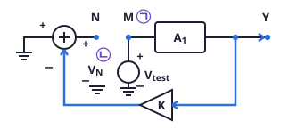
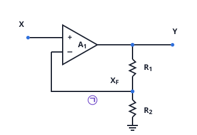
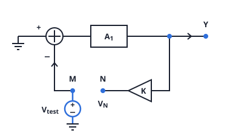
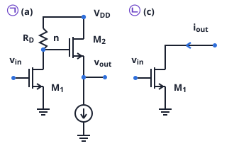
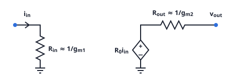
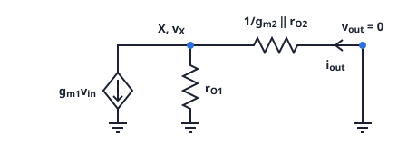
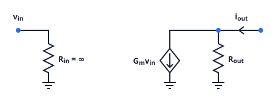
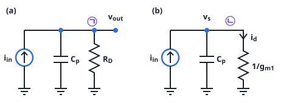
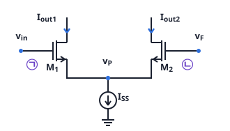
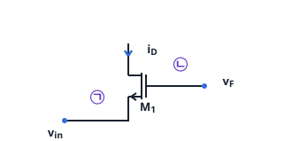

# 전자회로2 복습 1111 문제설명

회로와 첫 식을 짚고 핵심 계산으로 답을 구해요.

문제의 첫 줄부터 검산까지 설명해요.

**목차**

- [문항별 설명](#problems)
  - [P1. A1 입력에서 끊어 구한 루프 이득](#p1)
  - [P2. 뺄셈기 입력에서 끊어 구한 루프 이득](#p2)
  - [P3. 공칭 이득 4 비반전 증폭기의 실제 이득과 % 변화율](#p3)
  - [P4. 개루프 이득 20% 변화에 폐루프 이득 변화 1% 미만인 최소 루프 이득](#p4)
  - [P5. 공통 소스 단 공정 편차에서 폐루프 이득 ±5%를 보장하는 루프 이득](#p5)
  - [P6. K = 0, 0.1, 0.5일 때 단일 극점 증폭기의 폐루프 주파수 응답](#p6)
  - [P7. 개루프·폐루프 1차 시스템의 −1 dB 대역폭](#p7)
  - [P8. 단일 이득 대역폭이 K와 무관함을 증명](#p8)
  - [P9. 폐루프 −3 dB 대역폭 B를 얻는 귀환율 K](#p9)
  - [P10. 네 가지 트랜지스터 단의 증폭기 모델](#p10)
  - [P11. NMOS 캐스코드의 증폭기 모델](#p11)
  - [P12. 전류 이득이 1인 공통 게이트 전류 증폭기의 장점](#p12)
  - [P13. 차동 입력 귀환 증폭기 여섯 개의 감지·반송 방식](#p13)
  - [P14. 공통 게이트 입력 귀환 증폭기 네 개의 감지·반송 방식](#p14)

## 문항별 설명

### P1. A1 입력에서 끊어 구한 루프 이득

E12.03 · 예제 12.3 · [원 문제 보기](../%EB%B3%B5%EC%8A%B5%EB%AC%B8%EC%A0%9C_1111_Sense_and_Return-%EB%AC%B8%EC%A0%9C.pdf)

#### 주어진 조건

- 루프를 끊는 위치: $A_1$의 입력
- 루프 이득 계산법: 입력 $X$를 0으로 놓고 루프를 끊은 뒤, 끊은 점의 한쪽(M)에 테스트 신호 $V_{test}$를 인가하고 다른 쪽(N)에서 신호 $V_N$을 얻음
- 식 (12.8): $KA_1 = -\dfrac{V_N}{V_{test}}$

#### 구할 것

- $A_1$의 입력에서 루프를 끊었을 때 루프 이득

원문 보기

$A_1$의 입력에서 루프를 끊음으로써 그림 12.1의 귀환 시스템의 루프 이득을 계산하라.

*$A_1$ 입력에서 끊은 회로. $M$에서 주입하고 $N$에서 읽어요.*

#### 증폭기 입력에서 측정한 루프 이득

외부 입력 $X=0$에서 ㉠ $A_1$ 입력 $M$에 $V_{test}$를 걸고, ㉡ 비교부 출력 $N$을 열어 $V_N$을 재요. 이상적 단방향 블록의 입력은 앞 단을 로딩하지 않아요.

$$
V_N/V_{test}=(Y/V_{test})(X_F/Y)(V_N/X_F)
$$

신호는 $A_1$, 귀환망 $K$, 비교부의 반전 입력을 차례로 지나므로 귀환 전압에 마이너스가 붙어요.

$$
T=-V_N/V_{test}=-A_1K(-1)=KA_1
$$

**페이지 요약**

루프를 따라간 부호 있는 전압비에 마이너스를 붙이면 루프 이득이에요.

이 끊기 위치에서는 비교부의 반전이 신호 경로 마지막에 와요.

---

### P2. 뺄셈기 입력에서 끊어 구한 루프 이득

X12.03 · 연습문제 12.3 · [원 문제 보기](../%EB%B3%B5%EC%8A%B5%EB%AC%B8%EC%A0%9C_1111_Sense_and_Return-%EB%AC%B8%EC%A0%9C.pdf)

#### 주어진 조건

- 예제 12.3과 같은 시스템: Fig 12.1 일반적인 귀환 시스템 (뺄셈기(덧셈기 ⊕, + $X$, − $X_F$), 순방향 블록 $A_1$, 귀환 회로망 $K$)
- 바뀐 점: 루프를 끊는 위치가 $A_1$의 입력이 아니라 뺄셈기의 입력
- 뺄셈기의 두 입력 중 루프 위에 있는 것은 귀환 신호 $X_F$가 들어가는 − 입력
- 루프 이득 계산법: 입력 $X$를 0으로 놓고 루프를 끊은 뒤, 끊은 점의 한쪽(M)에 테스트 신호 $V_{test}$를 인가하고 다른 쪽(N)에서 신호 $V_N$을 얻음
- 식 (12.8): $KA_1 = -\dfrac{V_N}{V_{test}}$

#### 구할 것

- 뺄셈기의 입력에서 루프를 끊었을 때 루프 이득

원문 보기

뺄셈기의 입력에서 루프를 끊을 때 루프 이득을 계산하라.

*비교부 반전 입력과 귀환망 출력 사이를 끊은 회로예요.*

#### 비교부 입력에서 측정한 루프 이득

외부 입력 $X=0$에서 ㉠ 비교부 반전 입력 $M$에 $V_{test}$를 걸고 ㉡ 귀환망 출력 $N$을 열어 $V_N$을 재요. 이상적 블록에서 비교부의 출력 $E$는 처음부터 반대 부호예요.

$$
V_N/V_{test}=(E/V_{test})(Y/E)(V_N/Y)
$$

비교부, $A_1$, $K$를 지나는 곱이에요. 증폭기 입력에서 끊을 때와 같은 세 인자가 들어가요.

$$
T=-V_N/V_{test}=-(-1)A_1K=KA_1
$$

**페이지 요약**

귀환선을 끊으면 시험 신호가 가장 먼저 비교부의 반전 입력을 만나요.

블록의 순서만 바뀌므로 $KA_1$은 같아요.

---

### P3. 공칭 이득 4 비반전 증폭기의 실제 이득과 % 변화율

E12.04 · 예제 12.4 · [원 문제 보기](../%EB%B3%B5%EC%8A%B5%EB%AC%B8%EC%A0%9C_1111_Sense_and_Return-%EB%AC%B8%EC%A0%9C.pdf)

#### 주어진 조건

- 공칭값이 4가 되도록 설계됨 (인쇄는 "공칭 전압이 4")

  - 문맥과 맞지 않음(오식으로 보임): 전압이 아니라 공칭 (전압) 이득 $Y/X \approx 1 + R_1/R_2 = 4$로 읽어야 뜻이 통함. 풀이도 식 (12.15)에서 $R_1/R_2 = 3$으로 씀
- 식 (12.15): $KA_1 \gg 1$이면 $\dfrac{Y}{X} \approx \dfrac{1}{K} \approx 1 + \dfrac{R_1}{R_2}$
- 식 (12.2): $\dfrac{Y}{X} = \dfrac{A_1}{1 + KA_1}$, 귀환율 $K = R_2/(R_1 + R_2)$
- (a) $A_1 = 1000$
- (b) $A_1$이 $1000$에서 $500$으로 감소

#### 구할 것

- (a) $A_1 = 1000$일 때 실제 이득 $Y/X$
- (b) $A_1$이 500으로 감소할 때 이득의 % 변화율

원문 보기

공칭 전압이 4가 되도록 그림 12.2의 회로가 설계되었다. (a) $A_1 = 1000$일 때 실제 이득을 결정하라. (b) $A_1$이 500으로 감소할 때 이득의 % 변화율을 결정하라.

*비반전 증폭기의 반전 입력으로 출력 분배 전압이 돌아와요.*

#### (a) 실제 이득

㉠ 분배점의 귀환율 $K$는 저항비로 정해져요. 원문의 공칭값 4는 큰 루프 이득에서의 전압 이득이에요.

$$
1/K=4
$$

유한한 $A_1$을 폐루프 식에 대입해요.

$$
G=A_1/(1+KA_1)=1000/251\approx3.98
$$

#### (b) 개루프 이득이 절반이 될 때

저항이 같으므로 $K=1/4$도 그대로예요.

$$
G^*=500/(1+500/4)=250/63
$$

변화율은 변경 전 실제 이득 $G$를 기준으로 구해요.

$$
(G^*-G)/G=(250/63)/(1000/251)-1=-1/252\approx-0.4\%
$$

**페이지 요약**

공칭 이득의 역수로 귀환율을 먼저 정해요.

변화율의 분모에는 변경 전의 실제 이득을 써요.

---

### P4. 개루프 이득 20% 변화에 폐루프 이득 변화 1% 미만인 최소 루프 이득

P12.07 · 장말문제 12.7 · [원 문제 보기](../%EB%B3%B5%EC%8A%B5%EB%AC%B8%EC%A0%9C_1111_Sense_and_Return-%EB%AC%B8%EC%A0%9C.pdf)

#### 주어진 조건

- 개루프 이득 $A_1$이 20% 변함
- 식 (12.2): $\dfrac{Y}{X} = \dfrac{A_1}{1 + KA_1}$, 루프 이득은 $KA_1$
- $K$는 변하지 않는다고 봄

#### 구할 것

- 폐루프 이득의 변화가 1% 미만이 되도록 하는 최소 루프 이득

원문 보기

Suppose the open-loop gain $A_1$ in Fig. 12.1 changes by 20%. Determine the minimum loop gain necessary to ensure the closed-loop gain changes by less than 1%.

#### 공칭 루프 이득의 하한

귀환율 $K$를 고정하고 공칭 루프 이득을 $T=KA_1$, 개루프 상대 변화를 $\delta=(A_1^*-A_1)/A_1$로 둬요.

$$
G^*/G=(1+\delta)(1+T)/[1+(1+\delta)T]
$$

$$
(G^*-G)/G=\delta/[1+(1+\delta)T]
$$

분자의 크기는 두 방향 모두 0.2예요. 감소할 때 변경 후 루프 이득이 $0.8T$로 더 작아 분모가 작아져요.

$$
0.2/(1+0.8T)\lt0.01
$$

감소를 견디면 증가 조건도 만족해요. 경계에서는 변화가 정확히 1%이므로 공칭 루프 이득은 경계보다 커야 해요.

$$
T=KA_1>23.75
$$

**페이지 요약**

변화율의 분모에는 변경 후 루프 이득이 들어가요.

증가와 감소의 크기가 같으면 이득이 감소하는 경우가 하한을 정해요.

---

### P5. 공통 소스 단 공정 편차에서 폐루프 이득 ±5%를 보장하는 루프 이득

P12.08 · 장말문제 12.8 · [원 문제 보기](../%EB%B3%B5%EC%8A%B5%EB%AC%B8%EC%A0%9C_1111_Sense_and_Return-%EB%AC%B8%EC%A0%9C.pdf)

#### 주어진 조건

- $\mu_n C_{ox}$는 $\pm 10\%$, $\lambda$는 $\pm 20\%$까지 변할 수 있음
- 식 (12.2): $\dfrac{Y}{X} = \dfrac{A_1}{1 + KA_1}$, 루프 이득은 $KA_1$
- 전류원은 이상적 전류원이고 바이어스 전류는 변하지 않는다고 봄

#### 구할 것

- 폐루프 이득의 변동을 $\pm 5\%$ 미만으로 보장하는 최소 루프 이득

원문 보기

Consider the feedback system shown in Fig. 12.81, where the common-source stage serves as the feedforward network. Assume $\mu_n C_{ox}$ may vary by $\pm 10\%$ and $\lambda$ by $\pm 20\%$. What is the minimum loop gain necessary to guarantee that the closed-loop gain varies by less than $\pm 5\%$?

*공통 소스 순방향 단에서 이상적 바이어스 전류원을 AC 개방한 회로예요.*

#### 두 공정 변동이 겹치는 최악 조건

㉠ 이상적 전류원으로 $I_D$가 고정되므로 드레인의 부하는 $r_O=1/(\lambda I_D)$예요. 반전 공통 소스 단에서 $T=KA_1>0$이 되도록 음귀환을 걸어요.

$$
A_1=-g_m r_O
$$

$$
\lvert A_1\rvert\propto\sqrt{\mu_n C_{ox}}/\lambda
$$

변경 후 개루프 이득의 배율 $q=A_1^*/A_1$은 이동도 계수가 작고 $\lambda$가 클 때 최소예요. 반대 조합이 최대예요.

$$
q_{\min}=\sqrt{0.9}/1.2
$$

$$
q_{\max}=\sqrt{1.1}/0.8
$$

귀환율을 고정하면 $(G^*-G)/G=(q-1)/(1+qT)$예요. 이 값은 $q$와 함께 증가하므로 양 끝에서 각각 5% 조건을 검사해요.

$$
T>19/q_{\min}-20\approx4.03
$$

$$
T>20-21/q_{\max}\approx3.98
$$

이득이 감소하는 쪽에서 요구하는 공칭 루프 이득이 더 커요. 엄밀한 경계는 근호 식이고 소수는 반올림값이에요.

$$
T=KA_1>22.8/\sqrt{0.9}-20
$$

**페이지 요약**

두 파라미터가 동시에 변할 수 있으므로 개루프 이득이 가장 커지거나 작아지는 조합부터 찾아요.

폐루프의 최악 조건은 변동률의 분모에 들어가는 변경 후 루프 이득까지 비교해요.

---

### P6. K = 0, 0.1, 0.5일 때 단일 극점 증폭기의 폐루프 주파수 응답

E12.05 · 예제 12.5 · [원 문제 보기](../%EB%B3%B5%EC%8A%B5%EB%AC%B8%EC%A0%9C_1111_Sense_and_Return-%EB%AC%B8%EC%A0%9C.pdf)

#### 주어진 조건

- 순방향 증폭기: 단일 극점 개루프 증폭기, 식 (12.19): $A_1(s) = \dfrac{A_0}{1 + \dfrac{s}{\omega_0}}$, $A_0$는 저주파 이득, $\omega_0$는 $-3\ \text{dB}$ 대역폭
- 식 (12.22): $\dfrac{Y}{X}(s) = \dfrac{\dfrac{A_0}{1 + KA_0}}{1 + \dfrac{s}{(1 + KA_0)\omega_0}}$
- $A_0 = 200$
- $K = 0$, $0.1$, $0.5$의 세 경우
- $\omega_0$ 값은 주어지지 않음 (응답 모양을 $\omega_0$ 기준으로 그림)

#### 구할 것

- $K = 0, 0.1, 0.5$일 때 식 (12.22)의 폐루프 주파수 응답 도시

원문 보기

$K = 0, 0.1, 0.5$일 때 식 (12.22)로 주어지는 폐루프 주파수 응답을 도시하라. $A_0 = 200$으로 가정하라.

#### 평탄 이득과 꺾임 주파수

단일 극점에서 $D=1+KA_0$로 놓으면 평탄 이득은 $D$로 나누고 극점은 $D$배 해요.

$$
G(s)=(200/D)/(1+s/(D\omega_0))
$$

$(K, D)$는 차례로 $(0,1)$, $(0.1,21)$, $(0.5,101)$이에요. 각 줄의 분자는 평탄 이득(V/V), 분모는 극점의 위치를 보여 줘요. 공통 고주파 점근선은 $200\omega_0/\omega$예요.

$$
G_{K=0}(s)=200/(1+s/\omega_0)
$$

$$
G_{K=0.1}(s)=(200/21)/(1+s/(21\omega_0))
$$

$$
G_{K=0.5}(s)=(200/101)/(1+s/(101\omega_0))
$$

*단일 극점 응답의 보데 점근선. 실제 크기는 각 꺾임 주파수에서 해당 평탄 이득보다 약 3 dB 낮아요.*

**페이지 요약**

이득을 줄인 배수만큼 극점 주파수가 높아져요.

고주파 점근선은 세 경우 모두 기울기가 decade당 −20 dB예요.

---

### P7. 개루프·폐루프 1차 시스템의 −1 dB 대역폭

P12.09 · 장말문제 12.9 · [원 문제 보기](../%EB%B3%B5%EC%8A%B5%EB%AC%B8%EC%A0%9C_1111_Sense_and_Return-%EB%AC%B8%EC%A0%9C.pdf)

#### 주어진 조건

- "$-1$ dB 대역폭": 이득이 10% 떨어지는 주파수로 정의
- 개루프 1차 시스템: 식 (12.19)
- 식 (12.19): $A_1(s) = \dfrac{A_0}{1 + \dfrac{s}{\omega_0}}$, $A_0$는 저주파 이득, $\omega_0$는 $-3$ dB 대역폭
- 폐루프 1차 시스템: 식 (12.22)
- 식 (12.22): $\dfrac{Y}{X}(s) = \dfrac{\dfrac{A_0}{1 + KA_0}}{1 + \dfrac{s}{(1 + KA_0)\,\omega_0}}$

#### 구할 것

- 개루프 시스템의 $-1$ dB 대역폭
- 폐루프 시스템의 $-1$ dB 대역폭
- 귀환으로 $-1$ dB 대역폭이 $1 + KA_0$배 늘어난다고 말할 수 있는가?

원문 보기

In some applications, we may define a “$-1$ dB bandwidth” as the frequency at which the gain falls by 10%. Determine the $-1$ dB bandwidth of the open-loop and closed-loop first-order systems described by Eqs. (12.19) and (12.22). Can we say the $-1$ dB bandwidth increases by $1 + KA_0$ as a result of feedback?

#### 10% 감소를 기준으로 한 대역폭

원문이 정한 10% 감소 기준을 쓰면 단일 극점 응답에서 공통으로 $x=\omega/\omega_p$가 다음을 만족해요.

$$
1/\sqrt{1+x^2}=0.9
$$

$$
x=\sqrt{19}/9
$$

개루프와 폐루프 극점에 같은 $x$를 곱하므로 이 정의에서도 대역폭은 정확히 $1+KA_0$배로 넓어져요.

$$
\omega_{-1,\mathrm{open}}=(\sqrt{19}/9)\omega_0
$$

$$
\omega_{-1,\mathrm{closed}}=(\sqrt{19}/9)(1+KA_0)\omega_0
$$

**페이지 요약**

각 응답의 저주파 이득을 기준으로 같은 비율만큼 떨어지는 점을 잡아요.

두 응답은 단일 극점 모양이 같아 대역폭의 비가 극점의 비와 같아요.

---

### P8. 단일 이득 대역폭이 K와 무관함을 증명

E12.06 · 예제 12.6 · [원 문제 보기](../%EB%B3%B5%EC%8A%B5%EB%AC%B8%EC%A0%9C_1111_Sense_and_Return-%EB%AC%B8%EC%A0%9C.pdf)

#### 주어진 조건

- "위 시스템": 단일 극점 개루프 증폭기 식 (12.19) $A_1(s) = \dfrac{A_0}{1 + s/\omega_0}$에 귀환율 $K$인 부귀환을 건 시스템 ($A_0$: 저주파 이득, $\omega_0$: $-3\ \text{dB}$ 대역폭)
- 식 (12.22): $\dfrac{Y}{X}(s) = \dfrac{\dfrac{A_0}{1 + KA_0}}{1 + \dfrac{s}{(1 + KA_0)\omega_0}}$
- 가정: $1 + KA_0 \gg 1$, $K^2 \ll 1$
- 단일 이득 대역폭 $\omega_u$: 폐루프 이득의 크기가 1이 되는 주파수

#### 구할 것

- 위 가정에서 단일 이득 대역폭이 $K$와 관계없이 일정함을 증명

원문 보기

$1+KA_0 \gg 1$과 $K^2 \ll 1$일 때 위 시스템의 단일 이득 대역폭이 $K$와 관계없이 일정하게 유지됨을 증명하라.

#### 단일 이득 교차 주파수

양의 교차 주파수가 있으려면 저주파 폐루프 이득이 1보다 커야 해요. 크기가 1이 되는 식을 제곱해 정리해요.

$$
\frac{A_0}{\sqrt{(1+KA_0)^2+(\omega_u/\omega_0)^2}}=1
$$

$$
\omega_u=A_0\omega_0\sqrt{1-(K+1/A_0)^2}
$$

$1+KA_0\gg1$이므로 $1/A_0\ll K$이고, $K^2\ll1$이므로 남은 근호는 1에 가까워요. 따라서 이 근사에서 교차 주파수는 $K$와 무관해요.

$$
\omega_u\simeq A_0\omega_0\sqrt{1-K^2}\simeq A_0\omega_0
$$

**페이지 요약**

정확한 교차 주파수 식에서는 $K+1/A_0$가 함께 나타나요.

두 가정을 차례로 적용하면 개루프 이득–대역폭 곱이 남아요.

---

### P9. 폐루프 −3 dB 대역폭 B를 얻는 귀환율 K

P12.10 · 장말문제 12.10 · [원 문제 보기](../%EB%B3%B5%EC%8A%B5%EB%AC%B8%EC%A0%9C_1111_Sense_and_Return-%EB%AC%B8%EC%A0%9C.pdf)

#### 주어진 조건

- 폐루프 $-3$ dB 대역폭이 $B$가 되어야 함
- $C_L$ 외의 다른 커패시턴스는 무시
- $\lambda > 0$
- 전류원은 이상적 전류원으로 봄
- 답은 $B$, $C_L$, $g_m$, $r_O$ 등 기호로 나타냄

#### 구할 것

- 필요한 $K$ 값

원문 보기

The circuit of Fig. 12.82 must achieve a closed-loop $-3$ dB bandwidth of $B$. Determine the required value of $K$. Neglect other capacitances and assume $\lambda > 0$.

*드레인의 출력저항과 부하 커패시터가 같은 출력 노드와 AC 접지에 연결돼요.*

#### 목표 대역폭에서 귀환율 역산

㉠ $r_O$와 $C_L$이 드레인에서 병렬이에요. 게이트 전압이 오르면 드레인으로 끌어가는 전류가 늘어 출력 전압은 내려가요.

$$
A_1(s)= -g_m(r_O\parallel 1/(sC_L))=-g_mr_O/(1+sr_OC_L)
$$

비교부에서 $v_g=v_{in}-Kv_{out}$으로 빼므로 분모는 $1+KA_1(s)$예요. $A_1(0)=-g_mr_O$인 반전 단에서 음귀환이 되려면 $K\lt 0$이어야 해요.

$$
B=(1-Kg_mr_O)/(r_OC_L)
$$

$B$는 각주파수(rad/s)예요. 대역폭을 넓히는 경우 $B>1/(r_OC_L)$이고, 목표가 개루프 대역폭과 같으면 $K=0$이에요.

$$
K=(1-Br_OC_L)/(g_mr_O)
$$

**페이지 요약**

출력에서 $r_O$와 $C_L$이 만드는 극점이 개루프 대역폭을 정해요.

비교부가 귀환 신호를 빼고 공통 소스 단이 반전하므로 대역폭을 넓히는 $K$는 음수예요.

---

### P10. 네 가지 트랜지스터 단의 증폭기 모델

P12.15 · 장말문제 12.15 · [원 문제 보기](../%EB%B3%B5%EC%8A%B5%EB%AC%B8%EC%A0%9C_1111_Sense_and_Return-%EB%AC%B8%EC%A0%9C.pdf)

#### 주어진 조건

- 참고 모델 (본문 Fig 12.18): 입력 쪽은 $R_{in}$, 출력 쪽은 $R_{out}$과 종속 전원($A_0 v_{in}$, $R_0 i_{in}$, $G_m v_{in}$, $A_I i_{in}$)으로 나타낸 네 가지 증폭기의 실제 모델. 전압 출력은 종속 전압원에 $R_{out}$ 직렬, 전류 출력은 종속 전류원에 $R_{out}$ 병렬. 전압 입력은 $R_{in}$을 입력 포트에 병렬, 전류 입력은 $i_{in}$이 $R_{in}$으로 흘러 들어감
- 그림에 인쇄된 값: (a) $R_{in} = \infty$, $R_{out} = 1/g_{m2}$ / (b) $R_{in} = 1/g_{m1}$, $R_{out} = 1/g_{m2}$ / (c) $R_{in} = \infty$, $R_{out} = r_O$ / (d) $R_{in} = 1/g_{m1}$, $R_{out} = \infty$

#### 구할 것

- Fig 12.19의 각 단 (a)–(d)에 대한 증폭기 모델 그리기

원문 보기

Using the developments in Fig. 12.18, draw the amplifier model for each stage in Fig. 12.19.

*게이트에서 전압을 받는 원 회로 (a)·(c)예요. 두 모델의 출력 포트가 달라요.*

#### 입출력 포트로 고르는 네 모델

㉠ (a)·(b)는 출력 개방에서 $M_1$ 드레인과 팔로워 게이트 사이 노드를 $n$으로 잡아요. 몸체 효과와 채널 길이 변조를 무시하고 이상적 바이어스 전류원을 쓰면 팔로워의 무부하 이득은 1이에요.

$$
A_{0,a}=(v_n/v_{in})(v_{out}/v_n)=(-g_{m1}R_D)(1)
$$

$$
R_{0,b}=(v_n/i_{in})(v_{out}/v_n)=(+R_D)(1)
$$

㉡ (c)는 출력 단락에서 $r_O$ 양단 전압이 0이어서 제어 전류가 그대로 드레인으로 들어가요. 입력을 영으로 두면 유한한 $r_O$가 출력에 남아요. (d)는 소스로 넣은 전류가 모두 드레인으로 나와요. 그림 12.19(d)의 아래쪽 화살표로 재면 $i_{out}/i_{in}=-1$, 여기서 그린 모델의 유출 기준으로는 $+1$이에요.

게이트 입력은 개방이고 공통 게이트의 소스 입력은 출력 단락에서 약 $1/g_{m1}$이에요. (a)·(b)의 출력에서는 팔로워 소스 저항을 봐요. (d)의 입력 전류원을 영으로 두면 소스가 열려 드레인 시험전류가 흐를 길이 없어요.

*(a) 전압 증폭기. 입력은 개방이고 출력은 테브난 전압원과 직렬 저항이에요.*

*(b) 트랜스임피던스 증폭기. 소스에 입력 전류를 넣고 팔로워 출력 전압을 읽어요.*

*(c) 트랜스컨덕턴스 증폭기. 모델의 출력 전류 기준은 드레인으로 들어가는 방향이에요.*

*(d) 전류 증폭기. 모델에서 출력 전류는 드레인 밖으로 나가는 방향이에요.*

전압 출력은 종속 전압원과 직렬 출력저항, 전류 출력은 종속 전류원과 병렬 출력저항으로 그려요. 표의 전류 기준은 아래 모델의 화살표를 따라요.

| 회로 | 입력저항 | 이득 | 출력저항 |
|---|---|---|---|
| (a) 전압 | $\infty$ | $-g_{m1}R_D$ | $1/g_{m2}$ |
| (b) 트랜스임피던스 | $1/g_{m1}$ | $+R_D$ | $1/g_{m2}$ |
| (c) 트랜스컨덕턴스 | $\infty$ | $+g_{m1}$ | $r_O$ |
| (d) 전류 | $\simeq1/g_{m1}$ | $+1$ (유출 기준) | $\infty$ |

**페이지 요약**

전압 출력의 이득은 출력을 열고, 전류 출력의 이득은 출력을 단락하고 구해요.

공통 게이트의 전류 이득에는 출력 전류의 기준 방향을 함께 적어요.

---

### P11. NMOS 캐스코드의 증폭기 모델

P12.16 · 장말문제 12.16 · [원 문제 보기](../%EB%B3%B5%EC%8A%B5%EB%AC%B8%EC%A0%9C_1111_Sense_and_Return-%EB%AC%B8%EC%A0%9C.pdf)

#### 주어진 조건

- $\lambda > 0$
- 증폭기 모델: 본문 Fig 12.18처럼 입력 저항 $R_{in}$, 출력 저항 $R_{out}$, 종속 전원 이득($A_0$, $R_0$, $G_m$, $A_I$ 중 해당하는 것)으로 나타낸 모델

#### 구할 것

- Fig 12.84 회로의 증폭기 모델

원문 보기

Determine the amplifier model for the circuit depicted in Fig. 12.84. Assume $\lambda > 0$.

*출력 단락 상태. 아래 소자의 전류는 내부 노드에서 $r_{O1}$과 위 소자 방향으로 나뉘어요.*

#### 캐스코드의 트랜스컨덕턴스 모델

㉠ 출력 단락에서 $M_2$ 소스가 보는 $R_{up}$과 $r_{O1}$이 병렬이에요. $M_1$의 제어 전류 중 위 가지가 공급하는 몫이 드레인으로 들어가는 출력 전류예요.

$$
R_{up}=(1/g_{m2})\parallel r_{O2}
$$

$$
G_m=i_{out,sc}/v_{in}=g_{m1}r_{O1}/(r_{O1}+R_{up})
$$

게이트 입력을 영으로 두면 ㉠ 위쪽 $M_2$의 소스 아래에 $r_{O1}$이 남아요. $g_{m2}r_{O1}\gg1$, $g_{m2}r_{O2}\gg1$일 때 캐스코드 주항에는 위 소자의 $g_{m2}r_{O2}$가 곱해져요.

몸체 효과를 무시한 저주파 모델이에요. 게이트는 개방이고, 출력에는 제어 전류원과 유한한 출력저항을 병렬로 둬요.

$$
R_{in}=\infty
$$

$$
G_m\simeq g_{m1}
$$

$$
R_{out}\simeq g_{m2}r_{O2}r_{O1}
$$

*캐스코드의 노턴 모델. 포트 전류는 드레인으로 들어가는 방향이에요.*

**페이지 요약**

단락 출력에서는 위 소자의 낮은 소스 저항 때문에 입력 소자의 전류가 거의 전부 전달돼요.

입력을 영으로 두면 같은 위 소자가 아래쪽 출력저항을 크게 키워요.

---

### P12. 전류 이득이 1인 공통 게이트 전류 증폭기의 장점

E12.09 · 예제 12.9 · [원 문제 보기](../%EB%B3%B5%EC%8A%B5%EB%AC%B8%EC%A0%9C_1111_Sense_and_Return-%EB%AC%B8%EC%A0%9C.pdf)

#### 주어진 조건

- 이 토폴로지의 전류 이득 $A_I = 1$ (입력 전류가 그대로 출력으로 흐름)
- 그림에 인쇄된 입출력 임피던스: $R_{in} = 1/g_{m1}$, $R_{out} = \infty$
- 소자 값은 주어지지 않음 (답은 정성적 설명)

#### 구할 것

- 전류 이득이 1인데도 이 회로(전선 한 조각 대신 CG 단)를 쓰는 장점

원문 보기

전류 이득이 1인 그림 12.19(d)의 토폴로지는 한 조각의 전선보다 조금도 좋아 보이지 않는다. 이 회로의 장점은 무엇인가?

*(a) 저항에 직접 연결한 입력 노드와 (b) 공통 게이트 단으로 분리한 입력 노드예요.*

#### 입력 기생 커패시턴스가 보는 저항

㉠ 입력 기생 커패시턴스 $C_p$가 부하 $R_D$와 같은 노드에 걸려요.

$$
\omega_{p,a}=1/(R_DC_p)
$$

㉡ 게이트를 AC 접지로 두면 $C_p$가 보는 소스 입력 저항은 $1/g_{m1}$예요. $\lambda=0$이고 몸체 효과와 다른 기생 커패시턴스를 무시한 모델이에요.

$$
\omega_{p,b}=g_{m1}/C_p
$$

저주파에서는 같은 전류가 부하로 전달돼요. $1/g_{m1}\ll R_D$이면 입력 극점이 올라가므로 큰 $C_p$를 가진 전류원도 더 높은 주파수까지 부하를 구동할 수 있어요.

$$
\omega_{p,b}/\omega_{p,a}=g_{m1}R_D
$$

**페이지 요약**

공통 게이트 단의 장점은 입력 커패시턴스가 보는 저항을 작게 만드는 데 있어요.

입력 극점이 대역폭을 제한할 때 이 효과가 드러나요.

---

### P13. 차동 입력 귀환 증폭기 여섯 개의 감지·반송 방식

P12.18 · 장말문제 12.18 · [원 문제 보기](../%EB%B3%B5%EC%8A%B5%EB%AC%B8%EC%A0%9C_1111_Sense_and_Return-%EB%AC%B8%EC%A0%9C.pdf)

#### 주어진 조건

- 감지 방식: 출력 전압을 감지하는지(병렬) 출력 전류를 감지하는지(직렬), 반송 방식: 입력에 전압으로 반송하는지(직렬) 전류로 반송하는지(병렬)를 가림

#### 구할 것

- (a)–(f) 각 증폭기의 감지 방식과 반송 방식

원문 보기

Identify the sense and return mechanisms in each amplifier depicted in Fig. 12.85.

*각 회로에 공통인 입력 반송 부분이에요.*

#### 입력 반송과 출력 감지

㉠ 입력이 $M_1$ 게이트, ㉡ 귀환이 $M_2$ 게이트에 걸려 차동쌍이 두 전압을 빼요.

$$
v_{G1}-v_{G2}=v_{in}-v_F
$$

(b)·(c)는 연결은 같고 출력의 정의가 달라요. (b)는 출력 노드 전압을 게이트로 보내고, (c)는 지정된 출력 전류가 지나는 $R_1$의 전압을 게이트로 보내요.

모두 입력 전압과 귀환 전압의 차를 사용하므로 반송은 전압 직렬 반송이에요. 출력 감지는 다음과 같아요.

| 회로 | 감지 | 귀환 전압 $v_F$ |
|---|---|---|
| (a)·(b)·(f) | 전압 · 병렬 | $v_{out}$ |
| (e) | 전압 · 병렬 | $[R_2/(R_1+R_2)]v_{out}$ |
| (c)·(d) | 전류 · 직렬 | $I_{out}R_1$ |

**페이지 요약**

반송은 입력에서 무엇을 빼는지 보고, 감지는 지정된 출력량에서 귀환 전압까지의 경로를 따라가요.

같은 저항이라도 회로가 지정한 출력이 단자 전압인지 가지 전류인지에 따라 감지 방식이 달라져요.

---

### P14. 공통 게이트 입력 귀환 증폭기 네 개의 감지·반송 방식

P12.19 · 장말문제 12.19 · [원 문제 보기](../%EB%B3%B5%EC%8A%B5%EB%AC%B8%EC%A0%9C_1111_Sense_and_Return-%EB%AC%B8%EC%A0%9C.pdf)

#### 주어진 조건

- 감지 방식: 출력 전압을 감지하는지(병렬) 출력 전류를 감지하는지(직렬), 반송 방식: 입력에 전압으로 반송하는지(직렬) 전류로 반송하는지(병렬)를 가림

#### 구할 것

- (a)–(d) 각 증폭기의 감지 방식과 반송 방식

원문 보기

Identify the sense and return mechanisms in each amplifier depicted in Fig. 12.86.

*각 회로에 공통인 입력 반송 부분이에요.*

#### 입력 반송과 출력 감지

㉠ 입력이 $M_1$ 소스, ㉡ 귀환이 같은 트랜지스터의 게이트에 걸려 두 전압의 차가 드레인 전류를 정해요.

$$
v_{GS1}=v_F-v_{in}
$$

(b)·(c)는 연결은 같고 출력의 정의가 달라요. (b)는 출력 노드 전압을 게이트로 보내고, (c)는 지정된 출력 전류가 지나는 $R_1$의 전압을 게이트로 보내요.

모두 입력 전압과 귀환 전압의 차를 사용하므로 반송은 전압 직렬 반송이에요. 출력 감지는 다음과 같아요.

| 회로 | 감지 | 귀환 전압 $v_F$ |
|---|---|---|
| (a)·(b)·(d) | 전압 · 병렬 | $v_{out}$ |
| (c) | 전류 · 직렬 | $I_{out}R_1$ |

**페이지 요약**

반송은 입력에서 무엇을 빼는지 보고, 감지는 지정된 출력량에서 귀환 전압까지의 경로를 따라가요.

같은 저항이라도 회로가 지정한 출력이 단자 전압인지 가지 전류인지에 따라 감지 방식이 달라져요.

---

원 문제·정리노트·PDF는 보존해요.
