# 음귀환의 장점과 감지·반송 — 5살도 이해하는 정리노트

권익진 교수님 전자회로2 · 1111 수업 (Lec6 8–22쪽, Razavi 12장)

> `정리노트_1111_Sense_and_Return.html`를 마크다운으로 옮겼어요. 그림은 `figures_1111/` 폴더의 SVG, 위젯은 대표 설정의 정적 그림으로 바꿨어요. 수식은 `$…$` / `$$…$$`라서 GitHub, Obsidian, Typora에서 보여요.

**목차**

- [들어가며: 왜 이런 회로를 쓸까](#why)
  - [왜 이런 회로를 쓸까](#why-circuit)
- [1. 루프 이득 다시 보기](#s0)
  - [루프는 어디서 끊어도 루프 이득이 같아요](#s0-break-anywhere)
- [2. 장점 ①: 이득 둔감화](#s1)
  - [루프 이득이 크면 이득은 1/K가 돼요](#s1-desensitization)
  - [증폭기 이득은 흔들리고 저항의 비는 정확해요](#s1-precise-k)
  - [루프 이득이 커야 하고, 그 대가로 이득은 줄어요](#s1-large-loop-gain)
- [3. 장점 ②: 대역폭 확장](#s2)
  - [극점이 (1+루프 이득)배 높아져요](#s2-pole-shift)
  - [이득을 내주고 대역폭을 얻어요](#s2-bandwidth-example)
- [4. 귀환의 대가: 불안정과 발진](#s3)
  - [음귀환이 양귀환으로 바뀌면 발진해요](#s3-instability)
- [5. 네 가지 증폭기 형태](#s4)
  - [입력과 출력이 전압이냐 전류냐](#s4-four-types)
  - [네 형태를 트랜지스터로 만들면](#s4-examples)
- [6. 출력을 감지하는 법](#s5)
  - [감지와 반송이 귀환 구조를 정해요](#s5-sense-return)
  - [전압은 병렬로, 큰 임피던스로 감지해요](#s5-voltage-sense)
  - [전류는 직렬로, 작은 임피던스로 감지해요](#s5-current-sense)
- [7. 전압을 입력에서 빼는 법](#s6)
  - [전압은 입력원과 직렬로 빼요](#s6-voltage-return)
  - [트랜지스터 하나와 차동쌍으로 전압 빼기](#s6-return-circuits)
- [8. 요약 · 예고](#s7)
  - [한눈에 다시 보기](#s7-cheatsheet)
  - [다음 시간 예고](#s7-next)
  - [함께 보면 좋은 자료](#s7-links)

## 들어가며: 왜 이런 회로를 쓸까

### 왜 이런 회로를 쓸까

*1111 수업 · L06 s3 · s10–13 · s15*

**쉽게 말하면**

음귀환은 ±20%까지 흔들리는 증폭기 이득 $A_1$ 대신 정확한 저항비 $K$로 이득을 정해요.

예를 들어 $K=0.1$이면 $A_1$이 1000이든 800이든 이득은 약 10이에요.

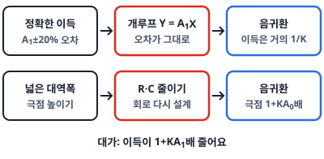

*피드백 팩터(귀환율) $K$는 출력 중 입력으로 되돌리는 비율이고, 줄마다 필요한 것 → 쉬운 방법이 막히는 곳 → 음귀환 순서로 읽어요.*

**정확히 말하면**

#### 풀고 싶은 문제

지금까지 만든 공통 소스·캐스코드·차동쌍 증폭기는 모두 개루프 이득(open-loop gain) $A_1$이에요. 공통 소스 단이면 이득의 크기가 $g_mR_D$예요.

$g_m$은 전류·소자 크기·공정·온도에 따라 바뀌어요. $R_D$는 단품이든 칩 안 저항이든 ±20%까지 오차가 나요. 그래서 $A_1$도 ±20%까지 흔들려요. **이득이 정확한 증폭기가 필요해요.** [증폭기 이득은 흔들리고 저항의 비는 정확해요](#s1-precise-k)

대역폭(bandwidth)도 넓히고 싶어요. 극점 주파수는 $\frac{1}{RC}$ 꼴이라 회로를 그대로 두면 정해진 주파수부터 이득이 떨어져요. [극점이 (1+루프 이득)배 높아져요](#s2-pole-shift)

#### 단순한 해법과 그 한계

가장 쉬운 방법은 $A_1$을 그대로 쓰는 개루프 증폭기예요.

$$
Y=A_1X
$$

**출력이 $A_1$에 정비례하므로 $A_1$이 20% 변하면 이득도 20% 변해요.** [루프 이득이 크면 이득은 1/K가 돼요](#s1-desensitization)

정확한 저항비만 쓰면 어떨까요? 저항 분배기는 1보다 작은 비만 만들어서 혼자서는 증폭을 못 해요.

대역폭을 넓히려고 극점을 올리려면 $R$을 줄이거나(이득이 줄어요) $C$를 줄여야(트랜지스터를 작게 해서 $g_m$과 전류가 줄어요) 해요. 결국 회로를 다시 설계해야 해요. [이득을 내주고 대역폭을 얻어요](#s2-bandwidth-example)

#### 핵심 아이디어

음귀환(negative feedback)은 출력을 감지(sense)해 피드백 팩터(귀환율) $K$만큼 되돌리고, 입력에서 빼서 그 차이를 $A_1$에 넣어요. op-amp와 저항 분배기 $R_1$–$R_2$로 만든 비반전 증폭기에서 $K$는 저항비예요.

$$
K=\frac{R_2}{R_1+R_2}
$$

**루프 이득(loop gain) $KA_1$이 1보다 훨씬 크면 폐루프 이득(closed-loop gain)이 $\frac{1}{K}$에 가까워져요.** [루프는 어디서 끊어도 루프 이득이 같아요](#s0-break-anywhere)

$$
\frac{Y}{X}=\frac{A_1}{1+KA_1}\approx\frac{1}{K}
$$

예를 들어 $K=0.1$이고 $A_1=1000$이면 이득은 $\frac{1000}{101}\approx9.90$이에요.

$A_1$이 20% 줄어 800이 되어도 이득은 $\frac{800}{81}\approx9.88$이라 둘 다 $\frac{1}{K}=10$ 근처예요.

이처럼 폐루프 이득이 $A_1$에 거의 영향을 받지 않는 성질이 이득 둔감화(gain desensitization)예요. [루프 이득이 크면 이득은 1/K가 돼요](#s1-desensitization)

$K$는 이득이 필요 없어서 저항·커패시터 같은 수동 소자의 비로 만들어요. 같은 공정의 저항은 함께 커지거나 함께 작아지므로, 하나하나는 ±20% 변해도 비는 ±1% 정도로 정확해요. [증폭기 이득은 흔들리고 저항의 비는 정확해요](#s1-precise-k)

같은 귀환이 대역폭도 넓혀요. 개루프가 극점 하나인 증폭기에서 $A_0$를 $A_1$의 저주파 값, $\omega_0$를 개루프 극점이라 하면 극점이 $1+KA_0$배 높아져요. 이것이 대역폭 확장(bandwidth extension)이에요. [극점이 (1+루프 이득)배 높아져요](#s2-pole-shift)

$$
\omega_0\ \to\ (1+KA_0)\omega_0
$$

#### 대가와 쓰이는 곳

대가는 이득이에요. **이득이 $A_1$에서 $\frac{A_1}{1+KA_1}$로, 즉 $1+KA_1$배 줄어요.** 대역폭이 넓어진 만큼 저주파 이득도 $1+KA_0$배 줄어요. [이득을 내주고 대역폭을 얻어요](#s2-bandwidth-example)

줄어든 이득은 쉽게 되찾아요. 정확한 이득 10짜리 단을 세 개 이으면 $10\times10\times10=1000$이에요.

둔감화가 잘 되려면 루프 이득 $KA_1$이 1보다 훨씬 커야 해요. 그래서 op-amp의 개루프 이득을 아주 크게 만들어요. [루프 이득이 커야 하고, 그 대가로 이득은 줄어요](#s1-large-loop-gain)

주파수가 올라가 루프를 한 바퀴 돈 위상이 180° 바뀌면 음귀환이 양귀환(positive feedback)이 되어 발진할 수 있어요. 안정성 설계는 이 과목에서 다루지 않아요. [음귀환이 양귀환으로 바뀌면 발진해요](#s3-instability)

정확한 이득뿐 아니라 전압 레귤레이터의 일정한 전압, PLL의 정확한 주파수처럼 정밀한 특성이 필요한 회로는 모두 귀환을 써요. [증폭기 이득은 흔들리고 저항의 비는 정확해요](#s1-precise-k)

실제 회로에서 출력을 어떻게 감지하고 입력에서 어떻게 뺄지는 증폭기 형태가 정해요. 입력과 출력이 전압이냐 전류냐에 따라 증폭기는 네 형태로 나뉘어요. [입력과 출력이 전압이냐 전류냐](#s4-four-types) · [네 형태를 트랜지스터로 만들면](#s4-examples) · [감지와 반송이 귀환 구조를 정해요](#s5-sense-return)

출력 전압은 병렬로, 출력 전류는 직렬로 감지해요. 입력 전압은 입력원과 직렬로 연결해 빼요. [전압은 병렬로, 큰 임피던스로 감지해요](#s5-voltage-sense) · [전류는 직렬로, 작은 임피던스로 감지해요](#s5-current-sense) · [전압은 입력원과 직렬로 빼요](#s6-voltage-return)

입력에서 전류를 빼는 방법은 다음 시간에 다뤄요. [다음 시간 예고](#s7-next)

**교수님 말씀**

> 부정확한 $A_1$을 정확한 $K$로 컨트롤한다라고 생각하면 되겠습니다.

> 이득을 높이는 건 어렵지 않습니다. … 10짜리 세 개 연결하면 1000이 되잖아요

> 대역폭을 늘리는 건 사실 굉장히 어려운 일이에요. … 게인을 늘리는 거는 쉽기 때문에

> 타입에 따라서 피드백의 구조가 달라지기 때문이에요.

교수님은 "처음부터 $K$만 쓰면 되지 않느냐"고 스스로 물었어요. $K$는 1보다 작아 증폭을 못 하므로 $A_1$이 꼭 있어야 한다는 답이었어요.

확인해 봐요. 저항 분배기의 비 $K$가 $\pm1\,\%$로 정확하다면, 개루프 증폭기 $A_1$ 없이 $K$만으로 증폭기를 만들면 안 되는 이유는 무엇인가요?

답 보기

저항 분배기 같은 수동 소자의 비 $K$는 $1$보다 작아 혼자서는 신호를 증폭할 수 없기 때문이에요. 그래서 $A_1$이 꼭 있어야 증폭이 되고, 음귀환은 $KA_1\gg1$일 때 이득이 $\frac{1}{K}$ 근처로 정해지게 해요.

**페이지 요약**

음귀환은 흔들리는 $A_1$ 대신 정확한 $K$로 이득을 정하고 대역폭도 넓혀요.

*핵심 식*

- 폐루프 이득 ($KA_1\gg1$일 때)

  $$
  \frac{Y}{X}=\frac{A_1}{1+KA_1}\approx\frac{1}{K}
  $$
- 극점 이동 (극점 하나인 개루프)

  $$
  \omega_0\ \to\ (1+KA_0)\omega_0
  $$

$A_1$은 ±20%까지 흔들리지만 저항비 $K$는 ±1% 정도로 정확해요.

대가로 이득이 $1+KA_1$배 줄고, 여러 단을 이어 되찾아요.

출력을 감지하고 입력에서 빼는 방식은 증폭기 형태가 정해요.

*용어*

- **음귀환(negative feedback)** — 출력을 감지해 되돌린 뒤 입력에서 빼는 구조
- **피드백 팩터(feedback factor)** — 귀환율이라고도 하며, 출력 중 입력으로 되돌리는 비율 $K$
- **이득 둔감화(gain desensitization)** — 폐루프 이득이 $A_1$에 거의 영향을 받지 않는 성질
- **대역폭 확장(bandwidth extension)** — 귀환으로 극점이 $1+KA_0$배 높아지는 것

---

## 1. 루프 이득 다시 보기

### 루프는 어디서 끊어도 루프 이득이 같아요

*1111 수업 · L06 s8–9*

**쉽게 말하면**

루프는 한 바퀴 이어진 길이라서, 어느 자리에서 끊고 시험 신호 $V_{test}$를 넣어도 한 바퀴 돌아온 비인 루프 이득은 $KA_1$로 같아요.

$A_1=200$, 피드백 팩터(귀환율) $K=0.05$일 때 $A_1$ 입력 쪽에 $1\,\mathrm{mV}$를 넣으면 $A_1$ 뒤 $200\,\mathrm{mV}$ → $K$ 뒤 $10\,\mathrm{mV}$ → 빼기 뒤 $-10\,\mathrm{mV}$로 돌아와서, 마이너스를 붙인 비 $10$이 루프 이득이에요.

*위는 출력 쪽, 아래는 $A_1$ 입력 쪽에서 끊었지만 둘 다 $-\frac{V_N}{V_{test}}=KA_1$이 나와요.*

**정확히 말하면**

#### 숫자로 확인하기

먼저 작은 예에 적용해 봐요. $A_1=200$, $K=0.05$이고, 입력을 접지해 $X=0$으로 둔 뒤 $A_1$ 입력 쪽 $M$에 $V_{test}=1\,\mathrm{mV}$를 넣어요.

$$
A_1V_{test}=200\times1\,\mathrm{mV}=200\,\mathrm{mV}
$$

$$
KA_1V_{test}=0.05\times200\,\mathrm{mV}=10\,\mathrm{mV}
$$

$$
V_N=0-10\,\mathrm{mV}=-10\,\mathrm{mV}
$$

$$
-\frac{V_N}{V_{test}}=-\frac{-10\,\mathrm{mV}}{1\,\mathrm{mV}}=10
$$

같은 루프를 출력 쪽($K$ 입력)에서 끊고 $1\,\mathrm{mV}$를 넣으면 $K$ 뒤 $0.05\,\mathrm{mV}$ → 빼기 뒤 $-0.05\,\mathrm{mV}$ → $A_1$ 뒤 $-10\,\mathrm{mV}$로 돌아와요. **비는 똑같이 $10$이에요.**

$$
KA_1=0.05\times200=10
$$

#### 어느 자리에서 끊어도 같은 이유

일반식은 칠판 유도 순서대로 따라가요.

1. **입력 영점** — 입력을 접지해 $X=0$으로 둬요. 돌아온 신호가 모두 시험 신호에서 온 것이 되게 하려는 거예요.
2. **루프 끊기** — 비교부(합산기) 출력 $N$과 $A_1$ 입력 $M$ 사이를 끊어요. 신호 방향은 그대로 $M$ → $A_1$ → $K$ → 비교부 → $N$이에요.
3. **시험 신호** — 끊은 자리 $M$에 $V_{test}$를 넣어요.
4. $$
   Y=A_1V_{test}
   $$

   **순방향 시스템** — $A_1$을 지나 출력이 돼요.
5. $$
   KY=KA_1V_{test}
   $$

   **귀환 회로망** — 출력을 감지해 $K$배 해요.
6. $$
   0-KA_1V_{test}
   $$

   $$
   V_N=-KA_1V_{test}
   $$

   **비교부** — 입력 0에서 귀환 신호를 빼서 $N$으로 돌아와요.
7. **부호와 정의** — 비 $\frac{V_N}{V_{test}}=-KA_1$은 음수예요. 음귀환에서 루프 이득을 양수로 나타내려고 마이너스를 붙여 정의해요.

   $$
   KA_1=-\frac{V_N}{V_{test}}
   $$

그림의 $N$, $M$은 끊은 자리의 두 끝 이름이에요. 출력 쪽에서 끊을 때는 $A_1$ 출력 끝이 $N$, $K$ 입력 끝이 $M$이라서 위치가 달라요.

루프 한 바퀴의 이득은 루프 위 블록인 $A_1$, $K$, 비교부의 빼기($-1$)를 모두 곱한 값이에요. **어디서 시작해도 곱하는 순서만 바뀌므로 결과는 같아요.**

$$
\begin{aligned}A_1\cdot K\cdot(-1)&=K\cdot(-1)\cdot A_1\\&=-KA_1\end{aligned}
$$

#### 어디를 끊는 것이 편할까요

**그래서 끊는 자리는 계산하기 편한 곳으로 고르면 돼요.** 보통은 출력이 명확히 보여서 출력 쪽에서 끊는 경우가 많아요. 출력 쪽에서 끊는 순서는 [루프를 끊고 시험 신호를 넣어요](../../1106/정리노트_1106_Negative_Feedback.html#s3-loop-gain)에서 따라갈 수 있어요.

루프 이득은 폐루프 이득뿐 아니라 뒤에서 볼 입출력 임피던스(I/O impedance)까지 좌우해서 따로 정의해 둬요.

**교수님 말씀**

> 루프를 한 바퀴 돌았을 때의 이득은 루프의 어디를 끊든지 동일해야 되겠죠

교수님은 출력 쪽에서 끊었던 지난 시간 그림을 다시 보여 준 뒤, 같은 루프를 $A_1$ 입력 쪽에서 끊어도 $KA_1$이 나오는 것을 칠판에서 따라갔어요.

> 출력 쪽이 … 명확히 보이기 때문에 출력 쪽에서 루프를 끊어서 … 좀 더 편한 경우가 많고요

> 루프 게인은 … 피드백 회로의 특징을 좌우하는 굉장히 중요한 파라미터

**꼭 기억해요**

> 루프 게인과 클로즈드 루프 게인은 잘 구별을 해야 된다

폐루프 이득 $\frac{Y}{X}=\frac{A_1}{1+KA_1}$은 입력 $X$에서 출력 $Y$까지의 관계예요. 루프 이득 $KA_1$은 $X=0$에서 루프를 한 바퀴 돈 이득이에요.

$A_1=200$, $K=0.05$이면 루프 이득은 $10$이고 폐루프 이득은 $\frac{200}{1+10}\approx18.18$이에요. 두 양을 나란히 비교한 내용은 [루프 이득과 폐루프 이득은 완전히 달라요](../../1106/정리노트_1106_Negative_Feedback.html#s3-loop-vs-closed)에 있어요.

끊는 자리가 달라도 루프 이득은 $KA_1$ 하나예요. 자리마다 다른 값이 나오면 $X=0$과 신호 방향을 다시 확인해요.

확인해 봐요. $A_1=400$, $K=0.02$인 루프에서 입력을 $X=0$으로 두고 $A_1$ 입력 쪽 $M$에 $V_{test}=1\,\mathrm{mV}$를 넣으면 $V_N$과 루프 이득 $KA_1$은 얼마인가요?

답 보기

$V_N=-8\,\mathrm{mV}$, 루프 이득 $KA_1=8$이에요. $A_1$ 뒤 $400\,\mathrm{mV}$ → $K$ 뒤 $0.02\times400=8\,\mathrm{mV}$ → 비교부에서 $V_N=0-8=-8\,\mathrm{mV}$이고, $KA_1=-\frac{V_N}{V_{test}}=-\frac{-8\,\mathrm{mV}}{1\,\mathrm{mV}}=8$이에요.

**페이지 요약**

루프는 어디서 끊어도 루프 이득이 $KA_1$로 같아서, 계산하기 편한 곳에서 끊으면 돼요.

*핵심 식*

- $A_1$ 입력 쪽에서 끊기

  $$
  V_N=-KA_1V_{test}
  $$
- 루프 이득

  $$
  KA_1=-\frac{V_N}{V_{test}}
  $$
- 폐루프 이득

  $$
  \frac{Y}{X}=\frac{A_1}{1+KA_1}
  $$

입력은 $X=0$으로 두고, 음귀환이라 음수로 나온 비에 마이너스를 붙여요.

폐루프 이득은 입력에서 출력까지의 관계이고 루프 이득은 루프 한 바퀴의 이득이에요.

*용어*

- **루프 이득(loop gain)** — 입력을 0으로 두고 루프를 한 바퀴 돈 이득
- **폐루프 이득(closed-loop gain)** — 루프가 닫힌 상태에서 입력 X부터 출력 Y까지의 이득
- **피드백 팩터(feedback factor)** — 귀환율이라고도 부르는 귀환 회로망의 비 $K$

---

## 2. 장점 ①: 이득 둔감화

### 루프 이득이 크면 이득은 1/K가 돼요

*1111 수업 · L06 s10*

**쉽게 말하면**

루프 이득 $KA_1$이 아주 크면, 폐루프 이득은 흔들리는 $A_1$이 아니라 피드백 팩터(귀환율) $K$ 하나로 정해져요.

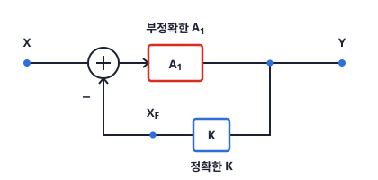

*$K=0.1$, $A_1=1000$이면 $KA_1=100$이라 이득이 $\frac{1000}{101}\approx9.90$으로 $\frac{1}{K}=10$과 거의 같아요.*

**정확히 말하면**

#### 숫자로 확인하기

음귀환 시스템의 폐루프 이득(closed-loop gain)은 개루프 이득(open-loop gain) $A_1$과 피드백 팩터(귀환율, feedback factor) $K$로 정해져요.

$$
\frac{Y}{X}=\frac{A_1}{1+KA_1}
$$

먼저 작은 예에 적용해 봐요. $K=0.1$, $A_1=1000$이면 루프 이득은 $KA_1=100$이에요.

$$
\frac{Y}{X}=\frac{1000}{1+0.1\times1000}=\frac{1000}{101}\approx9.90
$$

**이 값은 $\frac{1}{K}=10$과 거의 같아요.**

#### $A_1$이 식에서 사라지는 과정

일반식은 이 순서로 줄여요.

1. $$
   \frac{Y}{X}=\frac{A_1}{1+KA_1}
   $$

   폐루프 이득에서 시작해요.
2. $$
   1+KA_1\approx KA_1
   $$

   루프 이득이 $KA_1\gg1$이면 분모의 1을 무시할 수 있어요.
3. $$
   \frac{Y}{X}\approx\frac{A_1}{KA_1}
   $$

   분모에 대입해요.
4. $$
   \frac{Y}{X}\approx\frac{1}{K}
   $$

   분자와 분모의 $A_1$이 약분돼요.

폐루프 이득이 피드백 팩터의 역수가 되고, 식에서 $A_1$이 사라져요. **이득을 정하는 것이 $A_1$이 아니라 $K$가 된 거예요.**

그래서 폐루프 이득은 개루프 이득의 변화에 둔감해져요. 이 성질을 이득 둔감화(gain desensitization)라고 해요. desensitize는 감도를 낮춘다는 뜻이에요.

$A_1$은 지금까지 배운 공통 소스(CS)·공통 게이트(CG)·캐스코드·차동 증폭기 어느 것이든 될 수 있어요. 귀환이 없을 때 이들의 이득이 모두 개루프 이득이에요. 이 이득이 왜 부정확한지는 [증폭기 이득은 흔들리고 저항의 비는 정확해요](#s1-precise-k)에서 봐요.

#### 피드백 팩터 $K$의 범위

$K$는 보통 저항의 비예요. op-amp 비반전 증폭기에서는 출력 전압 중 저항 분배기가 입력 쪽으로 되돌려 보내는 비율이에요.

$$
K=\frac{X_F}{Y}=\frac{R_2}{R_1+R_2}
$$

비반전 증폭기를 귀환 시스템으로 나눠 본 내용은 1106 정리노트의 [비반전 증폭기를 귀환으로 보기](../../1106/정리노트_1106_Negative_Feedback.html#s2-noninverting)에 있어요.

$K$는 보통 1보다 작고, 커 봐야 1이에요. **$K\gt1$이면 폐루프 이득 $\frac{1}{K}$가 1보다 작아져 증폭이 되지 않아요.** 큰 이득이 필요하므로 실제 $K$는 1보다 훨씬 작아요.

**교수님 말씀**

> A1이 아니라 K에 의해서 이득이 결정된다.

> 정교한 K로 부정확한 A1을 보정한다.

교수님은 제어 시스템에 비유했어요. 정확하지 않은 시스템에 정교한 피드백 $K$를 덧붙여 정밀하게 제어하는 것이 피드백의 원리라고 했어요.

확인해 봐요. $K=0.2$, $A_1=500$일 때 루프 이득 $KA_1$, 폐루프 이득 $\frac{Y}{X}$, 그리고 $KA_1\gg1$ 근사값 $\frac{1}{K}$는 각각 얼마인가요?

답 보기

루프 이득은 $KA_1=0.2\times500=100$, 폐루프 이득은 $\frac{Y}{X}=\frac{500}{1+100}=\frac{500}{101}\approx4.95$, 근사값은 $\frac{1}{K}=\frac{1}{0.2}=5$예요.

**페이지 요약**

루프 이득이 $KA_1\gg1$이면 폐루프 이득은 $A_1$과 거의 무관한 $\frac{1}{K}$가 돼요.

*핵심 식*

- 폐루프 이득

  $$
  \frac{Y}{X}=\frac{A_1}{1+KA_1}
  $$
- 루프 이득이 클 때

  $$
  \frac{Y}{X}\approx\frac{1}{K}
  $$
- 비반전 증폭기의 K

  $$
  K=\frac{X_F}{Y}=\frac{R_2}{R_1+R_2}
  $$

이득을 정하는 것이 $A_1$이 아니라 $K$가 돼요.

보통 $K\lt1$이고, $K\gt1$이면 증폭이 되지 않아요.

*용어*

- **이득 둔감화(gain desensitization)** — 폐루프 이득이 개루프 이득의 변화에 둔감해지는 성질
- **피드백 팩터(feedback factor)** — 출력 중 입력 쪽으로 되돌아가는 비율 $K$, 1106 노트의 귀환율

---

### 증폭기 이득은 흔들리고 저항의 비는 정확해요

*1111 수업 · L06 s11*

**쉽게 말하면**

트랜지스터로 만든 $A_1$은 ±20%까지 흔들리지만, 저항 두 개의 비인 $K$는 ±1% 정도로 정확해요.

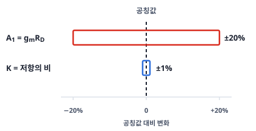

*$R_1=9\,\mathrm{k\Omega}$, $R_2=1\,\mathrm{k\Omega}$이 함께 20% 커져 $10.8\,\mathrm{k\Omega}$, $1.2\,\mathrm{k\Omega}$이 되어도 $K=\frac{1.2}{12}=0.1$ 그대로예요.*

**정확히 말하면**

#### 숫자로 확인하기

먼저 작은 예에 적용해 봐요. 비반전 증폭기의 $R_1=9\,\mathrm{k\Omega}$, $R_2=1\,\mathrm{k\Omega}$이 같은 공정에서 함께 20% 커졌다고 해 봐요. 바뀐 뒤의 값에는 $^*$를 붙여요.

$$
K=\frac{1\,\mathrm{k\Omega}}{9\,\mathrm{k\Omega}+1\,\mathrm{k\Omega}}=0.1
$$

$$
K^*=\frac{1.2\,\mathrm{k\Omega}}{10.8\,\mathrm{k\Omega}+1.2\,\mathrm{k\Omega}}=0.1
$$

**개별 저항값은 20% 바뀌었지만 $K$는 그대로예요.**

#### $A_1$은 왜 흔들리나요

$A_1$의 가장 단순한 예는 공통 소스(CS) 단이고, 이득의 크기는 다음과 같아요.

$$
|A_v|=g_mR_D
$$

- $g_m$은 바이어스 전류와 소자 크기의 함수라서 공정과 온도에 따라 바뀌어요.
- $R_D$는 단품 저항이든 칩 위에 만든 저항이든 최대 ±20%까지 오차가 나요.
- $W/L$도 공정의 랜덤 미스매치(random mismatch)로 바뀌어요.

**그래서 개루프 이득도 최대 ±20%까지 달라질 수 있어요.** 귀환 없이 $A_1$을 그대로 쓰면 $g_m$이나 $R_D$의 변화가 이득에 그대로 나타나요.

#### $K$는 왜 정확한가요

$K$는 1보다 작아도 되므로 이득이 필요 없어요. 그래서 $g_m$ 없이 수동 소자(저항이나 커패시터)의 비로 만들어요. 절댓값이 아니라 비(ratio)로 정해진다는 점이 핵심이에요.

1. $$
   R_1^*=\alpha R_1
   $$

   $$
   R_2^*=\alpha R_2
   $$

   같은 공정에서 만든 두 저항은 같은 배율 $\alpha$로 함께 늘거나 줄어요.
2. $$
   K^*=\frac{\alpha R_2}{\alpha R_1+\alpha R_2}=\frac{R_2}{R_1+R_2}=K
   $$

   $K$에 대입하면 $\alpha$가 약분돼요.
3. 실제 두 저항의 변화가 완전히 같지는 않아요. 그래도 같은 공정에서 만든 저항의 비는 ±1% 정도로 정확해요.

**정리하면 부정확한 $A_1$의 영향은 귀환이 줄이고, 이득은 정확한 비로 만든 $K$가 정해요.** [루프 이득이 크면 이득은 1/K가 돼요](#s1-desensitization)

#### 둔감화가 줄이는 변동과 쓰이는 곳

**개루프 이득에 영향을 주는 요인은 무엇이든 폐루프 이득에는 덜 영향을 줘요.** 이득 둔감화가 줄여 주는 변동은 세 가지예요.

- 부품 변동(component variation): $g_m$, $r_O$ 같은 소자 파라미터의 변화예요.
- 부하 변동(load variation): CS 단의 이득은 부하 저항에 의존하므로, 부하가 바뀌면 $A_1$도 바뀌어요.
- 주파수 변동(frequency variation): 주파수가 높아지면 CS 단의 이득이 떨어져요. 이 효과는 [극점이 (1+루프 이득)배 높아져요](#s2-pole-shift)에서 대역폭 확장으로 이어져요.

수업에서는 정밀한 이득뿐 아니라 정밀한 전류·전압·주파수를 만드는 회로도 모두 귀환을 쓴다고 했어요.

- 전압 레귤레이터(voltage regulator): 배터리 전압이 변해도 출력 전압을 일정하게 유지해요.
- 오실레이터와 PLL(phase-locked loop): LC로 정해지는 주파수는 L, C 값이 공정에서 ±20% 변하면 함께 바뀌어 그대로 쓸 수 없어요. 그래서 PLL의 귀환으로 정밀한 주파수를 만들어요.

**교수님 말씀**

> 저항의 비는 플러스마이너스 1% 정도로 굉장히 정확하게 구현할 수가 있습니다.

교수님은 파운드리에서 $100\,\Omega$ 저항을 만들면 ±20%까지 변하지만, 저항들이 같이 늘고 같이 줄어서 비는 정확하다고 설명했어요.

SPICE 시뮬레이션에서 100으로 설계해도 실제 칩에서는 99가 되거나 100.1이 될 수 있다는 예도 들었어요.

> 정밀한 전류를 만들거나 … 전압을 만들거나 … 주파수를 만들거나, 모두 다 피드백 씁니다.

확인해 봐요. $R_1=4\,\mathrm{k\Omega}$, $R_2=1\,\mathrm{k\Omega}$인 저항 분배기가 같은 공정 변화로 함께 $20\,\%$ 줄어 $R_1^*=3.2\,\mathrm{k\Omega}$, $R_2^*=0.8\,\mathrm{k\Omega}$이 되면 피드백 팩터 $K^*$는 얼마인가요?

답 보기

$K^*=0.2$로 원래 $K=\frac{1}{4+1}=0.2$와 같아요. $K^*=\frac{0.8}{3.2+0.8}=\frac{0.8}{4.0}=0.2$로 같은 비율 $\alpha=0.8$이 약분돼요.

**페이지 요약**

개루프 이득 $g_mR_D$는 ±20%까지 흔들리지만, 같은 공정 저항의 비인 $K$는 ±1% 정도로 정확해요.

*핵심 식*

- CS 단의 개루프 이득

  $$
  |A_v|=g_mR_D
  $$
- 함께 변한 저항의 비

  $$
  \begin{aligned}K^*&=\frac{\alpha R_2}{\alpha R_1+\alpha R_2}\\&=\frac{R_2}{R_1+R_2}=K\end{aligned}
  $$

이득 둔감화는 부품 변동, 부하 변동, 주파수 변동의 영향을 모두 줄여요.

전압 레귤레이터와 PLL도 귀환으로 정밀한 전압과 주파수를 만들어요.

*용어*

- **부품 변동(component variation)** — $g_m$, $r_O$ 같은 소자 파라미터의 공정·온도 변화
- **부하 변동(load variation)** — 부하 저항이 바뀌어 개루프 이득이 달라지는 것

---

### 루프 이득이 커야 하고, 그 대가로 이득은 줄어요

*1111 수업 · L06 s11*

**쉽게 말하면**

$A_1$이 작으면 이득이 $\frac{1}{K}$에서 멀어지므로, 루프 이득 $KA_1$을 1보다 훨씬 크게 만들어야 해요.

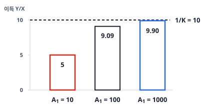

*$K=0.1$일 때 $A_1$이 10, 100, 1000으로 커지면 이득은 5, 9.09, 9.90이 되어 $\frac{1}{K}=10$과의 오차가 50%, 9.09%, 0.99%로 줄어요.*

**정확히 말하면**

#### $\frac{1}{K}$와의 오차 $\varepsilon$

이득이 $\frac{1}{K}$로 정해지려면 루프 이득이 $KA_1\gg1$이어야 해요. 실제 $A_1$은 유한하므로 폐루프 이득 $\frac{A_1}{1+KA_1}$은 $\frac{1}{K}$보다 조금 작아요. 이 모자란 비율을 오차 $\varepsilon$으로 정의해요.

먼저 작은 예에 적용해 봐요. $K=0.1$, $A_1=1000$이면 다음과 같아요.

$$
\frac{Y}{X}=\frac{1000}{1+0.1\times1000}=\frac{1000}{101}\approx9.90
$$

$$
\varepsilon=1-0.1\times\frac{1000}{101}=\frac{1}{101}\approx0.99\,\%
$$

일반식은 이 순서로 구해요.

1. $$
   \varepsilon=\frac{\frac{1}{K}-\frac{Y}{X}}{\frac{1}{K}}=1-K\frac{Y}{X}
   $$

   오차를 $\frac{1}{K}$ 대비 모자란 비율로 정의해요.
2. $$
   \varepsilon=1-\frac{KA_1}{1+KA_1}
   $$

   폐루프 이득을 대입해요.
3. $$
   \varepsilon=\frac{1}{1+KA_1}
   $$

   통분해요.
4. $$
   \varepsilon\approx\frac{1}{KA_1}
   $$

   $KA_1\gg1$이면 분모의 1을 무시해요.

**$A_1$이 작을수록 $KA_1$이 작아져 오차가 커져요.** $A_1\to\infty$이면 오차가 0이 되어 이득이 정확히 $\frac{1}{K}$예요.

| $A_1$ ($K=0.1$) | $KA_1$ | $\frac{Y}{X}=\frac{A_1}{1+KA_1}$ | $\varepsilon=\frac{1}{1+KA_1}$ |
|---|---|---|---|
| $10$ | $1$ | $5$ | $50\,\%$ |
| $100$ | $10$ | $\frac{100}{11}\approx9.09$ | $\frac{1}{11}\approx9.09\,\%$ |
| $1000$ | $100$ | $\frac{1000}{101}\approx9.90$ | $\frac{1}{101}\approx0.99\,\%$ |

#### 1% 오차에 필요한 루프 이득

교수님은 오차를 1% 정도로 만들려면 $A_1$이 1000 이상이어야 한다고 했어요. 이 숫자에는 폐루프 이득이 약 10, 즉 $K=0.1$이라는 전제가 숨어 있어요.

1. $$
   \frac{1}{1+KA_1}\le0.01
   $$

   오차를 1% 이하로 만드는 조건이에요.
2. $$
   KA_1\ge99
   $$

   정리하면 루프 이득이 약 100 이상이어야 해요.
3. $$
   A_1\ge\frac{99}{0.1}=990
   $$

   $K=0.1$을 넣어요.

그래서 $\frac{1}{K}=10$이면 $A_1\gtrsim1000$이에요. **일반 기준은 $KA_1\gtrsim100$이므로, 폐루프 이득이 더 큰 $\frac{1}{K}=100$이면 같은 1% 오차에 $A_1\gtrsim10^4$이 필요해요.**

#### 오차의 뜻과 op-amp를 크게 만드는 이유

여기의 오차는 이상적인 $\frac{1}{K}$와의 차이예요. $A_1$이 변할 때 폐루프 이득이 몇 % 바뀌는지(변화율)는 다른 질문이므로 두 기준을 섞지 않아요.

이 조건 때문에 op-amp의 이득을 아주 크게 설계해요. op-amp를 이득 1000이나 10000짜리 개루프 증폭기로 쓰려는 것이 아니에요. **귀환 안에서 루프 이득을 키워 정확한 폐루프 이득을 얻으려는 거예요.**

#### 대가와 줄어든 이득 되찾기

대가는 이득이에요. 폐루프 이득 $\frac{A_1}{1+KA_1}$은 개루프 이득 $A_1$보다 $1+KA_1$배 작아요. 위 예에서는 $1000$이 약 $9.90$으로 $101$배 줄었어요.

그럼 처음부터 $A_1$ 없이 $K$만 쓰면 될까요? $K$는 수동 소자(저항·커패시터)의 비라서 1보다 작아 증폭을 할 수 없어요. **$A_1$이 있어야 증폭이 되고, 귀환은 그 이득이 $A_1$이 아니라 $\frac{1}{K}$로 정해지게 해 줘요.**

줄어든 이득은 쉽게 되찾아요. 정확한 이득 10짜리 단을 세 개 이으면 돼요.

$$
10\times10\times10=1000
$$

반대로 이득 1000짜리 증폭기 하나를 귀환 없이 정확하게 만드는 것은 어려워요.

**교수님 말씀**

> op-amp 자체를 증폭기로 사용하지 않아요.

> K만 써서는 증폭을 할 수가 없죠, 이득이 안 나오잖아요.

> 10짜리 세 개 연결하면 1000이 되잖아요.

교수님은 "처음부터 $K$만 쓰면 되지 않느냐"는 질문을 스스로 던지고 답했어요. 모든 시스템에 정확한 이득이 필요한 것은 아니고, 정확한 이득이 필요할 때 귀환으로 이득을 조금 내주고 정확도를 얻는다고 했어요.

**꼭 기억해요**

> 루프 게인이 1보다 굉장히 커야 됩니다.

"1% 오차에 $A_1$이 1000 이상"은 폐루프 이득이 약 10일 때의 숫자예요. 일반 기준은 $KA_1\gtrsim100$이에요.

확인해 봐요. 목표 폐루프 이득이 $\frac{1}{K}=20$($K=0.05$)일 때 $\frac{1}{K}$와의 오차 $\varepsilon$를 $1\,\%$ 이하로 만들려면 개루프 이득 $A_1$은 최소 얼마여야 하나요?

답 보기

$A_1\ge1980$(약 $2000$ 이상)이어야 해요. $\frac{1}{1+KA_1}\le0.01$에서 $KA_1\ge99$이고, $K=0.05$를 넣으면 $A_1\ge\frac{99}{0.05}=1980$이에요.

**페이지 요약**

이득이 $\frac{1}{K}$에 가까우려면 루프 이득 $KA_1$이 1보다 훨씬 커야 하고, 그 대가로 이득은 $1+KA_1$배 줄어요.

*핵심 식*

- 폐루프 이득

  $$
  \frac{Y}{X}=\frac{A_1}{1+KA_1}
  $$
- 1/K와의 오차

  $$
  \varepsilon=\frac{1}{1+KA_1}\approx\frac{1}{KA_1}
  $$

1% 오차에는 $KA_1\gtrsim100$이 필요하고, $\frac{1}{K}=10$이면 $A_1\gtrsim1000$이에요.

$K$는 수동 소자의 비라서 혼자서는 증폭할 수 없어요.

줄어든 이득은 정확한 단을 세 개 이어 $10\times10\times10=1000$으로 되찾아요.

*용어*

- **오차 $\varepsilon$** — 폐루프 이득이 $\frac{1}{K}$보다 모자란 비율

---

## 3. 장점 ②: 대역폭 확장

### 극점이 (1+루프 이득)배 높아져요

*1111 수업 · L06 s12*

**쉽게 말하면**

단일 극점 증폭기에 음귀환을 걸면 저주파 이득은 $1+KA_0$배 줄고, 이득이 꺾이는 극점은 같은 $1+KA_0$배만큼 높은 주파수로 올라가요.

예를 들어 $A_0=100$, $K=0.09$이면 $1+KA_0=10$이라 이득은 100 → 10, 극점은 $\omega_0$ → $10\omega_0$가 돼요.

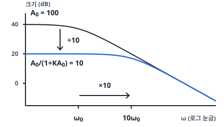

*영점이 없는 저역통과 응답이라 두 곡선 모두 평탄한 저주파 이득에서 시작해 극점 근처에서 부드럽게 꺾이고, 귀환을 건 강조색 곡선은 평탄 이득이 10으로 나뉘는 대신 극점이 10배 높아져요.*

**정확히 말하면**

작은 예시부터 적용해요. 피드백 팩터(귀환율) $K=0.09$, 개루프 저주파 이득 $A_0=100\,[\mathrm{V/V}]$이면 루프 이득은 $KA_0=9$이고 귀환 배수는 $1+KA_0=10$이에요. 폐루프 저주파 이득은 $100/10=10\,[\mathrm{V/V}]$로 40 dB에서 20 dB로 내려가고, 극점은 $\omega_0$에서 $10\omega_0$로 올라가요. 그래서 이득이 일정하게 유지되는 주파수 범위, 즉 대역폭이 10배 넓어져요. 이것이 대역폭 확장(bandwidth extension)이에요.

1. **개루프를 단일 극점(single pole) 시스템으로 둬요.** 저주파 이득이 $A_0$이고 극점이 $\omega_0$ 하나뿐인 증폭기예요. 영점이 없으므로 $\omega_0$가 −3 dB 대역폭이에요.

   $$
   A(s)=\frac{A_0}{1+s/\omega_0}
   $$
2. $$
   \frac{Y}{X}(s)=\frac{A(s)}{1+KA(s)}
   $$

   $$
   \frac{Y}{X}(s)=\frac{\dfrac{A_0}{1+s/\omega_0}}{1+K\dfrac{A_0}{1+s/\omega_0}}
   $$

   **폐루프 식에 넣어요.** 분자는 개루프 이득 $A(s)$이고, 분모의 $KA(s)$가 루프 이득이에요.
3. $$
   \frac{Y}{X}(s)=\frac{A_0}{1+KA_0+s/\omega_0}
   $$

   **분자와 분모에 $1+s/\omega_0$를 곱해요.**
4. **분자와 분모를 $1+KA_0$로 나눠요.** 상수항을 1로 만들고 $s$ 항을 앞으로 빼면 다시 단일 극점 꼴이 돼요.

   $$
   \frac{Y}{X}(s)=\frac{\dfrac{A_0}{1+KA_0}}{1+\dfrac{s}{(1+KA_0)\omega_0}}
   $$
5. $$
   \frac{Y}{X}(0)=\frac{A_0}{1+KA_0}
   $$

   **저주파 이득을 읽어요.** $s\to0$이면 분모가 1이에요. 저주파 이득은 $1+KA_0$배 줄어요.
6. **극점을 읽어요.** 극점은 분모를 0으로 만드는 $s$예요. 그 크기는 원래 $\omega_0$보다 같은 $1+KA_0$배 높아요.

   $$
   \omega_{p,\mathrm{closed}}=(1+KA_0)\omega_0
   $$
7. **두 배수를 함께 봐요.** 이득을 나눈 배수와 극점을 곱한 배수가 같아서, 평탄 이득과 대역폭의 곱은 귀환 전과 같은 $A_0\omega_0$예요.

슬라이드의 문장도 같은 뜻이에요. **음귀환은 이득을 $(1+KA_0)$배 낮추지만 대역폭을 같은 양만큼 넓혀요.** 실제 크기 곡선은 꺾은선이 아니라 부드럽게 변하고, 극점에서 평탄 이득보다 약 3 dB 낮아요.

**교수님 말씀**

교수님은 개루프를 극점 하나인 시스템으로 두고, 칠판에서 폐루프 식에 대입한 뒤 분자·분모를 $1+KA_0$로 나눠 끝까지 정리했어요. 극점을 읽는 기준도 짚었어요.

> “폴 주파수는 분모를 0으로 만드는 거잖아요”

결과를 그래프로 다시 읽어 줬어요.

> “원래는 ω0에서 게인이 떨어지는데, 이제는 … 1 + 루프 게인만큼 대역폭이 더 증가하더라”

확인해 봐요. 저주파 이득이 $A_0=80\,[\mathrm{V/V}]$이고 극점이 $\omega_0$인 단일 극점 증폭기에 $K=0.05$인 음귀환을 걸면, 폐루프 저주파 이득과 폐루프 극점은 얼마인가요?

답 보기

폐루프 저주파 이득은 $16\,[\mathrm{V/V}]$, 극점은 $5\omega_0$예요. $KA_0=0.05\times80=4$이므로 $1+KA_0=5$이고, 이득은 $\frac{80}{5}=16$, 극점은 $5\omega_0$가 돼요.

**페이지 요약**

음귀환은 단일 극점 증폭기의 저주파 이득을 $1+KA_0$배 낮추고 극점을 같은 배수만큼 올려 대역폭을 넓혀요.

*핵심 식*

- 개루프

  $$
  A(s)=\frac{A_0}{1+s/\omega_0}
  $$
- 폐루프 저주파 이득

  $$
  \frac{Y}{X}(0)=\frac{A_0}{1+KA_0}
  $$
- 폐루프 극점

  $$
  \omega_{p,\mathrm{closed}}=(1+KA_0)\omega_0
  $$

폐루프 식의 분자는 개루프 이득 $A(s)$이고 루프 이득은 $KA(s)$예요.

극점은 분모를 0으로 만드는 $s$이고, 단일 극점이면 그 크기가 −3 dB 대역폭이에요.

*용어*

- **대역폭 확장(bandwidth extension)** — 음귀환으로 극점이 $1+KA_0$배 높아져 대역폭이 넓어지는 성질
- **단일 극점(single pole)** — 전달 함수의 극점이 $\omega_0$ 하나뿐인 저역통과 응답

---

### 이득을 내주고 대역폭을 얻어요

*1111 수업 · L06 s13*

**쉽게 말하면**

피드백 팩터 $K$를 0 → 0.1 → 0.5로 키울수록 평탄한 이득은 $1+KA_0$배 내려가고, 극점은 같은 배수만큼 오른쪽으로 가요.

예를 들어 $A_0=100$이면 $1+KA_0$는 1 → 11 → 51이라 이득은 100 → 약 9.09 → 약 1.96, 극점은 $\omega_0$ → $11\omega_0$ → $51\omega_0$예요.

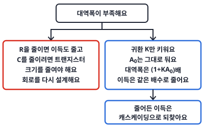

*극점을 R·C로 올리려면 회로를 다시 설계해야 하지만, 귀환은 $A_0$를 그대로 두고 $K$만 조절하며 줄어든 이득은 캐스케이딩으로 되찾아요.*

**정확히 말하면**

작은 예시부터 적용해요. 위젯용 예시 값 $A_0=100\,[\mathrm{V/V}]$에서 피드백 팩터(귀환율) $K$만 바꿔요. 먼저 $1+KA_0$를 구하고, 평탄 이득은 $A_0$를 그 값으로 나누고, 극점은 $\omega_0$에 그 값을 곱해요.

| $K$ | $1+KA_0$ | 평탄 이득 [V/V] | 평탄 이득 [dB] | 극점 |
|---|---|---|---|---|
| 0 | 1 | 100 | 40 | $\omega_0$ |
| 0.1 | 11 | ≈ 9.09 | ≈ 19.17 | $11\omega_0$ |
| 0.5 | 51 | ≈ 1.96 | ≈ 5.85 | $51\omega_0$ |

1. **슬라이드의 세 곡선을 읽어요.** $K=0$이면 귀환이 없어 개루프 곡선 그대로이고 극점은 $\omega_0$예요. $K$를 키우면 피드백이 더 많이 되어 극점이 올라가요.

   $$
   K=0.1:\ \omega_{p,\mathrm{closed}}=(1+0.1A_0)\omega_0
   $$

   $$
   K=0.5:\ \omega_{p,\mathrm{closed}}=(1+0.5A_0)\omega_0
   $$

   평탄 이득은 같은 배수로 줄어요. 게인은 줄어드는 것만큼 대역폭은 더 늘어나요.
2. **곡선 모양을 확인해요.** 영점이 없는 저역통과 응답이라 세 곡선 모두 평탄한 저주파 이득에서 시작해 각자의 극점 근처에서 부드럽게 꺾여요. 극점 위 고주파 쪽에서는 평탄 이득을 나눈 배수와 극점을 곱한 배수가 같아서, 하강선이 개루프 곡선과 거의 겹쳐요.
3. **회로로 극점을 올리려면 어떻게 할까요.** 신호 경로의 노드 극점은 그 노드에서 본 저항과 커패시턴스의 곱으로 정해져요([1028 정리노트: 극점은 노드마다, 떠 있는 C는 밀러로](../../1028/정리노트_1028_CS_Stage_Frequency_Response.html#s1-strategy)).

   $$
   |\omega_p|=\frac{1}{RC}
   $$

   $R$을 줄이면 이득도 같이 줄어요. 예를 들어 CS 단 이득의 크기는 $g_mR_D$예요. $C$를 줄이려면 트랜지스터 크기를 줄여야 하고, 그러면 $g_m$과 전류도 줄어요. 어느 쪽이든 회로를 다시 설계해야 해요.
4. **귀환은 회로를 그대로 둬요.** $A_0$를 바꾸지 않고 $K$만 조절해 대역폭을 $1+KA_0$배 넓혀요. 대가는 같은 배수만큼 줄어드는 이득이에요.
5. **줄어든 이득은 캐스케이딩으로 되찾아요.** 캐스케이딩(cascading)은 증폭단을 여러 단 이어 전체 이득을 곱으로 키우는 방법이에요. **이득을 늘리는 일은 쉽고 대역폭을 늘리는 일은 어려우므로, 귀환으로 이득을 대역폭과 바꾸는 것이 이득이에요.**

#### 직접 해 보기: K를 키우면 이득은 내려가고 극점은 오른쪽으로 가요 *(정적 스냅샷 — 직접 조작은 HTML 버전)*

피드백 팩터 $K$ 슬라이더(눈금 0, 0.1, 0.5)를 움직이면 $A_0=100$인 단일 극점 증폭기의 폐루프 크기 응답에서 평탄 이득이 $1+KA_0$배 낮아지고 극점이 $(1+KA_0)\omega_0$로 오른쪽으로 가요. 고주파 하강선은 개루프 곡선(흐린 점선)과 거의 겹쳐요.

표시점: $K=0$ $K=0.1$ $K=0.5$

현재 값: **K = 0.1 · 1+KA0 = 11 · 평탄 이득 ≈ 9.09 (≈ 19.17 dB) · 극점 = 11ω0 · 평탄 이득 × 극점 = 100ω0**

범례: 개루프 곡선 ($K=0$) · 폐루프 곡선 (현재 $K$) · 폐루프 극점 위치(세로 점선)

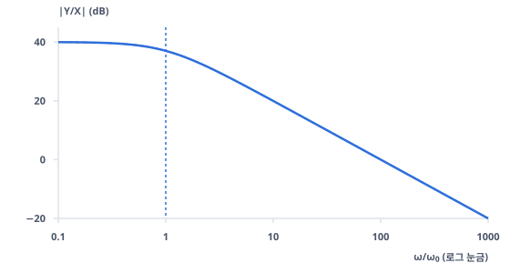

*$K=0$*

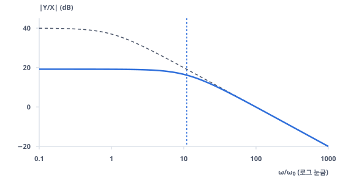

*$K=0.1$*

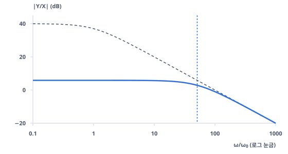

*$K=0.5$*

| 설정 | $1+KA_0$ | 평탄 이득 | 극점 |
|---|---|---|---|
| $K=0$ | 1 | 100 | $\omega_0$ |
| $K=0.1$ | 11 | ≈ 9.09 | $11\omega_0$ |
| $K=0.5$ | 51 | ≈ 1.96 | $51\omega_0$ |

**교수님 말씀**

교수님은 $K$를 0, 0.1, 0.5로 키운 그래프를 짚으며 이득과 대역폭이 반대로 움직인다고 정리했어요.

> “게인은 줄어드는 것만큼 대역폭은 더 늘어난다”

대역폭을 늘리는 회로 설계를 묻고 스스로 답했어요.

> “R과 C를 줄여야 되겠죠. R을 줄이든지, C를 줄이든지.”

> “C를 줄이려면 트랜지스터 사이즈를 줄여야 돼요”

줄어든 이득은 여러 단으로 해결하면 된다고 했어요.

> “게인이 줄어든 만큼 캐스케이딩을 이용해서 여러 단을 쓰면 되겠습니다”

귀환의 가장 우선적인 목적은 정확한 특성을 얻는 것이고, 대역폭 증가는 또 하나의 장점이라고 정리했어요.

확인해 봐요. 위젯의 예시처럼 개루프 저주파 이득이 $A_0=100\,[\mathrm{V/V}]$일 때 피드백 팩터 $K=0.19$로 키우면 폐루프 평탄 이득[V/V]과 극점은 얼마가 되나요?

답 보기

평탄 이득은 $5\,[\mathrm{V/V}]$, 극점은 $20\omega_0$가 돼요. $1+KA_0=1+0.19\times100=20$이므로 이득은 $\frac{100}{20}=5\,[\mathrm{V/V}]$, 극점은 $20\omega_0$예요.

**페이지 요약**

피드백 팩터 $K$를 키우면 평탄 이득은 $1+KA_0$배 낮아지고 대역폭은 같은 배수로 넓어져요.

*핵심 식*

- $K=0.1$의 극점

  $$
  \omega_{p,\mathrm{closed}}=(1+0.1A_0)\omega_0
  $$
- $K=0.5$의 극점

  $$
  \omega_{p,\mathrm{closed}}=(1+0.5A_0)\omega_0
  $$

극점 위 고주파 하강선은 개루프 곡선과 거의 겹쳐요.

$R$이나 $C$를 줄여 극점을 올리려면 회로를 다시 설계해야 해요.

귀환은 $A_0$를 그대로 두고 $K$만 조절해 대역폭을 넓혀요.

줄어든 이득은 캐스케이딩으로 되찾아요.

*용어*

- **피드백 팩터(귀환율, feedback factor)** — 출력에서 입력으로 되돌리는 비율 $K$
- **캐스케이딩(cascading)** — 증폭단을 여러 단 이어 이득을 곱으로 키우는 방법

---

## 4. 귀환의 대가: 불안정과 발진

### 음귀환이 양귀환으로 바뀌면 발진해요

*1111 수업 · L06 s14*

**쉽게 말하면**

귀환 신호가 루프를 한 바퀴 도는 동안 위상이 180° 밀리면, 빼던 신호를 거꾸로 더하게 되어 출력이 점점 커져요.

이렇게 입력이 없어도 저절로 신호가 생기는 것을 발진이라 하고, 발진하는 회로는 증폭기로 쓸 수 없어요.

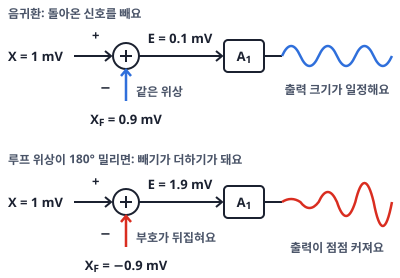

*같은 크기 $0.9\,\mathrm{mV}$라도 부호가 뒤집혀 돌아오면 비교부의 차이가 $0.1\,\mathrm{mV}$에서 $1.9\,\mathrm{mV}$로 커지고, 이 신호가 다시 증폭되어 돌아오기를 되풀이해요.*

**정확히 말하면**

#### 부호가 뒤집히면 차이가 커져요

전방 증폭기 $A_1$과 피드백 팩터(귀환율) $K$로 만든 음귀환의 대가는 두 가지예요. 하나는 이득이 $1+KA_1$배 줄어드는 것이에요([루프 이득이 커야 하고, 그 대가로 이득은 줄어요](#s1-large-loop-gain)). 다른 하나는 회로가 불안정(unstable)해져 발진(oscillation)할 수 있다는 것이에요.

비교부는 입력 $X$에서 귀환 신호 $X_F$를 빼서 전방 증폭기 $A_1$에 넣어요.

$$
E=X-X_F
$$

먼저 그림의 크기 예시에 적용해요. 입력 $X=1\,\mathrm{mV}$와 같은 위상으로 $X_F=0.9\,\mathrm{mV}$가 돌아오면 차이가 작아요.

$$
E=1-0.9=0.1\,\mathrm{mV}
$$

**같은 크기가 부호만 뒤집혀 $X_F=-0.9\,\mathrm{mV}$로 돌아오면 차이가 입력보다 커져요.**

$$
E=1-(-0.9)=1.9\,\mathrm{mV}
$$

#### 왜 위상이 180° 밀리나요

부호가 왜 뒤집히는지는 위상으로 설명해요.

1. $$
   \sin(\omega t-180^\circ)=-\sin\omega t
   $$

   사인파는 위상이 180° 밀리면 부호만 뒤집힌 같은 파형이에요.
2. 귀환 신호는 $A_1$과 $K$를 거쳐 루프를 한 바퀴 돌아와요. 저주파에서는 입력과 같은 위상으로 돌아오도록 음귀환을 설계해요.
3. 주파수가 올라가면 증폭기의 극점(pole)에서 크기뿐 아니라 위상도 늦어지는 위상 이동(phase shift)이 생겨요. 극점은 [극점이 (1+루프 이득)배 높아져요](#s2-pole-shift)에서 본 $\omega_0$ 같은 주파수예요.
4. 어떤 주파수에서 루프 한 바퀴의 위상 이동이 180°가 되면 그 주파수의 $X_F$는 부호가 뒤집혀 $-X_F$로 돌아와요.

   $$
   E=X-(-X_F)=X+X_F
   $$
5. **빼기가 더하기가 되었으니 이 주파수에서는 양귀환(positive feedback)이에요.** 더해진 신호가 다시 증폭되어 돌아오고 또 더해지면서 신호가 점점 커지는 것이 발진이에요.
6. 발진하면 신호를 넣지 않아도 원치 않는 신호가 출력에 나와요. 이런 회로는 증폭기로 쓸 수 없어요.

|   | 설계한 음귀환 | 루프 위상이 180° 밀린 경우 |
|---|---|---|
| 돌아온 $X_F$ | 입력과 같은 위상 | 부호가 뒤집힌 $-X_F$ |
| 비교부 | $E=X-X_F$, 차이가 작아져요 | $E=X+X_F$, 빼기가 더하기가 돼요 |
| 출력 | 정해진 이득으로 증폭돼요 | 점점 커져 발진해요 |
| 쓰임 | 증폭기 | 증폭기로 못 써요. 오실레이터는 일부러 이용해요 |

#### 발진이 쓰이는 곳과 이 과목의 범위

일부러 양귀환을 쓰는 회로도 있어요. 신호를 만드는 회로인 오실레이터(oscillator, 발진기)는 발진을 이용해 신호를 만들어요. **증폭기에서는 발진이 나면 안 돼요.**

그래서 실제 귀환 증폭기에는 안정성(stability)을 지키는 조치가 필요할 수 있어요. 어떤 조건에서 발진하는지 따지는 안정성 분석은 이 과목에서 다루지 않아요.

**교수님 말씀**

> 피드백 회로의 단점은 언스테이블(unstable)해질 수 있다는 단점이 있어요.

이득이 줄어드는 것 말고 또 하나의 단점으로 꼽았어요. 이때 "우리 전자회로 편에서는 다루지 않지만"이라고 말해 이 내용이 이 과목의 범위 밖임을 밝혔어요.

> 파지티브 피드백과 네거티브 피드백은 서로 한 끗 차이거든요.

음귀환으로 설계했어도 잘못하면 양귀환이 될 수 있다는 뜻이에요.

> 지금 마이크 소리 나는 것도 피드백 때문이죠.

수업 중 강의실 마이크에서 난 소리를 예로 들었어요. 소리가 마이크로 계속 다시 들어가 같은 소리가 증폭되면, 아무도 말하지 않아도 소리가 나는 발진이 돼요.

> 앰프에서는 발진이 나면 안 되죠.

신호를 만드는 회로는 일부러 발진을 이용한다고 덧붙였어요.

확인해 봐요. 입력 $X=2\,\mathrm{mV}$일 때 크기 $1.5\,\mathrm{mV}$의 귀환 신호가 같은 위상($X_F=1.5\,\mathrm{mV}$)으로 돌아올 때와 루프 위상이 $180^\circ$ 밀려($X_F=-1.5\,\mathrm{mV}$) 돌아올 때 비교부 출력 $E$는 각각 얼마인가요?

답 보기

같은 위상이면 $E=2-1.5=0.5\,\mathrm{mV}$로 작아지고, $180^\circ$ 밀려 부호가 뒤집히면 $E=2-(-1.5)=3.5\,\mathrm{mV}$로 입력보다 커져 발진할 수 있어요.

**페이지 요약**

루프를 한 바퀴 돈 위상이 180° 밀리면 음귀환이 양귀환이 되어 발진하고, 발진하는 회로는 증폭기로 쓸 수 없어요.

*핵심 식*

- 비교부

  $$
  E=X-X_F
  $$
- 180° 밀린 사인파

  $$
  \sin(\omega t-180^\circ)=-\sin\omega t
  $$
- 부호가 뒤집힌 귀환

  $$
  E=X-(-X_F)=X+X_F
  $$

*용어*

- **불안정(unstable)** — 귀환 회로가 발진할 수 있는 상태예요.
- **양귀환(positive feedback)** — 돌아온 신호를 더해 신호가 점점 커지는 귀환이에요.
- **발진(oscillation)** — 신호를 넣지 않아도 원치 않는 신호가 출력에 나오는 현상이에요.
- **오실레이터(oscillator)** — 발진을 일부러 이용해 신호를 만드는 회로예요.

---

## 5. 네 가지 증폭기 형태

### 입력과 출력이 전압이냐 전류냐

*1111 수업 · L06 s15*

**쉽게 말하면**

증폭기는 받는 입력이 전압이냐 전류냐, 내보내는 출력이 전압이냐 전류냐에 따라 네 가지로 나뉘어요.

예를 들어 입력 전압으로 발광 다이오드의 전류를 바꿔 밝기를 정하는 증폭기는 전압을 받아 전류를 내보내니 트랜스컨덕턴스 증폭기예요.

*색칠된 점이 있는 단자는 전압을, 화살표가 있는 도선은 전류를 주고받고, 선으로 그린 삼각형 안의 기호가 그 형태의 이득이에요.*

**정확히 말하면**

#### 네 형태의 이득 정의

입력의 종류 두 가지(전압, 전류)와 출력의 종류 두 가지(전압, 전류)를 짝지으면 증폭기는 네 가지 형태(type)가 돼요.

그림의 예에 먼저 적용해요. 발광 다이오드(LED)는 흐르는 전류가 밝기를 정해요. 밝기를 조절하는 증폭기는 입력 전압의 크기에 따라 다이오드에 흘릴 출력 전류를 바꿔야 하므로, 입력은 전압이고 출력은 전류인 트랜스컨덕턴스 증폭기예요.

**네 형태의 이득은 모두 출력을 입력으로 나눈 비예요.**

$$
A_v=\frac{v_{out}}{v_{in}}
$$

$$
A_I=\frac{i_{out}}{i_{in}}
$$

$$
G_m=\frac{i_{out}}{v_{in}}
$$

$$
R_O=\frac{v_{out}}{i_{in}}
$$

전압 증폭기(voltage amplifier)의 $A_v$와 전류 증폭기(current amplifier)의 $A_I$는 같은 종류의 양끼리 나눈 비라서 단위가 $\mathrm{V/V}$, $\mathrm{A/A}$예요.

트랜스컨덕턴스 증폭기(transconductance amplifier)의 $G_m$은 전류를 전압으로 나눈 비라서 컨덕턴스(저항의 역수)와 단위가 같아요($\mathrm{A/V}=\mathrm{S}$).

트랜스임피던스 증폭기(transimpedance amplifier)의 $R_O$는 전압을 전류로 나눈 비라서 저항과 단위가 같아요($\mathrm{V/A}=\Omega$).

#### 트랜스(trans-)의 뜻과 기호 구별

같은 노드의 전압과 전류의 비는 그 노드의 저항이에요. 예를 들어 $v_{in}/i_{in}$은 입력저항 $R_{in}$이에요. $G_m$과 $R_O$는 입력 쪽 양과 출력 쪽 양, 즉 서로 다른 노드의 양을 잇는 비라서 "건너간다, 바뀐다"는 뜻의 트랜스(trans-)를 붙여 트랜스컨덕턴스, 트랜스임피던스라고 불러요.

트랜지스터의 $g_m$도 게이트 전압의 변화가 드레인 전류의 변화를 정하는 비라서 트랜스컨덕턴스라고 불러요([0904 노트의 트랜스컨덕턴스](../../0904/정리노트_0904_MOS_Small_Signal_Model.html#s1-gm)). 그래서 트랜지스터는 트랜스컨덕턴스 증폭기의 대표적인 예예요.

기호를 구별해요. **형태의 이득 $G_m$(대문자)과 소자의 $g_m$은 다른 양이고, 트랜스임피던스 이득 $R_O$(대문자)와 트랜지스터의 출력저항 $r_O$도 다른 양이에요.**

#### 이상적인 입력저항과 출력저항

각 형태가 신호를 잘 받고 잘 내보내려면 입력저항 $R_{in}$과 출력저항 $R_{out}$이 정해진 쪽으로 가야 해요. 작은 예부터 봐요. 내부 저항 $R_S=1\,\mathrm{k\Omega}$인 전압원 $v_s$를 증폭기 입력에 이으면 $R_S$와 $R_{in}$이 전압을 나눠 가져요.

$$
v_{in}=\frac{R_{in}}{R_S+R_{in}}v_s
$$

$R_{in}=99\,\mathrm{k\Omega}$이면 전원 전압을 거의 다 받아요.

$$
\frac{v_{in}}{v_s}=\frac{99}{1+99}=0.99
$$

$R_{in}=1\,\mathrm{k\Omega}$이면 절반만 받아요.

$$
\frac{v_{in}}{v_s}=\frac{1}{1+1}=0.5
$$

같은 나눔을 입력과 출력의 네 경우에 적용하면 이상적인 값이 나와요.

1. 전압 입력: 위 전압 분배에서 $R_{in}\to\infty$이면 $v_{in}\to v_s$라서 전원 전압을 그대로 받아요.
2. 전류 입력: 내부 저항 $R_S$가 병렬로 붙은 전류원 $i_s$는 $R_S$와 $R_{in}$으로 전류를 나눠요.

   $$
   i_{in}=\frac{R_S}{R_S+R_{in}}i_s
   $$

   그래서 $R_{in}\to0$이면 $i_{in}\to i_s$예요.
3. 전압 출력: 출력 쪽은 개방 출력 전압 $v_{oc}$에 $R_{out}$이 직렬로 붙은 전압원처럼 보이고, 부하 $R_L$과 전압을 나눠요.

   $$
   v_L=\frac{R_L}{R_{out}+R_L}v_{oc}
   $$

   그래서 $R_{out}\to0$이면 어떤 부하에도 $v_L\to v_{oc}$인 이상적인 전압원이 돼요.
4. 전류 출력: 출력 쪽은 단락 출력 전류 $i_{sc}$에 $R_{out}$이 병렬로 붙은 전류원처럼 보이고, 부하와 전류를 나눠요.

   $$
   i_L=\frac{R_{out}}{R_{out}+R_L}i_{sc}
   $$

   그래서 $R_{out}\to\infty$이면 $i_L\to i_{sc}$인 이상적인 전류원이 돼요.

| 형태 | 이득 | 이상적 $R_{in}$ | 이상적 $R_{out}$ |
|---|---|---|---|
| 전압 증폭기 | $A_v=v_{out}/v_{in}$ | $\infty$ | $0$ |
| 전류 증폭기 | $A_I=i_{out}/i_{in}$ | $0$ | $\infty$ |
| 트랜스컨덕턴스 증폭기 | $G_m=i_{out}/v_{in}$ | $\infty$ | $\infty$ |
| 트랜스임피던스 증폭기 | $R_O=v_{out}/i_{in}$ | $0$ | $0$ |

표는 입력의 종류가 $R_{in}$을, 출력의 종류가 $R_{out}$을 정한다는 규칙 하나로 읽어요. **전압이면 받는 쪽은 $\infty$, 내보내는 쪽은 $0$이고, 전류면 그 반대예요.**

형태를 나누는 이유는 귀환에서 출력의 무엇을 감지하고 입력에서 무엇을 뺄지가 이 형태로 정해지기 때문이에요([감지와 반송이 귀환 구조를 정해요](#s5-sense-return)).

**교수님 말씀**

> 이 네 가지 타입이 실제로 다 쓰여요.

지금까지는 전압을 받아 전압을 내보내는 전압 증폭기만 주로 배웠을 뿐, 실제로는 네 가지 형태가 모두 쓰인다고 했어요.

> 같은 노드의 전압과 전류의 관계가 아니라 입력과 출력의 … 관계이기 때문에

트랜스컨덕턴스의 "트랜스"가 붙는 이유로 든 말이에요. 입력 전압과 입력 전류의 관계는 그냥 입력 저항이라고 덧붙였어요.

> 트랜지스터가 트랜스컨덕턴스 앰프의 대표적인 예예요.

트랜스컨덕턴스라는 말을 처음 듣는 것이 아니라며, 트랜지스터의 $g_m$을 떠올리게 했어요.

네 형태가 모두 쓰이는 예로 발광 다이오드를 들었어요. 빛을 내려면 다이오드에 전류를 흘려야 하므로, 입력 전압의 크기에 따라 출력 전류를 바꿔 빛의 밝기를 조절해요.

> 전압을 잘 받으려면 입력 저항이 커야 되죠.

전류를 잘 받으려면 반대로 입력 저항이 작아야 한다고 했어요. 출력 쪽은 전압을 내보낼 때는 전압원을, 전류를 내보낼 때는 이상적인 전류원을 떠올리면 된다고 했어요.

확인해 봐요. 내부 저항이 $R_S=2\,\mathrm{k\Omega}$인 전압원 $v_s$를 입력저항 $R_{in}=18\,\mathrm{k\Omega}$인 전압 증폭기에 이으면 신호원 전압 중 몇 배($\frac{v_{in}}{v_s}$)가 입력에 걸리나요?

답 보기

$0.9$배($90\,\%$)가 걸려요. $v_{in}=\frac{R_{in}}{R_S+R_{in}}v_s$에서 $\frac{v_{in}}{v_s}=\frac{18}{2+18}=0.9$예요.

**페이지 요약**

증폭기는 입력과 출력이 각각 전압이냐 전류냐에 따라 네 형태로 나뉘고, 이득은 모두 출력을 입력으로 나눈 비예요.

*핵심 식*

- 전류 이득

  $$
  A_I=\frac{i_{out}}{i_{in}}
  $$
- 트랜스컨덕턴스

  $$
  G_m=\frac{i_{out}}{v_{in}}
  $$
- 트랜스임피던스

  $$
  R_O=\frac{v_{out}}{i_{in}}
  $$

전압을 받으면 $R_{in}\to\infty$, 전류를 받으면 $R_{in}\to0$이 이상적이에요.

전압을 내보내면 $R_{out}\to0$, 전류를 내보내면 $R_{out}\to\infty$가 이상적이에요.

$G_m$과 $R_O$는 서로 다른 노드인 입력과 출력의 양을 잇는 비라서 트랜스가 붙어요.

*용어*

- **트랜스컨덕턴스 증폭기(transconductance amplifier)** — 입력 전압을 받아 출력 전류를 내는 증폭기로, 트랜지스터가 대표적인 예예요.
- **트랜스임피던스 증폭기(transimpedance amplifier)** — 입력 전류를 받아 출력 전압을 내는 증폭기로, 이득 $R_O$는 트랜지스터의 $r_O$와 다른 양이에요.

---

### 네 형태를 트랜지스터로 만들면

*1111 수업 · L06 s16*

**쉽게 말하면**

전압은 게이트로 받고 전류는 공통 게이트의 소스로 받으며, 전압은 소스 팔로워로 내보내고 전류는 드레인으로 내보내요.

예를 들어 스피커처럼 저항이 작은 부하에 전압을 주려면 출력 쪽에 소스 팔로워를 붙여요.

*입력 단 두 가지와 출력 단 두 가지를 짝지으면 네 가지 증폭기가 모두 만들어져요.*

**정확히 말하면**

#### 작은 부하에 전압을 줄 때 소스 팔로워가 필요한 이유

그림의 스피커 예에 먼저 적용해요. 전압을 내보내는 출력은 개방 출력 전압 $v_{oc}$에 출력저항 $R_{out}$이 직렬로 붙은 전압원처럼 보이므로, 부하 $R_L$에는 그 일부만 걸려요.

$$
\frac{v_L}{v_{oc}}=\frac{R_L}{R_{out}+R_L}
$$

공통 소스(common-source) 단만 쓰면 $\lambda=0$에서 출력저항이 $R_D$예요. $R_D=10\,\mathrm{k\Omega}$에 작은 부하 $R_L=1\,\mathrm{k\Omega}$을 달면 개방 출력 전압의 약 9%만 부하에 걸려요.

$$
\frac{v_L}{v_{oc}}=\frac{1}{10+1}=\frac{1}{11}\approx0.09
$$

소스 팔로워(source follower)를 붙여 출력저항을 $1/g_{m2}$ 정도로 낮추면 대부분이 걸려요. $g_{m2}=10\,\mathrm{mS}$이면 출력저항과 비율은 다음과 같아요.

$$
\frac{1}{g_{m2}}=\frac{1}{10\,\mathrm{mS}}=0.1\,\mathrm{k\Omega}
$$

$$
\frac{v_L}{v_{oc}}=\frac{1}{0.1+1}=\frac{10}{11}\approx0.91
$$

**스피커처럼 저항이 더 작은 부하일수록 두 경우의 차이가 커져요.**

이 토픽의 $R_{in}$, $R_{out}$은 저주파 소신호 값이에요. $1/g_m$ 꼴의 값은 몸체효과를 무시하고 $g_mr_O\gg1$인 수업 기본 근사의 값이고, 공통 게이트 입력은 드레인 쪽 저항이 $r_O$보다 충분히 작다는 조건도 더해요. 슬라이드는 $R_{out}=1/g_{m2}$, $R_{in}=1/g_{m1}$처럼 등호로 적지만 이 근사 아래의 값이므로 $\approx$로 읽어요.

입력 단 두 가지(게이트, 공통 게이트의 소스)와 출력 단 두 가지(소스 팔로워, 드레인)를 짝지은 순서로 슬라이드의 네 회로를 봐요.

#### (a) 전압 증폭기: 공통 소스 $M_1$ + 소스 팔로워 $M_2$

*공통 소스 $M_1$이 게이트로 전압을 받아 증폭하고, 소스 팔로워 $M_2$가 낮은 출력저항으로 내보내요.*

- 입력: $M_1$의 게이트로 받아요. 저주파에서는 게이트로 전류가 흐르지 않으므로 $R_{in}=\infty$예요.
- 출력: 소스 팔로워 $M_2$의 소스에서 내보내요.

  $$
  R_{out}\approx\frac{1}{g_{m2}}
  $$
- 공통 소스 단만으로도 전압은 증폭돼요. 하지만 출력저항이 $R_D$로 커서 작은 부하를 달면 출력 전압이 떨어지므로 이상적인 전압 증폭기와는 거리가 있어요. **그래서 전압 증폭은 $M_1$이 맡고, $M_2$는 출력저항을 낮추는 일을 맡아요.**

#### (c) 트랜스컨덕턴스 증폭기: 트랜지스터 $M_1$ 하나

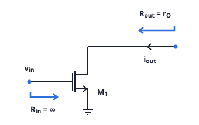

*게이트로 전압을 받아 드레인으로 전류를 내보내는 트랜지스터 자체가 트랜스컨덕턴스 증폭기예요.*

- 입력: 게이트라서 저주파에서 $R_{in}=\infty$예요.
- 출력: 드레인 전류 $i_{out}$을 내보내요. 소스가 접지이므로 드레인에서 들여다보면 트랜지스터의 출력저항 하나만 보여요.

  $$
  R_{out}=r_O
  $$

  **$\lambda=0$이면 $r_O=\infty$이고, $\lambda$를 고려해도 $r_O$는 커서 전류를 내보내기에 알맞아요.**

#### (d) 전류 증폭기: 공통 게이트 $M_1$ 하나

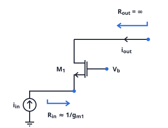

*게이트를 바이어스 $V_b$에 고정한 공통 게이트 $M_1$이 소스로 전류를 받아 드레인으로 내보내요.*

- 입력: 게이트를 $V_b$에 고정하고 소스로 전류를 받는 공통 게이트(common-gate) 단이에요. **소스에서 들여다본 저항이 작아서 전류를 받기에 알맞아요.**

  $$
  R_{in}\approx\frac{1}{g_{m1}}
  $$
- 출력: 드레인으로 전류를 내보내요. $\lambda=0$이면 $R_{out}=\infty$이고, $\lambda$를 고려해도 출력저항이 커서 전류를 내보내기에 알맞아요.

#### (b) 트랜스임피던스 증폭기: 공통 게이트 $M_1$ + 소스 팔로워 $M_2$

*공통 게이트 $M_1$이 전류를 받고, 소스 팔로워 $M_2$가 전압으로 내보내요.*

- 입력: (d)와 같은 공통 게이트 입력이라 $R_{in}\approx1/g_{m1}$로 작아요.
- 출력: (a)와 같은 소스 팔로워 출력이라 $R_{out}\approx1/g_{m2}$로 작아요.
- **전류를 받기 좋은 입력 단과 전압을 내보내기 좋은 출력 단을 이었으므로, 전류를 받아 전압을 내보내는 이상적인 트랜스임피던스 증폭기에 가까워요.**

(c)와 (d)처럼 드레인으로 내보내는 출력에 부하 저항을 달면 그 양단에 전압 출력이 생기지만, 트랜지스터 자체는 전류원처럼 동작해요.

네 회로는 받는 쪽과 내보내는 쪽의 조건을 단마다 맞춘 예예요. 각 형태의 이상적인 조건은 [입력과 출력이 전압이냐 전류냐](#s4-four-types)에 정리했어요.

**교수님 말씀**

> 요거는 이제 좋은 전압 증폭기는 아닐 수 있어요.

공통 소스 단만으로 만든 전압 증폭기를 두고 한 말이에요. 출력 임피던스가 $R_D$로 커서, 지난 시간에 말한 스피커처럼 임피던스가 작은 부하를 달면 출력 전압이 떨어진다고 했어요. 그래서 소스 팔로워를 붙이면 출력 임피던스가 낮은 좋은 구조가 된다고 했어요.

공통 게이트 단은 입력 임피던스가 $1/g_m$으로 작아서 전류를 받아들이기에 알맞은 구조라고 했어요.

> 트랜지스터 자체가 트랜스컨덕턴스 앰프예요.

게이트로 들어가는 입력 임피던스는 무한대이고, 전압을 받아 전류를 내보내며 출력 임피던스는 $r_O$라고 했어요.

> 로드 저항을 달게 되면 전압 출력이 나오겠지만, 트랜지스터 자체는 전류원이 되는 거고요.

확인해 봐요. 소스 팔로워 $M_2$의 $g_{m2}=4\,\mathrm{mS}$일 때 출력저항 $R_{out}\approx\frac{1}{g_{m2}}$는 얼마이고, $R_L=1\,\mathrm{k\Omega}$ 부하에 개방 출력 전압의 몇 배($\frac{v_L}{v_{oc}}$)가 걸리나요?

답 보기

$R_{out}\approx250\,\Omega$($0.25\,\mathrm{k\Omega}$)이고 $\frac{v_L}{v_{oc}}=\frac{1}{0.25+1}=0.8$배($80\,\%$)가 걸려요.

**페이지 요약**

게이트 입력은 전압을, 공통 게이트의 소스 입력은 전류를 받기 좋고, 소스 팔로워 출력은 전압을, 드레인 출력은 전류를 내보내기 좋아요.

*핵심 식*

- 소스 팔로워 출력

  $$
  R_{out}\approx\frac{1}{g_{m2}}
  $$
- 공통 게이트 입력

  $$
  R_{in}\approx\frac{1}{g_{m1}}
  $$
- 트랜지스터의 드레인 출력

  $$
  R_{out}=r_O
  $$

$1/g_m$ 꼴의 값은 몸체효과를 무시하고 $g_mr_O\gg1$인 수업 기본 근사의 값이에요.

공통 소스 단만으로는 출력저항 $R_D$가 커서 스피커 같은 작은 부하에 전압을 잘 주지 못해요.

공통 소스와 소스 팔로워는 전압, 공통 게이트와 소스 팔로워는 트랜스임피던스, 트랜지스터 하나는 트랜스컨덕턴스, 공통 게이트 하나는 전류 증폭기예요.

*용어*

- **소스 팔로워(source follower)** — 게이트로 받은 전압을 소스로 내보내는 단으로, 출력저항이 작아요.
- **공통 게이트(common-gate)** — 게이트를 고정하고 소스로 신호를 받는 단으로, 입력저항이 작아요.

---

## 6. 출력을 감지하는 법

### 감지와 반송이 귀환 구조를 정해요

*1111 수업 · L06 s3, s16*

**쉽게 말하면**

귀환은 피드포워드 시스템 $A_1$의 출력을 감지해 귀환 회로망 $K$로 보내고, 그 결과를 입력으로 반송해 입력에서 빼는 구조예요.

출력이 전압이면 전압을 감지하고 입력이 전압이면 전압을 빼는 것처럼, 무엇을 감지하고 무엇을 뺄지는 증폭기 형태가 정해요.

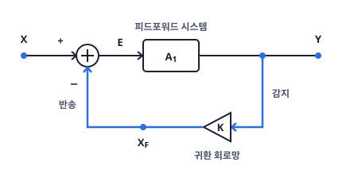

*출력 노드에서 감지한 신호가 귀환 회로망 $K$를 지나 $X_F$가 되고, 비교부에서 입력 $X$로부터 빼져요.*

**정확히 말하면**

#### 음귀환 시스템의 네 부분

강의 자료는 음귀환 시스템을 네 부분으로 나눠요.

| 부분 | 하는 일 |
|---|---|
| 피드포워드 시스템(feedforward system) $A_1$ | 입력 쪽 차이를 증폭해 출력 $Y$를 만드는 개루프 증폭기예요. |
| 출력 감지(sense) | 출력 $Y$를 재서 귀환 회로망으로 넘겨요. |
| 귀환 회로망(feedback network) $K$ | 감지한 양에 피드백 팩터(귀환율) $K$를 곱해 귀환 신호 $X_F$를 만들어요. |
| 입력 비교, 반송(return) | $X_F$를 입력으로 되돌려 $X$에서 빼요. |

신호는 이 네 부분을 차례로 돌아요.

1. $$
   X_F=KY
   $$

   귀환 회로망이 감지한 출력에 $K$를 곱해요.
2. $$
   E=X-X_F
   $$

   반송한 $X_F$를 입력에서 빼요.
3. $$
   Y=A_1E
   $$

   피드포워드 시스템이 그 차이를 증폭해 출력을 만들어요.

**그래서 귀환을 실제 회로로 만들 때 정할 것은 두 가지예요. 출력을 무엇으로 어떻게 감지할지, 그리고 입력에 무엇으로 어떻게 반송해 뺄지예요.**

#### 증폭기 형태가 귀환 구조를 정해요

먼저 전압 증폭기에 적용해요. op-amp 비반전 증폭기는 출력이 전압이라 저항 분배기가 출력 전압을 감지하고, 입력이 전압이라 귀환 전압을 입력 전압에서 빼요. 감지하는 방법은 [전압은 병렬로, 큰 임피던스로 감지해요](#s5-voltage-sense), 빼는 방법은 [전압은 입력원과 직렬로 빼요](#s6-voltage-return)에 있어요.

같은 규칙을 네 가지 증폭기 형태에 모두 적용해요. **출력 쪽 신호의 종류가 감지할 양을, 입력 쪽 신호의 종류가 뺄 양을 정해요.** 네 형태의 정의는 [입력과 출력이 전압이냐 전류냐](#s4-four-types)에 있어요.

| 증폭기 형태 | 입력 | 출력 | 감지할 양 | 입력에서 뺄 양 |
|---|---|---|---|---|
| 전압 증폭기 | 전압 | 전압 | 출력 전압 | 전압 |
| 전류 증폭기 | 전류 | 전류 | 출력 전류 | 전류 |
| 트랜스컨덕턴스 증폭기 | 전압 | 전류 | 출력 전류 | 전압 |
| 트랜스임피던스 증폭기 | 전류 | 전압 | 출력 전압 | 전류 |

#### 맞지 않는 조합은 쓰지 않아요

형태와 맞지 않는 조합은 쓰지 않아요. 예를 들어 전압 증폭기에서 출력 전류를 감지하거나 입력에서 전류를 빼면 안 돼요.

**그래서 네 가지 증폭기 형태에 맞춰 네 가지 귀환 구조가 있어요.** 각 구조와 전류를 입력에서 빼는 방법은 다음 시간에 다루고, 제목은 [다음 시간 예고](#s7-next)에 있어요.

돌아온 신호가 정말 빼지는지, 즉 음귀환이 되는지 따지는 극성은 수업에서 이름만 꺼냈어요. 출력 전류를 감지하는 방법은 [전류는 직렬로, 작은 임피던스로 감지해요](#s5-current-sense)에 있어요.

**교수님 말씀**

> 피드백은 그 오픈 루프 시스템의 출력을 센싱해서 다시 피드백 네트워크로 보낸 다음에

피드백 네트워크를 거치며 피드백 팩터만큼 곱해지고, 그것이 입력으로 리턴되어 입력과의 차이가 다시 회로로 들어간다고 이어 말했어요. 그래서 센싱 동작과 리턴 구조가 있어야 한다고 했어요.

> 타입에 따라서 피드백의 구조가 달라지기 때문이에요.

네 가지 증폭기 형태를 왜 소개했는지 스스로 묻고 답한 말이에요.

> 볼티지 앰프인데 전류를 센싱해서 전류를 리턴해주면 안 되겠죠.

전압 증폭기는 출력이 전압이라 전압을 감지하고, 입력이 전압이라 전압으로 빼야 한다는 예로 든 말이에요.

확인해 봐요. 입력이 전류이고 출력이 전압인 트랜스임피던스 증폭기에 음귀환을 걸 때, 귀환 회로망은 출력에서 무엇을 감지하고 입력에서 무엇을 빼야 하나요?

답 보기

출력 전압을 감지하고 입력에서 전류를 빼야 해요. 출력 쪽 신호의 종류(전압)가 감지할 양을, 입력 쪽 신호의 종류(전류)가 입력에서 뺄 양을 정해요.

**페이지 요약**

귀환 구조는 출력을 무엇으로 감지하고 입력에서 무엇으로 빼는지로 정해지고, 그 답은 증폭기 형태가 정해요.

*핵심 식*

- 귀환 회로망

  $$
  X_F=KY
  $$
- 입력 비교

  $$
  E=X-X_F
  $$

출력이 전압이면 전압을, 전류이면 전류를 감지해요.

입력이 전압이면 전압을, 전류이면 전류를 빼요.

*용어*

- **감지(sense)** — 피드포워드 시스템의 출력을 재서 귀환 회로망으로 넘기는 것
- **반송(return)** — 귀환 신호를 입력으로 되돌려 입력에서 빼는 것
- **귀환 회로망(feedback network)** — 감지한 양에 피드백 팩터(귀환율) $K$를 곱하는 부분

---

### 전압은 병렬로, 큰 임피던스로 감지해요

*1111 수업 · L06 s17–18, s26*

**쉽게 말하면**

전압은 노드와 접지 사이에 볼트미터를 병렬로 대서 재고, 볼트미터의 입력 임피던스가 클수록 원래 전압이 덜 바뀌어요.

출력저항 $1\,\mathrm{k\Omega}$ 뒤의 $1\,\mathrm{V}$에 $1\,\mathrm{k\Omega}$을 대면 $0.5\,\mathrm{V}$로 떨어지지만, $99\,\mathrm{k\Omega}$을 대면 $0.99\,\mathrm{V}$로 거의 그대로예요.

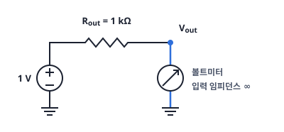

*볼트미터는 길을 끊지 않고 $V_{out}$ 노드와 접지 사이에 병렬로 붙고, 이상적으로는 입력 임피던스가 무한대예요.*

**정확히 말하면**

#### 볼트미터로 전압을 재는 방법

감지는 재는 것이에요. 두 단자 사이의 전압을 재려면 볼트미터(voltmeter)를 두 단자에 병렬(parallel)로 대요. 보통 한쪽 단자가 접지이므로 재려는 노드와 접지 사이에 대요. 강의 자료는 이를 "전압은 병렬로, 전류는 직렬로 감지한다"로 정리해요.

먼저 그림의 예에 적용해요. 증폭기 출력을 개방 전압 $V_{oc}$와 출력저항 $R_{out}$으로 보고, 출력 노드에서 감지하는 쪽을 본 입력 임피던스를 $R_{in,F}$라 해요.

1. $$
   V_{out}=V_{oc}\frac{R_{in,F}}{R_{out}+R_{in,F}}
   $$

   병렬로 댄 $R_{in,F}$와 $R_{out}$이 전압을 나눠요.
2. $V_{oc}=1\,\mathrm{V}$, $R_{out}=1\,\mathrm{k\Omega}$에 $R_{in,F}=1\,\mathrm{k\Omega}$을 대면 절반으로 떨어져요.

   $$
   V_{out}=1\,\mathrm{V}\times\frac{1\,\mathrm{k\Omega}}{1\,\mathrm{k\Omega}+1\,\mathrm{k\Omega}}=0.5\,\mathrm{V}
   $$
3. $$
   V_{out}=1\,\mathrm{V}\times\frac{99\,\mathrm{k\Omega}}{1\,\mathrm{k\Omega}+99\,\mathrm{k\Omega}}=0.99\,\mathrm{V}
   $$

   $R_{in,F}=99\,\mathrm{k\Omega}$이면 거의 그대로예요.
4. $$
   V_{out}\to V_{oc}
   $$

   $R_{in,F}$가 무한대로 가면 감지해도 출력 전압이 바뀌지 않아요.

작은 임피던스를 병렬로 대면 노드의 임피던스가 작아져서 같은 전류에 대해 전압이 떨어져요. **그래서 이상적인 볼트미터의 입력 임피던스는 무한대예요.**

#### 귀환 회로망에 적용하기

귀환 회로망이 출력 전압을 감지할 때도 같아요. 귀환 회로망을 출력 노드에 병렬로 연결하고, 출력 노드에서 귀환 회로망 쪽으로 본 입력 임피던스가 커야 해요. **이상적인 귀환 회로망이 전압을 감지할 때 입력 임피던스는 무한대예요.**

#### op-amp 저항 분배기의 조건

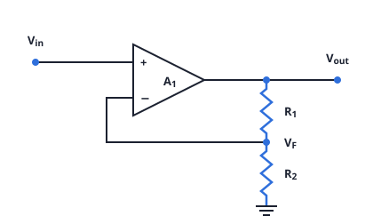

*$V_{out}$ 노드에서 귀환 회로망 쪽으로 보면 $R_1$과 $R_2$가 직렬로 접지까지 이어져 $R_1+R_2$가 보여요.*

op-amp 비반전 증폭기에서는 저항 분배기 $R_1$–$R_2$가 출력 전압을 감지하는 귀환 회로망이에요. op-amp의 − 입력으로는 전류가 들어가지 않는다고 봐요.

1. $$
   R_{in,F}=R_1+R_2
   $$

   $R_1$과 $R_2$에 같은 전류가 흐르므로 출력 노드에서 본 입력 임피던스는 두 저항의 합이에요.
2. $$
   V_F=\frac{R_2}{R_1+R_2}V_{out}=KV_{out}
   $$

   분배기의 비가 피드백 팩터(귀환율) $K$예요.
3. 1번 식을 위 분배식에 넣으면 $R_1+R_2\gg R_{out}$일 때 $V_{out}\approx V_{oc}$예요. 강의 자료는 이 조건을 무한대로 적어요.

   $$
   R_1+R_2\approx\infty
   $$

$R_1+R_2$가 작으면 분배기를 연결하는 순간 출력 전압이 떨어져요. 실제로는 무한대로 만들 수 없으니 굉장히 큰 저항으로 설계해요.

**$K$는 두 저항의 비로, 출력에 주는 영향은 두 저항의 합으로 정해져요.** 그래서 비를 유지한 채 두 저항을 함께 키우면 $K$는 그대로이고 출력 전압이 덜 바뀌어요. 예를 들어 $9\,\mathrm{k\Omega}$–$1\,\mathrm{k\Omega}$과 $90\,\mathrm{k\Omega}$–$10\,\mathrm{k\Omega}$은 둘 다 $K=0.1$이지만 합은 $10\,\mathrm{k\Omega}$과 $100\,\mathrm{k\Omega}$이에요.

**교수님 말씀**

전압을 어떻게 재는지 물었을 때 한 학생이 "양단의 노드에"라고 답했고, 기준을 묻자 "그라운드"라고 답했어요.

> 노드에 찍잖아요, 찍. … 병렬로 연결된 거예요.

볼트미터는 길을 끊지 않고 접지를 기준으로 노드에 대기만 하므로 병렬 연결이라는 뜻이에요.

볼트미터의 임피던스가 왜 커야 하는지 묻자 한 학생이 "전압에 영향을 주지 않으려고"라고 답했고, 교수님은 "그렇죠"라고 했어요.

> 임피던스가 굉장히 작은 임피던스를 그 노드에 갖다 대면 … 전압이 확 떨어지겠죠.

병렬로 대면 임피던스가 작아져서 같은 전류에 대해 전압이 떨어진다고 설명했어요.

> OP 앰프의 출력이 전압이에요. … 이와 같이 노드에 병렬로

저항 귀환을 단 op-amp를 예로 들어, 출력 전압을 감지하는 귀환 회로망도 출력 노드에 병렬로 연결한다고 했어요.

확인해 봐요. 개방 출력 전압 $V_{oc}=1\,\mathrm{V}$, 출력저항 $R_{out}=1\,\mathrm{k\Omega}$인 노드에 $R_1=8\,\mathrm{k\Omega}$, $R_2=1\,\mathrm{k\Omega}$ 저항 분배기를 병렬로 달면 분배기의 입력 임피던스 $R_{in,F}$와 출력 전압 $V_{out}$은 얼마가 되나요?

답 보기

$R_{in,F}=9\,\mathrm{k\Omega}$, $V_{out}=0.9\,\mathrm{V}$예요. $R_{in,F}=R_1+R_2=8+1=9\,\mathrm{k\Omega}$이고, $V_{out}=1\,\mathrm{V}\times\frac{9\,\mathrm{k\Omega}}{1\,\mathrm{k\Omega}+9\,\mathrm{k\Omega}}=0.9\,\mathrm{V}$예요.

**페이지 요약**

전압은 노드와 접지 사이에 병렬로 감지하고, 감지하는 쪽의 입력 임피던스가 무한대에 가까워야 출력 전압이 그대로예요.

*핵심 식*

- 병렬로 댄 쪽이 나누는 전압

  $$
  V_{out}=V_{oc}\frac{R_{in,F}}{R_{out}+R_{in,F}}
  $$
- 분배기의 입력 임피던스

  $$
  R_{in,F}=R_1+R_2
  $$
- 분배기의 비

  $$
  V_F=\frac{R_2}{R_1+R_2}V_{out}=KV_{out}
  $$

$R_1+R_2\gg R_{out}$이어야 하고, 강의 자료는 이를 $R_1+R_2\approx\infty$로 적어요.

$K$는 저항의 비로, 출력에 주는 영향은 저항의 합으로 정해져요.

*용어*

- **볼트미터(voltmeter)** — 노드와 접지 사이에 병렬로 대서 전압을 재는 계기, 이상적인 입력 임피던스는 무한대
- **입력 임피던스(input impedance)** — 출력 노드에서 감지하는 쪽을 본 임피던스 $R_{in,F}$

---

### 전류는 직렬로, 작은 임피던스로 감지해요

*1111 수업 · L06 s19–20, s26*

**쉽게 말하면**

전류는 흐르는 길을 끊고 전류계를 직렬로 넣어 재고, 전류계의 임피던스가 작을수록 원래 전류가 덜 바뀌어요.

$1\,\mathrm{V}$가 $1\,\mathrm{k\Omega}$ 부하에 $1\,\mathrm{mA}$를 흘릴 때 $1\,\mathrm{k\Omega}$을 직렬로 넣으면 $0.5\,\mathrm{mA}$로 줄지만, $10\,\Omega$을 넣으면 약 $0.99\,\mathrm{mA}$로 거의 그대로예요.

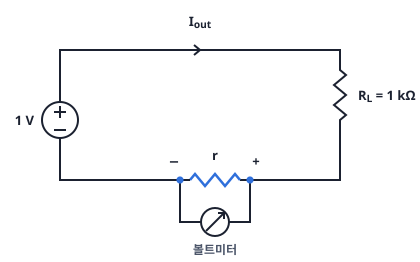

*전류계는 끊은 자리에 작은 저항 $r$을 직렬로 넣고, $r$ 양단 전압을 볼트미터로 재서 전류를 구해요.*

**정확히 말하면**

#### 전류계로 전류를 재는 방법

전류를 재려면 전류가 흐르는 길 중간을 끊고 전류계(current meter)를 직렬(series)로 넣어요. 병렬로 대서는 전류를 잴 수 없어요. 실제 전류계는 작은 저항 $r$과 그 양단 전압 $V_r$을 재는 볼트미터로 이뤄져 있어요.

$$
I=\frac{V_r}{r}
$$

먼저 그림의 예에 적용해요. 전압원 $V$가 부하 $R_L$에 전류를 흘리는 길에 $r$을 직렬로 넣어요.

1. $$
   I_{out}=\frac{V}{R_L+r}
   $$

   직렬로 넣은 $r$이 부하에 더해져요.
2. $V=1\,\mathrm{V}$, $R_L=1\,\mathrm{k\Omega}$에 $r=1\,\mathrm{k\Omega}$을 넣으면 절반으로 줄어요.

   $$
   I_{out}=\frac{1\,\mathrm{V}}{1\,\mathrm{k\Omega}+1\,\mathrm{k\Omega}}=0.5\,\mathrm{mA}
   $$
3. $$
   I_{out}=\frac{1\,\mathrm{V}}{1\,\mathrm{k\Omega}+0.01\,\mathrm{k\Omega}}\approx0.99\,\mathrm{mA}
   $$

   $r=10\,\Omega=0.01\,\mathrm{k\Omega}$이면 거의 그대로예요.
4. $$
   I_{out}\to\frac{V}{R_L}
   $$

   $r$이 0으로 가면 넣기 전의 전류와 같아요.

**그래서 이상적인 전류계의 임피던스는 0이에요.**

#### 귀환 회로망에 적용하기

귀환 회로망이 출력 전류를 감지할 때도 같아요. 출력 전류가 흐르는 길을 끊고 귀환 회로망을 직렬로 넣고, 그 입력 임피던스는 작아야 해요. 증폭기의 출력이 귀환 회로망에는 입력으로 들어가므로 이 임피던스를 입력 임피던스라 불러요. **이상적인 귀환 회로망이 전류를 감지할 때 입력 임피던스는 0이에요.**

#### 소스 저항 $R_S$로 감지할 때와 감지법 비교

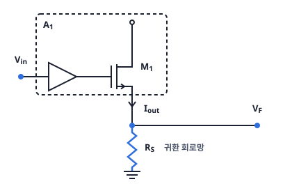

*점선 상자 안의 증폭기와 $M_1$이 $A_1$이고, $M_1$의 출력 전류 $I_{out}$이 흐르는 길에 직렬로 놓인 $R_S$가 귀환 회로망이에요.*

트랜지스터 $M_1$의 출력은 전류예요. 소스로 나온 $I_{out}$이 $R_S$를 지나 접지로 흐르고, $R_S$ 위 노드에서 귀환 전압을 꺼내요.

$$
V_F=I_{out}R_S
$$

$R_S$가 크면 출력 전류 자체가 바뀌어요. 포화 영역의 $M_1$에서 $I_{out}$은 $V_{GS}$로 정해지기 때문이에요.

1. $$
   V_S=I_{out}R_S
   $$

   $R_S$의 전압 강하만큼 소스 전압이 올라가요.
2. $$
   V_{GS}=V_G-I_{out}R_S
   $$

   게이트 전압 $V_G$가 같아도 남는 $V_{GS}$가 줄어요.
3. $V_{GS}$가 줄면 $I_{out}$이 줄어요. $R_S$가 클수록 감지하려던 전류가 원래 값에서 더 멀어져요.
4. 작은 신호로 보면, 몸체효과와 $r_O$를 무시할 때 게이트 소신호 $v_g$ 가운데 $i_{out}R_S$를 뺀 나머지만 전류를 만들어요.

   $$
   i_{out}=g_{m1}(v_g-i_{out}R_S)
   $$
5. $$
   i_{out}=\frac{g_{m1}}{1+g_{m1}R_S}v_g=\frac{v_g}{1/g_{m1}+R_S}
   $$

   $i_{out}$에 대해 정리하면 저항 합의 꼴이 돼요.
6. **$R_S\ll1/g_{m1}$이면 분모가 $1/g_{m1}$로 남아 $R_S$가 없을 때의 $i_{out}=g_{m1}v_g$와 거의 같아요.** 예를 들어 $g_{m1}R_S=0.1$이면 $\frac{1}{1.1}\approx0.91$배예요.

그래서 강의 자료는 이 조건을 다음처럼 적어요. 교과서는 기준을 $R_S\ll1/g_{m1}$로 적어요.

$$
R_S\approx0
$$

두 감지 방법을 나란히 놓으면 다음과 같아요.

| 감지할 출력 | 귀환 회로망 연결 | 귀환 회로망 입력 임피던스 | 이상적인 값 |
|---|---|---|---|
| 전압 | 출력 노드에 병렬 | 커야 해요 | 무한대 |
| 전류 | 출력 전류 길에 직렬 | 작아야 해요 | 0 |

**교수님 말씀**

> 전류는 전류 패스를 끊고 거기에 직렬로 커런트 미터를 갖다 대야

병렬로 대서는 전류를 잴 수 없다는 질문 뒤에 한 말이에요. 커런트 미터는 아주 작은 저항에 걸린 전압을 재서 전류를 계산한다고 덧붙였어요.

직렬로 큰 저항을 연결하면 어떻게 되는지 묻자 한 학생이 "전류가 작아…"라고 답했고, 교수님은 "전류가 확 줄어들죠"라고 했어요.

> 출력은 피드백 네트워크로 봤을 때는 … 피드백 네트워크의 입력으로 들어가잖아요

증폭기의 출력 쪽인데도 입력 임피던스라고 부르는 이유예요.

> 요거는 이제 피드백 네트워크고, 여기까지가 이제 $A_1$이에요.

트랜지스터 회로에서 $R_S$가 귀환 회로망이고, 그 앞까지가 피드포워드 시스템이라고 나눠 보였어요.

확인해 봐요. $g_{m1}=10\,\mathrm{mS}$($1/g_{m1}=100\,\Omega$)인 $M_1$의 소스에 $R_S=25\,\Omega$을 직렬로 넣어 전류를 감지하면, $R_S=0$일 때의 전류 $g_{m1}v_g$에 비해 몇 배가 되나요?

답 보기

$0.8$배($80\,\%$)가 돼요. $i_{out}=\frac{g_{m1}}{1+g_{m1}R_S}v_g$에서 $g_{m1}R_S=10\,\mathrm{mS}\times25\,\Omega=0.25$이므로 $\frac{1}{1+0.25}=0.8$배예요.

**페이지 요약**

전류는 흐르는 길을 끊고 직렬로 감지하고, 감지하는 쪽의 입력 임피던스가 0에 가까워야 출력 전류가 그대로예요.

*핵심 식*

- 직렬로 넣은 저항

  $$
  I_{out}=\frac{V}{R_L+r}
  $$
- $R_S$가 바꾸는 $V_{GS}$ 크기

  $$
  V_{GS}=V_G-I_{out}R_S
  $$
- 감지 조건

  $$
  R_S\approx0
  $$

교과서 기준은 $R_S\ll1/g_{m1}$이에요.

전압 감지는 병렬과 큰 입력 임피던스, 전류 감지는 직렬과 작은 입력 임피던스예요.

*용어*

- **전류계(current meter)** — 길을 끊고 직렬로 넣어 전류를 재는 계기, 작은 저항 $r$과 볼트미터로 이뤄지고 이상적인 임피던스는 0
- **입력 임피던스(input impedance)** — 귀환 회로망 쪽에서 본 임피던스, 증폭기 출력이 귀환 회로망의 입력이라서 붙은 이름

---

## 7. 전압을 입력에서 빼는 법

### 전압은 입력원과 직렬로 빼요

*1111 수업 · L06 s21*

**쉽게 말하면**

전압 반송은 귀환 전압 $v_F$를 입력원과 직렬로, 극성을 반대로 이어서 입력 전압에서 빼는 방법이에요.

건전지 1.5 V 두 개도 직렬로 이어야 3 V가 되고, 한쪽을 뒤집어 이으면 두 전압이 빼져요.

*입력 $1\,\mathrm{V}$에 귀환 전압 $0.9\,\mathrm{V}$를 반대 극성으로 직렬 연결하면 피드포워드 시스템에는 차이인 $0.1\,\mathrm{V}$만 들어가요.*

**정확히 말하면**

#### 전압 반송의 정의

귀환 회로는 피드포워드 시스템(feedforward system) $A_1$의 출력을 감지(sense)해 귀환 회로망(feedback network)으로 보내고, 귀환 회로망이 만든 귀환 신호를 입력으로 반송(return)해 입력에서 빼요([감지와 반송이 귀환 구조를 정해요](#s5-sense-return)).

증폭기의 입력이 전압이면 빼는 양도 전압이어야 해요. **귀환 전압 $v_F$를 입력 전압 $v_{in}$에서 빼도록 연결하는 것을 전압 반송(voltage return)이라고 해요.**

출력 전압을 감지하는 귀환이라면 $v_F$는 출력 전압에 피드백 팩터(귀환율) $K$를 곱한 값이에요.

$$
v_F=Kv_{out}
$$

먼저 그림의 예시에 적용해요. 입력 $v_{in}=1\,\mathrm{V}$와 귀환 전압 $v_F=0.9\,\mathrm{V}$를 극성이 반대가 되게 직렬로 이으면 피드포워드 시스템에 걸리는 전압은 차이예요.

$$
v_e=1-0.9=0.1\,\mathrm{V}
$$

#### 전압원을 직렬로 이어 빼는 원리

왜 직렬이어야 하는지는 전압원 두 개를 잇는 방법에서 나와요.

1. 두 전압원 $v_1$, $v_2$를 같은 극성으로 직렬 연결하면 양 끝 전압은 두 전압의 합이에요. 건전지 1.5 V 두 개를 직렬로 이으면 3 V가 돼요.

   $$
   v_{total}=v_1+v_2
   $$
2. 병렬로 연결하면 두 전원의 양 끝이 같은 두 노드에 묶여요. 두 전압이 같지 않으면 전압은 더해지지 않고 두 전원 사이에 전류만 흘러요.
3. $$
   v_{total}=v_1-v_2
   $$

   빼기는 음수를 더하는 것과 같아요. 그래서 한쪽 전원을 극성만 반대로 해서 직렬로 이으면 두 전압이 빼져요.
4. 같은 원리로 귀환 회로망의 출력 $v_F$를 입력원 $v_{in}$과 직렬로, 극성이 반대가 되게 연결해요. 입력원 → 피드포워드 시스템의 입력 → 귀환 회로망의 출력으로 이어지는 루프에서 KVL을 쓰면

   $$
   v_{in}=v_e+v_F
   $$
5. **피드포워드 시스템의 입력에 실제로 걸리는 오차 전압(error voltage) $v_e$는 두 전압의 차이예요.**

   $$
   v_e=v_{in}-v_F
   $$
6. $v_F=0$이면 $v_e=v_{in}$이에요. 더해지는 전압이 없으니 입력이 그대로 피드포워드 시스템에 들어가요.

#### 감지와 반송의 연결 비교

강의 슬라이드의 문장도 같은 내용이에요. 두 전압원을 더하거나 빼려면(add or subtract) 직렬로 놓고, 그래서 귀환 회로망은 입력원과 직렬로 놓여요.

**출력 쪽에서 전압을 감지할 때와는 연결이 반대예요**([전압은 병렬로, 큰 임피던스로 감지해요](#s5-voltage-sense)).

|   | 출력 쪽 전압 감지 | 입력 쪽 전압 반송 |
|---|---|---|
| 연결 | 출력 노드에 병렬 | 입력원과 직렬 |
| 이유 | 노드 전압은 그 노드와 접지 사이에 걸쳐서 재요 | 두 전압을 더하거나 빼려면 직렬로 이어야 해요 |

**교수님 말씀**

> 1.5V, 1.5V 건전지 가지고 전압을 높이려면 어떻게 해야 됩니까?

학생이 "직렬"이라고 답하자 "직렬로 해야지 전압이 높아지죠"라고 받았어요. 병렬로 이으면 전압이 그대로라는 점도 짚었어요.

> 더하는 거나 빼는 거는 같잖아요. 부호만 다를 뿐이지.

그래서 빼기도 직렬로 연결하되 부호를 반대로 이으면 된다고 설명했어요.

> 출력에서 센싱할 때와 전압을 입력에서 받아줄 때는 서로 반대입니다.

출력 쪽 전압 감지는 병렬, 입력 쪽 전압 반송은 직렬이라는 대비예요.

확인해 봐요. 입력 전압 $v_{in}=1.5\,\mathrm{V}$, 출력 전압 $v_{out}=12\,\mathrm{V}$, 피드백 팩터 $K=0.1$인 전압 반송 회로에서 귀환 전압 $v_F$와 오차 전압 $v_e$는 각각 얼마인가요?

답 보기

$v_F=1.2\,\mathrm{V}$, $v_e=0.3\,\mathrm{V}$예요. $v_F=Kv_{out}=0.1\times12=1.2\,\mathrm{V}$이고, $v_e=v_{in}-v_F=1.5-1.2=0.3\,\mathrm{V}$예요.

**페이지 요약**

입력이 전압이면 귀환 전압 $v_F$를 입력원과 직렬로, 극성을 반대로 이어서 빼요.

*핵심 식*

- 루프의 KVL

  $$
  v_{in}=v_e+v_F
  $$
- 오차 전압

  $$
  v_e=v_{in}-v_F
  $$

$v_F=0$이면 $v_e=v_{in}$으로 입력이 그대로 들어가요.

출력 쪽 전압 감지는 병렬, 입력 쪽 전압 반송은 직렬로 서로 반대예요.

*용어*

- **전압 반송(voltage return)** — 귀환 전압을 입력원과 직렬로 이어 입력 전압에서 빼는 연결
- **오차 전압(error voltage)** — 피드포워드 시스템의 입력에 실제로 걸리는 차이 전압 $v_e$

---

### 트랜지스터 하나와 차동쌍으로 전압 빼기

*1111 수업 · L06 s22*

**쉽게 말하면**

트랜지스터는 두 단자 사이의 전압 차이로 전류를 만들어서, $v_{in}$과 $v_F$를 서로 다른 단자에 넣으면 두 전압의 차이가 전류가 돼요.

예를 들어 $v_{in}=10\,\mathrm{mV}$, $v_F=9\,\mathrm{mV}$이면 전류를 만드는 전압 차이는 $1\,\mathrm{mV}$뿐이에요.

*두 회로 모두 $v_F$가 $v_{in}$과 다른 노드에 걸려서, 직접 이어져 있지 않아도 직렬로 전압을 빼는 구조예요.*

**정확히 말하면**

#### 전압 뺄셈기 두 구조

실제 귀환 회로에서 전압을 빼는 방법으로는 두 구조가 많이 쓰여요. 하나는 트랜지스터 하나의 게이트와 소스에 두 전압을 나눠 넣는 것이고, 다른 하나는 차동쌍(differential pair)의 두 게이트에 나눠 넣는 것이에요.

두 구조 모두 $v_{in}$과 $v_F$가 [전압은 입력원과 직렬로 빼요](#s6-voltage-return)의 그림처럼 직접 직렬로 이어져 있지는 않아요. **그래도 만들어지는 전류가 $v_{in}$과 $v_F$의 차이에 비례하므로 전압을 빼는 구조예요.** 이 역할을 전압 뺄셈기(voltage subtractor)라고 불러요.

아래 식은 포화 영역의 저주파 소신호 모델에서 $r_O$와 몸체 효과를 무시하고, 전압과 전류의 작은 신호 성분만 쓴 것이에요.

#### 트랜지스터 하나

먼저 그림의 예시에 적용해요. 소스에 $v_{in}=10\,\mathrm{mV}$, 게이트에 $v_F=9\,\mathrm{mV}$가 걸리면 게이트–소스 전압은 두 전압의 차이예요.

$$
v_{GS}=9-10=-1\,\mathrm{mV}
$$

1. $$
   v_{GS}=v_F-v_{in}
   $$

   게이트에 $v_F$, 소스에 $v_{in}$이 걸리면 게이트–소스 전압은
2. $$
   i_D=g_mv_{GS}=g_m(v_F-v_{in})
   $$

   드레인 전류는 트랜스컨덕턴스 $g_m$과 $v_{GS}$의 곱이에요.
3. $$
   i_D=g_m(v_{in}-v_F)
   $$

   두 전압의 자리를 바꿔 게이트에 $v_{in}$, 소스에 $v_F$를 넣어도 같은 원리예요.
4. **어느 쪽이든 전류는 두 전압의 차이에 비례하고, 자리를 바꾸면 부호만 반대가 돼요.** $v_F=0$이면 원래 입력만으로 전류가 정해져요.
5. 드레인에 저항을 달면 이 전류가 저항을 지나며 출력 전압이 돼요.

#### 차동쌍

한쪽 게이트에 $v_{in}$, 다른 쪽 게이트에 $v_F$를 넣어요. 두 트랜지스터 $M_1$, $M_2$는 같은 소자이고 테일 전류원 $I_{SS}$를 반씩 나눠 흘려서 $g_m$이 같아요. 두 소스가 만나는 노드의 소신호 전압을 $v_P$라고 해요.

1. $$
   I_{out1}=g_m(v_{in}-v_P)
   $$

   $$
   I_{out2}=g_m(v_F-v_P)
   $$

   각 트랜지스터의 드레인 전류는 자기 게이트 전압과 $v_P$의 차이로 정해져요.
2. $$
   I_{out1}+I_{out2}=0
   $$

   테일 전류원이 이상적이면 두 전류의 합은 바뀌지 않으므로 신호 성분의 합은 0이에요.
3. $$
   v_P=\frac{v_{in}+v_F}{2}
   $$

   두 식을 대입해 풀면 $v_P$는 두 게이트 전압의 평균을 따라가요.
4. $$
   I_{out}=I_{out1}-I_{out2}=g_m(v_{in}-v_F)
   $$

   차동 출력 전류는 두 전류의 차이예요.
5. $v_F=0$이면 $I_{out}=g_mv_{in}$으로 입력만큼 전류가 나오고, $v_F$가 0이 아니면 두 전압의 차이가 입력처럼 작용해요.

수업에서는 이 비례 계수를 차동쌍 전체의 트랜스컨덕턴스 $G_m$이라고 불렀어요. **위 조건에서는 $G_m=g_m$으로, 한 트랜지스터의 $g_m$과 같아요.**

#### 직렬인지 병렬인지 가리는 법

**귀환 전압이 원래 입력과 같은 노드에 걸리면 병렬, 다른 노드에 걸리면 직렬이에요.** 병렬은 두 소자가 같은 노드에 묶여야만 될 수 있으므로, 같은 노드인지만 확인하면 돼요.

|   | 트랜지스터 하나 | 차동쌍 |
|---|---|---|
| $v_{in}$이 걸리는 노드 | 소스(또는 게이트) | $M_1$의 게이트 |
| $v_F$가 걸리는 노드 | 게이트(또는 소스) | $M_2$의 게이트 |
| 만드는 전류 | $g_mv_{GS}$, $v_{GS}$가 두 전압의 차이 | $I_{out1}-I_{out2}$가 $v_{in}-v_F$에 비례 |
| 판별 | 다른 노드라서 직렬 | 다른 노드라서 직렬 |

[전압은 입력원과 직렬로 빼요](#s6-voltage-return)의 연결에서도 $v_F$는 $v_{in}$이 걸린 노드가 아니라 피드포워드 시스템의 다른 입력에 걸려요. 귀환이 같은 노드에 걸리는 병렬 연결은 [다음 시간 예고](#s7-next)의 내용이에요.

**교수님 말씀**

> 크게 두 가지 방법이 많이 쓰입니다, 실제 회로에 피드백 할 때.

차동 구조와, 게이트–소스 전압의 차이를 쓰는 트랜지스터 하나를 예로 들었어요.

> 위치가 바뀌어도 상관없겠죠

입력을 게이트에, $v_F$를 소스에 넣어도 같은 원리로 두 전압의 차이가 출력 전류를 만든다고 했어요.

> 병렬은 명확하죠. 병렬은 같은 노드로 연결되어야지 병렬이 될 수 있으니까

그래서 직렬인지 병렬인지 헷갈리면 귀환 전압이 입력과 같은 노드에 있는지 다른 노드에 있는지만 보라고 했어요.

**꼭 기억해요**

> 입력과 다른 노드로 피드백 전압이 인가되면 그거는 직렬이에요. 가장 쉬운 방법은 그렇게 외우세요.

직접 직렬로 이어져 있지 않아도 $v_F$가 입력과 다른 노드에 걸리면 직렬로 전압을 빼는 구조예요.

확인해 봐요. $g_m=2\,\mathrm{mS}$인 차동쌍의 두 게이트에 각각 $v_{in}=15\,\mathrm{mV}$, $v_F=10\,\mathrm{mV}$를 넣으면 공통 소스 노드 전압 $v_P$와 차동 출력 전류 $I_{out}=I_{out1}-I_{out2}$는 얼마이고, 이 귀환 연결은 직렬인가요 병렬인가요?

답 보기

$v_P=12.5\,\mathrm{mV}$, $I_{out}=10\,\mu\mathrm{A}$이고, 직렬 연결이에요. $v_P=\frac{15+10}{2}=12.5\,\mathrm{mV}$, $I_{out}=2\,\mathrm{mS}\times(15-10)\,\mathrm{mV}=10\,\mu\mathrm{A}$이며, $v_F$가 $v_{in}$과 다른 노드($M_2$ 게이트)에 걸리므로 직렬이에요.

**페이지 요약**

트랜지스터 하나나 차동쌍에서 $v_F$를 $v_{in}$과 다른 노드에 넣으면 전류가 두 전압의 차이에 비례해서 전압을 빼요.

*핵심 식*

- 트랜지스터 하나

  $$
  i_D=g_mv_{GS}=g_m(v_F-v_{in})
  $$
- 차동쌍

  $$
  I_{out}=I_{out1}-I_{out2}=g_m(v_{in}-v_F)
  $$

차동쌍 식은 같은 두 트랜지스터와 이상적인 테일 전류원에서, $r_O$를 무시한 작은 신호로 성립해요.

귀환 전압이 입력과 같은 노드에 걸리면 병렬, 다른 노드에 걸리면 직렬이에요.

*용어*

- **차동쌍(differential pair)** — 소스를 묶고 테일 전류원을 단 두 트랜지스터로, 두 게이트 전압의 차이에 비례하는 전류를 만드는 회로
- **전압 뺄셈기(voltage subtractor)** — 두 전압의 차이에 비례하는 신호를 만드는 회로

---

## 8. 요약 · 예고

### 한눈에 다시 보기

| 토픽 | 어떤 조건에서 무엇을 쓰나요? |
|---|---|
| [루프는 어디서 끊어도 루프 이득이 같아요](#s0-break-anywhere) | 입력을 $X=0$으로 두고, 루프를 계산하기 편한 곳에서 끊어 시험 전압 $V_{test}$를 넣어요. $V_N=-KA_1V_{test}$ $KA_1=-\frac{V_N}{V_{test}}$ 출력 쪽에서 끊든 $A_1$ 입력 쪽에서 끊든 루프 이득은 $KA_1$로 같아요. |
| [루프 이득이 크면 이득은 1/K가 돼요](#s1-desensitization) | $\frac{Y}{X}=\frac{A_1}{1+KA_1}$ 루프 이득이 $KA_1\gg1$이면 폐루프 이득이 피드백 팩터(귀환율) $K$의 역수가 돼요. $\frac{Y}{X}\approx\frac{1}{K}$ 식에서 개루프 이득 $A_1$이 사라지므로 $A_1$이 흔들려도 폐루프 이득은 거의 그대로예요. |
| [증폭기 이득은 흔들리고 저항의 비는 정확해요](#s1-precise-k) | 개루프 이득의 예인 CS 단 $g_mR_D$는 공정에 따라 최대 ±20% 흔들려요. $K=\frac{R_2}{R_1+R_2}$ $K$는 저항의 비라서 개별 저항이 함께 변해도 비는 ±1% 수준으로 정확해요. 부정확한 $A_1$을 정확한 $K$로 제어하는 것이 음귀환의 기본 생각이에요. |
| [루프 이득이 커야 하고, 그 대가로 이득은 줄어요](#s1-large-loop-gain) | $\frac{Y}{X}\approx\frac{1}{K}$는 루프 이득이 1보다 훨씬 클 때만 맞아서, op-amp의 이득을 크게 만들어요. 대가로 이득은 $A_1$에서 $\frac{A_1}{1+KA_1}$로, $1+KA_1$배 줄어요. 줄어든 이득은 정확한 이득 10짜리 단 세 개를 이어 1000으로 되찾을 수 있어요. |
| [극점이 (1+루프 이득)배 높아져요](#s2-pole-shift) | 개루프가 단일 극점 $A(s)=\frac{A_0}{1+s/\omega_0}$이면 저주파 이득과 극점이 같은 배수 $1+KA_0$만큼 바뀌어요. $\frac{Y}{X}(0)=\frac{A_0}{1+KA_0}$ $\omega_{p,\mathrm{closed}}=(1+KA_0)\omega_0$ 이득이 줄어든 만큼 대역폭이 넓어져요. |
| [이득을 내주고 대역폭을 얻어요](#s2-bandwidth-example) | $R$이나 트랜지스터 크기를 줄여 극점을 올리면 회로를 다시 설계해야 해요. 귀환은 $A_0$는 그대로 두고 $K$만 키워 극점을 올리고, 줄어든 이득은 캐스케이딩으로 되찾아요. |
| [음귀환이 양귀환으로 바뀌면 발진해요](#s3-instability) | 루프를 한 바퀴 도는 동안 위상이 180° 밀리면 음귀환이 양귀환이 되어 발진할 수 있어요. 발진하는 회로는 증폭기로 쓸 수 없어요. |
| [입력과 출력이 전압이냐 전류냐](#s4-four-types) | 전압을 받으면 입력 임피던스가 커야 하고, 전류를 받으면 작아야 해요. 전압을 내보내면 출력 임피던스가 작아야 하고, 전류를 내보내면 커야 해요. 전압 증폭기 $A_v=\frac{v_{out}}{v_{in}}$: $R_{in}\to\infty$, $R_{out}\to0$ 전류 증폭기 $A_I=\frac{i_{out}}{i_{in}}$: $R_{in}\to0$, $R_{out}\to\infty$ 트랜스컨덕턴스 증폭기 $G_m=\frac{i_{out}}{v_{in}}$: $R_{in}\to\infty$, $R_{out}\to\infty$ 트랜스임피던스 증폭기 $R_O=\frac{v_{out}}{i_{in}}$: $R_{in}\to0$, $R_{out}\to0$ |
| [네 형태를 트랜지스터로 만들면](#s4-examples) | 전압 증폭기는 CS 단 뒤에 소스 팔로워를 붙여 출력 임피던스를 낮춰요. 전류 입력은 소스로 받는 공통 게이트 단, 트랜스컨덕턴스 증폭기는 트랜지스터 하나예요. |
| [감지와 반송이 귀환 구조를 정해요](#s5-sense-return) | 출력이 전압이면 전압을, 전류면 전류를 감지해요. 입력이 전압이면 전압을, 전류면 전류를 입력에서 빼요. 그래서 개루프 증폭기의 형태가 귀환 구조를 정해요. |
| [전압은 병렬로, 큰 임피던스로 감지해요](#s5-voltage-sense) | 볼트미터처럼 출력 노드에 병렬로 연결해요. 출력에서 귀환 회로망 쪽으로 보는 입력 임피던스는 이상적으로 무한대여서, 저항 분배기는 $R_1+R_2$가 커야 해요. |
| [전류는 직렬로, 작은 임피던스로 감지해요](#s5-current-sense) | 전류계처럼 출력 전류 경로를 끊고 직렬로 넣어요. 귀환 회로망의 입력 임피던스는 이상적으로 0이어서, 소스 저항으로 감지하면 $R_S\approx0$이어야 해요. |
| [전압은 입력원과 직렬로 빼요](#s6-voltage-return) | 건전지를 이어 전압을 더하듯, 귀환 회로망의 출력을 입력원과 직렬로 연결해 빼요. $v_e=v_{in}-v_F$ 출력 쪽 전압 감지는 병렬, 입력 쪽 전압 반송은 직렬로 서로 반대예요. |
| [트랜지스터 하나와 차동쌍으로 전압 빼기](#s6-return-circuits) | 귀환 전압이 원래 입력과 같은 노드에 들어가면 병렬, 다른 노드에 들어가면 직렬이에요. 게이트와 소스에 나눠 넣은 트랜지스터 하나와, 두 게이트에 나눠 넣은 차동쌍이 직렬 뺄셈의 예예요. |

---

### 다음 시간 예고

- 전류 반송(current return): 전류를 입력에서 빼는 법
- 네 가지 증폭기 형태별 귀환 구조: 전압-전압 귀환, 전압-전류 귀환, 전류-전압 귀환, 전류-전류 귀환
- 귀환의 극성(polarity of feedback) 판정: 돌아온 신호가 음귀환인지 가리는 법

---

### 함께 보면 좋은 자료

- [1106 정리노트 · 음귀환 시스템, 폐루프 이득, 루프 이득](../../1106/정리노트_1106_Negative_Feedback.html)
- [문제집 12장 문제 (PDF)](../../../workbook/pdf/ch12-문제.pdf)
- [복습문제 14개 (PDF)](../복습문제_1111_Sense_and_Return-문제.pdf)
- [답안 (PDF)](../복습문제_1111_Sense_and_Return-답안.pdf)

---

출처: 권익진 교수님 강의자료(Lec6) · 수업 녹음 전사(1111) · B. Razavi, *Microelectronics*, 2nd ed. (Wiley) 12장.
