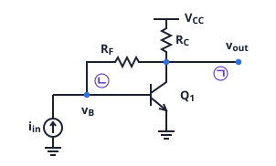
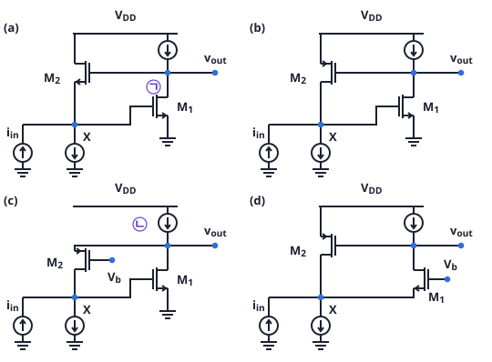
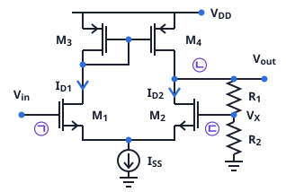
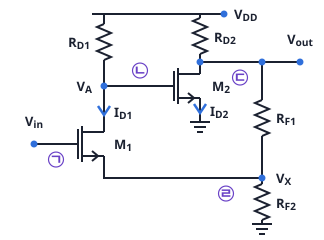
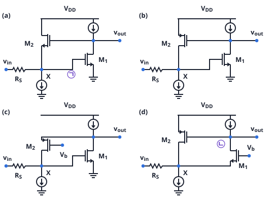
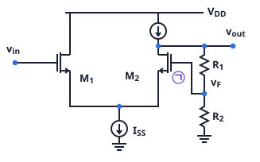

# 전자회로2 복습 1113 문제설명

회로와 첫 식을 짚고 핵심 계산으로 답을 구해요.

문제의 첫 줄부터 검산까지 설명해요.

**목차**

- [문항별 설명](#problems)
  - [P1. R_F 귀환 증폭기 두 개(BJT, MOS)의 감지·반송 방식](#p1)
  - [P2. 전류 입력 귀환 증폭기 네 개의 감지·반송 방식](#p2)
  - [P3. 능동 부하 차동쌍과 저항 분배기 귀환의 극성](#p3)
  - [P4. R1을 M1 드레인에 연결했을 때의 귀환 극성](#p4)
  - [P5. 두 단 CS 증폭기와 소스 귀환 분배기의 극성](#p5)
  - [P6. 둘째 단을 CG 단으로 바꿨을 때의 귀환 극성](#p6)
  - [P7. CS 단과 귀환 트랜지스터의 극성](#p7)
  - [P8. R_S 입력 귀환 단 네 개의 귀환 극성](#p8)
  - [P9. 귀환 증폭기 열여섯 개의 귀환 극성](#p9)

## 문항별 설명

### P1. R_F 귀환 증폭기 두 개(BJT, MOS)의 감지·반송 방식

P12.21 · 장말문제 12.21 · [원 문제 보기](../%EB%B3%B5%EC%8A%B5%EB%AC%B8%EC%A0%9C_1113_Voltage_Voltage_Feedback-%EB%AC%B8%EC%A0%9C.pdf)

#### 주어진 조건

- 감지 방식: 출력 전압을 감지하는지(병렬) 출력 전류를 감지하는지(직렬), 반송 방식: 입력에 전압으로 반송하는지(직렬) 전류로 반송하는지(병렬)를 가림

#### 구할 것

- (a), (b) 각 증폭기의 감지 방식과 반송 방식

원문 보기

Identify the sense and return mechanisms in each amplifier depicted in Fig. 12.88.

*(a) 공통 이미터 단. (b)에서도 같은 귀환 저항의 양 끝을 따라가요.*

#### 귀환 저항의 두 끝

㉠ (a) $R_F$의 한쪽 끝은 $Q_1$ 컬렉터의 출력 노드에서 갈라져요. (b)에서는 $M_3$ 소스의 출력 노드에서 갈라져요. 두 경우 모두 출력 전류의 경로가 그대로 이어져요.

㉡ 다른 쪽 끝은 (a)의 베이스, (b)의 $M_1$ 게이트에서 입력 전류원과 만나요. (b)에서 꼬리 전류원 도선과의 교차점에는 접속점이 없어요.

(a), (b) 모두 출력 전압을 병렬로 감지하고, 입력 전류원과 같은 노드에 전류를 병렬로 반송해요.

**페이지 요약**

$R_F$의 출력 쪽 끝은 출력 전압을 읽고, 입력 쪽 끝은 입력 전류원과 한 노드에서 만나요.

---

### P2. 전류 입력 귀환 증폭기 네 개의 감지·반송 방식

P12.20 · 장말문제 12.20 · [원 문제 보기](../%EB%B3%B5%EC%8A%B5%EB%AC%B8%EC%A0%9C_1113_Voltage_Voltage_Feedback-%EB%AC%B8%EC%A0%9C.pdf)

#### 주어진 조건

- 감지 방식: 출력 전압을 감지하는지(병렬) 출력 전류를 감지하는지(직렬), 반송 방식: 입력에 전압으로 반송하는지(직렬) 전류로 반송하는지(병렬)를 가림

#### 구할 것

- (a)–(d) 각 증폭기의 감지 방식과 반송 방식

원문 보기

Identify the sense and return mechanisms in each amplifier depicted in Fig. 12.87.

*각 회로에서 출력과 입력 노드 $X$ 사이를 잇는 $M_2$의 두 단자를 보세요.*

#### 반송 트랜지스터의 두 단자

㉠ (a)는 $M_2$의 게이트로 출력을 받아 소스로 $X$에 전류를 보내요. (b)와 (d)는 게이트로 출력을 받아 드레인으로 $X$에 전류를 보내요. (d)에서는 순방향 $M_1$의 입력만 소스로 바뀌어요.

㉡ (c)는 바이어스된 게이트 대신 **소스**가 출력에 붙어요. $M_2$ 가지가 출력 노드에서 갈라지므로 이 가지가 받아들이는 전압은 $v_{out}$이에요. 드레인은 입력 전류원과 같은 $X$에 붙어요.

(a)–(d) 모두 출력 전압을 병렬로 감지하고 입력 노드에 전류를 병렬로 반송해요.

**페이지 요약**

(c)는 소스에 전류가 흘러도 출력에 병렬로 달려 있어 전압을 감지해요.

반송 쪽에서는 네 회로 모두 $M_2$ 전류가 입력 전류원과 같은 노드에서 합쳐져요.

---

### P3. 능동 부하 차동쌍과 저항 분배기 귀환의 극성

E12.12 · 예제 12.12 · [원 문제 보기](../%EB%B3%B5%EC%8A%B5%EB%AC%B8%EC%A0%9C_1113_Voltage_Voltage_Feedback-%EB%AC%B8%EC%A0%9C.pdf)

#### 주어진 조건

- 입력 $v_{in}$은 $M_1$ 게이트
- 소자 값은 주어지지 않음 (답은 정성적 판정)

#### 구할 것

- 귀환의 극성 (부귀환인지 정귀환인지)

원문 보기

그림 12.28의 회로에서 귀환의 극성을 결정하라.

*전류 거울 부하 차동쌍의 오른쪽 드레인에서 분압기로 되먹임해요.*

#### 오른쪽 드레인에서 되돌아오는 변화

㉠ $v_{in}$이 오르면 꼬리 전류가 $M_1$ 쪽으로 옮겨가요. ㉡ 오른쪽 출력에서 $M_4$가 공급하는 전류는 늘고 $M_2$가 빼는 전류는 줄어 $v_{out}$이 올라요.

㉢ 출력이 오르면 분압된 $v_X$도 올라요.

$$
\Delta v_X=\frac{R_2}{R_1+R_2}\Delta v_{out}
$$

$v_X$는 $M_2$ 게이트에 돌아와 차동 입력 $v_{in}-v_X$의 증가를 줄여요. 따라서 부귀환이에요.

**페이지 요약**

오른쪽 드레인 전압이 오르면 분압된 신호가 반대쪽 입력 $M_2$ 게이트를 올려 차동 입력의 변화를 줄여요.

---

### P4. R1을 M1 드레인에 연결했을 때의 귀환 극성

X12.12 · 연습문제 12.12 · [원 문제 보기](../%EB%B3%B5%EC%8A%B5%EB%AC%B8%EC%A0%9C_1113_Voltage_Voltage_Feedback-%EB%AC%B8%EC%A0%9C.pdf)

#### 주어진 조건

- 예제 12.12와 같은 회로: Fig 12.28 (능동 부하 차동쌍 $M_1$–$M_4$, 꼬리 전류원 $I_{SS}$, $R_1$–$R_2$ 분배기, 가운데 노드 $X$가 $M_2$ 게이트로)
- 바뀐 점: $R_1$의 위 단자가 $M_2$의 드레인(출력 $v_{out}$) 대신 $M_1$의 드레인(그림의 n1, $M_3$ 다이오드 연결 노드)에 연결됨
- 소자 값은 주어지지 않음 (답은 정성적 판정)

#### 구할 것

- 귀환의 극성

원문 보기

$R_1$의 위 단자가 $M_2$의 드레인 대신 $M_1$의 드레인에 연결되었다고 가정하라. 귀환의 극성을 결정하라.

*분압기의 위 끝을 왼쪽 드레인으로 옮긴 회로*

#### 왼쪽 드레인을 감지할 때

㉠ $v_{in}$이 오르면 $M_1$의 전류가 늘어 다이오드 연결 $M_3$에 더 큰 $V_{SG3}$가 필요해요. 따라서 $M_1$의 드레인 전압 $v_{D1}$은 내려가요.

㉡ 분압기가 이제 왼쪽 드레인을 읽으므로 $M_2$ 게이트 전압도 내려가요.

$$
\Delta v_X=\frac{R_2}{R_1+R_2}\Delta v_{D1}
$$

$v_X$가 내려가면 $v_{in}-v_X$가 더 커져요. 처음의 전류 이동을 강화하므로 정귀환이에요.

**페이지 요약**

분압기가 연결된 왼쪽 드레인은 입력 증가에 대해 내려가요.

반대쪽 게이트로 낮아진 전압이 돌아와 차동 입력을 더 키워요.

---

### P5. 두 단 CS 증폭기와 소스 귀환 분배기의 극성

E12.13 · 예제 12.13 · [원 문제 보기](../%EB%B3%B5%EC%8A%B5%EB%AC%B8%EC%A0%9C_1113_Voltage_Voltage_Feedback-%EB%AC%B8%EC%A0%9C.pdf)

#### 주어진 조건

- 입력 $v_{in}$은 $M_1$ 게이트
- 소자 값은 주어지지 않음 (답은 정성적 판정)

#### 구할 것

- 귀환의 극성

원문 보기

그림 12.29의 회로에서 귀환의 극성을 결정하라.

*공통 소스 두 단과 $M_1$ 소스에 연결된 귀환 분압기*

#### 두 번의 반전과 소스 반송

㉠ $v_{in}$이 올라 $M_1$의 전류가 늘면 ㉡ 첫째 단 드레인 $A$는 내려가요. $A$가 $M_2$ 게이트를 내리므로 ㉢ 둘째 단 출력은 올라가요.

㉣ 출력에서 $M_1$ 소스로 이어진 분압기가 소스 전압 $v_X$를 올려요.

$v_{GS1}=v_{in}-v_X$에서 소스 전압 상승은 처음의 게이트 전압 상승을 상쇄해요. 따라서 부귀환이에요.

**페이지 요약**

공통 소스 두 단을 지나면 출력은 입력과 같은 방향으로 변해요.

그 전압을 첫째 단 소스에 돌려주면 $v_{GS1}$의 변화가 줄어요.

---

### P6. 둘째 단을 CG 단으로 바꿨을 때의 귀환 극성

X12.13 · 연습문제 12.13 · [원 문제 보기](../%EB%B3%B5%EC%8A%B5%EB%AC%B8%EC%A0%9C_1113_Voltage_Voltage_Feedback-%EB%AC%B8%EC%A0%9C.pdf)

#### 주어진 조건

- 예제 12.13과 같은 회로: Fig 12.29 (두 단 증폭기 $M_1$–$R_{D1}$, $M_2$–$R_{D2}$, 출력 $v_{out}$에서 $R_{F1}$–$R_{F2}$ 분배기, 가운데 노드 $X$가 $M_1$ 소스)
- 바뀐 점: $M_2$가 CG 단 — 소스가 노드 $A$에, 게이트가 바이어스 전압에 연결
- $M_2$의 드레인은 그대로 $R_{D2}$와 출력 $v_{out}$에 연결
- 소자 값은 주어지지 않음 (답은 정성적 판정)

#### 구할 것

- 귀환의 극성

원문 보기

$M_2$가 CG 단으로 바뀌었을 때, 다시 말하면 소스가 노드 $A$에 연결되고 게이트가 바이어스 전압에 연결되었을 때 위의 예제를 다시 풀어라.

*둘째 단의 게이트를 고정하고, 첫째 단 드레인 $A$를 둘째 단 소스에 연결한 회로*

#### 둘째 단을 공통 게이트로 바꿀 때

㉠ $v_{in}$이 오르면 $M_1$ 전류가 늘고 $v_A$가 내려가요. $A$는 이제 게이트가 고정된 $M_2$의 **소스**예요. 소스가 내려가면 $v_{GS2}$가 커지고 $R_{D2}$의 전압 강하가 늘어 $v_{out}$도 내려가요.

㉡ 출력의 하강이 분압기를 거쳐 $M_1$의 소스 전압 $v_X$를 내려요.

$v_{GS1}=v_{in}-v_X$가 더 커져 처음의 전류 증가를 키우므로 정귀환이에요.

**페이지 요약**

공통 게이트인 둘째 단은 소스 전압의 하강을 같은 방향으로 출력에 전달해요.

내려간 전압이 첫째 단 소스로 돌아와 게이트–소스 전압을 더 키워요.

---

### P7. CS 단과 귀환 트랜지스터의 극성

E12.14 · 예제 12.14 · [원 문제 보기](../%EB%B3%B5%EC%8A%B5%EB%AC%B8%EC%A0%9C_1113_Voltage_Voltage_Feedback-%EB%AC%B8%EC%A0%9C.pdf)

#### 주어진 조건

- 소자 값은 주어지지 않음 (답은 정성적 판정)

#### 구할 것

- 귀환의 극성

원문 보기

그림 12.30의 회로에서 귀환의 극성을 결정하라.

*출력 전압이 $M_2$ 게이트를 구동하고 드레인 전류가 입력 노드에서 빠져나가요.*

#### 입력에서 빠지는 전류의 변화

㉠ $i_{in}$이 늘어 $v_X$가 올라가면 $M_1$의 드레인 전류가 늘어요. ㉡ $R_{D1}$의 전압 강하가 커지면서 $v_{out}$이 내려가요.

$v_{out}$은 소스가 접지된 $M_2$의 게이트 전압이에요. 이 전압이 내려가면 $M_2$가 $X$에서 빼는 전류도 줄어요.

$X$에서 빠지는 전류가 줄면 $v_X$는 더 올라가요. 돌아온 변화가 처음의 $v_X$ 상승을 키우므로 정귀환이에요.

**페이지 요약**

출력이 내려가면 $M_2$가 입력에서 빼는 전류가 줄어 처음의 입력 전압 상승을 강화해요.

---

### P8. R_S 입력 귀환 단 네 개의 귀환 극성

P12.22 · 장말문제 12.22 · [원 문제 보기](../%EB%B3%B5%EC%8A%B5%EB%AC%B8%EC%A0%9C_1113_Voltage_Voltage_Feedback-%EB%AC%B8%EC%A0%9C.pdf)

#### 주어진 조건

#### 구할 것

- (a)–(d) 각 단의 귀환 극성 (부귀환인지 정귀환인지)

원문 보기

Determine the polarity of feedback in each of the stages illustrated in Fig. 12.89.

*같은 입력 저항을 통해 $X$를 조금 올렸을 때의 네 가지 연결*

#### 처음 올린 입력 노드로 돌아오는 변화

㉠ $R_S$를 통해 $v_X$를 올리면 (a)–(c)의 $M_1$ 게이트가 올라가 $v_{out}$은 내려가요. 이제 $M_2$가 $X$에 넣는 전류를 비교해요.

(a) 소스 팔로워의 게이트가 내려가 $X$에 넣는 전류가 줄어요.

(b) PMOS의 게이트가 내려가 $v_{SG2}$가 커져요. $X$에 넣는 전류도 늘어요.

(c) 게이트가 고정된 PMOS의 소스가 내려가 $v_{SG2}$가 작아져요. $X$에 넣는 전류가 줄어요.

㉡ (d)는 $X$가 $M_1$ 소스여서 $v_X$ 상승이 $v_{GS1}$을 낮추고 $v_{out}$을 올려요. PMOS $M_2$의 게이트가 오르면 $X$에 넣는 전류가 줄어요.

(a), (c), (d)는 $X$를 다시 낮추는 **부귀환**이에요. (b)는 $X$를 더 올리는 **정귀환**이에요.

**페이지 요약**

$X$를 올린 뒤 $M_2$가 $X$로 공급하는 전류를 추적해요.

그 전류가 증가하면 정귀환, 감소하면 부귀환이에요.

---

### P9. 귀환 증폭기 열여섯 개의 귀환 극성

P12.24 · 장말문제 12.24 · [원 문제 보기](../%EB%B3%B5%EC%8A%B5%EB%AC%B8%EC%A0%9C_1113_Voltage_Voltage_Feedback-%EB%AC%B8%EC%A0%9C.pdf)

#### 주어진 조건

#### 구할 것

- 각 회로의 귀환 극성 (부귀환인지 정귀환인지)

원문 보기

Determine the polarity of feedback in the circuits depicted in Figs. 12.85–12.88.

*그림 12.85(e). 오른쪽 게이트로 되돌아온 전압이 차동쌍의 처음 전류 변화를 키우는지 확인해요.*

#### 그림마다 한 노드를 정해 극성 판정

㉠ $v_{in}$을 올리면 꼬리 전류가 $M_1$ 쪽으로 옮겨가 $I_{D2}$가 줄고 오른쪽 드레인 전압이 올라요. 귀환이 $M_2$ 게이트를 올리면 $I_{D2}$가 회복되고, 내리면 더 줄어요.

(a), (d)의 소스 팔로워와 (e)의 저항 분압기는 오른쪽 게이트를 올려요. (b), (c)의 PMOS 공통 소스 단은 게이트를 내려요. (f)도 $M_4$의 전류가 줄면 $M_3$의 복사 전류와 $R_1$의 전압이 줄어 게이트가 내려가요.

$M_1$ 소스의 입력 전압을 올리면 $v_{GS1}$과 $I_{D1}$이 줄고 드레인 전압은 올라요. (a)의 소스 팔로워는 $M_1$ 게이트를 올려 $v_{GS1}$을 회복시켜요. (b), (c)의 PMOS 공통 소스 단은 게이트를 내려요. (d)도 줄어든 $I_{D1}$을 거울이 복사해 게이트를 내려요.

$X$가 올라가면 (a)–(c)의 순방향 공통 소스 단은 출력을 내려요. (a) 소스 팔로워와 (c) 게이트 고정 PMOS는 $X$에 넣는 전류를 줄이고, (b) 게이트가 내려간 PMOS는 늘려요. (d)의 공통 게이트 단은 출력을 올리므로 반송 PMOS가 $X$에 넣는 전류가 줄어요.

입력 노드를 올리면 (a)의 공통 이미터 단은 출력을 내려 $R_F$가 입력으로 보내는 전류를 줄여요. (b)는 $M_2$의 전류가 줄고 오른쪽 드레인과 $M_3$ 소스가 올라, $R_F$가 입력으로 보내는 전류를 늘려요.

**12.85** 부귀환 (a), (d), (e) · 정귀환 (b), (c), (f)

**12.86** 부귀환 (a) · 정귀환 (b), (c), (d)

**12.87** 부귀환 (a), (c), (d) · 정귀환 (b)

**12.88** 부귀환 (a) · 정귀환 (b)

**페이지 요약**

먼저 입력 변화가 만든 전류나 노드 전압 하나를 고르고, 루프를 한 바퀴 돈 뒤 같은 양의 변화 방향을 비교해요.

처음 변화를 줄이면 부귀환, 키우면 정귀환이에요.

---

원 문제·정리노트·PDF는 보존해요.
