# 전류 반송, 귀환 극성, 전압-전압 귀환 — 5살도 이해하는 정리노트

권익진 교수님 전자회로2 · 1113 수업 (Lec6 23–35쪽, Razavi 12장)

> `정리노트_1113_Voltage_Voltage_Feedback.html`를 마크다운으로 옮겼어요. 그림은 `figures_1113/` 폴더의 SVG, 위젯은 대표 설정의 정적 그림으로 바꿨어요. 수식은 `$…$` / `$$…$$`라서 GitHub, Obsidian, Typora에서 보여요.

**목차**

- [들어가며: 왜 이런 회로를 쓸까](#why)
  - [왜 이런 회로를 쓸까](#why-circuit)
- [1. 전류를 입력에서 빼는 법](#s0)
  - [전류는 같은 노드에 병렬로 빼요](#s0-current-return)
  - [트랜지스터와 큰 저항으로 전류를 빼요](#s0-current-return-circuits)
- [2. 예제: 차동쌍과 저항 분배기의 감지·반송](#s1)
  - [차동쌍이 빼고 저항 분배기가 감지해요](#s1-sense-return-example)
- [3. 이상적인 귀환 회로망의 임피던스](#s2)
  - [감지하는 쪽은 입력 임피던스로 따져요](#s2-sense-impedance)
  - [반송하는 쪽은 출력 임피던스로 따져요](#s2-return-impedance)
- [4. 귀환의 극성 판정](#s3)
  - [입력을 올려 보고 루프를 한 바퀴 따라가요](#s3-polarity-steps)
  - [반전이 두 번이면 음귀환, 한 번이면 양귀환이에요](#s3-polarity-two-stage)
- [5. 네 가지 귀환 토폴로지](#s4)
  - [무엇을 감지해서 무엇을 반송하나요](#s4-four-topologies)
- [6. 전압-전압 귀환](#s5)
  - [출력 전압을 감지해 입력에서 전압을 빼요](#s5-vv-gain)
  - [입력 임피던스는 (1+루프 이득)배 커져요](#s5-vv-input-impedance)
  - [출력 임피던스는 (1+루프 이득)로 나눠져요](#s5-vv-output-impedance)
  - [루프 이득만 알면 폐루프 특성을 바로 구해요](#s5-loop-gain-rule)
- [7. 요약 · 예고](#s6)
  - [한눈에 다시 보기](#s6-cheatsheet)
  - [다음 시간 예고](#s6-next)
  - [함께 보면 좋은 자료](#s6-links)

## 들어가며: 왜 이런 회로를 쓸까

### 왜 이런 회로를 쓸까

*1113 수업 · L06 s23–35*

**쉽게 말하면**

음귀환을 걸면 이득만 정확해지는 게 아니라, 전압 증폭기의 입력 임피던스는 커지고 출력 임피던스는 작아져요.

루프 이득이 99이면 입력 임피던스는 100배, 출력 임피던스는 100분의 1이 되고, 대신 이득도 100분의 1로 줄어요.

*루프 이득 $KA_0$는 출력 중 되돌리는 비율 $K$와 개루프 이득 $A_0$의 곱이고, 줄마다 필요한 것 → 쉬운 방법이 막히는 곳 → 이번 수업의 귀환 순서로 읽어요.*

**정확히 말하면**

#### 풀고 싶은 문제

지난 시간에는 출력을 감지(sense)해 입력에서 빼는(반송, return) 음귀환으로 이득을 정확한 $\frac{1}{K}$ 근처로 정했어요. 그때 입력에서 뺀 것은 전압이었어요.

그런데 공통 게이트(CG) 단처럼 입력이 전류인 증폭기도 있어요. 이때는 입력에서 전압이 아니라 전류를 빼야 해요. 무엇을 뺄지는 내가 고르는 것이 아니라 원래 증폭기의 입력 종류가 정해요. [전류는 같은 노드에 병렬로 빼요](#s0-current-return)

좋은 전압 증폭기는 신호원의 전압을 그대로 받아들이고, 부하에 전압을 그대로 내보내야 해요. 그래서 입력 임피던스(input impedance)는 클수록, 출력 임피던스(output impedance)는 작을수록 이상적이에요(입력 $\infty$, 출력 0).

공통 소스(CS)·캐스코드 증폭기의 개루프 이득과 입력·출력 임피던스는 이미 구할 줄 알아요. **귀환을 걸었을 때 그 입력·출력 임피던스가 어떻게 바뀌는지가 이번 질문이에요.** [입력 임피던스는 (1+루프 이득)배 커져요](#s5-vv-input-impedance)

#### 단순한 해법과 그 한계

전압을 뺄 때처럼 귀환 전류원을 입력 전류원과 직렬로 이으면 어떨까요? **직렬로 이은 두 전류원에는 같은 전류만 흐를 수 있어서 두 전류가 더해지지 않아요.** 전류를 빼는 것은 반대 방향 전류를 더하는 것이므로 직렬로는 뺄 수도 없어요. [전류는 같은 노드에 병렬로 빼요](#s0-current-return)

귀환 회로망을 아무 저항으로 달면 어떨까요? 출력 전압을 감지하는 $R_1$–$R_2$가 작으면 연결하는 순간 출력 전압이 바뀌어 오차가 생겨요. [감지하는 쪽은 입력 임피던스로 따져요](#s2-sense-impedance)

전류를 빼는 저항 $R_F$가 작으면 입력 노드 전압이 변할 때 $i_F$도 따라 변해서 원하는 전류를 빼기 어려워요. [트랜지스터와 큰 저항으로 전류를 빼요](#s0-current-return-circuits) · [반송하는 쪽은 출력 임피던스로 따져요](#s2-return-impedance)

귀환을 건 회로의 임피던스를 노드 방정식이나 시험 전원으로 처음부터 다시 풀 수도 있어요. 하지만 귀환 때문에 식이 매우 복잡해져요. [루프 이득만 알면 폐루프 특성을 바로 구해요](#s5-loop-gain-rule)

#### 핵심 아이디어

전류는 입력 신호와 같은 노드에 병렬로 연결해서 빼요. 이것이 전류 반송(current return)이고, 증폭기로 들어가는 전류는 두 전류의 차예요.

$$
i_e=i_{in}-i_F
$$

반송하는 소자는 전류원처럼 임피던스가 커야 해요. 트랜지스터는 $r_O$가 커서 그대로 쓰고, 저항 $R_F$는 매우 크게 설계해요. [트랜지스터와 큰 저항으로 전류를 빼요](#s0-current-return-circuits)

감지하는 쪽은 전압계처럼 입력 임피던스가 커야 하고, 전압을 반송하는 쪽은 전압원처럼 출력 임피던스가 0이어야 해요. 예를 들어 전류 거울 부하 차동쌍의 출력에 큰 $R_1$–$R_2$ 분배기를 병렬로 달면, 분배기가 출력 전압을 감지하고 차동쌍이 $V_{in}-V_F$를 만들어 전압을 빼요. [차동쌍이 빼고 저항 분배기가 감지해요](#s1-sense-return-example) · [감지하는 쪽은 입력 임피던스로 따져요](#s2-sense-impedance) · [반송하는 쪽은 출력 임피던스로 따져요](#s2-return-impedance)

귀환은 음귀환이어야 해요. 입력을 올려 보고 루프를 한 바퀴 따라가서, 돌아온 양이 처음 변화를 줄이면 음귀환이에요. [입력을 올려 보고 루프를 한 바퀴 따라가요](#s3-polarity-steps)

출력 전압을 감지해 입력에서 전압을 빼는 전압-전압 귀환(voltage-voltage feedback)을 전압 증폭기에 걸어요. 귀환 회로망이 이상적이면 이득·입력 임피던스·출력 임피던스에 모두 같은 인자 $1+KA_0$가 나와요. $K$는 피드백 계수, $KA_0$는 루프 이득(loop gain)이에요. [출력 전압을 감지해 입력에서 전압을 빼요](#s5-vv-gain)

$$
\frac{V_{out}}{V_{in}}=\frac{A_0}{1+KA_0}
$$

$$
R_{in,closed}=R_{in}(1+KA_0)
$$

$$
R_{out,closed}=\frac{R_{out}}{1+KA_0}
$$

$A_0$, $R_{in}$, $R_{out}$은 개루프 값이고, $R_{in,closed}$, $R_{out,closed}$는 귀환을 건 뒤의 값이에요. [입력 임피던스는 (1+루프 이득)배 커져요](#s5-vv-input-impedance) · [출력 임피던스는 (1+루프 이득)로 나눠져요](#s5-vv-output-impedance)

예를 들어 $A_0=990$, $K=0.1$이면 루프 이득은 $KA_0=99$이고 $1+KA_0=100$이에요. 개루프 $R_{in}=10\ \mathrm{k\Omega}$, $R_{out}=1\ \mathrm{k\Omega}$이면 다음과 같아요.

$$
R_{in,closed}=10\ \mathrm{k\Omega}\times100=1\ \mathrm{M\Omega}
$$

$$
R_{out,closed}=\frac{1\ \mathrm{k\Omega}}{100}=10\ \Omega
$$

**개루프 값 $A_0$, $R_{in}$, $R_{out}$과 루프 이득만 알면 폐루프 이득과 입력·출력 임피던스를 바로 구해요.** [루프 이득만 알면 폐루프 특성을 바로 구해요](#s5-loop-gain-rule)

#### 대가와 쓰이는 곳

대가는 이득이에요. 이득이 $A_0$에서 $\frac{A_0}{1+KA_0}$로, 즉 $1+KA_0$배 줄어요. 위 예에서는 이득이 990에서 9.9가 돼요. [출력 전압을 감지해 입력에서 전압을 빼요](#s5-vv-gain)

$$
\frac{V_{out}}{V_{in}}=\frac{990}{100}=9.9
$$

극성도 조심해야 해요. 루프 안의 반전 횟수가 바뀌어 극성이 뒤집히면 양귀환(positive feedback)이 돼요. **양귀환이 되면 증폭기로 쓸 수 없고 발진(oscillation)해요.** 신호를 넣지 않아도 원하지 않는 주파수의 큰 신호가 출력에 나와요. 그래서 증폭기의 귀환은 항상 음귀환이 되게 설계해요. [반전이 두 번이면 음귀환, 한 번이면 양귀환이에요](#s3-polarity-two-stage)

전압-전압 귀환은 전압 증폭기에 걸어 더 이상적인 전압 증폭기를 만들어요. 증폭기는 입력과 출력이 전압이냐 전류냐에 따라 네 종류이고, 귀환도 무엇을 감지해 무엇을 반송하느냐에 따라 네 가지예요. [무엇을 감지해서 무엇을 반송하나요](#s4-four-topologies)

나머지 세 가지 귀환과 귀환 회로망의 저항이 충분히 크지 않을 때의 영향은 다음 시간에 다뤄요. [다음 시간 예고](#s6-next)

**교수님 말씀**

> 피드백 시스템을 구성했을 때 요놈의 임피던스가 어떻게 될 거냐, 이거를 살펴보려고 합니다.

> 입력 임피던스는 더 증가시켜 주고, 출력 임피던스는 더 감소시켜 줘서 더 이상적인 전압 증폭기에 가깝도록 만들어 주죠.

> 루프 게인만 알고 있으면 요거의 특성을 쉽게 해석할 수 있다는 거죠.

> 극성이 반대가 되면 파지티브 피드백이 될 수가 있는 거예요.

> 그러면 이거는 앰프로 못 써요, 발진돼요.

교수님은 전류를 물에 빗대어, 파이프를 직렬로 이어 붙여도 흐르는 양은 더해지지 않는다고 했어요.

"신호를 안 넣었는데 어떻게 신호가 나오냐"고 스스로 묻고, 회로의 열잡음(thermal noise)이 루프를 돌며 계속 커져서 나온다고 답했어요.

확인해 봐요. 전압 증폭기에 전압-전압 귀환을 걸어 입력·출력 임피던스를 좋게 만들 때, 대가로 무엇을 내주고 무엇을 조심해야 하나요?

답 보기

이득을 내줘요. 이득이 $A_0$에서 $\frac{A_0}{1+KA_0}$로 $1+KA_0$배 줄어요. 또 극성이 뒤집혀 양귀환이 되면 증폭기로 쓸 수 없고 발진하므로, 루프를 한 바퀴 따라가 음귀환인지 확인해야 해요.

**페이지 요약**

귀환을 걸면 이득뿐 아니라 입력·출력 임피던스도 $1+KA_0$만큼 바뀌어 더 이상적인 전압 증폭기가 돼요.

*핵심 식*

- 폐루프 이득

  $$
  \frac{V_{out}}{V_{in}}=\frac{A_0}{1+KA_0}
  $$
- 폐루프 입력 임피던스

  $$
  R_{in,closed}=R_{in}(1+KA_0)
  $$
- 폐루프 출력 임피던스

  $$
  R_{out,closed}=\frac{R_{out}}{1+KA_0}
  $$

세 식은 귀환 회로망이 이상적인 전압-전압 귀환에서 성립해요.

입력이 전류인 증폭기는 같은 노드에 병렬로 전류를 빼요.

극성이 뒤집혀 양귀환이 되면 증폭기로 쓸 수 없고 발진해요.

*용어*

- **전류 반송(current return)** — 입력 신호와 같은 노드에 병렬로 귀환 전류를 연결해 빼는 것
- **루프 이득(loop gain)** — 피드백 계수와 개루프 이득의 곱 $KA_0$
- **전압-전압 귀환(voltage-voltage feedback)** — 출력 전압을 감지해 입력에서 전압을 빼는 귀환
- **발진(oscillation)** — 양귀환 때문에 입력 없이도 원하지 않는 주파수의 큰 신호가 나오는 것

---

## 1. 전류를 입력에서 빼는 법

### 전류는 같은 노드에 병렬로 빼요

*1113 수업 · L06 s23*

**쉽게 말하면**

전류를 더하려면 전류원을 병렬로 이어야 해서, 귀환 전류 $i_F$도 입력 전류가 들어오는 같은 노드에 이어서 빼요.

입력 전류 $10\,\mu\mathrm{A}$가 들어오는 노드에서 귀환 회로망이 $9\,\mu\mathrm{A}$를 빼 가면 피드포워드 시스템에는 $1\,\mu\mathrm{A}$만 들어가요.

*귀환 회로망이 입력과 같은 노드에서 $9\,\mu\mathrm{A}$를 빼 가서 피드포워드 시스템에는 차이인 $i_e=1\,\mu\mathrm{A}$만 들어가요.*

**정확히 말하면**

#### 언제 전류를 빼나요

귀환 회로는 출력을 감지해 귀환 회로망을 거친 신호를 원래 증폭기의 입력에서 빼요. 귀환이 없는 원래 증폭기(개루프 시스템)를 피드포워드 시스템(feedforward system)이라고 불러요.

**원래 증폭기의 입력이 전류이면 빼는 양도 전류여야 해요.** 공통 게이트(CG) 단처럼 전류를 입력으로 받는 증폭기가 그런 예예요. 귀환 전류 $i_F$를 입력 전류 $i_{in}$에서 빼도록 연결하는 것을 전류 반송(current return)이라고 해요.

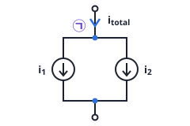

*㉠ 두 전류원이 만나는 위 노드 (강의노트 s23 (a))*

#### 전류를 더하는 연결

전류를 빼는 것은 방향을 반대로 한 전류를 더하는 것과 같아요. 그래서 먼저 두 전류원 $i_1$, $i_2$를 더하는 방법을 봐요.

1. $$
   i_{total}=i_1+i_2
   $$

   병렬로 이으면 두 전류원이 같은 두 노드에 묶이고, ㉠ 위 노드의 KCL에서 두 전류가 합쳐져요.
2. $$
   i_{total}=i_1-i_2
   $$

   회로에서 한쪽 전류원 $i_2$의 방향만 뒤집어 병렬로 이으면 두 전류가 빼져요.
3. 직렬로 이으면 가지가 하나뿐이라 KCL에 따라 두 소자에 같은 전류가 흘러요. 그래서 전류가 더해지지 않아요. 값이 다른 이상 전류원 두 개를 직렬로 두면 한 가지에 서로 다른 두 전류를 강요하게 되어 KCL과 모순이고, 회로로 성립하지 않아요.

**전류를 더하거나 빼려면 전류원을 직렬이 아니라 병렬로, 같은 노드에 이어야 해요.**

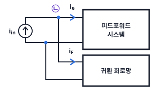

*㉡ 입력 전류가 갈라지는 노드 (강의노트 s23 (b))*

#### 피드포워드 시스템에 들어가는 전류

먼저 쉽게 말하면의 예시에 적용해요. 입력 전류 $i_{in}=10\,\mu\mathrm{A}$가 들어오는 ㉡ 노드에서 귀환 회로망이 $i_F=9\,\mu\mathrm{A}$를 빼 가면 피드포워드 시스템에는 나머지만 들어가요.

$$
i_e=10-9=1\,\mu\mathrm{A}
$$

1. 귀환 회로망을 입력 신호와 같은 노드에 병렬로 연결해요. ㉡ 노드에서 입력 전류가 두 갈래로 나뉘어요.
2. $$
   i_{in}=i_e+i_F
   $$

   ㉡ 노드로 들어오는 전류는 나가는 전류의 합이에요(KCL).
3. $$
   i_e=i_{in}-i_F
   $$

   ㉡에서 $i_F$가 아래로 빠지고 남아 피드포워드 시스템에 들어가는 전류예요.
4. $i_F=0$이면 $i_e=i_{in}$이에요. 빼 가는 전류가 없으니 귀환이 없는 개루프와 같아요.

**피드포워드 시스템에는 입력 전류와 귀환 전류의 차이 $i_e=i_{in}-i_F$가 들어가요.**

#### 잴 때와 더할 때는 연결이 반대예요

출력 쪽에서 재는 연결(감지)과 입력 쪽에서 더하는 연결(반송)은 서로 반대예요. 전류와 전압을 나란히 놓으면 다음과 같아요.

|   | 전류 | 전압 |
|---|---|---|
| 잴 때(감지) | 직렬: 전류계처럼 경로를 끊고 끼워요 | 병렬: 전압계처럼 노드와 접지 사이에 걸쳐요 |
| 더할 때(반송) | 병렬: 같은 노드에 이어요 | 직렬: 건전지처럼 이어요 |

**전류는 잴 때 직렬, 더할 때 병렬이고, 전압은 잴 때 병렬, 더할 때 직렬이에요.**

그래서 회로에서는 귀환이 입력과 같은 노드로 들어가면 병렬, 다른 노드로 들어가면 직렬이라고 판단해요.

**교수님 말씀**

> 전류를 물이라고 생각하면 파이프 두 개가 있어요.

넓은 파이프와 좁은 파이프를 이어 붙이면 흐르는 물의 양은 좁은 쪽이 정한다고 했어요. 직렬로 이으면 전류가 더해지지 않는다는 비유예요.

이 비유는 직관용이에요. 실제 회로에서는 값이 다른 이상 전류원 두 개를 직렬로 둘 수 없어요(KCL과 모순). 비유 속 흐르는 양은 전류, 곧 단위 시간당 흐르는 전하량이에요.

> 같은 노드로 인가돼야지 전류가 분기가 되죠.

귀환 전류가 입력과 같은 노드에 들어와야 입력 전류가 나뉘고, 그 차이가 피드포워드 시스템으로 들어간다고 했어요.

> 전류를 잴 때는 … 시리즈로 연결하지만 전류를 더할 때는 병렬로 더해지고

전압은 그 반대로 병렬로 재고 직렬로 더한다고 이어서 말했어요.

**꼭 기억해요**

> 병렬로 연결되어야 된다는 게 핵심 포인트죠.

입력이 전류면 귀환 회로망을 입력과 같은 노드에 병렬로 이어요. 입력이 전압일 때는 반대로 다른 노드에 직렬로 이어서 빼요([1111 정리노트 · 전압은 입력원과 직렬로 빼요](../../1111/정리노트_1111_Sense_and_Return.html#s6-voltage-return)).

확인해 봐요. 입력 전류 $i_{in}=20\,\mu\mathrm{A}$가 들어오는 노드에서 귀환 회로망이 $i_F=18\,\mu\mathrm{A}$를 빼 가면 피드포워드 시스템에 들어가는 전류 $i_e$는 얼마인가요?

답 보기

$2\,\mu\mathrm{A}$예요. $i_e=i_{in}-i_F=20-18=2\,\mu\mathrm{A}$

**페이지 요약**

입력이 전류면 귀환 전류 $i_F$를 입력과 같은 노드에 병렬로 이어서 빼요.

*핵심 식*

- 피드포워드 시스템에 들어가는 전류

  $$
  i_e=i_{in}-i_F
  $$

$i_F=0$이면 $i_e=i_{in}$으로 개루프와 같아요.

전류는 잴 때 직렬, 더할 때 병렬이고, 전압은 그 반대예요.

*용어*

- **전류 반송(current return)** — 귀환 전류를 입력과 같은 노드에 병렬로 이어 입력 전류에서 빼는 연결
- **피드포워드 시스템(feedforward system)** — 귀환이 없는 원래 증폭기(개루프 시스템)

---

### 트랜지스터와 큰 저항으로 전류를 빼요

*1113 수업 · L06 s24*

**쉽게 말하면**

입력 노드에 트랜지스터 $M_1$이나 저항 $R_F$를 병렬로 달아 $i_F$를 빼는데, 노드 전압이 흔들려도 $i_F$가 그대로이려면 그 소자가 전류원처럼 저항이 아주 커야 해요.

노드 전압이 $10\,\mathrm{mV}$ 흔들릴 때 $R_F=1\,\mathrm{k\Omega}$이면 $i_F$가 $10\,\mu\mathrm{A}$나 바뀌지만, $R_F=1\,\mathrm{M\Omega}$이면 $0.01\,\mu\mathrm{A}$만 바뀌어요.

*두 회로 모두 $M_1$과 $R_F$가 입력 전류원과 같은 노드 $v_n$에 붙어 병렬로 $i_F$를 빼고, $M_1$은 $r_O$가 커서, $R_F$는 크게 설계해서 전류원에 가까워져요.*

**정확히 말하면**

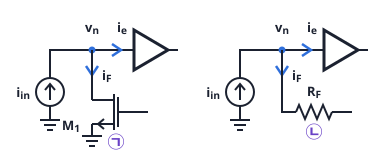

*㉠ (c) 트랜지스터 $M_1$ · ㉡ (d) 저항 $R_F$ (강의노트 s24 (c)·(d))*

#### 같은 노드에 붙는 두 소자

그림 (c)는 ㉠ 트랜지스터 $M_1$의 드레인을, 그림 (d)는 ㉡ 저항 $R_F$의 한쪽 끝을 입력 전류원이 연결된 노드에 붙여요. 이 노드의 소신호 전압을 $v_n$이라고 해요. $M_1$의 게이트와 $R_F$의 다른 끝은 귀환 회로망의 나머지로 이어져서 빼 갈 전류 $i_F$를 정해요.

강의 슬라이드의 문장대로 **$M_1$과 $R_F$는 입력 전류원과 병렬이라서 각자의 전류를 입력 전류에서 빼요.** 그래서 피드포워드 시스템에 들어가는 전류는 여기서도 $i_e=i_{in}-i_F$예요([전류는 같은 노드에 병렬로 빼요](#s0-current-return)).

#### 노드 전압이 바뀌면 $i_F$도 바뀌나요

먼저 쉽게 말하면의 예시에 적용해요. ㉡ $R_F$의 다른 끝 전압은 그대로이고 노드 전압만 $\Delta v_n=10\,\mathrm{mV}$ 바뀌면, $\mathrm{mV}/\mathrm{k\Omega}=\mu\mathrm{A}$로 환산해 $i_F$의 변화는 다음과 같아요.

$$
\Delta i_F=\frac{10\,\mathrm{mV}}{1\,\mathrm{k\Omega}}=10\,\mu\mathrm{A}
$$

$$
\Delta i_F=\frac{10\,\mathrm{mV}}{1\,\mathrm{M\Omega}}=0.01\,\mu\mathrm{A}
$$

[전류는 같은 노드에 병렬로 빼요](#s0-current-return)의 예시처럼 $9\,\mu\mathrm{A}$를 빼려는데 노드 전압 때문에 $10\,\mu\mathrm{A}$나 바뀌면 원하는 전류를 뺄 수 없어요. $1\,\mathrm{M\Omega}$이면 그 변화가 $0.01\,\mu\mathrm{A}$로 작아져요.

1. $$
   \Delta i_F=\frac{\Delta v_n}{R_F}
   $$

   (d): ㉡ $R_F$의 다른 끝 전압이 그대로일 때 옴의 법칙이에요.
2. (c): ㉠ $M_1$을 포화 영역의 저주파 소신호 모델로 보고 몸체 효과를 무시해요. 소스가 접지이고 드레인 전압이 $v_n$이므로 드레인 전류는 게이트가 정하는 부분과 $r_O$를 지나는 부분의 합이에요.

   $$
   i_F=g_mv_{gs}+\frac{v_n}{r_O}
   $$
3. $$
   \Delta i_F=\frac{\Delta v_n}{r_O}
   $$

   (c): ㉠ $M_1$의 게이트 전압이 그대로이고 노드 전압만 바뀔 때예요.
4. 두 경우 모두 $i_F$의 원치 않는 변화는 노드에서 본 반송 소자의 저항($R_F$ 또는 $r_O$)에 반비례해요.

**반송 소자의 저항이 클수록 노드 전압이 바뀌어도 $i_F$가 덜 바뀌어요.**

#### $M_1$은 $r_O$가 커서, $R_F$는 크게 설계해서

트랜지스터 $M_1$은 노드에서 본 저항이 $r_O$예요. $r_O$는 원래 커서 $M_1$은 따로 손보지 않아도 전류원에 가까워요.

저항 $R_F$는 매우 크게 설계해야 해요. 이유는 앞의 식에 있어요. $R_F$로 전류를 빼면 노드에서 본 저항이 $R_F$ 자체예요. **$R_F$가 전류원처럼 동작하려면 매우 커야 해요.** 그래야 $\Delta v_n/R_F$가 작아져 노드 전압이 바뀌어도 $i_F$가 거의 그대로예요.

#### 왜 전류원이어야 하나요

전류를 반송하는 회로망은 입력 노드에 전류를 더하거나 빼는 전류원 역할을 해요. 이상적인 전류원은 양단 전압이 바뀌어도 전류가 바뀌지 않으므로, 노드에서 본 출력 임피던스는 무한대예요.

$$
\frac{\Delta v_n}{\Delta i_F}\to\infty
$$

**전류를 반송하는 소자는 출력 임피던스가 무한대에 가까워야 노드 전압이 바뀌어도 $i_F$를 그대로 유지해요.** 귀환 회로망의 임피던스 조건은 [반송하는 쪽은 출력 임피던스로 따져요](#s2-return-impedance)에서 전압 반송과 함께 정리해요.

#### 회로에서 전류 반송 알아보기

회로 그림에서 귀환이 전류 반송인지 가리려면 귀환 소자가 어느 노드에 붙어 있는지 봐요.

|   | (c) 트랜지스터 $M_1$ | (d) 저항 $R_F$ |
|---|---|---|
| 입력 노드에 붙는 단자 | 드레인 | 한쪽 끝 |
| $i_F$를 정하는 것 | 게이트 전압($g_mv_{gs}$) | 다른 끝의 전압과 $R_F$ |
| 노드 전압에 따른 변화 | $\Delta v_n/r_O$ | $\Delta v_n/R_F$ |
| 전류원에 가까워지는 조건 | $r_O$가 커서 자연히 만족 | $R_F$를 매우 크게 설계 |
| 판별 | 같은 노드라서 병렬, 전류 반송 | 같은 노드라서 병렬, 전류 반송 |

**귀환 소자가 입력 전류원과 같은 노드에 붙어 있으면 병렬, 곧 전류 반송이에요.** 다른 노드에 붙어 있으면 직렬로 전압을 빼는 구조예요.

**교수님 말씀**

> 전류원은 기본적으로 굉장히 큰, 이상적으로는 무한대의 임피던스를 가지고

임피던스가 무한대가 아니면 노드 전압이 바뀔 때 전류도 바뀌어서, 이상적인 전류를 빼 주기 어렵다고 했어요.

> 심플하게 그냥 저항으로 $I_F$를 구성할 수도 있습니다.

트랜지스터로 전류원을 만드는 방법 말고, 저항 $R_F$를 병렬로 다는 더 간단한 방법도 있다고 했어요.

> 여기는 이제 $r_O$이기 때문에 … 일반적으로 굉장히 크죠.

$R_F$는 크게 설계해야 하지만 $M_1$은 $r_O$라서 원래 크다는 대비예요.

확인해 봐요. 그림 (c)에서 $M_1$의 $r_O=100\,\mathrm{k\Omega}$이고 게이트 전압은 그대로일 때, 노드 전압이 $\Delta v_n=20\,\mathrm{mV}$ 바뀌면 $i_F$는 얼마나 바뀌나요?

답 보기

$0.2\,\mu\mathrm{A}$예요. $\Delta i_F=\Delta v_n/r_O=20\,\mathrm{mV}/100\,\mathrm{k\Omega}=0.2\,\mu\mathrm{A}$

**페이지 요약**

입력 노드에 병렬로 단 트랜지스터 $M_1$이나 큰 저항 $R_F$가 전류원처럼 $i_F$를 빼요.

*핵심 식*

- $R_F$로 뺄 때

  $$
  \Delta i_F=\frac{\Delta v_n}{R_F}
  $$
- $M_1$로 뺄 때

  $$
  i_F=g_mv_{gs}+\frac{v_n}{r_O}
  $$

노드 전압이 바뀌어도 $i_F$가 그대로이려면 반송 소자의 출력 임피던스가 무한대에 가까워야 해요.

$M_1$은 $r_O$가 커서 이 조건에 가깝고, $R_F$는 매우 크게 설계해야 해요.

귀환 소자가 입력 전류원과 같은 노드에 붙어 있으면 병렬, 곧 전류 반송이에요.

*용어*

- **전류원(current source)** — 양단 전압이 바뀌어도 전류가 그대로인 소자로, 이상적인 출력 임피던스가 무한대

---

## 2. 예제: 차동쌍과 저항 분배기의 감지·반송

### 차동쌍이 빼고 저항 분배기가 감지해요

*1113 수업 · L06 s25*

**쉽게 말하면**

저항 두 개 $R_1$, $R_2$가 출력 전압을 재서 $K$배로 줄여 돌려주면, 차동쌍이 $v_{in}$에서 그 $v_F$를 빼고 남은 차이만큼 출력 전류를 만들어요.

예를 들어 $R_1=30\,\mathrm{k\Omega}$, $R_2=10\,\mathrm{k\Omega}$이면 $K=\frac14$라서, 차동쌍 쪽 이득이 충분히 크면 출력은 입력의 약 4배에서 자리 잡아요.

*화살표처럼 $M_4$에서 출력 노드로 들어온 $i_1$과 $M_2$로 빠져나간 $i_2$의 차 $i_1-i_2$가 출력으로 나가요.*

**정확히 말하면**

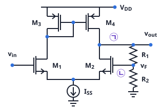

*㉠ 출력 노드(감지) · ㉡ $M_2$ 게이트(반송) (강의노트 s25)*

#### 어디서 재고 어디로 돌려주나요

개루프(피드포워드) 시스템은 $M_1$–$M_4$예요. $M_1$, $M_2$는 차동쌍이고, $M_3$, $M_4$는 그 부하인 전류 거울(current mirror)이에요. 다이오드로 연결된 $M_3$이 $M_1$의 전류를 받고 $M_4$가 그 전류를 복사해서, 차동 입력을 단일 출력(single-ended output)으로 바꿔요.

입력도 출력도 전압이므로 이 귀환은 전압을 감지해서 전압을 반송해요. **㉠ 출력과 같은 노드에 붙은 $R_1$–$R_2$는 병렬로 전압을 감지하고, 입력과 다른 노드인 ㉡ $M_2$ 게이트로 돌아간 $v_F$는 직렬로 전압을 빼요.** 감지 쪽 병렬은 parallel 또는 션트(shunt)라고도 부르고, 반송 쪽 직렬은 series예요.

|   | 연결한 노드 | 판별 |
|---|---|---|
| 감지: $R_1$–$R_2$ | 출력 노드 $v_{out}$와 같은 노드 | 병렬(션트) |
| 반송: $v_F$ | $M_2$ 게이트, $v_{in}$이 걸린 $M_1$ 게이트와 다른 노드 | 직렬 |

차동쌍이 두 게이트 전압의 차이로 전류를 만드는 원리는 1111 수업의 [트랜지스터 하나와 차동쌍으로 전압 빼기](../../1111/정리노트_1111_Sense_and_Return.html#s6-return-circuits)에서 봤어요. 그래서 슬라이드는 $M_1$과 $M_2$가 전압 뺄셈기(voltage subtractor) 역할도 한다고 적었어요. 교수님은 이 회로를 음의 귀환 폐루프 시스템으로 정리했고, 왜 음의 귀환인지는 [입력을 올려 보고 루프를 한 바퀴 따라가요](#s3-polarity-steps)에서 따져요.

#### $K$는 왜 저항비인가요

먼저 숫자로 볼게요. $R_1=30\,\mathrm{k\Omega}$, $R_2=10\,\mathrm{k\Omega}$이면 ㉠ 출력 전압 가운데 ㉡ $M_2$ 게이트로 돌아가는 비율은 다음과 같아요.

$$
K=\frac{10\,\mathrm{k\Omega}}{30\,\mathrm{k\Omega}+10\,\mathrm{k\Omega}}=\frac14
$$

$K$는 귀환 계수(feedback factor)로, 출력 전압 가운데 입력 쪽으로 돌아가는 비율이에요.

$$
K=\frac{v_F}{v_{out}}
$$

**㉡ $M_2$ 게이트로는 전류가 흐르지 않으므로 $R_1$과 $R_2$에 같은 전류가 흐르고, $K$는 두 저항의 비만으로 정해져요.** 분배기 중간에서 빠져나가는 전류가 없을 때 이 분배 식이 정확해요.

$$
K=\frac{R_2}{R_1+R_2}
$$

$R_1$, $R_2$가 모두 양수이므로 $K\lt1$이에요. 출력 전압의 일부만 돌아가요.

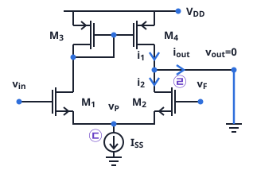

*㉢ 두 소스가 만나는 노드 · ㉣ 출력 노드. 귀환을 떼고 $v_F$를 $M_2$ 게이트의 독립 입력으로 둔 채, 출력을 단락선으로 접지에 이어 $v_{out}=0$으로 둔 측정 회로예요. $i_{out}$은 출력 노드에서 단락선으로 나가는 방향이 양이고, $r_O$는 무시한 모델이에요. (강의노트 s25를 바탕으로 새로 그린 그림)*

#### 차동쌍은 어떻게 빼나요

㉣ 출력 노드로 $M_4$의 전류가 들어오고 $M_2$의 전류가 빠져나가요. 그 차가 출력으로 나가는 전류예요. 표기를 보완하면, 대문자 $I$, $V$는 바이어스를 포함한 전체 값으로 읽힐 수 있어서 아래에서는 신호 성분만 소문자 $i$, $v$로 써요.

측정 조건은 이래요. 귀환을 떼고 피드포워드 회로 $M_1$–$M_4$만 남겨 $v_{in}$과 $v_F$를 두 게이트의 입력으로 봐요. 출력은 교류 접지에 단락해서 $v_{out}=0$으로 두고, 출력 노드에서 단락선으로 나가는 쪽을 $i_{out}$의 양의 방향으로 정해요. 모델은 포화 영역의 저주파 소신호이고, $M_1$과 $M_2$는 같은 소자, $I_{SS}$는 이상 전류원이에요. $r_O$는 무시해서(수업 기본 근사 $g_mr_O\gg1$의 주항) 거울은 $M_3$의 전류를 그대로 복사해요.

$i_{d1}$, $i_{d2}$는 $M_1$, $M_2$ 드레인 전류의 신호 성분(아래 방향), $v_P$는 ㉢ 두 소스가 만나는 노드의 신호 전압이에요.

1. $$
   i_{d1}=g_m(v_{in}-v_P)
   $$

   $M_1$의 게이트–소스 전압이 전류를 정해요
2. $$
   i_{d2}=g_m(v_F-v_P)
   $$

   $M_2$도 같은 소자라 같은 $g_m$이에요
3. $$
   i_{d1}+i_{d2}=0
   $$

   ㉢ 아래가 이상 테일 전류원이라 두 신호 전류의 합은 0이에요
4. $$
   v_P=\frac{v_{in}+v_F}{2}
   $$

   위 세 식을 풀면 $v_P$는 두 게이트 전압의 평균이에요
5. $$
   i_{d1}=\frac{g_m}{2}(v_{in}-v_F)
   $$

   $v_P$를 첫 식에 넣어요
6. $$
   i_{d2}=-\frac{g_m}{2}(v_{in}-v_F)
   $$

   $M_2$ 쪽은 같은 크기로 반대로 움직여요
7. $$
   i_1=i_{d1}
   $$

   $M_3$이 받은 $M_1$의 전류를 $M_4$가 복사해요
8. $$
   i_2=i_{d2}
   $$

   $M_2$의 드레인 전류가 ㉣ 출력 노드에서 빠져나가요
9. $$
   i_{out}=i_1-i_2
   $$

   ㉣ 출력 노드의 KCL: 들어온 $i_1$이 $i_2$와 $i_{out}$으로 나뉘어요
10. $$
    i_{out}=g_m(v_{in}-v_F)
    $$

    두 가지의 변화 $\frac{g_m}{2}(v_{in}-v_F)$가 더해져요

**각 가지의 신호 전류는 $\frac{g_m}{2}(v_{in}-v_F)$씩만 움직이고, 거울이 두 변화를 출력 노드에서 더해 주어서 $i_1-i_2$가 $g_m(v_{in}-v_F)$가 돼요.** 가지 하나의 전류는 $g_mv_{in}$이나 $g_mv_F$가 아니라 차이의 절반이에요. 두 가지의 차를 내야 비로소 $g_m(v_{in}-v_F)$가 나와요.

출력을 단락했을 때의 이 비례 계수가 피드포워드 회로의 트랜스컨덕턴스 $G_m$이고, 위 조건에서 $G_m=g_m$이에요. 출력 전류가 $v_{in}$에서 $v_F$를 뺀 값으로 정해지므로 $M_1$과 $M_2$가 전압 뺄셈기로 동작해요.

#### 이득은 왜 $\frac{1}{K}$로 정해지나요

개루프 이득을 $A_0$, 귀환 계수를 $K$라고 하면 폐루프 이득은 다음과 같아요. 이 식의 유도는 [출력 전압을 감지해 입력에서 전압을 빼요](#s5-vv-gain)에서 해요.

$$
\frac{v_{out}}{v_{in}}=\frac{A_0}{1+KA_0}
$$

루프 이득 $KA_0$가 1보다 훨씬 크면 분모의 1을 무시할 수 있고, $A_0$가 약분돼요. 1보다 조금 큰 정도로는 부족하고, 1보다 훨씬 커야 해요.

$$
\frac{v_{out}}{v_{in}}\approx\frac{1}{K}
$$

숫자로 확인해요. 앞의 $K=\frac14$에서 $A_0=1000$이면 $KA_0=250$이에요.

$$
\frac{1000}{1+250}\approx3.98
$$

이 값은 $\frac{1}{K}=4$에 거의 같아요. 같은 $K$에서 $A_0=8$이면 $KA_0=2$뿐이에요.

$$
\frac{8}{1+2}\approx2.67
$$

이때는 4와 거리가 멀어요. **루프 이득이 충분히 크면 폐루프 이득은 $A_0$와 거의 상관없이 저항비 $\frac{1}{K}=\frac{R_1+R_2}{R_2}$로 정해져요.**

**교수님 말씀**

> 차동 입력을 싱글 엔디드 출력으로 만드는 대표적인 회로가 커런트 미러 로드를 이용한 차동 증폭기

저항 $R_1$, $R_2$가 없을 때가 개루프이고, 여기에 귀환 회로망을 붙여 폐루프 시스템으로 동작시키는 것이라고 했어요.

> 전압을 센싱할 때는 병렬, 다른 말로 parallel이라고 하기도 하고 션트라고 얘기했습니다

반송할 때는 입력과 다른 노드에 직렬로 연결해서, 전압을 감지해 전압을 반송하는 구조라고 정리했어요.

> 피드백 네트워크가 전체의 이득을 결정하는 거예요. 저항의 비로 이득이 결정이 됩니다.

루프 이득이 크면 폐루프 이득이 $\frac{1}{K}$로 가서, 증폭기가 아니라 두 저항이 이득을 정한다는 뜻이에요.

확인해 봐요. $R_1=40\,\mathrm{k\Omega}$, $R_2=10\,\mathrm{k\Omega}$이고 루프 이득 $KA_0$가 1보다 훨씬 크면, $K$와 폐루프 이득은 얼마일까요?

답 보기

$K=\frac{10}{40+10}=\frac15$이고, 폐루프 이득은 $\frac{1}{K}=5$에 가까워요.

**페이지 요약**

출력에 병렬로 붙은 $R_1$–$R_2$가 전압을 $K$배로 감지하고, 차동쌍 $M_1$·$M_2$가 $v_{in}$에서 $v_F$를 빼는 전압 뺄셈기로 동작해요.

*핵심 식*

- 귀환 계수

  $$
  K=\frac{R_2}{R_1+R_2}
  $$
- 출력 전류

  $$
  i_{out}=g_m(v_{in}-v_F)
  $$
- 폐루프 이득

  $$
  \frac{v_{out}}{v_{in}}\approx\frac{1}{K}
  $$

출력과 같은 노드에 붙은 감지는 병렬(션트)이고, 입력과 다른 노드인 $M_2$ 게이트로의 반송은 직렬이에요.

$i_{out}$ 식은 전류 거울 부하 차동쌍의 출력을 단락한 신호 관계이고, 각 가지 전류는 그 절반씩만 움직여요.

폐루프 이득이 $\frac{1}{K}$가 되려면 루프 이득 $KA_0$가 1보다 훨씬 커야 해요.

*용어*

- **귀환 계수(feedback factor)** — 출력 전압 가운데 입력 쪽으로 돌아가는 비율 $K$
- **전압 뺄셈기(voltage subtractor)** — 두 전압의 차이에 비례하는 전류를 만드는 회로
- **션트(shunt)** — 같은 노드에 병렬로 붙이는 연결

---

## 3. 이상적인 귀환 회로망의 임피던스

### 감지하는 쪽은 입력 임피던스로 따져요

*1113 수업 · L06 s26*

**쉽게 말하면**

출력을 감지하는 귀환 회로망은 계기처럼 출력에 붙어서, 전압을 감지할 때는 볼트미터처럼 입력 임피던스가 $\infty$, 전류를 감지할 때는 커런트 미터처럼 0이어야 출력이 그대로예요.

*전압은 출력 노드에 병렬로 대서 입력 임피던스 $\infty$로, 전류는 전류 경로를 끊고 직렬로 넣어 입력 임피던스 0으로 감지해요.*

**정확히 말하면**

#### 출력에 붙는 쪽은 귀환 회로망의 입력이에요

감지(sense)는 증폭기 출력을 재는 일이에요. 귀환 회로망(feedback network)은 입력 포트로 출력을 받아 $K$를 곱하고, 출력 포트로 그 결과를 입력 쪽에 돌려보내요.

**그래서 감지하는 쪽에서 따질 값은 출력 노드에서 귀환 회로망 쪽으로 본 입력 임피던스 $R_{in,F}$예요.** 이 값이 이상적이어야 귀환 회로망을 붙여도 재려는 출력이 바뀌지 않아요.

전압 감지와 전류 감지는 1111 수업의 [전압은 병렬로, 큰 임피던스로 감지해요](../../1111/정리노트_1111_Sense_and_Return.html#s5-voltage-sense)와 [전류는 직렬로, 작은 임피던스로 감지해요](../../1111/정리노트_1111_Sense_and_Return.html#s5-current-sense)에서 연결 방법을 먼저 봤어요. 여기서는 귀환 회로망이 가져야 할 입력 임피던스를 정리해요.

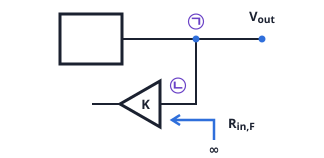

*㉠ 출력 노드 · ㉡ $K$의 입력. 화살표 끝 ∞는 이상적인 $R_{in,F}$예요. (강의노트 s26 왼쪽)*

#### 전압 감지는 볼트미터처럼 $\infty$예요

증폭기 출력을 개방 전압 $V_{oc}$와 직렬 출력저항 $R_{out}$으로 보고, ㉠ 출력 노드에 귀환 회로망을 병렬로 대요. 두 값은 회로의 왼쪽 상자 안에 있어요.

1. $$
   V_{out}=V_{oc}\frac{R_{in,F}}{R_{out}+R_{in,F}}
   $$

   ㉠에 병렬로 댄 ㉡ $R_{in,F}$와 $R_{out}$이 전압을 나눠요.
2. $V_{oc}=1\,\mathrm{V}$, $R_{out}=1\,\mathrm{k\Omega}$에 $R_{in,F}=1\,\mathrm{k\Omega}$이면 절반으로 떨어져요.

   $$
   V_{out}=1\,\mathrm{V}\times\frac{1\,\mathrm{k\Omega}}{1\,\mathrm{k\Omega}+1\,\mathrm{k\Omega}}=0.5\,\mathrm{V}
   $$
3. $R_{in,F}=99\,\mathrm{k\Omega}$이면 거의 그대로예요.

   $$
   V_{out}=1\,\mathrm{V}\times\frac{99\,\mathrm{k\Omega}}{1\,\mathrm{k\Omega}+99\,\mathrm{k\Omega}}=0.99\,\mathrm{V}
   $$
4. $$
   R_{in,F}\to\infty\ \Rightarrow\ V_{out}\to V_{oc}
   $$

   입력 임피던스가 무한대로 가면 출력 전압이 바뀌지 않아요.

**전압을 감지하는 귀환 회로망의 입력 임피던스는 볼트미터처럼 이상적으로 $\infty$예요.** 저항 분배기 $R_1$–$R_2$로 감지하고 귀환 노드에서 전류가 빠져나가지 않으면 $R_{in,F}=R_1+R_2$이므로, $R_1$과 $R_2$를 굉장히 크게 설계해요.

실제로는 무한대가 아니라 굉장히 크다는 뜻이에요. $R_1$, $R_2$가 충분히 크지 않을 때 귀환 전체가 어떻게 달라지는지는 수업에서 뒤로 미뤘어요([다음 시간 예고](#s6-next)).

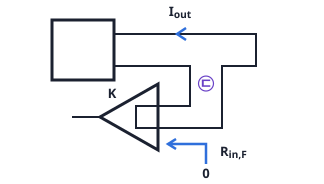

*㉢ 끊고 $K$를 끼운 자리. 화살표 끝 0은 이상적인 $R_{in,F}$예요. (강의노트 s26 오른쪽)*

#### 전류 감지는 커런트 미터처럼 0이에요

전류를 내는 증폭기 출력을 단락 전류 $I_{sc}$와 병렬 출력저항 $R_{out}$으로 봐요. ㉢ 출력 전류 경로를 끊고 귀환 회로망의 입력을 직렬로 넣어요(부하는 단락으로 둬요).

1. $$
   I_{out}=I_{sc}\frac{R_{out}}{R_{out}+R_{in,F}}
   $$

   ㉢에 직렬로 넣은 $R_{in,F}$와 상자 안의 $R_{out}$이 전류를 나눠요.
2. $I_{sc}=1\,\mathrm{mA}$, $R_{out}=99\,\mathrm{k\Omega}$에 $R_{in,F}=99\,\mathrm{k\Omega}$이면 절반만 흘러요.

   $$
   \begin{aligned}I_{out}&=1\,\mathrm{mA}\times\frac{99\,\mathrm{k\Omega}}{99\,\mathrm{k\Omega}+99\,\mathrm{k\Omega}}\\&=0.5\,\mathrm{mA}\end{aligned}
   $$
3. $R_{in,F}=1\,\mathrm{k\Omega}$이면 거의 그대로예요.

   $$
   \begin{aligned}I_{out}&=1\,\mathrm{mA}\times\frac{99\,\mathrm{k\Omega}}{99\,\mathrm{k\Omega}+1\,\mathrm{k\Omega}}\\&=0.99\,\mathrm{mA}\end{aligned}
   $$
4. $$
   R_{in,F}\to0\ \Rightarrow\ I_{out}\to I_{sc}
   $$

   입력 임피던스가 0으로 가면 출력 전류가 바뀌지 않아요.

**전류를 감지하는 귀환 회로망의 입력 임피던스는 커런트 미터처럼 이상적으로 0이에요.** 전압 감지는 $R_{in,F}$를 키울수록, 전류 감지는 줄일수록 출력이 덜 바뀌어요. 여기서도 0은 실제로 굉장히 작다는 뜻이에요.

#### 헷갈리기 쉬운 점

이 슬라이드는 출력을 감지하는 쪽에서 본 귀환 회로망의 입력 임피던스 이야기예요. "전압을 return하면 임피던스 $\infty$, 전류를 return하면 0"처럼 동사를 return(반송)으로 기억하면 바로 다음 슬라이드의 반송 규칙(전압 반송은 출력 임피던스 0, 전류 반송은 $\infty$)과 정반대가 돼요.

값과 두 그림의 위치는 그대로 두고 동사만 감지로 바꿔 읽어요. 왼쪽 그림(㉠)은 전압을 감지 $\Rightarrow$ 입력 임피던스 $\infty$(볼트미터), 오른쪽 그림(㉢)은 전류를 감지 $\Rightarrow$ 입력 임피던스 0(커런트 미터)이에요.

**감지는 귀환 회로망의 입력 임피던스(전압 $\infty$, 전류 0)로, 반송은 귀환 회로망의 출력 임피던스(전압 0, 전류 $\infty$)로 따져요.** 재는 쪽은 계기처럼, 빼는 쪽은 전원처럼 생각하면 돼요.

짧게 확인해요. 전압을 반송하는 귀환 회로망의 출력 임피던스는 $\infty$일까요 0일까요? 전압을 빼주는 전압원이므로 0이에요([반송하는 쪽은 출력 임피던스로 따져요](#s2-return-impedance)).

**교수님 말씀**

> 볼트미터처럼 … 입력 임피던스가 굉장히 커야 되겠죠. 그래야지 연결했을 때 전압이 변하지 않는다

출력 전압을 감지할 때 귀환 회로망은 출력 노드에 병렬(션트)로 연결되고, 이때 귀환 회로망의 입력 임피던스를 볼트미터에 빗댔어요.

> 원래 출력 전류에 영향을 주지 않으려면 … 입력 임피던스가 0에 가까워야 된다

전류를 감지할 때는 전류 경로를 끊고 직렬로 넣으며, 이를 커런트 미터에 빗댔어요.

> 무한대라기보다는 굉장히 커야 된다라는 의미로 생각을 해보면 되겠습니다

0도 마찬가지로 실제로는 굉장히 작아야 한다는 뜻이라고 했어요.

**꼭 기억해요**

> 또 하나 이제 고려해야 될 게, 자 이게 피드백 네트워크가 가져야 될 특징이

감지·반송을 직렬로 할지 병렬로 할지 정한 뒤에도, 귀환 회로망의 임피던스가 이상값에 가까운지 함께 따져야 해요.

> $R_1$과 $R_2$가 굉장히 커야 된다는 거죠. 되게 크도록 설계를 해야 됩니다

분배기로 전압을 감지할 때 출력 노드에 걸리는 것은 $R_1+R_2$예요.

확인해 봐요. 개방 전압 $V_{oc}=2\,\mathrm{V}$, 출력저항 $R_{out}=1\,\mathrm{k\Omega}$인 출력에 입력 임피던스 $R_{in,F}=9\,\mathrm{k\Omega}$인 귀환 회로망을 병렬로 대면 $V_{out}$은 얼마인가요?

답 보기

$V_{out}=2\,\mathrm{V}\times\frac{9\,\mathrm{k\Omega}}{1\,\mathrm{k\Omega}+9\,\mathrm{k\Omega}}=1.8\,\mathrm{V}$예요. 출력 전압을 그대로 두려면 $R_{in,F}$를 더 키워야 해요.

**페이지 요약**

감지하는 쪽은 귀환 회로망의 입력 임피던스로 따지고, 전압 감지는 $\infty$, 전류 감지는 0이어야 출력이 그대로예요.

*핵심 식*

- 전압 감지: 병렬로 댄 쪽이 나누는 전압

  $$
  V_{out}=V_{oc}\frac{R_{in,F}}{R_{out}+R_{in,F}}
  $$
- 전류 감지: 직렬로 넣은 쪽이 나누는 전류

  $$
  I_{out}=I_{sc}\frac{R_{out}}{R_{out}+R_{in,F}}
  $$

전압은 볼트미터처럼 병렬로 대서 $R_{in,F}\to\infty$, 전류는 커런트 미터처럼 직렬로 넣어 $R_{in,F}\to0$이 이상적이에요.

분배기로 감지하면 $R_{in,F}=R_1+R_2$이므로 $R_1$과 $R_2$를 굉장히 크게 설계해요.

감지는 입력 임피던스, 반송은 출력 임피던스로 따져요.

*용어*

- **감지(sense)** — 귀환 회로망이 증폭기 출력을 재는 것
- **입력 임피던스(input impedance) $R_{in,F}$** — 출력 노드에서 귀환 회로망 쪽으로 본 임피던스
- **볼트미터(voltmeter)** — 병렬로 대서 전압을 재는 계기, 이상적인 입력 임피던스는 $\infty$
- **커런트 미터(current meter)** — 경로를 끊고 직렬로 넣어 전류를 재는 계기, 이상적인 입력 임피던스는 0

---

### 반송하는 쪽은 출력 임피던스로 따져요

*1113 수업 · L06 s27*

**쉽게 말하면**

입력에서 빼 주는 귀환 회로망은 전원처럼 일해서, 전압을 반송할 때는 출력 임피던스 0인 전압원, 전류를 반송할 때는 출력 임피던스 $\infty$인 전류원이어야 해요.

*전압은 입력과 다른 노드에 직렬로 넣어 출력 임피던스 0의 전압원으로, 전류는 입력과 같은 노드에 병렬로 붙여 출력 임피던스 $\infty$의 전류원으로 빼요.*

**정확히 말하면**

#### 무엇을 반송할지는 원래 증폭기의 입력이 정해요

반송(return)은 감지한 양에 $K$를 곱해 원래 증폭기의 입력에서 빼는 일이에요. **반송 방식은 내가 고르는 것이 아니라 원래 증폭기(개루프)의 입력 종류가 정해요.**

원래 입력이 전압이면 전압을 빼야 하고, 전압은 입력과 다른 노드에 직렬로 넣어야 빼져요. 원래 입력이 전류이면 전류를 빼야 하고, 전류는 입력과 같은 노드에 병렬로 붙여야 빼져요([전류는 같은 노드에 병렬로 빼요](#s0-current-return)).

귀환 회로망이 입력 쪽으로 내보내는 포트는 출력 포트이므로, 반송하는 쪽에서 따질 값은 귀환 회로망의 출력 임피던스 $R_{out,F}$예요.

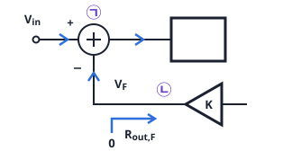

*㉠ 전압을 빼는 자리 · ㉡ $K$의 출력. 화살표 끝 0은 이상적인 $R_{out,F}$예요. (강의노트 s27 왼쪽)*

#### 전압 반송: 전압을 빼주는 전압원이에요

㉡ 쪽 $K$ 블록은 ㉠에서 $V_F$를 입력과 직렬로 넣어 전압을 빼주는 전압원이에요. 전압원이 전압을 잘 전달하려면 흐르는 전류와 관계없이 전압이 바뀌지 않아야 해요.

귀환 회로망의 출력을 $V_F$와 직렬 출력 임피던스 $R_{out,F}$로 보면, 증폭기 입력 전류 $I$가 이 저항을 지나며 실제로 빼지는 전압이 어긋나요.

1. $$
   \Delta V_F=I\,R_{out,F}
   $$

   ㉠에서 빼지는 전압이 $I R_{out,F}$만큼 어긋나요.
2. $I=10\,\mu\mathrm{A}$, $R_{out,F}=10\,\mathrm{k\Omega}$이면 전류를 mA로 바꾼 뒤 $[\mathrm{mA}]\times[\mathrm{k\Omega}]=[\mathrm{V}]$로 계산해요.

   $$
   10\,\mu\mathrm{A}=0.01\,\mathrm{mA}
   $$

   $$
   \Delta V_F=0.01\,\mathrm{mA}\times10\,\mathrm{k\Omega}=0.1\,\mathrm{V}
   $$
3. $$
   R_{out,F}\to0\ \Rightarrow\ \Delta V_F\to0
   $$

   출력 임피던스가 0이면 어긋남이 없어요.

**그래서 전압을 반송하는 귀환 회로망의 출력 임피던스는 이상적으로 0이에요.** 전압원은 전압의 변화가 없으므로 저항이 0이에요.

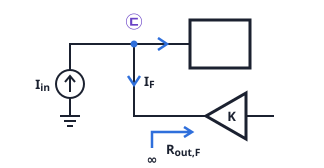

*㉢ 전류를 빼는 입력 노드. 화살표 끝 ∞는 이상적인 $R_{out,F}$예요. (강의노트 s27 오른쪽)*

#### 전류 반송: 전류를 빼주는 전류원이에요

이 회로의 $K$ 블록은 ㉢ 입력 노드에서 $I_F$를 빼주는 전류원이에요. 귀환 회로망의 출력을 $I_F$와 병렬 출력 임피던스 $R_{out,F}$로 보면, 입력 노드 전압이 $\Delta V$ 바뀔 때 이 저항으로 흐르는 전류도 바뀌어요.

1. $$
   \Delta I_F=\frac{\Delta V}{R_{out,F}}
   $$

   ㉢ 노드 전압 변화가 반송 전류를 흔들어요.
2. $\Delta V=0.1\,\mathrm{V}$, $R_{out,F}=100\,\mathrm{k\Omega}$이면 $[\mathrm{V}]/[\mathrm{k\Omega}]=[\mathrm{mA}]$로 계산해요.

   $$
   \Delta I_F=\frac{0.1\,\mathrm{V}}{100\,\mathrm{k\Omega}}=0.001\,\mathrm{mA}=1\,\mu\mathrm{A}
   $$
3. $R_{out,F}=10\,\mathrm{M\Omega}=10^4\,\mathrm{k\Omega}$이면 100배 작아져요.

   $$
   \begin{aligned}\Delta I_F&=\frac{0.1\,\mathrm{V}}{10^4\,\mathrm{k\Omega}}=10^{-5}\,\mathrm{mA}\\&=0.01\,\mu\mathrm{A}\end{aligned}
   $$
4. $$
   R_{out,F}\to\infty\ \Rightarrow\ \Delta I_F\to0
   $$

   출력 임피던스가 $\infty$이면 전류가 흔들리지 않아요.

**전류를 반송하는 귀환 회로망의 출력 임피던스는 이상적으로 $\infty$예요.** 전류원은 양단 전압과 관계없이 전류가 일정하므로 $\Delta V/\Delta I\to\infty$예요. 큰 $R_F$나 $r_O$가 큰 트랜지스터로 전류를 빼는 이유가 이것이에요([트랜지스터와 큰 저항으로 전류를 빼요](#s0-current-return-circuits)).

#### 감지와 반송을 한 표로 보면

|   | 전압 | 전류 |
|---|---|---|
| 감지(입력 임피던스) | $\infty$, 볼트미터처럼 병렬 | $0$, 커런트 미터처럼 직렬 |
| 반송(출력 임피던스) | $0$, 전압을 빼주는 전압원(직렬) | $\infty$, 전류를 빼주는 전류원(병렬) |

**재는 쪽은 계기처럼, 빼는 쪽은 전원처럼 이상값이 정해져요.** 실제 귀환 회로망이 이 값에서 벗어나면 오차가 생기고, 그 영향은 수업에서 뒤로 미뤘어요([다음 시간 예고](#s6-next)).

**교수님 말씀**

> 내가 전압을 빼주고 싶다고 해서 전압을 빼주는 게 아니고

원래 오픈 루프 시스템의 입력이 전압이면 전압을, 전류면 전류를 빼야 하며, 전류 입력에서 전압을 뺄 수는 없다고 했어요.

> 피드백 네트워크가 전류원의 역할을 하는 거예요. 여기는 전압원의 역할을 하는 거고

두 그림을 나란히 가리키며, 반송하는 귀환 회로망을 전원으로 보라고 했어요.

> 전류원이라고 하는 것은 양단의 전압에 무관하고 … 전압원은 전압의 변화가 없다

그래서 전류원의 저항은 $\infty$, 전압원의 저항은 0이라고 설명했어요.

> 그렇지 않으면 … 오차가 생기게 되고 그 오차를 우리가 고려를 해 줘야

이상적인 귀환 회로망을 설계하려면 이 값에 가깝게 만들어야 한다고 정리했어요.

확인해 봐요. 전류를 반송하는 귀환 회로망의 출력 임피던스가 $R_{out,F}=1\,\mathrm{M\Omega}$이고 입력 노드 전압이 $0.2\,\mathrm{V}$ 바뀌면 반송 전류는 얼마나 바뀌나요?

답 보기

$\Delta I_F=\frac{0.2\,\mathrm{V}}{1\,\mathrm{M\Omega}}=0.2\,\mu\mathrm{A}$예요. 출력 임피던스가 클수록 작아지므로 전류 반송은 $\infty$가 이상적이에요.

**페이지 요약**

반송하는 쪽은 귀환 회로망의 출력 임피던스로 따지고, 전압 반송은 0, 전류 반송은 $\infty$여야 해요.

*핵심 식*

- 전압 반송: 빼지는 전압의 어긋남

  $$
  \Delta V_F=I\,R_{out,F}
  $$
- 전류 반송: 반송 전류의 흔들림

  $$
  \Delta I_F=\frac{\Delta V}{R_{out,F}}
  $$

반송 방식은 원래 증폭기의 입력 종류가 정해요.

전압 반송은 전압을 빼주는 전압원이라 $R_{out,F}\to0$이 이상적이에요.

전류 반송은 전류를 빼주는 전류원이라 $R_{out,F}\to\infty$가 이상적이에요.

*용어*

- **반송(return)** — 감지한 양에 $K$를 곱해 원래 증폭기의 입력에서 빼는 것
- **출력 임피던스(output impedance) $R_{out,F}$** — 귀환 회로망이 입력 쪽으로 내보내는 포트에서 본 임피던스
- **전류원(current source)** — 양단 전압과 관계없이 전류가 일정한 원, 출력 임피던스 $\infty$

---

## 4. 귀환의 극성 판정

### 입력을 올려 보고 루프를 한 바퀴 따라가요

*1113 수업 · L06 s28–s29*

**쉽게 말하면**

입력을 살짝 올렸다고 가정하고 그 변화를 루프를 따라 한 바퀴 돌려 보면, 돌아온 변화가 처음 변화를 줄일 때 음귀환, 키울 때 양귀환이에요.

이렇게 귀환이 어느 쪽으로 작용하는지 가리는 일을 극성(polarity) 판정이라고 해요.

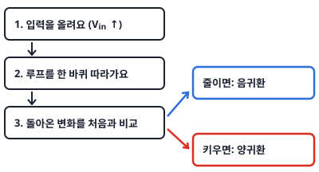

*이 세 단계는 어떤 귀환 회로에도 그대로 써요.*

**정확히 말하면**

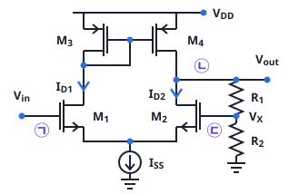

*㉠ $M_1$ 게이트(입력) · ㉡ $M_2$ 드레인(출력) · ㉢ $M_2$ 게이트(빼는 입력). 전류 화살표는 글에 맞춰 더했어요. (강의노트 s29)*

#### 극성을 따지는 세 단계

귀환 회로를 설계할 때는 감지와 반송 방식을 정한 뒤 극성(polarity)도 따져야 해요. 음귀환으로 만들려던 회로라도 극성이 뒤집히면 양귀환이 되기 때문이에요.

1. 입력이 올라간다(또는 내려간다)고 가정해요.
2. 그 변화를 순방향 증폭기와 귀환 회로망을 거쳐 루프를 따라 한 바퀴 추적해요.
3. 돌아온 양(전압 또는 전류)이 **처음 변화를 줄이면 음귀환(negative feedback), 키우면 양귀환(positive feedback)**이에요.

#### 예제 I: 능동 부하 차동쌍과 저항 분배기

㉠ $M_1$ 게이트가 입력, ㉡ $M_2$ 드레인이 출력이에요. $R_1$–$R_2$ 분배기가 출력 전압을 나눈 $V_X$를 ㉢ $M_2$ 게이트로 돌려보내요. 분배기는 출력 전압을 일정한 비율로 줄일 뿐이므로 $V_X$는 $V_{out}$과 같은 방향으로 움직여요.

$$
V_X=\frac{R_2}{R_1+R_2}V_{out}
$$

입력을 올리고 루프를 따라가요.

1. ㉠ $V_{in}\uparrow$이면 $M_1$이 더 켜져 $I_{D1}\uparrow$예요. 꼬리 전류는 $I_{SS}$로 고정이므로 $I_{D2}\downarrow$예요.

   $$
   I_{D1}+I_{D2}=I_{SS}
   $$
2. $M_3$–$M_4$ 전류 거울이 $I_{D1}$을 복사해 ㉡ 출력 노드로 밀어 넣고, $M_2$는 $I_{D2}$를 빼 가요. 늘어난 $I_{D1}$과 줄어든 $I_{D2}$의 차만큼 출력 노드에 전류가 남으므로 $V_{out}\uparrow$예요.
3. 분배기를 거친 $V_X$도 $V_X\uparrow$예요.
4. $V_X$는 ㉢ $M_2$ 게이트, 즉 차동쌍에서 빼는 쪽 입력이에요. 두 입력의 차 $V_{in}-V_X$가 줄어 $I_{D2}\uparrow$, $I_{D1}\downarrow$로 돌아와요.
5. 처음의 $I_{D1}\uparrow$, $I_{D2}\downarrow$를 거꾸로 되돌리므로 **예제 I은 음귀환이에요**.

#### 위상으로 따지는 두 번째 방법

전류를 하나씩 따라가지 않고 부호(위상)만 따라가도 같은 답이 나와요. 공통 소스(CS) 단은 게이트에서 드레인으로 갈 때 위상이 반전돼요. 이득의 마이너스 부호가 반전을 뜻해요.

$$
A_v=-g_mR_L
$$

반대로 소스로 입력을 받으면 드레인은 입력과 같은 위상으로 움직여요.

1. $M_1$ 소스는 게이트 입력을 따라 같은 방향으로 움직여요. $M_2$는 이 소스로 입력을 받는 셈이므로 ㉡ $M_2$ 드레인의 $V_{out}$은 $V_{in}$과 같은 위상이에요.
2. 거울 쪽 경로도 같아요. $M_1$ 게이트에서 드레인으로 한 번, $M_4$ 게이트에서 드레인으로 또 한 번 반전되어 결국 같은 위상이에요.
3. 분배기는 부호를 바꾸지 않으므로 $V_X$도 $V_{in}$과 같은 위상이에요.
4. 같은 위상의 신호가 ㉢ 빼는 입력($M_2$ 게이트)으로 돌아오면 두 입력의 차가 줄어요. 그래서 음귀환이에요.

작은 숫자로 확인해요(값은 설명용 예시예요). 입력이 $1\,\mathrm{mV}$ 올랐을 때 빼는 입력으로 같은 위상의 $0.9\,\mathrm{mV}$가 돌아오면 차동쌍이 보는 차는 작아져요.

$$
1-0.9=0.1\,\mathrm{mV}
$$

같은 크기가 반대 위상으로 돌아오면 차가 오히려 커져요.

$$
1-(-0.9)=1.9\,\mathrm{mV}
$$

| 돌아오는 곳 | 같은 위상으로 돌아오면 | 반대 위상으로 돌아오면 |
|---|---|---|
| 빼는 입력 | 차가 줄어 음귀환 | 차가 커져 양귀환 |
| 더하는 입력 | 합이 커져 양귀환 | 합이 줄어 음귀환 |

**같은 위상인지와 함께 신호가 빼는 입력으로 돌아오는지를 봐야 극성이 정해져요.** 두 방법 중 편한 쪽으로 따지면 돼요.

**교수님 말씀**

> 같은 위상의 신호가 빠지게 되면 차이가 줄어드니까 네거티브 피드백이 됩니다.

극성의 기준을 '같은 방향이냐'가 아니라 '빼는 차가 줄어드냐 커지냐'로 정리했어요.

> 조금 더 직관적으로 따져주는 방법은 여러분이 부호로 보면 좋겠습니다.

전류 변화를 하나씩 따라가는 방법을 보인 뒤 위상으로 보는 방법을 소개하고, 둘 중 편한 방법으로 따지면 된다고 했어요.

**꼭 기억해요**

> 극성이 반대가 되면 파지티브 피드백이 될 수가 있는 거예요.

돌아온 변화는 처음 가정한 것과 같은 양끼리 비교해요. 예제 I에서 처음 $I_{D1}\uparrow$였는데 $I_{D1}\downarrow$로 돌아오면 음귀환이에요. 처음의 $I_{D2}\downarrow$를 돌아온 $I_{D1}\downarrow$와 비교하면 같은 방향으로 보여 양귀환으로 착각하기 쉬워요.

확인해 봐요. 예제 I에서 이번에는 입력이 내려간다고($V_{in}\downarrow$) 가정하면 $I_{D1}$은 어떻게 돌아오고 극성은 무엇인가요?

답 보기

$V_{in}\downarrow$ → $I_{D1}\downarrow$, $I_{D2}\uparrow$ → $V_{out}\downarrow$, $V_X\downarrow$ → 두 입력의 차가 줄어 $I_{D1}\uparrow$로 돌아와요. 처음의 $I_{D1}\downarrow$를 되돌리므로 음귀환이에요.

**페이지 요약**

입력을 올려 루프를 한 바퀴 따라간 뒤 돌아온 변화가 처음 변화를 줄이면 음귀환, 키우면 양귀환이에요.

*핵심 식*

- 꼬리 전류 고정

  $$
  I_{D1}+I_{D2}=I_{SS}
  $$
- CS 단의 반전

  $$
  A_v=-g_mR_L
  $$

*판단 기준*

빼는 입력으로 같은 위상의 신호가 돌아오면 차가 줄어 음귀환이에요.

돌아온 변화는 처음 가정한 것과 같은 양끼리 비교해요.

*용어*

- **극성(polarity)** — 귀환이 처음 변화를 줄이는지 키우는지를 가리는 성질이에요.
- **음귀환(negative feedback)** — 돌아온 변화가 처음 변화를 줄이는 귀환이에요.
- **양귀환(positive feedback)** — 돌아온 변화가 처음 변화를 키우는 귀환이에요.

---

### 반전이 두 번이면 음귀환, 한 번이면 양귀환이에요

*1113 수업 · L06 s30*

**쉽게 말하면**

공통 소스(CS) 단을 지날 때마다 신호가 뒤집히므로, 두 번 뒤집혀 같은 방향으로 $M_1$ 소스에 돌아오면 음귀환이고 한 번만 뒤집히면 양귀환이에요.

*$M_2$를 빼면 반전이 한 번으로 줄어 $V_X$가 반대로 움직여요.*

**정확히 말하면**

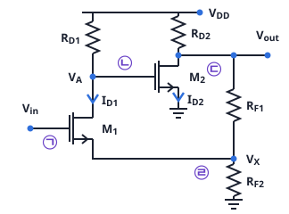

*㉠ $M_1$ 게이트(입력) · ㉡ 노드 $A$ · ㉢ $M_2$ 드레인(출력) · ㉣ $M_1$ 소스로 돌아온 $X$. 전류 화살표는 글에 맞춰 더했어요. (강의노트 s30)*

#### 어디가 귀환 회로망인가요

귀환 회로는 처음 보면 어디가 귀환인지 찾기 어려워요. ㉠ 입력($M_1$ 게이트)과 ㉢ 출력($M_2$ 드레인)을 먼저 찾으면, **출력에서 입력 쪽으로 되돌아가는 $R_{F1}$–$R_{F2}$ 경로가 귀환 회로망**이에요.

$M_1$과 $M_2$가 공통 소스(CS) 두 단이고, 이 길은 ㉣ $M_1$ 소스 $X$로 돌아와요. 귀환 회로망을 떼고 $M_1$ 소스를 접지로 보면 개루프는 CS 단 두 개를 이은 증폭기예요.

#### 한 단계씩 따라가기

1. ㉠ $V_{in}\uparrow$이면 $M_1$ 게이트가 올라가 $I_{D1}\uparrow$예요.
2. $$
   V_A=V_{DD}-I_{D1}R_{D1}
   $$

   $R_{D1}$의 전압 강하가 커져 ㉡ $V_A\downarrow$예요.
3. ㉡ $V_A$는 $M_2$의 게이트이므로 $I_{D2}\downarrow$예요.
4. $$
   V_{out}=V_{DD}-I_{D2}R_{D2}
   $$

   $R_{D2}$의 전압 강하가 줄어 ㉢ $V_{out}\uparrow$이고, 분배기를 거친 ㉣ $V_X\uparrow$예요.
5. $$
   V_{GS1}=V_{in}-V_X
   $$

   ㉣ $V_X$는 $M_1$ 소스예요. 돌아온 $V_X\uparrow$는 $V_{GS1}$을 줄이는 쪽으로 작용해요.
6. 그래서 $I_{D1}\downarrow$로 돌아와요. **원래 증가하던 $I_{D1}$을 감소하는 쪽으로 되돌리므로 음귀환이에요.**

슬라이드의 체인은 $V_A\downarrow$ 다음에 바로 $V_{out}\uparrow$로 넘어가요. 그 사이에 $I_{D2}\downarrow$ 단계를 넣으면 루프 전체가 이렇게 이어져요.

$$
\begin{aligned}V_{in}\uparrow&\to I_{D1}\uparrow\to V_A\downarrow\to I_{D2}\downarrow\\&\to V_{out}\uparrow,\ V_X\uparrow\\&\to V_{GS1}\downarrow\to I_{D1}\downarrow\end{aligned}
$$

#### 반전 횟수로 보기

CS 단은 게이트에서 드레인으로 갈 때마다 위상이 반전돼요. 이 회로는 CS 단을 두 번 지나므로 반전이 두 번이고, $V_{out}$은 $V_{in}$과 같은 위상이에요.

1. $M_1$: 게이트의 $V_{in}$에서 드레인의 $V_A$로 한 번 반전해요.
2. $M_2$: 게이트의 $V_A$에서 드레인의 $V_{out}$으로 또 반전해요. 두 번 반전하면 같은 위상이에요.
3. 분배기는 부호를 바꾸지 않으므로 $V_X$도 $V_{in}$과 같은 위상이에요.
4. $V_X$는 $M_1$ 소스로 돌아와요. $V_{GS1}=V_{in}-V_X$에서 소스는 빼는 입력이에요.
5. **게이트와 소스가 같은 부호로 움직이면 차인 $V_{GS1}$이 줄어 음귀환이에요.** 소스가 반대로 내려가면 $V_{GS1}$이 더 커져 양귀환이 돼요.

$M_2$가 있으면 음귀환이고, 없으면 양귀환이에요. $M_2$가 하는 일은 신호를 한 번 더 반전시키는 것이에요. 그래서 극성을 정하는 것은 $M_2$라는 소자 자체보다 루프 안의 반전 횟수(CS 두 번)와 신호가 돌아오는 곳($M_1$ 소스, 빼는 입력)이에요.

#### 둘째 단을 없애면 양귀환이 되어 발진해요

둘째 단 $M_2$와 $R_{D2}$를 빼고 ㉡ 노드 $A$를 바로 출력으로 써서 $R_{F1}$에 이으면 반전은 한 번뿐이에요.

1. $V_{in}\uparrow$ → $I_{D1}\uparrow$ → $V_A\downarrow$예요. 이제 $V_A$가 출력이에요.
2. 분배기를 거친 ㉣ $V_X\downarrow$가 $M_1$ 소스로 돌아와요.
3. 게이트는 올라가고 소스는 내려가므로 $V_{GS1}\uparrow$, $I_{D1}\uparrow$예요.
4. **돌아온 변화가 처음의 $I_{D1}\uparrow$를 더 키우므로 양귀환이에요.**

양귀환이면 돌아온 변화가 입력 쪽 변화를 다시 키우고, 그 결과가 또 돌아와 더 커져요. 한 바퀴 돌 때마다 변화가 커지면 증폭기로 쓸 수 없고 발진(oscillation)해요. 발진하면 신호를 넣지 않아도 원치 않는 주파수의 큰 신호가 출력에 나와요.

신호를 넣지 않았는데 신호가 나오는 씨앗은 회로 자체의 잡음이에요. 회로에는 늘 열잡음(thermal noise, 서멀 노이즈)이 있고, 이 작은 잡음이 루프를 돌며 계속 증폭되어 커져요. 이 설명은 슬라이드에는 없고 수업에서 말로 덧붙였어요.

위상이 밀려 음귀환이 양귀환으로 바뀌는 경우는 [음귀환이 양귀환으로 바뀌면 발진해요](../../1111/정리노트_1111_Sense_and_Return.html#s3-instability)에서 다뤘어요.

**교수님 말씀**

> 입력이 뭔지를 파악하고 출력이 뭔지를 파악하면 피드백이 어디 있어요? 출력과 입력 사이에 있겠죠.

귀환 회로를 처음 보면 어디가 귀환인지 판단하기 어렵다고 하면서 이 순서를 권했어요.

> 실제로 신호가 아예 없는 건 아니에요. 회로에는 노이즈가 있으니까요.

"신호를 안 넣었는데 어떻게 신호가 나와요?"라는 질문을 스스로 던지고, 서멀 노이즈가 증폭되어 나오는 것이라고 답했어요.

**꼭 기억해요**

> 그러면 이거는 앰프로 못 써요, 발진돼요.

단 하나를 빼거나 더하면 루프 안의 반전 횟수가 달라져 극성이 뒤집힐 수 있어요. 회로를 바꿀 때마다 극성을 다시 따져요.

#### 직접 해 보기: 루프를 한 칸씩 따라가 극성을 정해요 *(정적 스냅샷 — 직접 조작은 HTML 버전)*

$M_2$ 있음/없음을 고르고 '한 단계씩'을 누르면 루프를 따라 다음 변화가 켜져요. 마지막 칸에서 돌아온 $I_{D1}$의 변화가 처음 $I_{D1}\uparrow$를 줄이면 음귀환, 키우면 양귀환이에요.

지금: **둘째 단 있음 · 1/7단계: 입력 Vin을 올린다고 가정해요.**

범례: 지금 단계와 따라온 화살표 · 이미 지난 단계

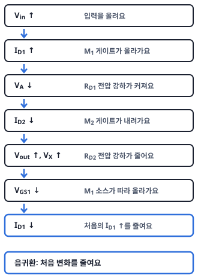

*$M_2$ 있음: 반전 두 번, 돌아온 $I_{D1}\downarrow$가 처음 변화를 줄여 음귀환이에요.*

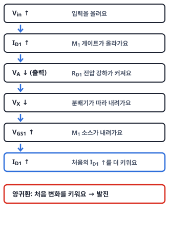

*$M_2$ 없음: 반전 한 번, 돌아온 $I_{D1}\uparrow$가 처음 변화를 키워 양귀환이에요.*

| 설정 | 반전 횟수 | $M_1$ 소스로 돌아온 변화 | 극성 |
|---|---|---|---|
| $M_2$ 있음 | 2 | $V_X\uparrow$, $V_{GS1}\downarrow$ | 음귀환 |
| $M_2$ 없음 | 1 | $V_X\downarrow$, $V_{GS1}\uparrow$ | 양귀환(발진) |

확인해 봐요. 예제 II(둘째 단 있음)에서 이번에는 입력이 내려간다고($V_{in}\downarrow$) 가정하면 $V_A$, $I_{D2}$, $V_X$는 어떻게 움직이고 극성은 무엇인가요?

답 보기

$V_{in}\downarrow$ → $I_{D1}\downarrow$ → $V_A\uparrow$ → $I_{D2}\uparrow$ → $V_{out}\downarrow$, $V_X\downarrow$ → $V_{GS1}$이 커지는 쪽으로 작용해 $I_{D1}\uparrow$로 돌아와요. 처음의 $I_{D1}\downarrow$를 되돌리므로 음귀환이에요.

**페이지 요약**

CS 단을 두 번 지나 같은 위상이 된 신호가 $M_1$ 소스로 돌아오면 $V_{GS1}$이 줄어 음귀환이에요.

*핵심 식*

- 첫째 단 출력

  $$
  V_A=V_{DD}-I_{D1}R_{D1}
  $$
- 돌아오는 곳

  $$
  V_{GS1}=V_{in}-V_X
  $$

*판단 기준*

귀환 회로망은 입력과 출력을 먼저 찾은 뒤 출력에서 입력으로 되돌아가는 경로예요.

둘째 단을 없애 반전이 한 번이면 양귀환이 되어 발진해요.

*용어*

- **반전(inversion)** — CS 단의 게이트에서 드레인으로 갈 때 위상이 뒤집히는 것이에요.
- **발진(oscillation)** — 신호를 넣지 않아도 원치 않는 주파수의 큰 신호가 출력에 나오는 현상이에요.
- **열잡음(thermal noise)** — 회로에 늘 있는 작은 잡음으로, 발진이 시작되는 씨앗이에요.

---

## 5. 네 가지 귀환 토폴로지

### 무엇을 감지해서 무엇을 반송하나요

*1113 수업 · L06 s31–s32*

**쉽게 말하면**

귀환의 이름은 출력에서 무엇을 감지하는지(앞)와 입력에서 무엇을 반송하는지(뒤)를 이은 것이라, 전압-전압·전압-전류·전류-전압·전류-전류 네 가지가 있어요.

예를 들어 강조한 칸의 전압-전류 귀환은 출력 전압을 감지해 입력에서 전류를 빼니까, 전류를 받아 전압을 내는 트랜스임피던스 증폭기에 걸어요.

*왼쪽 루프에서 출력 쪽 감지가 이름의 앞, 입력 쪽 반송이 이름의 뒤이고, 오른쪽 표의 각 칸 아래에는 그 귀환을 거는 포워드 증폭기를 적었어요.*

**정확히 말하면**

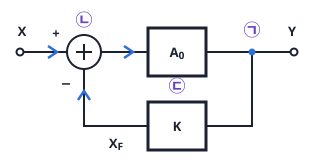

*㉠ 출력 $Y$ 감지 · ㉡ 입력에서 $X_F$ 빼기 · ㉢ 귀환 회로망 $K$. 네 귀환에 공통인 꼴을 새로 그렸어요(슬라이드에는 없는 그림).*

#### 포워드 증폭기의 종류가 귀환의 종류를 정해요

증폭기는 입력이 전압이냐 전류냐, 출력이 전압이냐 전류냐에 따라 네 종류예요([1111 노트의 입력과 출력이 전압이냐 전류냐](../../1111/정리노트_1111_Sense_and_Return.html#s4-four-types)). 증폭기 종류는 입력 → 출력 순서로 읽어요. 트랜스임피던스 증폭기는 전류를 받아 전압을 내보내고, 트랜스컨덕턴스 증폭기는 전압을 받아 전류를 내보내요.

귀환을 걸 원래 증폭기를 포워드 증폭기(forward amplifier)라고 해요. 그 종류가 정해지면 출력에서 무엇을 감지할지와 입력에서 무엇을 뺄지가 함께 정해져요.

1. ㉠ 출력이 전압이면 출력 전압을, 출력이 전류이면 출력 전류를 감지해요.
2. ㉡ 입력이 전압이면 입력에서 전압을, 입력이 전류이면 입력에서 전류를 빼요. 이것이 반송이에요.

**증폭기가 네 종류이듯 귀환도 포워드 증폭기의 종류에 따라 네 가지 토폴로지(topology)로 나뉘어요.**

#### 이름은 감지 → 반송 순서로 읽어요

먼저 전압-전류 귀환에 적용해요. 앞의 "전압"은 출력에서 전압을 감지한다는 뜻이고, 뒤의 "전류"는 입력에서 전류를 반송한다는 뜻이에요. 출력이 전압이고 입력이 전류이므로, 전류를 받아 전압을 내는 트랜스임피던스 증폭기에 거는 귀환이에요.

무엇을 감지해서 무엇을 반송하나요? 아래 표가 네 줄로 답해요. 괄호는 연결 방식이에요([전류는 같은 노드에 병렬로 빼요](#s0-current-return), [감지하는 쪽은 입력 임피던스로 따져요](#s2-sense-impedance)).

귀환 이름은 감지(출력 쪽) – 반송(입력 쪽) 순서라서, 증폭기 종류를 읽는 입력 – 출력 순서와 반대예요.

| 귀환 이름 | 감지(출력 쪽) | 반송(입력 쪽) | 포워드 증폭기(입력 → 출력) |
|---|---|---|---|
| 전압-전압 | 전압(병렬) | 전압(직렬) | 전압 증폭기(전압 → 전압) |
| 전압-전류 | 전압(병렬) | 전류(병렬) | 트랜스임피던스 증폭기(전류 → 전압) |
| 전류-전압 | 전류(직렬) | 전압(직렬) | 트랜스컨덕턴스 증폭기(전압 → 전류) |
| 전류-전류 | 전류(직렬) | 전류(병렬) | 전류 증폭기(전류 → 전류) |

**귀환 이름의 앞은 출력에서 감지하는 양, 뒤는 입력에서 반송하는 양이에요.**

전압-전압 귀환은 입력 쪽이 직렬(series), 출력 쪽이 병렬(shunt)이라서 다른 교재에서는 시리즈-션트(series-shunt) 귀환이라고도 불러요([출력 전압을 감지해 입력에서 전압을 빼요](#s5-vv-gain)). 이 이름은 연결 방식을 입력 쪽부터 적어서, 감지를 앞에 두는 슬라이드의 이름과 순서가 달라요.

#### 폐루프 이득은 네 종류 모두 같은 꼴이에요

먼저 작은 예에 적용해요. 트랜스임피던스 포워드 증폭기의 개루프 이득이 $A_0=10\,\mathrm{k\Omega}$이고, 전압-전류 귀환 회로망이 출력 전압 $1\,\mathrm{V}$마다 $1\,\mathrm{mA}$를 반송하면 $K=1\,\mathrm{mS}$예요.

$$
KA_0=1\,\mathrm{mS}\times10\,\mathrm{k\Omega}=10
$$

$$
\frac{Y}{X}=\frac{10\,\mathrm{k\Omega}}{1+10}\approx0.91\,\mathrm{k\Omega}
$$

$\mathrm{mS}\times\mathrm{k\Omega}=1$이라 $KA_0$에는 단위가 없고, 폐루프 이득은 $A_0$와 같은 $\mathrm{k\Omega}$ 단위예요.

네 종류 모두 입력 쪽 양을 $X$, 출력 쪽 양을 $Y$, 반송하는 양을 $X_F$로 두면 같은 유도가 돼요. 전압-전류 귀환이면 $X$는 입력 전류, $Y$는 출력 전압, $X_F$는 귀환 전류예요.

1. $$
   X_F=KY
   $$

   ㉢ 귀환 회로망이 ㉠에서 감지한 출력 $Y$를 $K$배 해서 반송해요.
2. $$
   Y=A_0(X-X_F)
   $$

   포워드 증폭기에는 ㉡에서 반송량을 뺀 차이가 들어가요.
3. $$
   (1+KA_0)Y=A_0X
   $$

   $X_F=KY$를 대입하고 $Y$ 항을 왼쪽으로 모아요.
4. $$
   \frac{Y}{X}=\frac{A_0}{1+KA_0}
   $$

   양변을 $X$와 $1+KA_0$로 나눠요.

$KA_0$는 신호가 루프를 한 바퀴 도는 이득이라서 루프 이득(loop gain)이라고 불러요. $A_0$와 $K$의 단위는 종류마다 달라도, 입력 쪽 양이 한 바퀴 돌아 같은 종류의 양으로 돌아오므로 $KA_0$에는 단위가 없어요.

**폐루프 이득은 귀환 종류와 관계없이 개루프 이득을 1 + 루프 이득으로 나눈 $\frac{A_0}{1+KA_0}$예요.**

#### 임피던스는 종류마다 따로 따져요

이득의 꼴은 같아도 입력·출력 임피던스는 종류마다 달라요. 네 증폭기의 이상적인 임피던스는 입력의 종류가 $R_{in}$을, 출력의 종류가 $R_{out}$을 정해요([1111 노트의 입력과 출력이 전압이냐 전류냐](../../1111/정리노트_1111_Sense_and_Return.html#s4-four-types)).

- 전압을 받는 입력은 $R_{in}\to\infty$, 전류를 받는 입력은 $R_{in}\to0$이 이상적이에요.
- 전압을 내보내는 출력은 $R_{out}\to0$, 전류를 내보내는 출력은 $R_{out}\to\infty$가 이상적이에요.

전압-전압 귀환이 입력 임피던스와 출력 임피던스를 어떻게 바꾸는지는 [입력 임피던스는 (1+루프 이득)배 커져요](#s5-vv-input-impedance)와 [출력 임피던스는 (1+루프 이득)로 나눠져요](#s5-vv-output-impedance)에서 구해요.

**입력·출력 임피던스는 귀환 종류마다 따로 구하고, 이번 수업에서는 전압-전압 귀환만 구했어요.** 나머지 세 종류의 임피던스는 다음 시간에 다뤄요([다음 시간 예고](#s6-next)).

**교수님 말씀**

> 입력이 전압, 전류 두 가지고 출력이 전압, 전류 두 가지니까 총 조합이 네 가지

증폭기가 네 종류인 것처럼 귀환도 그에 따라 네 가지 조합이 있다고 했어요.

> 네 가지 타입의 피드백은 이제 포워드 앰프에서 결정이 됩니다

전압을 감지할지 전류를 감지할지, 전압을 반송할지 전류를 반송할지를 포워드 증폭기의 종류에 맞춰 정한다고 했어요. 전압 증폭기라면 전압을 감지해서 전압을 반송하는 구조가 돼요.

> 앞이 센싱 부분이고 뒤가 리턴 부분

그래서 전압 증폭기에 거는 귀환을 전압-전압 귀환이라고 부른다고 했어요.

> 피드백 타입에 상관없이 네거티브 피드백의 일반적인 이런 전달함수로 표현된다

폐루프 이득 $\frac{A_0}{1+KA_0}$은 네 가지 모두에 똑같이 적용된다고 했어요. 이어서 각 토폴로지의 입력·출력 임피던스와, 귀환 회로망의 임피던스가 무한대나 0이 아닐 때 그 효과를 어떻게 보정하는지 살펴보겠다고 예고했어요.

확인해 봐요. 포워드 증폭기가 입력 전압을 받아 출력 전류를 내보내는 트랜스컨덕턴스 증폭기라면, 출력에서 무엇을 감지하고 입력에서 무엇을 반송하며 귀환의 이름은 무엇인가요?

답 보기

출력 전류를 감지하고 입력에서 전압을 반송하므로 전류-전압 귀환이에요. 이름은 감지(전류) – 반송(전압) 순서라서, 증폭기 종류의 입력 → 출력(전압 → 전류)과 순서가 반대예요.

**페이지 요약**

귀환의 이름은 앞이 출력에서 감지하는 양, 뒤가 입력에서 반송하는 양이고, 포워드 증폭기의 종류가 이를 정해요.

*핵심 식*

- 폐루프 이득

  $$
  \frac{Y}{X}=\frac{A_0}{1+KA_0}
  $$

이름은 감지 – 반송 순서라서 증폭기 종류의 입력 – 출력 순서와 반대예요.

전압-전압은 전압 증폭기, 전압-전류는 트랜스임피던스 증폭기, 전류-전압은 트랜스컨덕턴스 증폭기, 전류-전류는 전류 증폭기에 걸어요.

폐루프 이득의 꼴은 네 종류 모두 같고, $KA_0$가 루프 이득이에요.

*용어*

- **포워드 증폭기(forward amplifier)** — 귀환을 걸 원래 증폭기로, 그 입력·출력의 종류가 귀환의 종류를 정해요.
- **루프 이득(loop gain)** — 신호가 루프를 한 바퀴 도는 이득 $KA_0$예요.

---

## 6. 전압-전압 귀환

### 출력 전압을 감지해 입력에서 전압을 빼요

*1113 수업 · L06 s33*

**쉽게 말하면**

출력 전압 $V_{out}$을 병렬로 재서 $K$배 한 $V_F$를 입력에 직렬로 넣어 빼면, 전압 증폭기 $A_0$에는 차이 $V_1$만 들어가요.

$A_0=1000$, $K=0.1$, $V_{in}=1\,\mathrm{V}$이면 $A_0$에는 약 $9.90\,\mathrm{mV}$만 들어가고 출력은 $V_{in}/K=10\,\mathrm{V}$에 가까운 약 $9.90\,\mathrm{V}$가 돼요.

*강조선으로 이은 귀환 회로망 $K$는 출력에는 병렬로 붙어 $V_{out}$을 재고, 입력 고리에는 직렬로 끼어 $V_F$를 빼요.*

**정확히 말하면**

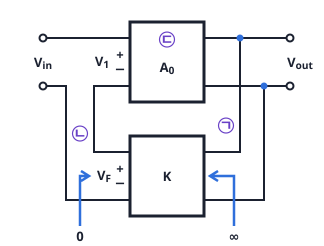

*㉠ 출력 병렬 감지 · ㉡ 입력 직렬 반송 · ㉢ 전압 증폭기 $A_0$. 화살표 끝 0과 ∞는 이상 귀환망의 두 포트 임피던스예요. (강의노트 s33)*

#### 어떻게 연결하나요

$A_0$는 입력도 전압, 출력도 전압인 전압 증폭기예요. 출력이 전압이라 귀환 회로망은 출력 전압을 재야 하고, 전압은 병렬로 재요. 입력도 전압이라 귀환 전압을 입력 전압에서 빼야 하고, 전압은 직렬로 이어서 빼요.

**㉠ 출력 쪽은 병렬로 $V_{out}$을 감지하고, ㉡ 입력 쪽은 직렬로 $V_F=KV_{out}$을 반송해요.**

Razavi는 감지-반송 순서로 이름을 붙여 전압-전압 귀환(voltage-voltage feedback)이라고 불러요([무엇을 감지해서 무엇을 반송하나요](#s4-four-topologies)). 다른 책은 입력 쪽이 직렬(series), 출력 쪽이 병렬(shunt)이라서 같은 구조를 시리즈-션트(series-shunt) 귀환이라고 불러요.

#### 이상적인 귀환 회로망은 어떤 모습인가요

출력 전압을 재는 쪽은 전압계처럼 입력 임피던스가 $\infty$여야 출력 전압을 바꾸지 않아요([감지하는 쪽은 입력 임피던스로 따져요](#s2-sense-impedance)). 입력에서 전압을 빼는 쪽은 전압원처럼 출력 임피던스가 0이어야 $V_F$가 그대로 빠져요([반송하는 쪽은 출력 임피던스로 따져요](#s2-return-impedance)).

**이상적인 귀환 회로망은 입력 임피던스 $\infty$, 출력 임피던스 0이에요.**

#### 숫자로 먼저 확인해요

$A_0=1000$, $K=0.1$, $V_{in}=1\,\mathrm{V}$일 때 출력은 $V_{out}=\frac{1000}{101}\,\mathrm{V}\approx9.90\,\mathrm{V}$예요. 이 값이 세 관계를 모두 만족하는지 차례로 확인해요.

1. $$
   V_F=0.1\times\frac{1000}{101}\,\mathrm{V}=\frac{100}{101}\,\mathrm{V}\approx0.99\,\mathrm{V}
   $$

   출력 전압을 $K$배 해서 돌려보내요.
2. $$
   V_1=1-\frac{100}{101}=\frac{1}{101}\,\mathrm{V}\approx9.90\,\mathrm{mV}
   $$

   입력에서 $V_F$를 빼고 남은 전압이에요.
3. $$
   A_0V_1=1000\times\frac{1}{101}\,\mathrm{V}=\frac{1000}{101}\,\mathrm{V}
   $$

   처음에 둔 $V_{out}$과 같아요.

**$A_0$에는 약 $9.90\,\mathrm{mV}$만 들어가고, 출력은 $V_{in}/K=10\,\mathrm{V}$에 가까운 약 $9.90\,\mathrm{V}$예요.**

#### 이득 식을 유도해요

1. $$
   V_1=V_{in}-V_F
   $$

   ㉡ 입력 고리에 직렬로 이은 두 전압이 빼져 $A_0$ 입력에 걸려요.
2. $$
   V_F=KV_{out}
   $$

   귀환 회로망이 ㉠에서 감지한 출력 전압을 $K$배 해요.
3. $$
   V_{out}=A_0V_1
   $$

   ㉢ 전압 증폭기의 개루프 이득이에요.
4. $$
   V_{out}=A_0(V_{in}-KV_{out})
   $$

   1·2를 3에 넣어요.
5. $$
   V_{out}(1+KA_0)=A_0V_{in}
   $$

   $V_{out}$ 항을 왼쪽으로 모아요.
6. $$
   \frac{V_{out}}{V_{in}}=\frac{A_0}{1+KA_0}
   $$

   폐루프 이득이에요.

$K$를 피드백 계수(feedback factor)라고 해요. $K=0$이면 귀환이 없어 개루프 이득 $A_0$로 돌아가요. **폐루프 이득은 개루프 이득 $A_0$를 $1+KA_0$로 나눈 값이에요.**

$KA_0\gg1$이면 $\frac{V_{out}}{V_{in}}\approx\frac1K$라서 이득이 귀환 회로망의 비 $K$로 정해져요.

**교수님 말씀**

> 피드백 네트워크가 전압을 센싱하려면 즉 병렬로 연결해야 되죠.

이어서 입력은 전압이니 전압을 빼려면 시리즈로 이어야 한다고 했어요. 그래서 이 구조를 볼티지 센싱, 볼티지 리턴이라고 불러요.

> 시리즈-션트 피드백으로 나왔다, 그거는 … 입력이 시리즈고 출력이 병렬 구조다.

다른 책에서 이 이름을 만나면 입력 쪽과 출력 쪽의 연결 방식으로 읽으면 된다고 했어요.

확인해 봐요. $A_0=500$, $K=0.2$, $V_{in}=1\,\mathrm{V}$이면 $V_{out}$은 얼마인가요?

답 보기

약 $4.95\,\mathrm{V}$예요. $V_{out}=\frac{500}{1+0.2\times500}\times1\,\mathrm{V}=\frac{500}{101}\,\mathrm{V}\approx4.95\,\mathrm{V}$로 $V_{in}/K=5\,\mathrm{V}$에 가까워요.

**페이지 요약**

출력 전압을 병렬로 감지하고 $V_F=KV_{out}$을 입력에 직렬로 반송해 빼요.

*핵심 식*

- 세 관계

  $$
  \begin{aligned}V_1&=V_{in}-V_F\\V_F&=KV_{out}\\V_{out}&=A_0V_1\end{aligned}
  $$
- 폐루프 이득

  $$
  \frac{V_{out}}{V_{in}}=\frac{A_0}{1+KA_0}
  $$

$KA_0\gg1$이면 이득은 $\frac1K$에 가까워요.

*용어*

- **피드백 계수(feedback factor)** — $V_F=KV_{out}$의 $K$
- **시리즈-션트(series-shunt) 귀환** — 입력 쪽 직렬, 출력 쪽 병렬을 뜻하는 전압-전압 귀환의 다른 이름

---

### 입력 임피던스는 (1+루프 이득)배 커져요

*1113 수업 · L06 s34*

**쉽게 말하면**

귀환 전압 $V_F$가 입력 전압을 거의 상쇄해서 같은 $V_{in}$에도 입력 전류가 $1+KA_0$배 작아지니, 입력 임피던스는 $1+KA_0$배 커져요.

$R_{in}=10\,\mathrm{k\Omega}$, $KA_0=100$이면 입력 쪽에서 본 임피던스는 $10\,\mathrm{k\Omega}\times101=1010\,\mathrm{k\Omega}$이에요.

*입력 단자 $V_{in}$에서 본 $R_{in,closed}=V_{in}/I_{in}$은 점선 상자 안의 개루프 $R_{in}$보다 $1+KA_0$배 커요.*

**정확히 말하면**

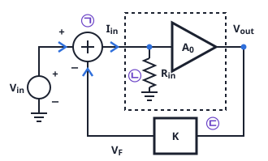

*㉠ 전압을 빼는 자리 · ㉡ 개루프 입력 임피던스 $R_{in}$ · ㉢ 귀환 회로망 $K$. 점선 상자는 피드포워드 시스템이에요. (강의노트 s34)*

#### 무엇을 구하나요

공통 소스(CS) 단이나 캐스코드처럼 귀환이 없는 증폭기의 이득과 입력·출력 임피던스는 이미 구할 줄 알아요. 이번에는 그 증폭기에 귀환을 걸었을 때 임피던스가 어떻게 바뀌는지 봐요.

피드포워드 시스템의 입력에서 본 등가 저항 ㉡ $R_{in}$은 귀환이 없을 때($K=0$)의 개루프 입력 임피던스(open-loop input impedance)예요. 귀환을 건 전체 회로를 입력 단자 $V_{in}$에서 본 값 $R_{in,closed}=V_{in}/I_{in}$은 폐루프 입력 임피던스(closed-loop input impedance)예요. 수업에서는 두 값을 모두 $R_{in}$으로 불렀는데, 여기서는 기호를 나눠 써요.

**개루프 입력 임피던스 $R_{in}$을 알 때 폐루프 입력 임피던스 $V_{in}/I_{in}$을 $R_{in}$과 루프 이득으로 나타내는 것이 목표예요.**

#### 숫자로 먼저 확인해요

$R_{in}=10\,\mathrm{k\Omega}$, $A_0=1000$, $K=0.1$, $V_{in}=1\,\mathrm{V}$일 때 입력 전류는 $I_{in}=\frac{1}{1010}\,\mathrm{mA}\approx0.99\,\mu\mathrm{A}$예요. 노드 전압을 따라가며 확인해요($\mathrm{mA}\times\mathrm{k\Omega}=\mathrm{V}$).

1. ㉡에 걸린 $A_0$ 입력 노드 전압이에요.

   $$
   \begin{aligned}I_{in}R_{in}&=\frac{1}{1010}\,\mathrm{mA}\times10\,\mathrm{k\Omega}\\&=\frac{1}{101}\,\mathrm{V}\approx9.90\,\mathrm{mV}\end{aligned}
   $$
2. $A_0$배 한 뒤 ㉢에서 $K$배 해서 돌아와요.

   $$
   \begin{aligned}V_F&=0.1\times1000\times\frac{1}{101}\,\mathrm{V}\\&=\frac{100}{101}\,\mathrm{V}\approx0.99\,\mathrm{V}\end{aligned}
   $$
3. $$
   V_{in}-V_F=1-\frac{100}{101}=\frac{1}{101}\,\mathrm{V}
   $$

   1의 $I_{in}R_{in}$과 같아요.
4. $$
   \frac{V_{in}}{I_{in}}=\frac{1\,\mathrm{V}}{(1/1010)\,\mathrm{mA}}=1010\,\mathrm{k\Omega}
   $$

   $R_{in}=10\,\mathrm{k\Omega}$의 $101$배예요.

귀환이 없으면 $I_{in}=1\,\mathrm{V}/10\,\mathrm{k\Omega}=0.1\,\mathrm{mA}=100\,\mu\mathrm{A}$예요. **귀환 전압이 입력 전압을 거의 상쇄해 같은 $V_{in}$에서 입력 전류가 $101$배 작아져요.**

#### 식으로 유도해요

1. 입력에서 전압을 빼므로 귀환 회로망은 입력 고리에 직렬로 붙어 있어요. 전류가 갈라질 다른 길이 없어서 $I_{in}$이 그대로 ㉡ $R_{in}$으로 흘러요.
2. $$
   I_{in}R_{in}=V_{in}-V_F
   $$

   ㉡ $R_{in}$에 걸린 전압은 ㉠을 지난 값, 곧 $V_{in}$에서 $V_F$를 뺀 값이에요.
3. $$
   V_{out}=A_0I_{in}R_{in}
   $$

   $A_0$ 입력 전압 $I_{in}R_{in}$을 $A_0$배 해요.
4. $$
   V_F=KV_{out}=KA_0I_{in}R_{in}
   $$

   ㉢이 출력 전압을 $K$배 해서 돌려보내요.
5. $$
   I_{in}R_{in}=V_{in}-KA_0I_{in}R_{in}
   $$

   4를 2에 넣어요.
6. $$
   I_{in}R_{in}(1+KA_0)=V_{in}
   $$

   $I_{in}R_{in}$ 항을 왼쪽으로 모아요.
7. $$
   \frac{V_{in}}{I_{in}}=R_{in}(1+KA_0)
   $$

   폐루프 입력 임피던스예요.

슬라이드 식에서 $R_{in}$은 개루프 입력 임피던스, $KA_0$는 루프 이득(loop gain)이에요. 쉽게 말하면의 그림에서는 피드백 노드에 전압 $V_F=KA_0I_{in}R_{in}$만 적고, 폐루프 입력 임피던스는 입력 단자 $V_{in}$에서 본 $R_{in,closed}$로 따로 표시했어요.

**폐루프 입력 임피던스는 개루프 입력 임피던스 $R_{in}$의 $(1+KA_0)$배예요.**

#### 커지면 왜 좋은가요

전압 증폭기는 입력 임피던스가 클수록 이상적이에요. 신호원에 내부 저항이 있어도 입력 임피던스가 크면 전압이 덜 나뉘어 거의 그대로 들어와요. 입력 임피던스가 커질수록 전압을 더 잘 받아들여요.

**입력 임피던스가 커져 회로가 더 좋은 voltage sensor가 돼요.** 앞에서 배운 부귀환의 장점인 이득 둔감화와 대역폭 확장에, 임피던스를 더 이상적인 쪽으로 바꾸는 장점이 더해져요.

**교수님 말씀**

> 전류는 변함이 없는 거죠. 다른 길도 없으니까.

귀환 회로망이 입력에 직렬로 붙어 있어 $I_{in}$이 그대로 $R_{in}$으로 흐른다는 뜻이에요.

> 시리즈로 뭔가가 더 붙으면 임피던스는 더 증가할 거라고 예상할 수 있죠

식을 풀기 전에도 입력에 직렬로 붙은 귀환 회로망을 보고 임피던스가 커지는 방향을 예상할 수 있다고 했어요.

> 더 좋은 볼티지 센서가 돼서 전압을 잘 받아들이는 회로가 될 수 있으니까

입력 임피던스가 커지는 것은 전압 증폭기에 장점이라고 했어요.

확인해 봐요. 개루프 입력 임피던스 $R_{in}=20\,\mathrm{k\Omega}$, $A_0=500$, $K=0.02$이면 폐루프 입력 임피던스는 얼마인가요?

답 보기

$220\,\mathrm{k\Omega}$예요. $KA_0=0.02\times500=10$이므로 $R_{in}(1+KA_0)=20\,\mathrm{k\Omega}\times11=220\,\mathrm{k\Omega}$

**페이지 요약**

입력에 전압을 직렬로 반송하면 입력 임피던스가 $(1+KA_0)$배 커져요.

*핵심 식*

- 폐루프 입력 임피던스

  $$
  \frac{V_{in}}{I_{in}}=R_{in}(1+KA_0)
  $$

$R_{in}$은 개루프 입력 임피던스이고, $V_{in}/I_{in}$은 입력 단자 $V_{in}$에서 본 폐루프 입력 임피던스예요.

직렬이라 $I_{in}$이 그대로 $R_{in}$으로 흘러요.

입력 임피던스가 커져 더 좋은 voltage sensor가 돼요.

*용어*

- **개루프 입력 임피던스(open-loop input impedance)** — 귀환이 없을 때 피드포워드 시스템의 입력 임피던스 $R_{in}$
- **루프 이득(loop gain)** — $KA_0$

---

### 출력 임피던스는 (1+루프 이득)로 나눠져요

*1113 수업 · L06 s35*

**쉽게 말하면**

출력 전압을 재서 되돌리는 귀환이 출력 전압의 변화를 반대쪽으로 밀어내서, 출력 임피던스가 $1+KA_0$로 나눠져요.

$R_{out}=1\,\mathrm{k\Omega}$, $KA_0=100$이면 출력 쪽에서 본 임피던스는 $1000\,\Omega/101\approx9.90\,\Omega$이에요.

*입력을 0으로 두고 출력 끝에 시험 전압 $V_X$를 걸면, 귀환이 $A_0$ 출력을 $-KA_0V_X$로 끌어내려 $R_{out}$에 큰 전류 $I_X$가 흘러요.*

**정확히 말하면**

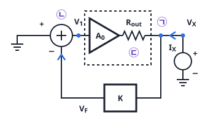

*㉠ 시험 전압을 건 출력 노드 · ㉡ 합산기 · ㉢ 개루프 출력 임피던스 $R_{out}$. $V_1$은 글에 맞춰 더했고, 점선 상자는 슬라이드의 System이에요. (강의노트 s35)*

#### 전압 출력은 어떻게 모델링하나요

전압을 내는 증폭기는 이상 전압원에 개루프 출력 임피던스 $R_{out}$을 직렬로 붙여 모델링해요. 이상 전압원의 저항은 0이라 $R_{out}$을 병렬로 붙이면 의미가 없어요. 반대로 전류를 내는 증폭기는 이상 전류원에 $R_{out}$을 병렬로 붙여요.

**전압 증폭기의 출력은 이상 전압원 $A_0V_1$과 ㉢ 직렬 $R_{out}$으로 보고, 귀환을 건 뒤 출력 끝에서 본 임피던스를 구해요.**

#### 숫자로 먼저 확인해요

측정 조건은 입력 영점($V_{in}=0$)과 출력 끝의 시험 전압 $V_X$예요. $R_{out}=1\,\mathrm{k\Omega}$, $A_0=1000$, $K=0.1$이고 $V_X=1\,\mathrm{mV}$를 걸어요($\mathrm{mV}/\mathrm{k\Omega}=\mu\mathrm{A}$).

1. $$
   V_F=0.1\times1\,\mathrm{mV}=0.1\,\mathrm{mV}
   $$

   출력 전압을 $K$배 해요.
2. $$
   V_1=0-0.1\,\mathrm{mV}=-0.1\,\mathrm{mV}
   $$

   입력이 0이라 $-V_F$만 남아요.
3. $R_{out}$ 왼쪽 끝 전압이에요.

   $$
   \begin{aligned}A_0V_1&=1000\times(-0.1\,\mathrm{mV})\\&=-100\,\mathrm{mV}\end{aligned}
   $$
4. $$
   I_X=\frac{1-(-100)}{1}\,\frac{\mathrm{mV}}{\mathrm{k\Omega}}=101\,\mu\mathrm{A}
   $$

   $R_{out}$ 양단 전압을 $R_{out}$으로 나눠요.
5. $R_{out}=1\,\mathrm{k\Omega}$의 $1/101$이에요.

   $$
   \begin{aligned}\frac{V_X}{I_X}&=\frac{1\,\mathrm{mV}}{101\,\mu\mathrm{A}}\\&=\frac{1000}{101}\,\Omega\approx9.90\,\Omega\end{aligned}
   $$

귀환이 없으면 $A_0V_1=0$이라 $I_X=1\,\mathrm{mV}/1\,\mathrm{k\Omega}=1\,\mu\mathrm{A}$예요. **귀환이 $R_{out}$ 반대쪽 끝을 $-100\,\mathrm{mV}$로 끌어내려 같은 $V_X$에서 $I_X$가 $101$배 커져요.**

#### 노드를 차례로 따라가며 유도해요

귀환 회로망의 입력 임피던스가 $\infty$라서 출력 노드에서 귀환 회로망으로는 전류가 흐르지 않아요. 그래서 ㉠으로 들어온 $I_X$는 모두 ㉢ $R_{out}$으로 흘러요. 출력 노드부터 루프를 한 바퀴 돌며 전압을 적어요.

1. $$
   V_{out}=V_X
   $$

   ㉠ 출력 노드 전압은 시험 전압원이 정해요.
2. $K$의 입력도 $V_X$예요. 귀환 회로망이 출력 노드에 병렬로 붙어 있어서예요.
3. $$
   V_F=KV_X
   $$

   $K$의 출력이에요.
4. $$
   V_1=0-V_F=-KV_X
   $$

   입력 영점($V_{in}=0$)이라 ㉡ 합산기 출력은 $-V_F$예요.
5. $$
   A_0V_1=-KA_0V_X
   $$

   $A_0$ 출력, 곧 ㉢ $R_{out}$ 왼쪽 끝 전압이에요.
6. $R_{out}$ 양단 전압을 $R_{out}$으로 나눠요.

   $$
   \begin{aligned}I_X&=\frac{V_X-(-KA_0V_X)}{R_{out}}\\&=\frac{V_X(1+KA_0)}{R_{out}}\end{aligned}
   $$
7. $$
   \frac{V_X}{I_X}=\frac{R_{out}}{1+KA_0}
   $$

   폐루프 출력 임피던스예요.

위 4단계의 $-KV_X$는 출력 임피던스를 잴 때 입력을 0(접지)으로 두는 측정 조건에서 나와요. 수업 칠판에는 $1+\beta A_0$로 적었는데, $\beta$는 다른 교재에서 피드백 계수에 쓰는 기호라 여기서는 슬라이드 표기 $K$로 통일해요.

**폐루프 출력 임피던스는 개루프 출력 임피던스 $R_{out}$을 $1+KA_0$로 나눈 값이에요.**

#### 작아지면 왜 좋은가요

이상적인 전압 증폭기의 출력 임피던스는 0이에요. 출력 임피던스가 작아지면 부하가 전류를 끌어가도 출력 전압이 덜 떨어져요.

**출력 임피던스가 0에 가까워져 회로가 더 좋은 voltage source가 돼요.** [입력 임피던스는 (1+루프 이득)배 커져요](#s5-vv-input-impedance)와 함께 보면, 전압 증폭기에 부귀환을 걸면 입력 임피던스는 커지고 출력 임피던스는 작아져 더 이상적인 전압 증폭기가 돼요.

**교수님 말씀**

> 이상 저항이 제로이기 때문에 여기다 직렬로 $R_{out}$을 모델링한 거죠.

전압원의 출력 임피던스는 직렬로, 전류원의 출력 임피던스는 병렬로 붙여 모델링한다고 했어요.

> 뭔가 병렬로 연결되면 임피던스는 원래보다는 낮아지게 되겠죠.

출력에 귀환 회로망이 병렬로 붙었으니 식을 풀기 전에도 출력 임피던스가 낮아질 것을 예상할 수 있다고 했어요.

> 더 이상적인 전압 증폭기에 가깝도록 만들어 주죠.

전압 증폭기에서는 귀환이 입력 임피던스를 키우고 출력 임피던스를 줄여 동작 특성을 개선한다고 정리했어요.

확인해 봐요. 개루프 출력 임피던스 $R_{out}=2\,\mathrm{k\Omega}$, $A_0=1000$, $K=0.01$이면 폐루프 출력 임피던스는 얼마인가요?

답 보기

약 $181.82\,\Omega$예요. $KA_0=0.01\times1000=10$이므로 $\frac{R_{out}}{1+KA_0}=\frac{2000\,\Omega}{11}\approx181.82\,\Omega$

**페이지 요약**

출력 전압을 병렬로 감지해 되돌리면 출력 임피던스가 $1+KA_0$로 나눠져요.

*핵심 식*

- 폐루프 출력 임피던스

  $$
  \frac{V_X}{I_X}=\frac{R_{out}}{1+KA_0}
  $$

입력을 0으로 두고 출력 끝에 시험 전압 $V_X$를 걸어 재요.

입력 영점이라 $A_0$ 입력은 $-KV_X$, $A_0$ 출력은 $-KA_0V_X$예요.

출력 임피던스가 작아져 더 좋은 voltage source가 돼요.

*용어*

- **개루프 출력 임피던스(open-loop output impedance)** — 이상 전압원에 직렬로 붙인 $R_{out}$

---

### 루프 이득만 알면 폐루프 특성을 바로 구해요

*1113 수업 · L06 s34–s35*

**쉽게 말하면**

이득·입력 임피던스·출력 임피던스에 모두 같은 인자 $1+KA_0$가 나오니, 개루프 값과 루프 이득 $KA_0$만 알면 귀환 회로를 다시 풀지 않고 바로 구해요.

$KA_0=100$이면 이득 $1000$은 약 $9.90$으로, 입력 임피던스 $10\,\mathrm{k\Omega}$은 $1010\,\mathrm{k\Omega}$으로, 출력 임피던스 $1\,\mathrm{k\Omega}$은 약 $9.90\,\Omega$으로 바뀌어요.

*세 개루프 값에 같은 인자 $1+KA_0$를 곱하거나 나누기만 하면 폐루프 값이 나와요.*

**정확히 말하면**

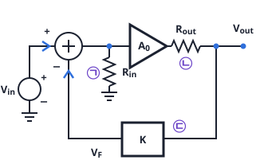

*㉠ 개루프 입력 임피던스 $R_{in}$ · ㉡ 개루프 출력 임피던스 $R_{out}$ · ㉢ 귀환 회로망 $K$ (강의노트 s34와 s35를 합쳐 새로 그린 그림)*

#### 개루프 값과 루프 이득만 있으면 돼요

먼저 예에 적용해요. 개루프 이득 $A_0=1000$, $R_{in}=10\,\mathrm{k\Omega}$, $R_{out}=1\,\mathrm{k\Omega}$인 전압 증폭기에 $K=0.1$인 전압-전압 귀환을 걸어요.

1. $$
   KA_0=0.1\times1000=100
   $$

   $A_0$와 ㉢을 한 바퀴 도는 루프 이득이에요.
2. $$
   \frac{A_0}{1+KA_0}=\frac{1000}{101}\approx9.90
   $$

   폐루프 이득이에요.
3. ㉠에서 얻는 폐루프 입력 임피던스예요.

   $$
   \begin{aligned}R_{in}(1+KA_0)&=10\,\mathrm{k\Omega}\times101\\&=1010\,\mathrm{k\Omega}\end{aligned}
   $$
4. ㉡에서 얻는 폐루프 출력 임피던스예요.

   $$
   \begin{aligned}\frac{R_{out}}{1+KA_0}&=\frac{1\,\mathrm{k\Omega}}{101}\\&=\frac{1000}{101}\,\Omega\approx9.90\,\Omega\end{aligned}
   $$

세 결과 모두 같은 인자 $1+KA_0$에서 나왔어요. 루프 이득(loop gain) $KA_0$는 루프를 한 바퀴 돈 이득이에요([1106 정리노트 · 루프를 끊고 시험 신호를 넣어요](../../1106/정리노트_1106_Negative_Feedback.html#s3-loop-gain)). $A_0$를 알면 피드백 계수 $K$만 더 알면 돼요.

귀환이 있는 회로를 노드 방정식이나 시험원으로 매번 처음부터 풀면 매우 복잡해요. **개루프 이득 $A_0$와 $R_{in}$, $R_{out}$을 알면 루프 이득 $KA_0$만으로 폐루프 이득과 입력·출력 임피던스를 바로 구해요.**

#### 곱할지 나눌지는 연결로 판단해요

감지는 출력에서 전압이나 전류를 재는 방법이고, 반송은 입력에서 전압이나 전류를 더하는 방법이에요. 전압은 병렬로 재고 직렬로 더하므로, 전압-전압 귀환에서 ㉢ 귀환 회로망은 입력에 직렬, 출력에 병렬로 붙어요.

| 쪽 | 귀환 회로망 연결 | 폐루프 임피던스 |
|---|---|---|
| 입력 | 직렬(전압을 더함) | $R_{in}(1+KA_0)$로 커짐 |
| 출력 | 병렬(전압을 잼) | $\frac{R_{out}}{1+KA_0}$로 작아짐 |

**귀환 회로망이 직렬로 붙은 입력 쪽은 $(1+KA_0)$배로 커지고, 병렬로 붙은 출력 쪽은 $1+KA_0$로 나눠져요.** 이 곱하기·나누기 쌍은 전압-전압 귀환과 이상적인 귀환 회로망을 기준으로 한 결과예요. 교수님은 전류 입력이면 반대로 입력 임피던스가 작아진다고 예고했어요.

#### 헷갈리기 쉬운 점

$KA_0$를 개루프 이득(open-loop gain)이라고 부르기 쉬워요. $KA_0$ 안에 개루프 이득 $A_0$가 들어 있어서 두 이름이 섞이는데, 앞의 [입력 임피던스 유도](#s5-vv-input-impedance)에서처럼 $KA_0$는 루프 이득(loop gain)이에요.

**개루프 이득은 $A_0$, 피드백 계수는 $K$, 루프 이득은 둘을 곱한 $KA_0$예요.** 폐루프 값은 다음과 같고, 전압-전압 귀환과 이상적인 귀환 회로망 기준이에요.

$$
A_{closed}=\frac{A_0}{1+KA_0}
$$

$$
R_{in,closed}=R_{in}(1+KA_0)
$$

$$
R_{out,closed}=\frac{R_{out}}{1+KA_0}
$$

확인 예: $A_0=1000$, $K=0.1$이면 루프 이득은 $KA_0=100$이고 개루프 이득은 $A_0=1000$이에요.

**교수님 말씀**

> 루프 게인을 정의한 이유가 게인에도 1 + 루프 게인만큼 나오는데, … 임피던스에도 1 + 루프 게인

루프 이득이 이득과 입력·출력 임피던스에 모두 영향을 주니 귀환 회로의 특성을 크게 좌우한다고 했어요.

> 풀어서 구하려고 하면 굉장히 복잡합니다 사실은. 이 피드백이 있기 때문에.

귀환 회로망을 새로 해석하지 않고 개루프 해석 결과와 루프 이득으로 특성을 구하는 것이 이 방법의 목적이라고 했어요.

**꼭 기억해요**

> rule로 외우지 마세요. 여러분들 rule로 외우면 헷갈립니다 … 개념적으로 이해를 해야죠.

직렬인지 병렬인지, 곱할지 나눌지는 표를 외우지 말고 전압·전류를 잴 때와 더할 때 어떻게 잇는지에서 판단해요.

#### 직접 해 보기: 루프 이득과 세 폐루프 값 *(정적 스냅샷 — 직접 조작은 HTML 버전)*

루프 이득 $KA_0$를 키우면 세 막대가 같은 인자 $1+KA_0$만큼 함께 늘거나 줄고, 이득 막대는 $1/K$ 표시에 붙어요.

고정한 개루프 값: 개루프 이득 $A_0=1000$, $R_{in}=10\,\mathrm{k\Omega}$, $R_{out}=1\,\mathrm{k\Omega}$

$1+KA_0$ = **101**, 피드백 계수 $K$ = **0.1**, 이득이 다가가는 $1/K$ = **10 V/V**

범례: 폐루프 값(개루프 대비 배율) · 이득의 $1/K$ 위치

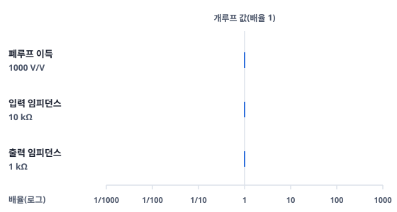

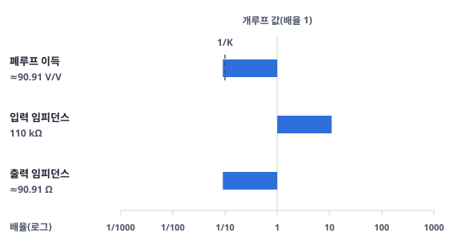

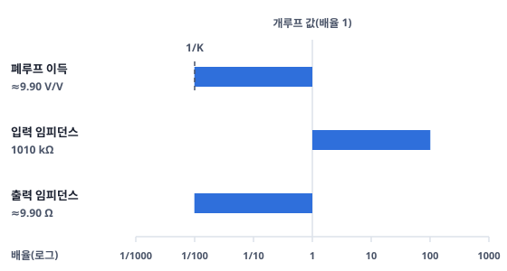

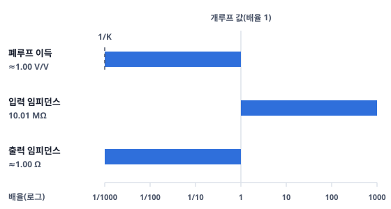

| $KA_0$ | $1+KA_0$ | 폐루프 이득 | $1/K$ | 입력 임피던스 | 출력 임피던스 |
|---|---|---|---|---|---|
| 0 | 1 | 1000 V/V | 없음(귀환 없음) | 10 kΩ | 1 kΩ |
| 10 | 11 | ≈90.91 V/V | 100 V/V | 110 kΩ | ≈90.91 Ω |
| 100 | 101 | ≈9.90 V/V | 10 V/V | 1010 kΩ | ≈9.90 Ω |
| 1000 | 1001 | ≈1.00 V/V | 1 V/V | 10.01 MΩ | ≈1.00 Ω |

확인해 봐요. 개루프 이득 $A_0=200$, $R_{in}=5\,\mathrm{k\Omega}$, $R_{out}=2\,\mathrm{k\Omega}$인 증폭기에 $K=0.045$인 전압-전압 귀환을 걸면 폐루프 이득과 입력·출력 임피던스는 얼마인가요?

답 보기

이득 $20$, 입력 임피던스 $50\,\mathrm{k\Omega}$, 출력 임피던스 $200\,\Omega$예요. $KA_0=0.045\times200=9$라서 $1+KA_0=10$이고, $200/10=20$, $5\,\mathrm{k\Omega}\times10=50\,\mathrm{k\Omega}$, $2\,\mathrm{k\Omega}/10=0.2\,\mathrm{k\Omega}=200\,\Omega$

**페이지 요약**

개루프 값과 루프 이득 $KA_0$만 알면 귀환 회로를 다시 풀지 않고 폐루프 특성을 바로 구해요.

*핵심 식*

- 폐루프 이득

  $$
  A_{closed}=\frac{A_0}{1+KA_0}
  $$
- 폐루프 입력 임피던스

  $$
  R_{in,closed}=R_{in}(1+KA_0)
  $$
- 폐루프 출력 임피던스

  $$
  R_{out,closed}=\frac{R_{out}}{1+KA_0}
  $$

귀환 회로망이 직렬로 붙은 입력 쪽은 곱하고, 병렬로 붙은 출력 쪽은 나눠요.

개루프 이득은 $A_0$, 루프 이득은 $KA_0$예요.

전압-전압 귀환과 이상적인 귀환 회로망 기준이에요.

*용어*

- **루프 이득(loop gain)** — 루프를 한 바퀴 돈 이득 $KA_0$
- **개루프 이득(open-loop gain)** — 귀환이 없을 때의 이득 $A_0$

---

## 7. 요약 · 예고

### 한눈에 다시 보기

| 토픽 | 어떤 조건에서 무엇을 쓰나요? |
|---|---|
| [왜 이런 회로를 쓸까](#why-circuit) | 음귀환을 걸면 이득뿐 아니라 입력·출력 임피던스도 같은 인자 $1+KA_0$만큼 바뀌어요. 전압-전압 귀환에서는 입력 임피던스가 커지고 출력 임피던스가 작아져 더 이상적인 전압 증폭기가 돼요. 극성이 뒤집혀 양귀환이 되면 증폭기로 쓸 수 없고 발진해요. |
| [전류는 같은 노드에 병렬로 빼요](#s0-current-return) | 원래 증폭기의 입력이 전류면 귀환 전류 $i_F$를 입력과 같은 노드에 병렬로 이어서 빼요. $i_e=i_{in}-i_F$ 전류는 잴 때 직렬, 더할 때 병렬이고, 전압은 그 반대예요. |
| [트랜지스터와 큰 저항으로 전류를 빼요](#s0-current-return-circuits) | 입력 노드에 병렬로 단 트랜지스터 $M_1$이나 저항 $R_F$가 전류원처럼 $i_F$를 빼요. 노드 전압이 바뀌어도 $i_F$가 그대로이려면 반송 소자의 출력 임피던스가 무한대에 가까워야 해요. $M_1$은 $r_O$가 커서 이 조건에 가깝고, $R_F$는 매우 크게 설계해요. |
| [차동쌍이 빼고 저항 분배기가 감지해요](#s1-sense-return-example) | 출력 노드에 병렬(션트)로 붙은 $R_1$–$R_2$가 출력 전압을 감지해요. $K=\frac{R_2}{R_1+R_2}$ $v_F$는 입력과 다른 노드인 $M_2$ 게이트로 직렬 반송되고, 차동쌍이 전압 뺄셈기가 돼요. $i_{out}=g_m(v_{in}-v_F)$ 이 식은 전류 거울 부하 차동쌍의 출력을 단락한 소신호 관계예요. 루프 이득 $KA_0\gg1$이면 폐루프 이득은 $\frac{1}{K}$에 가까워져요. |
| [감지하는 쪽은 입력 임피던스로 따져요](#s2-sense-impedance) | 감지 = 귀환 회로망의 입력 임피던스, 반송 = 귀환 회로망의 출력 임피던스예요. 전압 감지는 볼트미터처럼 병렬로 대므로 입력 임피던스가 $\infty$여야 해요. 전류 감지는 커런트 미터처럼 직렬로 넣으므로 입력 임피던스가 0이어야 해요. 그래서 분배기로 감지할 때는 $R_1$과 $R_2$를 크게 설계해요. |
| [반송하는 쪽은 출력 임피던스로 따져요](#s2-return-impedance) | 감지 = 귀환 회로망의 입력 임피던스, 반송 = 귀환 회로망의 출력 임피던스예요. 전압 반송은 전압을 빼주는 전압원이라 출력 임피던스가 0이어야 해요. 전류 반송은 전류를 빼주는 전류원이라 출력 임피던스가 $\infty$여야 해요. 반송 방식은 고르는 것이 아니라 원래 증폭기의 입력 종류가 정해요. |
| [입력을 올려 보고 루프를 한 바퀴 따라가요](#s3-polarity-steps) | 입력이 올라간다고 가정하고, 루프를 따라 신호를 추적한 뒤, 돌아온 양이 원래 변화를 키우는지 줄이는지 봐요. 원래 변화를 줄이면 음귀환, 키우면 양귀환이에요. 빼는 입력에 입력과 같은 위상으로 돌아오면 두 입력의 차가 줄어 음귀환이에요. |
| [반전이 두 번이면 음귀환, 한 번이면 양귀환이에요](#s3-polarity-two-stage) | $V_{in}\uparrow$ → $I_{D1}\uparrow$ → $V_A\downarrow$ → $I_{D2}\downarrow$ → $V_{out}\uparrow$, $V_X\uparrow$ → $V_{GS1}\downarrow$ → $I_{D1}\downarrow$이므로 음귀환이에요. CS 반전이 두 번이라 $V_{out}$은 입력과 같은 위상이고, 게이트와 소스가 같은 방향으로 움직여 $V_{GS1}$이 줄어요. 둘째 단을 빼서 반전이 한 번이 되면 양귀환이 되어, 열잡음에서 시작한 신호가 커지며 발진해요. |
| [무엇을 감지해서 무엇을 반송하나요](#s4-four-topologies) | 귀환 이름은 앞이 감지(출력 쪽), 뒤가 반송(입력 쪽)이에요. 전압-전압은 전압 증폭기, 전압-전류는 트랜스임피던스 증폭기, 전류-전압은 트랜스컨덕턴스 증폭기, 전류-전류는 전류 증폭기에 걸어요. 증폭기 종류는 입력–출력 순서로 읽으므로 귀환 이름과 순서가 반대예요. $\frac{A_0}{1+KA_0}$ 종류와 관계없이 폐루프 이득은 개루프 이득을 $1+$루프 이득으로 나눈 값이에요. |
| [출력 전압을 감지해 입력에서 전압을 빼요](#s5-vv-gain) | 출력 전압은 병렬로 감지하고, $V_F=KV_{out}$는 입력에 직렬로 반송해요(다른 책의 시리즈-션트 귀환). $V_1=V_{in}-V_F$ $\frac{V_{out}}{V_{in}}=\frac{A_0}{1+KA_0}$ |
| [입력 임피던스는 (1+루프 이득)배 커져요](#s5-vv-input-impedance) | 반송이 직렬이라 $I_{in}$이 갈라지지 않고 개루프 입력 임피던스 $R_{in}$으로 그대로 흘러요. $\frac{V_{in}}{I_{in}}=R_{in}(1+KA_0)$ 입력 임피던스가 커져 전압을 더 잘 받아들이는 voltage sensor가 돼요. |
| [출력 임피던스는 (1+루프 이득)로 나눠져요](#s5-vv-output-impedance) | 입력을 0으로 두고 출력에 시험 전압 $V_X$를 걸면 $A_0$ 출력이 $-KA_0V_X$가 돼요. $\frac{V_X}{I_X}=\frac{R_{out}}{1+KA_0}$ 귀환 회로망이 출력에 병렬로 붙어 출력 임피던스가 작아지고, 이상 전압원(voltage source)에 가까워져요. |
| [루프 이득만 알면 폐루프 특성을 바로 구해요](#s5-loop-gain-rule) | 매번 회로 방정식을 푸는 게 아니라, 루프 이득 $KA_0$와 개루프 임피던스 $R_{in}$, $R_{out}$만 알면 폐루프 임피던스를 빠르게 구할 수 있어요. $R_{in}(1+KA_0)$ $\frac{R_{out}}{1+KA_0}$ 개루프 이득은 $A_0$, 피드백 계수는 $K$, 루프 이득은 $KA_0$예요. 이 곱하기·나누기 쌍은 이상적인 귀환 회로망의 전압-전압 귀환 결과이고, 곱할지 나눌지는 직렬인지 병렬인지로 판단해요. |

---

### 다음 시간 예고

- 나머지 세 가지 귀환의 구성과 입출력 임피던스: 전압-전류 귀환, 전류-전압 귀환, 전류-전류 귀환
- 유한한 입출력 임피던스(비이상 귀환 회로망)와 루프 끊기: $R_1$, $R_2$가 충분히 크지 않을 때의 보정

---

### 함께 보면 좋은 자료

- [1111 정리노트 · 감지와 반송](../../1111/정리노트_1111_Sense_and_Return.html)
- [문제집 12장 문제 (PDF)](../../../workbook/pdf/ch12-문제.pdf)
- [복습문제 9개 (PDF)](../복습문제_1113_Voltage_Voltage_Feedback-문제.pdf)
- [답안 (PDF)](../복습문제_1113_Voltage_Voltage_Feedback-답안.pdf)

---

출처: 권익진 교수님 강의자료(Lec6) · 수업 녹음 전사(1113) · B. Razavi, *Microelectronics*, 2nd ed. (Wiley) 12장.
