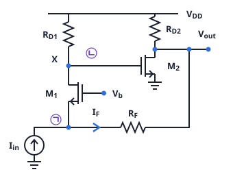
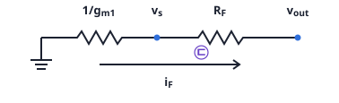
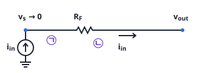
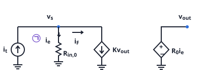
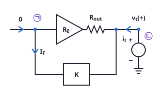
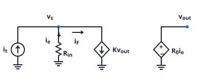
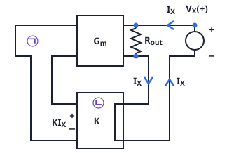

# 전자회로2 복습 1118 문제설명

회로와 첫 식을 짚고 핵심 계산으로 답을 구해요.

문제의 첫 줄부터 검산까지 설명해요.

**목차**

- [문항별 설명](#problems)
  - [P1. 트랜스임피던스 귀환의 극성과 이득](#p1)
  - [P2. 큰 루프 이득과 입력 가상 접지](#p2)
  - [P3. 전류 반송으로 낮아지는 입력저항](#p3)
  - [P4. 전압 출력의 폐루프 출력저항](#p4)
  - [P5. 능동 전류 반송의 이득과 두 임피던스](#p5)
  - [P6. 출력 시험원 연결에서 잘못된 점 찾기](#p6)

## 문항별 설명

### P1. 트랜스임피던스 귀환의 극성과 이득

E12.18 · 예제 12.18 · [원 문제 보기](../%EB%B3%B5%EC%8A%B5%EB%AC%B8%EC%A0%9C_1118_Feedback_Loading-%EB%AC%B8%EC%A0%9C.pdf)

#### 주어진 조건

- 가정: $\lambda = 0$, $R_F$가 매우 큼
- 소자 값은 주어지지 않음 (답은 $g_m$, 저항의 식으로)
- 식 (12.72): $\dfrac{V_{out}}{I_{in}} = \dfrac{R_0}{1 + KR_0}$

#### 구할 것

- (a) 귀환이 부귀환임을 증명
- (b) 개루프 이득
- (c) 폐루프 이득

원문 보기

그림 12.38(a)의 회로에서 $\lambda = 0$과 $R_F$가 매우 크다고 가정하고, (a) 귀환이 부귀환임을 증명하라. (b) 개루프 이득을 계산하라. (c) 폐루프 이득을 계산하라.

*공통 게이트 입력과 공통 소스 출력 사이를 귀환 저항이 연결해요.*

#### (a) 귀환의 극성

㉠ 입력 전류가 늘면 $M_1$의 소스 전압이 올라 드레인 전류가 줄어요. ㉡ 드레인 $X$의 전압이 오르면 $M_2$가 더 많은 전류를 끌어 출력 전압은 내려가요.

출력에서 $R_F$를 거쳐 입력으로 들어오는 전류가 줄어 처음 변화를 상쇄하므로 부귀환이에요.

#### (b) 개루프 트랜스임피던스

$R_F\gg 1/g_{m1},\,R_{D2}$이므로 개루프 계산에서는 두 포트에 붙는 $R_F$의 부하를 생략해요. $\lambda=0$에서 공통 게이트 단에 들어간 전류는 $R_{D1}$의 전압을 올리고, 둘째 단은 반전해요.

$$
R_0=\frac{v_X}{i_{in}}\frac{v_{out}}{v_X}
$$

$$
\frac{v_X}{i_{in}}\approx R_{D1}
$$

$$
\frac{v_{out}}{v_X}\approx -g_{m2}R_{D2}
$$

$$
R_0\approx -g_{m2}R_{D1}R_{D2}
$$

*독립 입력 전류원을 개방하고 출력에 시험전압을 걸었어요. 귀환 전류의 양의 방향은 입력에서 출력 쪽이에요.*

#### (c) 폐루프 트랜스임피던스

㉢ 독립 입력 전류원을 열고 출력을 구동하면 $R_F$와 $M_1$의 소스 저항이 직렬이에요. $i_F$는 입력에서 빠져나오는 방향이 양이므로 양의 시험전압에 대해 음수예요.

$$
K=\frac{i_F}{v_{out}}=-\frac{1}{R_F+1/g_{m1}}\approx-\frac1{R_F}
$$

$$
\frac{v_{out}}{i_{in}}=\frac{R_0}{1+KR_0}\approx\frac{-g_{m2}R_{D1}R_{D2}}{1+g_{m2}R_{D1}R_{D2}/R_F}
$$

**페이지 요약**

공통 게이트 단은 비반전, 공통 소스 단은 반전이어서 순방향 트랜스임피던스는 음수예요.

입력에서 빠져나가는 전류를 기준으로 잡으면 귀환율도 음수여서 $KR_0>0$이에요.

---

### P2. 큰 루프 이득과 입력 가상 접지

X12.18 · 연습문제 12.18 · [원 문제 보기](../%EB%B3%B5%EC%8A%B5%EB%AC%B8%EC%A0%9C_1118_Feedback_Loading-%EB%AC%B8%EC%A0%9C.pdf)

#### 주어진 조건

- 예제 12.18과 같은 회로: Fig 12.38(a) ($M_1$ 공통 게이트 첫째 단(게이트 $V_b$, 드레인 $X$ – $R_{D1}$ – $V_{DD}$, 소스 = 입력 노드, 입력 전류원 $i_{in}$), $M_2$ 공통 소스 둘째 단(게이트 $X$, 드레인 $v_{out}$ – $R_{D2}$ – $V_{DD}$), $v_{out}$과 입력 노드 사이 귀환 저항 $R_F$)
- 예제의 가정을 이어받음: $\lambda = 0$, $R_F$가 매우 큼
- 바뀐 점: $R_{D1} \to \infty$
- 힌트: 무한대의 개루프 이득은 $M_1$의 소스에서 가상 접지 노드를 만든다
- 예제 12.18의 결과 (식 12.75): $\left.\dfrac{V_{out}}{I_{in}}\right|_{closed} = \dfrac{-g_{m2}R_{D1}R_{D2}}{1 + \dfrac{g_{m2}R_{D1}R_{D2}}{R_F}}$

#### 구할 것

- $R_{D1} \to \infty$일 때 폐루프 이득
- 이 결과의 해석

원문 보기

$R_{D1} \to \infty$이면 폐루프 이득은 얼마인가? 이 결과는 어떻게 해석될 수 있는가?(힌트: 무한대의 개루프 이득은 $M_1$의 소스에서 가상 접지 노드를 만든다.)

*루프 이득이 무한대로 갈 때의 입력 전류 경로*

#### 입력 노드의 가상 접지

㉠ $R_{D1}\to\infty$이면 무한히 큰 개루프 이득이 유한한 출력을 내는 데 필요한 오차 전류 $i_e$는 0으로 가요. $M_1$의 소스 전압 $v_s=i_e/g_{m1}$도 0으로 가므로 여기가 가상 접지예요.

㉡ 입력 전류가 모두 $R_F$를 통해 출력으로 흘러요.

$$
v_s-v_{out}\longrightarrow i_{in}R_F
$$

$$
\lim_{R_{D1}\to\infty}\frac{v_{out}}{i_{in}}=-R_F
$$

**페이지 요약**

큰 루프 이득의 극한에서는 $M_1$ 소스가 가상 접지가 되고, 입력 전류 전체가 $R_F$로 흘러요.

---

### P3. 전류 반송으로 낮아지는 입력저항

E12.19 · 예제 12.19 · [원 문제 보기](../%EB%B3%B5%EC%8A%B5%EB%AC%B8%EC%A0%9C_1118_Feedback_Loading-%EB%AC%B8%EC%A0%9C.pdf)

#### 주어진 조건

- 예제 12.18의 회로: Fig 12.38(a) ($M_1$ 공통 게이트 첫째 단(게이트 $V_b$, 드레인 $X$ – $R_{D1}$ – $V_{DD}$, 소스 = 입력 노드, 입력 전류원 $i_{in}$), $M_2$ 공통 소스 둘째 단(게이트 $X$, 드레인 $v_{out}$ – $R_{D2}$ – $V_{DD}$), $v_{out}$과 입력 노드 사이 귀환 저항 $R_F$)
- 예제 12.18의 가정을 이어받음: $\lambda = 0$, $R_F$가 매우 큼
- 소자 값은 주어지지 않음 (답은 $g_m$, 저항의 식으로)
- 식 (12.78): $\dfrac{V_X}{I_X} = \dfrac{R_{in}}{1 + KR_0}$
- 예제 12.18의 결과: $R_0 = R_{D1}(-g_{m2}R_{D2})$, $K = -1/R_F$, 폐루프 이득의 분모 $1 + KR_0 = 1 + \dfrac{g_{m2}R_{D1}R_{D2}}{R_F}$ (식 12.75)

#### 구할 것

- 회로의 폐루프 입력 임피던스

원문 보기

예제 12.18에서 배운 회로의 폐루프 입력 임피던스를 결정하라.

*큰 귀환 저항을 가정한 입력 시험 회로. 시험 전류는 입력 저항과 반송 전류원으로 나뉘어요.*

#### 전류 반송이 있는 입력 포트

㉠ 입력에 시험 전류 $i_t$를 넣으면 순방향 입력으로 $i_e$가 흐르고 반송 가지로 $i_F=Kv_{out}$이 빠져요. $v_{out}=R_0i_e$를 대입해요.

$$
i_t=i_e+i_F=(1+KR_0)i_e
$$

$\lambda=0$이고 $R_F\gg 1/g_{m1},\,R_{D2}$이므로 개루프에서는 $M_1$ 소스에서 본 저항과 예제 12.18의 루프 이득을 써요.

$$
R_{in,0}\approx 1/g_{m1}
$$

$$
KR_0\approx \frac{g_{m2}R_{D1}R_{D2}}{R_F}
$$

$$
R_{in,cl}=\frac{v_s}{i_t}\approx\frac{1/g_{m1}}{1+g_{m2}R_{D1}R_{D2}/R_F}
$$

**페이지 요약**

병렬 전류 반송에서는 같은 입력 전압을 만들 때 시험원이 더 많은 전류를 공급해요.

$$
R_{in,cl}\approx R_{in,0}/(1+KR_0)
$$

---

### P4. 전압 출력의 폐루프 출력저항

E12.20 · 예제 12.20 · [원 문제 보기](../%EB%B3%B5%EC%8A%B5%EB%AC%B8%EC%A0%9C_1118_Feedback_Loading-%EB%AC%B8%EC%A0%9C.pdf)

#### 주어진 조건

- 예제 12.18의 회로: Fig 12.38(a) ($M_1$ 공통 게이트 첫째 단(게이트 $V_b$, 드레인 $X$ – $R_{D1}$ – $V_{DD}$, 소스 = 입력 노드, 입력 전류원 $i_{in}$), $M_2$ 공통 소스 둘째 단(게이트 $X$, 드레인 $v_{out}$ – $R_{D2}$ – $V_{DD}$), $v_{out}$과 입력 노드 사이 귀환 저항 $R_F$)
- 예제 12.18의 가정을 이어받음: $\lambda = 0$, $R_F$가 매우 큼
- 소자 값은 주어지지 않음 (답은 $g_m$, 저항의 식으로)
- 식 (12.82): $\dfrac{V_X}{I_X} = \dfrac{R_{out}}{1 + KR_0}$
- 예제 12.18의 결과: $R_0 = R_{D1}(-g_{m2}R_{D2})$, $K = -1/R_F$, 폐루프 이득의 분모 $1 + KR_0 = 1 + \dfrac{g_{m2}R_{D1}R_{D2}}{R_F}$ (식 12.75)

#### 구할 것

- 회로의 폐루프 출력 임피던스

원문 보기

예제 12.18에서 배운 회로의 폐루프 출력 임피던스를 계산하라.

*입력 전류원을 개방하고 귀환을 연결한 출력 시험 회로*

#### 출력 전압 시험

㉠ 독립 입력 전류원을 열어도 $R_F$의 반송 경로는 남아요. ㉡ 출력에 시험전압 $v_t$를 걸면 귀환이 출력 전압 상승을 억제하므로, 같은 $v_t$를 유지하는 데 더 큰 유입 전류 $i_t$가 필요해요.

$\lambda=0$, $R_F\gg R_{D2},\,1/g_{m1}$에서 $M_2$의 드레인에 보이는 개루프 저항과 루프 이득은 다음과 같아요.

$$
R_{out,0}\approx R_{D2}
$$

$$
T=KR_0\approx \frac{g_{m2}R_{D1}R_{D2}}{R_F}
$$

$$
R_{out,cl}=\frac{v_t}{i_t}\approx\frac{R_{D2}}{1+T}
$$

**페이지 요약**

출력 전압을 병렬로 감지하면 폐루프 출력저항은 $R_{out,0}/(1+T)$로 줄어요.

---

### P5. 능동 전류 반송의 이득과 두 임피던스

P12.33 · 장말문제 12.33 · [원 문제 보기](../%EB%B3%B5%EC%8A%B5%EB%AC%B8%EC%A0%9C_1118_Feedback_Loading-%EB%AC%B8%EC%A0%9C.pdf)

#### 주어진 조건

- $R_1 + R_2$가 매우 큼
- $\lambda = 0$
- 소자 값은 주어지지 않음 (답은 $g_m$, 저항의 식으로)

#### 구할 것

- 폐루프 이득
- 입력 임피던스와 출력 임피던스 (I/O impedances)

원문 보기

The amplifier depicted in Fig. 12.97 consists of a common-gate stage ($M_1$ and $R_D$) and a feedback network ($R_1$, $R_2$, and $M_2$). Assuming $R_1 + R_2$ is very large and $\lambda = 0$, compute the closed-loop gain and I/O impedances.

*분압기로 출력을 감지하고 $M_2$의 드레인으로 전류를 반송해요.*

#### 공통 게이트의 이득과 전류 반송

㉠ 분압기가 출력 전압을 병렬로 감지하고, ㉡ $M_2$가 입력 노드에 전류를 병렬로 반송해요. $M_2$의 드레인에서 반송 경로를 끊어도 $R_1+R_2$는 출력에서 교류 접지로 이어져요. $\lambda=0$이고 몸체 효과를 무시하면 $M_1$의 소스로 들어가는 전류 $i_e$가 출력 부하에 그대로 전달되어 $v_{out}$이 올라가요.

$$
A_{\mathrm{open}}=\frac{v_{out}}{i_e}=R_D\parallel(R_1+R_2)\ [\mathrm{V/A}]
$$

귀환망의 반송단인 $M_2$ 드레인을 교류 접지에 두고 감지단에 시험 전압 $v_{out}$을 걸어요. $i_F$는 $M_2$의 드레인으로 들어가 소스 쪽으로 흐르는 방향이 양이에요. 게이트 전압은 $R_2$ 양단에 걸리는 분압 전압이에요.

$$
K=\frac{i_F}{v_{out}}=g_{m2}\frac{R_2}{R_1+R_2}
$$

입력 전류가 순방향 전류 $i_e$와 반송 전류 $i_F$로 나뉘어요. $v_{out}=A_{\mathrm{open}}i_e$이고 $i_F=Kv_{out}$이므로 다음 이득을 얻어요.

$$
A_{\mathrm{closed}}=\frac{v_{out}}{i_{in}}=\frac{A_{\mathrm{open}}}{1+KA_{\mathrm{open}}}
$$

#### 입력 임피던스와 출력 임피던스

개루프 입력에서 $M_1$의 소스를 바라보면 $1/g_{m1}$이 보여요. 개루프 출력은 입력 전류원을 개방한 상태에서 바라봐요. 이때 $M_1$의 소신호 드레인 전류가 0이므로 앞에서 읽은 병렬 부하가 남아요.

$$
R_{\mathrm{in,open}}=1/g_{m1}
$$

$$
R_{\mathrm{out,open}}=R_D\parallel(R_1+R_2)
$$

귀환을 연결하면 입력은 병렬 전류 반송, 출력은 병렬 전압 감지이므로 두 저항이 모두 같은 배수로 줄어요.

$$
R_{\mathrm{in,closed}}=\frac{R_{\mathrm{in,open}}}{1+KA_{\mathrm{open}}}
$$

$$
R_{\mathrm{out,closed}}=\frac{R_{\mathrm{out,open}}}{1+KA_{\mathrm{open}}}
$$

**페이지 요약**

$R_1+R_2\gg R_D$라서 분압 가지의 출력 로딩은 작아요.

개루프 이득의 $R_D\parallel(R_1+R_2)$와 귀환율의 분압비를 각각 읽어요.

전류 반송과 전압 감지가 모두 병렬이므로 개루프 이득과 두 포트 저항을 각각 $1+KA_{\mathrm{open}}$으로 나눠요.

---

### P6. 출력 시험원 연결에서 잘못된 점 찾기

E12.23 · 예제 12.23 · [원 문제 보기](../%EB%B3%B5%EC%8A%B5%EB%AC%B8%EC%A0%9C_1118_Feedback_Loading-%EB%AC%B8%EC%A0%9C.pdf)

#### 주어진 조건

#### 구할 것

- 이 토폴로지가 실제 (전류-전압 귀환) 회로의 잘못된 표현인 이유 설명

원문 보기

학생이 그림 12.45에 그려진 회로의 도움을 받아 전류-전압 귀환 토폴로지의 출력 임피던스를 계산하려고 한다. 왜 이 토폴로지가 실제 회로의 잘못된 표현인지 설명하라.

*올바른 직렬 접속. 순방향 출력의 내부 가지 전류가 다시 합쳐져 감지 포트를 통과해요.*

#### 시험 전류가 지나야 하는 경로

㉠ 독립 입력 전압을 0으로 두고 출력에 시험원을 연결해요. ㉡ 전류 감지 포트는 순방향 출력 포트와 직렬이어야 하므로, 같은 순환 방향을 기준으로 다음 조건이 성립해야 해요.

$$
I_X=I_{\mathrm{port}}=I_{\mathrm{sense}}
$$

원문 그림 12.45에서는 $V_X$를 출력과 병렬로 연결해 시험 전류가 순방향 출력과 $K$의 감지 입력으로 갈라져요. 위 회로처럼 감지 포트를 출력의 귀로에 직렬로 넣어야 $K$가 시험 전류 전체를 읽어요.

**페이지 요약**

출력 전류를 감지할 때는 시험원, 순방향 출력 포트, 감지 포트가 같은 전류를 공유해야 해요.

---

원 문제·정리노트·PDF는 보존해요.
