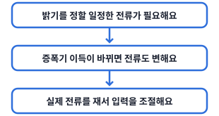
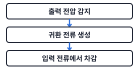
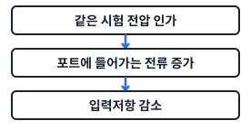
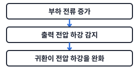
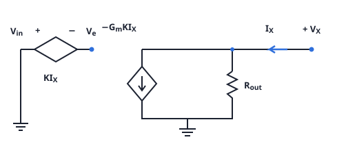
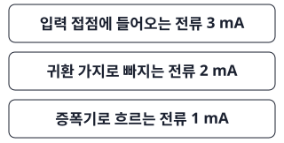

# 귀환 구조와 로딩 — 5살도 이해하는 정리노트

권익진 교수님 전자회로2 · 1118 수업 (Lec6, Razavi 12장)

> `정리노트_1118_Feedback_Loading.html`를 마크다운으로 옮겼어요. 그림은 `figures_1118/` 폴더의 SVG, 위젯은 대표 설정의 정적 그림으로 바꿨어요. 수식은 `$…$` / `$$…$$`라서 GitHub, Obsidian, Typora에서 보여요.

**목차**

- [들어가며: 왜 이런 회로를 쓸까](#why)
  - [왜 이런 회로를 쓸까](#why-circuit)
- [1. 전압–전류 귀환: 전류를 전압으로](#s0)
  - [전압을 감지하고 전류를 돌려줘요](#s0-vc-gain)
  - [입력 노드 KCL로 입력저항을 구해요](#s0-vc-input)
  - [전압 출력의 저항은 낮아져요](#s0-vc-output)
- [2. 전류–전압 귀환: 전압으로 전류를 조절해요](#s1)
  - [전류를 감지하고 전압을 돌려줘요](#s1-cv-gain)
  - [전압 입력은 입력저항이 커져요](#s1-cv-input)
  - [입력을 영점화하고 출력 시험원을 걸어요](#s1-cv-output)
- [3. 전류–전류 귀환: 두 포트의 규칙을 합쳐요](#s2)
  - [전류의 차이를 증폭해요](#s2-cc-gain)
  - [입력은 낮게, 출력은 높게 만들어요](#s2-cc-impedances)
- [4. 네 구조를 연결 방식으로 판단해요](#s3)
  - [감지·반송과 임피던스 변화 한눈에](#s3-topology-map)
  - [0과 무한대는 원래 회로와 비교해요](#s3-relative-impedance)
- [5. 유한 임피던스의 로딩과 V-V 종단](#s4)
  - [귀환망을 달면 순방향 특성도 달라져요](#s4-loading)
  - [귀환망을 두 벌로 복제해 양쪽 부하를 남겨요](#s4-duplicates)
  - [V-V에서는 감지 복제본은 개방, 반송 복제본은 접지](#s4-vv-termination)
- [6. 요약 · 예고](#s5)
  - [한 장으로 다시 보는 귀환](#s5-cheatsheet)
  - [다음 시간 예고](#s5-next)
  - [함께 보면 좋은 자료](#s5-links)

## 들어가며: 왜 이런 회로를 쓸까

### 왜 이런 회로를 쓸까

*1118 수업 · L06 s36, 39, 42, 47–48*

**쉽게 말하면**

출력이 너무 커지면 입력에서 더 많이 빼 줘요. 이렇게 출력을 되돌려 주면 증폭기의 성능이 조금 달라져도 원하는 출력을 유지하기 쉬워요.

*LED를 흐르는 전류가 늘면 되돌리는 신호도 커져요.*

**정확히 말하면**

#### 풀고 싶은 문제

손잡이 전압으로 LED 밝기를 조절한다고 해 봐요. 같은 전압에서 같은 밝기를 내려면 **출력 전류가 입력 전압에 일정한 비율로 따라가야 해요.** 이때 선택하는 구조가 [C-V 귀환](#s1-cv-gain)이에요.

#### 단순한 해법과 그 한계

전압을 전류로 바꾸는 증폭기 하나만 두면 소자 특성에 따라 그 비율도 변해요. **순방향 이득을 키우는 것만으로는 비율을 정확하게 정하기 어려워요.** 입력 전류를 출력 전압으로 바꾸는 [V-C 귀환](#s0-vc-gain)에서도 같은 문제가 생겨요.

#### 핵심 아이디어

첫 글자는 출력에서 재는 양, 둘째는 입력에서 빼는 양이에요. V는 전압, C는 전류예요. C-V는 출력 전류가 커지면 되돌리는 전압을 키워 증폭기를 구동하는 전압을 줄여요. [C-C 귀환](#s2-cc-gain)은 전류를 재고 전류를 빼요. **음귀환의 무차원 루프 이득 $T=KA$가 1보다 충분히 크면 정확한 K로 전체 이득을 정할 수 있어요.**

순방향 이득을 $A$, 귀환율을 $K$라 하면 이 조건에서 폐루프 이득은 다음과 같아요.

$$
A_{cl}=\frac{A}{1+KA}\approx\frac{1}{K}
$$

#### 대가와 쓰이는 곳

**이득 감소를 받아들이면 신호원과 부하에 맞는 입출력 저항도 얻어요.** C-V는 입력 저항을 높여 전압원에서 전류를 적게 끌어오고, 출력 저항을 높여 부하가 바뀌어도 전류를 유지해요. 실제 귀환망의 유한한 저항을 연결하면 순방향 이득 자체가 달라져요. 이 [로딩](#s4-loading)을 양쪽 포트에 남겨 두면 전체 회로의 노드 방정식을 매번 풀지 않고도 폐루프 특성을 구할 수 있어요.

음귀환은 대역폭을 넓혀 더 넓은 주파수 범위의 신호를 증폭하게 해 줘요. 다만 주파수에 따라 위상이 변해 되돌아온 신호가 출력의 변화를 더 키우면 회로가 불안정해질 수 있어요. 안정성의 상세 해석은 상위 과목에서 다뤄요.

**교수님 말씀**

> 그 이유는 요거는 부정확하기 때문에 우리가 정확한 K로 이득을 결정합니다.

교수님이 예로 든 연산증폭기에서는 저항비로 되돌릴 전압의 비율을 정해요. 그러면 소자마다 달라지는 순방향 이득을 정확히 알지 못해도 큰 루프 이득에서 원하는 전압 이득을 얻어요.

확인해 봐요. LED 전류가 늘어날 때 입력 전압에서 더 큰 전압을 빼 주면 어느 귀환 구조이고, 전류는 어떻게 조절될까요?

답 보기

C-V예요. 출력 전류를 재고 입력에서 전압을 빼므로 구동 전압이 작아져 처음의 전류 증가를 억제해요.

**페이지 요약**

큰 루프 이득에서 귀환율로 전체 이득을 정하고 입출력 저항을 신호에 맞춰요.

*핵심 식*

- 음귀환 폐루프 이득 ($T=KA$가 1보다 충분히 클 때)

  $$
  A_{cl}=\frac{A}{1+KA}\approx\frac{1}{K}
  $$

*용어*

- **귀환율 (feedback factor)** — 출력에서 잰 양에 곱해 입력으로 되돌릴 양을 정하는 $K$예요.
- **로딩 (loading)** — 연결한 귀환망의 유한한 저항 때문에 순방향 특성이 달라지는 현상이에요.

---

## 1. 전압–전류 귀환: 전류를 전압으로

### 전압을 감지하고 전류를 돌려줘요

*1118 수업 · L06 s36*

**쉽게 말하면**

출력 전압이 높아지면 입력에서 더 많은 전류를 빼서 출력의 증가를 억제해요.

*양의 순방향 이득을 가진 예에서 신호가 돌아오는 순서예요.*

**정확히 말하면**

#### 무엇을 재고 무엇을 빼나요?

입력 5 mA 중 귀환 가지가 2 mA를 가져가면 증폭기로 들어가는 전류는 3 mA예요. **이름의 첫 글자는 출력에서 잰 전압, 둘째 글자는 입력에서 뺀 전류를 가리켜요.** 출력에는 이상 전압계처럼 무한 저항인 센서를 병렬로 달고, 입력에는 출력저항이 무한대인 귀환 전류원을 병렬로 연결해요. 양쪽 모두 병렬이므로 shunt-shunt 구조예요.

#### 귀환을 한 바퀴 돌면 이득은 얼마인가요?

1. $$
   I_F=KV_{out}
   $$

   출력 전압을 귀환 전류로 바꿔요.
2. $$
   V_{out}=R_0(I_{in}-I_F)
   $$

   남은 입력 전류를 전압으로 바꿔요.
3. $$
   V_{out}(1+KR_0)=R_0 I_{in}
   $$

   귀환 전류를 대입하고 출력 항을 모아요.
4. $$
   V_{out}/I_{in} = R_0/(1+KR_0)
   $$

   입력 전류로 나누어요.

**트랜스임피던스 $R_0$의 단위는 Ω, 귀환율 $K$의 단위는 S이므로 루프 이득 $T = KR_0$에는 단위가 없어요.** 이 뺄셈 규약에서 음귀환이면 $T>0$이에요. 반전 회로에서는 $R_0$와 $K$가 모두 음수일 수도 있어요. $T\gg1$일 때만 폐루프 전달량이 $1/K$에 가까워져요.

**교수님 말씀**

연산증폭기의 전압 이득을 저항비로 정하는 상황을 떠올려 보세요. 여기서도 루프 이득이 충분히 크면 순방향 이득이 변해도 폐루프 전달량은 주로 귀환망이 정해요.

확인해 봐요. 입력 7 mA 중 귀환 가지가 3 mA를 가져가면 순방향 입력 전류는 얼마인가요?

답 보기

4 mA예요. 입력 노드에서 7 mA − 3 mA를 계산해요.

**페이지 요약**

출력 전압을 감지해 입력 전류에서 빼면 트랜스임피던스가 $1+T$로 나뉘어요.

*핵심 식*

- 폐루프 트랜스임피던스

  $$
  V_{out}/I_{in} = R_0/(1+KR_0)
  $$
- 루프 이득

  $$
  T = KR_0
  $$

*용어*

- **트랜스임피던스** — 전류를 전압으로 바꾸는 전달량이며 단위는 Ω이에요.

---

### 입력 노드 KCL로 입력저항을 구해요

*1118 수업 · L06 s37*

**쉽게 말하면**

같은 입력 전압을 걸어도 귀환 가지가 전류를 더 가져가므로 입력에서 본 저항이 작아져요.

*입력 단자로 들어간 전류는 순방향 입력과 귀환 가지로 갈라져요.*

**정확히 말하면**

#### 같은 전압에서 전류가 두 배라면?

시험원 전압 1 V에서 1 mA가 흐르다가 귀환을 연결하자 2 mA가 되면 입력저항은 1 kΩ에서 0.5 kΩ으로 줄어요. **입력저항의 분모에는 시험원이 보낸 전체 전류 $I_X$를 써요.**

#### 입력 노드에서 전류를 어떻게 세나요?

1. $$
   I_X-I_F = V_X/R_{in}
   $$

   포트 전류에서 귀환 전류를 빼면 순방향 입력 전류예요.
2. $$
   V_{out}=R_0 V_X/R_{in}
   $$

   순방향 입력 전류에 트랜스임피던스를 곱해요.
3. $$
   I_F=KV_{out}
   $$

   출력 전압이 귀환 전류를 정해요.
4. $$
   I_X=(1+KR_0)V_X/R_{in}
   $$

   귀환 전류를 입력 노드 식에 대입해요.
5. $$
   R_{in,cl} = R_{in}/(1+KR_0)
   $$

   시험 전압을 포트 전류로 나누어요.

**전류 입력에서는 낮은 입력저항이 유리해요.** 전류원의 유한한 병렬 내부저항과 증폭기 입력에 전류가 나뉘므로 입력저항이 작을수록 증폭기로 들어오는 몫이 커져요.

**교수님 말씀**

입력 임피던스가 줄어드는 것이 장점인지 교수님이 물으셨어요. 이상적인 전류 입력은 저항이 0이어서 신호원의 전류를 모두 받아들인다는 것이 판단 기준이에요.

확인해 봐요. 시험 전압 1 V에서 포트 전류가 4 mA이면 입력저항은 얼마인가요?

답 보기

0.25 kΩ이에요. 시험 전압 1 V를 전체 전류 4 mA로 나누어요.

**페이지 요약**

귀환 전류가 입력 노드에서 갈라져 폐루프 입력저항이 작아져요.

*핵심 식*

- 폐루프 입력저항

  $$
  R_{in,cl} = R_{in}/(1+KR_0)
  $$

*용어*

- **시험원** — 포트에 전압을 걸고 그 단자로 들어가는 전체 전류를 측정해요.

---

### 전압 출력의 저항은 낮아져요

*1118 수업 · L06 s38*

**쉽게 말하면**

부하가 더 많은 전류를 가져가 출력 전압이 떨어지면 귀환이 그 전압 변화를 줄여 줘요.

*같은 부하 전류 변화에서 전압 강하가 작을수록 출력저항이 낮아요.*

**정확히 말하면**

#### 전압을 유지하려면 어떤 출력이 좋을까요?

부하 전류가 1 mA 늘 때 출력 전압이 1 V 떨어지면 출력저항은 1 kΩ이에요. 같은 변화에서 0.1 V만 떨어지면 0.1 kΩ이에요. **이상적인 전압원은 부하 전류가 변해도 전압을 유지하므로 출력저항이 0이에요.**

#### 전압–전압 귀환에서 어떤 결과를 가져오나요?

전압–전류 귀환도 출력에 센서를 병렬로 달아 전압을 감지해요. 출력저항을 볼 때는 독립 입력 전류원을 개방하고 귀환은 연결해 두어요. 전압–전압 귀환과 같은 전압 감지 규칙을 적용해요.

$$
R_{out,cl} = R_{out}/(1+KR_0)
$$

**$R_{out}$은 출력 단자에서 본 개루프 저항이고, $R_0$는 입력 전류를 출력 전압으로 바꾸는 전달량이에요.** 단위는 둘 다 Ω이지만 루프 이득에 들어가는 양은 $R_0$예요.

**교수님 말씀**

교수님은 앞서 배운 전압 출력의 측정 방식을 그대로 쓰셨어요. 개루프 출력저항과 루프 이득을 알면 매번 출력 시험원 식을 다시 풀 필요가 없어요.

**꼭 기억해요**

> 외우면은 헷갈립니다. 오히려 외우면은 헷갈려서 틀려요.

표를 떠올리기 전에 출력에서 어떤 양을 일정하게 유지하려는지 확인해요.

확인해 봐요. 부하 전류가 1 mA 늘 때 출력 전압이 0.2 V 낮아지면 출력저항은 얼마인가요?

답 보기

0.2 kΩ이에요. 전압 강하의 크기 0.2 V를 부하 전류 증가량 1 mA로 나누어요.

**페이지 요약**

출력 전압을 병렬로 감지하는 음귀환은 출력저항을 낮춰요.

*핵심 식*

- 폐루프 출력저항

  $$
  R_{out,cl} = R_{out}/(1+KR_0)
  $$

*용어*

- **전압원** — 출력저항이 작을수록 부하 전류가 변할 때 전압 변화가 작아요.

---

## 2. 전류–전압 귀환: 전압으로 전류를 조절해요

### 전류를 감지하고 전압을 돌려줘요

*1118 수업 · L06 s39*

**쉽게 말하면**

출력 전류가 늘면 되돌아오는 전압도 커져서 증폭기가 전류 증가를 억제해요.

*LED 전류가 예상보다 늘었을 때의 변화예요.*

**정확히 말하면**

#### 어느 포트에서 무엇을 재나요?

LED의 밝기를 전압으로 조절하려면 LED에 흐르는 전류를 맞춰야 해요. 출력 경로에 직렬로 끼운 이상 감지기는 전압 강하 없이 같은 전류를 읽어요. **입력에서도 귀환 전압을 직렬로 빼므로 series-series 구조예요.**

#### 한 바퀴 돌면 단위가 어떻게 되나요?

순방향 블록의 $G_m$은 입력 오차 전압당 출력 전류(A/V), 귀환 블록의 $K$는 출력 전류당 귀환 전압(V/A)이에요. **두 블록의 전달량을 곱하면 단위가 소거돼요.**

1. $$
   V_F=KI_{out}
   $$

   출력 감지 전류를 전압으로 바꿔요.
2. $$
   T = KG_m
   $$

   한 바퀴의 전달량을 구해요.

#### 입력에서 본 전달량은 얼마인가요?

**증폭기에 실제로 걸리는 오차 전압은 외부 입력에서 귀환 전압을 뺀 값이에요.**

1. $$
   I_{out}=G_m(V_{in}-V_F)
   $$

   순방향 블록은 오차 전압을 증폭해요.
2. $$
   I_{out}(1+KG_m)=G_mV_{in}
   $$

   귀환식을 대입하고 출력 항을 모아요.
3. $$
   I_{out}/V_{in} = G_m/(1+KG_m)
   $$

   양변을 입력 전압과 귀환 배율로 나눠요.

오차 전압은 $V_{in}/(1+T)$이므로 큰 양의 루프 이득에서는 작아져요. 그때에도 외부 입력 전압은 LED의 목표 전류를 정해요.

**교수님 말씀**

건전지 두 개를 반대 극성으로 직렬 연결하면 단자 사이에는 두 전압의 차가 걸려요. 귀환 전압원도 입력 전압원에 이 방향으로 연결해요.

**꼭 기억해요**

> 루프 게인을 구하시오, 클로즈드 게인을 구하시오, 오픈 게인을 구하시오. 구분할 수 있어야 됩니다.

개루프 이득은 $G_m$, 루프 이득은 $KG_m$, 폐루프 이득은 입력 전압에 대한 실제 출력 전류의 비예요.

확인해 봐요. 입력 전압을 고정하고 LED 전류가 증가하면 오차 전압은 어떻게 되나요?

답 보기

감지 전류가 커지면 $V_F$가 증가하므로 $V_{in}-V_F$는 감소해요.

**페이지 요약**

출력 전류가 늘면 되돌아오는 전압도 커져서 증폭기가 전류 증가를 억제해요.

*핵심 식*

- 루프 이득

  $$
  T = KG_m
  $$
- 폐루프 이득

  $$
  I_{out}/V_{in} = G_m/(1+KG_m)
  $$

*용어*

- **트랜스컨덕턴스** — 전압 변화당 전류 변화이며 단위는 A/V예요.

---

### 전압 입력은 입력저항이 커져요

*1118 수업 · L06 s40*

**쉽게 말하면**

귀환 전압을 입력에 직렬로 빼면 같은 입력 전압에서 신호원이 공급할 전류가 줄어요.

*신호원이 공급하는 전류가 줄어드는 순서예요.*

**정확히 말하면**

#### 신호원은 왜 작은 전류를 공급하나요?

같은 전압 입력을 걸고 귀환을 닫아 보세요. 개루프 입력저항 $R_{in}$에 걸리는 전압은 오차 전압이므로 전류도 그만큼 작아져요. **외부 신호원은 더 큰 입력저항을 보게 돼요.**

#### 목표 저항에서 무엇을 정하나요?

전압–전압 구조에서 직렬로 전압을 빼던 입력 포트와 같은 관계예요. **목표 입력저항과 원래 입력저항의 비가 필요한 귀환 배율이에요.**

1. $$
   R_{in,cl} = R_{in}(1+KG_m)
   $$

   이상 블록의 직렬 입력저항 관계를 적용해요.
2. $$
   T=R_{in,cl}/R_{in}-1
   $$

   저항의 비에서 1을 빼면 필요한 루프 이득이에요.

**교수님 말씀**

> 어떻게 설계해야 될 건가, 그거의 가이드가 되는 거죠, 식이.

목표 저항에서 $T$를 정한 뒤 순방향 블록의 $G_m$에 맞춰 $K$를 선택할 수 있어요.

**꼭 기억해요**

저항에 곱하는 배율은 $1+T$예요. 회로 전체의 입력 전압을 그대로 $R_{in}$에 걸었다고 계산하면 직렬 귀환의 효과가 사라져요.

확인해 봐요. 입력 전압이 같을 때 양의 루프 이득을 키우면 입력 전류는 어떻게 되나요?

답 보기

입력저항이 $1+T$에 비례해 증가하므로 입력 전류는 감소해요.

**페이지 요약**

귀환 전압을 입력에 직렬로 빼면 같은 입력 전압에서 신호원이 공급할 전류가 줄어요.

*핵심 식*

- 직렬 전압 입력

  $$
  R_{in,cl} = R_{in}(1+KG_m)
  $$

*용어*

- **입력저항** — 신호원에서 본 입력 전압과 입력 전류의 비예요.

---

### 입력을 영점화하고 출력 시험원을 걸어요

*1118 수업 · L06 s41*

**쉽게 말하면**

입력을 영점화한 뒤 출력에 시험전압을 걸면 귀환이 시험전류의 변화를 억제해요.

*입력을 영점화한 등가회로에서 시험전압은 오른쪽 끝과 기준점 사이에 걸고 시험전류는 왼쪽으로 흘려요.*

**정확히 말하면**

#### 시험원은 어느 전류를 재나요?

출력에 연결된 부하 대신 시험원을 연결해요. 왼쪽 도선이 독립 입력 전압원을 단락해 $V_{in} = 0$이 돼요. 직렬 귀환 전압원의 오른쪽 제어 노드는 $V_e=V_{in}-KI_X=-KI_X$이므로 종속원 아래 방향의 전류는 $G_mV_e=-G_mKI_X$예요. 시험전압 $V_X$는 출력 단자의 기준점 대비 전압으로 정의해요. **오른쪽에서 왼쪽으로 들어가는 시험전류 $I_X$는 출력 포트 전체의 전류예요.**

#### 두 가지의 전류는 어떻게 합치나요?

그림에서 두 가지의 양의 전류 방향을 위에서 아래로 잡아요. **저항 가지 전류에 귀환이 만드는 부호 있는 종속원 가지 전류를 더해요.**

1. $$
   I_X = V_X/R_{out}-G_mKI_X
   $$

   시험전류를 두 가지로 나눠 KCL을 써요.
2. $$
   (1+KG_m)I_X=V_X/R_{out}
   $$

   시험전류에 비례하는 항을 왼쪽으로 모아요.
3. $$
   R_{out,cl} = R_{out}(1+KG_m)
   $$

   시험전압을 시험전류로 나눈 값을 읽어요.

같은 시험전압 변화에 대해 출력 전류의 변화량은 개루프 때보다 작아요. 전류 감지기는 출력 경로와 직렬이어야 이 전체 전류를 읽어요.

**교수님 말씀**

이상적인 전류원은 단자 전압이 변해도 정해진 전류를 유지해요. 출력저항이 커지는 방향이 바로 전류원 특성이 좋아지는 방향이에요.

확인해 봐요. 시험전압을 고정하고 귀환을 닫으면 시험전류의 크기는 어떻게 달라지나요?

답 보기

양의 루프 이득에서는 출력저항이 $1+KG_m$배가 되므로 시험전류의 크기는 그 역수배가 돼요.

**페이지 요약**

입력을 영점화한 뒤 출력에 시험전압을 걸면 귀환이 시험전류의 변화를 억제해요.

*핵심 식*

- 출력저항

  $$
  R_{out,cl} = R_{out}(1+KG_m)
  $$

*용어*

- **시험전류** — 시험원에서 출력 포트로 들어가 두 가지로 나뉘는 전체 전류예요.

---

## 3. 전류–전류 귀환: 두 포트의 규칙을 합쳐요

### 전류의 차이를 증폭해요

*1118 수업 · L06 s42*

**쉽게 말하면**

출력 전류가 늘면 더 많은 전류가 입력 접점에서 빠져요. 그래서 출력의 증가가 줄어요.

**정확히 말하면**

#### 전류는 어디에서 빠질까요?

입력으로 3 mA가 들어오고 귀환 가지로 2 mA가 빠지면 순방향 블록에는 1 mA가 흘러요. **전류 증폭기(current amplifier)는 입력 접점에 남은 전류를 증폭해요.**

출력 가지에 감지기를 끼우는 직렬 감지(series sensing)는 부하와 같은 전류를 읽어요. 입력 접점에 귀환 가지를 붙이는 병렬 반송(shunt return)은 빼려는 전류가 그 가지로 흐르게 해요.

#### 개루프 이득에서 폐루프 이득까지

순방향 전류 이득 $A_I$는 출력 전류를 블록에 남은 입력 전류로 나눈 값이에요. 귀환율 $K$는 감지한 출력 전류 중 되돌리는 비율이에요. 둘 다 A/A여서 단위가 소거돼요. **외부 입력을 기준으로 한 폐루프 이득은 음귀환 때문에 작아져요.**

1. $$
   I_F=K I_{out}
   $$

   출력 전류에서 귀환 전류를 구해요.
2. $$
   I_{out}=A_I(I_{in}-I_F)
   $$

   접점에서 빠진 전류를 빼요.
3. $$
   I_{out}=A_I(I_{in}-K I_{out})
   $$

   귀환 전류를 대입해요.
4. $$
   (1+KA_I)I_{out}=A_I I_{in}
   $$

   출력 전류 항을 왼쪽에 모아요.
5. $$
   I_{out}/I_{in} = A_I/(1+KA_I)
   $$

   외부 입력에 대한 전류 이득이에요.
6. $$
   T = KA_I
   $$

   한 바퀴의 두 이득을 곱하면 무차원 루프 이득이에요.

**교수님 말씀**

귀환 경로를 따라가며 어떤 전류를 어떤 전류로 나누는지 살펴보라고 하셨어요. 출력과 입력의 비, 순방향 이득, 한 바퀴의 이득을 이렇게 구별할 수 있어요.

**꼭 기억해요**

직렬 감지기의 이상적인 입력저항은 0 Ω이에요. 병렬로 전류를 돌려주는 귀환 가지는 이상적인 전류원처럼 출력저항이 무한대예요.

확인해 봐요. 입력 전류가 5 mA이고 귀환 가지로 3 mA가 빠지면 순방향 블록에는 얼마가 흐를까요?

답 보기

접점에서 전류가 보존되므로 $5-3=2$ mA가 흘러요.

**페이지 요약**

출력 전류에 비례해 입력에서 전류를 빼면 전류 이득이 줄어요.

*핵심 식*

- 폐루프 전류 이득

  $$
  I_{out}/I_{in} = A_I/(1+KA_I)
  $$
- 루프 이득

  $$
  T = KA_I
  $$

*용어*

- **귀환율(feedback factor)** — 출력 전류 중 되돌리는 비율이에요.

---

### 입력은 낮게, 출력은 높게 만들어요

*1118 수업 · L06 s43–44*

**쉽게 말하면**

전류 입력은 작은 전압으로 받아들이고, 전류 출력은 부하 전압이 바뀌어도 전류를 유지해요.

**정확히 말하면**

#### 입력에서는 왜 나눌까요?

루프 이득이 3이면 개루프 입력저항 4 kΩ은 1 kΩ이 돼요. 같은 외부 입력 전류를 넣어도 병렬 반송으로 일부가 귀환 가지로 빠져요. **순방향 블록에 흐르는 전류와 입력 단자 전압이 함께 줄어요.**

1. $$
   V_{in}=R_{in}(I_{in}-I_F)
   $$

   개루프 입력저항에 실제로 흐르는 전류를 곱해요.
2. $$
   I_{in}-I_F=I_{in}/(1+KA_I)
   $$

   폐루프 전류 이득을 순방향 이득으로 나눠요.
3. $$
   R_{in,cl} = R_{in}/(1+KA_I)
   $$

   입력 단자 전압을 외부 입력 전류로 나눠요.

#### 출력에서는 왜 곱할까요?

출력 쪽에는 전류를 직렬로 감지하는 구조의 규칙을 적용해요. 독립 입력 전류를 0으로 두고 출력에 시험전압을 걸면, 음귀환이 전류 변화를 억제해요. 같은 시험전압에 대한 시험전류가 개루프 값의 $1/(1+KA_I)$배가 돼요. **출력저항이 커져 부하 전압이 달라져도 일정한 전류를 공급하는 전류원에 가까워져요.**

1. $$
   R_{out,cl} = R_{out}(1+KA_I)
   $$

   출력저항은 시험전압을 유입 시험전류로 나눈 값이에요.

같은 루프 이득 3에서 개루프 출력저항이 4 kΩ이면 폐루프 출력저항은 16 kΩ이에요. 두 저항 관계는 귀환망의 로딩을 무시한 이상 블록 모델에 적용해요.

**교수님 말씀**

교수님은 두 포트를 따로 읽으셨어요. 입력은 전류를 돌려주는 구조의 규칙을, 출력은 전류를 감지하는 구조의 규칙을 가져오면 노드 방정식을 처음부터 다시 세울 필요가 없어요.

**꼭 기억해요**

개루프 값과 폐루프 값을 구별해 적어요. 저항 변화 배율에는 귀환율뿐 아니라 순방향 이득까지 포함돼요.

확인해 봐요. 루프 이득이 4이고 개루프 출력저항이 2 kΩ이면 폐루프 출력저항은 얼마일까요?

답 보기

직렬 감지이므로 $2(1+4)=10$ kΩ이에요.

**페이지 요약**

이상적인 전류 귀환에서는 입력저항을 낮추고 출력저항을 높여요.

*핵심 식*

- 폐루프 입력저항

  $$
  R_{in,cl} = R_{in}/(1+KA_I)
  $$
- 폐루프 출력저항

  $$
  R_{out,cl} = R_{out}(1+KA_I)
  $$

*용어*

- **개루프(open loop)** — 귀환을 걸기 전의 기준값이에요.

---

## 4. 네 구조를 연결 방식으로 판단해요

### 감지·반송과 임피던스 변화 한눈에

*1118 수업 · L06 s45*

**쉽게 말하면**

같은 전류가 흐르는 길에 직렬로 연결하면 그쪽 저항이 커지고, 같은 전압을 보는 두 단자에 병렬로 연결하면 작아져요.

*루프 이득이 1이면 직렬 쪽은 두 배, 병렬 쪽은 절반이에요.*

**정확히 말하면**

#### 출력에서 무엇을 읽고 입력에 무엇을 돌려주나요?

예를 들어 출력 두 단자에 나란히 대고 전압을 읽은 뒤, 입력 전류에서 반송 전류를 빼면 V-C예요. **두 글자는 출력 감지(sense), 입력 반송(return) 순서예요.** C는 전류를 뜻해요. 지난 수업의 V-V도 같은 순서로 읽어요.

| 구조 | 입력 → 출력 | 출력 감지 | 입력 반송 |
|---|---|---|---|
| V-V | 전압 → 전압 | 전압 · 병렬 | 전압 · 직렬 |
| V-C | 전류 → 전압 | 전압 · 병렬 | 전류 · 병렬 |
| C-V | 전압 → 전류 | 전류 · 직렬 | 전압 · 직렬 |
| C-C | 전류 → 전류 | 전류 · 직렬 | 전류 · 병렬 |

#### 단위를 곱하면 무엇이 남나요?

순방향 이득 $A$는 출력/오차 입력이고, 반송 계수 $K$는 반송량/출력이에요. **루프 이득 $T=KA$에서는 단위가 소거돼요.** 전압/전류는 Ω, 전류/전압은 S예요.

| 구조 | $A$ 단위 | $K$ 단위 | $T$ 단위 |
|---|---|---|---|
| V-V | V/V | V/V | 무차원 |
| V-C | Ω | S | 무차원 |
| C-V | S | Ω | 무차원 |
| C-C | A/A | A/A | 무차원 |

#### 두 단자에서 본 저항은 어떻게 변하나요?

전압 입력에 직렬로 되돌린 전압은 같은 입력 전압에서 유입 전류를 줄여요. 전류 입력에 병렬로 되돌리면 같은 입력 전류에서 단자 전압 변화가 작아져요. 출력 전압을 감지하면 부하 전류 변화에도 전압을 유지하고, 출력 전류를 감지하면 부하 전압 변화에도 전류를 유지해요.

**이상 음귀환 블록에서 직렬 쪽은 열린 루프 저항에 $1+T$를 곱하고 병렬 쪽은 나눠요.** 아래 표는 $T=9$일 때의 닫힌 루프 저항/열린 루프 저항이에요. $T=0$이면 두 배율은 모두 1이에요.

| 구조 | 입력저항 배율 | 출력저항 배율 |
|---|---|---|
| V-V | 10 | 0.1 |
| V-C | 0.1 | 0.1 |
| C-V | 10 | 10 |
| C-C | 0.1 | 10 |

**교수님 말씀**

출력 소스부터 떠올려 보세요. 전압원은 작은 출력저항으로 전압을 유지하고 전류원은 큰 출력저항으로 전류를 유지해요.

**꼭 기억해요**

> 외우면은 헷갈립니다.

직렬·병렬은 신호를 연결한 방식이에요. 저항 두 개의 물리적 합성 공식을 적용하는 자리가 아니에요.

#### 직접 해 보기 · 구조와 루프 이득 *(정적 스냅샷 — 직접 조작은 HTML 버전)*

구조를 고르고 루프 이득을 움직여 두 저항의 배율을 비교해요.

입력 **10**배 · 출력 **0.1**배

*V-V 구조, 루프 이득 0에서의 저항 배율*

*V-V 구조, 루프 이득 9에서의 저항 배율*

*V-C 구조, 루프 이득 9에서의 저항 배율*

| 구조 | 루프 이득 | 입력 배율 | 출력 배율 |
|---|---|---|---|
| V-V | 0 | 1 | 1 |
| V-V | 9 | 10 | 0.1 |
| V-C | 9 | 0.1 | 0.1 |

확인해 봐요. 전류를 감지해 전압으로 되돌리는 구조에서 $T=4$이면 두 저항은 각각 몇 배인가요?

답 보기

C-V의 감지와 반송은 모두 직렬이어서 각각 $1+4=5$배예요.

**페이지 요약**

직렬 포트의 저항은 열린 루프 저항의 $1+T$배이고, 병렬 포트의 저항은 열린 루프 저항을 $1+T$로 나눈 값이에요.

*핵심 식*

- 루프 이득

  $$
  T=KA
  $$

*용어*

- **반송(return)** — 출력에서 얻은 신호를 입력에 되돌리는 과정이에요.

---

### 0과 무한대는 원래 회로와 비교해요

*1118 수업 · L06 s42, 45*

**쉽게 말하면**

같은 전압계도 어디에 연결하느냐에 따라 읽으려던 전압을 절반까지 떨어뜨려요.

*출력저항과 전압계 저항이 같으면 전압을 반씩 나눠 가져요.*

**정확히 말하면**

#### 직렬로 더한 100 Ω은 언제 작을까요?

수 MΩ의 경로에 감지용 100 Ω을 직렬로 더한다고 해요. 같은 구동 전압에서 전류를 정하는 전체 저항은 거의 그대로예요. **직렬 감지의 이상값 0은 원래 경로에 비해 전류 변화가 무시될 만큼 작다는 뜻이에요.**

#### 병렬로 댄 전압계는 언제 클까요?

열린 출력의 전압을 $V_{oc}$, 출력저항을 $R_{out}$, 전압계 저항을 $R_m$이라 해요. 출력 두 단자에 전압계만 연결하면 전압계로 흐르는 전류가 내부 출력저항에도 흘러 전압이 나뉘어요.

1. $$
   V_m=V_{oc}\frac{R_m}{R_{out}+R_m}
   $$

   전압계 양단의 분압을 취해요.

100 Ω 출력에 100 kΩ 전압계를 대면 비율은 $1000/1001$이므로 원래 전압의 약 99.9%를 읽어요. 100 kΩ 출력에 같은 전압계를 대면 비율은 $1/2$예요. **병렬 감지의 이상값 무한대는 출력저항에 비해 커서 전압 변화가 무시된다는 상대적 조건이에요.**

**교수님 말씀**

수업에서는 같은 100 kΩ 전압계를 두 출력에 번갈아 대 봐요. 계기 눈금을 해석할 때 회로 쪽 출력저항도 알아야 하는 이유예요.

**꼭 기억해요**

> 원래 있던 회로의 전류에 영향을 미치지 않으면 작은 거예요.

저항의 숫자만으로 판단하기 전에 직렬에서는 원래 전류를, 병렬에서는 원래 전압을 얼마나 바꾸는지 확인해요.

확인해 봐요. 출력저항 50 kΩ에 50 kΩ 전압계를 대면 원래 출력 전압의 얼마를 읽나요?

답 보기

두 저항이 같아서 $50/(50+50)=1/2$, 원래 전압의 절반이에요.

**페이지 요약**

직렬 감지 저항과 병렬 전압계 저항은 원래 경로의 저항과 비교해요.

*핵심 식*

- 전압계의 분압

  $$
  V_m=V_{oc}\frac{R_m}{R_{out}+R_m}
  $$

*용어*

- **열린 출력 전압** — 계기를 연결하기 전 출력 두 단자 사이의 전압이에요.

---

## 5. 유한 임피던스의 로딩과 V-V 종단

### 귀환망을 달면 순방향 특성도 달라져요

*1118 수업 · L06 s47*

**쉽게 말하면**

전압계도 연결하면 출력에서 전류를 가져가므로 눈금에는 연결한 뒤의 전압이 나타나요.

*계기를 꽂는 순간 출력의 전류 경로가 달라져요.*

**정확히 말하면**

#### 100 Ω 전압계로 어느 전압을 읽을까요?

출력저항이 있는 전압원에 입력저항 100 Ω인 전압계를 연결해요. 계기 가지로 전류가 흐르면 출력저항에서 전압이 떨어져요.

**눈금은 100 Ω 부하 양단의 전압이에요.**

#### 귀환망을 달고 무엇을 다시 구할까요?

출력에 붙인 감지망은 출력에서 전류를 받아요. 입력에 붙인 반송망도 입력 쪽에서 보이는 임피던스를 바꿀 수 있어요. 이처럼 연결 때문에 원래 신호가 달라지는 현상이 로딩(loading effect)이에요.

**개루프 이득, 입력저항, 출력저항을 구할 때 귀환 신호의 순환만 끊고 귀환망의 부하는 남겨요.**

**교수님 말씀**

교수님은 입력저항이 100 Ω인 전압계를 예로 들었어요. 측정 결과를 예측하려면 계산할 회로에도 그 계기를 달아야 해요.

**꼭 기억해요**

> 연결되면 이제 전압이 바뀌는 거예요.

확인해 봐요. 전압계의 입력저항이 200 Ω이라면 계산할 출력에는 무엇을 연결할까요?

답 보기

200 Ω을 출력 양단에 연결해요. 실제로 계기가 가져가는 전류까지 반영해야 같은 전압을 얻어요.

**페이지 요약**

귀환망의 유한 임피던스를 부하로 남긴 상태에서 순방향 특성을 구해요.

*용어*

- **로딩 (loading effect)** — 붙인 회로의 임피던스 때문에 원래 포트의 전압이나 전류가 달라지는 현상이에요.

---

### 귀환망을 두 벌로 복제해 양쪽 부하를 남겨요

*1118 수업 · L06 s48*

**쉽게 말하면**

귀환 신호는 한 바퀴 돌지 못하게 하면서 입력과 출력에 걸렸던 부하는 양쪽 모두 남겨요.

*각 줄은 순방향 증폭기 한쪽에 남기는 연결이에요.*

**정확히 말하면**

#### 출력 쪽 연결만 남기면 무엇이 사라질까요?

귀환망을 순방향 출력에 그대로 두고 순방향 입력에서 떼면 감지 쪽 부하는 남아요. 하지만 순방향 입력이 보던 귀환망 출력은 떨어져 나가요.

**한쪽만 남기면 반대 포트의 로딩을 잃어요.**

#### 두 복제본은 어디에 붙일까요?

같은 귀환망의 sense replicate(감지 복제본)는 그 입력을 순방향 출력에 붙여요. return replicate(반송 복제본)는 그 출력을 순방향 입력에 붙여요. 두 복제본끼리는 잇지 않아요. 각 복제본의 남은 포트에 무엇을 연결할지 정하는 일을 종단이라고 해요.

**양쪽 로딩을 재현하는 기준은 자유 포트가 끊기 전에 보던 원래 임피던스예요.**

**교수님 말씀**

교수님은 귀환선을 끊을 자리를 바꿔 보라고 했어요. 어느 쪽에 부하가 남고 어디에서 사라지는지 따라가면 복제본 두 벌이 필요한 이유가 보여요.

**꼭 기억해요**

> 그러면 가장 이상적인 방법은 여기에 임피던스를 그대로 여기에다가 달아 주면 됩니다.

확인해 봐요. 이번에는 반송 복제본만 순방향 입력에 붙였어요. 어느 쪽 로딩을 빠뜨렸을까요?

답 보기

순방향 출력 쪽이에요. 그 출력에 감지 복제본의 입력을 붙여야 출력이 보던 부하가 남아요.

**페이지 요약**

순방향 출력에는 감지 복제본을, 입력에는 반송 복제본을 붙여요.

*용어*

- **종단 (termination)** — 복제본의 자유 포트가 바라볼 임피던스를 정하는 일이에요.

---

### V-V에서는 감지 복제본은 개방, 반송 복제본은 접지

*1118 수업 · L06 s49*

**쉽게 말하면**

V-V에서는 감지 복제본의 남은 출력을 열어 두고 반송 복제본의 남은 입력을 접지해요.

*단자 이름은 귀환망 복제본을 기준으로 읽어요.*

**정확히 말하면**

#### 감지 복제본의 출력은 무엇을 보았나요?

순방향 출력에 붙은 sense replicate의 자유 출력은 원래 전압 입력을 보았어요. 원래 입력저항이 100 kΩ이면 100 kΩ으로 종단하는 편이 정확해요. 이상적인 전압 입력은 전류를 받지 않으므로 입력저항을 무한대로 근사해요.

**감지 복제본의 자유 출력은 개방해요.**

#### 반송 복제본의 입력은 무엇을 보았나요?

순방향 입력에 붙은 return replicate의 자유 입력은 원래 전압원 출력을 보았어요. 원래 출력저항이 100 Ω이면 정확한 종단은 100 Ω이에요. 이상적인 전압원의 출력저항은 0 Ω이므로 신호를 0으로 놓은 이 포트는 접지와 같아요.

**반송 복제본의 자유 입력은 접지해요.**

**교수님 말씀**

교수님은 100 Ω과 100 kΩ을 각각 그대로 달 수도 있다고 설명했어요. 원래 포트의 임피던스까지 모델링하는 수고를 줄이려고 개방과 접지를 사용해요.

**꼭 기억해요**

> 약간의 근사(approximation)가 포함돼 있는 겁니다.

확인해 봐요. 순방향 출력에 감지 복제본을 붙였어요. 그 복제본의 자유 출력은 어떻게 종단할까요?

답 보기

개방해요. 이 단자가 원래 보던 전압 입력의 이상 입력저항이 무한대이기 때문이에요.

**페이지 요약**

V-V의 이상 포트 근사에서는 감지 복제본의 자유 출력은 개방하고 반송 복제본의 자유 입력은 접지해요.

*용어*

- **자유 포트** — 복제한 귀환망에서 순방향 증폭기와 연결하지 않은 쪽이에요.

---

## 6. 요약 · 예고

### 한 장으로 다시 보는 귀환

*1118 수업 · L06 s36–49*

출력에서 무엇을 감지하고 입력에 무엇을 돌려주는지 먼저 읽는다. V-C는 출력 전압을 감지해 입력에 전류를 돌려주는 구조다.

| 구할 양 | 판단 기준 |
|---|---|
| 개루프 이득 | $A$는 오차 입력에서 출력까지의 순방향 이득이다. V-C에서는 $R_0$ (Ω), C-V에서는 $G_m$ (A/V), C-C에서는 $A_I$ (A/A)다. |
| 루프 이득 | $T=KA$. 귀환율 $K$의 단위는 순방향 이득의 단위와 곱해서 소거된다. 오차 입력에서 귀환량을 빼는 표기로 음귀환이면 $T>0$이다. |
| 폐루프 이득 | 외부 입력에 대한 출력의 비는 $A_{cl}=A/(1+T)$다. $T\gg1$일 때만 $A_{cl}\approx 1/K$로 줄인다. |
| 포트 저항 | 이상 블록에서 직렬로 연결한 포트의 저항은 $1+T$배가 되고 병렬로 연결한 포트의 저항은 $1+T$로 나뉜다. 입력과 출력을 각각 판정한다. |
| 로딩 | 귀환망이 유한한 임피던스로 두 포트를 부하한다. 루프를 열 때 감지 복제본은 출력에, 반송 복제본은 입력에 남긴다. |
| V-V 종단 | 원래 마주 보던 포트를 이상적으로 근사하면 감지 복제본의 자유 출력은 개방하고 반송 복제본의 자유 입력은 접지한다. |

---

### 다음 시간 예고

- V-C 종단
- C-V 종단
- C-C 종단
- 피드백 팩터 측정 규칙
- 레이저 다이오드 구동 회로

---

### 함께 보면 좋은 자료

전압–전압 귀환과 12장 복습 자료

- [전압–전압 귀환의 폐루프 이득](../../1113/정리노트_1113_Voltage_Voltage_Feedback.html#s5-vv-gain)
- [전압–전압 귀환의 입력 저항](../../1113/정리노트_1113_Voltage_Voltage_Feedback.html#s5-vv-input-impedance)
- [전압–전압 귀환의 출력 저항](../../1113/정리노트_1113_Voltage_Voltage_Feedback.html#s5-vv-output-impedance)
- [12장 문제집 (PDF)](../../../workbook/pdf/ch12-문제.pdf)
- [복습문제 6개 (PDF)](../복습문제_1118_Feedback_Loading-문제.pdf)
- [답안 (PDF)](../복습문제_1118_Feedback_Loading-답안.pdf)

---

출처: 권익진 교수님 강의자료(Lec6) · 수업 녹음 전사(1118) · B. Razavi, *Microelectronics*, 2nd ed. (Wiley) 12장.
