# 전자회로2 복습 1120 문제설명

회로와 첫 식을 짚고 핵심 계산으로 답을 구해요.

문제의 첫 줄부터 검산까지 설명해요.

**목차**

- [문항별 설명](#problems)
  - [P1. 분배기 귀환 CG 단의 네 성분과 이상적 해석](#p1)
  - [P2. 복제 종단으로 푸는 분배기 귀환 CG 단](#p2)
  - [P3. 전류원 부하 CG 단에서 커지는 로딩 효과](#p3)
  - [P4. 바이폴라 CB 단의 분배기 귀환 로딩](#p4)
  - [P5. 소스로 귀환하는 2단 CS 증폭기의 로딩 해석](#p5)
  - [P6. 분배기 귀환 차동 증폭기의 로딩 해석](#p6)
  - [P7. 귀환 저항이 크지 않은 트랜스임피던스 증폭기](#p7)
  - [P8. CG와 PMOS CS로 만든 트랜스임피던스 증폭기의 개루프·폐루프 해석](#p8)
  - [P9. CG와 소스 팔로워 귀환 회로의 루프 부호와 폐루프 해석](#p9)
  - [P10. 단일 BJT 트랜스임피던스 증폭기의 로딩 해석](#p10)
  - [P11. 분배기와 귀환 저항을 함께 쓴 트랜스임피던스 증폭기](#p11)

## 문항별 설명

### P1. 분배기 귀환 CG 단의 네 성분과 이상적 해석

E12.07 · 예제 12.7 · [원 문제 보기](../%EB%B3%B5%EC%8A%B5%EB%AC%B8%EC%A0%9C_1120_Nonideal_IO_Feedback-%EB%AC%B8%EC%A0%9C.pdf)

#### 주어진 조건

- 가정: $\lambda = 0$, $R_1 + R_2 \gg R_D$
- 소자 값은 주어지지 않음 (답은 $g_m$, $R_D$, $R_1$, $R_2$의 식으로)
- 귀환 시스템의 네 성분: 피드포워드(순방향) 시스템, 출력 감지 장치, 귀환 회로망(귀환율 $K = X_F/Y$), 비교(반송) 장치(오차 $E = X - X_F$)
- 식 (12.2): $\dfrac{Y}{X} = \dfrac{A_1}{1 + KA_1}$

#### 구할 것

- (a) 귀환 시스템의 네 가지 성분
- (b) 개루프와 폐루프 전압 이득
- (c) 개루프와 폐루프 입력·출력 임피던스

원문 보기

그림 12.11은 그림 12.2 귀환 회로의 트랜지스터 레벨 실현을 보여 준다. 단순화를 위해 $\lambda = 0$과 $R_1 + R_2 \gg R_D$라고 가정한다. (a) 귀환 시스템의 네 가지 성분을 밝혀라. (b) 개루프와 폐루프 전압 이득을 결정하라. (c) 개루프와 폐루프 I/O 임피던스를 결정하라.

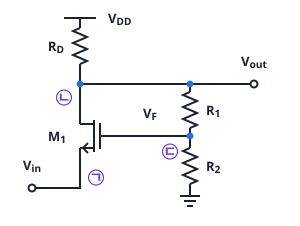

*분배기 귀환이 연결된 원래 회로 · ㉠ $M_1$ 소스(입력) · ㉡ 드레인(출력) · ㉢ 분배기 가운데 노드와 게이트 (강의노트 s53 왼쪽)*

#### (a) 귀환의 네 성분

$R_1$–$R_2$가 ㉡ 출력 전압을 나눠 ㉢ 게이트에 돌려줘요. ㉠ 소스에 $v_{in}$이 들어와요.

$$
K=\frac{R_2}{R_1+R_2}
$$

$$
v_F=Kv_{out}
$$

$$
i_D=g_m(v_F-v_{in})
$$

순방향은 $M_1$과 $R_D$로 이루어진 CG 단, 출력 감지와 귀환은 $R_1$–$R_2$ 분압기, 전압 비교는 $M_1$이 맡아요.

#### (b) 전압 이득

개루프에서 게이트를 AC 접지하고 출력을 단락해요. 드레인으로 들어가는 전류가 양의 방향이에요.

$$
G_m=-g_m
$$

입력을 0으로 둬요. $\lambda=0$이고 $R_1+R_2\gg R_D$이므로 출력 부하는 $R_D$로 근사해요.

$$
R_{out,\mathrm{open}}\approx R_D
$$

$$
A_{\mathrm{open}}=-G_mR_{out,\mathrm{open}}\approx g_mR_D
$$

$$
A_{\mathrm{closed}}\approx\frac{A_{\mathrm{open}}}{1+KA_{\mathrm{open}}}
$$

#### (c) 입출력 임피던스

출력 개루프 저항은 (b)의 값이에요. 전압을 직렬로 비교하는 입력은 $1+KA_{\mathrm{open}}$배, 전압을 병렬로 감지하는 출력은 그 값으로 나눠요.

$$
R_{in,\mathrm{open}}=\frac{1}{g_m}
$$

$$
R_{in,\mathrm{closed}}\approx R_{in,\mathrm{open}}(1+KA_{\mathrm{open}})
$$

$$
R_{out,\mathrm{closed}}\approx\frac{R_{out,\mathrm{open}}}{1+KA_{\mathrm{open}}}
$$

**페이지 요약**

출력 분압 전압과 소스 입력을 $M_1$이 비교해요.

#### 개루프에서 남는 부하

$R_1+R_2\gg R_D$이므로 $R_{out,\mathrm{open}}\approx R_D$예요.

---

### P2. 복제 종단으로 푸는 분배기 귀환 CG 단

E12.26 · 예제 12.26 · [원 문제 보기](../%EB%B3%B5%EC%8A%B5%EB%AC%B8%EC%A0%9C_1120_Nonideal_IO_Feedback-%EB%AC%B8%EC%A0%9C.pdf)

#### 주어진 조건

- 조건: $R_1 + R_2$가 $R_D$보다 충분히 작지 않을 때
- 문맥과 맞지 않음(오식으로 보임): 같은 회로를 다룬 예제 12.25는 "$R_1 + R_2$가 $R_D$에 비해 훨씬 크지 않다", 다음 예제 12.27은 "충분히 크지 않을 때"로 적고, 이 예제 풀이도 결과가 예제 12.25와 일치한다고 함. "충분히 크지 않을 때"의 뜻으로 보임
- 해석 = 12.7.1절의 여섯 단계로 개루프·폐루프 이득과 I/O 임피던스를 구함
- 12.7.1절의 여섯 단계: 순방향 증폭기 확인, 귀환 회로망 확인, 법칙에 따라 귀환 회로망 끊기, 개루프 변수 계산, 법칙에 따라 귀환율 결정, 폐루프 변수 계산
- 전압-전압 귀환에서 귀환 회로망을 끊는 법칙 (본문 Fig 12.53(a)): 출력에 연결한 복사물(감지 복제)의 출력 포트는 개방, 입력에 연결한 복사물(반송 복제)의 입력 포트는 단락
- 전압-전압 귀환의 귀환율 (본문 Fig 12.54(a)): 귀환 회로망 입력 포트에 $V_1$을 인가하고 출력 포트를 개방한 채 출력 전압 $V_2$를 보아 $K = V_2/V_1$
- 소자 값은 주어지지 않음 (답은 $g_{m1}$, $R_D$, $R_1$, $R_2$의 식으로)

#### 구할 것

- 증폭기의 해석: 개루프·폐루프 전압 이득, 폐루프 입력·출력 임피던스

원문 보기

$R_1 + R_2$가 $R_D$보다 충분히 작지 않을 때 그림 12.55(a)에 그려진 증폭기를 해석하라.

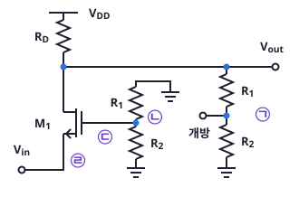

*감지·반송 복제를 붙인 개루프 회로 · ㉠ 감지 복제 · ㉡ 반송 복제 · ㉢ 게이트 · ㉣ $M_1$ 소스(입력) (강의노트 s53 오른쪽)*

#### 복제 회로에서 첫 식 세우기

분압기 부하를 포함하고 $\lambda=0$으로 가정해요.

㉠ 감지 복제의 가운데 포트를 열면 출력에서 접지까지 $R_1+R_2$가 보여요.

㉡ 반송 복제의 위쪽 포트를 접지하면 ㉢ 게이트에 $R_1\parallel R_2$가 달려요. 게이트 전류가 0이므로 게이트는 AC 접지예요.

#### 개루프 이득과 귀환율

㉣ 소스가 입력이에요. 출력을 단락하고 드레인으로 들어가는 전류를 양으로 잡아요.

$$
G_m=-g_{m1}
$$

입력을 0으로 두고 ㉠ 감지 복제와 $R_D$를 병렬로 합쳐요.

$$
R_{out,\mathrm{open}}=R_D\parallel(R_1+R_2)
$$

$$
A_{\mathrm{open}}=-G_mR_{out,\mathrm{open}}
$$

$$
R_{in,\mathrm{open}}=\frac{1}{g_{m1}}
$$

분압기만 떼어 위쪽에 $V_1$을 걸고 열린 가운데 단자의 $V_2$를 읽어요.

$$
K=\frac{V_2}{V_1}=\frac{R_2}{R_1+R_2}
$$

#### 폐루프 답

$$
A_{\mathrm{closed}}=\frac{A_{\mathrm{open}}}{1+KA_{\mathrm{open}}}
$$

$$
R_{in,\mathrm{closed}}=R_{in,\mathrm{open}}(1+KA_{\mathrm{open}})
$$

$$
R_{out,\mathrm{closed}}=\frac{R_{out,\mathrm{open}}}{1+KA_{\mathrm{open}}}
$$

**검산** $R_1+R_2\gg R_D$이면 $R_{out,\mathrm{open}}\approx R_D$이므로 P1과 같은 출력 부하가 돼요.

**페이지 요약**

감지 복제의 $R_1+R_2$가 출력 부하에 들어가요.

#### 개루프에서 남는 부하

$R_{out,\mathrm{open}}=R_D\parallel(R_1+R_2)$예요.

---

### P3. 전류원 부하 CG 단에서 커지는 로딩 효과

P12.41 · 장말문제 12.41 · [원 문제 보기](../%EB%B3%B5%EC%8A%B5%EB%AC%B8%EC%A0%9C_1120_Nonideal_IO_Feedback-%EB%AC%B8%EC%A0%9C.pdf)

#### 주어진 조건

- 부하가 이상적 전류원이므로 $R_1$, $R_2$가 일으키는 부하 효과를 고려해야 함
- 예제 12.26을 이 회로로 되풀이 (원문 표기 "Example 12-26")
- 예제 12.26: $R_1 + R_2$가 $R_D$보다 충분히 작지 않을 때 그림 12.55(a)의 증폭기(전압-전압 귀환 CG 단)를 해석하라 — 개루프 변수와 귀환율 $K$를 구하고 폐루프 이득 $A_{v,closed}$, $R_{in,closed}$, $R_{out,closed}$를 구함
- 참고 회로 (본문 Fig 12.55(a)): $V_{DD}$에서 $R_D$를 거쳐 $M_1$ 드레인 $= V_{out}$, $V_{out}$과 접지 사이에 $R_1$, $R_2$ 직렬, 그 가운데 노드가 $M_1$ 게이트, $M_1$ 소스가 $V_{in}$
- 식 (12.120)–(12.121): $K = \dfrac{V_2}{V_1} = \dfrac{R_2}{R_1 + R_2}$, 예제 12.26의 귀환율
- 소자 값은 주어지지 않음 (답은 기호로)

#### 구할 것

- 예제 12.26처럼 $R_1$, $R_2$의 부하 효과를 넣어 개루프 회로를 만들고, 귀환율, 폐루프 전압 이득, 폐루프 입력·출력 임피던스를 구함

원문 보기

The common-gate stage shown in Fig. 12.104 employs an ideal current source as its load, requiring that the loading introduced by $R_1$ and $R_2$ be taken into account. Repeat Example 12-26 for this circuit.

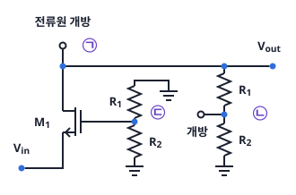

*전류원 부하를 개방한 CG 개루프 회로*

#### 전류원 부하가 사라진 자리

㉠ 이상적 전류원은 소신호에서 열려요. $\lambda=0$을 가정하면 출력에서 접지로 이어지는 부하는 ㉡ 감지 복제의 $R_1+R_2$만 남아요.

㉢ 반송 복제의 $R_1\parallel R_2$에는 게이트 전류가 흐르지 않아 게이트는 교류 접지예요.

출력을 단락하고 드레인으로 들어가는 전류를 양으로 잡아요.

$$
G_m=-g_{m1}
$$

입력을 0으로 두고 출력에서 본 저항이에요.

$$
R_{\mathrm{out,open}}=R_1+R_2
$$

$$
A_{\mathrm{open}}=-G_mR_{\mathrm{out,open}}=g_{m1}(R_1+R_2)
$$

$$
R_{\mathrm{in,open}}=\frac{1}{g_{m1}}
$$

$$
K=\frac{R_2}{R_1+R_2}
$$

$$
KA_{\mathrm{open}}=g_{m1}R_2
$$

#### 폐루프 답

$$
A_{\mathrm{closed}}=\frac{g_{m1}(R_1+R_2)}{1+g_{m1}R_2}
$$

$$
R_{\mathrm{in,closed}}=\frac{1}{g_{m1}}+R_2
$$

$$
R_{\mathrm{out,closed}}=\frac{R_1+R_2}{1+g_{m1}R_2}
$$

**페이지 요약**

이상적 전류원을 열면 $R_1+R_2$가 출력 부하에 남아요.

루프 이득은 $g_{m1}R_2$예요.

---

### P4. 바이폴라 CB 단의 분배기 귀환 로딩

P12.42 · 장말문제 12.42 · [원 문제 보기](../%EB%B3%B5%EC%8A%B5%EB%AC%B8%EC%A0%9C_1120_Nonideal_IO_Feedback-%EB%AC%B8%EC%A0%9C.pdf)

#### 주어진 조건

- 예제 12.26의 회로 (본문 Fig 12.55(a)): $R_D$를 부하로 한 NMOS 공통 게이트 단, $V_{out}$과 접지 사이 $R_1$, $R_2$ 분압기의 가운데 노드가 $M_1$ 게이트로 귀환. $R_1 + R_2$가 $R_D$보다 충분히 작지 않을 때 해석
- $R_1 + R_2$는 매우 크지 않다고 가정 (부하 효과를 고려)
- $1 \ll \beta < \infty$
- $V_A = \infty$
- 소자 값은 주어지지 않음 (답은 기호로)

#### 구할 것

- 폐루프 이득
- 폐루프 입력·출력 임피던스

원문 보기

Figure 12.105 depicts the bipolar counterpart of the circuit studied in Example 12-26. Assuming $R_1 + R_2$ is not very large, $1 \ll \beta < \infty$ and $V_A = \infty$, determine the closed-loop gain and I/O impedances.

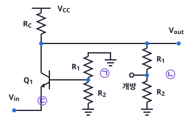

*베이스에 반송 복제가 붙은 CB 개루프 회로*

#### 이미터에서 보는 저항

㉠ 반송 복제의 위쪽을 단락하면 베이스에 $R_B$가 붙어요. ㉢ 이미터에서 보면 큰 $\beta$에서 $R_B/\beta$가 내부의 $1/g_m$에 직렬로 더해져요.

$$
R_B=R_1\parallel R_2
$$

㉡ 감지 복제의 가운데 포트를 열면 출력에 $R_1+R_2$가 붙어요. $V_A=\infty$이므로 $r_o$는 생략해요.

출력을 단락하고 컬렉터로 들어가는 전류를 양으로 잡아요. 베이스가 바로 교류 접지면 $R_B=0$이라서 $-g_m$으로 줄어요.

$$
G_m=-\frac{1}{1/g_m+R_B/\beta}
$$

입력을 0으로 두고 출력에서 본 저항이에요.

$$
R_{\mathrm{out,open}}=R_C\parallel(R_1+R_2)
$$

$$
A_{\mathrm{open}}=-G_mR_{\mathrm{out,open}}=\frac{R_{\mathrm{out,open}}}{1/g_m+R_B/\beta}
$$

$$
R_{\mathrm{in,open}}=\frac{r_\pi+R_B}{\beta+1}\approx\frac{1}{g_m}+\frac{R_B}{\beta}
$$

$$
K=\frac{R_2}{R_1+R_2}
$$

#### 폐루프 답

$$
A_{\mathrm{closed}}\approx\frac{A_{\mathrm{open}}}{1+KA_{\mathrm{open}}}
$$

$$
R_{\mathrm{in,closed}}\approx R_{\mathrm{in,open}}(1+KA_{\mathrm{open}})
$$

$$
R_{\mathrm{out,closed}}\approx\frac{R_{\mathrm{out,open}}}{1+KA_{\mathrm{open}}}
$$

**페이지 요약**

㉢ 이미터에서 읽은 $1/g_m+R_B/\beta$의 음의 역수가 출력 단락 $G_m$이에요.

감지 복제의 $R_1+R_2$는 $R_C$와 병렬이에요.

---

### P5. 소스로 귀환하는 2단 CS 증폭기의 로딩 해석

E12.28 · 예제 12.28 · [원 문제 보기](../%EB%B3%B5%EC%8A%B5%EB%AC%B8%EC%A0%9C_1120_Nonideal_IO_Feedback-%EB%AC%B8%EC%A0%9C.pdf)

#### 주어진 조건

- 해석 = 개루프·폐루프 이득과 I/O 임피던스를 구함
- 전압-전압 귀환에서 귀환 회로망을 끊는 법칙 (본문 Fig 12.53(a)): 감지 복제의 출력 포트는 개방, 반송 복제의 입력 포트는 단락. 귀환율은 입력 포트에 $V_1$을 인가하고 출력 포트를 개방해 $K = V_2/V_1$ (본문 Fig 12.54(a))
- 소자 값은 주어지지 않음

#### 구할 것

- 회로의 해석: 개루프·폐루프 전압 이득, 폐루프 입력·출력 임피던스

원문 보기

그림 12.57(a)의 회로를 해석하라.

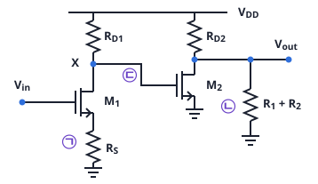

*두 복제를 저항으로 합친 개루프 회로*

#### 반송 복제가 첫 단을 축퇴시켜요

㉠ 반송 복제를 단락해 얻은 $R_S$가 $M_1$ 소스에 달려요. 두 MOS는 $\lambda=0$으로 가정해요.

$$
R_S=R_1\parallel R_2
$$

㉢ 첫 단 출력 $X$에서는 $M_2$ 게이트 전류가 0이라 부하가 $R_{D1}$이에요.

$$
\frac{v_X}{v_{in}}=-\frac{R_{D1}}{1/g_{m1}+R_S}
$$

㉡ 감지 복제의 가운데 포트가 열려 있어 $R_1+R_2$가 $R_{D2}$에 병렬로 붙어요.

$$
R_{\mathrm{out,open}}=R_{D2}\parallel(R_1+R_2)
$$

$$
\frac{v_{out}}{v_X}=-g_{m2}R_{\mathrm{out,open}}
$$

두 공통 소스 단이 각각 반전하므로 개루프 이득은 양수예요.

$$
A_{\mathrm{open}}=\frac{v_X}{v_{in}}\frac{v_{out}}{v_X} =\frac{g_{m2}R_{D1}R_{\mathrm{out,open}}}{1/g_{m1}+R_S}
$$

$$
K=\frac{R_2}{R_1+R_2}
$$

#### 폐루프 답

분압기를 통한 직접 전달을 무시하는 복제법의 결과예요.

$$
A_{\mathrm{closed}}\approx\frac{A_{\mathrm{open}}}{1+KA_{\mathrm{open}}}
$$

$$
R_{\mathrm{in,open}}=R_{\mathrm{in,closed}}=\infty
$$

$$
R_{\mathrm{out,closed}}\approx\frac{R_{\mathrm{out,open}}}{1+KA_{\mathrm{open}}}
$$

**페이지 요약**

반송 복제는 첫 단의 소스 축퇴, 감지 복제는 둘째 단의 출력 부하예요.

㉢의 $X$를 기준으로 첫 단의 $v_X/v_{in}$과 둘째 단의 $v_{out}/v_X$를 곱해요.

---

### P6. 분배기 귀환 차동 증폭기의 로딩 해석

E12.27 · 예제 12.27 · [원 문제 보기](../%EB%B3%B5%EC%8A%B5%EB%AC%B8%EC%A0%9C_1120_Nonideal_IO_Feedback-%EB%AC%B8%EC%A0%9C.pdf)

#### 주어진 조건

- 조건: $R_1 + R_2$가 $r_{OP} \parallel r_{ON}$보다 충분히 크지 않음
- $r_{ON}$, $r_{OP}$: NMOS($M_1$, $M_2$)와 PMOS($M_3$, $M_4$)의 출력 저항, $g_{mN}$: NMOS 입력 쌍의 트랜스컨덕턴스
- 해석 = 개루프·폐루프 이득과 I/O 임피던스를 구함
- 전압-전압 귀환에서 귀환 회로망을 끊는 법칙 (본문 Fig 12.53(a)): 감지 복제의 출력 포트는 개방, 반송 복제의 입력 포트는 단락. 귀환율은 입력 포트에 $V_1$을 인가하고 출력 포트를 개방해 $K = V_2/V_1$ (본문 Fig 12.54(a))
- 소자 값은 주어지지 않음

#### 구할 것

- 회로의 해석: 개루프·폐루프 전압 이득, 폐루프 입력·출력 임피던스

원문 보기

$R_1 + R_2$가 $r_{OP} \parallel r_{ON}$보다 충분히 크지 않을 때 그림 12.56(a)의 회로를 해석하라.

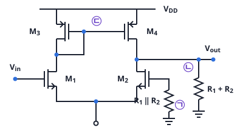

*두 복제를 저항으로 합친 차동쌍 개루프 회로*

귀환을 끊으면 출력에서 접지로 어떤 저항을 지나갈까요? [감지 복제 결선해 보기](../.assets/%EC%9E%90%EB%A3%8C_%EB%AC%B8%EC%A0%9C%EC%84%A4%EB%AA%85_1120_Nonideal_IO_Feedback/labs/E12.27/index.html)

#### 전류 거울 출력에 분압기 부하가 붙어요

㉠ 반송 복제의 $R_1\parallel R_2$에는 게이트 전류가 흐르지 않아 $M_2$ 게이트가 교류 접지예요. ㉡ 감지 복제의 $R_1+R_2$는 출력 저항과 병렬이에요.

대칭 차동쌍, 이상적 테일 전류원과 ㉢ 거울 근사($g_{mP}(r_{ON}\parallel r_{OP})\gg1$)를 써요.

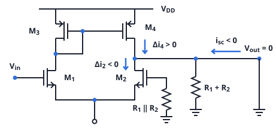

*출력 단락 · 양의 입력에서의 소신호 전류 변화*

입력을 올리면 $M_4$는 위에서 더 공급하고 $M_2$는 아래로 덜 끌어가요. 그림에서 두 가지 전류는 아래를 양으로, $i_{\mathrm{sc}}$는 오른쪽 단락선에서 증폭기로 들어가는 쪽을 양으로 잡아요. 대칭 차동쌍에서 $g_{m1}=g_{m2}=g_{mN}$이에요. 남는 전류는 단락선으로 나가므로 $i_{\mathrm{sc}}$는 음수예요.

$$
\Delta i_4\approx+\frac{g_{mN}v_{in}}{2}
$$

$$
\Delta i_2\approx-\frac{g_{mN}v_{in}}{2}
$$

$$
i_{\mathrm{sc}}=\Delta i_2-\Delta i_4\approx -g_{m1}v_{in}
$$

$$
G_m=\frac{i_{\mathrm{sc}}}{v_{in}}\approx -g_{m1}
$$

입력을 0으로 두고 출력에서 본 저항이에요.

$$
R_{\mathrm{out,open}}\approx r_{ON}\parallel r_{OP}\parallel(R_1+R_2)
$$

$$
A_{\mathrm{open}}=-G_mR_{\mathrm{out,open}}\approx g_{m1}R_{\mathrm{out,open}}
$$

$$
K=\frac{R_2}{R_1+R_2}
$$

#### 폐루프 답

$$
A_{\mathrm{closed}}\approx\frac{A_{\mathrm{open}}}{1+KA_{\mathrm{open}}}
$$

$$
R_{\mathrm{in,open}}=R_{\mathrm{in,closed}}=\infty
$$

$$
R_{\mathrm{out,closed}}\approx\frac{R_{\mathrm{out,open}}}{1+KA_{\mathrm{open}}}
$$

**페이지 요약**

감지 복제 $R_1+R_2$가 차동쌍의 출력 부하에 더해져요.

$R_{\mathrm{out,open}}\approx r_{ON}\parallel r_{OP}\parallel(R_1+R_2)$예요.

---

### P7. 귀환 저항이 크지 않은 트랜스임피던스 증폭기

E12.29 · 예제 12.29 · [원 문제 보기](../%EB%B3%B5%EC%8A%B5%EB%AC%B8%EC%A0%9C_1120_Nonideal_IO_Feedback-%EB%AC%B8%EC%A0%9C.pdf)

#### 주어진 조건

- $R_F$가 매우 크지 않음 (귀환 회로망이 순방향 증폭기에 주는 부하를 무시할 수 없음)
- 소자 값은 주어지지 않음 (답은 소신호 파라미터 기호로, $\lambda = 0$으로 봄)
- 본문의 해석 순서: 순방향 증폭기와 귀환 회로망을 확인하고, 종지 법칙(Fig 12.53)에 따라 루프를 끊어 개루프 변수를 구한 뒤, Fig 12.54의 법칙으로 귀환율을 구하고 폐루프 변수를 계산
- 전압-전류 귀환의 종지 법칙 (본문 Fig 12.53(b)): 감지 복제의 출력 포트와 반송 복제의 입력 포트를 모두 단락
- 전압-전류 귀환의 귀환율 (본문 Fig 12.54(b)): 귀환 회로망 입력에 전압 $V_1$을 걸고 단락된 출력 포트의 전류 $I_2$를 재어 $K = I_2/V_1$

#### 구할 것

- 회로 해석: 개루프 이득 $R_0 = V_{out}/I_{in}$, 개루프 입력·출력 임피던스, 귀환율 $K$, 폐루프 이득과 폐루프 입력·출력 임피던스

원문 보기

$R_F$가 매우 크지 않다고 가정할 때 그림 12.58(a)의 회로를 해석하라.

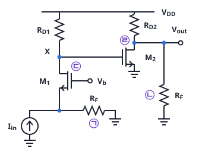

*입력·출력에 단락 복제를 붙인 개루프 회로*

두 복제의 반대 포트를 단락해 ㉠ 입력과 ㉡ 출력에 각각 $R_F$를 접지로 붙여요. $\lambda=0$으로 두어요.

$I_{in}\parallel R_F$를 테브난 등가 $I_{in}R_F$와 직렬 $R_F$로 바꾸면 ㉢ $X$ 전압은 CG 이득으로 구해요.

$$
\frac{v_X}{I_{in}}=R_F\frac{R_{D1}}{R_F+1/g_{m1}}
$$

㉣ CS 단의 출력 전류는 드레인으로 들어가는 방향이 양이에요.

$$
G_{m2}=g_{m2}
$$

$$
R_{out,\mathrm{open}}=R_{D2}\parallel R_F
$$

$$
\frac{v_{out}}{v_X}=-G_{m2}R_{out,\mathrm{open}}
$$

입력을 단락하면 $v_{out}\gt0$에서 $R_F$ 전류가 입력 노드로 들어와요. 그 노드에서 빠져나가는 방향을 $I_F$의 양으로 잡아요.

$$
R_0=\frac{v_X}{I_{in}}\frac{v_{out}}{v_X}
$$

$$
R_{in,\mathrm{open}}=R_F\parallel\frac{1}{g_{m1}}
$$

$$
K=\frac{I_F}{v_{out}}=-\frac{1}{R_F}
$$

$KR_0\gt0$인 부궤환이에요. 복제법에서 다음 폐루프 값이 나와요.

$$
\frac{v_{out}}{I_{in}}\approx\frac{R_0}{1+KR_0}
$$

$$
R_{in,\mathrm{closed}}\approx\frac{R_{in,\mathrm{open}}}{1+KR_0}
$$

$$
R_{out,\mathrm{closed}}\approx\frac{R_{out,\mathrm{open}}}{1+KR_0}
$$

**페이지 요약**

CG–CS의 $R_0$와 $K=-1/R_F$가 모두 음수여서 $1+KR_0\gt1$이에요.

---

### P8. CG와 PMOS CS로 만든 트랜스임피던스 증폭기의 개루프·폐루프 해석

2023-1_기말-Q2 · 기출 2 · [원 문제 보기](../%EB%B3%B5%EC%8A%B5%EB%AC%B8%EC%A0%9C_1120_Nonideal_IO_Feedback-%EB%AC%B8%EC%A0%9C.pdf)

#### 주어진 조건

- $R_F$는 매우 크지 않다고 가정
- $\lambda = 0$으로 가정
- 소자 값($R_D$, $R_F$, $R_M$, $V_b$, $V_{DD}$, 트랜지스터 크기)은 주어지지 않음

#### 구할 것

- (1) Open-loop gain과 open-loop 입력 임피던스, open-loop 출력 임피던스를 각각 구함
- (2) Feedback factor, closed-loop gain, closed-loop 입력 임피던스를 각각 구함

원문 보기

다음 회로에서 $R_F$는 매우 크지 않다고 가정하며, $\lambda = 0$으로 가정한다.

(1) Open-loop gain과 open-loop 입력 및 출력 임피던스를 각각 구하시오.

(2) Feedback factor, closed-loop gain, closed-loop 입력 임피던스를 각각 구하시오.

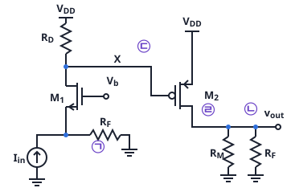

*단락 복제를 붙인 CG–PMOS CS 개루프 회로*

#### (1) 개루프

두 복제를 단락해 ㉠ 입력에 $R_F$, ㉡ 출력에 $R_M\parallel R_F$를 남겨요. $\lambda=0$이에요.

$I_{in}\parallel R_F$의 테브난 전압은 $I_{in}R_F$예요. 직렬 $R_F$가 붙은 CG 단에서 ㉢ $X$까지의 이득을 써요.

$$
\frac{v_X}{I_{in}}=R_F\frac{R_D}{R_F+1/g_{m1}}
$$

㉣ PMOS CS는 반전이에요. $v_X$가 오르면 $M_2$가 출력으로 공급하는 전류가 줄어요. $i_{out}$은 증폭기로 들어가는 방향을 양으로 잡아요.

$$
G_{m2}=g_{m2}
$$

$$
R_{out,\mathrm{open}}=R_M\parallel R_F
$$

$$
\frac{v_{out}}{v_X}=-G_{m2}R_{out,\mathrm{open}}
$$

$$
R_0=\frac{v_X}{I_{in}}\frac{v_{out}}{v_X}
$$

$$
R_{in,\mathrm{open}}=R_F\parallel\frac{1}{g_{m1}}
$$

#### (2) 귀환율과 폐루프

입력을 단락하면 $v_{out}\gt0$에서 $R_F$ 전류가 입력 노드로 들어와요. 그 노드에서 빠져나가는 방향을 $I_F$의 양으로 잡아요.

$$
K=\frac{I_F}{v_{out}}=-\frac{1}{R_F}
$$

복제법으로 폐루프 값을 근사해요.

$$
\frac{v_{out}}{I_{in}}\approx\frac{R_0}{1+KR_0}
$$

$$
R_{in,\mathrm{closed}}\approx\frac{R_{in,\mathrm{open}}}{1+KR_0}
$$

**페이지 요약**

PMOS CS가 반전하므로 출력 부하 $R_M\parallel R_F$를 넣은 $R_0$는 음수예요.

---

### P9. CG와 소스 팔로워 귀환 회로의 루프 부호와 폐루프 해석

2021-1_기말-Q3 · 기출 3 · [원 문제 보기](../%EB%B3%B5%EC%8A%B5%EB%AC%B8%EC%A0%9C_1120_Nonideal_IO_Feedback-%EB%AC%B8%EC%A0%9C.pdf)

#### 주어진 조건

- $R_F$는 매우 크지 않다고 가정
- $\lambda = 0$으로 가정
- 소자 값($R_D$, $R_F$, $R_M$, $V_b$, $V_{DD}$, 트랜지스터 크기)은 주어지지 않음

#### 구할 것

- (1) Feedback factor와 closed-loop gain을 각각 구함
- (2) Closed-loop input impedance와 closed-loop output impedance를 각각 구함

원문 보기

다음 회로에서 $R_F$는 매우 크지 않다고 가정하며, $\lambda = 0$으로 가정한다.

(1) Feedback factor와 closed-loop gain을 각각 구하시오.

(2) Closed-loop input impedance와 closed-loop output impedance를 각각 구하시오.

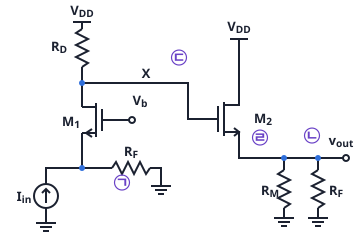

*단락 복제를 붙인 CG–소스 팔로워 개루프 회로*

#### (1) 귀환율과 폐루프 이득

두 복제를 단락하면 ㉠ 입력과 ㉡ 출력에 $R_F$가 각각 남아요. $\lambda=0$이고 몸체 효과는 무시해요.

테브난 전압 $I_{in}R_F$에 직렬 $R_F$가 붙으므로 ㉢ $X$까지의 CG 이득을 바로 써요.

$$
\frac{v_X}{I_{in}}=R_F\frac{R_D}{R_F+1/g_{m1}}
$$

㉣ $M_2$의 소스가 출력이에요. $i_{out}$을 증폭기 쪽으로 들어가는 방향으로 잡으면 $G_{m2}$가 음수예요.

$$
G_{m2}=-g_{m2}
$$

$$
R_{out,\mathrm{open}}=\frac{1}{g_{m2}}\parallel R_M\parallel R_F
$$

$$
\frac{v_{out}}{v_X}=-G_{m2}R_{out,\mathrm{open}}
$$

$$
R_0=\frac{v_X}{I_{in}}\frac{v_{out}}{v_X}\gt0
$$

입력 단락 시 그 노드에서 빠져나가는 방향을 $I_F$의 양으로 잡아요.

$$
K=\frac{I_F}{v_{out}}=-\frac{1}{R_F}
$$

$$
T=-KR_0=\frac{R_0}{R_F}
$$

CG와 소스 팔로워가 모두 비반전이므로 정궤환이에요. 저주파 복제 모델에서 $T\lt1$인 경우를 써요.

$$
\frac{v_{out}}{I_{in}}\approx\frac{R_0}{1-T}
$$

#### (2) 폐루프 입출력 저항

$$
R_{in,\mathrm{open}}=R_F\parallel\frac{1}{g_{m1}}
$$

$$
R_{in,\mathrm{closed}}\approx\frac{R_{in,\mathrm{open}}}{1-T}
$$

$$
R_{out,\mathrm{closed}}\approx\frac{R_{out,\mathrm{open}}}{1-T}
$$

**페이지 요약**

두 단이 모두 비반전이므로 폐루프 분모가 $1-T$인 정궤환이에요.

---

### P10. 단일 BJT 트랜스임피던스 증폭기의 로딩 해석

P12.49 · 장말문제 12.49 · [원 문제 보기](../%EB%B3%B5%EC%8A%B5%EB%AC%B8%EC%A0%9C_1120_Nonideal_IO_Feedback-%EB%AC%B8%EC%A0%9C.pdf)

#### 주어진 조건

- 예제 12.29의 해석을 이 회로로 되풀이 (원문 표기 "Example 12-29")
- 예제 12.29: $R_F$가 매우 크지 않다고 가정할 때 그림 12.58(a)의 회로를 해석하라 — 전압-전류 귀환으로 보고 개루프 트랜스임피던스 $R_0$, $R_{in,open}$, $R_{out,open}$, 귀환율 $K$를 구한 뒤 폐루프 이득 $V_{out}/I_{in}$, $R_{in,closed}$, $R_{out,closed}$를 구함
- 참고 회로 (본문 Fig 12.58(a)): $I_{in}$이 $M_1$ 소스로 들어가고, $M_1$ (게이트 $V_b$, 드레인 X, $R_{D1}$ 부하) → $M_2$ (소스 접지, 드레인 $R_{D2}$ 부하 = $V_{out}$), $V_{out}$에서 $R_F$를 거쳐 $M_1$ 소스로 귀환
- $V_A < \infty$
- 소자 값은 주어지지 않음 (답은 기호로)

#### 구할 것

- 예제 12.29처럼 개루프 트랜스임피던스·개루프 입력·출력 임피던스, 귀환율, 폐루프 이득 $V_{out}/I_{in}$과 폐루프 입력·출력 임피던스

원문 보기

Figure 12.112 depicts a popular transimpedance amplifier topology. Repeat the analysis of Example 12-29 for this circuit. Assume $V_A < \infty$.

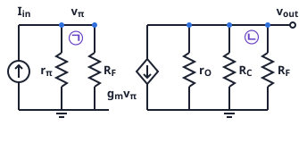

*단락 복제를 붙인 CE 소신호 회로*

두 복제를 단락하면 ㉠ 베이스와 ㉡ 컬렉터에 각각 $R_F$가 붙어요. $V_A\lt\infty$이므로 컬렉터의 $r_O$를 남겨요.

$$
R_{in,\mathrm{open}}=r_\pi\parallel R_F
$$

$$
v_\pi=I_{in}R_{in,\mathrm{open}}
$$

$$
R_{out,\mathrm{open}}=R_C\parallel r_O\parallel R_F
$$

$$
R_0=-g_mR_{in,\mathrm{open}}R_{out,\mathrm{open}}
$$

입력을 단락하고 출력에 $v_{out}$을 걸어요. 베이스 노드에서 나가는 방향을 $I_F$의 양으로 잡아요.

$$
K=\frac{I_F}{v_{out}}=-\frac{1}{R_F}
$$

복제법으로 폐루프 값을 근사해요.

$$
\frac{v_{out}}{I_{in}}\approx\frac{R_0}{1+KR_0}
$$

$$
R_{in,\mathrm{closed}}\approx\frac{R_{in,\mathrm{open}}}{1+KR_0}
$$

$$
R_{out,\mathrm{closed}}\approx\frac{R_{out,\mathrm{open}}}{1+KR_0}
$$

**페이지 요약**

베이스에는 $r_\pi\parallel R_F$, 컬렉터에는 $R_C\parallel r_O\parallel R_F$가 보여요.

---

### P11. 분배기와 귀환 저항을 함께 쓴 트랜스임피던스 증폭기

P12.47 · 장말문제 12.47 · [원 문제 보기](../%EB%B3%B5%EC%8A%B5%EB%AC%B8%EC%A0%9C_1120_Nonideal_IO_Feedback-%EB%AC%B8%EC%A0%9C.pdf)

#### 주어진 조건

- 예제 12.29를 이 회로로 되풀이 (원문 표기 "Example 12-29")
- 예제 12.29: $R_F$가 매우 크지 않다고 가정할 때 그림 12.58(a)의 회로를 해석하라 — 전압-전류 귀환으로 보고 개루프 트랜스임피던스 $R_0$, $R_{in,open}$, $R_{out,open}$, 귀환율 $K$를 구한 뒤 폐루프 이득 $V_{out}/I_{in}$, $R_{in,closed}$, $R_{out,closed}$를 구함
- 참고 회로 (본문 Fig 12.58(a)): $I_{in}$이 $M_1$ 소스로 들어가고, $M_1$ (게이트 $V_b$, 드레인 X, $R_{D1}$ 부하) → $M_2$ (소스 접지, 드레인 $R_{D2}$ 부하 = $V_{out}$), $V_{out}$에서 $R_F$를 거쳐 $M_1$ 소스로 귀환
- $\lambda > 0$
- 소자 값은 주어지지 않음 (답은 기호로)

#### 구할 것

- 예제 12.29처럼 개루프 트랜스임피던스·개루프 입력·출력 임피던스, 귀환율, 폐루프 이득 $v_{out}/i_{in}$과 폐루프 입력·출력 임피던스

원문 보기

Repeat Example 12-29 for the circuit illustrated in Fig. 12.110. Assume $\lambda > 0$.

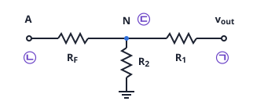

*분배 귀환망의 두 단락 포트*

㉠ 출력 포트를 단락하면 ㉡ 입력 $A$에서 본 반송 복제가 $R_A$예요. 반대로 $A$를 단락하면 출력에서 본 감지 복제가 $R_B$예요.

$$
R_A=R_F+(R_1\parallel R_2)
$$

$$
R_B=R_1+(R_2\parallel R_F)
$$

$\lambda\gt0$이라 두 $r_O$를 남기고, 몸체 효과는 무시해요. $g_{m1}r_{O1}\gg1$에서 $M_1$ 소스 저항을 $R_{S1}$로 근사해요.

$$
R_{S1}\approx\frac{1}{g_{m1}}\left(1+\frac{R_{D1}}{r_{O1}}\right)
$$

$i_{in}\parallel R_A$를 전압 $i_{in}R_A$와 직렬 $R_A$로 바꿔 CG 이득을 곱해요.

$$
\frac{v_X}{i_{in}}\approx R_A\frac{R_{D1}}{R_A+R_{S1}}
$$

이상적 전류원 부하는 소신호에서 개방이에요. $i_{out}$은 $M_2$ 드레인에 들어가는 방향이 양이에요.

$$
G_{m2}=g_{m2}
$$

$$
R_{out,\mathrm{open}}=r_{O2}\parallel R_B
$$

$$
\frac{v_{out}}{v_X}=-G_{m2}R_{out,\mathrm{open}}
$$

$A$를 단락하고 $v_{out}$을 걸면 ㉢ $N$의 아래쪽 저항은 $R_2\parallel R_F$예요. $A$에서 빠져나가는 방향을 $i_F$의 양으로 잡아요.

$$
v_N=\frac{R_2\parallel R_F}{R_B}v_{out}
$$

$$
R_0=\frac{v_X}{i_{in}}\frac{v_{out}}{v_X}
$$

$$
R_{in,\mathrm{open}}\approx R_A\parallel R_{S1}
$$

$$
K=\frac{i_F}{v_{out}}=-\frac{R_2}{R_1R_2+R_1R_F+R_2R_F}
$$

복제법으로 폐루프 값을 근사해요.

$$
\frac{v_{out}}{i_{in}}\approx\frac{R_0}{1+KR_0}
$$

$$
R_{in,\mathrm{closed}}\approx\frac{R_{in,\mathrm{open}}}{1+KR_0}
$$

$$
R_{out,\mathrm{closed}}\approx\frac{R_{out,\mathrm{open}}}{1+KR_0}
$$

**페이지 요약**

$A$를 단락하면 $R_F$가 $R_2$와 병렬이 되어 감지 부하와 귀환율이 모두 달라져요.

---

원 문제·정리노트·PDF는 보존해요.
