# 로딩을 포함한 귀환 회로 해석 — 5살도 이해하는 정리노트

권익진 교수님 전자회로2 · 1120 수업 (Lec6 47–56쪽, Razavi 12장)

> `정리노트_1120_Nonideal_IO_Feedback.html`를 마크다운으로 옮겼어요. 그림은 `figures_1120/` 폴더의 SVG, 위젯은 대표 설정의 정적 그림으로 바꿨어요. 수식은 `$…$` / `$$…$$`라서 GitHub, Obsidian, Typora에서 보여요.

**목차**

- [들어가며: 왜 이런 회로를 쓸까](#why)
  - [왜 이런 회로를 쓸까](#why-circuit)
- [1. 루프를 끊는 규칙: 복제와 종단](#s0)
  - [귀환망을 두 벌 복제해 로딩을 남겨요](#s0-loading-recap)
  - [네 증폭기 형태의 종단 규칙](#s0-four-terminations)
- [2. 귀환율 K를 재는 규칙](#s1)
  - [개루프와 K만 알면 폐루프가 나와요](#s1-why-open-loop)
  - [감지량은 원으로 걸고 반송량은 개방·단락해서 재요](#s1-k-rules)
- [3. 예제 I: V-V 귀환 CG 단](#s2)
  - [로딩을 무시하면 게이트가 접지된 CG 단이에요](#s2-vv-ideal)
  - [복제를 달면 출력에 분배기 저항이 병렬로 보여요](#s2-vv-open)
  - [K는 분배비, 폐루프 이득은 저항 비](#s2-vv-closed)
- [4. 예제 II: V-C 트랜스임피던스 증폭기](#s3)
  - [CG+CS 트랜스임피던스 증폭기의 이상적 개루프](#s3-vc-ideal)
  - [귀환 저항을 입력과 출력에 접지해 달아요](#s3-vc-open)
  - [반송 전류는 입력 노드에서 빠지는 방향이 양이에요](#s3-vc-sign)
  - [폐루프 이득과 입출력 저항이 모두 1+루프 이득으로 나뉘어요](#s3-vc-closed)
- [5. 귀환 회로 해석의 순서](#s4)
  - [입출력 종류부터 폐루프까지 다섯 단계](#s4-procedure)
- [6. 요약 · 예고](#s5)
  - [로딩 포함 귀환 해석 핵심 식](#s5-cheatsheet)
  - [다음 시간 예고](#s5-next)
  - [함께 보면 좋은 자료](#s5-links)

## 들어가며: 왜 이런 회로를 쓸까

### 왜 이런 회로를 쓸까

*1120 수업 · L06 s47–56*

**쉽게 말하면**

공통 게이트(CG) 단의 이득 $g_{m1}R_D$는 $g_m$과 $I_D$에 따라 흔들려서, 출력을 되돌리는 귀환 회로망으로 저항 비만큼 정확한 이득을 만들어요.

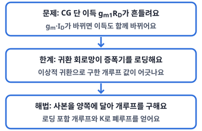

*실제 귀환 회로망은 증폭기에 저항을 덧붙이는 로딩 효과를 내므로, 그 저항을 단 채로 개루프를 구해요.*

**정확히 말하면**

#### 풀고 싶은 문제

귀환 없이 쓰는 CG 단은 개루프 이득이 $A_0=g_{m1}R_D$예요. $g_m$은 $I_D$와 소자 특성에 따라 크게 달라지므로 이 이득도 함께 흔들려요. **$g_m$과 $I_D$가 변해도 거의 변하지 않는 정확한 이득이 필요해요.** 이 출발점의 회로는 [로딩을 무시하면 게이트가 접지된 CG 단이에요](#s2-vv-ideal)에서 다뤄요.

#### 단순한 해법과 그 한계

출력의 일부를 되돌려 입력에서 빼면 폐루프 이득은 다음과 같아요. 루프 이득 $KA_0$가 1보다 충분히 크면 개루프 이득 대신 귀환율 $K$가 이득을 정해요.

$$
A_{closed}=\frac{A_0}{1+KA_0}\approx\frac{1}{K}
$$

저항 분배기 $R_1$–$R_2$로 되돌리면 $K=R_2/(R_1+R_2)$이므로, 루프 이득이 클 때 이득은 약 $1/K=1+R_1/R_2$라는 저항 비로 정해져요. 예를 들어 저항 비로 정한 $K=1/4$는 고정하고 $A_0$만 40에서 $A_0^*=48$로 1.2배 바뀐다고 해 봐요. 폐루프 이득은 $A_{closed}=40/11\approx3.64$에서 $A_{closed}^*=48/13\approx3.69$가 되어, 배율은 $A_{closed}^*/A_{closed}=66/65$로 약 1.5%만 늘어요. $A_0$가 커지면 분모의 $1+KA_0$도 함께 커져 비가 $1/K=4$ 쪽으로 다가가므로 $A_0$의 변화는 대부분 상쇄돼요.

그런데 이 계산은 귀환 회로망이 전압을 감지하는 포트에서 무한대, 전류를 감지하는 포트에서 0의 임피던스를 보인다는 이상적 가정 위에 있어요. **실제 귀환 회로망은 유한한 임피던스로 순방향 증폭기를 로딩하므로, 이상적 귀환으로 구한 개루프 값이 맞지 않아요.** $R_1+R_2$가 $R_D$보다 충분히 크지 않으면 출력에 $R_1+R_2$가 병렬로 보여 개루프 이득이 줄어요.

$$
A_{v,open}=g_{m1}[R_D\parallel(R_1+R_2)]
$$

이 로딩 효과는 [귀환망을 두 벌 복제해 로딩을 남겨요](#s0-loading-recap)와 [복제를 달면 출력에 분배기 저항이 병렬로 보여요](#s2-vv-open)에서 자세히 봐요. 귀환을 모른 채 모든 노드의 노드 방정식을 세워도 답은 나오지만, 쉽게 구할 값을 복잡하게 구하게 돼요.

#### 핵심 아이디어

루프를 끊을 때 귀환 회로망의 사본을 출력 쪽(감지 복제)과 입력 쪽(반송 복제)에 모두 달아요. 사본의 반대편 포트는 원래 연결돼 있던 포트의 이상적 임피던스로 종단해요. 예를 들어 V-V 귀환에서 감지 복제의 반대편은 원래 전압 입력($\infty$)에 붙어 있었으니 개방, 반송 복제의 반대편은 원래 전압 출력($0$)에 붙어 있었으니 접지예요. 이상적 귀환 회로망은 사본을 달아도 아무 영향이 없는 특수한 경우일 뿐이에요.

**로딩을 개루프 안에 남겨 두면 노드 방정식 없이 로딩 포함 개루프 값과 $K$만으로 폐루프 특성을 바로 얻어요.** 개루프 해석은 CS, CG, 소스 팔로워, 캐스코드, 차동 단으로 이미 해 왔으니 새로 할 일은 종단과 $K$ 측정이에요. 종단은 [네 증폭기 형태의 종단 규칙](#s0-four-terminations), 개루프를 구하는 이유는 [개루프와 K만 알면 폐루프가 나와요](#s1-why-open-loop), $K$ 측정은 [감지량은 원으로 걸고 반송량은 개방·단락해서 재요](#s1-k-rules), 전체 순서는 [입출력 종류부터 폐루프까지 다섯 단계](#s4-procedure)에서 정리해요.

#### 대가와 쓰이는 곳

귀환 회로망은 $K\lt1$이라 그 자체로는 이득을 만들지 못하고, 루프 이득이 클 때 폐루프 이득은 $A_0$보다 작은 약 $1/K$로 줄어요. 로딩까지 넣으면 개루프 이득도 줄고, 개루프를 구할 때마다 사본을 달고 종단하는 단계가 하나 늘어요.

첫째 쓰임은 출력 전압을 분배기로 감지해 게이트로 되돌리는 V-V 귀환 CG 단이에요. 폐루프 이득은 [K는 분배비, 폐루프 이득은 저항 비](#s2-vv-closed)에서 구해요.

둘째 쓰임은 입력 전류를 받아 출력 전압을 내는 트랜스임피던스 증폭기예요. CG 단은 입력 임피던스가 $1/g_{m1}$로 작아 전압보다 전류 입력에 알맞으므로 첫 단에 두고, 둘째 단 CS가 전압을 키워요. 출력 전압을 $R_F$로 감지해 입력 노드에서 전류를 빼는 V-C 귀환이며, $R_F$는 입력과 출력을 모두 로딩해 $R_{in,open}=(1/g_{m1})\parallel R_F$, $R_{out,open}=R_{D2}\parallel R_F$가 돼요. **이상적 귀환으로 볼지는 절댓값이 아닌 상대 크기로 정하고, 아무 가정이 없으면 로딩을 포함해 풀어요.** $R_F\gg1/g_{m1}$이고 $R_F\gg R_{D2}$일 때만 로딩을 무시할 수 있어요. 이 회로는 [CG+CS 트랜스임피던스 증폭기의 이상적 개루프](#s3-vc-ideal), [귀환 저항을 입력과 출력에 접지해 달아요](#s3-vc-open), [반송 전류는 입력 노드에서 빠지는 방향이 양이에요](#s3-vc-sign), [폐루프 이득과 입출력 저항이 모두 1+루프 이득으로 나뉘어요](#s3-vc-closed)로 이어져요. 핵심 식은 [로딩 포함 귀환 해석 핵심 식](#s5-cheatsheet)에 모았어요.

**교수님 말씀**

> $g_m$이나 $I_D$에 영향을 많이 받으니까, … 피드백에 의해서 정확한 게인을 얻고 싶다.

CG 단 이득의 변동이 귀환 회로망을 연결하는 이유라고 하셨어요.

> 요거의 비로 결정되니까 굉장히 정확합니다.

루프 이득이 크면 폐루프 이득이 개루프가 아닌 분배기 저항 비로 정해진다는 뜻이에요.

> 이게 무한대가 아니고, 이게 0이 아닌 임피던스를 가지기 때문에 오픈 루프 특성에는 영향을 미치게 됩니다.

로딩을 이상적이지 않은 전압계에 비유하셨어요. 저항이 유한한 전압계를 대면 그 저항 때문에 재려는 전압이 떨어져요.

> 노드 방정식 쓰려 그러면 복잡하니까 오픈 루프를 구하면 편하니까.

개루프 특성과 $K$만 알면 폐루프를 따로 해석하지 않아도 된다는 말씀이에요.

> 보통은 전류가 더 적합하다고 그랬죠. 입력 임피던스가 작기 때문에.

트랜스임피던스 증폭기의 첫 단을 CG로 두는 이유예요.

확인해 봐요. 문제에 "$R_F$가 매우 크다"는 말이 없을 때, 트랜스임피던스 증폭기의 폐루프 이득을 구하려면 어떤 개루프를 먼저 구해야 할까요?

답 보기

$R_F$를 입력 노드와 출력에 각각 접지해 단 로딩 포함 개루프예요. 아무 가정이 없으면 로딩 효과를 고려하고, 그 개루프 값과 $K$로 폐루프를 구해요.

**페이지 요약**

귀환으로 이득을 저항 비만큼 정확하게 만들되, 귀환 회로망의 로딩은 개루프에 남겨 두고 $K$로 폐루프를 구해요.

*핵심 식*

- 폐루프 이득 (루프 이득이 클 때)

  $$
  A_{closed}=\frac{A_0}{1+KA_0}\approx\frac{1}{K}
  $$
- 로딩 포함 개루프 이득 (V-V 귀환 CG 단)

  $$
  A_{v,open}=g_{m1}[R_D\parallel(R_1+R_2)]
  $$

아무 가정이 없으면 로딩을 포함해 풀어요.

*용어*

- **귀환 회로망 (feedback network)** — 출력에서 감지한 양을 입력으로 되돌리는 회로로, 귀환율 $K$를 정해요.
- **로딩 효과 (loading effect)** — 귀환 회로망의 유한한 임피던스가 순방향 증폭기의 개루프 이득과 임피던스를 바꾸는 현상이에요.
- **트랜스임피던스 증폭기 (transimpedance amplifier)** — 입력 전류를 받아 출력 전압을 내는 증폭기로, 이번 예제는 CG 단과 CS 단을 이어 만들어요.

---

## 1. 루프를 끊는 규칙: 복제와 종단

### 귀환망을 두 벌 복제해 로딩을 남겨요

*1120 수업 · L06 s47–49*

**쉽게 말하면**

귀환망 $K$를 출력 쪽과 입력 쪽에 한 벌씩 복제해 달면, 루프는 끊기고 귀환망이 주던 부하는 양쪽에 그대로 남아요.

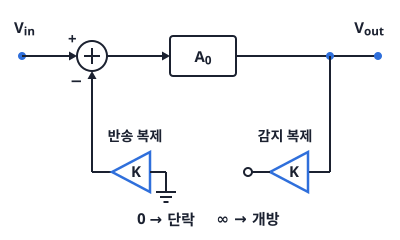

*V-V 귀환에서는 출력 쪽 감지 복제의 남은 포트를 개방하고, 입력 쪽 반송 복제의 남은 포트를 접지해요.*

**정확히 말하면**

#### 이상적 귀환망은 무엇을 가정했나요

개루프 특성과 귀환율 $K$만 알면 루프 이득 $KA_0$로 폐루프 이득과 입력·출력 임피던스를 구할 수 있어요. 이때 귀환망을 달아도 개루프 특성은 바뀌지 않는다고 가정했어요.

이 가정은 귀환망이 이상적일 때만 성립해요. 출력 전압을 감지하는 포트의 임피던스는 $\infty$, 출력 전류를 감지하는 포트의 임피던스는 $0$이어야 전방 증폭기에 아무 영향을 주지 않아요.

**실제 귀환망은 유한한(0이 아닌) 임피던스를 가져 전방 증폭기의 전압·전류를 바꾸는데, 이것이 로딩 효과(loading effect)예요.** 그래서 개루프 특성을 구할 때 이 로딩을 넣어 보정해야 해요.

#### 작은 예시: 출력에서 보이는 저항

전방 증폭기의 출력저항을 $R_A$, 귀환망이 출력 쪽에서 보이는 저항을 $R_K$라고 해요. 두 저항은 같은 출력 노드와 접지 사이에 걸리므로 출력에서 보이는 저항은 병렬 합성이에요.

$$
R_A\parallel R_K=\frac{R_AR_K}{R_A+R_K}
$$

식을 정리한 뒤 마지막에 $R_A=10\,\mathrm{k\Omega}$, $R_K=10\,\mathrm{k\Omega}$를 넣어요. 결과는 반올림 없는 정확한 값이에요.

$$
R_A\parallel R_K=\frac{10\times10}{10+10}\,\mathrm{k\Omega}=5\,\mathrm{k\Omega}
$$

귀환망이 이상적($R_K\to\infty$)이면 $R_A\parallel R_K\to R_A=10\,\mathrm{k\Omega}$로 그대로예요. **귀환망의 로딩을 무시하면 이 출력저항을 두 배로 잘못 잡게 돼요.**

#### 귀환망을 두 벌 복제해 양쪽에 달아요

루프를 끊으면 귀환망은 원래 출력에도, 입력에도 붙어 있었어요. 그래서 귀환망 $K$의 사본을 두 벌 만들어요.

- 감지 복제(sense duplicate): 출력 쪽에 달아 출력이 보던 부하를 남겨요.
- 반송 복제(return duplicate): 입력 쪽에 달아 입력이 보던 부하를 남겨요.

**두 복제본이 각각 전방 증폭기의 출력과 입력에 부하를 주므로, 루프는 끊겨도 양쪽 로딩은 남아요.** 두 복제본끼리는 잇지 않으므로 각 사본에는 연결되지 않은 남은 포트가 하나씩 생겨요.

#### 남은 포트는 무엇으로 막나요

**남은 포트가 원래 어디에 연결되어 있었는지 보고, 그 자리의 이상적 임피던스로 종단(termination)해요.** V-V 귀환에 적용하면 이렇게 돼요.

1. $$
   Z_{in}=\infty\ \Rightarrow\ \text{개방}
   $$

   감지 복제의 남은 포트는 원래 전방 증폭기의 전압 입력에 붙어 있었어요.
2. $$
   Z_{out}=0\ \Rightarrow\ \text{단락(접지)}
   $$

   반송 복제의 남은 포트는 원래 전방 증폭기의 전압 출력에 붙어 있었어요.

여기서 $Z_{in}$은 이상적인 전압 감지기의 입력 임피던스, $Z_{out}$은 이상적인 전압원의 출력 임피던스예요.

#### 실제 임피던스를 달면 더 정확해요

**가장 정확한 방법은 남은 포트에 원래 연결되어 있던 실제 임피던스를 그대로 달아 주는 것이에요.** 수업에서는 그렇게까지 모델링하지 않고 이상적 임피던스로 종단하는 근사를 써요. 실제 임피던스를 다 넣으면 해석이 복잡해지기 때문이에요.

**교수님 말씀**

교수님은 귀환망이 개루프에 영향을 주는 이유를 실제 구현에서 찾았어요.

> 프랙티컬하게 구현할 때 이게 무한대가 아니고, 이게 0이 아닌 임피던스를 가지기 때문에

예를 들어 원래 그 자리가 $R_{in}$이었다면 $R_{in}$을 병렬로 달아 주는 것이 가장 이상적인 방법이라고 했어요. 다만 수업에서는 그렇게까지 정확하게 모델링하지 않고 이상적인 임피던스를 본다고 정리했어요.

확인해 봐요. 작은 예시와 같은 전방 증폭기($R_A=10\,\mathrm{k\Omega}$)에서 귀환망이 출력 쪽에서 $R_K=40\,\mathrm{k\Omega}$로 보이면, 출력에서 보이는 저항은 얼마일까요?

답 보기

$8\,\mathrm{k\Omega}$예요. $R_A\parallel R_K=\frac{R_AR_K}{R_A+R_K}=\frac{10\times40}{10+40}\,\mathrm{k\Omega}=8\,\mathrm{k\Omega}$이므로 이상적일 때의 $10\,\mathrm{k\Omega}$보다 작아요.

**페이지 요약**

귀환망의 유한한 임피던스가 개루프를 바꾸므로, 귀환망을 출력(감지 복제)과 입력(반송 복제)에 복제해 로딩을 남겨요.

*판단 기준*

남은 포트는 원래 연결되어 있던 자리의 이상적 임피던스로 종단해요.

V-V 귀환에서는 감지 복제를 개방하고 반송 복제를 접지해요.

실제 임피던스를 다는 것이 가장 정확하지만 수업은 이상적 임피던스로 근사해요.

*용어*

- **로딩 효과 (loading effect)** — 귀환망의 유한한 임피던스가 전방 증폭기의 전압·전류를 바꾸는 효과예요.
- **감지 복제 (sense duplicate)** — 출력 쪽에 다는 귀환망 사본이에요.
- **반송 복제 (return duplicate)** — 입력 쪽에 다는 귀환망 사본이에요.
- **종단 (termination)** — 복제본의 남은 포트를 개방하거나 단락하는 일이에요.

---

### 네 증폭기 형태의 종단 규칙

*1120 수업 · L06 s50*

**쉽게 말하면**

남은 포트가 원래 붙어 있던 자리의 이상적 임피던스가 $\infty$면 개방, $0$이면 단락해요.

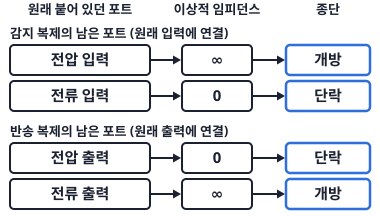

*위 두 줄은 감지 복제, 아래 두 줄은 반송 복제의 남은 포트가 원래 붙어 있던 자리예요.*

**정확히 말하면**

#### 네 포트의 이상적 임피던스

전방 증폭기의 입력과 출력은 전압이거나 전류예요. 각 포트가 이상적이라면 임피던스는 다음과 같아요.

- 전압 입력: 전압만 재고 전류를 끌어가지 않으므로 $Z_{in}=\infty$예요.
- 전류 입력: 전류를 받으면서 전압이 걸리지 않으므로 $Z_{in}=0$이에요.
- 전압 출력: 이상적인 전압원이므로 $Z_{out}=0$이에요.
- 전류 출력: 이상적인 전류원이므로 $Z_{out}=\infty$예요.

이 값은 실제 $r_O$나 실제 입력 임피던스가 아니라 그 포트가 가져야 할 이상값이에요. **남은 포트는 원래 붙어 있던 포트의 이 이상값이 $\infty$면 개방, $0$이면 단락해요.**

#### 작은 예시: 트랜스임피던스 증폭기

트랜스임피던스 증폭기 $R_0$는 입력이 전류, 출력이 전압이에요. 출력 전압을 감지해 입력에 전류를 반송하므로 V-C 귀환이에요.

1. $$
   Z_{in}=0\ \Rightarrow\ \text{단락}
   $$

   감지 복제의 남은 포트는 원래 전류 입력에 붙어 있었어요.
2. $$
   Z_{out}=0\ \Rightarrow\ \text{단락}
   $$

   반송 복제의 남은 포트는 원래 전압 출력에 붙어 있었어요.

**트랜스임피던스 증폭기는 두 복제본의 남은 포트를 모두 단락해요.**

#### 네 형태를 한 표로

형태 이름은 감지량-반송량 순서예요. 예를 들어 C-V는 출력 전류를 감지해 입력에 전압을 반송해요.

| 형태 | 감지 복제의 남은 포트 | 반송 복제의 남은 포트 |
|---|---|---|
| (a) 전압 증폭기 $A_0$ (V-V) | 전압 입력 $\infty$ → 개방 | 전압 출력 $0$ → 단락(접지) |
| (b) 트랜스임피던스 $R_0$ (V-C) | 전류 입력 $0$ → 단락 | 전압 출력 $0$ → 단락 |
| (c) 전류 증폭기 $A_I$ (C-C) | 전류 입력 $0$ → 단락 | 전류 출력 $\infty$ → 개방 |
| (d) 트랜스컨덕턴스 $G_m$ (C-V) | 전압 입력 $\infty$ → 개방 | 전류 출력 $\infty$ → 개방 |

**감지 복제는 전방 증폭기 입력의 종류가, 반송 복제는 출력의 종류가 종단을 정해요.** 출력 전류를 감지하는 (c)·(d)에서는 귀환망이 출력 전류 경로에 직렬로 들어가요. 그래서 귀환망의 0이 아닌 임피던스를 출력 쪽에 직렬로 고려해요.

#### 이상적 귀환망은 특수한 경우예요

귀환망의 포트 임피던스가 이상적이면(예를 들어 V-V에서 감지 쪽 $\infty$, 반송 쪽 $0$) 복제본을 달아도 전방 증폭기에 아무 영향이 없어요. 이때는 로딩을 고려한 결과와 귀환망을 아예 무시한 결과가 같아요. 포트 임피던스가 유한하거나 0이 아니면 두 결과가 달라져요.

**로딩을 고려한 해석이 일반적인 케이스이고, 이상적 귀환망은 그 특수한 경우예요.**

#### 실제 입력 임피던스가 0이 아니어도

공통 게이트(CG) 단이 전류 입력을 받으면 실제 입력 임피던스는 $0$이 아니라 $1/g_m$이에요. 그래도 감지 복제의 종단은 이상값 $0$을 따라 단락해요. **종단에는 실제값이 아닌 이상값을 쓰는 근사가 들어가요.** 실제 임피던스를 쓰는 더 정확한 방법은 [귀환망을 두 벌 복제해 로딩을 남겨요](#s0-loading-recap)에서 봤어요.

**교수님 말씀**

교수님은 이상적 임피던스가 실제 소자 값이 아니라는 점을 여러 번 짚었어요.

> 실제 요 ro의 임피던스를 얘기하는 게 아니라 이상적인 임피던스를 얘기하는 거예요.

이상적 귀환망을 따로 외울 규칙으로 보지 말고 로딩 해석에 포함된 경우로 보라고 했어요.

> 로딩 이펙트를 고려해 주는 게 좀 더 일반적인 케이스다

**꼭 기억해요**

> 이거를 외우려고 하지 마세요.

표를 외우면 까먹어요. 남은 포트마다 "원래 어디에 붙어 있었나?"를 물으면 네 형태 모두 다시 만들 수 있어요. 감지 복제가 출력 쪽에 달린다고 출력의 종류로 종단하면 틀려요.

#### 직접 해 보기: 네 형태의 종단 바꿔 보기 *(정적 스냅샷 — 직접 조작은 HTML 버전)*

형태를 고르면 출력 쪽 감지 복제와 입력 쪽 반송 복제의 남은 포트가 개방 또는 단락으로 바뀌고, 그 이유가 그림 아래에 보여요.

종단 이유: **감지 복제: 원래 전압 입력 → 이상적 임피던스 ∞ → 개방 · 반송 복제: 원래 전압 출력 → 이상적 임피던스 0 → 단락**

범례: 삼각형 K: 귀환망 복제본 · 속이 빈 동그라미: 개방 단자 · 접지 기호: 단락

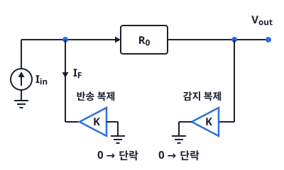

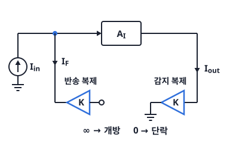

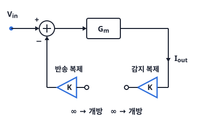

| 설정 | 결과 |
|---|---|
| (a) 전압 증폭기 V-V | 감지 복제: 원래 전압 입력 → 이상적 임피던스 ∞ → 개방 · 반송 복제: 원래 전압 출력 → 이상적 임피던스 0 → 단락 |
| (b) 트랜스임피던스 V-C | 감지 복제: 원래 전류 입력 → 이상적 임피던스 0 → 단락 · 반송 복제: 원래 전압 출력 → 이상적 임피던스 0 → 단락 |
| (c) 전류 증폭기 C-C | 감지 복제: 원래 전류 입력 → 이상적 임피던스 0 → 단락 · 반송 복제: 원래 전류 출력 → 이상적 임피던스 ∞ → 개방 |
| (d) 트랜스컨덕턴스 C-V | 감지 복제: 원래 전압 입력 → 이상적 임피던스 ∞ → 개방 · 반송 복제: 원래 전류 출력 → 이상적 임피던스 ∞ → 개방 |

확인해 봐요. 전류 증폭기 $A_I$(C-C)에서 두 복제본의 남은 포트는 각각 무엇으로 종단할까요?

답 보기

감지 복제는 단락, 반송 복제는 개방이에요. 감지 복제의 남은 포트는 원래 전류 입력($0$)에, 반송 복제의 남은 포트는 원래 전류 출력($\infty$)에 붙어 있었기 때문이에요.

**페이지 요약**

남은 포트는 원래 붙어 있던 자리의 이상적 임피던스가 $\infty$면 개방, $0$이면 단락해요.

*판단 기준*

감지 복제는 전압 입력이면 개방, 전류 입력이면 단락해요.

반송 복제는 전압 출력이면 단락, 전류 출력이면 개방해요.

로딩을 고려한 해석이 일반적인 케이스이고 이상적 귀환망은 그 특수한 경우예요.

*용어*

- **이상적 임피던스 (ideal impedance)** — 전압 입력 $\infty$, 전류 입력 $0$, 전압 출력 $0$, 전류 출력 $\infty$처럼 포트가 가져야 할 값이에요.

---

## 2. 귀환율 K를 재는 규칙

### 개루프와 K만 알면 폐루프가 나와요

*1120 수업 · L06 s32–45*

**쉽게 말하면**

폐루프 이득과 임피던스는 노드 방정식을 다시 풀지 않고, 개루프 값을 $1+KA_0$로 나누거나 곱해서 얻어요.

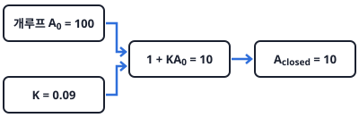

*$A_0=100$, $K=0.09$이면 $1+KA_0=10$이라서 폐루프 이득은 $100/10=10$이 되고, 전압을 직렬로 돌려주는 입력 임피던스는 같은 10배로 커져요.*

**정확히 말하면**

#### 무엇을 구하려는 건가요?

귀환 회로에서 끝내 알고 싶은 값은 폐루프(closed loop) 이득, 폐루프 입력 임피던스, 폐루프 출력 임피던스예요. 노드 방정식(node equation)을 세우거나 입력·출력에 시험원을 걸어 직접 풀 수도 있지만 식이 복잡해져요. **그래서 개루프(open loop) 이득·입력 임피던스·출력 임피던스와 귀환율 $K$를 따로 구하고, 루프 이득(loop gain) $KA_0$로 폐루프 값을 한 번에 얻어요.**

#### 숫자로 확인하기

전압 증폭기(V-V 귀환)에서 로딩을 포함한 개루프 값이 $A_0=100$, $R_{in,open}=1\ \mathrm{k\Omega}$, $R_{out,open}=2\ \mathrm{k\Omega}$이고 $K=0.09$라고 해 봐요.

1. $$
   KA_0=0.09\times100=9
   $$

   루프 이득을 먼저 구해요.
2. $$
   \begin{aligned}A_{closed}&=\frac{A_0}{1+KA_0}\\&=\frac{100}{1+9}=10\end{aligned}
   $$

   이득은 $1+KA_0$로 나눠요.
3. $$
   \begin{aligned}R_{in,closed}&=R_{in,open}(1+KA_0)\\&=1\ \mathrm{k\Omega}\times10=10\ \mathrm{k\Omega}\end{aligned}
   $$

   전압을 입력과 직렬로 돌려주므로 커져요.
4. $$
   \begin{aligned}R_{out,closed}&=\frac{R_{out,open}}{1+KA_0}\\&=\frac{2\ \mathrm{k\Omega}}{10}=0.2\ \mathrm{k\Omega}\end{aligned}
   $$

   출력 전압을 병렬로 감지하므로 작아져요.

**세 값 모두 같은 인자 $1+KA_0$로 바뀌어요.** 이득은 나누고, 임피던스는 포트 연결에 따라 곱하거나 나눠요.

#### 곱할까요, 나눌까요?

네 형태 모두 폐루프 이득은 개루프 이득을 $1+$루프 이득으로 나눈 값이에요. 개루프 이득의 이름만 형태마다 $A_0$, $R_0$, $G_m$, $A_I$로 달라요.

$$
A_{closed}=\frac{A_0}{1+KA_0}
$$

임피던스는 그 포트에서 귀환이 하는 일로 정해져요. **입력에 전압을 직렬로 돌려주거나 출력 전류를 직렬로 감지하면 $(1+KA_0)$배 커지고, 입력에 전류를 병렬로 돌려주거나 출력 전압을 병렬로 감지하면 $(1+KA_0)$로 나눠져요.**

| 형태 (개루프 이득) | 입력 임피던스 | 출력 임피던스 |
|---|---|---|
| V-V $A_0$ [V/V] | 직렬 전압 반송:  $\times(1+KA_0)$ | 전압 감지:  $\div(1+KA_0)$ |
| V-C $R_0$ [Ω] | 병렬 전류 반송:  $\div(1+KR_0)$ | 전압 감지:  $\div(1+KR_0)$ |
| C-V $G_m$ [S] | 직렬 전압 반송:  $\times(1+KG_m)$ | 전류 감지:  $\times(1+KG_m)$ |
| C-C $A_I$ [A/A] | 병렬 전류 반송:  $\div(1+KA_I)$ | 전류 감지:  $\times(1+KA_I)$ |

이 관계는 지난 수업에서 형태마다 유도했으니 여기서는 표로만 정리해요. 음귀환이면 루프 이득이 양수라서 $1+KA_0\gt1$이에요. 부호를 확인하는 방법은 [반송 전류는 입력 노드에서 빠지는 방향이 양이에요](#s3-vc-sign)에서 이어져요.

#### 어떤 개루프 값을 넣나요?

공식에 넣는 $A_0$, $R_{in,open}$, $R_{out,open}$은 귀환망 사본을 입력과 출력에 달아 로딩을 포함한 개루프 값이에요([귀환망을 두 벌 복제해 로딩을 남겨요](#s0-loading-recap)). 이상적 귀환망이면 사본이 아무 영향도 주지 않아서 로딩을 무시한 값과 같아요. **개루프 값이 준비되면 남은 것은 $K$ 하나예요.** $K$를 재는 방법은 [감지량은 원으로 걸고 반송량은 개방·단락해서 재요](#s1-k-rules)에서 다뤄요.

개루프 해석은 CS, CG, 소스 팔로워, 캐스코드, 차동 증폭기에서 이미 해 왔어요. 폐루프는 따로 해석하지 않고 그 개루프 값과 $K$만으로 구해요.

**교수님 말씀**

교수님이 "오픈 루프 특성 왜 구하죠?"라고 물으셨어요. 답은 폐루프 이득, 폐루프 입력 임피던스, 폐루프 출력 임피던스였고, 그 계산에 개루프 값 다음으로 필요한 것이 $K$라고 정리하셨어요.

> 노드 방정식 쓰려 그러면 복잡하니까 오픈 루프를 구하면 편하니까.

슬라이드에 없는 말로, 출력 임피던스는 원래 $r_O$이고 부하가 있으면 $r_O\parallel R_L$이며 그 값이 $1+$루프 이득만큼 낮아진다고 덧붙이셨어요. 이 단원의 슬라이드 예제는 $\lambda=0$이라 $r_O$를 빼고 계산해요.

확인해 봐요. V-V 귀환에서 $A_0=50$, $K=0.18$, $R_{in,open}=2\ \mathrm{k\Omega}$이면 폐루프 이득과 폐루프 입력 임피던스는 얼마인가요?

답 보기

$KA_0=0.18\times50=9$라서 $1+KA_0=10$이에요. 그래서 $A_{closed}=50/10=5$, $R_{in,closed}=2\ \mathrm{k\Omega}\times10=20\ \mathrm{k\Omega}$예요.

**페이지 요약**

폐루프 값은 로딩을 포함한 개루프 값과 $K$로 구해요.

*핵심 식*

- 폐루프 이득

  $$
  A_{closed}=\frac{A_0}{1+KA_0}
  $$

*판단 기준*

직렬 전압 반송과 전류 감지는 임피던스를 $(1+KA_0)$배 키워요.

병렬 전류 반송과 전압 감지는 임피던스를 $(1+KA_0)$로 나눠요.

*용어*

- **루프 이득(loop gain)** — 귀환율과 개루프 이득의 곱 $KA_0$예요.

---

### 감지량은 원으로 걸고 반송량은 개방·단락해서 재요

*1120 수업 · L06 s51–52*

**쉽게 말하면**

$K$는 귀환망만 떼어 감지 포트에 출력과 같은 종류의 원을 걸고, 반송 포트를 전압이면 개방하고 전류면 단락해서 재요.

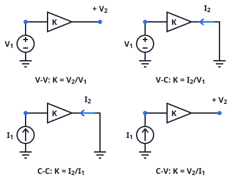

*위 두 칸은 출력 전압을 감지해서 전압원 $V_1$을, 아래 두 칸은 출력 전류를 감지해서 전류원 $I_1$을 걸고, 오른쪽 끝에서 $V_2$나 $I_2$를 재요.*

**정확히 말하면**

#### 무엇을 걸고 무엇을 재나요?

귀환율(feedback factor) $K$는 귀환망이 감지한 양에 대해 돌려주는 양의 비예요. 그래서 귀환망만 떼어 내고 두 포트를 따로 다뤄요.

- 감지 포트(전방 증폭기 출력에 붙던 쪽)에는 감지량과 같은 종류의 원을 걸어요. 전압을 감지하면 전압원 $V_1$, 전류를 감지하면 전류원 $I_1$이에요.
- 반송 포트(입력에 붙던 쪽)는 반송량이 전압이면 개방(open)하고 접지 기준 전압 $V_2$를 재요. 반송량이 전류면 단락(short)하고 단락선 전류 $I_2$를 재요.

**단락한 채 전압을 재면 항상 0이고, 개방한 채 전류를 재면 항상 0이라서 짝이 정해져요.** 회로 그림은 $K$의 입력인 시험원을 왼쪽, 재는 반송 포트를 오른쪽에 두었어요. 슬라이드는 루프 방향대로 $K$를 왼쪽으로 향하게 그렸지만 연결은 같아요.

예를 들어 귀환망이 출력–$R_1$–가운데–$R_2$–접지로 이어진 분배기이고, 가운데 노드가 전압을 돌려주는 반송 포트라고 해 봐요. $R_1=9\ \mathrm{k\Omega}$, $R_2=1\ \mathrm{k\Omega}$이에요. 구할 값은 $K=V_2/V_1$이고, 필요한 중간값은 개방한 가운데 노드의 전압 $V_2$예요.

1. $$
   \begin{aligned}V_2&=V_1\frac{R_2}{R_1+R_2}\\&=1\ \mathrm{V}\times\frac{1}{9+1}=0.1\ \mathrm{V}\end{aligned}
   $$

   감지 포트에 $V_1=1\ \mathrm{V}$를 걸고 가운데를 개방해요.
2. $$
   K=V_2/V_1=0.1
   $$

   전압끼리의 비라서 단위가 없어요.

가운데를 단락하면 $V_2$는 0으로 고정되어 $K$를 잴 수 없어요.

#### 네 형태의 K와 단위

감지량은 걸어 줄 원의 종류를, 반송량은 포트 처리와 재는 양을 정해요. **그래서 $K$는 전압 이득만이 아니라 전류 이득, 트랜스컨덕턴스, 트랜스임피던스일 수도 있어요.**

| 형태 (감지–반송) | 거는 원 | 반송 포트 | 귀환율 | 단위 |
|---|---|---|---|---|
| V-V | $V_1$ | 개방 | $K=V_2/V_1$ | V/V |
| V-C | $V_1$ | 단락 | $K=I_2/V_1$ | S |
| C-C | $I_1$ | 단락 | $K=I_2/I_1$ | A/A |
| C-V | $I_1$ | 개방 | $K=V_2/I_1$ | Ω |

$K$의 단위는 짝이 되는 개루프 이득 단위의 역수예요. V-C에서 $K$[S]와 $R_0$[Ω]를 곱하면 루프 이득은 단위가 없어요.

#### 전류는 어느 방향이 양인가요?

전류를 돌려주는 귀환은 입력 노드에 병렬로 붙어요. 들어온 입력 전류 중 반송 전류 $I_F$가 귀환망으로 빠지고, 나머지가 전방 증폭기로 들어가요. **$I_F$의 양의 방향은 입력 노드에서 빠져 $K$로 들어가는 방향이에요.**

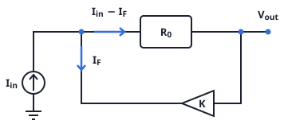

*전류 입력 노드에서 $I_F$는 아래로 빠져 $K$로 들어가는 방향이 양이고, 전방 증폭기에는 $I_{in}-I_F$가 들어가요.*

1. $$
   I_{in}=I_F+(I_{in}-I_F)
   $$

   입력 노드의 KCL이에요.
2. $$
   I_F=KV_{out}
   $$

   V-C 귀환에서 감지한 출력 전압에 대한 반송 전류예요.

$K$를 잴 때 단락선이 입력 노드 자리를 대신하므로, $I_2$도 단락선에서 $K$로 들어가는 방향을 양으로 잡아요. 출력 전류를 감지할 때는 $I_{out}$ 자리에 귀환망으로 들어가는 방향의 전류원 $I_1$을 걸어요.

귀환망이 출력과 입력 노드 사이의 저항 $R_F=10\ \mathrm{k\Omega}$ 하나인 V-C 귀환으로 확인해 봐요. 구할 값은 $K=I_2/V_1$이고, 필요한 중간값은 단락선에서 $K$로 들어가는 전류 $I_2$예요.

1. $$
   \frac{V_1}{R_F}=\frac{1\ \mathrm{V}}{10\ \mathrm{k\Omega}}=0.1\ \mathrm{mA}
   $$

   $V_1=1\ \mathrm{V}$를 걸고 반송 포트를 단락하면 이 전류가 단락선으로 나가요.
2. $$
   I_2=-0.1\ \mathrm{mA}
   $$

   $K$로 들어가는 방향이 양이라서 음수예요.
3. $$
   K=I_2/V_1=-0.1\ \mathrm{mS}=-\frac{1}{R_F}
   $$

   mA를 V로 나누면 mS예요.

$K$가 음수여도 이상하지 않아요. 개루프 이득의 부호와 곱한 루프 이득이 양수인지가 음귀환의 판단 기준이에요([반송 전류는 입력 노드에서 빠지는 방향이 양이에요](#s3-vc-sign)).

**교수님 말씀**

교수님은 출력이 전압이면 전압원을, 전류면 전류원을 걸고, 돌아오는 양이 전압이면 개방해서, 전류면 단락해서 잰다고 정리하셨어요.

> 전류의 방향은 항상 $I_F$가 $K$로 들어오는 방향이고 입력에서 빠지는 방향

$K$가 꼭 전압 이득일 필요는 없고, 전류 이득·트랜스컨덕턴스·트랜스임피던스로도 표현된다고 하셨어요.

확인해 봐요. 귀환망이 출력과 입력 노드 사이의 저항 $R_F=5\ \mathrm{k\Omega}$ 하나인 V-C 귀환이에요. $V_1=1\ \mathrm{V}$를 걸면 $K$는 얼마인가요?

답 보기

반송 포트를 단락하면 $1\ \mathrm{V}/5\ \mathrm{k\Omega}=0.2\ \mathrm{mA}$가 단락선으로 나가므로 $I_2=-0.2\ \mathrm{mA}$이고, $K=I_2/V_1=-0.2\ \mathrm{mS}=-1/R_F$예요.

**페이지 요약**

감지량과 같은 원을 걸고, 반송량이 전압이면 개방하고 전류면 단락해서 $K$를 재요.

*핵심 식*

- V-V

  $$
  K=V_2/V_1
  $$
- V-C

  $$
  K=I_2/V_1
  $$
- C-C

  $$
  K=I_2/I_1
  $$
- C-V

  $$
  K=V_2/I_1
  $$

*판단 기준*

단락한 채 전압을 재면 항상 0이라서 전압은 개방해서 재요.

$I_F$의 양의 방향은 입력 노드에서 빠져 $K$로 들어가는 방향이에요.

*용어*

- **귀환율(feedback factor)** — 귀환망이 감지한 양에 대해 돌려주는 양의 비예요.

---

## 3. 예제 I: V-V 귀환 CG 단

### 로딩을 무시하면 게이트가 접지된 CG 단이에요

*1120 수업 · L06 s53*

**쉽게 말하면**

귀환망 $R_1$–$R_2$를 떼어 내면 게이트가 접지되어, 이득이 $g_{m1}R_D$인 공통 게이트 단이 돼요.

$g_{m1}=5\,\mathrm{mS}$, $R_D=2\,\mathrm{k\Omega}$이면 이득은 10, 입력저항은 $200\,\Omega$이에요.

*(a)는 $R_1$–$R_2$가 출력 전압을 나눠 게이트 $V_F$로 돌려주는 원래 회로이고, (b)는 그 귀환망을 무시해 게이트를 접지한 개루프예요.*

**정확히 말하면**

#### 입력·출력·K는 어디에 있나요

입력 $V_{in}$은 $M_1$의 소스로 들어가고, 출력 $V_{out}$은 $R_D$가 달린 드레인에서 나와요. 출력과 접지 사이의 분배기 $R_1$–$R_2$가 귀환 회로망 $K$이고, 그 가운데 노드 $V_F$가 게이트로 가요.

분배기는 출력 전압을 병렬로 감지하고, 게이트로 들어가는 전류가 없으니 $V_F=\frac{R_2}{R_1+R_2}V_{out}$을 그대로 돌려줘요. 드레인 전류는 $i_D=g_{m1}(V_F-V_{in})$이라서 **$M_1$ 자체가 귀환 전압과 입력을 빼는 뺄셈기예요.**

#### K를 무시하면 어떤 단인가요

이상적인 귀환 회로망은 출력에서 본 임피던스가 무한대라서 출력 노드에서 전류를 끌어가지 않아요. 귀환을 끊으면 게이트에 신호가 남지 않아 게이트는 AC 접지가 돼요. **로딩을 무시한 개루프는 게이트가 접지되고 소스로 입력을 받는 공통 게이트(common-gate, CG) 단이에요.**

#### 숫자로 먼저 보기

$g_{m1}=5\,\mathrm{mS}$, $R_D=2\,\mathrm{k\Omega}$로 두면 $\mathrm{mS}\times\mathrm{k\Omega}=1$이라 단위 없이 바로 곱해져요.

$$
A_0=g_{m1}R_D=5\,\mathrm{mS}\times2\,\mathrm{k\Omega}=10
$$

$$
R_{in}=\frac{1}{5\,\mathrm{mS}}=0.2\,\mathrm{k\Omega}=200\,\Omega
$$

**입력저항은 $200\,\Omega$으로 작고, 이득은 부호가 +인 10이에요.**

#### 개루프 이득을 세 단계로 구해요

슬라이드처럼 $\lambda=0$($r_O$ 무시)으로 두고, 출력 전류 $i_{out}$은 출력 노드에서 드레인으로 들어가는 방향을 양으로 정해요.

1. $$
   G_m=\frac{i_{out}}{v_{in}}\Big|_{v_{out}=0}=-g_{m1}
   $$

   출력을 단락하면 게이트는 0, 소스는 $v_{in}$이라 $i_{out}=g_{m1}(0-v_{in})$이에요.
2. $$
   R_{out}\approx R_D
   $$

   $v_{in}=0$이면 드레인 쪽은 $\lambda=0$이라 열린 것처럼 보여 $R_D$만 남아요.
3. $$
   A_0=-G_mR_{out}=g_{m1}R_D
   $$

   $G_m$이 음수라 이득은 +예요. 입력과 출력이 같은 방향으로 움직여요.

**$G_m=-g_{m1}$과 $R_{out}\approx R_D$를 곱해 비반전 이득 $g_{m1}R_D$를 얻어요.** $\lambda=0$ 모델 안에서는 $R_{out}$이 정확히 $R_D$라서 이득을 등호로 써요. $R_{out}$의 $\approx$는 실제 소자의 $r_O$를 무시했다는 조건 표시예요.

#### 입출력 저항은 얼마인가요

입력저항은 소스에서 들여다본 저항이에요. 게이트가 접지되어 있으면 $v_{gs}=-v_{in}$이고 소스로 $g_{m1}v_{in}$의 전류가 들어가요.

$$
R_{in}=1/g_{m1}
$$

출력저항은 위에서 구한 $R_{out}\approx R_D$예요. **로딩을 무시하면 입력저항은 작은 $1/g_{m1}$, 출력저항은 $R_D$인 CG 단의 값이 그대로 개루프 값이에요.**

**교수님 말씀**

교수님은 이 회로에 귀환을 다는 이유부터 짚었어요.

> 배리에이션이 크니까 gm이나 ID에 영향을 많이 받으니까 … 정확한 게인을 얻고 싶다.

개루프 이득 $g_{m1}R_D$는 $g_{m1}$을 따라 흔들리고, $g_{m1}$은 바이어스 전류 $I_D$에 따라 달라져요. 귀환을 걸면 이득이 저항 비로 정해져 정확해져요([K는 분배비, 폐루프 이득은 저항 비](#s2-vv-closed)).

출력 쪽을 보면 안쪽으로 $r_O$도 보이니 정확히는 $R_D\parallel r_O$이지만, 개루프 특성으로는 $R_D$라고 써도 된다고 했어요.

**꼭 기억해요**

> 그래서 요거를 여러분들이 잘 구분할 수 있어야 됩니다.

게이트는 입력 단자가 아니에요. 입력 $V_{in}$은 소스로 들어가고, 게이트에는 귀환 전압 $V_F$만 들어와요. 게이트를 입력으로 읽으면 CS 단으로 착각하고, 분배기를 부하로만 읽으면 귀환을 놓쳐요.

확인해 봐요. 같은 회로에서 $g_{m1}=4\,\mathrm{mS}$, $R_D=5\,\mathrm{k\Omega}$이면 로딩을 무시한 $A_0$와 $R_{in}$은 얼마일까요?

답 보기

$A_0=4\,\mathrm{mS}\times5\,\mathrm{k\Omega}=20$, $R_{in}=1/(4\,\mathrm{mS})=0.25\,\mathrm{k\Omega}=250\,\Omega$이에요.

**페이지 요약**

귀환망 $R_1$–$R_2$를 무시하면 게이트가 접지된 공통 게이트 단이 되고, 이득은 $g_{m1}R_D$예요.

*핵심 식*

- 개루프 이득 ($\lambda=0$, 로딩 무시)

  $$
  A_0=g_{m1}R_D
  $$
- 입력저항 (소스에서 봄)

  $$
  R_{in}=1/g_{m1}
  $$
- 출력저항

  $$
  R_{out}\approx R_D
  $$

*용어*

- **공통 게이트 단 (common-gate stage)** — 게이트를 AC 접지하고 소스로 입력을 넣어 드레인에서 출력을 얻는 단이에요.
- **뺄셈기 (subtractor)** — $M_1$이 $V_F-V_{in}$에 비례하는 드레인 전류를 만들어 귀환량을 빼요.

---

### 복제를 달면 출력에 분배기 저항이 병렬로 보여요

*1120 수업 · L06 s53*

**쉽게 말하면**

귀환망을 출력과 입력에 한 벌씩 복제해 달면, 출력에는 $R_1+R_2$가 $R_D$와 병렬로 붙어 이득이 줄어요.

$R_D=R_1+R_2=2\,\mathrm{k\Omega}$이면 출력 쪽 저항이 $1\,\mathrm{k\Omega}$로 반이 되어 이득도 10에서 5로 반이 돼요.

*출력 쪽 감지 복제는 가운데 단자(테두리 원)를 열어 두고, 게이트 쪽 반송 복제는 $R_1$ 위 끝을 접지해요.*

**정확히 말하면**

#### 가정이 무엇을 바꾸나요

이번에는 $R_1+R_2$가 $R_D$보다 훨씬 크지 않다고 가정해요. 그러면 분배기가 출력 노드에서 전류를 끌어가 $R_D$와 나란히 부하로 보여요. **귀환 회로망의 유한한 저항이 개루프 이득과 출력저항을 바꾸므로 로딩을 넣은 개루프를 다시 구해요.**

#### 복제는 어디에 어떻게 다나요

귀환 회로망 $R_1$–$R_2$를 두 벌 복제해 출력과 입력에 하나씩 달아요([귀환망을 두 벌 복제해 로딩을 남겨요](#s0-loading-recap)). 반대편 단자는 원래 그 단자가 붙어 있던 자리의 이상적 임피던스로 종단해요.

- 출력 쪽 감지 복제(sense duplicate): 위 끝을 $V_{out}$에 붙여요. 가운데 단자는 원래 전압 입력(이상적 임피던스 $\infty$)에 붙어 있었으므로 개방해요. 그래서 출력에는 $R_1+R_2$가 접지까지 직렬로 달려요.
- 입력 쪽 반송 복제(return duplicate): 가운데 단자를 게이트에 붙여요. $R_1$ 위 끝은 원래 전압 출력(이상적 임피던스 $0$)에 붙어 있었으므로 접지해요. 그래서 게이트는 $R_1\parallel R_2$를 거쳐 접지를 봐요.

**V-V 귀환에서는 감지 복제의 반대편을 열고 반송 복제의 반대편을 접지해요**([네 증폭기 형태의 종단 규칙](#s0-four-terminations)).

#### 숫자로 먼저 보기

$g_{m1}=5\,\mathrm{mS}$, $R_D=2\,\mathrm{k\Omega}$, $R_1=1.5\,\mathrm{k\Omega}$, $R_2=0.5\,\mathrm{k\Omega}$이면 $R_1+R_2=2\,\mathrm{k\Omega}$로 $R_D$와 같아요.

$$
R_D\parallel(R_1+R_2)=\frac{2\times2}{2+2}\,\mathrm{k\Omega}=1\,\mathrm{k\Omega}
$$

$$
A_{v,open}=5\,\mathrm{mS}\times1\,\mathrm{k\Omega}=5
$$

**로딩을 무시했을 때의 이득 10이 로딩 때문에 5로 반이 돼요.** 입력저항은 그대로 $200\,\Omega$이에요.

#### 개루프 값을 차례로 구해요

복제를 단 회로에서도 게이트로는 전류가 흐르지 않아요. 그래서 $R_1\parallel R_2$에 전압이 생기지 않고 게이트는 AC 0이에요. 슬라이드처럼 $\lambda=0$으로 두고 $i_{out}$은 출력 노드에서 드레인으로 들어가는 방향을 양으로 정해요.

1. $$
   G_m=-g_{m1}
   $$

   출력을 단락하면 $R_D$와 감지 복제에는 신호 전류가 없고, 게이트 0·소스 $v_{in}$은 그대로예요.
2. $$
   R_{out,open}\approx R_D\parallel(R_1+R_2)
   $$

   $v_{in}=0$에서 출력은 $R_D$와 감지 복제의 $R_1+R_2$를 함께 봐요. 드레인 쪽은 열린 것처럼 보여요.
3. $$
   \begin{aligned}A_{v,open}&=-G_mR_{out,open}\\&=g_{m1}[R_D\parallel(R_1+R_2)]\end{aligned}
   $$

   $R_D$ 자리에 병렬 합성 저항이 들어가요.

여기서도 $\lambda=0$ 모델 안에서는 $R_{out,open}$이 정확히 $R_D\parallel(R_1+R_2)$라서 이득을 등호로 쓰고, $\approx$는 실제 소자의 $r_O$를 무시했다는 표시예요. 입력저항은 소스에서 본 저항이고 게이트가 AC 0이므로 바뀌지 않아요.

$$
R_{in,open}=1/g_{m1}
$$

**반송 복제는 전류가 흐르지 않는 게이트에 달려 입력저항을 바꾸지 않고, 감지 복제만 이득과 출력저항을 줄여요.**

#### 언제 로딩을 무시해도 되나요

$R_1+R_2\gg R_D$이면 $R_D\parallel(R_1+R_2)\approx R_D$라서 [로딩을 무시한 CG 단](#s2-vv-ideal)의 결과로 돌아가요. 무한대일 필요는 없어요. **$R_1+R_2$가 $R_D$보다 충분히 크면 로딩을 고려하든 안 하든 결과가 거의 같아요.**

예를 들어 $R_D=2\,\mathrm{k\Omega}$에서 $R_1+R_2=20\,\mathrm{k\Omega}$이면 $R_D\parallel(R_1+R_2)=\frac{40}{22}\,\mathrm{k\Omega}\approx1.82\,\mathrm{k\Omega}$로, $R_D$와 약 9 % 차이예요.

**교수님 말씀**

> 꼭 무한대가 아니더라도 RD에 비해서 충분히 크면 되죠.

교수님은 $R_1+R_2$를 크게 잡는 것이 좋은 설계라고 했어요. 그만큼 크게 만들 수 없거나 잘못 설계해서 크지 않으면 개루프 이득이 떨어지므로, 그때 로딩을 고려해야 한다고 했어요.

게이트 쪽은 저주파에서 전류가 흐르지 않아 실효 임피던스가 무한대예요. 그래서 반송 복제는 입력 임피던스에 영향을 주지 않고 출력 임피던스만 영향을 받는다고 짚었어요.

확인해 봐요. $g_{m1}=2\,\mathrm{mS}$, $R_D=3\,\mathrm{k\Omega}$, $R_1+R_2=6\,\mathrm{k\Omega}$이면 $A_{v,open}$, $R_{out,open}$, $R_{in,open}$은 얼마일까요?

답 보기

$R_D\parallel(R_1+R_2)=\frac{3\times6}{3+6}\,\mathrm{k\Omega}=2\,\mathrm{k\Omega}$이므로 $R_{out,open}\approx2\,\mathrm{k\Omega}$, $A_{v,open}=2\,\mathrm{mS}\times2\,\mathrm{k\Omega}=4$, $R_{in,open}=1/(2\,\mathrm{mS})=500\,\Omega$이에요.

**페이지 요약**

복제를 달면 출력에 $R_1+R_2$가 $R_D$와 병렬로 붙어 이득과 출력저항이 줄고, 입력저항은 그대로예요.

*핵심 식*

- 로딩 포함 개루프 이득 ($\lambda=0$)

  $$
  A_{v,open}=g_{m1}[R_D\parallel(R_1+R_2)]
  $$
- 개루프 입력저항 (게이트 전류 0이라 그대로)

  $$
  R_{in,open}=1/g_{m1}
  $$
- 개루프 출력저항

  $$
  R_{out,open}\approx R_D\parallel(R_1+R_2)
  $$

*용어*

- **감지 복제 (sense duplicate)** — 출력에 다는 귀환망 사본이고, V-V에서는 반대편 단자를 열어요.
- **반송 복제 (return duplicate)** — 입력(게이트)에 다는 귀환망 사본이고, V-V에서는 반대편 단자를 접지해요.

---

### K는 분배비, 폐루프 이득은 저항 비

*1120 수업 · L06 s54*

**쉽게 말하면**

$K$는 $R_1$–$R_2$의 분배비이고, 루프 이득이 크면 폐루프 이득은 $1/K$라는 저항 비만 남아요.

$R_1=3R_2$이면 $K=1/4$이고, 루프 이득이 클수록 이득은 4에 가까워져요.

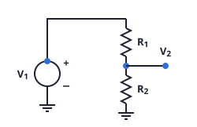

*왼쪽 시험원 $V_1$을 출력 자리에 걸고 오른쪽 반송 단자(게이트 쪽)를 연 채 $V_2$를 재면 $K=V_2/V_1$이에요.*

**정확히 말하면**

#### K는 어떻게 재나요

V-V 귀환이므로 감지량 자리($V_{out}$)에 전압원 $V_1$을 걸고, 반송 단자(게이트 쪽 가운데 단자)를 연 채 $V_2$를 재요([감지량은 원으로 걸고 반송량은 개방·단락해서 재요](#s1-k-rules)). 열린 단자로는 전류가 없으니 $K=V_2/V_1$은 분배기의 비예요.

$$
K=\frac{R_2}{R_1+R_2}
$$

$R_1=1.5\,\mathrm{k\Omega}$, $R_2=0.5\,\mathrm{k\Omega}$이면 $K=0.5/2=0.25$예요. 따로 떼어 재지 않아도 원래 회로에서 분배기를 바로 읽으면 같은 값이에요. **$K$는 소자의 $g_m$과 무관하게 저항의 비로만 정해져요.**

#### 폐루프 값은 개루프와 K로 구해요

[복제를 단 개루프](#s2-vv-open)의 값과 $K$를 넣어요([개루프와 K만 알면 폐루프가 나와요](#s1-why-open-loop)).

1. $$
   A_{v,closed}=\frac{A_{v,open}}{1+KA_{v,open}}
   $$

   이득은 $1+$루프 이득으로 나뉘어요.
2. $$
   R_{in,closed}=R_{in,open}(1+KA_{v,open})
   $$

   귀환 전압이 입력과 직렬로 들어오니 입력저항이 커져요.
3. $$
   R_{out,closed}=\frac{R_{out,open}}{1+KA_{v,open}}
   $$

   출력 전압을 병렬로 감지하니 출력저항이 작아져요.

슬라이드에는 마지막 식의 우변이 $R_{out,closed}$로 인쇄되어 있지만 $R_{out,open}$이 맞아요. **폐루프 이득과 출력저항은 $1+KA_{v,open}$으로 나뉘고, 입력저항은 그만큼 곱해져요.**

#### 숫자로 확인하기

앞의 예($A_{v,open}=5$, $R_{in,open}=200\,\Omega$, $R_{out,open}\approx1\,\mathrm{k\Omega}$)에 $K=0.25$를 넣어요.

$$
KA_{v,open}=0.25\times5=1.25
$$

$$
A_{v,closed}=\frac{5}{1+1.25}=\frac{5}{2.25}\approx2.22
$$

$$
R_{in,closed}=200\,\Omega\times2.25=450\,\Omega
$$

$$
R_{out,closed}\approx\frac{1\,\mathrm{k\Omega}}{2.25}\approx0.44\,\mathrm{k\Omega}
$$

$1/K=4$인데 실제 이득은 2.22예요. **루프 이득 1.25는 크지 않아서 이득이 아직 $1/K$에 가깝지 않아요.** 같은 분배기에서 $A_{v,open}=50$이면 $KA_{v,open}=12.5$, $A_{v,closed}=50/13.5\approx3.7$로 4에 가까워져요.

#### 루프 이득이 크면 왜 정확한가요

$KA_{v,open}\gg1$이면 분모의 1을 무시할 수 있어요.

$$
A_{v,closed}\approx\frac{1}{K}=\frac{R_1+R_2}{R_2}=1+\frac{R_1}{R_2}
$$

**이득이 흔들리는 $g_{m1}R_D$가 아니라 저항의 비로 정해지므로 정확해요.** $K\lt1$이라 귀환 회로망만으로는 이득을 얻을 수 없지만, 귀환을 건 전체 이득은 $1/K\gt1$이 돼요.

**교수님 말씀**

> 요거는 이제 요거의 비로 결정되니까 굉장히 정확합니다.

교수님은 이 회로처럼 루프 이득이 그렇게 크지 않을 수도 있지만, op amp처럼 개루프 이득이 큰 경우에는 이득이 개루프가 아닌 저항 비로 정해진다고 했어요.

피드백을 모르면 노드 방정식과 시험원으로 이득·입력저항·출력저항을 직접 풀 수도 있지만 복잡하다고 했어요. 개루프 특성(CS, CG, 소스 팔로워, 캐스코드, 차동)은 이미 해석했으니 $K$만 알면 폐루프를 바로 얻는다는 뜻이에요.

출력저항을 일반화하면, 부하가 있을 때 개루프 출력저항은 $r_O\parallel R_L$이고 이것이 $1+$루프 이득만큼 낮아진다고도 덧붙였어요.

**보충 · 수업에서 유도하진 않았어요**

수업에서는 폐루프 입력저항을 끝까지 대입하지 않고 "이 식은 복잡하죠?"라고만 했어요. $R_{in,closed}=R_{in,open}(1+KA_{v,open})$에 앞의 값을 모두 넣으면 다음과 같아요.

$$
\begin{aligned}R_{in,closed}&=\frac{1}{g_{m1}}\Big\{1+\frac{R_2}{R_1+R_2}\\&\qquad\times g_{m1}[R_D\parallel(R_1+R_2)]\Big\}\end{aligned}
$$

$\frac{R_2}{R_1+R_2}[R_D\parallel(R_1+R_2)]=\frac{R_DR_2}{R_D+R_1+R_2}$이므로 괄호를 풀면 두 항의 합으로 정리돼요.

$$
R_{in,closed}=\frac{1}{g_{m1}}+\frac{R_DR_2}{R_D+R_1+R_2}
$$

앞의 예에 넣으면 $200\,\Omega+\frac{2\times0.5}{4}\,\mathrm{k\Omega}=200\,\Omega+250\,\Omega=450\,\Omega$으로, 숫자로 확인한 값과 같아요. 폐루프 이득도 같은 방식으로 풀어 쓸 수 있어요.

$$
\begin{aligned}A_{v,closed}&=\frac{g_{m1}[R_D\parallel(R_1+R_2)]}{1+KA_{v,open}}\\K&=\frac{R_2}{R_1+R_2}\end{aligned}
$$

확인해 봐요. $R_1=3\,\mathrm{k\Omega}$, $R_2=1\,\mathrm{k\Omega}$이고 $A_{v,open}=40$이면 $K$와 $A_{v,closed}$는 얼마일까요?

답 보기

$K=1/(3+1)=0.25$, $KA_{v,open}=10$이므로 $A_{v,closed}=40/11\approx3.64$예요. 루프 이득이 커서 $1/K=4$에 가까워요.

**페이지 요약**

V-V 귀환의 $K$는 분배비이고, 루프 이득이 크면 폐루프 이득은 $1+R_1/R_2$인 저항의 비로 정해져요.

*핵심 식*

- 귀환율 ($V_1$ 인가, 반송 단자 개방)

  $$
  K=\frac{R_2}{R_1+R_2}
  $$
- 폐루프 이득 ($KA_{v,open}\gg1$이면 근사)

  $$
  \begin{aligned}A_{v,closed}&=\frac{A_{v,open}}{1+KA_{v,open}}\\&\approx1+\frac{R_1}{R_2}\end{aligned}
  $$
- 폐루프 입출력 저항 (직렬 반송·병렬 감지)

  $$
  \begin{aligned}R_{in,closed}&=R_{in,open}(1+KA_{v,open})\\R_{out,closed}&=\frac{R_{out,open}}{1+KA_{v,open}}\end{aligned}
  $$

*용어*

- **귀환율 (feedback factor)** — V-V에서는 $K=V_2/V_1$이고, 이 회로에서는 분배비예요.
- **루프 이득 (loop gain)** — $KA_{v,open}$이고, 클수록 폐루프 이득이 $1/K$에 가까워져요.

---

## 4. 예제 II: V-C 트랜스임피던스 증폭기

### CG+CS 트랜스임피던스 증폭기의 이상적 개루프

*1120 수업 · L06 s55 · L06 s36–38*

**쉽게 말하면**

입력 전류를 공통 게이트 단이 전압 $V_X$로 바꾸고, 공통 소스 단이 그 전압을 뒤집어 키워 $V_{out}$을 내요.

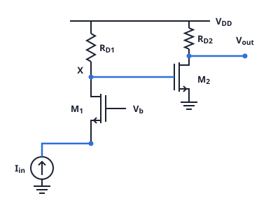

*$R_F$를 떼어 낸 이상적 개루프에서 $I_{in}$ → $V_X$ → $V_{out}$으로 신호가 지나가요.*

전류가 들어가 전압이 나오므로 이득의 단위는 Ω이고, 이런 이득을 트랜스임피던스라고 불러요.

**정확히 말하면**

#### 입력과 출력부터 구별해요

입력은 전류 $I_{in}$이고 출력은 전압 $V_{out}$이에요. **전류 입력·전압 출력이므로 출력 전압을 감지해 입력에서 전류를 빼는 V-C 귀환이고, 전방 증폭기는 트랜스임피던스 증폭기예요.** 출력에서 입력으로 넘어가는 $R_F$가 귀환 회로망이고, 나머지 $M_1$, $R_{D1}$, $M_2$, $R_{D2}$가 전방 증폭기예요. 이 토픽은 $R_F$가 아주 커서 영향을 주지 않는다고 보는 이상적 개루프이고, 슬라이드 예제처럼 $\lambda=0$($r_O$ 무시) 모델을 써요.

#### 숫자로 먼저 따라가요

$g_{m2}=10\ \mathrm{mS}$, $R_{D1}=5\ \mathrm{k\Omega}$, $R_{D2}=2\ \mathrm{k\Omega}$인 회로에 $I_{in}=1\ \mu\mathrm{A}$를 넣어 봐요.

1. $$
   V_X=1\ \mu\mathrm{A}\times5\ \mathrm{k\Omega}=5\ \mathrm{mV}
   $$

   입력 전류가 그대로 $R_{D1}$에 흘러요.
2. $$
   g_{m2}R_{D2}=10\ \mathrm{mS}\times2\ \mathrm{k\Omega}=20
   $$

   $\mathrm{mS}\times\mathrm{k\Omega}=1$이라 단위가 없어요.
3. $$
   V_{out}=-20\times5\ \mathrm{mV}=-100\ \mathrm{mV}
   $$

   공통 소스는 반전이라 부호가 바뀌어요.

**1 μA가 들어가 −100 mV가 나오므로 이 증폭기의 이득은 −100 kΩ이에요.**

#### 첫 단: 공통 게이트가 전류를 전압으로 바꿔요

$M_1$은 게이트가 바이어스 $V_b$(소신호 접지)에 묶이고 소스로 입력이 들어오는 공통 게이트 단이에요. $i_{D1}$을 $R_{D1}$에서 드레인으로 들어가는 소신호 전류로 둬요.

1. $$
   i_{D1}=-I_{in}
   $$

   게이트 전류가 0이라 소스에 넣은 만큼 $M_1$ 전류가 줄어요.
2. $$
   V_X=-i_{D1}R_{D1}=I_{in}R_{D1}
   $$

   $R_{D1}$의 전압 강하가 줄어 $V_X$가 올라가요.
3. $$
   \frac{V_X}{I_{in}}=R_{D1}
   $$

   첫 단의 트랜스임피던스예요.

소스에서 들여다본 저항은 $R_{in}=1/g_{m1}$으로 작아요. **이상적인 전류 입력의 임피던스는 0이므로, 입력 임피던스가 $1/g_{m1}$로 작은 공통 게이트는 전류 입력에 알맞아요.**

#### 둘째 단: 공통 소스 이득을 $G_m$과 $R_{out}$으로 나눠요

$M_2$는 게이트에 $V_X$를 받고 소스가 접지된 공통 소스 단이에요. 출력 단락에서 $G_m$, 입력 영점($V_X=0$)에서 $R_{out}$을 따로 구해 곱해요.

1. $$
   G_m=g_{m2}
   $$

   출력을 단락하면 $M_2$가 출력 노드에서 $g_{m2}V_X$를 끌어가요.
2. $$
   R_{out}=R_{D2}
   $$

   $V_X=0$이면 $M_2$ 전류가 0이고, $\lambda=0$이라 $R_{D2}$만 보여요.
3. $$
   \frac{V_{out}}{V_X}=-G_mR_{out}=-g_{m2}R_{D2}
   $$

   끌어간 전류가 $R_{out}$에 걸려 출력이 반대로 움직여요.

**둘째 단 이득은 $G_m=g_{m2}$와 $R_{out}=R_{D2}$의 곱에 음의 부호가 붙은 반전 이득이에요.**

#### 두 단을 곱하면 $R_0$가 나와요

$$
R_0=\frac{V_X}{I_{in}}\cdot\frac{V_{out}}{V_X}=R_{D1}(-g_{m2}R_{D2})
$$

$$
R_0=-g_{m2}R_{D1}R_{D2}
$$

$$
R_{in}=\frac{1}{g_{m1}}
$$

$$
R_{out}=R_{D2}
$$

**공통 게이트는 비반전, 공통 소스는 반전이라 $R_0$는 음수이고, 단위는 $\mathrm{mS}\cdot\mathrm{k\Omega}\cdot\mathrm{k\Omega}=\mathrm{k\Omega}$예요.** 앞의 숫자로는 $-(10\ \mathrm{mS})(5\ \mathrm{k\Omega})(2\ \mathrm{k\Omega})=-100\ \mathrm{k\Omega}$로 같아요.

(수업 중 $R_1$, $-g_mR_2$로 부른 기호는 슬라이드의 $R_{D1}$, $-g_{m2}R_{D2}$예요.)

**교수님 말씀**

교수님은 첫 단을 공통 게이트로 둔 이유를 입력 임피던스로 설명했어요.

> "커먼 게이트 구조 입력이 전압이 될 수도 있지만, 보통은 전류가 더 적합하다고 그랬죠."

이어서 "소스에 넣은 전류가 그대로 $i_D$가 되나요?"라고 물으며 학생들과 $V_X/I_{in}$과 $V_{out}/V_X$를 차례로 정리했어요. 전류를 전압으로 바꾸니 트랜스임피던스 증폭기라고 불렀고, 출력에는 $M_2$의 $r_{O2}$도 있다고 덧붙였어요. 슬라이드 예제는 $\lambda=0$ 모델이라 여기서는 $R_{out}=R_{D2}$로 둬요.

확인해 봐요. $g_{m2}=5\ \mathrm{mS}$, $R_{D1}=4\ \mathrm{k\Omega}$, $R_{D2}=3\ \mathrm{k\Omega}$이면 이상적 개루프 $R_0$는 얼마인가요?

답 보기

$-60\ \mathrm{k\Omega}$예요. $R_0=-(5\ \mathrm{mS})(4\ \mathrm{k\Omega})(3\ \mathrm{k\Omega})$로 계산해요.

**페이지 요약**

공통 게이트가 입력 전류를 전압으로 바꾸고 공통 소스가 반전 증폭해 트랜스임피던스 $R_0$를 만들어요.

*핵심 식*

- 이상적 개루프 이득

  $$
  R_0=-g_{m2}R_{D1}R_{D2}
  $$
- 입력 임피던스

  $$
  R_{in}=\frac{1}{g_{m1}}
  $$
- 출력 임피던스

  $$
  R_{out}=R_{D2}
  $$

*판단 기준*

입력이 전류이고 출력이 전압이면 V-C 귀환의 트랜스임피던스 증폭기예요.

공통 게이트는 입력 임피던스 $1/g_{m1}$이 작아 전류 입력에 알맞아요.

*용어*

- **트랜스임피던스(transimpedance)** — 입력 전류를 출력 전압으로 바꾸는 이득이며 단위는 Ω이에요.
- **공통 게이트(common gate)** — 게이트를 소신호 접지에 두고 소스로 입력을 받는 단이에요.

---

### 귀환 저항을 입력과 출력에 접지해 달아요

*1120 수업 · L06 s55*

**쉽게 말하면**

$R_F$가 아주 크지 않으면 입력 노드와 출력 노드에 접지된 $R_F$를 하나씩 달고 개루프를 다시 구해요.

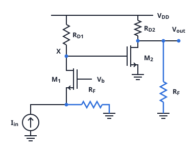

*두 사본의 반대편은 원래 이상 임피던스가 0인 포트(전류 입력, 전압 출력)에 붙어 있었으므로 모두 접지해요.*

입력 전류 일부가 $R_F$로 새고 출력 부하가 $R_{D2}\parallel R_F$로 줄어서 개루프 값이 모두 작아져요.

**정확히 말하면**

#### 두 사본의 반대편을 모두 단락해요

가정은 "$R_F$가 아주 크지 않다"예요. 그러면 루프를 끊을 때 $R_F$ 사본을 출력 쪽(감지 복제)과 입력 쪽(반송 복제)에 모두 달아요([네 증폭기 형태의 종단 규칙](#s0-four-terminations)). 감지 복제의 반대편은 원래 전류 입력에 붙어 있었고, 이상적인 전류 입력 임피던스는 0이에요. 반송 복제의 반대편은 원래 전압 출력에 붙어 있었고, 이상적인 전압 출력 임피던스도 0이에요. **두 사본의 반대편을 모두 단락하므로 $M_1$ 소스와 $V_{out}$에 각각 접지된 $R_F$가 달려요.**

#### 숫자로 먼저 따라가요

$g_{m1}=g_{m2}=10\ \mathrm{mS}$($1/g_{m1}=0.1\ \mathrm{k\Omega}$), $R_{D1}=5\ \mathrm{k\Omega}$, $R_{D2}=2\ \mathrm{k\Omega}$, $R_F=10\ \mathrm{k\Omega}$로 둬요. 입력 1 μA 중 $M_1$으로 가는 몫은 $10/10.1\approx0.99\ \mu\mathrm{A}$이고, 출력 부하는 $2\ \mathrm{k\Omega}$에서 $2\parallel10=5/3\approx1.67\ \mathrm{k\Omega}$로 줄어요. **입력 쪽에서는 전류가 1 %만 새지만 출력 부하는 약 17 % 줄어요.**

#### 첫 단: 입력 전류가 $1/g_{m1}$과 $R_F$로 나뉘어요

1. $$
   I_{M1}=I_{in}\frac{R_F}{R_F+1/g_{m1}}
   $$

   소스 저항 $1/g_{m1}$과 접지된 $R_F$의 전류 분배예요.
2. $$
   V_X=I_{M1}R_{D1}
   $$

   $M_1$으로 간 몫만 $R_{D1}$에 흘러요.
3. $$
   \frac{V_X}{I_{in}}=\frac{R_FR_{D1}}{R_F+1/g_{m1}}
   $$

   예시 값으로는 $\approx4.95\ \mathrm{k\Omega}$예요.

**반송 복제 $R_F$가 입력 전류 일부를 접지로 빼 가므로 첫 단 이득이 $R_{D1}$보다 작아져요.**

#### 둘째 단: 출력에 $R_F$가 병렬로 보여요

1. $$
   G_m=g_{m2}
   $$

   출력을 단락하면 감지 복제 $R_F$에 전류가 흐르지 않아요.
2. $$
   R_{out}=R_{D2}\parallel R_F
   $$

   $V_X=0$이면 $M_2$ 전류가 0이고 $\lambda=0$($r_O$ 무시)이라 $R_{D2}$와 $R_F$만 병렬로 보여요.
3. $$
   \frac{V_{out}}{V_X}=-g_{m2}(R_{D2}\parallel R_F)
   $$

   예시 값으로는 $-10\times5/3\approx-16.67$이에요.

**감지 복제 $R_F$는 $G_m$은 그대로 두고 $R_{out}$만 $R_{D2}\parallel R_F$로 줄여요.**

#### 로딩을 포함한 개루프 세 값

슬라이드 예제처럼 $\lambda=0$($r_O$ 무시) 모델에서 세 값을 모으면 다음과 같아요.

$$
\begin{aligned}R_0&=\frac{R_FR_{D1}}{R_F+1/g_{m1}}\\&\quad\times[-g_{m2}(R_{D2}\parallel R_F)]\end{aligned}
$$

$$
R_0\approx4.95\ \mathrm{k\Omega}\times(-16.67)\approx-82.51\ \mathrm{k\Omega}
$$

$$
R_{in,open}=\frac{1}{g_{m1}}\parallel R_F\approx99.01\ \Omega
$$

$$
R_{out,open}=R_{D2}\parallel R_F\approx1.67\ \mathrm{k\Omega}
$$

**$R_F$는 입력과 출력 양쪽에 병렬로 보여 $R_0$, $R_{in,open}$, $R_{out,open}$을 모두 줄여요.** $R_F\to\infty$로 보내면 이상적 개루프 값 $-g_{m2}R_{D1}R_{D2}$, $1/g_{m1}$, $R_{D2}$로 돌아가요([CG+CS 트랜스임피던스 증폭기의 이상적 개루프](#s3-vc-ideal)).

#### 언제 이상적 귀환으로 봐도 되나요

$g_{m1}$, $g_{m2}$, $R_{D1}$, $R_{D2}$는 고정하고 $R_F$만 바꿔요. 입력 쪽과 출력 쪽에서 이상값 대비 배율을 따로 구한 뒤, 두 배율을 곱해 $R_0$의 배율을 얻어요.

$$
\frac{R_{in,open}}{1/g_{m1}}=\frac{R_F}{R_F+1/g_{m1}}
$$

$$
\frac{R_{out,open}}{R_{D2}}=\frac{R_F}{R_F+R_{D2}}
$$

$$
\begin{aligned}\frac{R_0}{-g_{m2}R_{D1}R_{D2}}&=\frac{R_F}{R_F+1/g_{m1}}\\&\quad\times\frac{R_F}{R_F+R_{D2}}\end{aligned}
$$

두 비가 1에 가까우려면 $R_F\gg1/g_{m1}$이고 $R_F\gg R_{D2}$여야 해요. 예시는 $R_F$가 $1/g_{m1}$의 100배라 99.01 %, $R_{D2}$의 5배라 83.33 %이고, $R_0$의 비는 두 비의 곱인 82.51 %예요. **$R_F$가 무한대인지가 아니라 $1/g_{m1}$, $R_{D2}$와 비교한 상대 크기가 기준이에요.**

(수업 중 첫 단을 $R_D\parallel r_O$를 곱한 꼴로 말했다가 정정했어요: 슬라이드 식은 위의 전류 분배식이에요.)

**교수님 말씀**

교수님은 로딩을 전압계에 빗댔어요. 이상적인 전압계로 재면 전압이 그대로지만, 내부 저항이 유한한 전압계를 대면 그 저항 때문에 전압이 떨어져요.

> "이상적이지 않은 전압계로 재면은 전압이 떨어지고"

출력 전압을 감지하려고 붙인 $R_F$가 바로 그런 전압계예요. 기준은 상대적인 임피던스라고 강조했어요.

> "gm분의 1보다 충분히 크면 돼요. RD2보다 충분히 크면 돼요."

**꼭 기억해요**

시험 문제에 "$R_F$가 크다"는 말이 없으면 로딩을 고려해요.

> "아무 말이 없으면 고려하는 거예요."

교과서 예제는 "$R_F$가 아주 크지 않다"고 적어 주지만, 보통 시험은 $R_F$가 클 때만 그 가정을 따로 줘요. 이상적 귀환으로 풀려면 문제에 그 가정이 있어야 해요.

#### 직접 해 보기: 귀환 저항이 얼마나 커야 무시할까 *(정적 스냅샷 — 직접 조작은 HTML 버전)*

귀환 저항 *R*F를 키우면 로딩을 포함한 개루프 값이 이상값(*R*F→∞)에 몇 % 다가가는지 보여요. 1/*g*m1은 0.1 kΩ로 고정했어요.

*R*F는 1/*g*m1의 **100배**, *R*D2의 **5배**예요. *R*in,open **99.01 %**, *R*out,open **83.33 %**, |*R*0| **82.51 %**

범례: |*R*0| 비율 · *R*in,open 비율 · *R*out,open 비율

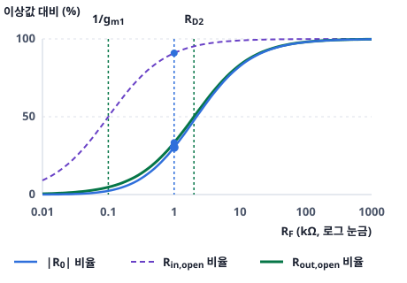

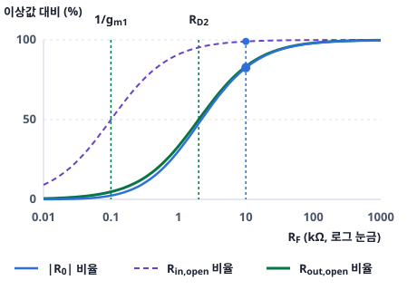

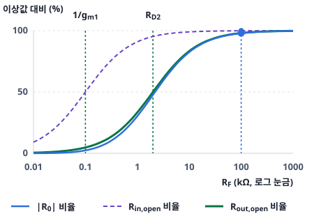

| *R*F | ÷ (1/*g*m1) | ÷ *R*D2 | *R*in,open | *R*out,open | \|*R*0\| |
|---|---|---|---|---|---|
| 1 kΩ | 10배 | 0.5배 | 90.91 % | 33.33 % | 30.30 % |
| 10 kΩ | 100배 | 5배 | 99.01 % | 83.33 % | 82.51 % |
| 100 kΩ | 1000배 | 50배 | 99.90 % | 98.04 % | 97.94 % |

1/*g*m1 = 0.1 kΩ, *R*D2 = 2 kΩ로 고정한 값이에요.

확인해 봐요. 같은 회로에서 $R_F=R_{D2}=2\ \mathrm{k\Omega}$이면 $R_{out,open}$은 얼마이고 이상값 $R_{D2}$의 몇 %인가요?

답 보기

$1\ \mathrm{k\Omega}$, 50 %예요. $R_{D2}\parallel R_F=2\parallel2=1\ \mathrm{k\Omega}$이에요.

**페이지 요약**

$R_F$가 크지 않으면 두 사본을 접지해 달고, 입력과 출력 모두에 $R_F$가 병렬로 보여요.

*핵심 식*

- 로딩 포함 개루프 이득

  $$
  \begin{aligned}R_0&=\frac{R_FR_{D1}}{R_F+1/g_{m1}}\\&\quad\times[-g_{m2}(R_{D2}\parallel R_F)]\end{aligned}
  $$
- 개루프 입력 임피던스

  $$
  R_{in,open}=\frac{1}{g_{m1}}\parallel R_F
  $$
- 개루프 출력 임피던스 (λ=0, rO 무시)

  $$
  R_{out,open}=R_{D2}\parallel R_F
  $$

*판단 기준*

두 사본의 반대편은 이상 임피던스가 0인 포트에 붙어 있었으므로 단락해요.

$R_F\gg1/g_{m1}$이고 $R_F\gg R_{D2}$이면 이상적 귀환으로 봐도 돼요.

문제에 아무 말이 없으면 로딩을 고려해요.

*용어*

- **감지 복제(sense duplicate)** — 출력 쪽에 단 귀환 회로망 사본이에요.
- **반송 복제(return duplicate)** — 입력 쪽에 단 귀환 회로망 사본이에요.

---

### 반송 전류는 입력 노드에서 빠지는 방향이 양이에요

*1120 수업 · L06 s56*

**쉽게 말하면**

$K$를 잴 때 반송 전류 $I_F$는 입력 노드에서 빠져 $R_F$로 들어가는 방향을 양으로 잡아요.

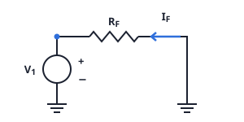

*왼쪽 감지 포트($V_{out}$ 자리)에 $V_1$을 걸고 오른쪽 반송 포트를 단락한 채, 입력 노드를 대신하는 단락선에서 $R_F$로 들어가는 $I_F$를 재요.*

실제 전류는 $V_1$에서 $R_F$를 지나 접지로 흘러 화살표와 반대라서 $K=-1/R_F$가 돼요.

**정확히 말하면**

#### K는 이렇게 재요

V-C 귀환은 출력 전압을 감지하고 입력에 전류를 돌려줘요. 그래서 감지 포트($V_{out}$ 자리)에는 전압원 $V_1$을 걸고, 반송 포트는 단락한 채 전류 $I_F$를 재요([감지량은 원으로 걸고 반송량은 개방·단락해서 재요](#s1-k-rules)). **$K=I_F/V_1$은 전류를 전압으로 나눈 값이라 단위가 S예요.**

#### 숫자로 먼저 따라가요

$R_F=10\ \mathrm{k\Omega}$에 $V_1=1\ \mathrm{V}$를 걸면 $0.1\ \mathrm{mA}$가 $V_1$에서 $R_F$를 지나 단락선으로 흘러요. 정한 양의 방향은 그 반대라서 $I_F=-0.1\ \mathrm{mA}$예요. **그래서 $K=-0.1\ \mathrm{mA}/1\ \mathrm{V}=-0.1\ \mathrm{mS}$로 음수가 나와요.**

#### 양의 방향을 이렇게 잡는 이유

1. $$
   I_e=I_{in}-I_F
   $$

   입력 노드에서 $I_F$가 빠져나간 나머지가 전방 증폭기로 들어가요.
2. $$
   V_{out}=R_0I_e
   $$

   전방 증폭기는 트랜스임피던스 $R_0$예요.
3. $$
   I_F=KV_{out}
   $$

   귀환 회로망이 출력 전압을 전류로 바꿔요.
4. $$
   \frac{V_{out}}{I_{in}}=\frac{R_0}{1+KR_0}
   $$

   대입해 정리하면 $1+KR_0$ 꼴이 나와요.

**뺄셈 $I_{in}-I_F$가 성립하려면 $I_F$는 입력 노드에서 빠져 $R_F$로 들어가는 방향이 양이어야 해요.** 이 방향으로 재면 $I_F=-V_1/R_F$이므로 다음과 같아요.

$$
K=-1/R_F
$$

슬라이드와 교과서 그림의 $i_{RF}$ 화살표는 $V_{out}$에서 입력 노드 쪽을 가리켜 이 양의 방향과 반대예요. 교수님은 귀환 회로망 쪽으로 빠지는 방향을 양으로 잡으라고 바로잡았어요.

#### $K$가 음수인데 음귀환인가요

$R_0$는 비반전인 공통 게이트와 반전인 공통 소스의 곱이라 음수예요. 그래서 루프 이득의 부호는 양이에요.

$$
KR_0=\left(-\frac{1}{R_F}\right)R_0=\frac{|R_0|}{R_F}\gt0
$$

예시 값으로 확인해요. 구할 것은 $KR_0$이고, 필요한 중간값은 앞에서 구한 $K$와 로딩을 포함한 개루프 $R_0$예요([귀환 저항을 입력과 출력에 접지해 달아요](#s3-vc-open)).

1. $$
   K=-0.1\ \mathrm{mS}
   $$

   중간값 1: $R_F=10\ \mathrm{k\Omega}$에서 구한 귀환율이에요.
2. $$
   R_0\approx-82.51\ \mathrm{k\Omega}
   $$

   중간값 2: 로딩을 포함한 개루프 이득이에요.
3. $$
   KR_0\approx(-0.1\ \mathrm{mS})(-82.51\ \mathrm{k\Omega})\approx8.25
   $$

   $\mathrm{mS}\times\mathrm{k\Omega}=1$이라 단위가 없어요.
4. $$
   1+KR_0\approx9.25
   $$

   분모가 1보다 커요.

신호를 따라가도 같은 결론이에요.

$$
I_{in}\uparrow\ \to\ V_X\uparrow\ \to\ V_{out}\downarrow\ \to\ I_F\uparrow
$$

입력 전류가 늘면 $M_1$ 전류가 줄어 $V_X$가 오르고 $V_{out}$은 내려가요. 그러면 입력 노드에서 $R_F$로 빠지는 $I_F$가 늘어 처음 늘어난 입력 전류를 상쇄해요. **$K$와 $R_0$가 모두 음수라 루프 이득 $KR_0$는 양수이고, 이 귀환은 음귀환이에요.**

(수업 중 $K=-R_2/R_1$로 말했다가 정정했어요: 이 회로는 $K=-1/R_F$예요.)

**교수님 말씀**

교수님은 책 그림의 화살표를 짚으며 방향을 바로잡았어요.

> "피드백 쪽으로는 요 방향이 양이 되는 거예요. 그래야지 네거티브 피드백이 되는 거예요."

$K$가 음수로 나와도 이상하게 여기지 말라고 했어요. 루프 이득이 음수인 게 아니라 개루프 이득이 음수이기 때문이에요.

**꼭 기억해요**

> "부호 잘못 고려하면 ... 양의 값이 나와야 되는데 음의 값이 나올 수 있습니다."

정리한 분모가 $1-KA$ 꼴이면 부호를 잘못 잡았거나 실제 회로가 양귀환이에요. 음귀환이면 $KA\gt0$이라 분모 $1+KA$가 1보다 커야 해요.

교과서처럼 $K=-1/R_F$를 대입해 분모를 $1-R_0/R_F$로 쓴 것은 $1+KR_0$와 같은 식이에요. $R_0\lt0$이라 이 값도 1보다 커요.

확인해 봐요. $R_0=-50\ \mathrm{k\Omega}$, $R_F=5\ \mathrm{k\Omega}$이면 $K$, $KR_0$, $1+KR_0$는 얼마인가요?

답 보기

$K=-0.2\ \mathrm{mS}$, $KR_0=10$, $1+KR_0=11$이에요. $(-0.2\ \mathrm{mS})\times(-50\ \mathrm{k\Omega})=10$이에요.

**페이지 요약**

$I_F$를 입력 노드에서 빠지는 방향으로 재면 $K=-1/R_F$이고, $R_0\lt0$이라 루프 이득 $KR_0$는 양수예요.

*핵심 식*

- 귀환율

  $$
  K=-1/R_F
  $$
- 루프 이득

  $$
  KR_0=\frac{|R_0|}{R_F}\gt0
  $$

*판단 기준*

슬라이드의 $i_{RF}$ 화살표가 아니라 입력 노드에서 빠지는 방향을 양으로 잡아요.

분모가 $1-KA$ 꼴로 나오면 부호 오류나 양귀환을 의심해요.

*용어*

- **귀환율(feedback factor)** — V-C 귀환에서는 $I_F/V_1$이라 단위가 S예요.
- **음귀환(negative feedback)** — 루프 이득 $KR_0$가 양수라 분모가 1보다 큰 귀환이에요.

---

### 폐루프 이득과 입출력 저항이 모두 1+루프 이득으로 나뉘어요

*1120 수업 · L06 s56 · L06 s37–38*

**쉽게 말하면**

귀환을 닫으면 이득, 입력저항, 출력저항이 모두 같은 수 $1+KR_0$로 나뉘어 작아져요.

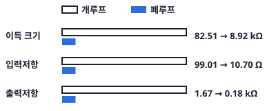

*예시에서는 $1+KR_0\approx9.25$라 세 값이 모두 약 11 %로 줄어요.*

**정확히 말하면**

#### 숫자로 먼저 따라가요

로딩을 포함한 개루프 값 $R_0\approx-82.51\ \mathrm{k\Omega}$, $R_{in,open}\approx99.01\ \Omega$, $R_{out,open}\approx1.67\ \mathrm{k\Omega}$와 $K=-0.1\ \mathrm{mS}$를 써요. $1+KR_0\approx9.25$이므로 세 값을 모두 9.25로 나눠요.

1. $$
   \frac{V_{out}}{I_{in}}\Big|_{closed}\approx\frac{-82.51\ \mathrm{k\Omega}}{9.25}\approx-8.92\ \mathrm{k\Omega}
   $$

   폐루프 이득이에요.
2. $$
   R_{in,closed}\approx\frac{99.01\ \Omega}{9.25}\approx10.70\ \Omega
   $$

   폐루프 입력저항이에요.
3. $$
   R_{out,closed}\approx\frac{1.67\ \mathrm{k\Omega}}{9.25}\approx0.18\ \mathrm{k\Omega}
   $$

   폐루프 출력저항이에요.

**세 값이 모두 개루프 값의 약 1/9.25로 줄어요.**

#### 폐루프 이득은 $R_0$를 $1+KR_0$로 나눠요

$$
\frac{V_{out}}{I_{in}}\Big|_{closed}=\frac{R_0}{1+KR_0}
$$

$R_0$는 로딩을 포함한 개루프 이득이고([귀환 저항을 입력과 출력에 접지해 달아요](#s3-vc-open)), $K=-1/R_F$예요([반송 전류는 입력 노드에서 빠지는 방향이 양이에요](#s3-vc-sign)). **폐루프 이득은 로딩 포함 개루프 이득을 $1+KR_0$로 나눈 값이에요.**

#### 입력저항은 병렬 반송이라 감소해요

$$
R_{in,closed}=\frac{R_{in,open}}{1+KR_0}
$$

입력 노드 전압이 조금 오르면 $M_1$ 전류가 줄어 $V_X$가 오르고 $V_{out}$이 내려가요. 그러면 $R_F$로 빠지는 $I_F$가 커져 같은 전압에 더 많은 전류가 들어가요. **입력 노드에 전류를 병렬로 반송하므로 입력저항은 $1+KR_0$로 나뉘어 감소하고, 전류 입력에는 작을수록 좋아요.**

#### 출력저항은 전압 감지라 감소해요

$$
R_{out,closed}=\frac{R_{out,open}}{1+KR_0}
$$

출력 전압을 병렬로 감지하므로 출력 전압이 바뀌면 귀환이 그 변화를 되돌려요. **전압을 감지하는 귀환은 출력저항을 $1+KR_0$로 나눠 더 좋은 전압원을 만들어요.**

#### 개루프 저항을 넣어 써요

$$
R_{in,closed}=\frac{(1/g_{m1})\parallel R_F}{1+KR_0}
$$

$$
R_{out,closed}=\frac{R_{D2}\parallel R_F}{1+KR_0}
$$

$R_{in,open}$은 입력 노드($M_1$ 소스)에서 바라본 저항이에요. $M_1$ 소스 쪽 $1/g_{m1}$과 반송 복제 $R_F$가 모두 이 노드와 소신호 접지 사이에 있어 병렬이에요. $R_{out,open}$은 출력 노드에서 바라본 저항이에요. $R_{D2}$($V_{DD}$는 소신호 접지)와 감지 복제 $R_F$가 출력 노드와 접지 사이에 있고, 입력 영점에서 $M_2$의 소신호 전류는 0이고 $\lambda=0$이라 $M_2$ 가지가 저항으로 보이지 않으므로 두 저항만 병렬이에요.

**두 개루프 저항 모두 $R_F$가 병렬로 들어간 값에서 출발해요.** 이상적 개루프의 $1/g_{m1}$, $R_{D2}$를 그대로 나누지 않아요.

(수업 중 $R_{in,closed}$를 $(1+KR_0)R_{in,open}$으로 말했다가 정정했어요: 감소하므로 나눠요.)

**교수님 말씀**

교수님은 입력저항이 어떻게 바뀌는지 학생들에게 물었어요.

> "입력 임피던스가 증가할까요, 감소할까요?"

학생들이 감소라고 답했고, 교수님은 병렬로 반송하니 감소한다고 확인했어요. 트랜스임피던스 증폭기라 개루프 이득을 $R_0$로 쓰지만 $A_0$로 통일해 써도 된다고 했어요. $R_0$와 $K$를 끝까지 대입해 정리하는 일은 과제로 남겼어요.

> "실제로 모든 걸 풀어서 이득과 임피던스 구해봐야 돼요."

**보충 · 수업에서 유도하진 않았어요**

과제로 남긴 전개를 루프 이득 $T=KR_0$로 정리해요. 이 결과도 이상적 종단으로 루프를 끊은 귀환 해석 안의 값이에요.

1. 첫 단 분수를 $\frac{R_FR_{D1}}{R_F+1/g_{m1}}=\frac{g_{m1}R_FR_{D1}}{1+g_{m1}R_F}$로 바꾸고 $-1/R_F$를 곱해요.

   $$
   T=\frac{g_{m1}g_{m2}R_{D1}(R_{D2}\parallel R_F)}{1+g_{m1}R_F}
   $$
2. $R_0=-TR_F$를 폐루프 이득에 대입해요.

   $$
   \frac{V_{out}}{I_{in}}\Big|_{closed}=-R_F\frac{T}{1+T}
   $$
3. $(1/g_{m1})\parallel R_F=R_F/(1+g_{m1}R_F)$를 $1+T$로 나누면 분모가 한 줄로 합쳐져요.

   $$
   R_{in,closed}=\frac{R_F}{D}
   $$

   $$
   \begin{aligned}D&=1+g_{m1}R_F\\&\quad+g_{m1}g_{m2}R_{D1}(R_{D2}\parallel R_F)\end{aligned}
   $$
4. 출력저항은 개루프 값을 그대로 $1+T$로 나눠요.

   $$
   R_{out,closed}=\frac{R_{D2}\parallel R_F}{1+T}
   $$

$T\gg1$이면 $T/(1+T)\to1$이라 폐루프 이득은 $-R_F$에 가까워져요. $R_F$가 크다고 가정한 교과서 예제 12.18의 결론과 같아요. 예시 값은 $T\approx8.25$라 $-10\ \mathrm{k\Omega}\times8.25/9.25\approx-8.92\ \mathrm{k\Omega}$로, $-R_F$의 약 89 %예요.

확인해 봐요. $R_0=-90\ \mathrm{k\Omega}$, $R_F=10\ \mathrm{k\Omega}$, $R_{in,open}=99\ \Omega$이면 폐루프 이득과 $R_{in,closed}$는 얼마인가요?

답 보기

$-9\ \mathrm{k\Omega}$, $9.9\ \Omega$예요. $KR_0=90/10=9$라 $1+KR_0=10$으로 나눠요.

**페이지 요약**

폐루프 이득·입력저항·출력저항은 모두 로딩 포함 개루프 값을 $1+KR_0$로 나눈 값이에요.

*핵심 식*

- 폐루프 이득

  $$
  \frac{V_{out}}{I_{in}}\Big|_{closed}=\frac{R_0}{1+KR_0}
  $$
- 폐루프 입력저항

  $$
  R_{in,closed}=\frac{R_{in,open}}{1+KR_0}
  $$
- 폐루프 출력저항

  $$
  R_{out,closed}=\frac{R_{out,open}}{1+KR_0}
  $$

*판단 기준*

입력에 전류를 병렬로 반송하므로 입력저항이 감소해요.

출력 전압을 감지하므로 출력저항도 감소해요.

*용어*

- **루프 이득(loop gain)** — $KR_0$이며 음귀환이면 양수예요.
- **폐루프(closed loop)** — 귀환 회로망을 연결한 채 본 전체 회로예요.

---

## 5. 귀환 회로 해석의 순서

### 입출력 종류부터 폐루프까지 다섯 단계

*1120 수업 · L06 s53–56 종합*

**쉽게 말하면**

귀환 회로는 입력·출력 종류 → 귀환 경로 → 로딩을 넣은 개루프 → 귀환율 $K$ → 폐루프 값 순서로 풀면 노드 방정식 없이 끝나요.

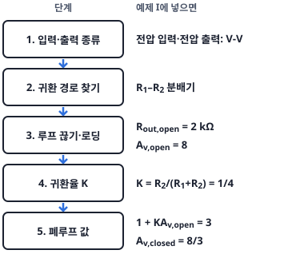

*예제 I의 CG 귀환 단에 $g_{m1}=4\ \mathrm{mS}$, $R_D=4\ \mathrm{k\Omega}$, $R_1=3\ \mathrm{k\Omega}$, $R_2=1\ \mathrm{k\Omega}$를 넣으면 폐루프 이득은 $8/3\approx2.67$이에요. 3단계에서 로딩을 빼먹으면 $16/5=3.2$로 크게 나와요.*

**정확히 말하면**

#### 숫자로 다섯 단계를 따라가요

예제 I의 CG 귀환 단([로딩을 무시하면 게이트가 접지된 CG 단이에요](#s2-vv-ideal))에 $g_{m1}=4\ \mathrm{mS}$, $R_D=4\ \mathrm{k\Omega}$, $R_1=3\ \mathrm{k\Omega}$, $R_2=1\ \mathrm{k\Omega}$를 넣어요. $R_1+R_2=4\ \mathrm{k\Omega}$가 $R_D$보다 충분히 크지 않아서 로딩이 결과를 바꿔요. 슬라이드 예제처럼 $\lambda=0$ 모델이라 $r_O$는 빼요.

1. 1단계, 입력·출력 종류: 입력 $V_{in}$은 $M_1$ 소스에 거는 전압이고 출력 $V_{out}$도 전압이에요. 그래서 출력 전압을 감지해 입력에 전압을 돌려주는 V-V 귀환이에요.
2. 2단계, 귀환 경로: 출력에서 접지까지의 $R_1$–$R_2$ 분배기가 가운데 노드로 게이트에 전압을 돌려줘요. 메인 경로($M_1$, $R_D$)와 병렬로 출력에서 입력 쪽으로 돌아가는 이 경로가 귀환망이고, 나머지가 전방 증폭기예요.
3. 3단계, 루프를 끊고 로딩 포함: 감지 사본의 반대편은 원래 이상적 전압 입력($\infty$)에 붙어 있었으니 개방하고, 반송 사본의 반대편은 원래 이상적 전압 출력($0$)에 붙어 있었으니 접지해요. 출력에는 $R_1+R_2$가 병렬로 달리고, 게이트는 $R_1\parallel R_2$를 거쳐 접지를 봐요. 아래 $G_m$은 출력을 단락하고, $R_{out,open}$은 입력을 0으로 둔 같은 개루프 회로에서 구해요. 이 회로 그림은 [복제를 달면 출력에 분배기 저항이 병렬로 보여요](#s2-vv-open)에 있어요.

   $$
   G_m=-g_{m1}=-4\ \mathrm{mS}
   $$

   출력을 단락하고, 출력 노드에서 드레인으로 들어가는 전류를 양으로 잡아요. 소스 입력이라 $v_{gs}=-v_{in}$이에요.

   $$
   \begin{aligned}R_{out,open}&=R_D\parallel(R_1+R_2)\\&=4\parallel4=2\ \mathrm{k\Omega}\end{aligned}
   $$

   입력을 0으로 두면 $R_D$와 감지 사본 $R_1+R_2$가 병렬이에요.

   $$
   \begin{aligned}A_{v,open}&=-G_mR_{out,open}\\&=-(-4\ \mathrm{mS})\times2\ \mathrm{k\Omega}=8\end{aligned}
   $$

   $G_m$이 음수라서 이득은 양수, 즉 비반전이에요.

   $$
   R_{in,open}=\frac1{g_{m1}}=0.25\ \mathrm{k\Omega}
   $$

   게이트로 전류가 흐르지 않아 반송 사본이 입력 저항을 바꾸지 않아요.
4. 4단계, 귀환율: 감지 포트에 $V_1$을 걸고 반송 포트를 개방한 채 $V_2$를 재요([감지량은 원으로 걸고 반송량은 개방·단락해서 재요](#s1-k-rules)).

   $$
   K=\frac{V_2}{V_1}=\frac{R_2}{R_1+R_2}=\frac14
   $$

   분배비가 그대로 귀환율이에요.
5. 5단계, 폐루프 값: 루프 이득을 먼저 구하고 같은 인자 $1+KA_{v,open}$로 이득과 임피던스를 바꿔요.

   $$
   KA_{v,open}=\frac14\times8=2
   $$

   양수라서 음귀환이에요.

   $$
   \begin{aligned}A_{v,closed}&=\frac{A_{v,open}}{1+KA_{v,open}}\\&=\frac83\approx2.67\end{aligned}
   $$

   이득은 나눠요.

   $$
   \begin{aligned}R_{in,closed}&=R_{in,open}(1+KA_{v,open})\\&=0.25\ \mathrm{k\Omega}\times3=0.75\ \mathrm{k\Omega}\end{aligned}
   $$

   전압을 입력과 직렬로 돌려주므로 곱해요.

   $$
   \begin{aligned}R_{out,closed}&=\frac{R_{out,open}}{1+KA_{v,open}}\\&=\frac{2\ \mathrm{k\Omega}}{3}\approx0.67\ \mathrm{k\Omega}\end{aligned}
   $$

   출력 전압을 병렬로 감지하므로 나눠요.

3단계를 건너뛰면 개루프 이득이 $g_{m1}R_D=16$이 되고 $KA_0=4$라서 폐루프 이득이 $16/5=3.2$로 나와요. **로딩을 빼먹으면 이 예에서는 폐루프 이득을 20% 크게 계산해요.** 루프 이득이 2로 크지 않아서 결과 $2.67$은 $1/K=4$와도 거리가 있어요.

#### 단계마다 무엇을 정하나요

- 입력·출력 종류: 입력이 전압인지 전류인지, 출력이 전압인지 전류인지 보고 V-V, V-C, C-V, C-C 중 형태를 정해요. 이 형태가 뒤의 종단, $K$의 측정법, 임피던스를 곱할지 나눌지를 모두 정해요.
- 귀환 경로: 메인 경로와 병렬로 출력에서 입력으로 되돌아가는 경로를 찾아요. 그 경로의 소자가 귀환망이고 나머지가 전방 증폭기예요.
- 로딩 포함 개루프: 이상적 귀환이라는 가정이 없으면 루프를 끊고 귀환망 사본을 출력(감지 복제)과 입력(반송 복제)에 달아요. 사본의 반대편은 원래 붙어 있던 포트의 이상적 임피던스(전압 입력 $\infty$, 전류 입력 $0$, 전압 출력 $0$, 전류 출력 $\infty$)로 종단해요([네 증폭기 형태의 종단 규칙](#s0-four-terminations)).
- 귀환율: 귀환망만 떼어 감지 포트에 출력과 같은 종류의 원을 걸고, 반송량이 전압이면 개방, 전류면 단락해서 $K$를 재요.
- 폐루프: 루프 이득 $KA_0$로 이득을 나누고, 임피던스는 포트 연결에 따라 $(1+KA_0)$를 곱하거나 나눠요([개루프와 K만 알면 폐루프가 나와요](#s1-why-open-loop)).

$$
A_{closed}=\frac{A_0}{1+KA_0}
$$

**1단계에서 정한 형태 하나가 3·4·5단계의 규칙을 모두 고르기 때문에, 입력과 출력의 종류를 먼저 가려야 해요.** Razavi 12.7.1은 같은 과정을 순방향 증폭기 확인, 귀환망 확인, 루프 끊기, 개루프 변수 계산, 귀환율 결정, 폐루프 변수 계산의 여섯 단계로 적어요. 수업의 3단계가 책의 루프 끊기와 개루프 변수 계산을 합친 것이에요.

#### 예제 I·II에 단계를 대응시켜요

| 단계 | 예제 I: CG 귀환 단 | 예제 II: 트랜스임피던스 증폭기 |
|---|---|---|
| 입력·출력 | 전압 입력, 전압 출력: V-V | 전류 입력, 전압 출력: V-C |
| 귀환 경로 | 출력에서 게이트로 가는 $R_1$–$R_2$ 분배기 | 출력에서 $M_1$ 소스로 가는 $R_F$ |
| 루프 끊기 | 감지 사본 개방, 반송 사본 접지 | 감지 사본·반송 사본 모두 단락 |
| 로딩 결과 | 출력에 $R_1+R_2$ 병렬, 입력 저항은 그대로 | 입력과 출력에 각각 접지된 $R_F$ |
| 귀환율 | $K=R_2/(R_1+R_2)$ | $K=-1/R_F$ |
| 폐루프 | 이득과 $R_{out}$은 나누고 $R_{in}$은 곱함 | 이득, $R_{in}$, $R_{out}$ 모두 나눔 |

예제 II의 3단계에서는 두 단의 이득을 곱해요. 첫 단은 입력 전류가 $1/g_{m1}$과 접지된 $R_F$로 나뉘고, $M_1$으로 간 몫만 $R_{D1}$에 흘러요([귀환 저항을 입력과 출력에 접지해 달아요](#s3-vc-open)).

$$
\frac{V_X}{I_{in}}=\frac{R_FR_{D1}}{R_F+1/g_{m1}}
$$

둘째 단은 CS라서 출력 단락의 $G_m$, 부하를 포함한 $R_{out}$, 부호 있는 이득 순서로 구해요.

$$
G_{m2}=g_{m2}
$$

출력을 단락하고, 출력 노드에서 드레인으로 들어가는 전류를 양으로 잡아요.

$$
R_{out,open}=R_{D2}\parallel R_F
$$

$V_X$를 0으로 두면 $R_{D2}$와 감지 사본 $R_F$가 병렬이에요.

$$
\begin{aligned}\frac{V_{out}}{V_X}&=-G_{m2}R_{out,open}\\&=-g_{m2}(R_{D2}\parallel R_F)\end{aligned}
$$

CS 단이라 반전해요.

$$
\begin{aligned}R_0&=\frac{V_X}{I_{in}}\cdot\frac{V_{out}}{V_X}\\&=\frac{R_FR_{D1}}{R_F+1/g_{m1}}\cdot[-g_{m2}(R_{D2}\parallel R_F)]\end{aligned}
$$

$$
R_{in,open}=\frac1{g_{m1}}\parallel R_F
$$

**두 예제는 형태가 달라 종단과 $K$의 단위는 다르지만, 같은 다섯 단계를 같은 순서로 밟아요.** 예제 II의 $K$ 부호와 폐루프 식은 [반송 전류는 입력 노드에서 빠지는 방향이 양이에요](#s3-vc-sign)와 [폐루프 이득과 입출력 저항이 모두 1+루프 이득으로 나뉘어요](#s3-vc-closed)에서 자세히 다뤄요.

#### 결과를 어떻게 점검하나요

음귀환이면 루프 이득이 양수라서 $1+KA_0\gt1$이에요. $1-KA_0$ 꼴이 나오면 부호를 잘못 잡았거나 실제로 양귀환이에요. 예제 II는 $K=-1/R_F\lt0$이지만 $R_0\lt0$이라 $KR_0\gt0$이에요.

로딩 포함 값은 귀환망 저항을 무한대로 보내면 이상적 값으로 돌아가야 해요. 예제 II에서 $R_F\to\infty$이면 $R_{in,open}\to1/g_{m1}$, $R_{out,open}\to R_{D2}$, $R_0\to-g_{m2}R_{D1}R_{D2}$예요.

**이상적 귀환으로 봐도 되는지는 귀환망 저항과 그 자리 저항의 상대 크기로 정해요.** 예제 I은 $R_1+R_2\gg R_D$, 예제 II는 $R_F\gg1/g_{m1}$이고 $R_F\gg R_{D2}$이면 로딩을 넣어도 결과가 거의 같아요. 그래서 로딩을 고려하는 해석이 일반적인 경우이고, 이상적 귀환은 그 특수한 경우예요.

**교수님 말씀**

처음 보면 피드백 구조인지조차 헷갈릴 수 있지만, 입력과 출력, 소스의 종류, 귀환망과 개루프를 잘 구별해 내면 해석은 수월해진다고 하셨어요. 이 순서가 피드백을 구별해서 해석하는 가장 기초적인 방법이라고 정리하셨어요.

> 회로를 많이 봐야지 사실은 이제 여러분들이 쉽게 접근할 수가 있겠죠.

**꼭 기억해요**

문제에는 귀환 저항의 크기에 대한 말이 없는 경우가 보통이고, "크다"는 말은 실제로 클 때만 주어져요. 말이 없는데 이상적 개루프 값을 그대로 쓰면 틀려요.

> 별 가정이 없으면 ... 로딩 이펙트까지 고려해서 생각해야 돼요.

기말고사 대비로 교과서의 답이 있는 예제를 이 순서로 직접 풀어 보라고 하셨어요.

> 책에 예제, 답이 있는 예제가 있습니다. ... 꼭 풀어보세요. 여러분들 기말고사 준비할 때.

확인해 봐요. 같은 CG 귀환 단에서 $g_{m1}=6\ \mathrm{mS}$, $R_D=3\ \mathrm{k\Omega}$, $R_1=4\ \mathrm{k\Omega}$, $R_2=2\ \mathrm{k\Omega}$이면 폐루프 이득과 폐루프 출력 임피던스는 얼마인가요?

답 보기

$R_{out,open}=3\parallel6=2\ \mathrm{k\Omega}$, $A_{v,open}=6\ \mathrm{mS}\times2\ \mathrm{k\Omega}=12$, $K=2/6=1/3$이라 $1+KA_{v,open}=5$예요. 그래서 $A_{v,closed}=12/5=2.4$, $R_{out,closed}=2\ \mathrm{k\Omega}/5=0.4\ \mathrm{k\Omega}$예요.

**페이지 요약**

귀환 회로는 입력·출력 종류, 귀환 경로, 로딩 포함 개루프, 귀환율 $K$, 폐루프 값 순서로 풀어요.

*핵심 식*

- 폐루프 이득

  $$
  A_{closed}=\frac{A_0}{1+KA_0}
  $$

*판단 기준*

이상적 귀환이라는 가정이 없으면 루프를 끊고 귀환망 사본으로 로딩을 넣어요.

음귀환이면 $1+KA_0\gt1$이어야 해요.

*용어*

- **로딩(loading)** — 유한한 귀환망 임피던스가 전방 증폭기의 개루프 값을 바꾸는 효과예요.
- **귀환율(feedback factor)** — 귀환망만 떼어 잰 반송량과 감지량의 비 $K$예요.

---

## 6. 요약 · 예고

### 로딩 포함 귀환 해석 핵심 식

*1120 수업 · L06 s50–56*

해석 순서는 하나예요. 입력·출력이 전압인지 전류인지 읽고, 출력에서 입력으로 돌아가는 귀환 경로를 찾아요. 그다음 귀환망을 두 벌 복제해 종단하고 로딩 포함 개루프 값을 구한 뒤, 귀환율 $K$를 재고 $1+KA_0$로 폐루프 값을 얻어요.

이상적 귀환이라는 말이 없으면 로딩을 고려해요. 슬라이드 예제는 $\lambda=0$(즉 $r_O$ 무시) 모델이에요.

**네 형태의 종단.** 복제본의 남은 포트는 원래 붙어 있던 자리의 이상적 임피던스가 $\infty$이면 개방, $0$이면 단락해요.

| 형태 | 감지 복제 (출력 쪽) | 반송 복제 (입력 쪽) |
|---|---|---|
| V-V 전압 증폭기 | 개방 (전압 입력 $\infty$) | 접지 (전압 출력 $0$) |
| V-C 트랜스임피던스 $R_0$ | 단락 (전류 입력 $0$) | 단락 (전압 출력 $0$) |
| C-C 전류 증폭기 $A_I$ | 단락 (전류 입력 $0$) | 개방 (전류 출력 $\infty$) |
| C-V 트랜스컨덕턴스 $G_m$ | 개방 (전압 입력 $\infty$) | 개방 (전류 출력 $\infty$) |

**귀환율 $K$ 측정.** 귀환망만 떼어 감지 포트에 감지량과 같은 종류의 원을 걸어요. 반송량이 전압이면 반송 포트를 개방하고, 전류면 단락해서 재요. $I_2$의 양의 방향은 입력 노드에서 빠져 귀환망으로 들어가는 방향이에요.

| 형태 | 감지 포트 | 반송 포트 | $K$ |
|---|---|---|---|
| V-V | 전압원 $V_1$ | 개방, $V_2$ | $V_2/V_1$ (무차원) |
| V-C | 전압원 $V_1$ | 단락, $I_2$ | $I_2/V_1$ (S) |
| C-C | 전류원 $I_1$ | 단락, $I_2$ | $I_2/I_1$ (무차원) |
| C-V | 전류원 $I_1$ | 개방, $V_2$ | $V_2/I_1$ (Ω) |

**차원 확인.** 루프 이득 $KA_0$(귀환율 × 개루프 이득)는 네 형태 모두 단위가 없어요.

- V-V: $K\,[\mathrm{V/V}]\times A_0\,[\mathrm{V/V}]$ → 무차원
- V-C: $K\,[\mathrm{S}]\times R_0\,[\Omega]=1$ → 무차원
- C-C: $K\,[\mathrm{A/A}]\times A_I\,[\mathrm{A/A}]$ → 무차원
- C-V: $K\,[\Omega]\times G_m\,[\mathrm{S}]=1$ → 무차원

**폐루프는 개루프 값과 $1+KA_0$로.** 음귀환이면 $KA_0\gt0$이라 $1+KA_0\gt1$이에요. $1-KA_0$ 꼴이 나오면 부호를 잘못 잡았거나 실제로 양귀환이에요.

| 구할 양 | 식과 판단 |
|---|---|
| 폐루프 이득 | $A_{closed}=\dfrac{A_0}{1+KA_0}$. 루프 이득이 크면 $A_{closed}\approx1/K$ |
| 입력 임피던스 | 직렬 전압 반송(V-V, C-V)은 $(1+KA_0)$배, 병렬 전류 반송(V-C, C-C)은 $(1+KA_0)$로 나눠요. |
| 출력 임피던스 | 전압 감지(V-V, V-C)는 $(1+KA_0)$로 나누고, 전류 감지(C-V, C-C)는 $(1+KA_0)$배예요. |

**예제 I: V-V 귀환 CG 단.** 입력은 $M_1$ 소스, 출력은 드레인($R_D$)이고 분배기 $R_1$–$R_2$의 가운데가 게이트로 가요. 가정은 $R_1+R_2$가 $R_D$보다 훨씬 크지 않다는 것이에요.

| 양 | 로딩 포함 값 |
|---|---|
| 종단 | 감지 복제: 출력–접지에 $R_1+R_2$ (가운데 개방). 반송 복제: 게이트가 $R_1\parallel R_2$를 거쳐 접지를 봐요. |
| $A_{v,open}$ | $g_{m1}[R_D\parallel(R_1+R_2)]$ (CG라 비반전) |
| $R_{in,open}$ | $1/g_{m1}$ (게이트로 전류가 흐르지 않아 그대로) |
| $R_{out,open}$ | $R_D\parallel(R_1+R_2)$ (둘 다 출력–접지 사이라 병렬) |
| $K$ | $\dfrac{R_2}{R_1+R_2}$ |
| $A_{v,closed}$ | $\dfrac{A_{v,open}}{1+KA_{v,open}}$. $KA_{v,open}\gg1$일 때 $\approx\dfrac1K=1+\dfrac{R_1}{R_2}$ |
| $R_{in,closed}$ | $R_{in,open}(1+KA_{v,open})$ (커져요) |
| $R_{out,closed}$ | $\dfrac{R_{out,open}}{1+KA_{v,open}}$ (작아져요) |
| 이상적으로 볼 조건 | $R_1+R_2\gg R_D$ |

**예제 II: V-C 트랜스임피던스 증폭기(CG+CS).** $I_{in}$이 $M_1$ 소스로 들어가고, 드레인 $X$($R_{D1}$)가 CS 단 $M_2$의 게이트를 구동해요. $R_F$는 $V_{out}$과 $M_1$ 소스 사이에 있고, 가정은 $R_F$가 매우 크지 않다는 것이에요.

| 양 | 로딩 포함 값 |
|---|---|
| 종단 | 두 복제 모두 단락: $M_1$ 소스–접지에 $R_F$, $V_{out}$–접지에 $R_F$ |
| 첫 단 (CG) | $\dfrac{V_X}{I_{in}}=\dfrac{R_FR_{D1}}{R_F+1/g_{m1}}$ (입력 전류가 $1/g_{m1}$과 $R_F$로 나뉘어요) |
| 둘째 단 $G_m$ | 출력을 단락한 전류로 $G_m=g_{m2}$ (CS 단) |
| $R_{out,open}$ | 부하 포함 $R_{D2}\parallel R_F$ (둘 다 $V_{out}$–접지 사이라 병렬) |
| 둘째 단 이득 | $\dfrac{V_{out}}{V_X}=-G_mR_{out,open}=-g_{m2}(R_{D2}\parallel R_F)$ (반전) |
| $R_0$ | $\dfrac{V_{out}}{I_{in}}\Big\vert _{open}=\dfrac{R_FR_{D1}}{R_F+1/g_{m1}}\cdot[-g_{m2}(R_{D2}\parallel R_F)]$ |
| $R_{in,open}$ | $\dfrac1{g_{m1}}\parallel R_F$ (둘 다 $M_1$ 소스–접지 사이라 병렬) |
| $K$ | $-\dfrac1{R_F}$. $R_0\lt0$이라 $KR_0\gt0$, 음귀환이에요. |
| 폐루프 이득 | $\dfrac{V_{out}}{I_{in}}\Big\vert _{closed}=\dfrac{R_0}{1+KR_0}$ |
| $R_{in,closed}$ | $\dfrac{R_{in,open}}{1+KR_0}$ (병렬 전류 반송이라 작아져요) |
| $R_{out,closed}$ | $\dfrac{R_{out,open}}{1+KR_0}$ (전압 감지라 작아져요) |
| 이상적으로 볼 조건 | $R_F\gg1/g_{m1}$이고 $R_F\gg R_{D2}$ |

이상적 귀환으로 볼지는 절대 크기가 아니라 상대 크기로 정해요. 교수님은 슬라이드 밖에서 실제 출력 쪽에는 $M_2$의 $r_{O2}$도 있다고 덧붙였어요.

---

### 다음 시간 예고

*1120 수업 · L06 s57–60*

남은 두 형태의 로딩 포함 예제를 다음 시간에 해석해요.

- 예제 III: C-V 귀환의 비이상 입출력 효과, 레이저 다이오드를 저항 $R_L$로 모델링하고 감지 저항 $R_M$이 작지 않을 때
- 예제 IV: C-C 귀환의 비이상 입출력 효과, $R_F$가 크지 않고 $R_M$이 작지 않을 때

---

### 함께 보면 좋은 자료

지난 시간의 복제·종단 규칙, 12장 문제집, 이번 범위 복습문제예요. 교수님은 기말고사 준비로 책의 답이 있는 예제를 꼭 풀어 보라고 했어요.

- [귀환망을 두 벌로 복제해 양쪽 부하를 남겨요 (1118)](../../1118/정리노트_1118_Feedback_Loading.html#s4-duplicates)
- [V-V에서는 감지 복제본은 개방, 반송 복제본은 접지 (1118)](../../1118/정리노트_1118_Feedback_Loading.html#s4-vv-termination)
- [전압을 감지하고 전류를 돌려줘요 (1118)](../../1118/정리노트_1118_Feedback_Loading.html#s0-vc-gain)
- [입력 임피던스는 (1+루프 이득)배 커져요 (1113)](../../1113/정리노트_1113_Voltage_Voltage_Feedback.html#s5-vv-input-impedance)
- [12장 문제집 (PDF)](../../../workbook/pdf/ch12-문제.pdf)
- [복습문제 11개 (PDF)](../복습문제_1120_Nonideal_IO_Feedback-문제.pdf)
- [답안 (PDF)](../복습문제_1120_Nonideal_IO_Feedback-답안.pdf)

---

출처: 권익진 교수님 강의자료(Lec6) · 수업 녹음 전사(1120) · B. Razavi, *Microelectronics*, 2nd ed. (Wiley) 12장.
