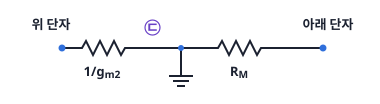
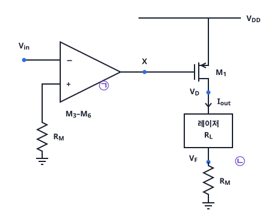
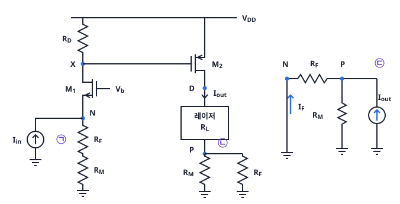
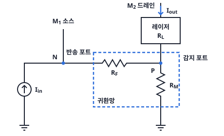
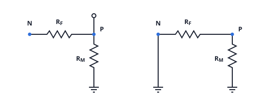
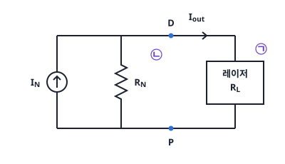
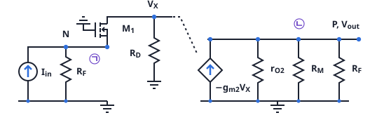

# 전자회로2 복습 1125 문제설명

회로와 첫 식을 짚고 핵심 계산으로 답을 구해요.

문제의 첫 줄부터 검산까지 설명해요.

**목차**

- [문항별 설명](#problems)
  - [P1. CG와 소스 팔로워로 레이저 전류를 조절하는 C-V 귀환](#p1)
  - [P2. 차동쌍과 PMOS 출력단으로 레이저를 구동하는 C-V 귀환](#p2)
  - [P3. 귀환 저항과 감지 저항이 유한한 C-C 레이저 구동 회로](#p3)
  - [P4. C-C 레이저 구동 회로를 레이저에서 본 노턴 등가](#p4)
  - [P5. 같은 회로의 출력을 전압으로 볼 때의 V-C 귀환](#p5)

## 문항별 설명

### P1. CG와 소스 팔로워로 레이저 전류를 조절하는 C-V 귀환

2021-1_기말-Q4 · 기출 4 · [원 문제 보기](../%EB%B3%B5%EC%8A%B5%EB%AC%B8%EC%A0%9C_1125_Analog_Filters-%EB%AC%B8%EC%A0%9C.pdf)

#### 주어진 조건

- $R_M$은 작지 않다고 가정
- laser diode의 임피던스는 $R_L$
- $\lambda = 0$으로 가정
- 소자 값($R_D$, $R_M$, $R_L$, $V_{DD}$, 트랜지스터 크기)은 주어지지 않음

#### 구할 것

- (1) Loop gain과 closed-loop gain을 각각 구함
- (2) Closed-loop input impedance와 closed-loop output impedance를 각각 구함

원문 보기

다음 회로에서 $R_M$은 작지 않다고 가정하며, laser diode의 임피던스는 $R_L$이다. $\lambda = 0$으로 가정한다.

(1) Loop gain과 closed-loop gain을 각각 구하시오.

(2) Closed-loop input impedance와 closed-loop output impedance를 각각 구하시오.

*반송 쪽 게이트는 교류 접지이고 감지 저항은 레이저와 직렬인 개루프*

#### (1) 루프 이득과 폐루프 이득

몸체 효과는 생략해요. ㉠ $M_1$ 게이트는 교류 접지라 소스 입력 CG의 이득은 $V_X/V_{in}=g_{m1}R_D$예요. ㉡ $M_2$는 소스 팔로워이고 소스에 레이저와 $R_M$이 직렬로 달려 있어요. 두 단의 이득을 노드 $X$에서 나눠요.

$$
A_{\mathrm{open}}=\frac{I_{out}}{V_{in}}=\frac{V_X}{V_{in}}\frac{I_{out}}{V_X}\ [\mathrm{A/V}]
$$

소스에 달린 부하를 $R_{\mathrm{source}}=R_L+R_M$으로 두고, 소스 팔로워의 전압 이득 공식을 써요.

$$
\frac{V_S}{V_X}=\frac{R_{\mathrm{source}}}{1/g_{m2}+R_{\mathrm{source}}}
$$

부하 양단의 전압 $V_S$를 $R_{\mathrm{source}}$로 나누면 레이저 전류가 나와요.

$$
\frac{I_{out}}{V_X}=\frac{V_S}{V_X}\frac{1}{R_{\mathrm{source}}}=\frac{1}{1/g_{m2}+R_L+R_M}
$$

$$
A_{\mathrm{open}}=\frac{g_{m1}R_D}{1/g_{m2}+R_L+R_M}
$$

$V_F=I_{out}R_M$이 입력 $V_{in}-V_F$로 돌아오므로 $K=R_M$인 음귀환이에요.

$$
KA_{\mathrm{open}}=\frac{g_{m1}R_DR_M}{1/g_{m2}+R_L+R_M}
$$

$$
A_{\mathrm{closed}}=\frac{A_{\mathrm{open}}}{1+KA_{\mathrm{open}}}
$$

$$
A_{\mathrm{closed}}=\frac{g_{m1}R_D}{1/g_{m2}+R_L+R_M+g_{m1}R_DR_M}
$$

*입력을 0으로 두고 레이저를 뺀 개루프 출력 두 단자*

#### (2) 폐루프 입력·출력 임피던스

입력은 게이트를 접지한 CG 소스를 보므로 $R_{in,open}=1/g_{m1}$이고, 직렬 전압 비교에는 레이저를 단 상태의 $KA_{\mathrm{open}}$을 써요.

㉢ 레이저를 떼고 $V_{in}=0$으로 두면 개루프의 $X$는 교류 접지예요. 위 단자의 $1/g_{m2}$와 아래 단자의 $R_M$이 접지를 거쳐 직렬로 보여요.

$$
R_{out,open}=\frac{1}{g_{m2}}+R_M
$$

레이저를 단 상태의 $A_{\mathrm{open}}$과 같은 조건으로 $R_{out,open}+R_L$에 귀환 배율을 곱해요. 여기서 $R_L$을 빼면 레이저 두 단자에서 본 구동 회로의 저항이 나와요.

$$
R_{in,closed}=R_{in,open}(1+KA_{\mathrm{open}})=\frac{1+KA_{\mathrm{open}}}{g_{m1}}
$$

$$
R_{out,closed}=(R_{out,open}+R_L)(1+KA_{\mathrm{open}})-R_L
$$

$$
R_{out,closed}=\frac{1}{g_{m2}}+R_M+g_{m1}R_DR_M
$$

**페이지 요약**

레이저를 연결한 $KA_{\mathrm{open}}$을 써요.

출력저항은 $(R_{out,open}+R_L)$에 귀환 배율을 곱하고 $R_L$을 빼요.

---

### P2. 차동쌍과 PMOS 출력단으로 레이저를 구동하는 C-V 귀환

2023-1_기말-Q3 · 기출 3 · [원 문제 보기](../%EB%B3%B5%EC%8A%B5%EB%AC%B8%EC%A0%9C_1125_Analog_Filters-%EB%AC%B8%EC%A0%9C.pdf)

#### 주어진 조건

- $R_M$은 작지 않다고 가정
- laser diode의 임피던스는 $R_L$
- $\lambda > 0$으로 가정
- 소자 값($R_M$, $R_L$, $I_{SS}$, $V_{DD}$, 트랜지스터 크기)은 주어지지 않음

#### 구할 것

- (1) Open-loop gain과 open-loop 입력 임피던스, open-loop 출력 임피던스를 각각 구함
- (2) Loop gain, closed-loop gain, closed-loop 출력 임피던스를 각각 구함

원문 보기

다음 회로에서 $R_M$은 작지 않다고 가정하며, laser diode의 임피던스는 $R_L$이다. 또한, $\lambda > 0$으로 가정한다.

(1) Open-loop gain과 open-loop 입력 및 출력 임피던스를 각각 구하시오.

(2) Loop gain, closed-loop gain, closed-loop 출력 임피던스를 각각 구하시오.

*반송 쪽 게이트는 교류 접지이고 감지 저항은 레이저와 직렬인 개루프*

#### (1) 개루프 이득과 입력·출력 임피던스

㉠ $M_4$ 게이트를 교류 접지하면 $M_3$ 입력은 반전해요. 중간 노드 $X$에서 두 단을 나눠요.

$$
A_{\mathrm{open}}=\frac{I_{out}}{V_{in}}=\frac{V_X}{V_{in}}\frac{I_{out}}{V_X}\ [\mathrm{A/V}]
$$

대칭 차동쌍, 1:1 전류 거울, 이상적인 테일 전류원, $g_mr_o\gg1$ 조건에서 차동단 이득은 아래와 같아요.

$$
\frac{V_X}{V_{in}}\approx-g_{m3}(r_{o3}\parallel r_{o5})
$$

㉡ 레이저를 연결한 상태에서 $M_1$ 드레인부터 교류 접지까지 $r_{o1}$과 레이저 가지 $R_L+R_M$이 병렬이에요. 드레인 전압을 $V_D$로 두면 공통 소스 단의 전압 이득은 아래와 같아요.

$$
\frac{V_D}{V_X}=-g_{m1}\bigl[r_{o1}\parallel(R_L+R_M)\bigr]
$$

1번과 같이 출력 전압을 부하 가지의 전류로 바꿔요. $I_{out}$은 직렬인 레이저와 $R_M$을 모두 지나고, 두 저항에 걸린 전압을 합하면 $V_D$예요. 따라서 $I_{out}=V_D/(R_L+R_M)$이에요. 양변을 $V_X$로 나누고 공통 소스 단의 이득을 넣어요.

$$
\frac{I_{out}}{V_X}=\frac{V_D}{V_X}\frac{1}{R_L+R_M}=-g_{m1}\frac{r_{o1}\parallel(R_L+R_M)}{R_L+R_M}
$$

$$
A_{\mathrm{open}}\approx\frac{V_X}{V_{in}}\left[-g_{m1}\frac{r_{o1}\parallel(R_L+R_M)}{R_L+R_M}\right]
$$

입력은 $M_3$ 게이트에 연결돼요. 게이트에 소신호 입력 전류가 흐르지 않으므로 입력 임피던스는 무한대예요.

$$
R_{in,open}=\infty
$$

*입력을 0으로 두고 레이저를 뺀 개루프 출력 두 단자*

레이저를 떼고 $V_{in}=0$으로 두면 $X$가 교류 접지가 돼요. 레이저가 있던 두 단자 사이에서 위쪽의 $r_{o1}$과 아래쪽의 $R_M$이 교류 접지를 거쳐 직렬로 보여요.

$$
R_{out,open}=r_{o1}+R_M
$$

#### (2) 루프 이득과 폐루프 이득·출력 임피던스

출력 전류가 늘면 $V_F=I_{out}R_M$이 올라 $M_4$를 통해 $X$를 올리고 PMOS 전류를 줄여요. 따라서 $K=R_M$인 음귀환이에요.

레이저를 단 상태의 $A_{\mathrm{open}}$과 같은 조건으로 $R_{out,open}+R_L$에 귀환 배율을 곱해요. 여기서 $R_L$을 빼면 레이저 두 단자에서 본 구동 회로의 저항이 나와요.

$$
KA_{\mathrm{open}}=R_M A_{\mathrm{open}}
$$

$$
A_{\mathrm{closed}}=\frac{A_{\mathrm{open}}}{1+KA_{\mathrm{open}}}
$$

$$
R_{out,closed}\approx(R_{out,open}+R_L)(1+KA_{\mathrm{open}})-R_L
$$

**페이지 요약**

차동쌍과 PMOS가 각각 반전하므로 개루프 트랜스컨덕턴스 $I_{out}/V_{in}$의 부호는 양수예요.

---

### P3. 귀환 저항과 감지 저항이 유한한 C-C 레이저 구동 회로

E12.32 · 예제 12.32 · [원 문제 보기](../%EB%B3%B5%EC%8A%B5%EB%AC%B8%EC%A0%9C_1125_Analog_Filters-%EB%AC%B8%EC%A0%9C.pdf)

#### 주어진 조건

- $R_F$가 크지 않음, $R_M$이 작지 않음
- 레이저 다이오드는 저항 $R_L$로 모델링
- $M_2$의 출력 저항 유한: $r_{O2} < \infty$
- 소자 값은 주어지지 않음 (답은 소신호 파라미터 기호로)
- 본문의 해석 순서: 순방향 증폭기와 귀환 회로망을 확인하고, 종지 법칙(Fig 12.53)에 따라 루프를 끊어 개루프 변수를 구한 뒤, Fig 12.54의 법칙으로 귀환율을 구하고 폐루프 변수를 계산
- 전류-전류 귀환의 종지 법칙 (본문 Fig 12.53(c)): 감지 복제의 출력 포트는 단락, 반송 복제의 입력 포트는 개방
- 전류-전류 귀환의 귀환율 (본문 Fig 12.54(c)): 귀환 회로망 입력에 전류 $I_1$을 흘리고 단락된 출력 포트의 전류 $I_2$를 재어 $K = I_2/I_1$

#### 구할 것

- 회로 해석: 개루프 전류 이득 $A_{I,open} = I_{out}/I_{in}$, 개루프 입력·출력 임피던스, 귀환율 $K$, 폐루프 이득과 폐루프 입력·출력 임피던스

원문 보기

$R_F$가 크지 않고, $R_M$이 작지 않으며, 레이저 다이오드가 저항 $R_L$에 의해 모델링될 때 그림 12.61(a)의 회로를 해석하라. 역시 $r_{O2} < \infty$라고 가정하라.

*왼쪽은 C–C 개루프 회로, 오른쪽은 반송 포트 N을 단락한 귀환망이에요.*

#### 루프를 끊는 위치

*점선 안의 $R_F$와 $R_M$이 귀환망이에요. 반송 포트($N$–접지)는 $I_{in}$과 병렬, 감지 포트($P$–접지)는 레이저와 직렬이에요.*

$R_M$은 $I_{out}$을 감지하고 $R_F$는 감지한 신호를 $N$으로 되돌리므로 두 저항 모두 귀환망이에요. 둘은 접지를 공통 단자로 쓰는 두 포트 블록이고, 어느 저항도 증폭기 쪽에 나눠 넣지 않아요.

이 블록을 입력 쪽과 출력 쪽에 하나씩 복제해요. 복제본에서 쓰지 않는 포트는 원 회로에서 직렬이면 개방하고 병렬이면 단락해요. 레이저와 직렬인 감지 포트는 입력 복제에서 열고, $I_{in}$과 병렬인 반송 포트는 출력 복제에서 단락해요.

*왼쪽 입력 복제는 감지 포트를 열어 $N$에서 $R_F+R_M$이 보여요. 오른쪽 출력 복제는 반송 포트 $N$을 단락해 $P$에서 $R_F\parallel R_M$이 보여요.*

- 출력 쪽에 원래의 $R_M$을 $R_F\parallel R_M$과 따로 더하지 않아요.
- 입력 복제에서 $P$를 접지에 붙이면 $R_F$만 남아요. 감지 포트는 직렬이라 열어야 해요.
- 출력 복제에서 $N$을 열어 두면 $R_F$에 전류가 흐르지 않아 $R_M$만 남아요. 반송 포트는 병렬이라 단락해야 해요.

#### 레이저를 연결한 개루프 이득

㉠ 입력 $N$에서 전류를 병렬로 합치고 출력에서 레이저 전류를 직렬로 감지하는 C-C 귀환이에요. 입력 쪽 복제의 감지 포트를 열면 $N$에서 접지까지 $R_F+R_M$이 남아요. $r_{O1}\to\infty$로 두고 몸체 효과를 무시하면 $M_1$ 소스 쪽 저항은 $1/g_{m1}$이에요.

$g_{m1}R_Dg_{m2}r_{O2}\gg R_M/(R_F+R_M)$에서 $R_F$의 직접 순방향 전달을 생략해요. 노턴 입력의 테브난 전압은 $V_{\mathrm{Th}}=I_{in}(R_F+R_M)$이고 직렬 저항은 $R_F+R_M$이에요. 첫 인자 $R_F+R_M$은 $V_{\mathrm{Th}}/I_{in}$이에요. 테브난 전압에서 $X$까지의 이득에는 $R_F+R_M$과 $1/g_{m1}$의 분압이 들어가요.

$$
A_{\mathrm{open}}=\frac{I_{out}}{I_{in}}=(R_F+R_M)\frac{V_X}{V_{\mathrm{Th}}}\frac{I_{out}}{V_X}\ [\mathrm{A/A}]
$$

$$
\frac{V_X}{V_{\mathrm{Th}}}=\frac{R_D}{R_F+R_M+1/g_{m1}}
$$

㉡ 반송 포트를 단락한 출력 복제에서 $P$와 교류 접지 사이에 $R_F\parallel R_M$이 남아요. $M_2$의 드레인부터 교류 접지까지 레이저 가지의 저항은 $R_L+(R_F\parallel R_M)$이에요. 이 가지와 $r_{O2}$가 병렬이므로 공통 소스 단의 전압 이득은 다음과 같아요.

$$
\frac{V_D}{V_X}=-g_{m2}\bigl[r_{O2}\parallel\bigl(R_L+(R_F\parallel R_M)\bigr)\bigr]
$$

레이저 가지 전체에 드레인 전압 $V_D$가 걸려요. 옴의 법칙으로 $I_{out}=V_D/[R_L+(R_F\parallel R_M)]$이에요. 양변을 $V_X$로 나누면 아래 항을 얻어요.

$$
\frac{I_{out}}{V_X}=\frac{V_D}{V_X}\frac{1}{R_L+(R_F\parallel R_M)}
$$

두 단을 곱하고 테브난 변환의 첫 인자 $R_F+R_M$을 포함해요.

$$
A_{\mathrm{open}}=(R_F+R_M)\frac{V_X}{V_{\mathrm{Th}}}(-g_{m2})\frac{r_{O2}\parallel\bigl(R_L+(R_F\parallel R_M)\bigr)}{R_L+(R_F\parallel R_M)}
$$

#### 개루프 입력·출력 임피던스

입력에서는 $M_1$ 소스 쪽 저항과 반송 복제의 $R_F+R_M$이 병렬이에요.

$$
R_{in,open}=(1/g_{m1})\parallel(R_F+R_M)
$$

출력은 레이저를 떼고 입력 전류원을 개방해요. 이때 $V_X=0$이에요. 두 레이저 단자 사이에서는 드레인 쪽의 $r_{O2}$와 감지 쪽의 $R_F\parallel R_M$이 교류 접지를 거쳐 직렬로 보여요.

$$
R_{out,open}=r_{O2}+(R_F\parallel R_M)
$$

㉢ 귀환망만 떼어 $N$을 단락하면 $I_{out}$의 일부가 $P$에서 $R_F$를 거쳐 $N$으로 흘러요. $I_F$의 기준 방향은 $N$에서 $P$이므로 귀환율은 음수예요.

$$
K=\frac{I_F}{I_{out}}=-\frac{R_M}{R_M+R_F}
$$

$$
KA_{\mathrm{open}}=\left(-\frac{R_M}{R_M+R_F}\right) A_{\mathrm{open}}>0
$$

#### 폐루프 이득과 임피던스

$$
A_{\mathrm{closed}}\approx\frac{A_{\mathrm{open}}}{1+KA_{\mathrm{open}}}
$$

입력은 병렬 합산이므로 입력 저항이 줄어요.

$$
R_{in,closed}\approx\frac{R_{in,open}}{1+KA_{\mathrm{open}}}
$$

출력은 직렬 감지이므로 저항이 커져요. 레이저를 단 상태의 $A_{\mathrm{open}}$과 같은 조건으로 $R_{out,open}+R_L$에 귀환 배율을 곱해요. 여기서 $R_L$을 빼면 레이저 두 단자에서 본 구동 회로의 저항이 나와요.

$$
R_{out,closed}\approx (R_{out,open}+R_L)(1+KA_{\mathrm{open}})-R_L
$$

**페이지 요약**

$R_F$와 $R_M$은 통째로 귀환망이에요.

직렬인 감지 포트는 열고 병렬인 반송 포트는 단락해 복제해요.

레이저를 연결한 $KA_{\mathrm{open}}$을 써요.

출력저항은 $(R_{out,open}+R_L)$에 귀환 배율을 곱하고 $R_L$을 빼요.

---

### P4. C-C 레이저 구동 회로를 레이저에서 본 노턴 등가

X12.32 · 연습문제 12.32 · [원 문제 보기](../%EB%B3%B5%EC%8A%B5%EB%AC%B8%EC%A0%9C_1125_Analog_Filters-%EB%AC%B8%EC%A0%9C.pdf)

#### 주어진 조건

- 예제 12.32의 회로: Fig 12.61(a), $R_F$가 크지 않음, $R_M$이 작지 않음, 레이저 다이오드는 저항 $R_L$, $r_{O2} < \infty$
- 레이저를 구동하는 전체 회로(레이저를 뺀 나머지, 귀환 포함)를 레이저 단자에서 본 노턴 등가 회로로 나타냄 (노턴 전류원 $I_N$과 병렬 저항 $R_N$을 $I_{in}$과 회로 파라미터로)
- 소자 값은 주어지지 않음 (답은 소신호 파라미터 기호로)
- 예제 12.32의 결과: $A_{I,open} = \dfrac{(R_F + R_M) R_D}{R_F + R_M + 1/g_{m1}}\cdot\dfrac{-g_{m2} r_{O2}}{r_{O2} + R_L + R_M \parallel R_F}$ (식 12.166), $A_{I,closed} = \dfrac{A_{I,open}}{1 - \frac{R_M}{R_M + R_F} A_{I,open}}$ (식 12.171), $R_{out,closed} = (r_{O2} + R_F \parallel R_M)\left(1 - \dfrac{R_M}{R_M + R_F} A_{I,open}\right)$ (식 12.173)

#### 구할 것

- 레이저를 구동하는 전체 회로의 노턴 등가 회로 (노턴 전류와 노턴 저항)

원문 보기

레이저를 구동하는 전체 회로의 노턴 등가 회로를 만들어라.

*레이저를 다시 연결한 노턴 등가. 내부 전류원의 기준 방향은 $P$에서 $D$, 외부 부하 전류의 기준 방향은 $D$에서 $P$예요.*

#### 레이저 단락 전류

㉠ 레이저 $R_L$ 자리를 도선으로 바꾸고 $I_{in}$은 그대로 흘려요. 이 도선에서 $D$에서 $P$로 흐르는 전류가 $I_N$이에요. 예제 12.32의 폐루프 전류 전달비를 $R_L=0$에서 평가해요.

3번에서 구한 $A_{\mathrm{open}}=I_{out}/I_{in}$과 $K=-R_M/(R_M+R_F)$를 써요. 폐루프 전류 전달비 전체에 $R_L=0$을 대입해요.

$$
I_N=I_{out}\big|_{R_L=0}\approx\left.\frac{A_{\mathrm{open}}}{1+KA_{\mathrm{open}}}\right|_{R_L=0}I_{in}
$$

등가회로의 전류원 기준은 $P\to D$예요. $I_{in}>0$이면 3번의 $A_{\mathrm{open}}$이 음수이므로 $I_N$도 음수예요.

#### 두 단자에서 본 저항

㉡ 이제 레이저를 떼고 독립 전류원 $I_{in}$을 개방해요. 시험전류 $I_t$가 $D$로 들어가 $P$로 나오면 $R_N=(V_D-V_P)/I_t$예요. 이 값은 3번에서 구한 레이저 두 단자의 폐루프 출력저항이에요.

$R_F$를 통한 순방향 전달을 무시한 2포트 근사에서 노턴 저항은 다음과 같아요.

$$
R_N=R_{out,closed}\approx (R_{out,open}+R_L)(1+KA_{\mathrm{open}})-R_L
$$

$$
R_N\approx r_{O2}+(R_F\parallel R_M)+\frac{R_M R_D g_{m2}r_{O2}}{R_F+R_M+1/g_{m1}}
$$

**페이지 요약**

단락 전류를 잴 때는 입력을 유지하고, 노턴 저항을 잴 때는 입력 전류원을 개방해요.

---

### P5. 같은 회로의 출력을 전압으로 볼 때의 V-C 귀환

E12.33 · 예제 12.33 · [원 문제 보기](../%EB%B3%B5%EC%8A%B5%EB%AC%B8%EC%A0%9C_1125_Analog_Filters-%EB%AC%B8%EC%A0%9C.pdf)

#### 주어진 조건

- 관심 있는 출력은 전압 $V_{out}$ (그림 12.61(a)에서는 레이저 전류 $I_{out}$)
- 그림 12.61(a)와의 차이: 레이저(상자)가 없고 $M_2$ 드레인이 바로 $R_M$, $R_F$가 만나는 노드
- 참고 회로 (본문 Fig 12.61(a), 예제 12.32): $V_{DD}$–$R_D$–$X$, $M_1$: D = $X$, G = $V_b$, S = 입력 노드, 입력 노드에 $I_{in}$(접지 → 노드), PMOS $M_2$: G = $X$, S = $V_{DD}$, D → 레이저 상자 → 노드 $P$, $P$–$R_M$–접지, 입력 노드–$R_F$–$P$
- 예제 12.32의 결과 (그림 12.61(a), 전류-전류 귀환): $R_{in,open} = \dfrac{1}{g_{m1}} \parallel (R_F + R_M)$, $R_{out,open} = r_{O2} + R_F \parallel R_M$, $K = -\dfrac{R_M}{R_M + R_F}$, $R_{out,closed} = (r_{O2} + R_F \parallel R_M)\left(1 - \dfrac{R_M}{R_M + R_F} A_{I,open}\right)$
- 소자 값은 주어지지 않음 (답은 소신호 파라미터 기호로)
- 전압-전류 귀환의 종지 법칙 (본문 Fig 12.53(b)): 감지 복제의 출력 포트와 반송 복제의 입력 포트를 모두 단락
- 전압-전류 귀환의 귀환율 (본문 Fig 12.54(b)): 귀환 회로망 입력에 전압 $V_1$을 걸고 단락된 출력 포트의 전류 $I_2$를 재어 $K = I_2/V_1$

#### 구할 것

- 증폭기 해석: 개루프 이득 $R_O = V_{out}/I_{in}$, 개루프 입력·출력 임피던스, 귀환율 $K$, 폐루프 변수
- 그림 12.61(a)의 회로(예제 12.32)와 이 회로의 차이

원문 보기

그림 12.62(a)는 그림 12.61(a)와 비슷한 회로를 묘사하지만 여기서 관심 있는 출력은 $V_{out}$이다. 증폭기를 해석하고 두 회로 사이의 차이를 공부하라.

*V–C 개루프 소신호 회로. $V_{DD}$와 $V_b$는 AC 접지예요.*

㉡ 출력 전압을 병렬로 감지하고 ㉠ 입력 $N$에서 전류를 병렬로 합쳐요. 두 복제의 반대쪽을 단락하면 출력에는 $R_M$과 $R_F$, 입력에는 $R_F$가 접지로 걸려요.

$$
R_{out,open}=r_{O2}\parallel R_M\parallel R_F
$$

$$
R_{in,open}=\frac{1}{g_{m1}}\parallel R_F
$$

$g_{m1}R_Dg_{m2}R_F\gg1$에서 $R_F$의 직접 순방향 전달을 생략해요. $N$의 노턴 입력은 테브난 전압 $V_{\mathrm{Th}}=I_{in}R_F$와 직렬 $R_F$로 바뀌어요. 첫 인자 $R_F$는 $V_{\mathrm{Th}}/I_{in}$이에요. 테브난 전압에서 $X$까지의 이득에는 $R_F$와 $1/g_{m1}$의 분압이 들어가요.

$$
A_{\mathrm{open}}=\frac{V_{out}}{I_{in}}=R_F\frac{V_X}{V_{\mathrm{Th}}}\frac{V_{out}}{V_X}\ [\mathrm{V/A}]
$$

$$
\frac{V_X}{V_{\mathrm{Th}}}=\frac{R_D}{R_F+1/g_{m1}}
$$

PMOS가 공급하는 전류의 변화 $-g_{m2}V_X$에 앞서 구한 출력저항을 곱해요.

$$
\frac{V_{out}}{V_X}=-g_{m2}R_{out,open}
$$

귀환망만 떼어 $N$을 접지하고 $P$에 $V_{out}$을 걸어요. 양의 $I_F$는 $N$에서 $P$로 향해요.

$$
V_{out}=-R_FI_F
$$

$$
K=\frac{I_F}{V_{out}}=-\frac1{R_F}
$$

$$
KA_{\mathrm{open}}=\frac{g_{m2}R_DR_{out,open}}{R_F+1/g_{m1}}
$$

병렬 입력·병렬 감지라 폐루프 이득과 두 포트 저항이 모두 $1+KA_{\mathrm{open}}$로 나뉘어요.

$$
A_{\mathrm{closed}}=\frac{V_{out}}{I_{in}}\approx\frac{A_{\mathrm{open}}}{1+KA_{\mathrm{open}}}
$$

$$
R_{in,closed}\approx\frac{R_{in,open}}{1+KA_{\mathrm{open}}}
$$

$$
R_{out,closed}\approx\frac{R_{out,open}}{1+KA_{\mathrm{open}}}
$$

교과서의 $r_{O2}\to\infty$ 모델에서는 출력 병렬 부하에는 $R_M\parallel R_F$만 남아요. E12.32는 $R_M$이 레이저와 직렬로 전류를 감지해 출력저항을 높이고, 이 회로는 $R_F$가 출력 전압을 병렬로 감지해 출력저항을 낮춰요. 입력 복제도 E12.32에서는 $R_F+R_M$, 여기서는 $R_F$예요.

**페이지 요약**

출력 전압을 병렬로 감지하면 두 복제의 반대 포트를 단락해요.

입력은 $R_F$로 종단하고, 출력의 병렬 부하에서 PMOS 이득을 읽어요.

폐루프 출력저항은 $1+KA_{\mathrm{open}}$로 나눠요.

---

원 문제·정리노트·PDF는 보존해요.
