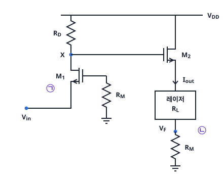

# 전자회로2 복습 1125 문제설명

주어진 조건을 읽고, 첫 줄을 쓰고, 이유를 따라가며 답을 확인해요.

문제의 첫 줄부터 검산까지 설명해요.

**목차**

- [문항별 설명](#problems)
  - [P1. CG와 소스 팔로워로 레이저 전류를 조절하는 C-V 귀환](#p1)
  - [P2. 차동쌍과 PMOS 출력단으로 레이저를 구동하는 C-V 귀환](#p2)
  - [P3. 귀환 저항과 감지 저항이 유한한 C-C 레이저 구동 회로](#p3)
  - [P4. C-C 레이저 구동 회로를 레이저에서 본 노턴 등가](#p4)
  - [P5. 같은 회로의 출력을 전압으로 볼 때의 V-C 귀환](#p5)

## 문항별 설명

### P1. CG와 소스 팔로워로 레이저 전류를 조절하는 C-V 귀환

2021-1_기말-Q4 · 기출 4

#### 주어진 조건

- $R_M$은 작지 않다고 가정
- laser diode의 임피던스는 $R_L$
- $\lambda = 0$으로 가정
- 소자 값($R_D$, $R_M$, $R_L$, $V_{DD}$, 트랜지스터 크기)은 주어지지 않음

#### 구할 것

- (1) Loop gain과 closed-loop gain을 각각 구함
- (2) Closed-loop input impedance와 closed-loop output impedance를 각각 구함

원문 보기

다음 회로에서 $R_M$은 작지 않다고 가정하며, laser diode의 임피던스는 $R_L$이다. $\lambda = 0$으로 가정한다.

(1) Loop gain과 closed-loop gain을 각각 구하시오.

(2) Closed-loop input impedance와 closed-loop output impedance를 각각 구하시오.

#### 문제를 읽어요

입력은 전압 $V_{in}$이고 $M_1$의 소스로 들어가요. $M_1$의 게이트는 $V_F$ 노드에 묶여 있으니, 신호 입장에서 $M_1$은 소스로 입력을 받는 공통 게이트(common-gate, CG) 단이에요. 드레인 노드 $X$에는 $R_D$가 달려 있어요.

$X$는 NMOS $M_2$의 게이트를 움직여요. $M_2$는 드레인이 $V_{DD}$, 소스가 레이저 쪽이므로 소스 팔로워(source follower)예요. $M_2$의 소스 전류가 레이저($R_L$)와 $R_M$을 차례로 지나 접지로 가요. 출력은 레이저 전류 $I_{out}$이에요.

$R_M$ 위의 전압 $V_F=I_{out}R_M$이 $M_1$ 게이트로 돌아가요. 출력 전류를 감지(sense)해서 전압으로 되돌리는(return) 구조라 전류-전압(C-V) 귀환이에요.

조건 $\lambda=0$은 모든 트랜지스터의 $r_o\to\infty$라는 뜻이에요. “$R_M$이 작지 않다”는 말은 $R_M$을 무시하지 말고 개루프 회로에 로딩(loading)으로 넣으라는 신호예요. 몸체 효과는 원문에 없으므로 수업 기본대로 무시해요.

(1)은 루프 이득과 폐루프 이득 $I_{out}/V_{in}$을, (2)는 $V_{in}$ 쪽에서 본 폐루프 입력 임피던스와 레이저 쪽에서 본 폐루프 출력 임피던스를 구해요. 출력 임피던스는 레이저를 떼어 낸 두 단자에서 구동 회로를 들여다본 값으로 정의해요. 레이저는 이 회로가 전류를 밀어 넣는 부하이기 때문이에요.

#### 이 개념과 공식을 떠올려요

**단서 → 개념.** “$R_M$이 작지 않다”와 “루프 이득·폐루프 임피던스”라는 요구에서 귀환망의 로딩을 넣는 2포트 해석(Razavi 12장의 종지 법칙, termination rule)을 떠올려요. 루프를 끊을 때 귀환망을 두 번 복제해요. 출력 쪽에 붙는 것이 감지 복제, 입력 쪽에 붙는 것이 반송 복제예요.

**남는 포트 처리.** 원래 회로에서 직렬로 끼어 있던 포트는 개방하고, 병렬로 걸려 있던 포트는 단락해요. 이 회로는 출력 전류가 $R_M$을 직렬로 지나가므로 반송 복제의 감지 포트를 개방해요. 또 $V_F$가 $M_1$의 게이트-소스 사이에서 $V_{in}$과 직렬로 비교되므로 감지 복제의 반송 포트도 개방해요.

**기호의 뜻.** $A=I_{out}/V_{in}$은 개루프 트랜스컨덕턴스(단위 S), $K=V_2/I_1$은 귀환율(단위 Ω)이에요. $K$는 귀환망 입력에 전류 $I_1$을 흘리고 개방한 출력 포트 전압 $V_2$를 재서 구해요. 루프 이득 $T=KA$는 단위가 없고, 폐루프 이득은 $A/(1+T)$예요.

**임피던스 규칙.** 입력에서 전압으로 직렬 비교하면 $R_{in}$이 $(1+T)$배, 출력에서 전류를 직렬로 감지하면 $R_{out}$도 $(1+T)$배가 돼요. 이 곱에 쓰는 $T$는 출력 임피던스를 재는 조건(레이저 자리를 시험원으로 바꾼 상태)에서의 루프 이득이어야 해요.

**알려진 블록.** $\lambda=0$인 CG 단의 입력 저항은 $1/g_{m1}$, 이득은 $g_{m1}R_D$예요. 소스 팔로워의 소스에서 위를 보면 $1/g_{m2}$이고, 소스에 부하 $R$이 직렬로 달리면 소스 전류는 $V_X/(1/g_{m2}+R)$예요. 귀환망이 $R_M$ 하나뿐이라 로딩만 넣으면 각 단을 이 블록으로 바로 풀 수 있어요.

#### 종이에 쓸 첫 줄

반송 복제는 감지 포트가 개방이라 $R_M$에 전류가 흐르지 않아요. 따라서 $M_1$ 게이트는 $R_M$을 거쳐 접지에 붙은 AC 0 V가 돼요. 감지 복제는 반송 포트가 개방이라 레이저 아래에 $R_M$만 접지로 남아요.

*C-V 귀환의 개루프 회로: $V_{DD}$는 AC 접지, $M_1$ 게이트의 $R_M$(반송 복제)에는 전류가 없고 레이저 아래 $R_M$(감지 복제)은 접지로 이어져요.*

개루프 이득은 두 단의 곱으로 쓰고, 귀환율은 $R_M$ 하나에서 바로 읽어요.

$$
A=\frac{I_{out}}{V_{in}}=\frac{V_X}{V_{in}}\cdot\frac{I_{out}}{V_X}
$$

$$
K=\frac{V_F}{I_{out}}=R_M
$$

#### 이렇게 풀어요

#### (1) 루프 이득과 폐루프 이득

1단은 소스 입력 CG예요. 입력은 $V_{in}$, 출력은 노드 $X$의 전압이에요. $G_m$과 $R_{out}$을 따로 구해 곱해요.

$X$를 접지에 단락하고, $X$에서 $M_1$ 드레인으로 빨려 들어가는 전류를 $i_{out}$의 양의 방향으로 잡아요. 게이트가 AC 0이므로 $v_{gs1}=0-v_{in}$이에요.

$$
i_{out}=g_{m1}(0-v_{in})
$$

$$
G_{m1}=\frac{i_{out}}{v_{in}}=-g_{m1}
$$

$V_{in}=0$으로 두면 $M_1$은 $\lambda=0$인 전류원이라 무한대 저항이고, $M_2$ 게이트로는 전류가 흐르지 않아요. $X$에서는 $R_D$만 보여요.

$$
R_{out1}=R_D
$$

$i_{out}$을 증폭기로 빨려 들어가는 방향으로 잡았으니 $V_X=-i_{out}R_{out1}$이에요.

$$
\frac{V_X}{V_{in}}=-G_{m1}R_{out1}=g_{m1}R_D
$$

$M_2$ 소스에서 위를 보면 $1/g_{m2}$, 아래로는 레이저와 감지 복제 $R_M$이 직렬이에요. 소스 전류가 그대로 $I_{out}$이에요.

$$
\frac{I_{out}}{V_X}=\frac{1}{1/g_{m2}+R_L+R_M}
$$

$$
A=\frac{g_{m1}R_D}{1/g_{m2}+R_L+R_M}
$$

폐루프에서는 $v_{gs1}=V_F-V_{in}=-(V_{in}-V_F)$예요. 개루프의 $A$를 $V_F=0$일 때 정했으므로, 귀환이 있으면 입력 자리에 $V_{in}-V_F$가 들어가요. 그래서 $I_{out}=A(V_{in}-KI_{out})$이고 귀환은 음(negative)이에요.

$$
T=KA=\frac{g_{m1}R_DR_M}{1/g_{m2}+R_L+R_M}
$$

$$
\frac{I_{out}}{V_{in}}=\frac{A}{1+T}=\frac{g_{m1}R_D}{1/g_{m2}+R_L+R_M+g_{m1}R_DR_M}
$$

#### (2) 폐루프 입력·출력 임피던스

개루프에서 $V_{in}$은 게이트가 접지된 CG의 소스를 보므로 $R_{in,open}=1/g_{m1}$이에요. 입력에서 전압을 직렬로 비교하니 $(1+T)$배가 돼요. 이때 $T$는 레이저가 실제로 달린 (1)의 루프 이득이에요.

$$
R_{in,closed}=\frac{1}{g_{m1}}(1+T)=\frac{1}{g_{m1}}\left(1+\frac{g_{m1}R_DR_M}{1/g_{m2}+R_L+R_M}\right)
$$

레이저를 떼고 그 두 단자에서 봐요. 개루프에서는 $V_{in}=0$이고 $M_1$ 게이트도 0이라 $X$가 움직이지 않아요. 위 단자에서는 $M_2$ 소스의 $1/g_{m2}$, 아래 단자에서는 $R_M$이 보이고 둘은 직렬이에요.

$$
R_{out,open}=\frac{1}{g_{m2}}+R_M
$$

출력 임피던스를 잴 때는 레이저 자리에 시험원이 들어가므로 루프 안에 $R_L$이 없어요. 그래서 곱하는 루프 이득은 (1)의 $T$에서 $R_L=0$으로 둔 $T_0$예요.

$$
T_0=\frac{g_{m1}R_DR_M}{1/g_{m2}+R_M}
$$

$$
R_{out,closed}=R_{out,open}(1+T_0)=\frac{1}{g_{m2}}+R_M+g_{m1}R_DR_M
$$

#### 완성 답과 검산

#### (1) 검산

**루프 이득 $T=\dfrac{g_{m1}R_DR_M}{1/g_{m2}+R_L+R_M}$, 폐루프 이득 $\dfrac{I_{out}}{V_{in}}=\dfrac{g_{m1}R_D}{1/g_{m2}+R_L+R_M+g_{m1}R_DR_M}$**예요. 조건은 $\lambda=0$, 몸체 효과 무시예요.

**단위:** $g_{m1}R_D$는 단위가 없고 분모는 Ω이라 이득은 S예요. $T$는 단위가 없어요.

**강한 귀환:** $T\gg1$이면 $I_{out}/V_{in}\to1/K=1/R_M$이에요. $V_F$가 $V_{in}$을 따라가서 $I_{out}\approx V_{in}/R_M$이 된다는 뜻이라, 레이저 전류가 $R_L$에 거의 무관해져요.

**귀환 제거:** $R_M\to0$이면 $T\to0$이고 이득은 $g_{m1}R_D/(1/g_{m2}+R_L)$로, 귀환 없는 CG+팔로워 직렬 연결로 돌아가요.

#### (2) 검산

**$R_{in,closed}=\dfrac{1+T}{g_{m1}}$, 레이저에서 본 $R_{out,closed}=\dfrac{1}{g_{m2}}+R_M+g_{m1}R_DR_M$**예요. 출력 임피던스를 레이저까지 포함한 출력 루프 전체로 정의하면 여기에 $R_L$을 더해요.

**직접 확인:** 문제 그림에서 레이저 자리에 $I_{out}$ 방향의 시험전류 $I_t$를 흘리고 $V_{in}=0$으로 둬요. $V_F=R_MI_t$이고, $M_1$ 게이트가 올라가니 $V_X=-g_{m1}R_DR_MI_t$예요. $M_2$ 소스는 $V_X-I_t/g_{m2}$이므로 두 단자 전압차는 $I_t(1/g_{m2}+R_M+g_{m1}R_DR_M)$이에요. 위 결과와 같아요.

**다른 정의와의 연결:** 루프에 $R_L$을 넣은 채 (1)의 $T$를 쓰면 출력 루프 전체 임피던스는 $(1/g_{m2}+R_L+R_M)(1+T)=1/g_{m2}+R_L+R_M+g_{m1}R_DR_M$이에요. 여기서 $R_L$을 빼면 같은 답이 나오고, 레이저에서 본 값은 $R_L$에 무관해요.

**극한:** $R_M\to0$이면 $R_{in}\to1/g_{m1}$, $R_{out}\to1/g_{m2}$로 귀환 없는 값이에요.

#### 주의할 점

- $R_M$이 작지 않은데 개루프에서 레이저 아래 $R_M$을 빼면 $A$가 커지고 $T$도 틀려요. 감지 복제 $R_M$은 레이저와 직렬로 남아요.
- 개루프에서 $M_1$ 게이트를 $V_F$에 그대로 두면 루프가 끊기지 않아요. 반송 복제의 $R_M$에는 전류가 없으니 게이트는 AC 0이에요.
- CG라서 $V_X/V_{in}=+g_{m1}R_D$로 양수예요. 귀환 신호는 $V_{in}-V_F$ 꼴로 빠지므로 $K=+R_M$, $T\gt0$이에요.
- $R_{out,open}$(레이저 제외)에 레이저를 포함한 $T$를 곱하면 $R_L\ll1/g_{m2}+R_M$일 때만 근사적으로 맞아요. 이 회로는 $R_L$이 $1/g_{m2}$, $R_M$과 비슷할 수 있어 차이가 커요.

#### 조건을 바꾸어 생각해요

1. 강한 귀환($T\gg1$)에서 $R_M$을 두 배로 키우면 $I_{out}/V_{in}$은 어떻게 변하나요?
2. $M_1$ 게이트를 $V_F$ 대신 고정 바이어스에 연결하면 $V_{in}$에서 본 입력 임피던스는 얼마인가요?
3. 레이저를 다른 소자로 바꿔 $R_L$이 두 배가 되면, 레이저에서 본 $R_{out,closed}$와 폐루프 이득 중 무엇이 바뀌나요?

**페이지 요약**

$R_M$이 작지 않으면 $R_M$ 복제를 넣은 개루프에서 $T=KA$로 풀어요.

#### 이득

$K=R_M$이고 $A=g_{m1}R_D/(1/g_{m2}+R_L+R_M)$이에요.

폐루프 이득은 $A/(1+T)$이고 $T\gg1$이면 $1/R_M$에 다가가요.

#### 임피던스

입력은 직렬 비교라 $(1+T)/g_{m1}$로 커져요.

레이저에서 본 출력은 $1/g_{m2}+R_M+g_{m1}R_DR_M$이에요.

출력 쪽 곱에는 레이저를 단락한 $T_0$를 써요.

---

### P2. 차동쌍과 PMOS 출력단으로 레이저를 구동하는 C-V 귀환

2023-1_기말-Q3 · 기출 3

#### 주어진 조건

- $R_M$은 작지 않다고 가정
- laser diode의 임피던스는 $R_L$
- $\lambda > 0$으로 가정
- 소자 값($R_M$, $R_L$, $I_{SS}$, $V_{DD}$, 트랜지스터 크기)은 주어지지 않음

#### 구할 것

- (1) Open-loop gain과 open-loop 입력 임피던스, open-loop 출력 임피던스를 각각 구함
- (2) Loop gain, closed-loop gain, closed-loop 출력 임피던스를 각각 구함

원문 보기

다음 회로에서 $R_M$은 작지 않다고 가정하며, laser diode의 임피던스는 $R_L$이다. 또한, $\lambda > 0$으로 가정한다.

(1) Open-loop gain과 open-loop 입력 및 출력 임피던스를 각각 구하시오.

(2) Loop gain, closed-loop gain, closed-loop 출력 임피던스를 각각 구하시오.

#### 문제를 읽어요

입력 $V_{in}$은 $M_3$ 게이트로 들어가요. $M_3$–$M_4$는 테일 전류 $I_{SS}$를 나눠 쓰는 차동쌍이고, $M_5$–$M_6$는 전류 거울 부하예요. 다이오드 연결은 $M_4$ 쪽의 $M_6$이고, 출력 노드 $X$는 $M_3$와 $M_5$의 드레인이에요.

$X$는 PMOS $M_1$의 게이트를 움직여요. $M_1$의 드레인 전류 $I_{out}$이 레이저($R_L$)를 지나 $R_M$으로 흐르고, $R_M$ 위의 전압 $V_F$가 $M_4$ 게이트로 돌아가요. 출력 전류를 감지해서 전압으로 되돌리는 전류-전압(C-V) 귀환이에요.

$\lambda\gt0$이니 모든 MOS의 $r_o$가 유한해요. 테일 $I_{SS}$는 출력저항이 주어지지 않았으므로 이상적 전류원으로 둬요. 차동쌍은 $M_3=M_4$, 거울은 $M_5=M_6$로 대칭이라고 보고 몸체 효과는 무시해요.

(1)은 개루프 이득 $I_{out}/V_{in}$과 개루프 입력·출력 임피던스를, (2)는 루프 이득, 폐루프 이득, 폐루프 출력 임피던스를 구해요. 출력 임피던스는 레이저를 떼어 낸 두 단자에서 구동 회로를 들여다본 값으로 정의해요.

#### 이 개념과 공식을 떠올려요

**단서 → 개념.** “$R_M$이 작지 않다”와 “open-loop gain·임피던스”라는 요구에서 귀환망 로딩을 넣는 2포트 해석(Razavi 12장 종지 법칙)을 떠올려요. 루프를 끊을 때 귀환망 $R_M$을 출력 쪽(감지 복제)과 입력 쪽(반송 복제)에 하나씩 붙여요.

**포트 처리.** $I_{out}$이 $R_M$을 직렬로 지나므로 반송 복제의 감지 포트는 개방해요. $V_F$는 $M_4$ 게이트에서 $V_{in}$과 차동으로 비교되는 직렬 전압이라 감지 복제의 반송 포트도 개방해요. 결과적으로 $M_4$ 게이트는 전류 없는 $R_M$을 거쳐 AC 0이 되고, 레이저 아래에는 $R_M$이 접지로 남아요.

**기호의 뜻.** $A=I_{out}/V_{in}$은 개루프 트랜스컨덕턴스(S), $K=V_2/I_1=R_M$은 귀환율(Ω), $T=KA$는 루프 이득이에요. 폐루프 이득은 $A/(1+T)$이고, 출력 전류를 직렬로 감지하므로 출력 임피던스는 $(1+T)$배가 돼요.

**알려진 블록과 근사.** 거울 부하 차동쌍의 단일 출력은 $G_m\approx g_{m3}$, $R_{out}\approx r_{o3}\parallel r_{o5}$로 $|A_v|\approx g_{m3}(r_{o3}\parallel r_{o5})$예요. 수업 기본 근사 $g_mr_o\gg1$을 써요. $M_3$ 게이트는 반전 입력, $M_4$ 게이트는 비반전 입력이에요. PMOS $M_1$은 소신호 전류원 $g_{m1}v_{sg1}$과 $r_{o1}$의 병렬이라, 출력 부하로 전류가 나뉘어요.

**선택 이유.** 귀환망이 $R_M$ 하나이고 두 단이 모두 알려진 블록이라, 로딩만 넣으면 단별 곱으로 $A$를 얻을 수 있어요.

#### 종이에 쓸 첫 줄

$M_3$–$M_6$을 하나의 차동 블록으로 묶고, $M_4$ 게이트(비반전 입력)는 반송 복제 $R_M$을 거쳐 접지에 둬요. 레이저 아래에는 감지 복제 $R_M$이 접지로 이어져요.

*C-V 귀환의 개루프 회로: $V_{DD}$는 AC 접지, $I_{SS}$는 이상적 전류원, $M_3$–$M_6$은 블록으로 묶었고 블록의 + 입력이 $M_4$ 게이트예요.*

$$
A=\frac{I_{out}}{V_{in}}=\frac{V_X}{V_{in}}\cdot\frac{I_{out}}{V_X}
$$

$$
K=\frac{V_F}{I_{out}}=R_M
$$

#### 이렇게 풀어요

#### (1) 개루프 이득과 개루프 임피던스

1단의 입력은 $V_{in}$($M_4$ 게이트는 0), 출력은 노드 $X$의 전압이에요.

$X$를 접지에 단락하고, $X$에서 차동쌍 쪽으로 빨려 들어가는 알짜 전류를 $i_{out}$으로 잡아요. 차동 입력 $V_{in}$이 반씩 나뉘어 $M_3$는 $g_{m3}V_{in}/2$를 더 끌어가고, $M_4$의 변화 $-g_{m3}V_{in}/2$는 $M_6$→$M_5$로 복사되어 $X$로 들어오는 전류를 그만큼 줄여요.

$$
i_{out}\approx\frac{g_{m3}V_{in}}{2}-\left(-\frac{g_{m3}V_{in}}{2}\right)=g_{m3}V_{in}
$$

$$
G_m\approx g_{m3}
$$

$V_{in}=0$에서 $X$를 보면 위로 $r_{o5}$, 아래로 $M_3$–$M_4$ 경로가 있어요. 아래 경로 전류가 거울로 한 번 더 복사되어 $X$에 더해지므로 아래쪽은 약 $r_{o3}$로 보여요. $M_1$ 게이트는 전류를 끌지 않아요.

$$
R_{out1}\approx r_{o3}\parallel r_{o5}
$$

$$
\frac{V_X}{V_{in}}=-G_mR_{out1}\approx-g_{m3}(r_{o3}\parallel r_{o5})
$$

뒤 식을 짧게 쓰려고 1단 이득의 크기를 $a_1$로 둬요.

$$
a_1\equiv g_{m3}(r_{o3}\parallel r_{o5})
$$

$M_1$의 소신호 드레인 전류원은 $g_{m1}v_{sg1}=-g_{m1}V_X$이고, 이 전류가 $r_{o1}$과 부하(레이저 + 감지 복제 $R_M$)로 나뉘어요.

$$
\frac{I_{out}}{V_X}=-g_{m1}\frac{r_{o1}}{r_{o1}+R_L+R_M}
$$

$$
A=\frac{I_{out}}{V_{in}}\approx a_1\cdot\frac{g_{m1}r_{o1}}{r_{o1}+R_L+R_M}
$$

입력은 $M_3$ 게이트라 전류가 흐르지 않아요.

$$
R_{in,open}=\infty
$$

레이저를 떼고 두 단자에서 봐요. $V_{in}=0$이고 $M_4$ 게이트도 0이라 $X$가 고정되므로, 위 단자에서는 $M_1$ 드레인의 $r_{o1}$, 아래 단자에서는 $R_M$이 직렬로 보여요.

$$
R_{out,open}=r_{o1}+R_M
$$

#### (2) 루프 이득, 폐루프 이득, 폐루프 출력 임피던스

폐루프에서 차동 블록의 입력은 $V_{in}-V_F$예요. 따라서 $I_{out}=A(V_{in}-KI_{out})$이고 $K=R_M$이에요.

$$
T=KA\approx\frac{a_1g_{m1}r_{o1}R_M}{r_{o1}+R_L+R_M}
$$

$$
\frac{I_{out}}{V_{in}}=\frac{A}{1+T}\approx\frac{a_1g_{m1}r_{o1}}{r_{o1}+R_L+R_M+a_1g_{m1}r_{o1}R_M}
$$

출력 임피던스를 잴 때는 레이저 자리에 시험원이 들어가므로 루프 이득도 $R_L=0$에서 계산한 $T_0$를 써요.

$$
T_0\approx\frac{a_1g_{m1}r_{o1}R_M}{r_{o1}+R_M}
$$

$$
R_{out,closed}=(r_{o1}+R_M)(1+T_0)\approx r_{o1}+R_M+a_1g_{m1}r_{o1}R_M
$$

마지막 항을 $r_{o1}$ 항과 비교하면 비가 $a_1g_{m1}R_M$이고, $R_M$ 항과 비교하면 비가 $a_1g_{m1}r_{o1}$이에요. 두 조건 $a_1g_{m1}R_M\gg1$과 $a_1g_{m1}r_{o1}\gg1$이 함께 성립할 때만 마지막 항이 압도적이라 $R_{out,closed}\approx a_1g_{m1}r_{o1}R_M=g_{m1}r_{o1}\,g_{m3}(r_{o3}\parallel r_{o5})R_M$으로 줄여 읽어요.

#### 완성 답과 검산

#### (1) 검산

**$A\approx g_{m3}(r_{o3}\parallel r_{o5})\dfrac{g_{m1}r_{o1}}{r_{o1}+R_L+R_M}$, $R_{in,open}=\infty$, 레이저에서 본 $R_{out,open}=r_{o1}+R_M$**이에요. 조건은 $g_mr_o\gg1$, 대칭 차동쌍, 이상적 $I_{SS}$예요.

**단위:** $g_{m3}(r_{o3}\parallel r_{o5})$는 단위가 없고, $g_{m1}r_{o1}$을 저항 합으로 나눈 둘째 인자는 S라 $A$는 S예요.

**부호:** $V_{in}$이 오르면 $X$가 내려가고, PMOS $M_1$의 $v_{sg1}$이 커져 $I_{out}$이 늘어요. 그래서 $A\gt0$이에요.

**극한:** $r_{o1}\gg R_L+R_M$이면 $I_{out}/V_X\to-g_{m1}$으로 이상적 전류원 출력이 돼요.

#### (2) 검산

**$T\approx\dfrac{a_1g_{m1}r_{o1}R_M}{r_{o1}+R_L+R_M}$, $\dfrac{I_{out}}{V_{in}}=\dfrac{A}{1+T}\approx\dfrac{a_1g_{m1}r_{o1}}{r_{o1}+R_L+R_M+a_1g_{m1}r_{o1}R_M}$, 레이저에서 본 $R_{out,closed}\approx r_{o1}+R_M+a_1g_{m1}r_{o1}R_M$**이고, $a_1=g_{m3}(r_{o3}\parallel r_{o5})$예요. 출력 루프 전체(레이저 포함)로 정의하면 $R_L$을 더해요.

**귀환 극성:** $I_{out}$이 늘면 $V_F$가 올라 $M_4$(비반전 입력) 쪽으로 $X$가 올라가고, $M_1$ 전류가 줄어요. 음귀환이라 $T\gt0$이 맞아요.

**강한 귀환:** $T\gg1$이면 $I_{out}/V_{in}\to1/R_M$이에요. 두 입력이 같아지려 해서 $V_F\approx V_{in}$이 되기 때문이에요.

**정의 연결:** (2)의 $T$를 그대로 쓰려면 개루프 출력 저항에도 $R_L$을 넣어야 해요. $(r_{o1}+R_L+R_M)(1+T)-R_L$을 전개하면 위 $R_{out,closed}$와 같아서 결과가 $R_L$에 무관해요.

#### 주의할 점

- 출력 $X$가 거울의 출력 쪽($M_3$·$M_5$ 드레인)이라 $M_3$ 게이트가 반전 입력이에요. 극성을 거꾸로 잡으면 귀환이 양귀환처럼 보여요.
- 개루프 입력 임피던스는 게이트라 $\infty$예요. CG처럼 $1/g_m$을 쓰지 않아요.
- $\lambda\gt0$이므로 $M_1$의 전류가 $r_{o1}$과 부하로 나뉘는 인자 $r_{o1}/(r_{o1}+R_L+R_M)$를 빠뜨리지 않아요.
- $R_{out,open}$(레이저 제외)에 레이저를 포함한 $T$를 곱하는 식은 $R_L\ll r_{o1}+R_M$일 때의 근사예요. 정의와 루프 조건을 맞춰요.

#### 조건을 바꾸어 생각해요

1. $\lambda\to0$이면 루프 이득과 폐루프 이득은 각각 어떻게 되나요?
2. $V_F$를 $M_4$ 대신 $M_3$ 게이트에 연결하고 $V_{in}$을 $M_4$에 넣으면 귀환의 극성은 어떻게 되나요?
3. $r_{o1}$이 $R_L+R_M$보다 훨씬 크면 $I_{out}/V_X$는 얼마로 줄여 쓸 수 있나요?

**페이지 요약**

C-V 귀환이므로 $R_M$ 복제 두 개를 넣은 개루프에서 $T=R_MA$를 구해요.

#### 개루프

1단은 $V_X/V_{in}\approx-g_{m3}(r_{o3}\parallel r_{o5})$예요.

2단은 $I_{out}/V_X=-g_{m1}r_{o1}/(r_{o1}+R_L+R_M)$예요.

$R_{in,open}=\infty$이고 레이저에서 본 $R_{out,open}=r_{o1}+R_M$이에요.

#### 폐루프

폐루프 이득은 $A/(1+T)$이고 $T\gg1$이면 $1/R_M$이에요.

출력 임피던스는 레이저를 단락한 $T_0$로 $(r_{o1}+R_M)(1+T_0)$예요.

---

### P3. 귀환 저항과 감지 저항이 유한한 C-C 레이저 구동 회로

E12.32 · 예제 12.32

#### 주어진 조건

- $R_F$가 크지 않음, $R_M$이 작지 않음
- 레이저 다이오드는 저항 $R_L$로 모델링
- $M_2$의 출력 저항 유한: $r_{O2} < \infty$
- 소자 값은 주어지지 않음 (답은 소신호 파라미터 기호로)
- 본문의 해석 순서: 순방향 증폭기와 귀환 회로망을 확인하고, 종지 법칙(Fig 12.53)에 따라 루프를 끊어 개루프 변수를 구한 뒤, Fig 12.54의 법칙으로 귀환율을 구하고 폐루프 변수를 계산
- 전류-전류 귀환의 종지 법칙 (본문 Fig 12.53(c)): 감지 복제의 출력 포트는 단락, 반송 복제의 입력 포트는 개방
- 전류-전류 귀환의 귀환율 (본문 Fig 12.54(c)): 귀환 회로망 입력에 전류 $I_1$을 흘리고 단락된 출력 포트의 전류 $I_2$를 재어 $K = I_2/I_1$

#### 구할 것

- 회로 해석: 개루프 전류 이득 $A_{I,open} = I_{out}/I_{in}$, 개루프 입력·출력 임피던스, 귀환율 $K$, 폐루프 이득과 폐루프 입력·출력 임피던스

원문 보기

$R_F$가 크지 않고, $R_M$이 작지 않으며, 레이저 다이오드가 저항 $R_L$에 의해 모델링될 때 그림 12.61(a)의 회로를 해석하라. 역시 $r_{O2} < \infty$라고 가정하라.

#### 문제를 읽어요

입력은 전류 $I_{in}$이에요. 접지에서 입력 노드(여기서는 $N$이라 부를게요)로 들어가고, $N$은 $M_1$의 소스예요. $M_1$ 게이트는 고정 전압 $V_b$라서 $M_1$은 공통 게이트(CG) 단이고, 드레인 $X$에 $R_D$가 달려 있어요.

$X$가 PMOS $M_2$의 게이트를 움직이고, $M_2$의 드레인 전류 $I_{out}$이 레이저($R_L$)를 지나 노드 $P$로 들어가요. $P$는 $R_M$으로 접지되고, $R_F$가 $P$와 $N$을 이어요.

$I_{out}$은 $R_M$을 직렬로 지나며 감지되고, $R_F$를 흐르는 전류 $I_F$가 입력 노드 $N$에서 $I_{in}$과 병렬로 합쳐져요. 전류를 감지해 전류로 되돌리니 전류-전류(C-C) 귀환이에요.

$R_F$가 크지 않고 $R_M$이 작지 않으니 둘 다 로딩으로 넣어야 해요. 원문은 $r_{O2}$만 유한하다고 했으므로 $M_1$의 $r_o$는 무한대로 두고, 몸체 효과는 무시해요.

구할 것은 개루프 전류 이득 $A_{I,open}=I_{out}/I_{in}$, 개루프 입력·출력 임피던스, 귀환율 $K$, 그리고 폐루프 이득과 폐루프 입력·출력 임피던스예요. 출력 임피던스는 레이저를 떼어 낸 두 단자에서 들여다본 값으로 정의해요.

#### 이 개념과 공식을 떠올려요

**단서 → 개념.** “$R_F$가 크지 않고 $R_M$이 작지 않다”는 귀환망 $R_F$·$R_M$이 순방향 증폭기를 무겁게 누른다는 뜻이에요. 그래서 귀환망을 감지 복제와 반송 복제로 나눠 붙이는 종지 법칙(termination rule)을 써요.

**C-C의 종지 법칙.** 감지 복제는 출력 쪽에 붙고, 반송 포트($N$ 쪽)를 단락해요. 반송이 병렬이기 때문이에요. 그러면 $P$에서 $R_M$과 접지로 간 $R_F$가 병렬로 보여 $R_M\parallel R_F$가 돼요. 반송 복제는 입력 쪽에 붙고, 감지 포트($P$ 쪽)를 개방해요. 감지가 직렬이기 때문이에요. 그러면 $N$에서 $R_F+R_M$이 접지까지 직렬로 보여요.

**귀환율.** 귀환망 입력($P$)에 $I_1$을 넣고 단락한 출력 포트의 전류 $I_2$를 재서 $K=I_2/I_1$이에요. $I_2$의 양의 방향은 그림의 $I_F$(즉 $N\to P$)로 잡아요. 루프 이득은 $T=KA_{I,open}$, 폐루프 이득은 $A_{I,open}/(1+T)$예요.

**임피던스 규칙.** 입력에서 전류를 병렬로 합치므로 $R_{in}$은 $(1+T)$로 나누고, 출력에서 전류를 직렬로 감지하므로 $R_{out}$은 $(1+T)$를 곱해요.

**알려진 블록.** CG 소스의 입력 저항은 $1/g_{m1}$이고, $N$에 들어온 전류는 $1/g_{m1}$과 $R_F+R_M$으로 나뉘어요. PMOS $M_2$는 $g_{m2}v_{sg2}$와 $r_{O2}$의 병렬이라 출력 부하와 전류를 나눠요.

#### 종이에 쓸 첫 줄

종지 법칙대로 $N$에는 $R_F+R_M$을, $P$에는 $R_M\parallel R_F$를 붙인 개루프 회로를 먼저 그려요.

*C-C 귀환의 개루프 회로: $V_{DD}$·$V_b$는 AC 접지, $N$의 $R_F+R_M$은 반송 복제(감지 포트 개방), $P$의 $R_M$과 접지된 $R_F$는 감지 복제(반송 포트 단락)예요.*

$$
A_{I,open}=\frac{I_{out}}{I_{in}}=\frac{V_X}{I_{in}}\cdot\frac{I_{out}}{V_X}
$$

#### 이렇게 풀어요

**1단 (전류 → $V_X$).** $I_{in}$은 $N$에서 $R_F+R_M$과 $M_1$ 소스($1/g_{m1}$)로 나뉘어요. $M_1$ 소스로 들어간 몫만큼 $M_1$ 드레인 전류가 줄고, 그만큼 $R_D$의 전압강하가 줄어 $X$가 올라가요.

$$
\frac{V_X}{I_{in}}=\frac{(R_F+R_M)R_D}{R_F+R_M+1/g_{m1}}
$$

**2단 ($V_X$ → 전류).** $M_2$의 소신호 전류원 $g_{m2}v_{sg2}=-g_{m2}V_X$가 $r_{O2}$와 부하(레이저 + $R_M\parallel R_F$)로 나뉘어요.

$$
\frac{I_{out}}{V_X}=\frac{-g_{m2}r_{O2}}{r_{O2}+R_L+R_M\parallel R_F}
$$

$$
A_{I,open}=\frac{(R_F+R_M)R_D}{R_F+R_M+1/g_{m1}}\cdot\frac{-g_{m2}r_{O2}}{r_{O2}+R_L+R_M\parallel R_F}
$$

**개루프 임피던스.** 입력 노드 $N$에서는 $1/g_{m1}$과 $R_F+R_M$이 병렬이에요. 레이저 자리에서는 $I_{in}=0$이라 $X$가 고정되므로 위로 $r_{O2}$, 아래로 $R_F\parallel R_M$이 직렬로 보여요.

$$
R_{in,open}=\frac{1}{g_{m1}}\parallel(R_F+R_M)
$$

$$
R_{out,open}=r_{O2}+R_F\parallel R_M
$$

$P$에 $I_1$을 넣고 $N$ 쪽을 단락하면 $I_1$이 $R_M$과 $R_F$로 나뉘어, $R_F$로는 $I_1R_M/(R_M+R_F)$가 $P\to N$ 방향으로 흘러요. $I_F$($N\to P$) 기준으로는 음수예요.

$$
K=\frac{I_F}{I_1}=-\frac{R_M}{R_M+R_F}
$$

$A_{I,open}\lt0$, $K\lt0$이라 $T=KA_{I,open}\gt0$으로 음귀환이에요.

$$
T=\frac{R_M}{R_F+R_M+1/g_{m1}}\cdot\frac{g_{m2}r_{O2}R_D}{r_{O2}+R_L+R_M\parallel R_F}
$$

$$
A_{I,closed}=\frac{A_{I,open}}{1+T}=\frac{A_{I,open}}{1-\dfrac{R_M}{R_M+R_F}A_{I,open}}
$$

$$
R_{in,closed}\approx\frac{(1/g_{m1})\parallel(R_F+R_M)}{1+T}
$$

폐루프 입력 임피던스도 $R_F$를 통한 순방향 전달을 무시한 2포트 근사라서 $\approx$로 써요.

출력 임피던스는 교과서 식 $(r_{O2}+R_F\parallel R_M)(1+T)$의 꼴이에요. 레이저 자리를 시험원으로 둔 조건과 루프 이득을 맞추려면, 그 상태의 루프 이득 $T_0$($T$에서 $R_L=0$)를 곱해요. 이 값도 $R_F$를 통한 순방향 전달을 무시한 2포트 근사라서 $\approx$로 써요.

$$
T_0=\frac{R_M}{R_F+R_M+1/g_{m1}}\cdot\frac{g_{m2}r_{O2}R_D}{r_{O2}+R_M\parallel R_F}
$$

$$
R_{out,closed}\approx(r_{O2}+R_F\parallel R_M)(1+T_0)=r_{O2}+R_F\parallel R_M+\frac{g_{m2}r_{O2}R_DR_M}{R_F+R_M+1/g_{m1}}
$$

보통 레이저 저항은 $r_{O2}+R_F\parallel R_M$보다 훨씬 작아서 $T_0\approx T$이고, 교과서 식과 사실상 같은 값이에요.

#### 완성 답과 검산

#### 검산

**$A_{I,open}=\dfrac{(R_F+R_M)R_D}{R_F+R_M+1/g_{m1}}\cdot\dfrac{-g_{m2}r_{O2}}{r_{O2}+R_L+R_M\parallel R_F}$, $R_{in,open}=\dfrac1{g_{m1}}\parallel(R_F+R_M)$, $R_{out,open}=r_{O2}+R_F\parallel R_M$, $K=-\dfrac{R_M}{R_M+R_F}$**예요.

**$A_{I,closed}=\dfrac{A_{I,open}}{1+T}$, $R_{in,closed}\approx\dfrac{R_{in,open}}{1+T}$, 레이저에서 본 $R_{out,closed}\approx R_{out,open}(1+T_0)$**이고 $T=-\dfrac{R_M}{R_M+R_F}A_{I,open}$, $T_0=T|_{R_L=0}$예요. $R_L\ll r_{O2}+R_F\parallel R_M$이면 $T_0\approx T$예요. 두 폐루프 임피던스는 2포트 근사값이에요.

**단위:** 두 인자 $(R_F+R_M)R_D/(\cdots)$는 Ω, $g_{m2}r_{O2}/(\cdots)$는 S라 $A_{I,open}$은 단위가 없어요. $K$도 단위가 없어요.

**강한 귀환:** $T\gg1$이면 $A_{I,closed}\to1/K=-(1+R_F/R_M)$이에요. 이때 $I_{in}$이 거의 다 $R_F$로 흐르고 $N$의 전압은 거의 0이라 $V_P\approx-R_FI_{in}$이 되고, $P$의 KCL $I_{out}=V_P/R_M-I_{in}$과 일치해요.

**귀환 제거:** $R_F\to\infty$이면 $K\to0$이고, $R_{in,open}\to1/g_{m1}$, $A_{I,open}\to R_D\cdot(-g_{m2}r_{O2})/(r_{O2}+R_L+R_M)$로 단순 직렬 연결이 돼요.

#### 주의할 점

- C-C에서는 입력 쪽이 $R_F+R_M$(감지 포트 개방), 출력 쪽이 $R_M\parallel R_F$(반송 포트 단락)예요. 둘을 바꾸면 V-C 규칙과 섞여요.
- $K$의 부호는 $I_F$의 기준 방향에서 나와요. $A_{I,open}$이 음수이므로 $K$도 음수여야 $T\gt0$이에요.
- $R_{out,open}$에 $R_F\parallel R_M$을 빠뜨리거나 레이저 $R_L$을 넣지 않아요. 레이저는 출력 임피던스를 보는 쪽이에요.
- 입력 임피던스는 병렬 합침이라 $(1+T)$로 나눠요. 출력처럼 곱하지 않아요.

#### 조건을 바꾸어 생각해요

1. $R_F\to\infty$이면 $K$, $T$, 폐루프 이득은 각각 어떻게 되나요?
2. 강한 귀환에서 $R_M$을 두 배로 키우면 $A_{I,closed}$의 크기는 커지나요, 작아지나요?
3. 레이저를 없애고 $P$의 전압을 출력으로 본다면 입력 쪽 로딩은 $R_F+R_M$ 대신 무엇이 되나요?

**페이지 요약**

C-C 귀환은 입력에 $R_F+R_M$, 출력에 $R_M\parallel R_F$를 붙인 개루프로 풀어요.

#### 개루프와 귀환율

$A_{I,open}$은 1단 $V_X/I_{in}$과 2단 $I_{out}/V_X$의 곱이고 음수예요.

$K=-R_M/(R_M+R_F)$이라 $T=KA_{I,open}\gt0$이에요.

#### 폐루프

이득은 $A_{I,open}/(1+T)$이고 $T\gg1$이면 $-(1+R_F/R_M)$이에요.

2포트 근사로 입력 임피던스는 $R_{in,closed}\approx R_{in,open}/(1+T)$예요.

2포트 근사로 레이저에서 본 출력 임피던스는 $R_{out,closed}\approx R_{out,open}(1+T_0)$예요.

---

### P4. C-C 레이저 구동 회로를 레이저에서 본 노턴 등가

X12.32 · 연습문제 12.32

#### 주어진 조건

- 예제 12.32의 회로: Fig 12.61(a), $R_F$가 크지 않음, $R_M$이 작지 않음, 레이저 다이오드는 저항 $R_L$, $r_{O2} < \infty$
- 레이저를 구동하는 전체 회로(레이저를 뺀 나머지, 귀환 포함)를 레이저 단자에서 본 노턴 등가 회로로 나타냄 (노턴 전류원 $I_N$과 병렬 저항 $R_N$을 $I_{in}$과 회로 파라미터로)
- 소자 값은 주어지지 않음 (답은 소신호 파라미터 기호로)
- 예제 12.32의 결과: $A_{I,open} = \dfrac{(R_F + R_M) R_D}{R_F + R_M + 1/g_{m1}}\cdot\dfrac{-g_{m2} r_{O2}}{r_{O2} + R_L + R_M \parallel R_F}$ (식 12.166), $A_{I,closed} = \dfrac{A_{I,open}}{1 - \frac{R_M}{R_M + R_F} A_{I,open}}$ (식 12.171), $R_{out,closed} = (r_{O2} + R_F \parallel R_M)\left(1 - \dfrac{R_M}{R_M + R_F} A_{I,open}\right)$ (식 12.173)

#### 구할 것

- 레이저를 구동하는 전체 회로의 노턴 등가 회로 (노턴 전류와 노턴 저항)

원문 보기

레이저를 구동하는 전체 회로의 노턴 등가 회로를 만들어라.

#### 문제를 읽어요

예제 12.32의 회로에서 레이저만 떼어 내고, 나머지 전체(귀환 포함)를 레이저의 두 단자에서 본 노턴 등가(Norton equivalent)로 바꾸는 문제예요. 위 단자는 $M_2$ 드레인 쪽(여기서는 $D$라 부를게요), 아래 단자는 노드 $P$예요.

노턴 등가는 두 값으로 끝나요. 하나는 두 단자를 단락했을 때 흐르는 전류 $I_N$, 다른 하나는 $I_{in}=0$으로 두고 두 단자 사이에서 본 저항 $R_N$이에요. $I_N$의 양의 방향은 $I_{out}$과 같게, 즉 $D$에서 레이저로 나가는 방향으로 잡아요.

예제 12.32의 결과(식 12.166, 12.171, 12.173)를 쓸 수 있어요. 조건은 같아요: $R_F$가 크지 않고, $R_M$이 작지 않고, $r_{O2}$만 유한하며 몸체 효과는 무시해요.

#### 이 개념과 공식을 떠올려요

**단서 → 개념.** “레이저를 구동하는 전체 회로의 노턴 등가”라는 말에서, 레이저는 부하이고 나머지는 전류원 $I_N$과 병렬 저항 $R_N$으로 줄인다는 정의를 떠올려요. 노턴 값은 부하와 무관해야 하므로 $R_L$이 답에 들어가면 안 돼요.

**기호의 뜻.** $I_N$은 레이저 자리를 단락($R_L=0$)했을 때의 출력 전류, $R_N$은 레이저에서 본 폐루프 출력 임피던스예요. $R_o=r_{O2}+R_F\parallel R_M$은 개루프 출력 저항이에요.

**핵심 관찰.** 식 12.166의 둘째 인자는 $-g_{m2}r_{O2}/(R_o+R_L)$ 꼴이에요. 그래서 $A_0$를 $R_L=0$일 때의 개루프 이득이라 하면 $A_{I,open}=A_0\,R_o/(R_o+R_L)$로, $R_L$은 전류 분배로만 들어가요. 노턴 값은 이 $A_0$로 만들어요.

**선택 이유.** 단락 전류는 식 12.171에 $R_L=0$을 넣으면 되고, 출력 저항은 식 12.173의 꼴에서 루프 이득을 같은 조건($R_L=0$)으로 맞추면 돼요.

#### 종이에 쓸 첫 줄

*레이저에서 본 노턴 등가: 구동 회로 전체를 $D$–$P$ 사이의 전류원 $I_N$과 병렬 $R_N$으로 바꾸고, 오른쪽 레이저 $R_L$을 다시 연결해요.*

$$
I_N=I_{out}\big|_{R_L=0}
$$

$$
R_N=\frac{V_{DP}}{I_t}\Big|_{I_{in}=0}
$$

둘째 식은 레이저를 떼고 시험전류 $I_t$를 $D$로 흘려 넣어 $P$로 빼낼 때, 두 단자 사이 전압 $V_{DP}=V_D-V_P$로 구한 저항이에요.

#### 이렇게 풀어요

레이저를 단락하면 식 12.166에서 $R_L=0$이에요.

$$
A_0=\frac{(R_F+R_M)R_D}{R_F+R_M+1/g_{m1}}\cdot\frac{-g_{m2}r_{O2}}{r_{O2}+R_M\parallel R_F}
$$

귀환율 $K=-R_M/(R_M+R_F)$는 그대로이므로 같은 조건의 루프 이득은 다음과 같아요.

$$
T_0=-\frac{R_M}{R_M+R_F}A_0
$$

$$
T_0=\frac{R_M}{R_F+R_M+1/g_{m1}}\cdot\frac{g_{m2}r_{O2}R_D}{r_{O2}+R_M\parallel R_F}
$$

식 12.171에 $R_L=0$을 넣어요.

$$
I_N=\frac{A_0}{1-\dfrac{R_M}{R_M+R_F}A_0}\,I_{in}=\frac{A_0}{1+T_0}\,I_{in}
$$

식 12.173의 꼴 $R_o(1+T)$에서 루프 이득을 시험원 조건과 같은 $T_0$로 써요. 그래야 값이 $R_L$에 무관해요.

$$
R_N\approx(r_{O2}+R_F\parallel R_M)(1+T_0)
$$

$$
R_N\approx r_{O2}+R_F\parallel R_M+\frac{g_{m2}r_{O2}R_DR_M}{R_F+R_M+1/g_{m1}}
$$

이 값은 $R_F$를 통한 순방향 전달을 무시한 2포트 근사라서, 정의식 $V_{DP}/I_t$와 등호가 아니라 $\approx$로 이어요.

귀환이 강하면($T_0\gg1$) $I_N\approx-(1+R_F/R_M)I_{in}$, $R_N\approx g_{m2}r_{O2}R_DR_M/(R_F+R_M+1/g_{m1})$로 읽을 수 있어요. $I_N$이 음수라는 것은 $I_{in}$이 늘 때 레이저 전류가 그만큼 줄어든다는 뜻이에요.

#### 완성 답과 검산

#### 검산

**노턴 등가: $D$–$P$ 사이에 전류원 $I_N=\dfrac{A_0}{1+T_0}I_{in}$($D$에서 레이저로 나가는 방향)과 병렬 저항 $R_N\approx r_{O2}+R_F\parallel R_M+\dfrac{g_{m2}r_{O2}R_DR_M}{R_F+R_M+1/g_{m1}}$**이에요. $R_N$은 2포트 근사값이에요. 여기서 $A_0=A_{I,open}|_{R_L=0}$, $T_0=-\dfrac{R_M}{R_M+R_F}A_0$예요.

**레이저를 다시 달기:** 노턴 회로에서 $I_{out}=I_N\,R_N/(R_N+R_L)$이에요. 대입하면 다음이 돼요.

$$
I_{out}=\frac{A_0}{1+T_0}\cdot\frac{R_o(1+T_0)}{R_o(1+T_0)+R_L}\,I_{in}=\frac{A_0R_o}{R_o(1+T_0)+R_L}\,I_{in}
$$

식 12.171에 $A_{I,open}=A_0R_o/(R_o+R_L)$을 넣어도 분모가 $R_o+R_L+T_0R_o$가 되어 같은 식이 나와요. 등가 회로가 원래 폐루프 이득을 그대로 재현해요.

**부하 무관성:** $I_N$과 $R_N$에 $R_L$이 없어요. 식 12.173에 $R_L$이 든 $A_{I,open}$을 그대로 넣으면 $R_N$이 레이저에 따라 바뀌어 노턴 저항이 될 수 없어요.

**귀환 제거:** $R_F\to\infty$이면 $T_0\to0$이라 $R_N\to r_{O2}+R_M$, $I_N\to A_0I_{in}$으로 귀환 없는 PMOS 전류원이 돼요.

#### 주의할 점

- 노턴 값에 $R_L$이 남으면 안 돼요. 이득과 루프 이득은 레이저 단락($R_L=0$) 조건에서 써요.
- $R_N$은 $I_N$과 직렬이 아니라 병렬이에요. 레이저가 $R_N$과 전류를 나눠 가져요.
- $I_N$의 부호는 방향 정의에서 나와요. 음수 값을 크기만 옮기면 화살표 방향을 반대로 그려야 해요.

#### 조건을 바꾸어 생각해요

1. $R_N\gg R_L$일 때 레이저 저항이 두 배가 되면 $I_{out}$은 얼마나 변하나요?
2. 같은 회로를 테브난 등가로 바꾸면 전압원과 직렬 저항은 무엇인가요?
3. $R_F\to\infty$로 귀환을 없애면 $R_N$은 얼마가 되나요?

**페이지 요약**

노턴 등가는 레이저 단락 전류와 레이저에서 본 저항으로 만들어요.

#### 값

$I_N=A_0I_{in}/(1+T_0)$이고 $A_0$, $T_0$는 $R_L=0$에서 계산해요.

2포트 근사로 $R_N\approx(r_{O2}+R_F\parallel R_M)(1+T_0)$예요.

#### 판단

노턴 값에 $R_L$이 들어가면 정의가 섞인 거예요.

$I_{out}=I_NR_N/(R_N+R_L)$로 식 12.171을 다시 얻어 확인해요.

---

### P5. 같은 회로의 출력을 전압으로 볼 때의 V-C 귀환

E12.33 · 예제 12.33

#### 주어진 조건

- 관심 있는 출력은 전압 $V_{out}$ (그림 12.61(a)에서는 레이저 전류 $I_{out}$)
- 그림 12.61(a)와의 차이: 레이저(상자)가 없고 $M_2$ 드레인이 바로 $R_M$, $R_F$가 만나는 노드
- 참고 회로 (본문 Fig 12.61(a), 예제 12.32): $V_{DD}$–$R_D$–$X$, $M_1$: D = $X$, G = $V_b$, S = 입력 노드, 입력 노드에 $I_{in}$(접지 → 노드), PMOS $M_2$: G = $X$, S = $V_{DD}$, D → 레이저 상자 → 노드 $P$, $P$–$R_M$–접지, 입력 노드–$R_F$–$P$
- 예제 12.32의 결과 (그림 12.61(a), 전류-전류 귀환): $R_{in,open} = \dfrac{1}{g_{m1}} \parallel (R_F + R_M)$, $R_{out,open} = r_{O2} + R_F \parallel R_M$, $K = -\dfrac{R_M}{R_M + R_F}$, $R_{out,closed} = (r_{O2} + R_F \parallel R_M)\left(1 - \dfrac{R_M}{R_M + R_F} A_{I,open}\right)$
- 소자 값은 주어지지 않음 (답은 소신호 파라미터 기호로)
- 전압-전류 귀환의 종지 법칙 (본문 Fig 12.53(b)): 감지 복제의 출력 포트와 반송 복제의 입력 포트를 모두 단락
- 전압-전류 귀환의 귀환율 (본문 Fig 12.54(b)): 귀환 회로망 입력에 전압 $V_1$을 걸고 단락된 출력 포트의 전류 $I_2$를 재어 $K = I_2/V_1$

#### 구할 것

- 증폭기 해석: 개루프 이득 $R_O = V_{out}/I_{in}$, 개루프 입력·출력 임피던스, 귀환율 $K$, 폐루프 변수
- 그림 12.61(a)의 회로(예제 12.32)와 이 회로의 차이

원문 보기

그림 12.62(a)는 그림 12.61(a)와 비슷한 회로를 묘사하지만 여기서 관심 있는 출력은 $V_{out}$이다. 증폭기를 해석하고 두 회로 사이의 차이를 공부하라.

#### 문제를 읽어요

그림 12.61(a)와 거의 같은 회로지만 레이저가 없고, $M_2$ 드레인이 곧바로 $R_M$과 $R_F$가 만나는 노드 $P$예요. 관심 출력은 이 노드의 전압 $V_{out}$이에요.

입력은 여전히 전류 $I_{in}$이고 입력 노드($N$이라 부를게요)는 CG $M_1$의 소스예요. $R_F$는 출력 전압 $V_{out}$을 병렬로 감지하고, 그 전류를 $N$에서 $I_{in}$과 병렬로 합쳐요. 전압을 감지해 전류로 되돌리니 전압-전류(V-C) 귀환이에요.

$R_M$은 이제 전류를 감지하는 저항이 아니라 출력 노드의 평범한 부하예요. 원문은 $r_{O2}$를 따로 말하지 않아요. 비교 대상인 예제 12.32의 가정($r_{O2}\lt\infty$)을 이어받아 $r_{O2}$를 유한으로 두는 일반화를 쓰고, $r_{O2}\to\infty$로 두면 교과서 결과로 돌아가는지 검산에서 확인해요. 다른 $r_o$는 무한대, 몸체 효과는 무시해요.

구할 것은 개루프 트랜스임피던스 $R_O=V_{out}/I_{in}$, 개루프 입력·출력 임피던스, 귀환율 $K$, 폐루프 값, 그리고 예제 12.32 회로와의 차이예요.

#### 이 개념과 공식을 떠올려요

**단서 → 개념.** “관심 있는 출력은 $V_{out}$”이라는 말이 귀환 종류를 바꿔요. 회로는 그대로여도 출력을 전압으로 정의하면 감지가 병렬(전압)이 되어 V-C 귀환의 종지 법칙을 써요.

**V-C의 종지 법칙.** 감지도 병렬, 반송도 병렬이라 두 복제의 남는 포트를 모두 단락해요. 반송 복제는 $P$ 쪽이 단락되어 $N$에서 $R_F$가 접지로 보여요. 감지 복제는 $N$ 쪽이 단락되어 $P$에서 $R_F$가 접지로 보여요.

**귀환율.** 귀환망 입력($P$)에 전압 $V_1$을 걸고 단락한 출력 포트의 전류 $I_2$를 재서 $K=I_2/V_1$(단위 S)이에요. $I_2$의 기준 방향은 예제 12.32와 같은 $I_F$($N\to P$)로 잡아요. 개루프 이득 $R_O$는 Ω이라 $T=KR_O$는 단위가 없어요.

**임피던스 규칙.** 입력·출력이 모두 병렬 연결이라 $R_{in}$과 $R_{out}$을 모두 $(1+T)$로 나눠요. 전압 출력이 귀환으로 단단해지는(낮은 출력 임피던스) 그림이에요.

**알려진 블록.** 1단은 예제 12.32처럼 CG의 전류 분배이고, 2단은 PMOS 공통 소스(CS) 전압이득 $-g_{m2}\times$(출력 노드의 저항)이에요.

#### 종이에 쓸 첫 줄

두 복제 모두 남는 포트를 단락하므로 $N$에는 $R_F$만, $P$에는 $R_M$과 접지된 $R_F$가 붙은 개루프 회로를 그려요.

*V-C 귀환의 개루프 회로: $V_{DD}$·$V_b$는 AC 접지, $N$의 $R_F$는 반송 복제($P$ 쪽 단락), $P$의 $R_F$는 감지 복제($N$ 쪽 단락), $R_M$은 출력 부하예요.*

$$
R_O=\frac{V_{out}}{I_{in}}=\frac{V_X}{I_{in}}\cdot\frac{V_{out}}{V_X}
$$

#### 이렇게 풀어요

$I_{in}$은 $N$에서 $R_F$와 $M_1$ 소스($1/g_{m1}$)로 나뉘고, $M_1$ 소스로 들어간 몫이 $R_D$에서 $V_X$를 올려요.

$$
\frac{V_X}{I_{in}}=\frac{R_FR_D}{R_F+1/g_{m1}}
$$

2단의 입력은 $V_X$, 출력은 $V_{out}$이에요.

$P$를 접지에 단락하고 $P$에서 $M_2$로 빨려 들어가는 전류를 $i_{out}$으로 잡아요. PMOS의 소신호 드레인 전류는 $P$로 $g_{m2}v_{sg2}=-g_{m2}V_X$만큼 나오므로, 들어가는 방향으로는 $+g_{m2}V_X$예요.

$$
G_{m2}=\frac{i_{out}}{V_X}=g_{m2}
$$

$V_X$를 고정하고 $P$에서 보면 $r_{O2}$, $R_M$, 감지 복제 $R_F$가 모두 $P$와 접지 사이에 병렬이에요.

$$
R_{out,open}=r_{O2}\parallel R_M\parallel R_F
$$

$$
\frac{V_{out}}{V_X}=-G_{m2}R_{out,open}=-g_{m2}(r_{O2}\parallel R_M\parallel R_F)
$$

$$
R_O=-\frac{g_{m2}R_DR_F}{R_F+1/g_{m1}}(r_{O2}\parallel R_M\parallel R_F)
$$

$$
R_{in,open}=\frac{1}{g_{m1}}\parallel R_F
$$

$P$에 $V_1$을 걸고 $N$ 쪽을 단락하면 $R_F$로 $V_1/R_F$가 $P\to N$으로 흘러요. $I_F$($N\to P$) 기준으로는 음수예요.

$$
K=\frac{I_F}{V_1}=-\frac{1}{R_F}
$$

$$
T=KR_O=\frac{g_{m2}R_D(r_{O2}\parallel R_M\parallel R_F)}{R_F+1/g_{m1}}
$$

$$
R_{O,closed}=\frac{R_O}{1+T}
$$

$$
R_{in,closed}\approx\frac{(1/g_{m1})\parallel R_F}{1+T}
$$

$$
R_{out,closed}\approx\frac{r_{O2}\parallel R_M\parallel R_F}{1+T}
$$

두 폐루프 임피던스는 $R_F$를 통한 순방향 전달을 무시한 2포트 근사라서 $\approx$로 써요.

회로 연결은 거의 같지만 출력의 정의가 달라 해석의 모든 단계가 달라져요.

- 귀환 종류: 예제 12.32는 $I_{out}$을 $R_M$으로 직렬 감지하는 C-C, 이 문제는 $V_{out}$을 $R_F$로 병렬 감지하는 V-C예요.
- 입력 쪽 로딩: $R_F+R_M$(감지 포트 개방)에서 $R_F$(감지 포트 단락)로 바뀌어요.
- 출력 쪽 로딩: 레이저와 직렬인 $R_M\parallel R_F$에서, $r_{O2}$와 병렬인 $R_M\parallel R_F$로 바뀌어요. $R_M$은 감지 저항이 아니라 부하가 돼요.
- 귀환율: $K=-R_M/(R_M+R_F)$(무단위)에서 $K=-1/R_F$(S)로 바뀌어요.
- 출력 임피던스: 재는 포트부터 달라요. 예제 12.32는 레이저 가지를 끊고 그 자리에 직렬로 시험원을 넣어 보지만, 이 문제는 $P$와 접지 사이에 시험원을 걸어 봐요. 그래서 예제 12.32는 $(1+T)$를 곱해 높아지는 전류원, 이 문제는 $(1+T)$로 나눠 낮아지는 전압원이에요. 강한 귀환의 이득도 $-(1+R_F/R_M)$에서 $-R_F$로 바뀌어요.

#### 완성 답과 검산

#### 검산

**$R_O=-\dfrac{g_{m2}R_DR_F(r_{O2}\parallel R_M\parallel R_F)}{R_F+1/g_{m1}}$, $R_{in,open}=\dfrac1{g_{m1}}\parallel R_F$, $R_{out,open}=r_{O2}\parallel R_M\parallel R_F$, $K=-\dfrac1{R_F}$**예요.

**폐루프는 $R_O$, $R_{in}$, $R_{out}$을 모두 $1+T$로 나누고($R_{in,closed}$, $R_{out,closed}$는 2포트 근사로 $\approx$) $T=\dfrac{g_{m2}R_D(r_{O2}\parallel R_M\parallel R_F)}{R_F+1/g_{m1}}$**예요. 차이: 예제 12.32는 C-C로 출력 임피던스를 높이고, 이 회로는 V-C로 출력 임피던스를 낮춰요.

**단위:** $R_O$는 $R_DR_F\cdot g_{m2}(\cdots)/(\cdots)$라 Ω이고, $K$는 S라서 $T$는 단위가 없어요.

**강한 귀환:** $T\gg1$이면 $V_{out}/I_{in}\to1/K=-R_F$예요. $I_{in}$이 모두 $R_F$로 흐르고 $N$이 거의 0 V이면 $V_{out}=-I_{in}R_F$가 되는 것과 같아요.

**귀환 제거:** $R_F\to\infty$이면 $K\to0$, $R_{in}\to1/g_{m1}$, $R_{out}\to r_{O2}\parallel R_M$으로 단순 직렬 연결이 돼요.

**$r_{O2}\to\infty$ (교과서 가정):** 교과서 풀이(식 12.175·12.178)는 $r_{O2}$를 무한대로 둔 결과예요. 위 식에서 $r_{O2}\parallel R_M\parallel R_F\to R_M\parallel R_F$로 바꾸면 그 꼴로 돌아가요.

$$
R_O\to-\frac{g_{m2}R_DR_F(R_M\parallel R_F)}{R_F+1/g_{m1}}
$$

$$
T\to\frac{g_{m2}R_D(R_M\parallel R_F)}{R_F+1/g_{m1}}
$$

$$
R_{out,closed}\approx\frac{R_M\parallel R_F}{1+T}\quad(r_{O2}\to\infty)
$$

$K$와 $R_{in,open}$에는 $r_{O2}$가 없어 그대로예요.

#### 주의할 점

- 예제 12.32의 C-C 로딩($N$에 $R_F+R_M$)을 그대로 가져오면 틀려요. V-C는 두 복제 모두 단락이라 $N$에는 $R_F$만 붙어요.
- $K$의 단위가 S예요. $R_O$가 Ω이라 곱이 단위 없는 $T$가 되는지 확인해요.
- 전압 감지에서는 출력 임피던스를 $(1+T)$로 나눠요. C-C처럼 곱하지 않아요.

#### 조건을 바꾸어 생각해요

1. 강한 귀환에서 $R_M$을 두 배로 키우면 $V_{out}/I_{in}$은 어떻게 변하나요?
2. $P$에 다시 레이저를 넣고 레이저 전류를 출력으로 보면 어떤 귀환 종류와 종지 법칙을 써야 하나요?
3. $T$가 매우 크면 $R_{out,closed}$는 커지나요, 작아지나요?

**페이지 요약**

출력을 $V_{out}$으로 보면 같은 회로가 V-C 귀환이 되어 두 복제를 모두 단락해요.

#### 개루프와 귀환율

$N$에는 $R_F$, $P$에는 $r_{O2}\parallel R_M\parallel R_F$가 보여요.

$K=-1/R_F$이고 $T=KR_O\gt0$이에요.

#### 폐루프와 차이

$R_O$는 $1+T$로 나누고, $R_{in}$과 $R_{out}$도 2포트 근사로 $1+T$로 나눠요.

강한 귀환이면 $V_{out}/I_{in}\approx-R_F$예요.

C-C는 출력 임피던스를 키우고 V-C는 줄여요.

---

원 문제·정리노트·PDF는 보존해요.
