# 전류 귀환의 로딩과 아날로그 필터 — 5살도 이해하는 정리노트

권익진 교수님 전자회로2 · 1125 수업 (Lec6 57–60쪽, Razavi 12·14장)

> `정리노트_1125_Analog_Filters.html`를 마크다운으로 옮겼어요. 그림은 `figures_1125/` 폴더의 SVG, 위젯은 대표 설정의 정적 그림으로 바꿨어요. 수식은 `$…$` / `$$…$$`라서 GitHub, Obsidian, Typora에서 보여요.

**목차**

- [들어가며: 왜 이런 회로를 쓸까](#why)
  - [왜 이런 회로를 쓸까](#why-circuit)
- [1. 감지·반송 이름과 연결](#s0)
  - [앞 글자는 감지, 뒤 글자는 반송이에요](#s0-naming)
  - [전류는 직렬로 재고, 전류는 같은 노드에서 빼요](#s0-connection)
- [2. 예제 III: C-V 귀환의 로딩](#s1)
  - [감지 저항을 없애면 CG 단과 소스 팔로워의 곱이에요](#s1-cv-ideal)
  - [감지 저항을 양쪽에 복제하고 모두 개방해요](#s1-cv-open)
  - [출력 쪽에서는 소스 쪽 저항과 감지 저항이 직렬이에요](#s1-cv-io)
  - [루프 이득이 크면 레이저 전류는 감지 저항이 정해요](#s1-cv-closed)
- [3. 예제 IV: C-C 귀환의 로딩](#s2)
  - [입력 쪽 복제는 개방, 출력 쪽 복제는 접지해요](#s2-cc-break)
  - [입력은 테브난 변환으로, 출력은 전류 분배로 구해요](#s2-cc-gain)
  - [0과 무한대가 아니어도 충분히 작거나 크면 돼요](#s2-cc-io)
  - [K는 음수여도 루프 이득은 양수예요](#s2-cc-closed)
- [4. 아날로그 필터 들어가기](#s3)
  - [필터는 주파수로 신호를 골라요](#s3-filter-role)
  - [통과·저지·천이 대역과 리플](#s3-filter-bands)
  - [주파수 특성과 소자로 필터를 나눠요](#s3-filter-types)
- [5. 요약 · 예고](#s4)
  - [한눈에 다시 보기](#s4-cheatsheet)
  - [다음 시간 예고](#s4-next)
  - [함께 보면 좋은 자료](#s4-links)

## 들어가며: 왜 이런 회로를 쓸까

### 왜 이런 회로를 쓸까

*1125 수업 · L06 s57–60*

**쉽게 말하면**

레이저 다이오드 밝기를 트랜지스터 이득에 맡기면 ±20%까지 흔들려서, 출력 전류를 재어 되돌리는 귀환으로 정확한 감지 저항이 전류를 정하게 해요.

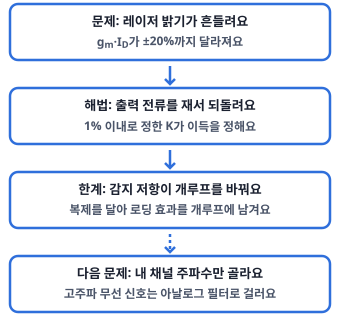

*감지 저항이 작지 않아 생기는 로딩 효과는 귀환망 복제로 개루프에 넣어 풀고, 수업 끝에는 무선 통신에서 내 채널만 거르는 아날로그 필터로 넘어가요.*

**정확히 말하면**

#### 풀고 싶은 문제

레이저 다이오드는 흘려 준 전류만큼 빛을 내는 소자이고, 증폭기 입장에서는 스피커처럼 구동되는 부하(load)예요. 귀환 회로망이 아니므로 해석에서는 저항 $R_L$로 모델링해요. 입력 전압 $V_{in}$으로 레이저 전류 $I_{out}$, 곧 밝기를 정하는 회로는 입력이 전압이고 출력이 전류인 트랜스컨덕턴스 증폭기예요. 수업 예제는 공통 게이트(CG) 단 $M_1$이 소스 팔로워 $M_2$를 구동해요.

귀환 없이 쓰면 $I_{out}/V_{in}$은 $g_{m1}R_D$와 $g_{m2}$로 정해져요. 그런데 $g_m$이나 $I_D$는 ±20%까지 달라질 수 있어서, 그 오차가 그대로 밝기 오차가 돼요. 이 개루프 회로는 [감지 저항을 없애면 CG 단과 소스 팔로워의 곱이에요](#s1-cv-ideal)에서 다뤄요.

수업 끝에는 다른 문제가 나왔어요. 셀룰러(3G, LTE, 5G 등), Wi-Fi(2.4 GHz, 5 GHz), 블루투스(2.4 GHz), GPS 같은 무선 통신 신호가 주파수를 나눠 쓰고, 한 대역도 여러 채널로 쪼개 여러 사람이 함께 써요. 내게 할당된 채널 신호는 통과시키고 다른 사람의 신호는 막아야 해요. 이 역할은 [필터는 주파수로 신호를 골라요](#s3-filter-role)에서 봐요.

**입력 전압으로 레이저 전류를 정확히 정하는 일과, 섞인 무선 신호에서 내 채널만 골라내는 일이 이번 수업의 두 문제예요.**

#### 단순한 해법과 그 한계

출력 전류를 작은 감지 저항 $R_M$으로 재어 $V_F=I_{out}R_M$을 $M_1$의 게이트로 되돌리면 전류-전압 귀환이 돼요. 앞 글자는 감지(sense)하는 양, 뒤 글자는 반송(return)하는 양이에요([앞 글자는 감지, 뒤 글자는 반송이에요](#s0-naming)). 귀환 계수는 $K=R_M$이고, 개루프 이득을 $A_0=(I_{out}/V_{in})|_{open}$이라 하면 루프 이득 $KA_0$가 1보다 충분히 클 때 다음과 같아요.

$$
\left.\frac{I_{out}}{V_{in}}\right|_{closed}=\frac{A_0}{1+KA_0}\approx\frac{1}{K}=\frac{1}{R_M}
$$

예를 들어 $KA_0=10$인데 $g_m$이 변해 개루프 이득이 20% 커지면 $KA_0^*=12$가 돼요. 폐루프 이득은 $\frac{1}{K}\cdot\frac{10}{11}$에서 $\frac{1}{K}\cdot\frac{12}{13}$으로 바뀌어, 배율은 $\frac{132}{130}\approx1.02$로 약 1.54%만 늘어요. 귀환 계수는 보통 1% 이내로 정확히 정해지므로 전류도 그만큼 정확해져요. 이 관계는 [루프 이득이 크면 레이저 전류는 감지 저항이 정해요](#s1-cv-closed)에서 구해요.

이상적인 전류 감지 저항은 0이므로, 가장 쉬운 해석은 $R_M$을 지우고 개루프를 구하는 거예요. 그러면 둘째 단은 $\frac{I_{out}}{V_X}=\frac{1}{1/g_{m2}+R_L}$이에요. 그런데 실제 $R_M$은 충분히 작지 않을 수 있어요. $R_M$이 $M_2$의 소스 전압을 올리면 $V_{GS2}$가 줄어 전류도 줄고, 둘째 단은 다음처럼 바뀌어요.

$$
\frac{I_{out}}{V_X}=\frac{1}{1/g_{m2}+R_L+R_M}
$$

귀환망이 개루프 특성을 바꾸는 이 현상이 로딩 효과(loading effect)예요. 무선 신호 쪽의 단순한 해법은 모두 디지털로 바꿔 디지털 필터로 거르는 것인데, 아날로그 신호를 디지털로 바꿀 수 있는 대역은 수십 MHz, 높아야 100 MHz 정도예요. GHz 대역 신호는 그대로 디지털 필터에 넣을 수 없어요.

**$R_M$을 0이라 두고 지우면 로딩 효과를 놓치고, GHz 무선 신호는 디지털 필터로 바로 거를 수 없어요.**

#### 핵심 아이디어

루프를 끊을 때 귀환망을 지우지 않고 입력 쪽과 출력 쪽에 하나씩 복제해 달아요. 복제의 남는 포트는 원래 연결돼 있던 쪽의 이상적인 임피던스로 종단해요. 전류-전압 귀환은 감지 쪽이 전류 출력($\infty$), 반송 쪽이 전압 입력($\infty$)에 붙어 있었으므로 두 복제를 모두 개방해요([감지 저항을 양쪽에 복제하고 모두 개방해요](#s1-cv-open)). 출력 쪽에서는 $1/g_{m2}$와 $R_M$이 직렬로 보여요([출력 쪽에서는 소스 쪽 저항과 감지 저항이 직렬이에요](#s1-cv-io)). 감지망을 출력과 직렬로 잇고 전압 반송은 입력과 다른 노드에, 전류 반송은 같은 노드에 잇는 이유는 [전류는 직렬로 재고, 전류는 같은 노드에서 빼요](#s0-connection)에서 봐요.

둘째 예제는 둘째 단을 PMOS 공통 소스로 바꾸고 $R_F$와 $R_M$이 출력 전류를 나눠 입력 노드로 되돌리는 전류-전류 귀환이에요. 여기서는 입력 쪽 복제를 개방, 출력 쪽 복제를 접지해요([입력 쪽 복제는 개방, 출력 쪽 복제는 접지해요](#s2-cc-break)). 개루프 전류 이득은 [입력은 테브난 변환으로, 출력은 전류 분배로 구해요](#s2-cc-gain), 귀환망이 0이나 $\infty$가 아니어도 되는 조건은 [0과 무한대가 아니어도 충분히 작거나 크면 돼요](#s2-cc-io), $K=-R_M/(R_F+R_M)$의 부호는 [K는 음수여도 루프 이득은 양수예요](#s2-cc-closed)에서 다뤄요. 이상적인 귀환망($R_M\to0$, $R_F\to\infty$)은 복제를 달아도 아무 영향이 없는 특수한 경우예요.

무선 신호는 아날로그 회로에서 원하는 주파수만 통과시키고 원하지 않는 주파수는 차단해요. 이것이 아날로그 필터이고, 주파수를 낮춘 뒤에야 디지털로 바꿔 디지털 필터로 처리할 수 있어요.

**귀환은 복제로 로딩을 개루프에 남겨 개루프 특성과 $K$로 폐루프를 구하고, 고주파 신호는 아날로그 필터로 먼저 걸러요.**

#### 대가와 쓰이는 곳

전류-전압 귀환 예제는 저항의 비가 아니라 $R_M$ 하나로 $K$를 정하므로 $R_M$의 절댓값이 정확해야 해요. 저항의 절댓값은 변동이 있어서 실제로는 저항 비로 $K$를 정하는 구조를 더 많이 써요. 로딩을 고려하려면 루프를 끊을 때 복제를 달고 종단하는 단계도 하나 늘어요.

얻는 것도 있어요. 전압을 반송하는 입력은 임피던스가 $1+KA_0$배 커져 더 좋은 전압 감지기가 되고, 전류를 감지해 조절하는 출력은 임피던스가 $1+KA_0$배 커져 더 좋은 전류원이 돼요. 대역폭도 개루프보다 $1+KA_0$배 넓어져요. 그래서 입력 전압으로 레이저 다이오드 밝기를 원하는 값에 맞추는 구동 회로에 써요. 전류-전류 귀환은 입력 임피던스를 낮추고 출력 임피던스를 높여 더 좋은 전류 증폭기를 만들어요.

필터는 이상적으로 원하는 주파수는 크기 1로, 나머지는 0으로 만들어야 하지만 실제로는 주파수에 따라 서서히 줄고 통과 대역 안에서도 이득이 조금씩 달라요([통과·저지·천이 대역과 리플](#s3-filter-bands)). 수동 필터는 이득이 없는 대신 전류 소모가 없고, 능동 필터는 이득이 있는 대신 전류를 소모해요([주파수 특성과 소자로 필터를 나눠요](#s3-filter-types)). 무선 통신에서 채널을 고를 때 말고도 잡음이 많은 주파수 대역이나 군사용 재밍 신호를 없앨 때 필터를 써요.

**이 예제의 전류-전압 귀환은 $R_M$ 절댓값이 정확해야 하고, 능동 필터는 이득을 얻는 대신 전류를 소모해요.** 핵심 식은 [한눈에 다시 보기](#s4-cheatsheet), 다음 수업 내용은 [다음 시간 예고](#s4-next)에 모았어요.

**교수님 말씀**

> 오픈 루프로 설계하면 … 10%, 20% 오차가 생긴다 그러면 빛의 밝기가 달라지죠.

귀환 없이 트랜지스터 이득에 맡기면 레이저 밝기가 흔들린다는 말씀이에요.

> 피드백 팩터는 보통 1% 이내로 그렇게 정확하게 정해지기 때문에

$g_m$이나 $I_D$가 ±20%까지 달라지는 것과 비교하신 말씀이에요.

> $R_M$이 일반적으로 작지 않을 수도 있죠 … 오픈 루프 특성에 영향을 준다는 거죠.

그래서 $R_M$을 지우지 않고 로딩 효과를 고려해 개루프를 구해요.

> 저항 자체는 이제 절댓값이 좀 변동이 있거든요. 그래서 보통 이제 비로 주는 경우를 더 많이 쓰는데

$R_M$ 하나로 $K$를 정하는 이 예제 구조의 대가예요.

> 무선 통신에서는 주파수가 높기 때문에 이걸 디지털로 처리를 못한다.

그래서 고주파 신호는 아날로그 필터로 먼저 걸러야 한다고 하셨어요.

확인해 봐요. 감지 저항 $R_M$이 작지 않은데도 $R_M$을 지우고 개루프 이득을 구하면, 실제 개루프 이득보다 크게 나올까요, 작게 나올까요?

답 보기

크게 나와요. 실제로는 $R_M$이 $M_2$의 소스 전압을 올려 $V_{GS2}$와 전류가 줄어요. 그래서 $\frac{1}{1/g_{m2}+R_L+R_M}\lt\frac{1}{1/g_{m2}+R_L}$이고, 이 차이가 로딩 효과예요.

**페이지 요약**

출력 전류를 재어 되돌리면 정확한 $K$가 레이저 전류를 정해요.

작지 않은 감지 저항의 로딩 효과는 지우지 말고 개루프에 넣어 풀어요.

GHz 무선 신호는 디지털로 바로 못 다뤄서 아날로그 필터로 원하는 주파수만 걸러요.

*핵심 식*

- 폐루프 이득 (루프 이득이 클 때)

  $$
  \left.\frac{I_{out}}{V_{in}}\right|_{closed}=\frac{A_0}{1+KA_0}\approx\frac{1}{K}=\frac{1}{R_M}
  $$
- 로딩 포함 둘째 단

  $$
  \frac{I_{out}}{V_X}=\frac{1}{1/g_{m2}+R_L+R_M}
  $$

*용어*

- **전류-전압 귀환 (current-voltage feedback)** — 출력 전류를 감지해 입력에 전압을 반송하는 귀환이에요.
- **전류-전류 귀환 (current-current feedback)** — 출력 전류를 감지해 입력 노드에서 전류를 빼는 귀환이에요.
- **로딩 효과 (loading effect)** — 귀환망의 유한한 임피던스가 개루프 특성을 바꾸는 현상이에요.
- **아날로그 필터 (analog filter)** — 원하는 주파수의 신호는 통과시키고 나머지는 차단하는 아날로그 회로예요.

---

## 1. 감지·반송 이름과 연결

### 앞 글자는 감지, 뒤 글자는 반송이에요

*1125 수업 · L06 s32*

**쉽게 말하면**

귀환 이름의 앞 글자는 출력에서 감지하는 양, 뒤 글자는 입력으로 반송하는 양이에요.

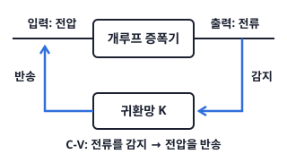

*입력 전압·출력 전류인 증폭기라서 출력 전류를 감지하고 입력에 전압을 반송하는 전류-전압(C-V) 귀환이 돼요.*

**정확히 말하면**

#### 이름은 어떻게 읽나요

입력 전압으로 레이저 다이오드의 전류를 정하는 증폭기를 생각해요. 입력이 전압이고 출력이 전류이므로 이 증폭기는 트랜스컨덕턴스 증폭기예요. 귀환망은 출력 전류를 감지(sense)하고 입력 쪽에 전압을 반송(return)하므로 이 귀환은 전류-전압(C-V) 귀환이에요. **이름의 앞 글자는 출력에서 감지하는 양, 뒤 글자는 입력에 반송하는 양이에요.**

이번 수업은 지난 시간의 두 형태에 이어 남은 두 형태를 실제 회로로 풀어요.

| 귀환 형태 | 감지 → 반송 | 개루프 증폭기 | 귀환 계수 |
|---|---|---|---|
| 전류-전압(C-V) | 출력 전류 → 입력 전압 | 트랜스컨덕턴스 증폭기, $I_{out}/V_{in}$ [S] | $K=V_F/I_{out}$ [Ω] |
| 전류-전류(C-C) | 출력 전류 → 입력 전류 | 전류 증폭기, $I_{out}/I_{in}$ [A/A] | $K=I_F/I_{out}$ [A/A] |

#### 감지·반송할 양은 누가 정하나요

개루프 증폭기의 출력이 전류이면 귀환망이 잴 수 있는 출력은 전류예요. 개루프 증폭기의 입력이 전압이면 입력에서 빼 줄 수 있는 것도 전압이에요. **감지할 양과 반송할 양은 원래 증폭기의 출력과 입력의 종류가 정해요.** 그래서 C-V 귀환은 트랜스컨덕턴스 증폭기의 귀환이고, C-C 귀환은 전류 증폭기의 귀환이에요.

#### 귀환 회로는 어떤 순서로 풀까요

폐루프 회로를 통째로 풀지 않고 개루프 증폭기와 귀환망으로 나눠서 풀어요.

1. 개루프: 귀환망의 로딩을 반영해 루프를 끊고 개루프 이득 $A_{open}$과 입·출력 임피던스를 구해요.
2. 귀환 계수: 귀환망만 떼어 감지한 양에 대한 반송한 양의 비 $K$를 구해요.
3. $$
   KA_{open}\gt0
   $$

   루프 이득 $KA_{open}$은 단위가 없고, 음의 귀환이면 양수여야 해요.
4. $$
   A_{closed}=\frac{A_{open}}{1+KA_{open}}
   $$

   폐루프 이득을 개루프 이득과 루프 이득으로 써요.

**폐루프 이득은 개루프 이득을 1 더하기 루프 이득으로 나눈 값이에요.** 폐루프 입·출력 임피던스도 개루프 값에 같은 $1+KA_{open}$을 곱하거나 나눠 구해요. 예제 III은 [C-V 폐루프](#s1-cv-closed), 예제 IV는 [C-C 폐루프](#s2-cc-closed)에서 이 순서를 끝까지 적용해요.

**교수님 말씀**

> 오픈 루프 특성을 구해야 되고, 그다음 K를 구하고 … 루프 게인을 구하고.

교수님은 이득과 입·출력 임피던스를 알려면 "어떻게 해야 되죠?"라고 물은 뒤 직접 이 순서로 답했어요. 그다음에야 폐루프 특성을 알 수 있다고 정리했어요.

**꼭 기억해요**

> 센싱하고 싶어 센싱한 게 아니라, 원래 있던 앰프의 출력이 … 전류이기 때문에

이름은 입력에서 출력으로 가는 순서가 아니에요. C-V를 "전류 입력·전압 출력"으로 읽으면 반대예요. C-V는 출력 전류를 감지하고 입력 전압에 반송하므로 전압 입력·전류 출력 증폭기의 귀환이에요.

확인해 봐요. 입력이 전류이고 출력이 전압인 증폭기에 귀환을 걸면 무엇을 감지하고 무엇을 반송하며, 이름은 무엇인가요?

답 보기

출력 전압을 감지하고 입력에 전류를 반송하므로 전압-전류(V-C) 귀환이에요. 앞 글자가 출력에서 감지하는 양, 뒤 글자가 입력에 반송하는 양이에요.

**페이지 요약**

귀환 이름의 앞 글자는 출력에서 감지하는 양, 뒤 글자는 입력에 반송하는 양이에요.

*핵심 식*

- 폐루프 이득

  $$
  A_{closed}=\frac{A_{open}}{1+KA_{open}}
  $$

*용어*

- **감지(sense)·반송(return)** — 출력에서 재는 양과 입력에서 빼 주는 양으로, 원래 증폭기의 출력·입력 종류가 정해요.
- **루프 이득(loop gain)** — 단위가 없는 $KA_{open}$으로, 음의 귀환이면 양수예요.
- **풀이 순서** — 개루프 → 귀환 계수 $K$ → 루프 이득 → 폐루프예요.

---

### 전류는 직렬로 재고, 전류는 같은 노드에서 빼요

*1125 수업 · L06 s57·s59*

**쉽게 말하면**

전류는 전류계처럼 길 중간에 끼워(직렬) 재고, 전류를 빼려면 같은 노드에 갈래를 붙여요(병렬).

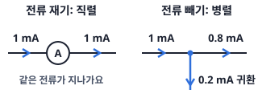

*전압을 뺄 때는 두 전압을 서로 다른 노드에 걸어 그 차이가 증폭기에 들어가게 해요.*

**정확히 말하면**

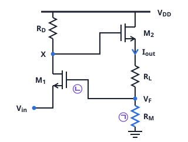

*㉠ 출력 전류 경로에 끼운 감지 저항 · ㉡ $M_1$ 게이트로 가는 반송 전압. 레이저 다이오드는 부하 $R_L$로 그렸어요. (강의노트 s57 왼쪽)*

#### 예제 III: 전류는 직렬로 재요

도선에 $1\ \mathrm{mA}$가 흐를 때 도선을 끊고 $0.1\ \mathrm{k\Omega}$ 저항을 끼우면, 같은 $1\ \mathrm{mA}$가 저항을 지나며 $1\ \mathrm{mA}\times0.1\ \mathrm{k\Omega}=0.1\ \mathrm{V}$를 만들어요. 전류계도 이렇게 경로에 끼워 넣어 전류를 재요. 예제 III의 ㉠ $R_M$이 바로 이 자리에 있어요. $M_2$에서 나온 $I_{out}$은 부하 $R_L$을 지나 $V_F$ 노드에 닿고, $M_1$ 게이트로는 전류가 흐르지 않으므로 모두 $R_M$으로 내려가요.

$$
V_F=I_{out}R_M
$$

**출력 전류를 감지하는 귀환망은 출력 전류 경로에 직렬로 들어가요.** 이상적인 전류계처럼 감지 저항이 0에 가까우면 원래 출력 전류를 바꾸지 않아요. $R_M$이 충분히 작지 않을 때 생기는 변화는 [감지 저항을 양쪽에 복제하고 모두 개방해요](#s1-cv-open)에서, 출력 임피던스에서 $R_M$이 더해지는 이유는 [출력 쪽에서는 소스 쪽 저항과 감지 저항이 직렬이에요](#s1-cv-io)에서 다뤄요.

#### 예제 III: 전압은 서로 다른 노드에서 빼요

입력 전압 $V_{in}$은 $M_1$의 소스에, ㉡ 반송 전압 $V_F$는 $M_1$의 게이트에 걸려요. 두 전압이 서로 다른 노드에 걸리므로 공통 게이트 $M_1$은 두 전압의 차이에 반응해요. 몸체 효과와 $M_1$의 $r_O$를 무시한 소신호 모델에서 드레인 $X$의 전압은 다음과 같아요.

$$
V_X=g_{m1}R_D(V_{in}-V_F)
$$

**전압을 반송하는 귀환망은 입력과 직렬, 즉 입력과 서로 다른 노드에 연결돼요.** $V_F=0$이면 공통 게이트 이득 $g_{m1}R_D$만 남아요.

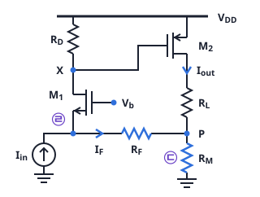

*㉢ 출력 전류 경로에 끼운 귀환망 · ㉣ 입력 전류와 귀환 전류가 만나는 $M_1$ 소스 노드. 레이저 다이오드는 부하 $R_L$로 그렸어요. (강의노트 s59 왼쪽)*

#### 예제 IV: 전류는 같은 노드에서 빼요

출력 쪽은 예제 III와 같아요. ㉢ $I_{out}$이 부하 $R_L$을 지나 노드 $P$로 들어가고, 그 뒤에 귀환망 $R_M$과 $R_F$가 이어지므로 귀환망은 출력 전류 경로에 직렬이에요. 입력 쪽은 달라요. $M_1$의 게이트는 고정 바이어스 $V_b$이고, 신호는 전류 $I_{in}$으로 ㉣ $M_1$ 소스 노드에 들어와요. 이 노드에 $R_F$ 갈래를 붙이면 $1\ \mathrm{mA}$가 들어올 때 $0.2\ \mathrm{mA}$가 $I_F$로 빠지고 $0.8\ \mathrm{mA}$만 $M_1$ 소스로 들어가요. $M_1$ 소스로 들어가는 전류를 $I_{S1}$이라 하면 ㉣ 노드의 KCL은 다음과 같아요.

$$
I_{S1}=I_{in}-I_F
$$

**전류를 반송하는 귀환망은 입력과 같은 노드에 병렬로 연결해야 전류가 빠져요.** 다른 노드에 연결하면 $I_F$가 이 KCL에 들어가지 않아 입력 전류에서 빠지지 않아요. $I_F$의 방향은 입력 노드에서 빠지는 쪽으로 정했어요. 이 방향 때문에 생기는 귀환 계수의 부호는 [K는 음수여도 루프 이득은 양수예요](#s2-cc-closed)에서 확인해요.

#### 세 가지 연결을 한 표로

| 할 일 | 연결 | 이상적인 귀환망 포트 | 이번 회로 |
|---|---|---|---|
| 출력 전류 감지 | 출력과 직렬(전류계처럼) | 임피던스 0 | ㉠ $R_M$, ㉢ $R_M$·$R_F$ |
| 입력에 전압 반송 | 입력과 직렬(서로 다른 노드) | 임피던스 0 | ㉡ $M_1$ 게이트 |
| 입력에 전류 반송 | 입력과 병렬(같은 노드) | 임피던스 ∞ | ㉣ $M_1$ 소스 노드 |

**직렬로 끼우는 포트는 0, 병렬로 붙이는 포트는 무한대가 이상적이에요.** 그래야 귀환망이 원래 회로의 전압과 전류를 바꾸지 않아요. 예제 IV의 이상적인 귀환망은 $R_M\to0$, $R_F\to\infty$예요.

**교수님 말씀**

> 전류를 추가적인 피드백 네트워크에 직렬로 연결되도록 해서 재잖아요.

> 입력과 같은 노드로 … 연결돼야지 전류가 빠지죠.

교수님은 전류를 어떻게 재는지 떠올리면 감지 귀환망이 출력과 직렬이라는 것을 알 수 있다고 했어요. 예제 IV에서는 앞 예제가 입력과 서로 다른 노드에서 전압을 뺐던 것과 비교해, 전류는 같은 노드에서 빼야 한다고 짚었어요.

확인해 봐요. 예제 III에서 레이저 전류 $I_{out}=2\ \mathrm{mA}$가 ㉠ $R_M=0.05\ \mathrm{k\Omega}$를 지나면 반송 전압 $V_F$는 얼마인가요?

답 보기

$V_F=I_{out}R_M=2\ \mathrm{mA}\times0.05\ \mathrm{k\Omega}=0.1\ \mathrm{V}$예요. $M_1$ 게이트로는 전류가 흐르지 않아 $I_{out}$ 전부가 직렬로 끼운 $R_M$을 지나요.

**페이지 요약**

출력 전류 감지와 전압 반송은 직렬, 전류 반송은 같은 노드에 병렬로 연결해요.

*핵심 식*

- 예제 III 반송 전압

  $$
  V_F=I_{out}R_M
  $$
- 예제 III 첫 단 (전압의 차)

  $$
  V_X=g_{m1}R_D(V_{in}-V_F)
  $$
- 예제 IV 입력 노드 KCL

  $$
  I_{S1}=I_{in}-I_F
  $$

*용어*

- **전류계(ammeter)** — 경로를 끊고 직렬로 끼워 전류를 재는 계기로, 이상적이면 저항이 0이에요.
- **같은 노드·서로 다른 노드** — 전류는 같은 노드에서 빼고, 전압은 서로 다른 노드에 걸어 차이를 만들어요.

---

## 2. 예제 III: C-V 귀환의 로딩

### 감지 저항을 없애면 CG 단과 소스 팔로워의 곱이에요

*1125 수업 · L06 s57*

**쉽게 말하면**

감지 저항 $R_M$을 0으로 두면 입력 전압이 공통 게이트 단에서 전압 $V_X$로 커지고, 소스 팔로워 단에서 레이저 전류 $I_{out}$으로 바뀌어요.

예를 들어 $V_{in}=10\ \mathrm{mV}$가 10배인 $100\ \mathrm{mV}$가 되고, 다시 약 $1.33\ \mathrm{mS}$가 곱해져 약 $0.13\ \mathrm{mA}$가 흘러요.

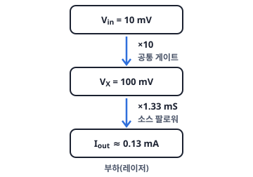

*전체 이득은 두 단 이득의 곱이에요.*

**정확히 말하면**

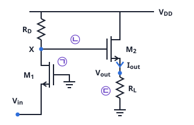

*㉠ 공통 게이트 $M_1$ · ㉡ 노드 X · ㉢ 부하 $R_L$(위쪽 $M_2$ 소스 노드 $V_{out}$). 감지 저항을 지워 $M_1$ 게이트를 접지하고 레이저를 $R_L$로 바꾼 개루프예요. (강의노트 s57)*

#### 무엇을 구하나요

이 회로는 입력 전압 $V_{in}$으로 레이저 다이오드의 전류 $I_{out}$을 정하는 트랜스컨덕턴스 증폭기에 귀환을 건 것이에요. 알고 싶은 것은 폐루프 이득 $I_{out}/V_{in}$과 입력·출력 임피던스예요.

**순서는 개루프 특성 → 귀환 계수 $K$ → 루프 이득 → 폐루프 특성이에요.** 레이저 다이오드는 귀환망이 아니라 전류를 받아 빛을 내는 부하(load)이고, 해석에서는 저항 $R_L$로 바꿔요. 귀환망은 출력 전류를 재서 전압 $V_F=I_{out}R_M$을 입력에 돌려주는 감지 저항 $R_M$이에요.

#### 이상적이면 감지 저항을 지워요

전류를 재는 감지기는 입력 임피던스가 0이어야 이상적이에요. $R_M$이 0에 가깝게 설계됐다면 $R_M$을 지우고 개루프를 구하면 되고, 이때 $M_1$ 게이트는 접지돼요. **㉠ $M_1$은 소스로 입력을 받아 드레인 ㉡ X로 내보내는 공통 게이트(common gate), $M_2$는 게이트로 받아 소스로 내보내는 소스 팔로워(source follower)예요.**

#### 숫자로 먼저 볼까요

$g_{m1}=2\ \mathrm{mS}$, $R_D=5\ \mathrm{k\Omega}$, $g_{m2}=4\ \mathrm{mS}$, $R_L=0.5\ \mathrm{k\Omega}$로 두어요. 채널 길이 변조와 몸체 효과는 무시해요. $\mathrm{mS}\times\mathrm{k\Omega}=1$이므로 첫 단 이득은 $2\times5=10$이고, $1/g_{m2}=0.25\ \mathrm{k\Omega}$이에요.

**전체 이득은 $10/(0.25+0.5)\ \mathrm{k\Omega}=40/3\ \mathrm{mS}\approx13.33\ \mathrm{mS}$예요.** 아래 유도가 이 계산의 두 인자를 차례로 만들어요.

#### 첫 단: 공통 게이트

㉠ 게이트가 교류 접지이고 소스로 $V_{in}$을 받아 드레인 ㉡ X로 내보내는 공통 게이트 단이에요. 채널 길이 변조와 몸체 효과를 무시하면 기본 전압 이득을 바로 쓸 수 있어요.

$$
\frac{V_X}{V_{in}}=g_{m1}R_D
$$

**공통 게이트 단은 입력과 같은 부호로 $g_{m1}R_D$배 키워요.**

#### 둘째 단: 소스 팔로워와 연쇄 곱

㉢ 부하 $R_L$ 위쪽의 $M_2$ 소스 전압을 $V_{out}$이라 두면, $I_{out}=V_{out}/R_L$이므로 전체 이득을 두 단의 전압 이득과 $1/R_L$의 연쇄 곱으로 바로 이어 쓸 수 있어요.

1. $$
   \begin{aligned}\frac{I_{out}}{V_{in}}&=\frac{V_X}{V_{in}}\cdot\frac{I_{out}}{V_X}\\&=\frac{V_X}{V_{in}}\cdot\frac{V_{out}}{V_X}\cdot\frac{1}{R_L}\end{aligned}
   $$

   부하 $R_L$에 걸리는 전압이 $V_{out}$이므로 $I_{out}/V_X=(V_{out}/V_X)\cdot(1/R_L)$이에요.
2. $$
   \frac{V_{out}}{V_X}=\frac{R_L}{1/g_{m2}+R_L}
   $$

   게이트 입력 $V_X$가 소스 $V_{out}$으로 나오는 소스 팔로워의 기본 전압 이득이에요.
3. $$
   \begin{aligned}\frac{I_{out}}{V_{in}}&=(g_{m1}R_D)\cdot\frac{R_L}{1/g_{m2}+R_L}\cdot\frac{1}{R_L}\\&=\frac{g_{m1}R_D}{1/g_{m2}+R_L}\end{aligned}
   $$

   분자와 분모의 $R_L$이 약분돼요.

**분모는 소스에서 본 $1/g_{m2}$와 부하 $R_L$의 합이어서, 둘 중 큰 쪽이 전류를 정해요.** 이 결과는 $R_M$이 충분히 작을 때만 맞고, 그렇지 않으면 [감지 저항을 양쪽에 복제하고 모두 개방해요](#s1-cv-open)에서 로딩을 넣어요.

**교수님 말씀**

교수님은 풀이 순서를 학생에게 묻고 스스로 정리했어요.

> "오픈 루프 특성을 구해야 되고, 그다음 K를 구하고 ... 루프 게인을 구하고."

레이저 다이오드는 귀환망이 아니라 증폭기가 구동하는 부하라고 짚으면서, 오디오 앰프가 구동하는 스피커에 비유했어요.

> "앰프에 어떤 스피커를 구동할 때 그게 로드예요."

확인해 봐요. $g_{m1}R_D=8$, $g_{m2}=5\ \mathrm{mS}$, $R_L=0.8\ \mathrm{k\Omega}$이고 감지 저항을 지운 개루프라면 $I_{out}/V_{in}$은 얼마인가요?

답 보기

$1/g_{m2}=0.2\ \mathrm{k\Omega}$이므로 $8/(0.2+0.8)\ \mathrm{k\Omega}=8\ \mathrm{mS}$예요.

**페이지 요약**

감지 저항을 지운 개루프 이득은 공통 게이트 단 이득과 소스 팔로워 단 이득의 곱이에요.

*핵심 식*

- 공통 게이트 단

  $$
  \frac{V_X}{V_{in}}=g_{m1}R_D
  $$
- 소스 팔로워 단

  $$
  \frac{I_{out}}{V_X}=\frac{1}{1/g_{m2}+R_L}
  $$

*용어*

- **부하(load)** — 증폭기가 전류를 공급하는 레이저 다이오드로, 해석에서는 $R_L$로 바꿔요.
- **소스 팔로워(source follower)** — 게이트로 받아 소스로 내보내는 단이에요.

---

### 감지 저항을 양쪽에 복제하고 모두 개방해요

*1125 수업 · L06 s57*

**쉽게 말하면**

$R_M$을 입력 쪽과 출력 쪽에 하나씩 복제해 달면, 출력 쪽 복제가 레이저 전류의 길에 더해져 개루프 이득이 줄어요.

예를 들어 $R_M=1\ \mathrm{k\Omega}$이면 전류가 지나는 저항의 합이 $0.75$에서 $1.75\ \mathrm{k\Omega}$로 늘어 개루프 이득이 약 $13.33$에서 약 $5.71\ \mathrm{mS}$로 줄어요.

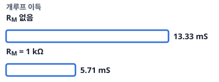

*같은 입력에서 레이저 전류가 절반 아래로 줄어드는 것이 로딩 효과예요.*

**정확히 말하면**

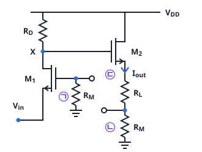

*㉠ 입력 쪽 복제 · ㉡ 출력 쪽 복제 · ㉢ $M_2$ 소스. 테두리만 있는 원은 끊은 뒤 열어 둔 단자예요. (강의노트 s57)*

#### 감지 저항이 작지 않으면 왜 문제인가요

실제 $R_M$은 0이 아니어서 개루프의 출력 전류에 영향을 줘요. 귀환망의 유한한 입·출력 임피던스가 순방향 증폭기에 짐을 지우는 이 현상을 로딩 효과(loading effect)라고 해요. **그래서 $R_M$을 무시하지 않고, 루프를 끊을 때 개루프 안에 넣어요.**

#### 복제는 어디에 달고 끝은 어떻게 하나요

루프를 끊으면서 $R_M$의 복제(replica)를 순방향 증폭기의 입력 쪽 ㉠과 출력 쪽 ㉡에 하나씩 달아요. 각 복제의 끊은 포트는 원래 연결돼 있던 쪽의 이상적인 임피던스로 종단(termination)해요.

- ㉠ 입력 쪽 복제의 감지 포트는 원래 증폭기의 전류 출력에 이어져 있었어요. 이상적인 전류원의 출력 임피던스는 $\infty$이므로 개방해요.
- ㉡ 출력 쪽 복제의 반송 포트는 원래 전압을 빼는 입력에 이어져 있었어요. 이상적인 전압 입력의 임피던스는 $\infty$이므로 개방해요.

**C-V 귀환은 두 복제를 모두 개방으로 종단해요.**

#### 숫자로 먼저 볼까요

[감지 저항을 없애면 CG 단과 소스 팔로워의 곱이에요](#s1-cv-ideal)의 값($g_{m1}R_D=10$, $1/g_{m2}=0.25\ \mathrm{k\Omega}$, $R_L=0.5\ \mathrm{k\Omega}$)에 $R_M=1\ \mathrm{k\Omega}$을 더해요. 첫 단은 그대로 10이고, 둘째 단의 저항 합은 $0.25+0.5+1=1.75\ \mathrm{k\Omega}$이 돼요.

**개루프 이득은 $10/(1.75\ \mathrm{k\Omega})=40/7\ \mathrm{mS}\approx5.71\ \mathrm{mS}$로, 이상적일 때의 약 $13.33\ \mathrm{mS}$보다 작아요.**

#### 입력 쪽 복제는 첫 단을 바꾸지 않아요

㉠ 복제는 $M_1$ 게이트와 접지 사이에 달려요. **게이트로는 전류가 흐르지 않아 복제에 전압이 걸리지 않고, 게이트는 여전히 0이에요.** 그래서 첫 단 이득은 그대로예요.

$$
\frac{V_X}{V_{in}}=g_{m1}R_D
$$

#### 출력 쪽 복제는 $R_L$ 자리에 $(R_L+R_M)$으로 들어가요

㉡ 출력 쪽 복제 $R_M$이 $R_L$ 아래에 직렬로 붙어, ㉢ $M_2$ 소스에서 접지까지 총 저항이 $R_L$에서 $(R_L+R_M)$으로 바뀌어요. 식을 처음부터 다시 풀지 않아도, 이상적 개루프 식의 $R_L$ 자리에 $(R_L+R_M)$을 그대로 치환하면 돼요.

1. $$
   R_L\longrightarrow R_L+R_M
   $$

   직렬 로딩 저항 $R_M$이 더해져 소스 전압이 $V_{out}=I_{out}(R_L+R_M)$으로 더 올라가고, 그만큼 $V_{GS2}$와 전류가 줄어요.
2. $$
   \frac{I_{out}}{V_X}=\frac{1}{1/g_{m2}+R_L+R_M}
   $$

   $\frac{R_L+R_M}{1/g_{m2}+R_L+R_M}\cdot\frac{1}{R_L+R_M}$에서 $(R_L+R_M)$이 약분돼요.
3. $$
   \left.\frac{I_{out}}{V_{in}}\right|_{open}=\frac{g_{m1}R_D}{R_L+R_M+1/g_{m2}}
   $$

   첫 단 이득 $g_{m1}R_D$와 곱해요. 강의노트의 식과 같아요.

**출력 쪽 복제만 전류의 길에 직렬로 더해져 개루프 이득을 줄여요.** $R_M=0$을 넣으면 이상적인 결과로 돌아가요.

**교수님 말씀**

교수님은 끊은 단자를 어떻게 처리할지 묻고, 원래 이어져 있던 쪽이 이상적이었다면 어떤 임피던스였을지 보라고 정리했어요.

> "원래 연결되어 있던 입력이나 출력 쪽의 이상적인 임피던스를 고려하자."

이상적으로는 $R_M$을 작게 설계하지만, 작지 않으면 원래보다 전류가 더 줄어드는 것이 로딩 효과라고 덧붙였어요.

**꼭 기억해요**

> "$R_M$이 증가하면 그 소스 전압이 증가하기 때문에 $V_{GS}$가 줄어서 전류가 줄어요."

V-V 귀환에서 반송 쪽 복제를 접지하던 습관대로 끊은 끝을 접지하면 안 돼요. C-V에서 출력 쪽 복제의 끊은 끝을 접지하면 $R_M$이 단락돼 로딩이 사라지고, 이상적인 결과가 잘못 다시 나와요.

확인해 봐요. 같은 값에서 $R_M=0.5\ \mathrm{k\Omega}$이면 로딩을 넣은 개루프 이득은 얼마인가요?

답 보기

저항 합이 $0.25+0.5+0.5=1.25\ \mathrm{k\Omega}$이므로 $10/(1.25\ \mathrm{k\Omega})=8\ \mathrm{mS}$예요.

**페이지 요약**

C-V 귀환은 $R_M$ 복제를 입력 쪽과 출력 쪽에 달고 끊은 끝을 모두 개방하며, 출력 쪽 복제만 개루프 이득을 줄여요.

*핵심 식*

- 로딩을 넣은 개루프 이득

  $$
  \left.\frac{I_{out}}{V_{in}}\right|_{open}=\frac{g_{m1}R_D}{R_L+R_M+1/g_{m2}}
  $$

*용어*

- **로딩 효과(loading effect)** — 귀환망의 유한한 입·출력 임피던스가 개루프 특성을 바꾸는 현상이에요.
- **종단(termination)** — 끊은 포트를 원래 쪽의 이상적인 임피던스(여기서는 $\infty$, 개방)로 처리하는 것이에요.

---

### 출력 쪽에서는 소스 쪽 저항과 감지 저항이 직렬이에요

*1125 수업 · L06 s57–58*

**쉽게 말하면**

레이저 양단에서 위로는 접지까지 $1/g_{m2}$, 아래로는 접지까지 $R_M$이 보이고, 두 접지는 같은 교류 접지라 한 선으로 이어지므로 둘은 직렬이에요.

예를 들어 $1/g_{m2}=0.25\ \mathrm{k\Omega}$, $R_M=1\ \mathrm{k\Omega}$이면 출력 임피던스는 $1.25\ \mathrm{k\Omega}$이에요.

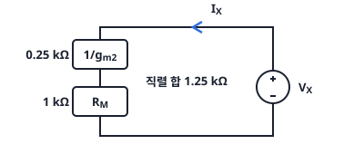

*레이저 입장에서 위쪽 $1/g_{m2}$과 아래쪽 $R_M$이 같은 교류 접지로 이어져 한 고리의 직렬이 돼요.*

**정확히 말하면**

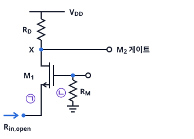

*㉠ $M_1$ 소스 · ㉡ 입력 쪽 복제 $R_M$. 입력 신호원을 떼고 입력 단자에서 들여다봐요. (강의노트 s57)*

#### 입력 임피던스는 M1 소스에서 봐요

입력은 ㉠ $M_1$ 소스로 들어가요. ㉡ 복제는 게이트에 붙어 전류가 흐르지 않으므로 영향이 없고, 게이트는 교류 접지예요. **채널 길이 변조를 무시하면 공통 게이트의 소스에서 본 임피던스는 $1/g_{m1}$이에요.**

$$
R_{in,open}=1/g_{m1}
$$

$g_{m1}=2\ \mathrm{mS}$이면 $0.5\ \mathrm{k\Omega}$이에요.

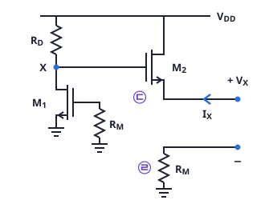

*㉢ $M_2$ 소스 · ㉣ 출력 쪽 복제 $R_M$. 입력을 접지하고 $R_L$ 자리의 두 단자에 시험원 $V_X$를 걸었어요. (강의노트 s58)*

#### 출력 포트는 두 노드 사이예요

출력은 부하 $R_L$의 양단, 곧 $M_2$ 소스와 $R_M$ 위 노드 사이의 포트예요. $R_L$을 떼어 그 양단에서 회로를 들여다보면 되고, 입력 $V_{in}$을 0으로 두면 $M_1$에 신호 전류가 없어 노드 X와 $M_2$ 게이트는 교류 접지예요.

부하(레이저) 양단에서 ㉢ 위쪽으로는 게이트가 접지된 $M_2$ 소스에서 교류 접지까지 $1/g_{m2}$가 보이고, ㉣ 아래쪽으로는 출력 쪽 복제 $R_M$이 교류 접지까지 이어져요. **위쪽과 아래쪽의 두 접지는 같은 교류 접지이므로 하나로 연결되어, 레이저 입장에서는 $1/g_{m2}$와 $R_M$이 그대로 직렬로 보여요.** 채널 길이 변조와 몸체 효과를 무시하는 모델에서 출력 임피던스는 바로 다음과 같아요.

$$
R_{out,open}=1/g_{m2}+R_M
$$

예시 값이면 $0.25+1=1.25\ \mathrm{k\Omega}$이에요. 그림처럼 부하 자리에 시험원 $V_X$(노드 X와는 다른 기호)를 걸어 보아도 같은 시험전류 $I_X$가 두 저항을 차례로 지나므로 똑같이 직렬 합이 나와요.

#### 병렬이 맞는 경우와 비교해요

부하가 한 노드와 접지 사이에 있다면 시험원도 그 노드와 접지 사이에 걸리고, 그 노드에 붙은 저항들은 병렬로 보여요. 이 회로의 부하는 두 노드 사이에 있으므로 직렬이에요. **출력 전류를 재는 귀환망은 전류계처럼 출력 경로에 직렬로 끼워져 있어요.** 별다른 말이 없으면 이렇게 로딩을 넣어 구해요.

**교수님 말씀**

교수님은 직렬인지 병렬인지 헷갈리면 전류를 어떻게 재는지 떠올리라고 했어요.

> "전류를 추가적인 피드백 네트워크에 직렬로 연결되도록 해서 재잖아요."

부하 자리에 시험원을 걸고 전류를 재 보면 두 저항이 어떻게 이어졌는지 바로 보인다고 덧붙였어요.

**꼭 기억해요**

> "요거를 병렬로 헷갈릴 수 있는데 직렬입니다."

병렬로 보고 $(1/g_{m2})\parallel R_M$로 쓰면 $R_M\to0$에서 출력 임피던스가 0이 돼요. 이상적인 귀환망이면 $R_M$의 효과가 사라져 $1/g_{m2}$로 돌아가야 하므로 맞지 않아요. 직렬·병렬 판단은 이 극한으로 점검해요.

확인해 봐요. $g_{m2}=5\ \mathrm{mS}$, $R_M=0.3\ \mathrm{k\Omega}$이면 $R_{out,open}$은 얼마인가요?

답 보기

$1/g_{m2}=0.2\ \mathrm{k\Omega}$과 $R_M$이 직렬이므로 $0.2+0.3=0.5\ \mathrm{k\Omega}$이에요. 병렬로 잘못 보면 $0.12\ \mathrm{k\Omega}$이 나와요.

**페이지 요약**

C-V 개루프의 입력 임피던스는 $M_1$ 소스의 $1/g_{m1}$이고, 출력 임피던스는 부하 자리에서 본 $1/g_{m2}$와 $R_M$의 직렬이에요.

*핵심 식*

- 입력 임피던스

  $$
  R_{in,open}=1/g_{m1}
  $$
- 출력 임피던스

  $$
  R_{out,open}=1/g_{m2}+R_M
  $$

*판단*

부하 양단에서 위·아래로 보이는 두 저항이 같은 교류 접지로 이어지므로 직렬이에요.

*용어*

- **시험원(test source)** — 임피던스를 재려고 포트에 거는 전압원으로, 그 전압을 들어가는 전류로 나눠요.

---

### 루프 이득이 크면 레이저 전류는 감지 저항이 정해요

*1125 수업 · L06 s58*

**쉽게 말하면**

$R_M$이 출력 전류를 전압 $V_F=I_{out}R_M$으로 바꿔 돌려주므로 $K=R_M$이고, 루프 이득이 크면 폐루프 이득은 $1/R_M$에 가까워져요.

예를 들어 $g_{m1}$이 20% 줄면 개루프 이득은 20% 줄지만, 폐루프 이득은 약 3.6%만 줄어요.

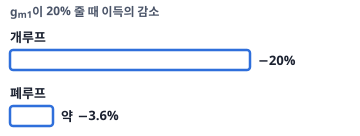

*귀환이 트랜지스터 값의 흔들림을 대부분 지워 줘요.*

**정확히 말하면**

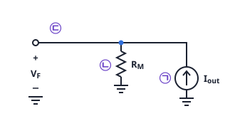

*㉠ 감지 포트에 넣은 $I_{out}$ · ㉡ 귀환망 $R_M$ · ㉢ 열어 둔 반송 포트. 수업 예시를 옮긴 그림이에요: 감지 포트에 전류를 넣고 반송 포트의 개방 전압을 재는 규칙(강의노트 s52)을 s58의 $R_M$에 적용했어요.*

#### K는 어떻게 재나요

귀환망은 출력 전류를 감지해 전압을 반송하므로 $K$는 전압을 전류로 나눈 값이에요. ㉠ 감지 포트에 전류 $I_{out}$을 넣고, ㉢ 반송 포트는 열어 둔 채 전압 $V_F$를 재요.

1. $$
   V_F=I_{out}R_M
   $$

   ㉡ 감지 전류가 $R_M$에 그대로 흘러 전압을 만들어요.
2. $$
   K=\frac{V_F}{I_{out}}
   $$

   반송 전압을 감지 전류로 나눠요.
3. $$
   K=R_M
   $$

   그림 없이 $V_F=I_{out}R_M$에서 바로 읽어도 돼요.

**귀환 계수는 감지 저항 그 자체예요.**

#### 숫자로 먼저 볼까요

[감지 저항을 양쪽에 복제하고 모두 개방해요](#s1-cv-open)의 개루프 이득 $40/7\approx5.71\ \mathrm{mS}$와 $K=1\ \mathrm{k\Omega}$을 써요. 루프 이득은 단위가 지워지는 수예요.

$$
\begin{aligned}K\left.\frac{I_{out}}{V_{in}}\right|_{open}&=1\ \mathrm{k\Omega}\times\frac{40}{7}\ \mathrm{mS}\\&=\frac{40}{7}\approx5.71\end{aligned}
$$

$$
\begin{aligned}\left.\frac{I_{out}}{V_{in}}\right|_{closed}&=\frac{40/7}{1+40/7}\ \mathrm{mS}\\&=\frac{40}{47}\ \mathrm{mS}\approx0.85\ \mathrm{mS}\end{aligned}
$$

**폐루프 이득은 약 $0.85\ \mathrm{mS}$로, $1/R_M=1\ \mathrm{mS}$에 가까워요.**

#### 폐루프 이득과 임피던스

루프 이득은 $K(I_{out}/V_{in})|_{open}$이에요. 강의노트의 C-V 관계에 그대로 넣어요.

$$
\left.\frac{I_{out}}{V_{in}}\right|_{closed}=\frac{(I_{out}/V_{in})|_{open}}{1+K(I_{out}/V_{in})|_{open}}
$$

$$
\begin{aligned}R_{in,closed}&=R_{in,open}\\&\quad\times[1+K(I_{out}/V_{in})|_{open}]\end{aligned}
$$

$$
\begin{aligned}R_{out,closed}&=R_{out,open}\\&\quad\times[1+K(I_{out}/V_{in})|_{open}]\end{aligned}
$$

개루프 값과 비교하면 폐루프 이득은 $\frac{1}{1+K(I_{out}/V_{in})|_{open}}$배로 줄고, 입력과 출력 임피던스는 모두 $[1+K(I_{out}/V_{in})|_{open}]$배로 커져요. 입력 쪽에서는 귀환망이 전압을 직렬로 빼므로 입력 임피던스가 커져 더 좋은 전압 감지기(voltage sensor)가 돼요. 출력 쪽에서는 출력 전류를 감지해 조절하므로 출력 임피던스가 커져 더 좋은 전류원(current source)이 돼요. **C-V 귀환은 이득을 $1+$루프 이득으로 나누는 대신, 입력과 출력 임피던스를 모두 $1+$루프 이득 배로 키워요.** 예시 값에서는 $1+40/7=47/7$배예요.

$$
R_{in,closed}=0.5\ \mathrm{k\Omega}\times\frac{47}{7}\approx3.36\ \mathrm{k\Omega}
$$

$$
R_{out,closed}=1.25\ \mathrm{k\Omega}\times\frac{47}{7}\approx8.39\ \mathrm{k\Omega}
$$

#### 루프 이득이 크면 감지 저항이 전류를 정해요

개루프 이득을 $A_0=(I_{out}/V_{in})|_{open}$으로 쓰면, $KA_0\gg1$일 때 분모의 1을 무시할 수 있어요.

$$
\left.\frac{I_{out}}{V_{in}}\right|_{closed}\approx\frac{1}{K}=\frac{1}{R_M}
$$

$g_{m1}$, $R_D$, $I_D$가 바뀌면 $A_0$는 그대로 흔들리지만 폐루프 이득은 거의 $K$로만 정해져요. 예시 값에서 $g_{m1}$이 20% 줄면 변화 후 개루프 이득 $A_0^*=32/7\approx4.57\ \mathrm{mS}$로 20% 줄고, 폐루프 이득은 $A_0^*/(1+KA_0^*)=32/39\approx0.82\ \mathrm{mS}$로 약 3.6%만 줄어요. **입력 전압이 정하는 레이저 전류, 곧 빛의 밝기가 트랜지스터 값이 아니라 $R_M$으로 정해져요.**

#### 대역폭도 넓어져요

귀환은 이득을 $(1+KA_0)$배 줄이는 대신 대역폭(bandwidth)을 같은 배수로 넓혀요. **예시 값이면 대역폭이 $47/7\approx6.71$배 넓어져요.**

**교수님 말씀**

교수님은 이 회로를 입력 전압으로 레이저 다이오드의 빛의 밝기를 조절하는 회로로 소개했어요. 개루프로 만들면 $g_m$이나 $I_D$가 ±20%까지 흔들려 밝기가 달라지지만, 전류를 감지해 귀환하면 보통 1% 이내로 정해지는 귀환 계수가 이득을 정해요.

> "$R_M$만 정확하게 알게 되면 정확한 전류를 흘려줄 수가 있겠죠."

임피던스가 커지는지 작아지는지 헷갈리면 귀환의 원리로 판단하라고 했어요.

> "헷갈린다라고 하면 원리, 피드백 원리에 의해서 커지죠."

**꼭 기억해요**

> "저항 자체는 이제 절댓값이 좀 변동이 있거든요."

이 예제의 폐루프 이득은 저항의 비가 아니라 $R_M$ 하나의 절댓값에 달려 있어요. 저항의 절댓값은 공정에 따라 흔들리므로, 실제 설계에서는 두 저항의 비로 $K$를 정하는 구조를 더 많이 써요.

#### 직접 해 보기: 트랜지스터가 흔들려도 레이저 전류는 거의 그대로 *(정적 스냅샷 — 직접 조작은 HTML 버전)*

$g_{m1}$을 공칭값의 −20%~+20%로 움직이고 $R_M$을 바꾸면, 개루프와 폐루프 이득의 변화율과 출력 임피던스가 함께 바뀌어요($g_{m1}=2\ \mathrm{mS}$, $R_D=5\ \mathrm{k\Omega}$, $g_{m2}=4\ \mathrm{mS}$, $R_L=0.5\ \mathrm{k\Omega}$ 기준).

개루프 **5.71 mS** · 루프 이득 **5.71** · 폐루프 **0.85 mS**(1/RM = **1 mS**의 **85%**) · 출력 임피던스 **1.25 → 8.39 kΩ**

범례: 개루프 이득의 변화율 · 폐루프 이득의 변화율 · 막대: 출력 임피던스

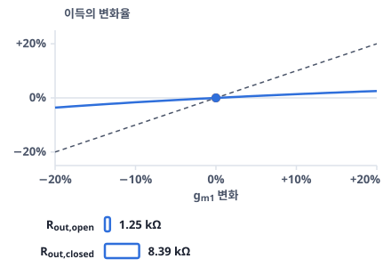

*대표 설정 1: gm1 0%, RM 1 kΩ*

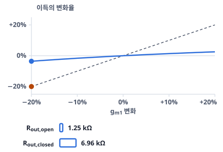

*대표 설정 2: gm1 −20%, RM 1 kΩ*

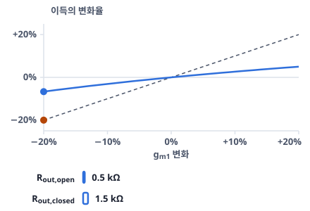

*대표 설정 3: gm1 −20%, RM 0.25 kΩ*

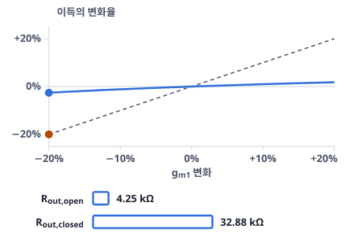

*대표 설정 4: gm1 −20%, RM 4 kΩ*

| 설정 | 개루프 이득 | 루프 이득 | 폐루프 이득 | 1/RM | 출력 임피던스 |
|---|---|---|---|---|---|
| gm1 0%, RM 1 kΩ | 5.71 mS (0%) | 5.71 | 0.85 mS (0%) | 1 mS | 1.25 → 8.39 kΩ |
| gm1 −20%, RM 1 kΩ | 4.57 mS (−20%) | 4.57 | 0.82 mS (−3.6%) | 1 mS | 1.25 → 6.96 kΩ |
| gm1 −20%, RM 0.25 kΩ | 8 mS (−20%) | 2 | 2.67 mS (−6.7%) | 4 mS | 0.5 → 1.5 kΩ |
| gm1 −20%, RM 4 kΩ | 1.68 mS (−20%) | 6.74 | 0.22 mS (−2.6%) | 0.25 mS | 4.25 → 32.88 kΩ |

확인해 봐요. 개루프 이득이 $4\ \mathrm{mS}$이고 $R_M=2\ \mathrm{k\Omega}$이면 폐루프 이득은 얼마이고, $1/R_M$과 얼마나 가까운가요?

답 보기

루프 이득이 $2\times4=8$이므로 폐루프 이득은 $4/9\approx0.44\ \mathrm{mS}$이고, $1/R_M=0.5\ \mathrm{mS}$의 약 89%예요.

**페이지 요약**

감지 저항이 그대로 귀환 계수 $K=R_M$이 되고, 루프 이득이 크면 폐루프 이득은 $1/R_M$에 가까워져요.

*핵심 식*

- 귀환 계수

  $$
  K=R_M
  $$
- 큰 루프 이득

  $$
  \left.\frac{I_{out}}{V_{in}}\right|_{closed}\approx\frac{1}{K}=\frac{1}{R_M}
  $$
- 출력 임피던스

  $$
  \begin{aligned}R_{out,closed}&=R_{out,open}\\&\quad\times[1+K(I_{out}/V_{in})|_{open}]\end{aligned}
  $$

*판단*

입력 임피던스도 같은 배수로 커져 더 좋은 전압 감지기가 되고, 출력은 더 좋은 전류원이 돼요.

정확도는 $R_M$의 절댓값에 달려 있어요.

*용어*

- **전류원(current source)** — 단자 전압이 변해도 전류를 유지하는 소자로, 출력 임피던스가 클수록 좋아요.

---

## 3. 예제 IV: C-C 귀환의 로딩

### 입력 쪽 복제는 개방, 출력 쪽 복제는 접지해요

*1125 수업 · L06 s59 · L06 s50*

**쉽게 말하면**

귀환망 $R_F$, $R_M$을 입력 쪽과 출력 쪽에 하나씩 복제해 달고, 입력 쪽 복제는 개방하고 출력 쪽 복제는 접지해서 루프를 끊어요.

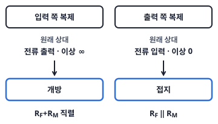

*각 복제의 끊은 쪽은 원래 붙어 있던 상대의 이상 임피던스대로 처리해요(∞이면 개방, 0이면 접지).*

예를 들어 $R_F=10\ \mathrm{k\Omega}$, $R_M=1\ \mathrm{k\Omega}$이면 입력 쪽에는 $11\ \mathrm{k\Omega}$, 출력 쪽에는 약 $0.91\ \mathrm{k\Omega}$이 보여요.

**정확히 말하면**

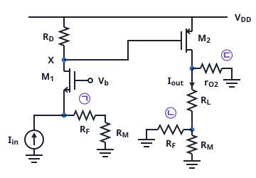

*㉠ 입력 쪽 복제 · ㉡ 출력 쪽 복제 · ㉢ $M_2$의 $r_{O2}$ (강의노트 s59 오른쪽: 로딩을 넣어 끊은 개루프)*

#### 원래 회로는 전류를 받아 전류를 내요

원래 회로(강의노트 s59 왼쪽)는 입력도 출력도 전류인 전류 증폭기(current amplifier)예요. 첫 단 $M_1$은 게이트가 $V_b$에 묶인 공통 게이트라서 $I_{in}$이 소스로 들어가 드레인 $X$의 $R_D$로 나와요. 둘째 단 $M_2$는 PMOS 공통 소스(common source)라서 게이트 $X$의 전압으로 드레인 전류 $I_{out}$을 정해요.

$I_{out}$은 부하인 레이저 다이오드($R_L$로 모델링)를 지나 노드 $P$로 가요. $P$에서 $R_M$을 거쳐 접지로, $R_F$를 거쳐 $M_1$ 소스로 이어지고, $R_F$로 가는 전류가 귀환 전류 $I_F$예요. 출력 전류는 귀환망을 직렬로 넣어 감지하고, $I_F$는 입력과 같은 노드에 병렬로 연결해 입력 전류에서 빼요([전류는 직렬로 재고, 전류는 같은 노드에서 빼요](#s0-connection)). **첫 단은 예제 III과 같고, 둘째 단만 소스 팔로워에서 PMOS 공통 소스로 바뀌었어요.**

#### 이상적 귀환망은 $R_M\to0$, $R_F\to\infty$예요

감지 쪽은 전류를 직렬로 재므로 이상적인 입력 임피던스가 0이어야 하고, 이것이 $R_M\to0$이에요. 반송 쪽은 전류원처럼 전류를 내보내야 하므로 이상적인 출력 임피던스가 ∞여야 하고, 이것이 $R_F\to\infty$예요. 슬라이드는 "$R_F$가 크지 않고 $R_M$이 작지 않다"고 가정해요. **실제 $R_F$는 무한대가 아니고 $R_M$은 0이 아니어서 귀환망이 개루프를 로딩해요.**

#### 끊은 포트는 원래 상대의 이상 임피던스로 처리해요

㉠ 입력 쪽 복제는 반송 포트를 $M_1$ 소스에 그대로 두고 감지 포트를 끊어요. 감지 포트는 원래 전류 출력($M_2$ 드레인 쪽)에 붙어 있었고, 이상적인 전류 출력 임피던스는 ∞라서 개방해요. 그래서 $M_1$ 소스에서 접지까지 $R_F$와 $R_M$이 직렬로 보여요.

㉡ 출력 쪽 복제는 감지 포트를 $R_L$ 아래에 그대로 두고 반송 포트를 끊어요. 반송 포트는 원래 전류 입력($M_1$ 소스)에 붙어 있었고, 이상적인 전류 입력 임피던스는 0이라서 접지해요. 그래서 $R_L$ 아래 노드에서 $R_F$와 $R_M$이 모두 접지로 가 병렬로 보여요.

예시 값 $R_F=10\ \mathrm{k\Omega}$, $R_M=1\ \mathrm{k\Omega}$을 넣어요.

$$
R_F+R_M=11\ \mathrm{k\Omega}
$$

$$
R_F\parallel R_M=\frac{10\times1}{10+1}\ \mathrm{k\Omega}\approx0.91\ \mathrm{k\Omega}
$$

**입력 쪽 복제는 개방이라 $R_F+R_M$, 출력 쪽 복제는 접지라 $R_F\parallel R_M$으로 보여요.**

#### $r_{O2}$는 드레인에서 AC 접지로 그려요

㉢ $r_{O2}$는 $M_2$의 채널 길이 변조로 생기는 출력저항이고, 원래 드레인과 소스 사이에 있어요. $M_2$ 소스는 $V_{DD}$라 AC 접지이므로 슬라이드는 $r_{O2}$를 드레인에서 접지로 그렸어요. **소스가 AC 접지라서 드레인–소스 사이의 $r_{O2}$는 드레인–접지 사이에 둔 것과 같아요.** $M_1$의 출력저항은 슬라이드처럼 무시해요.

#### 이상적이면 복제가 없는 것과 같아요

$R_F\to\infty$이면 ㉠의 $R_F+R_M$도 ∞라서 입력 쪽 복제는 끊긴 선과 같아요. $R_F\to\infty$와 $R_M\to0$이면 ㉡의 $R_F\parallel R_M$은 0이라서 $R_L$ 아래가 바로 접지돼요. **이상적 귀환망이면 두 복제가 사라져, 로딩을 넣어 끊은 회로가 귀환망을 무시한 개루프와 같아져요.**

**교수님 말씀**

레이저 다이오드는 증폭기의 일부가 아니라 부하라고 먼저 구분했어요.

> "회로에 포함된 게 아니라 로드예요."

입력 쪽 연결이 병렬인 이유는 전류를 빼는 방식에 있다고 했어요.

> "전류를 뺄 때는 병렬로 연결돼 있죠."

이상적인 귀환망이면 복제를 달아도 결과가 같다고 정리했어요.

> "이상적인 거면 없는 거랑 똑같아요"

확인해 봐요. $R_F=20\ \mathrm{k\Omega}$, $R_M=2\ \mathrm{k\Omega}$이면 입력 쪽 복제와 출력 쪽 복제는 각각 몇 kΩ으로 보이나요?

답 보기

입력 쪽은 $22\ \mathrm{k\Omega}$, 출력 쪽은 약 $1.82\ \mathrm{k\Omega}$이에요. 입력 쪽은 개방이라 $20+2$, 출력 쪽은 접지라 $20\times2/22\approx1.82$예요.

**페이지 요약**

루프를 끊을 때 입력 쪽 복제는 개방해 $R_F+R_M$, 출력 쪽 복제는 접지해 $R_F\parallel R_M$으로 달아요.

*핵심 식*

- 입력 쪽 복제 (개방)

  $$
  R_F+R_M
  $$
- 출력 쪽 복제 (접지)

  $$
  R_F\parallel R_M
  $$

*판단 기준*

끊은 포트는 원래 상대의 이상 임피던스(전류 출력 ∞, 전류 입력 0)로 처리해요.

$R_F\to\infty$, $R_M\to0$이면 두 복제가 사라져요.

*용어*

- **전류 증폭기 (current amplifier)** — 입력 전류를 받아 출력 전류를 내는 증폭기예요.
- **종단 (termination)** — 끊은 포트를 개방하거나 접지하는 처리예요.

---

### 입력은 테브난 변환으로, 출력은 전류 분배로 구해요

*1125 수업 · L06 s59*

**쉽게 말하면**

첫 단은 입력 전류원과 병렬 복제 저항을 테브난 전압원으로 바꿔 공통 게이트 이득으로 풀고, 둘째 단은 $M_2$ 드레인 전류 $I^*$가 $r_{O2}$와 부하 경로로 나뉘는 전류 분배로 구해 두 값을 곱해요.

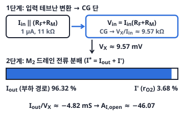

*첫 단은 테브난 변환으로 익숙한 공통 게이트 이득을 쓰고, 둘째 단은 전류 분배로 구해 곱해요.*

**정확히 말하면**

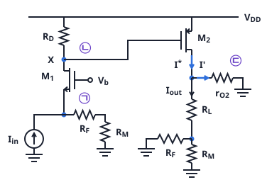

*㉠ 입력 테브난 변환 구간($I_{in}\parallel(R_F+R_M)$) · ㉡ 노드 $X$ · ㉢ $M_2$ 드레인 분기($I^*=I_{out}+I'$) (강의노트 s59 오른쪽)*

#### 숫자로 먼저 따라가요

예시 값으로 $g_{m1}=2\ \mathrm{mS}$($1/g_{m1}=0.5\ \mathrm{k\Omega}$), $R_D=10\ \mathrm{k\Omega}$, $g_{m2}=5\ \mathrm{mS}$, $r_{O2}=50\ \mathrm{k\Omega}$, $R_L=1\ \mathrm{k\Omega}$, $R_F=10\ \mathrm{k\Omega}$, $R_M=1\ \mathrm{k\Omega}$를 써요. 입력 $1\ \mu\mathrm{A}$가 병렬 저항 $R_F+R_M=11\ \mathrm{k\Omega}$와 만나 테브난 등가 전압 $V_{in}=11\ \mathrm{mV}$가 되고, 소스 저항 $11\ \mathrm{k\Omega}$가 붙은 공통 게이트 단 이득 $10/(0.5+11)\approx0.87$을 거쳐 $V_X\approx9.57\ \mathrm{mV}$가 돼요. 이어서 $M_2$ 드레인 전류 $I^*$ 중 약 96.32 %가 부하 경로로 나뉘어 $I_{out}\approx-46.07\ \mu\mathrm{A}$가 돼요. **두 단의 곱으로 $A_{I,open}\approx-46.07$이에요.**

#### 첫 단: 테브난 변환으로 공통 게이트 이득을 바로 써요

전체 개루프 전류 이득은 중간 노드 $X$를 기준으로 $\frac{I_{out}}{I_{in}}=\frac{V_X}{I_{in}}\cdot\frac{I_{out}}{V_X}$로 끊어 구해요. ㉠ 입력 전류원 $I_{in}$과 병렬 복제 저항 $(R_F+R_M)$을 테브난 등가(Thévenin equivalent)로 바꾸면, 직렬 소스 저항 $R_F+R_M$을 가진 전압원 $V_{in}=I_{in}(R_F+R_M)$이 공통 게이트 단 $M_1$을 구동하는 꼴이 돼요.

1. $$
   \begin{aligned}\frac{V_X}{I_{in}}&=\frac{V_{in}}{I_{in}}\cdot\frac{V_X}{V_{in}}\\&=(R_F+R_M)\cdot\frac{V_X}{V_{in}}\end{aligned}
   $$

   노턴→테브난 변환으로 $V_{in}=I_{in}(R_F+R_M)$을 세워 전압 이득으로 넘겨요.
2. $$
   \frac{V_X}{V_{in}}=\frac{R_D}{1/g_{m1}+(R_F+R_M)}
   $$

   ㉡ 직렬 소스 저항 $(R_F+R_M)$이 붙은 공통 게이트 단의 기본 전압 이득이에요.
3. $$
   \frac{V_X}{I_{in}}=\frac{(R_F+R_M)R_D}{R_F+R_M+1/g_{m1}}
   $$

   두 식을 곱해요. 예시 값으로는 $\approx9.57\ \mathrm{k\Omega}$예요.

**$R_F+R_M$이 $1/g_{m1}$보다 충분히 크면 분모의 $1/g_{m1}$이 작아져 $\frac{V_X}{I_{in}}\approx R_D$에 가까워져요.**

(수업 중 $V_X$ 식에서 $R_D$를 빠뜨렸다가 정정)

#### 둘째 단: 드레인 전류 $I^*$가 $I_{out}$과 $I'$으로 나뉘어요

㉢ $M_2$는 PMOS라서 $V_X$가 오르면 $V_{SG2}$가 줄어, 드레인에서 아래로 내려오는 소신호 전류는 $I^*=-g_{m2}V_X$예요. 이 $I^*$가 부하 경로 전류 $I_{out}$과 채널 길이 변조(channel-length modulation) 저항 $r_{O2}$ 가지 전류 $I'$으로 나뉘므로($I^*=I_{out}+I'$), 전류 분배로 바로 구해요.

1. $$
   I^*=I_{out}+I'=-g_{m2}V_X
   $$

   PMOS라서 $V_X$가 오르면 아래 방향 드레인 전류가 줄어 음수 부호가 붙어요.
2. $$
   I_{out}=I^*\cdot\frac{r_{O2}}{r_{O2}+R_L+R_M\parallel R_F}
   $$

   병렬 두 가지 중 부하 경로($R_L+R_M\parallel R_F$)로 가는 몫을 전류 분배로 잡아요.
3. $$
   \frac{I_{out}}{V_X}=\frac{-g_{m2}r_{O2}}{r_{O2}+R_L+R_M\parallel R_F}
   $$

   $I^*=-g_{m2}V_X$를 넣고 나눠요. 예시 값으로는 $-5\ \mathrm{mS}\times0.9632\approx-4.82\ \mathrm{mS}$예요.

**부하 경로 저항이 $r_{O2}$보다 작을수록 드레인 전류 $I^*$가 거의 다 $I_{out}$으로 가요.** 수업에서는 그런 가정을 따로 두지 않고 위 식을 그대로 썼어요.

#### 두 비를 곱해 $A_{I,open}$을 얻어요

$$
\begin{aligned}A_{I,open}&=\frac{(R_F+R_M)R_D}{R_F+R_M+1/g_{m1}}\\&\quad\cdot\frac{-g_{m2}r_{O2}}{r_{O2}+R_L+R_M\parallel R_F}\end{aligned}
$$

반올림하지 않으려고 두 비를 분수로 둬요. 첫째 비는 $\frac{11\times10}{11.5}=\frac{220}{23}\ \mathrm{k\Omega}$, 둘째 비는 $-\frac{5\times50}{571/11}=-\frac{2750}{571}\ \mathrm{mS}$예요.

$$
\begin{aligned}A_{I,open}&=\frac{220}{23}\ \mathrm{k\Omega}\times\left(-\frac{2750}{571}\ \mathrm{mS}\right)\\&=-\frac{605000}{13133}\approx-46.07\end{aligned}
$$

이상적 귀환망이면 $R_F\to\infty$, $R_M\to0$이라 첫째 비는 $R_D$가 되고 부하 경로에는 $R_L$만 남아요.

$$
A_{I,open}\to\frac{-g_{m2}R_Dr_{O2}}{r_{O2}+R_L}\approx-49.02
$$

예시의 $A_{I,open}$은 이 이상값의 약 93.98 %예요. **입력 쪽 복제와 출력 쪽 복제의 로딩이 개루프 전류 이득을 이상값보다 조금 줄여요.**

**교수님 말씀**

교수님은 입력 노드의 전류가 임피던스 비로 나뉜다는 점도 함께 짚었어요.

> "전류는 임피던스의 비로 나눠서 흐르겠죠"

$R_F+R_M$이 $1/g_{m1}$보다 크면 입력 전류가 대부분 소스 쪽으로 흐르고, 테브난 변환으로 구한 식과 완전히 같은 결과가 나와요.

**꼭 기억해요**

식이 길어 보여도 입력 테브난 변환+공통 게이트 이득과 출력 전류 분배를 곱한 것뿐이니 직접 유도해 봐요.

> "이것도 이렇게 복잡한데 이거 한번 풀어보세요."

$A_{I,open}$이 음수라는 점은 다음 단계의 루프 이득 부호 판단에 그대로 쓰여요([K는 음수여도 루프 이득은 양수예요](#s2-cc-closed)).

확인해 봐요. $R_F+R_M=4.5\ \mathrm{k\Omega}$, $1/g_{m1}=0.5\ \mathrm{k\Omega}$, $R_D=10\ \mathrm{k\Omega}$이면 테브난 변환으로 구한 첫 단 이득 $V_X/I_{in}$은 몇 $\mathrm{k\Omega}$인가요?

답 보기

$9\ \mathrm{k\Omega}$이에요. $(R_F+R_M)\cdot\frac{R_D}{1/g_{m1}+(R_F+R_M)}=4.5\times\frac{10}{0.5+4.5}=9\ \mathrm{k\Omega}$예요.

**페이지 요약**

입력은 테브난 변환과 공통 게이트 이득으로, 출력은 $M_2$ 드레인 전류 $I^*$의 전류 분배로 구해 곱하면 음수인 $A_{I,open}$이 나와요.

*핵심 식*

- 첫 단 (테브난 + CG)

  $$
  \begin{aligned}\frac{V_X}{I_{in}}&=(R_F+R_M)\\&\quad\cdot\frac{R_D}{1/g_{m1}+R_F+R_M}\end{aligned}
  $$
- 둘째 단 (전류 분배)

  $$
  \frac{I_{out}}{V_X}=\frac{-g_{m2}r_{O2}}{r_{O2}+R_L+R_M\parallel R_F}
  $$

*판단 기준*

전체 이득은 $\frac{I_{out}}{I_{in}}=\frac{V_X}{I_{in}}\cdot\frac{I_{out}}{V_X}$ 연쇄 곱으로 이어 붙어요.

PMOS 둘째 단은 $I^*=-g_{m2}V_X$라서 $A_{I,open}$이 음수예요.

*용어*

- **테브난 변환 (Thévenin conversion)** — 전류원과 병렬 저항을 전압원 $V_{in}=I_{in}R$과 직렬 저항 $R$로 바꾸는 등가 변환이에요.
- **전류 분배 (current division)** — 병렬 가지로 전류가 반대편 저항 비율만큼 나뉘는 관계예요.
- **채널 길이 변조 (channel-length modulation)** — 드레인 전압에 따라 전류가 조금 바뀌는 효과로, $r_{O2}$를 만들어요.

---

### 0과 무한대가 아니어도 충분히 작거나 크면 돼요

*1125 수업 · L06 s59 · L06 s58*

**쉽게 말하면**

입력 쪽 복제는 작은 $1/g_{m1}$에 병렬로, 출력 쪽 복제는 큰 $r_{O2}$에 직렬로 붙어서, 0이나 ∞가 아니어도 기준보다 충분히 크거나 작으면 거의 영향이 없어요.

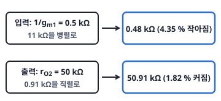

*예시 값에서는 입력이 4.35 %, 출력이 1.82 %만 바뀌어요.*

**정확히 말하면**

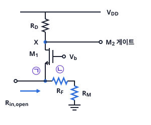

*㉠ $M_1$ 소스를 올려다본 쪽 · ㉡ 입력 쪽 복제 (강의노트 s59 오른쪽의 입력 단. $I_{in}$ 자리를 입력 단자로 두고 화살표 방향으로 들여다봐요. $M_2$ 게이트로는 전류가 흐르지 않아 둘째 단을 생략)*

#### 입력: $1/g_{m1}$과 $R_F+R_M$의 병렬이에요

입력 포트는 $I_{in}$이 들어가는 $M_1$ 소스 노드이고, 그림 왼쪽 입력 단자에서 화살표 방향으로 들여다본 저항이 $R_{in,open}$이에요. ㉠ 위로는 게이트가 $V_b$(AC 접지)인 $M_1$ 소스를 들여다본 $1/g_{m1}$이 보여요. ㉡ 아래로는 개방 종단한 입력 쪽 복제 $R_F+R_M$이 보여요. 두 가지가 같은 노드와 접지 사이에 있으므로 병렬이에요.

$$
R_{in,open}=\frac{1}{g_{m1}}\parallel(R_F+R_M)
$$

$$
\begin{aligned}R_{in,open}&=\frac{0.5\times11}{0.5+11}\ \mathrm{k\Omega}\\&\approx0.48\ \mathrm{k\Omega}\end{aligned}
$$

$R_F\to\infty$이면 $1/g_{m1}$만 남아요. **입력 쪽 복제는 $1/g_{m1}$에 병렬로 붙어 입력 임피던스를 조금 낮춰요.**

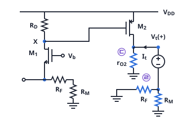

*㉢ $r_{O2}$ · ㉣ 출력 쪽 복제 (수업 예시를 옮긴 그림: s59 오른쪽 회로의 $R_L$ 자리에 s58처럼 시험원을 걸고, $I_{in}$은 개방)*

#### 출력: $r_{O2}$와 $R_F\parallel R_M$의 직렬이에요

출력 포트는 부하(레이저) $R_L$이 붙는 두 노드 사이예요. 입력 전류원 $I_{in}$을 개방하면 $V_X=0$이라 $M_2$의 $g_{m2}V_X$ 전류도 0이 돼요.

부하 $R_L$ 양단에서 ㉢ 위쪽으로는 $M_2$ 드레인에서 교류 접지까지 $r_{O2}$가 보이고, ㉣ 아래쪽으로는 출력 쪽 복제 $R_F\parallel R_M$이 교류 접지까지 이어져요. **두 접지가 같은 교류 접지로 하나로 연결되므로, 레이저 입장에서는 $r_{O2}$와 $R_F\parallel R_M$이 그대로 직렬로 보여요.** 그림처럼 $R_L$ 자리에 시험원 $V_t$를 걸어 보아도 같은 시험 전류 $I_t$가 두 저항을 차례로 지나므로 결과가 같아요.

$$
R_{out,open}=r_{O2}+R_F\parallel R_M
$$

$$
\begin{aligned}R_{out,open}&=50\ \mathrm{k\Omega}+\frac{10\times1}{11}\ \mathrm{k\Omega}\\&\approx50.91\ \mathrm{k\Omega}\end{aligned}
$$

예제 III은 출력이 $M_2$ 소스 쪽이라 $1/g_{m2}$가 보였지만, 여기는 드레인 쪽이라 $r_{O2}$가 보여요([출력 쪽에서는 소스 쪽 저항과 감지 저항이 직렬이에요](#s1-cv-io)). **출력 쪽 복제는 $r_{O2}$에 직렬로 붙어 출력 임피던스를 조금 높여요.** $R_M\to0$이면 $r_{O2}$만 남아요.

#### 0과 ∞ 대신 기준과 비교해요

두 값을 이상값으로 나누면 얼마나 벗어났는지 바로 보여요.

$$
\frac{R_{in,open}}{1/g_{m1}}=\frac{R_F+R_M}{R_F+R_M+1/g_{m1}}
$$

$$
\frac{R_{out,open}}{r_{O2}}=1+\frac{R_F\parallel R_M}{r_{O2}}
$$

첫째 비가 1에 가까우려면 $R_F+R_M\gg1/g_{m1}$, 둘째 비가 1에 가까우려면 $R_F\parallel R_M\ll r_{O2}$이면 충분해요. 예시는 $R_F+R_M$이 $1/g_{m1}$의 22배라 95.65 %, $R_F\parallel R_M$이 $r_{O2}$의 1.82 %라 101.82 %예요. 같은 $0.91\ \mathrm{k\Omega}$을 기준이 $0.5\ \mathrm{k\Omega}$인 곳에 직렬로 붙였다면 181.82 %나 커졌을 거예요. **기준 임피던스가 작으면 복제도 더 작아야 하고, 기준이 크면 상대적으로 커도 이상에 가까워요.** 1118 수업에서 본 "0과 ∞는 원래 회로와 비교한 말"과 같은 생각이에요.

**교수님 말씀**

교수님은 이상적인 귀환망에 가까워지는 데 0과 ∞가 꼭 필요하지 않다고 했어요.

> "꼭 무한대가 될 필요는 없고"

예제 III과 비교해, 기준 임피던스가 큰 쪽은 여유가 더 있다고 설명했어요.

> "여기는 상대적으로 임피던스가 크기 때문에 어 좀 더 커도"

**꼭 기억해요**

"충분히 크다/작다"는 늘 어떤 기준 임피던스와 비교한 말이에요. 입력은 $1/g_{m1}$, 출력은 $r_{O2}$와 비교해요.

> "기존의 전압이나 기존의 전류에 영향을 안 주면 돼요."

출력 쪽 조건에 들어가는 양은 $R_M$ 하나가 아니라 출력 쪽 복제 $R_F\parallel R_M$ 전체예요.

#### 직접 해 보기: 복제 저항이 개루프 임피던스를 얼마나 바꾸나요 *(정적 스냅샷 — 직접 조작은 HTML 버전)*

*R*F와 *R*M을 움직이면 *R*in,open이 1/*g*m1에서, *R*out,open이 *r*O2에서 몇 % 벗어나는지 막대로 보여요. *g*m1 = 2 mS(1/*g*m1 = 0.5 kΩ), *r*O2 = 50 kΩ로 고정하고 *M*1의 출력저항은 무시했어요.

*R*in,open = **0.48 kΩ**, *R*out,open = **50.91 kΩ**. *R*F+*R*M는 1/*g*m1의 **22배**, *R*F‖*R*M는 *r*O2의 **1.82 %**예요.

범례: *R*in,open 감소율 · *R*out,open 증가율 · 점선 테두리: 같은 *R*F‖*R*M을 0.5 kΩ 기준에 직렬로 붙였을 때

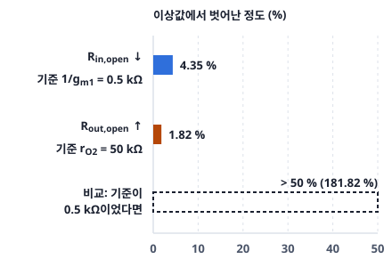

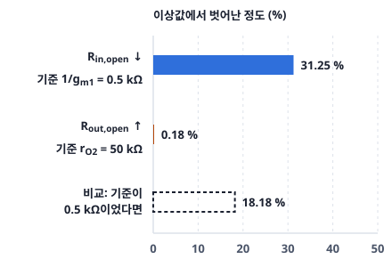

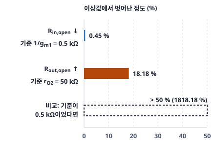

| *R*F | *R*M | (*R*F+*R*M) ÷ (1/*g*m1) | *R*F‖*R*M ÷ *r*O2 | *R*in,open | *R*out,open |
|---|---|---|---|---|---|
| 10 kΩ | 1 kΩ | 22배 | 1.82 % | 0.48 kΩ (4.35 % ↓) | 50.91 kΩ (1.82 % ↑) |
| 1 kΩ | 0.1 kΩ | 2.2배 | 0.18 % | 0.34 kΩ (31.25 % ↓) | 50.09 kΩ (0.18 % ↑) |
| 100 kΩ | 10 kΩ | 220배 | 18.18 % | 0.5 kΩ (0.45 % ↓) | 59.09 kΩ (18.18 % ↑) |

1/*g*m1 = 0.5 kΩ, *r*O2 = 50 kΩ로 고정한 값이에요.

확인해 봐요. $1/g_{m1}=0.5\ \mathrm{k\Omega}$, $r_{O2}=50\ \mathrm{k\Omega}$에서 $R_F=20\ \mathrm{k\Omega}$, $R_M=5\ \mathrm{k\Omega}$이면 $R_{in,open}$과 $R_{out,open}$은 얼마인가요?

답 보기

$R_{in,open}\approx0.49\ \mathrm{k\Omega}$, $R_{out,open}=54\ \mathrm{k\Omega}$예요. $0.5\parallel25=12.5/25.5\approx0.49$이고, $50+20\times5/25=54$예요.

**페이지 요약**

복제 저항이 0이나 ∞가 아니어도 기준 임피던스보다 충분히 크거나 작으면 개루프 입·출력 임피던스는 이상값에 가까워요.

*핵심 식*

- 개루프 입력 임피던스 (병렬)

  $$
  R_{in,open}=\frac{1}{g_{m1}}\parallel(R_F+R_M)
  $$
- 개루프 출력 임피던스 (직렬)

  $$
  R_{out,open}=r_{O2}+R_F\parallel R_M
  $$

*판단 기준*

$R_F+R_M\gg1/g_{m1}$이면 입력 쪽 로딩을 무시할 수 있어요.

$R_F\parallel R_M\ll r_{O2}$이면 출력 쪽 로딩을 무시할 수 있어요.

*용어*

- **로딩 효과 (loading effect)** — 귀환망의 유한한 임피던스가 개루프 특성을 바꾸는 현상이에요.

---

### K는 음수여도 루프 이득은 양수예요

*1125 수업 · L06 s60 · L06 s42–44 · L06 s52*

**쉽게 말하면**

귀환 계수 $K$는 음수로 나오지만 $A_{I,open}$도 음수라서 둘을 곱한 루프 이득은 양수이고, 그래서 음의 귀환이에요.

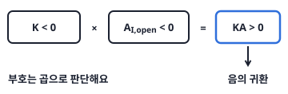

*예시 값에서는 $K=-1/11$, $A_{I,open}\approx-46.07$이라 루프 이득이 약 4.19예요.*

**정확히 말하면**

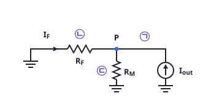

*㉠ 감지 포트 $P$ · ㉡ 접지한 반송 포트 쪽 $R_F$ · ㉢ $R_M$ 가지 (강의노트 s60 오른쪽. 원래 회로의 방향대로 $I_{out}$이 $P$로 들어가고 $I_F$가 입력에서 빠지게 그렸어요)*

#### 감지 포트에 $I_{out}$을 넣고 반송 포트를 접지해요

귀환망만 떼어 ㉠ 감지 포트 $P$에 출력 전류 $I_{out}$을 위로 넣어요. 반송하는 양이 전류이므로 ㉡ 반송 포트는 접지하고 그곳을 흐르는 귀환 전류 $I_F$를 재요. $I_F$의 양의 방향은 원래 회로처럼 입력 노드에서 빠지는 방향, 즉 반송 포트에서 $P$ 쪽이에요.

1. $$
   I_F=-\frac{R_M}{R_F+R_M}I_{out}
   $$

   ㉢ $P$로 들어온 $I_{out}$이 $R_M$과 $R_F$로 나뉠 때 $R_F$로 가는 몫이 $I_F$의 양의 방향과 반대로 흘러 음수가 붙어요.
2. $$
   K=\frac{I_F}{I_{out}}=-\frac{R_M}{R_F+R_M}
   $$

   예시 값으로는 $-1/11\approx-0.09$예요.

슬라이드 60 그림의 $I_1$ 화살표는 $P$에서 빠지는 쪽으로 그려져 있어서, 그 화살표대로 KCL을 쓰면 부호가 반대로 나와요. **$K$의 부호는 "$I_{out}$은 $P$로 들어가고 $I_F$는 입력에서 빠진다"는 원래 정의로 정해요.**

#### 루프 이득의 부호로 귀환의 종류를 판단해요

[입력은 테브난 변환으로, 출력은 전류 분배로 구해요](#s2-cc-gain)에서 본 $A_{I,open}$은 PMOS 둘째 단 때문에 음수예요.

$$
KA_{I,open}=\frac{R_M}{R_F+R_M}|A_{I,open}|\gt0
$$

$$
KA_{I,open}\approx\frac{1}{11}\times46.07\approx4.19
$$

**$K\lt0$이고 $A_{I,open}\lt0$이라 루프 이득 $KA_{I,open}$이 양수이므로 음의 귀환이에요.** 회로로 따라가도 $I_{in}$이 늘면 $V_X$가 올라 $I_{out}$이 줄고, $P$ 전압이 내려가 입력에서 빠지는 $I_F$가 커져 처음 변화를 줄여요.

#### 폐루프 세 식

C-C 귀환의 폐루프 관계(강의노트 s42–44)에 로딩을 포함한 개루프 값과 $K$를 넣어요.

$$
A_{I,closed}=\frac{A_{I,open}}{1+KA_{I,open}}
$$

$$
R_{in,closed}=\frac{R_{in,open}}{1+KA_{I,open}}
$$

$$
R_{out,closed}=R_{out,open}(1+KA_{I,open})
$$

입력은 귀환 전류를 같은 노드에서 빼는 병렬 연결이라 임피던스가 낮아져 더 좋은 전류 감지기가 돼요. 출력은 전류를 직렬로 감지해 조절하므로 임피던스가 커져 더 좋은 전류원이 돼요. **음의 귀환은 입력 임피던스를 낮추고 출력 임피던스를 높여 전류 증폭기를 더 이상적으로 만들어요.**

#### 숫자로 확인하기

반올림한 중간값을 다시 쓰지 않도록 분수로 계산해요. 예시의 $A_{I,open}=-\frac{605000}{13133}$, $K=-\frac{1}{11}$, $R_{in,open}=\frac{11}{23}\ \mathrm{k\Omega}$, $R_{out,open}=\frac{560}{11}\ \mathrm{k\Omega}$를 써요.

$$
\begin{aligned}1+KA_{I,open}&=1+\frac{55000}{13133}\\&=\frac{68133}{13133}\approx5.19\end{aligned}
$$

$$
\begin{aligned}A_{I,closed}&=-\frac{605000}{13133}\times\frac{13133}{68133}\\&=-\frac{605000}{68133}\approx-8.88\end{aligned}
$$

$$
R_{in,closed}=\frac{11}{23}\ \mathrm{k\Omega}\times\frac{13133}{68133}\approx92.19\ \Omega
$$

$$
\begin{aligned}R_{out,closed}&=\frac{560}{11}\ \mathrm{k\Omega}\times\frac{68133}{13133}\\&\approx264.11\ \mathrm{k\Omega}\end{aligned}
$$

루프 이득이 커질수록 $A_{I,closed}$는 $1/K=-11$에 가까워지고, 예시는 루프 이득이 약 4.19라 −8.88이에요. 일반적으로는 로딩을 넣어 루프를 끊고 개루프 → $K$ → 폐루프 순서로 구해요. **이상적 귀환망의 개루프 값은 로딩을 넣은 식에서 $R_F\to\infty$, $R_M\to0$ 극한으로 얻어요.**

**교수님 말씀**

교수님은 로딩을 넣어 푸는 것이 기본이라고 정리했어요.

> "일반적으로는 로딩 이펙트를 고려해서 구해야 돼요."

답과 설명이 있는 책 본문 예제를 풀어 보라고 권했어요. 이 회로는 교재 예제 12.32예요.

> "책에 있는 예제를 꼭 풀어 보세요."

임피던스가 곱해지는지 나눠지는지 패턴으로 외우지 말라고 했어요.

> "외우지 말고요. 그냥 개념적으로 잘 이해를 하시는 게"

귀환은 전자회로2에서 가장 어려운 내용 중 하나라고 하며 귀환 장을 마쳤어요.

**꼭 기억해요**

감지 전류 $I_{out}$은 $P$로 들어가는 방향, 반송 전류 $I_F$는 입력에서 빠지는 방향으로 정해요.

> "방향은 항상 빠지는 방향이에요. 입력에서 빠지는 방향."

$K$가 음수라고 양의 귀환이라고 판단하지 않아요.

> "K의 부호만 고려하는 게 아니라, 루프 게인이 양이 되는지를 체크"

확인해 봐요. $A_{I,open}=-20$, $K=-0.1$이면 루프 이득과 $A_{I,closed}$는 얼마이고, 입력 임피던스는 개루프의 몇 배가 되나요?

답 보기

루프 이득은 2, $A_{I,closed}\approx-6.67$, 입력 임피던스는 1/3배예요. $KA_{I,open}=(-0.1)(-20)=2$이고 $-20/(1+2)\approx-6.67$이에요.

**페이지 요약**

$K$는 음수지만 $A_{I,open}$도 음수라 루프 이득 $KA_{I,open}$이 양수인 음의 귀환이에요.

*핵심 식*

- 귀환 계수

  $$
  K=-\frac{R_M}{R_F+R_M}
  $$
- 폐루프 전류 이득

  $$
  A_{I,closed}=\frac{A_{I,open}}{1+KA_{I,open}}
  $$
- 폐루프 입력 임피던스

  $$
  R_{in,closed}=\frac{R_{in,open}}{1+KA_{I,open}}
  $$
- 폐루프 출력 임피던스

  $$
  R_{out,closed}=R_{out,open}(1+KA_{I,open})
  $$

*판단 기준*

$I_F$는 입력에서 빠지는 방향을 양으로 잡아요.

귀환의 종류는 $K$의 부호가 아니라 $KA_{I,open}$의 부호로 판단해요.

*용어*

- **귀환 계수 (feedback factor)** — C-C 귀환에서는 감지한 $I_{out}$ 대비 반송 전류 $I_F$의 비예요.
- **음의 귀환 (negative feedback)** — 루프 이득이 양수라 분모가 1보다 커지는 귀환이에요.

---

## 4. 아날로그 필터 들어가기

### 필터는 주파수로 신호를 골라요

*1125 수업*

**쉽게 말하면**

증폭기는 신호를 키우고, 필터는 원하는 주파수의 신호는 통과시키고 원하지 않는 주파수의 신호는 차단해요.

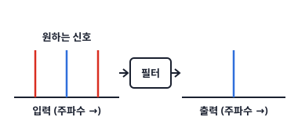

*입력의 세 주파수 가운데 원하는 가운데 주파수만 통과하고, 양쪽 두 신호는 차단돼요.*

**정확히 말하면**

#### 증폭기와 필터는 무엇이 다른가요

증폭기는 신호를 증폭할 때, 곧 신호를 키울 때 써요. 필터(filter)는 증폭기와 더불어 가장 기본적인 아날로그 회로예요. 필터는 보통 주파수 영역에서 원하는 주파수의 신호만 골라 통과시키고 나머지는 차단해요. **필터는 원하는 신호는 통과시키고 원하지 않는 신호는 차단하는 회로예요.**

예를 들어 900 MHz 대역은 여러 채널로 쪼개 쓰므로, 필터가 내게 할당된 채널만 통과시키고 다른 사람이 쓰는 채널은 차단해요. 무선 통신에서 이런 필터가 왜 꼭 필요한지는 [왜 이런 회로를 쓸까](#why-circuit)에서 이어서 봐요. 잡음이 많은 주파수 대역이나 군사용 재밍 신호를 없앨 때도 필터를 써요.

#### 아날로그 필터와 디지털 필터는 어떻게 나뉘나요

같은 걸러 내는 일을 아날로그 회로로 하면 아날로그 필터(analog filter), 디지털로 하면 디지털 필터(digital filter)예요. 디지털 필터는 아날로그 신호를 먼저 디지털 신호로 바꾼 다음에 처리해요. **디지털 필터를 쓰려면 신호를 먼저 디지털로 바꿀 수 있어야 해요.**

#### 2.4 GHz 신호는 바로 디지털 필터로 갈 수 있나요

블루투스와 Wi-Fi가 쓰는 2.4 GHz 신호로 확인해요. 아날로그 신호를 디지털로 바꿀 수 있는 주파수 대역은 수십 MHz, 높아야 약 100 MHz예요.

1. $$
   2.4\ \mathrm{GHz}=2400\ \mathrm{MHz}
   $$

   비교하기 전에 단위를 MHz로 맞춰요.
2. $$
   \frac{2400\ \mathrm{MHz}}{100\ \mathrm{MHz}}=24
   $$

   디지털로 바꿀 수 있는 대역의 위쪽 끝과 비교해요.

**2.4 GHz 신호는 디지털로 바꿀 수 있는 대역보다 약 24배 높아서 디지털 필터로 바로 보낼 수 없어요.**

#### 그래서 고주파 신호는 어떤 순서로 처리하나요

1. 고주파 신호를 아날로그로 처리해 주파수를 낮춰요.
2. 주파수가 낮아진 신호를 디지털 신호로 바꿔요.
3. 디지털 필터로 처리해요.

주파수가 높은 회로의 신호는 모두 아날로그 신호이고, 그 신호 자체를 걸러야 해요. **그래서 이 장은 주로 아날로그 필터를 다뤄요.**

**교수님 말씀**

> 내가 원하는 신호는 통과시켜주고 내가 원하지 않는 신호는 차단하는. 이게 이제 필터의 기본적인 원리

교수님은 "필터는 어디에 쓰니까?"라고 물으셨어요. "신호를 차단할 때"라는 답이 나오자, 반대로 원하는 신호를 통과시키는 쪽도 함께 짚으셨어요.

> 아날로그 신호를 디지털로 바꿀 수 있는 주파수 대역은 수십 메가, 높아봤자 백 메가 정도

무선 통신은 주파수가 높아서 디지털로 바로 처리하지 못한다는 이유로 이 숫자를 드셨어요.

확인해 봐요. 5 GHz Wi-Fi 신호에서 내 채널만 고르려고 해요. 디지털로 바꿀 수 있는 대역이 약 100 MHz까지라면 이 신호를 디지털 필터로 바로 보낼 수 있나요?

답 보기

바로 보낼 수 없어요. $5\ \mathrm{GHz}=5000\ \mathrm{MHz}$이고 $5000/100=50$이므로 약 50배 높아요. 먼저 아날로그로 처리해 주파수를 낮춘 뒤 디지털 필터로 보내요.

**페이지 요약**

필터는 원하는 주파수의 신호는 통과시키고 원하지 않는 신호는 차단해요.

디지털로 바꿀 수 있는 대역은 수십 MHz, 높아야 약 100 MHz예요.

그보다 높은 신호는 아날로그로 먼저 처리해 주파수를 낮춘 뒤 디지털 필터로 보내요.

*용어*

- **필터(filter)** — 원하는 신호는 통과, 원하지 않는 신호는 차단하는 회로예요.
- **아날로그 필터(analog filter)** — 아날로그 회로로 신호 자체를 걸러요.
- **디지털 필터(digital filter)** — 디지털로 바꾼 신호를 처리해 걸러요.

---

### 통과·저지·천이 대역과 리플

*1125 수업*

**쉽게 말하면**

이상적 필터는 원하는 주파수에서 크기 1, 나머지에서 크기 0이지만, 실제 필터는 경계에서 서서히 줄고 통과하는 구간 안에서도 크기가 조금씩 흔들려요.

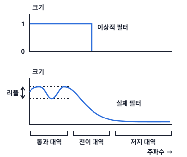

*위는 이상적 필터, 아래는 실제 필터이고, 아래 띠가 통과 대역·천이 대역·저지 대역이에요.*

**정확히 말하면**

#### 이상적 필터는 어떤 모양인가요

세로축은 필터가 신호를 통과시키는 크기(이득), 가로축은 주파수예요. 크기가 1이면 신호가 그대로 나가고, 0이면 완전히 막혀요. 진폭 1 V인 신호가 크기 1인 주파수에 있으면 출력도 1 V이고, 크기 0인 주파수에 있으면 출력은 0 V예요.

이상적 필터는 원하는 주파수는 크기 1로 통과시키고 원하지 않는 주파수는 크기 0으로 차단해요. 그래서 크기–주파수 그래프가 직사각형이에요. **이상적 필터는 원하는 주파수에서 크기 1, 나머지에서 크기 0인 직사각형 응답이지만 현실에서는 만들 수 없어요.**

#### 실제 필터는 어디서 이상과 달라지나요

- 경계에서 크기가 1에서 0으로 한 번에 떨어지지 않고, 주파수에 따라 서서히 감소해요.
- 통과시키고 싶은 구간에서도 크기가 일정하지 않고 주파수에 따라 달라져요.

**실제 필터는 경계가 날카롭지 않고 완만하며, 대역 안의 이득도 평탄하지 않아요.**

#### 네 용어는 그래프의 어디인가요

| 용어 | 뜻 | 이상적 필터 | 실제 필터 |
|---|---|---|---|
| 통과 대역(pass band) | 통과시키고 싶은 주파수 대역 | 크기가 정확히 1 | 크기가 1 근처에서 흔들림 |
| 저지 대역(stop band) | 제거하고 싶은 주파수 대역 | 크기가 정확히 0 | 평탄하지 않고 리플이 생길 수 있음 |
| 천이 대역(transition band) | 통과 대역과 저지 대역 사이에서 크기가 바뀌는 대역 | 폭 없이 수직 | 날카롭지 않고 완만함 |
| 리플(ripple) | 한 대역 안에서 주파수에 따른 이득의 차이 | 0(평탄) | 0보다 큼 |

**통과 대역과 저지 대역 사이가 천이 대역이고, 한 대역 안의 이득 차이가 리플이에요.**

#### 리플을 숫자로 읽어요

통과 대역에서 이득이 가장 클 때 1.05, 가장 작을 때 0.95인 필터를 생각해요.

1. $$
   1.05-0.95=0.1
   $$

   같은 통과 대역 안의 최대 이득에서 최소 이득을 빼요.

**이 필터의 통과 대역 리플은 0.1이에요.** 이상적 필터라면 통과 대역 이득이 늘 1이므로 리플은 0이에요.

**교수님 말씀**

> 아주 샤프한 트랜지션 밴드가 되기는 어렵죠, 현실적으로.

교수님은 이상적 필터를 원하는 주파수만 딱 통과시키고 나머지는 "1을 0으로" 만드는 모양으로 그리셨어요. 이어서 실제로는 그런 필터가 없고 주파수에 따라 서서히 감소한다고 하셨어요.

**꼭 기억해요**

> 여기서 용어 정도를 이렇게 기억하는 거고요.

이번 수업에서 외울 것은 식이 아니라 네 용어의 자리예요. 리플은 한 대역 안에서 흔들리는 높이 차이이고, 대역 사이에서 크기가 내려가는 구간은 천이 대역이에요. 내려가는 기울기를 리플로 부르지 않아요.

확인해 봐요. 어떤 필터의 통과 대역 이득이 가장 클 때 1.02, 가장 작을 때 0.9예요. 통과 대역 리플은 얼마인가요?

답 보기

0.12예요. 같은 통과 대역 안의 최대 이득에서 최소 이득을 빼서 $1.02-0.9=0.12$예요.

**페이지 요약**

이상적 필터는 직사각형 응답이지만, 실제 필터는 천이 대역이 완만하고 대역 안에 리플이 생겨요.

*용어*

- **이상적 필터(ideal filter)** — 원하는 주파수에서 크기 1, 나머지에서 크기 0인 응답으로 현실에서는 만들 수 없어요.
- **통과 대역(pass band)** — 통과시키고 싶은 주파수 대역이에요.
- **저지 대역(stop band)** — 제거하고 싶은 주파수 대역이에요.
- **천이 대역(transition band)** — 두 대역 사이에서 크기가 바뀌는 대역으로 실제로는 완만해요.
- **리플(ripple)** — 한 대역 안에서 주파수에 따른 이득의 차이예요.

---

### 주파수 특성과 소자로 필터를 나눠요

*1125 수업*

**쉽게 말하면**

통과 대역이 어디 있는지로 저역 통과·고역 통과·대역 통과·노치 필터를 나누고, 이득을 내는 소자가 들어 있는지로 수동 필터와 능동 필터를 나눠요.

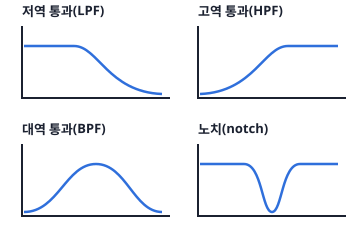

*가로축은 주파수, 세로축은 크기이고, 곡선이 높이 올라온 쪽이 통과 대역이에요.*

**정확히 말하면**

#### 주파수 특성으로 어떻게 나누나요

통과 대역이 주파수 축의 어디에 있는지 보면 이름이 정해져요.

| 이름 | 통과 대역 | 주로 쓰는 곳 |
|---|---|---|
| 저역 통과(low-pass, LPF) | 상대적으로 낮은 주파수 대역 | 낮은 주파수 신호만 남길 때 |
| 고역 통과(high-pass, HPF) | 상대적으로 높은 주파수 대역 | 높은 주파수 신호만 남길 때 |
| 대역 통과(band-pass, BPF) | 특정한 주파수 대역 하나 | 통신에서 원하는 대역만 받을 때 |
| 대역 저지(band-reject) = 노치(notch) | 특정한 대역만 빼고 나머지 | 잡음처럼 원하지 않는 특정 대역을 없앨 때 |

예를 들어 900 MHz 대역 안에서 내 채널만 받으려면 그 채널 주변만 통과시키는 대역 통과 필터를 써요. **통신에서는 특정한 대역만 통과시키는 대역 통과 필터를 많이 써요.**

#### 구현 소자로 어떻게 나누나요

수동 소자는 이득이 없는 R, L, C 같은 소자예요. 능동 소자는 이득을 얻을 수 있는 트랜지스터이고, OP-amp도 트랜지스터로 만들므로 능동 소자예요.

| 구분 | 쓰는 소자 | 이득 | 전류 소모 |
|---|---|---|---|
| 수동 필터(passive filter) | R, L, C만 | 없음 | 없음 |
| 능동 필터(active filter) | 트랜지스터·OP-amp 포함(R, C도 씀) | 있음 | 있음 |

L, R, C만 쓴 회로는 수동 필터예요. R, C에 OP-amp가 함께 들어간 회로는 능동 필터예요. **수동 필터는 이득이 없는 대신 전류 소모가 없고, 능동 필터는 이득이 있는 대신 전류 소모가 있어요.**

#### 다음 시간에는 무엇을 하나요

이번 시간은 필터의 개념만 소개했어요. 수동 필터와 능동 필터의 부연 설명은 다음 시간으로 미루셨고, 다음 시간부터 각 필터를 회로로 어떻게 구현하는지 봐요. 수동 필터도 다루지만 중점은 능동 필터 구현이에요. **수동·능동 필터의 자세한 설명과 각 필터의 회로는 다음 시간에 이어져요.** 다룰 내용은 [다음 시간 예고](#s4-next)에 모았어요.

**교수님 말씀**

> 주로 여기서 중점은 액티브 필터로 어떻게 우리가 구현할 것이냐

교수님은 수동과 능동을 수동 소자냐 능동 소자냐, 이득이 있느냐, 전류 소모가 있느냐로 나눌 수 있다고 정리하셨어요.

**꼭 기억해요**

> 이거는 이득이 없는 대신에 전류 소모가 없고 이거는 이득이 있는 대신에 전류 소모가 있죠.

능동 필터는 능동 소자만으로 만든 필터가 아니에요. R, C가 들어 있어도 트랜지스터나 OP-amp가 하나라도 포함되면 능동 필터로 분류해요.

확인해 봐요. 특정한 잡음 대역만 없애고 나머지 주파수는 모두 통과시키는 필터를 R, C와 OP-amp로 만들었어요. 주파수 특성과 구현 소자로 각각 어떤 필터인가요?

답 보기

특정한 대역만 막으므로 노치(대역 저지) 필터이고, OP-amp가 들어 있으므로 능동 필터예요. 이득이 있는 대신 전류 소모가 있어요.

**페이지 요약**

필터는 통과 대역의 위치와 구현 소자로 나눠요.

통신에서는 특정한 대역만 통과시키는 대역 통과 필터를 많이 써요.

수동 필터는 이득과 전류 소모가 없고, 능동 필터는 이득과 전류 소모가 있어요.

*용어*

- **저역 통과(LPF)** — 상대적으로 낮은 주파수 대역을 통과시켜요.
- **고역 통과(HPF)** — 상대적으로 높은 주파수 대역을 통과시켜요.
- **대역 통과(BPF)** — 특정한 주파수 대역 하나만 통과시켜요.
- **노치(notch)** — 특정한 대역만 제거하는 대역 저지 필터예요.
- **수동 필터(passive filter)** — R, L, C 같은 수동 소자만 써요.
- **능동 필터(active filter)** — 트랜지스터나 OP-amp를 포함하고 R, C도 함께 써요.

---

## 5. 요약 · 예고

### 한눈에 다시 보기

*1125 수업 · L06 s57–60*

귀환 회로는 늘 같은 순서로 풀어요. 입력·출력이 전압인지 전류인지 읽어 형태를 정하고, 귀환망을 입력 쪽과 출력 쪽에 한 벌씩 복제해 종단한 뒤 로딩 효과(loading effect)를 넣은 개루프 값을 구해요. 이어서 $K$와 루프 이득을 구하고 $1+$루프 이득으로 폐루프 값을 얻어요.

이상적인 귀환망이라는 말이 없으면 로딩 효과를 넣어 풀어요. 이상적인 결과는 그 식에서 $R_M\to0$이나 $R_F\to\infty$로 보내 확인해요.

| 항목 | 전류-전압 귀환 (C-V, 예제 III) | 전류-전류 귀환 (C-C, 예제 IV) |
|---|---|---|
| 증폭기 | 트랜스컨덕턴스 증폭기: 공통 게이트 + 소스 팔로워 | 전류 증폭기: 공통 게이트 + PMOS 공통 소스 |
| 귀환망 | 감지 저항 $R_M$ 하나, $V_F=I_{out}R_M$ | $R_F$와 $R_M$이 $I_{out}$을 나눠 $I_F$로 반송 |
| 종단 (입력 쪽 / 출력 쪽 복제) | 개방 / 개방 | 개방 / 접지 |
| 개루프 이득 | $A_0=\frac{g_{m1}R_D}{R_L+R_M+1/g_{m2}}$ | 테브난 변환+CG 이득과 출력 전류 분배의 곱, $A_{I,open}\lt0$ |
| 개루프 입력 임피던스 | $1/g_{m1}$ | $\dfrac{1}{g_{m1}}\parallel(R_F+R_M)$ |
| 개루프 출력 임피던스 | $1/g_{m2}+R_M$ (직렬) | $r_{O2}+R_F\parallel R_M$ (직렬) |
| 이상에 가까울 조건 | $R_M\ll1/g_{m2}$ (기준이 작아 더 작아야 해요) | $R_F+R_M\gg1/g_{m1}$ $R_F\parallel R_M\ll r_{O2}$ |
| 귀환 계수 | $K=R_M$ (감지 포트에 전류, 반송 포트는 개방해 전압) | $K=-\frac{R_M}{R_F+R_M}$ (반송 포트는 접지, $I_F$는 입력에서 빠지는 방향이 양) |
| 루프 이득 | $KA_0\gt0$ | $K\lt0$이고 $A_{I,open}\lt0$이라 $KA_{I,open}\gt0$ |
| 폐루프 이득 | $\dfrac{A_0}{1+KA_0}$ $KA_0\gg1$이면 $\approx1/R_M$ | $\dfrac{A_{I,open}}{1+KA_{I,open}}$ |
| 폐루프 입력 임피던스 | $(1+KA_0)$배로 커져요 (전압 반송, 직렬) | $(1+KA_{I,open})$로 나눠 작아져요 (전류 반송, 병렬) |
| 폐루프 출력 임피던스 | $(1+KA_0)$배로 커져요 (전류 감지) | $(1+KA_{I,open})$배로 커져요 (전류 감지) |

표의 $A_0$는 C-V의 개루프 이득 $(I_{out}/V_{in})|_{open}$이고, 개루프 입력·출력 임피던스는 각각 $R_{in,open}$, $R_{out,open}$이고, 출력 임피던스는 부하 $R_L$ 자리에서 본 값이에요. 두 형태 모두 출력 전류를 감지하므로 폐루프 출력 임피던스가 커져 더 좋은 전류원이 돼요.

**아날로그 필터 용어.** 필터는 원하는 주파수의 신호는 통과시키고 원하지 않는 신호는 차단해요.

- 통과 대역(pass band)은 통과시킬 주파수 대역, 저지 대역(stop band)은 제거할 대역, 그 사이가 천이 대역(transition band)이에요.
- 실제 필터의 천이 대역은 완만하고, 한 대역 안에서 주파수에 따라 이득이 달라지는 차이를 리플(ripple)이라고 해요.
- 주파수 특성으로 나누면 저역 통과(LPF), 고역 통과(HPF), 대역 통과(BPF), 대역 저지(노치)예요.
- 구현 소자로 나누면 R, L, C만 쓰는 수동 필터(이득 없음, 전류 소모 없음)와 트랜지스터나 OP-amp가 들어간 능동 필터(이득 있음, 전류 소모 있음)예요.

---

### 다음 시간 예고

*1125 수업*

다음 시간에는 이번에 분류한 필터를 회로로 어떻게 만드는지 봐요. 이번 시간은 필터의 도입 개념까지였고, 교수님은 수동 필터도 다루지만 중점은 능동 필터 구현이라고 했어요.

- 수동 필터와 능동 필터의 부연 설명: 이번에는 이득과 전류 소모로 나누는 분류만 했고, 자세한 설명은 다음 시간에 이어져요
- 필터의 전달 함수
- 1차 필터와 2차 필터
- 각 필터의 회로 구현 (능동 필터 중심)

---

### 함께 보면 좋은 자료

이번 예제 III·IV는 지난 시간의 복제·종단 규칙과 $K$ 측정 규칙을 그대로 적용한 것이에요. 교수님은 책 본문 중간에 있는 예제가 답과 설명까지 친절하게 실려 있으니 꼭 풀어 보라고 했어요. 아날로그 회로는 회로를 많이 보고 풀어 봐야 실력이 늘고, 답이 있어야 맞게 풀었는지 확인할 수 있기 때문이에요. 이번 복습문제에도 교과서 본문 예제 두 개가 들어 있어요.

- [네 증폭기 형태의 종단 규칙 (1120)](../../1120/정리노트_1120_Nonideal_IO_Feedback.html#s0-four-terminations)
- [감지량은 원으로 걸고 반송량은 개방·단락해서 재요 (1120)](../../1120/정리노트_1120_Nonideal_IO_Feedback.html#s1-k-rules)
- [입출력 종류부터 폐루프까지 다섯 단계 (1120)](../../1120/정리노트_1120_Nonideal_IO_Feedback.html#s4-procedure)
- [전류를 감지하고 전압을 돌려줘요 (1118)](../../1118/정리노트_1118_Feedback_Loading.html#s1-cv-gain)
- [전류의 차이를 증폭해요 (1118)](../../1118/정리노트_1118_Feedback_Loading.html#s2-cc-gain)
- [0과 무한대는 원래 회로와 비교해요 (1118)](../../1118/정리노트_1118_Feedback_Loading.html#s3-relative-impedance)
- [루프 이득이 크면 이득은 1/K가 돼요 (1111)](../../1111/정리노트_1111_Sense_and_Return.html#s1-desensitization)
- [12장 문제집 (PDF)](../../../workbook/pdf/ch12-문제.pdf)
- [복습문제 5개 (PDF)](../복습문제_1125_Analog_Filters-문제.pdf)
- [답안 (PDF)](../복습문제_1125_Analog_Filters-답안.pdf)

---

출처: 권익진 교수님 강의자료(Lec6) · 수업 녹음 전사(1125) · B. Razavi, *Microelectronics*, 2nd ed. (Wiley) 12·14장.
