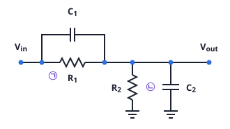
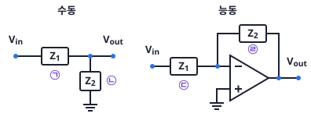
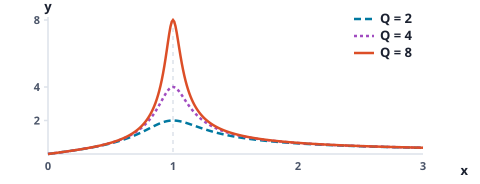

# 전자회로2 복습 1127 문제설명

회로와 첫 식을 짚고 핵심 계산으로 답을 구해요.

문제의 첫 줄부터 검산까지 설명해요.

**목차**

- [문항별 설명](#problems)
  - [P1. 수동 RC 필터의 전달 함수](#p1)
  - [P2. 능동 RC 필터의 전달 함수](#p2)
  - [P3. 극점과 영점의 상쇄](#p3)
  - [P4. 두 극점이 일치하는 Q](#p4)
  - [P5. 저역 통과의 피킹 경계](#p5)
  - [P6. 대역 통과의 피크와 Q](#p6)
  - [P7. 이득비와 극점·영점 비](#p7)

## 문항별 설명

### P1. 수동 RC 필터의 전달 함수

E15.08 · 예제 15.8 · [원 문제 보기](../%EB%B3%B5%EC%8A%B5%EB%AC%B8%EC%A0%9C_1127_Second_Order_Filters-%EB%AC%B8%EC%A0%9C.pdf)

#### 주어진 조건

- Fig 15.17(a)에서 입력과 출력 사이, 출력과 접지 사이에 각각 병렬 RC 가지가 있다.

#### 구할 것

- 이 회로의 주파수 응답을 구한다.

*두 병렬 RC 임피던스의 수동 분압기*

#### 병렬 RC 두 가지를 분압식에 넣어요

㉠ 입력과 출력 사이가 $Z_1=R_1\parallel(1/sC_1)$이고, ㉡ 출력과 접지 사이가 $Z_2=R_2\parallel(1/sC_2)$예요. 출력은 $Z_2$ 양단에서 읽어요.

$$
H(s)=\frac{Z_2}{Z_1+Z_2}
$$

$H(s)$를 1차 항의 비로 정리한 뒤 $s=j\omega$를 대입해요.

$$
\omega_z=\frac{1}{R_1C_1}
$$

$$
\omega_p=\frac{1}{(R_1\parallel R_2)(C_1+C_2)}
$$

$R_1C_1>R_2C_2$이면 영점이 먼저 와서 크기가 상승해요. $R_1C_1<R_2C_2$이면 극점이 먼저 와서 하강해요. 두 시정수가 같으면 평탄해요.

$$
H(j\omega)=\frac{R_2}{R_1+R_2}\frac{1+j\omega/\omega_z}{1+j\omega/\omega_p}
$$

$$
H(0)=\frac{R_2}{R_1+R_2}
$$

$$
\lim_{\omega\to\infty}H(j\omega)=\frac{C_1}{C_1+C_2}
$$

**페이지 요약**

출력에서 접지로 내려가는 병렬 RC 임피던스의 분압비를 쓰고, 극점과 영점의 순서로 응답이 오를지 내릴지 판단해요.

---

### P2. 능동 RC 필터의 전달 함수

E15.09 · 예제 15.9 · [원 문제 보기](../%EB%B3%B5%EC%8A%B5%EB%AC%B8%EC%A0%9C_1127_Second_Order_Filters-%EB%AC%B8%EC%A0%9C.pdf)

#### 주어진 조건

- Fig 15.18(a)는 수동 필터 Fig 15.17(a)에 대응하는 연산증폭기 회로이다. 입력과 되먹임에 각각 병렬 RC 임피던스가 있다.
- 문제는 연산증폭기의 이득을 가정하라고만 적고 값이나 크기를 명시하지 않는다.
- 인쇄 풀이에서는 개방루프 이득이 충분히 큰 이상적 연산증폭기의 반전 연결을 사용한다.

#### 구할 것

- 회로의 응답을 계산한다.

*입력과 귀환에 병렬 RC를 둔 반전 필터*

#### 반전 이득에 입력·귀환 임피던스를 넣어요

이상적 OP-amp를 가정해요. ㉠ 입력에는 $Z_1=R_1\parallel(1/sC_1)$, ㉡ 귀환에는 $Z_2=R_2\parallel(1/sC_2)$가 놓여요.

$$
H(s)=-\frac{Z_2}{Z_1}
$$

입력 임피던스가 분모에 놓이므로 입력의 시정수가 전달 함수의 영점에 들어가요.

$$
\omega_z=\frac{1}{R_1C_1}
$$

$$
\omega_p=\frac{1}{R_2C_2}
$$

$R_1C_1>R_2C_2$이면 영점이 먼저 와서 크기가 상승해요. 반대면 극점이 먼저 와서 하강하고, 같으면 평탄해요.

$$
H(j\omega)=-\frac{R_2}{R_1}\frac{1+j\omega/\omega_z}{1+j\omega/\omega_p}
$$

$$
H(0)=-\frac{R_2}{R_1}
$$

$$
\lim_{\omega\to\infty}H(j\omega)=-\frac{C_1}{C_2}
$$

**페이지 요약**

이상적 OP-amp에서 귀환 임피던스를 입력 임피던스로 나누어 반전 이득을 구하고, 두 시정수의 순서로 크기 응답을 판단해요.

---

### P3. 극점과 영점의 상쇄

P15.09 · 장말문제 15.9 · [원 문제 보기](../%EB%B3%B5%EC%8A%B5%EB%AC%B8%EC%A0%9C_1127_Second_Order_Filters-%EB%AC%B8%EC%A0%9C.pdf)

#### 주어진 조건

- Fig 15.17(a)의 수동 필터와 Fig 15.18(a)의 능동 필터 각각에서 극점과 영점이 일치한다.

#### 구할 것

- 이때 두 회로의 전달 함수가 각각 어떻게 변하는지 설명한다.

*각 회로에서 Z1은 R1과 C1의 병렬, Z2는 R2와 C2의 병렬 가지*

#### 공통 1차 인자를 약분해요

㉠ 입력 쪽 $R_1C_1$은 두 회로의 영점을 정해요. 수동에서는 ㉡ 접지 쪽 가지까지 포함한 분압비를 써요. 능동에서는 ㉢ 입력 임피던스에 대한 ㉣ 귀환 임피던스의 비를 써요.

$$
H_{\mathrm{passive}}=\frac{Z_2}{Z_1+Z_2}
$$

$$
H_{\mathrm{active}}=-\frac{Z_2}{Z_1}
$$

각 전달 함수의 극점에 대응하는 시정수를 $R_1C_1$과 같게 놓아요.

$$
R_1C_1=(R_1\parallel R_2)(C_1+C_2)\quad\text{(수동)}
$$

$$
R_1C_1=R_2C_2\quad\text{(이상적 OP-amp)}
$$

수동 조건도 $R_1C_1=R_2C_2$로 정리돼요. 공통 시정수를 $\tau$로 두면 두 임피던스에 같은 인자 $1/(1+s\tau)$가 곱해져요.

$$
Z_i=\frac{R_i}{1+s\tau}\quad(i=1,2)
$$

분압비와 반전 이득에서 이 인자가 약분되므로 두 응답 모두 주파수에 무관해요.

$$
H_{\mathrm{passive}}(s)=\frac{R_2}{R_1+R_2}=\frac{C_1}{C_1+C_2}
$$

$$
H_{\mathrm{active}}(s)=-\frac{R_2}{R_1}=-\frac{C_1}{C_2}
$$

**페이지 요약**

두 RC 시정수가 같아 극점과 영점이 상쇄되면 수동은 양의 분압비가 남고 이상적 OP-amp를 쓰는 능동 회로는 음의 반전 이득이 남아요.

---

### P4. 두 극점이 일치하는 Q

P15.10 · 장말문제 15.10 · [원 문제 보기](../%EB%B3%B5%EC%8A%B5%EB%AC%B8%EC%A0%9C_1127_Second_Order_Filters-%EB%AC%B8%EC%A0%9C.pdf)

#### 주어진 조건

- 대상은 식 (15.23)의 바이쿼드 전달 함수이다.
- 식 (15.23)은 $H(s)=(\alpha s^2+\beta s+\gamma)/[s^2+(\omega_n/Q)s+\omega_n^2]$이다.

#### 구할 것

- 두 극점이 일치하는 $Q$를 구한다.
- 그때의 극점 주파수들을 구한다.

#### 분모의 판별식을 0으로 놓아요

분자와의 상쇄가 없을 때 두 극점은 분모의 두 근이에요. 두 근이 일치하는 경계에서 2차 분모의 판별식이 0이에요. $Q$와 $\omega_n$은 양수예요.

$$
\left(\frac{\omega_n}{Q}\right)^2-4\omega_n^2=0
$$

이때 분모가 $(s+\omega_n)^2$이므로 두 극점은 같은 음의 실수 위치에 있고, 극점 각주파수의 크기는 둘 다 $\omega_n$이에요.

$$
Q=\frac12
$$

$$
p_1=p_2=-\omega_n
$$

**페이지 요약**

$Q=1/2$이면 분모가 $(s+\omega_n)^2$이므로 분자와 상쇄가 없을 때 두 극점이 $-\omega_n$에 겹쳐요.

---

### P5. 저역 통과의 피킹 경계

P15.11 · 장말문제 15.11 · [원 문제 보기](../%EB%B3%B5%EC%8A%B5%EB%AC%B8%EC%A0%9C_1127_Second_Order_Filters-%EB%AC%B8%EC%A0%9C.pdf)

#### 주어진 조건

- 식 (15.25)의 응답에서 $Q\le\sqrt{2}/2$이다.
- 식 (15.25)는 $|H(j\omega)|^2=\gamma^2/[(\omega_n^2-\omega^2)^2+(\omega_n\omega/Q)^2]$이다.

#### 구할 것

- 응답이 피킹을 보이지 않음, 즉 국소 최댓값이 없음을 증명한다.

#### 크기의 제곱을 분모로 판단해요

$x=\omega/\omega_n$로 두고, 비영 응답을 DC 이득으로 나눈 크기의 제곱을 써요.

$$
\frac{|H(j\omega)|^2}{|H(0)|^2}=\frac{1}{1+(Q^{-2}-2)x^2+x^4}
$$

$0<Q\le 1/\sqrt{2}$이면 $x^2$의 계수 $Q^{-2}-2$가 0 이상이에요. $x>0$에서 $x^4$는 엄격히 증가하므로 크기는 DC부터 계속 감소해요. 따라서 양의 주파수에서 피킹이 없어요.

**페이지 요약**

$Q\le 1/\sqrt{2}$에서 정규화 분모의 $x^2$와 $x^4$ 항을 보면 양의 주파수에서 크기가 감소해요.

---

### P6. 대역 통과의 피크와 Q

P15.13 · 장말문제 15.13 · [원 문제 보기](../%EB%B3%B5%EC%8A%B5%EB%AC%B8%EC%A0%9C_1127_Second_Order_Filters-%EB%AC%B8%EC%A0%9C.pdf)

#### 주어진 조건

- 식 (15.28)의 2차 대역통과 응답을 다룬다.
- 식 (15.28)은 $H(s)=\beta s/[s^2+(\omega_n/Q)s+\omega_n^2]$이다.
- 크기 응답을 $|\beta|$로 나누어 정규화한다.

#### 구할 것

- 응답이 $\omega=\omega_n$에서 정규화 피크 $Q/\omega_n$에 도달함을 증명한다.
- $Q=2,4,8$에 대해 응답을 그린다.

#### 분자의 주파수를 분모로 옮겨요

$\omega>0$에서 크기를 $|\beta|$로 나누고, 분자에 남은 $\omega$로 분모도 나눠요.

$$
\frac{|H(j\omega)|}{|\beta|}=\frac{1}{\sqrt{D(\omega)}}
$$

$$
D(\omega)=\bigl(\omega_n^2/\omega-\omega\bigr)^2+(\omega_n/Q)^2
$$

분모의 제곱항이 0이 되는 $\omega=\omega_n$에서 크기가 최대예요.

세 곡선의 피크 위치는 모두 $x=1$이에요. 세로축은 문제의 정규화 크기에 $\omega_n$을 한 번 더 곱한 무차원 값이에요.

$$
x=\frac{\omega}{\omega_n}
$$

$$
y=\frac{\omega_n|H(j\omega)|}{|\beta|}
$$

*같은 고유 주파수에서 Q가 2, 4, 8인 대역 통과 응답*

문제의 정규화로 읽으면 세 피크는 $2/\omega_n$, $4/\omega_n$, $8/\omega_n$이에요.

$$
\frac{|H(j\omega_n)|}{|\beta|}=\frac{Q}{\omega_n}
$$

**페이지 요약**

세 곡선은 $\omega_n$에서 최대가 되고, 문제의 정규화 피크는 $Q/\omega_n$이에요.

---

### P7. 이득비와 극점·영점 비

X15.09 · 연습문제 15.9 · [원 문제 보기](../%EB%B3%B5%EC%8A%B5%EB%AC%B8%EC%A0%9C_1127_Second_Order_Filters-%EB%AC%B8%EC%A0%9C.pdf)

#### 주어진 조건

- 통과대역 이득의 크기는 저지대역 이득 크기의 10배이다.
- 예제 15.9의 이상적 반전 RC 필터는 $H(s)=-\dfrac{R_2}{R_1}\dfrac{1+R_1C_1s}{1+R_2C_2s}$를 따른다.

#### 구할 것

- 극점 주파수가 영점 주파수의 5배가 될 수 있는지 판단한다.

*입력과 귀환에 병렬 RC를 둔 반전 필터*

#### 높은 쪽 이득을 낮은 쪽 이득으로 나눠요

$\omega_p=5\omega_z$이면 영점이 먼저 와서 고역 통과예요. 이상적 OP-amp에서 ㉠ 입력과 ㉡ 귀환의 임피던스 비는 저주파에서 저항비, 고주파에서 커패시턴스비로 정해져요.

$$
|H(0)|=\frac{R_2}{R_1}
$$

$$
\lim_{\omega\to\infty}|H(j\omega)|=\frac{C_1}{C_2}
$$

극점이 영점의 5배이면 양끝 이득비도 5예요. 이득비가 10인 고역 통과 응답은 $\omega_p=10\omega_z$를 요구하므로 주어진 두 조건은 양립할 수 없어요.

$$
\frac{C_1/C_2}{R_2/R_1}=\frac{R_1C_1}{R_2C_2}=\frac{\omega_p}{\omega_z}=5
$$

**페이지 요약**

영점이 먼저인 반전 1차 필터에서 통과·저지대역 이득비는 극점·영점 주파수비와 같아요.

---

원 문제·정리노트·PDF는 보존해요.
