# 1차·2차 아날로그 필터 — 5살도 이해하는 정리노트

권익진 교수님 전자회로2 · 1127 수업 (Lec7 7–15쪽, Razavi 15장)

> `정리노트_1127_Second_Order_Filters.html`를 마크다운으로 옮겼어요. 그림은 `figures_1127/` 폴더의 SVG, 위젯은 대표 설정의 정적 그림으로 바꿨어요. 수식은 `$…$` / `$$…$$`라서 GitHub, Obsidian, Typora에서 보여요.

**목차**

- [들어가며: 왜 이런 회로를 쓸까](#why)
  - [왜 이런 회로를 쓸까](#why-circuit)
- [1. 선택도와 필터 차수](#s0)
  - [1차 필터는 10배 떨어져야 20 dB 줄어요](#s0-first-order-limit)
  - [선택도를 높이려면 극점을 늘려요](#s0-selectivity-order)
- [2. 1차 필터의 극점과 영점](#s1)
  - [극점과 영점 중 먼저 오는 쪽이 LPF·HPF를 정해요](#s1-pole-zero)
- [3. 1차 필터 구현: 수동과 능동](#s2)
  - [RC 분압기는 이득이 1보다 작아요](#s2-passive)
  - [반전 증폭기는 극점과 영점을 따로 정해요](#s2-active)
  - [능동 필터는 이득을 얻는 대신 전력을 써요](#s2-compare)
- [4. 2차 필터 표준형과 Q](#s3)
  - [2차 필터는 분모를 고유 주파수와 Q로 써요](#s3-biquad)
  - [Q가 커지면 극점이 허수축으로 다가가요](#s3-pole-circle)
- [5. 2차 저역 통과와 Q](#s4)
  - [Q가 클수록 고유 주파수 근처가 솟아요](#s4-lowpass-q)
  - [평탄한 버터워스, 날카로운 체비셰프](#s4-butterworth-chebyshev)
- [6. 2차 고역 통과와 대역 통과](#s5)
  - [원점의 영점 두 개가 저주파를 막아요](#s5-highpass)
  - [고유 주파수에서 가장 크게 통과해요](#s5-bandpass)
- [7. 요약 · 예고](#s6)
  - [한눈에 다시 보기](#s6-cheatsheet)
  - [다음 시간 예고](#s6-next)
  - [함께 보면 좋은 자료](#s6-links)

## 들어가며: 왜 이런 회로를 쓸까

### 왜 이런 회로를 쓸까

*1127 수업 · L07 s3, s7, s9–s13*

**쉽게 말하면**

바로 옆 주파수의 간섭 신호를 크게 줄이기에 1차 필터는 너무 완만해서, 극점을 늘리고 복소 극점을 갖는 2차 필터를 능동 소자로 만들어요.

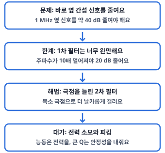

*날카롭게 거르는 대신 능동 필터는 전력을 쓰고, Q가 큰 2차 필터는 불안정에 가까워져요.*

**정확히 말하면**

#### 풀고 싶은 문제

스마트폰, 오디오 앰프, 자동차 레이더처럼 신호를 주고받는 기기는 원하는 주파수의 신호만 받아야 해요. 공중에는 Wi-Fi, 블루투스처럼 수많은 주파수의 신호가 있고, 내 신호가 아닌 나머지는 수신을 방해하는 간섭 신호(interferer)예요. 필터의 통과·저지·천이 대역과 수동·능동 구분은 지난 수업에서 봤어요([함께 보면 좋은 자료](#s6-links)).

어려운 점은 간섭 신호가 바로 옆 주파수에 있다는 거예요. 같은 표준을 쓰는 다른 단말은 같은 밴드를 잘게 쪼갠 채널을 쓰고, 그 신호가 기지국뿐 아니라 내 단말에도 들어와요. 예를 들어 900 MHz 대역의 채널이 901 MHz, 902 MHz처럼 1 MHz 간격이면, 1 MHz 떨어진 간섭 신호를 내 신호보다 약 40 dB, 곧 크기로 1/100까지 줄여야 해요. 원하는 신호는 잘 통과시키고 원하지 않는 신호는 잘 걸러내는 능력이 선택도(selectivity)예요.

**바로 옆 주파수의 간섭 신호를 크게 줄이는 높은 선택도가 필요해요.** 선택도와 차수의 관계는 [선택도를 높이려면 극점을 늘려요](#s0-selectivity-order)에서 다뤄요.

#### 단순한 해법과 그 한계

가장 쉬운 필터는 R 하나와 C 하나로 만든 1차 저역 통과 필터예요. 1차 필터는 극점 하나와 영점 하나의 상대 위치로 저역·고역 통과를 정하지만([극점과 영점 중 먼저 오는 쪽이 LPF·HPF를 정해요](#s1-pole-zero)), 꺾인 뒤의 기울기는 극점 하나가 만드는 −20 dB/dec뿐이에요. 극점 주파수 $\omega_p$보다 충분히 높은 $\omega\gg\omega_p$에서 크기는 다음과 같아요.

$$
|H(j\omega)|\approx\frac{\omega_p}{\omega}
$$

예를 들어 극점 주파수가 1 MHz이면 10 MHz에서 20 dB, 100 MHz에서야 40 dB 줄어요. 주파수가 10배 멀어져야 20 dB이므로 천이 대역이 넓고 저지 대역 감쇠도 크지 않아요. 1 MHz 바로 옆 간섭 신호를 40 dB 줄이기에는 너무 완만해요([1차 필터는 10배 떨어져야 20 dB 줄어요](#s0-first-order-limit)). R과 C만 쓴 수동 1차 필터는 이득도 늘 1보다 작아요([RC 분압기는 이득이 1보다 작아요](#s2-passive)).

**1차 필터는 주파수가 10배 멀어져야 20 dB 줄어서 바로 옆 간섭 신호를 크게 줄이지 못해요.**

#### 핵심 아이디어

극점 하나가 −20 dB/dec를 만들므로 전달 함수의 극점 수, 곧 차수를 늘리면 더 가파르게 줄어요. R과 C를 두 단 이어 극점을 두 개 만들면 −40 dB/dec가 되어, 같은 10배 거리에서 40 dB를 줄여요. 수업에서는 두 극점이 같은 주파수에 있다고 두었고, 실제로는 두 단이 서로 로딩해서 정확히 겹치지는 않아요. 고차 필터는 1차와 2차 필터의 조합으로 만들어요. 3차는 2차와 1차, 4차는 2차 두 개예요.

그런데 1차 필터는 실수 극점(real pole)밖에 못 만들어요. 1차 필터 두 개를 이은 2차는 실수 극점 두 개라 날카로움이 부족해요. 켤레 복소수 쌍인 복소 극점(complex pole)은 2차 필터 블록이 있어야 만들 수 있고, 그 분모는 고유 주파수 $\omega_n$과 Q로 써요([2차 필터는 분모를 고유 주파수와 Q로 써요](#s3-biquad)).

$$
H(s)=\frac{\alpha s^2+\beta s+\gamma}{s^2+\dfrac{\omega_n}{Q}s+\omega_n^2}
$$

$$
p_{1,2}=-\frac{\omega_n}{2Q}\pm j\omega_n\sqrt{1-\frac{1}{4Q^2}}
$$

근호 안이 양수인 $Q\gt\frac{1}{2}$일 때 두 극점이 복소 극점이 돼요. Q를 $\frac{1}{\sqrt{2}}$보다 크게 하면 고유 주파수 근처가 조금 솟는 대신 천이 대역이 더 날카로워지는데, 실수 극점 두 개로는 이런 필터를 만들 수 없어요([Q가 클수록 고유 주파수 근처가 솟아요](#s4-lowpass-q), [평탄한 버터워스, 날카로운 체비셰프](#s4-butterworth-chebyshev)). 같은 분모에 분자만 바꾸면 고역 통과와 대역 통과도 만들어요([원점의 영점 두 개가 저주파를 막아요](#s5-highpass), [고유 주파수에서 가장 크게 통과해요](#s5-bandpass)).

R과 C만으로는 Q가 큰 날카로운 특성이 나오지 않아요. 인덕터 L을 넣으면 되지만 저주파에서는 L이 너무 커요. 그래서 L 대신 OP-amp나 트랜지스터 같은 능동 소자를 R, C와 함께 써서 능동 필터(active filter)를 만들어요. 1차에서도 반전 OP-amp 구조는 이득을 1보다 크게 할 수 있고 극점과 영점을 따로 정할 수 있어요([반전 증폭기는 극점과 영점을 따로 정해요](#s2-active)).

**극점 수를 늘려 차수를 높이고, 2차 필터로 복소 극점을 만들면 바로 옆 간섭 신호를 더 날카롭게 줄일 수 있어요.**

#### 대가와 쓰이는 곳

능동 필터는 공짜가 아니에요. 공급한 전력보다 큰 이득을 얻을 수는 없으므로 이득을 얻으려면 전원이 필요하고 전력 소모가 생겨요. 수동 필터는 전원이 필요 없어요. OP-amp도 자기 극점 주파수 뒤로 이득이 떨어지는 대역폭 한계가 있어서 동작 주파수가 제한되고, 잡음도 조금 더 들어와요. 트랜지스터가 늘어도 칩에서는 R, C가 훨씬 넓은 면적을 차지하므로 면적은 큰 단점이 아니에요([능동 필터는 이득을 얻는 대신 전력을 써요](#s2-compare)). 수백 MHz에서 GHz 대역으로 올라가면 L이 작아져 R, L, C 수동 필터가 오히려 유리할 수도 있어요.

2차 필터의 Q에도 대가가 있어요. Q가 클수록 천이 대역은 날카로워지지만 고유 주파수 근처에 피킹이 생겨 통과 대역 이득이 고르지 않고, 시간 응답에는 오버슈트가 생겨요. Q가 무한대로 가면 두 극점이 $\pm j\omega_n$, 곧 허수축 위에 놓여 불안정해져요([Q가 커지면 극점이 허수축으로 다가가요](#s3-pole-circle)). 슬라이드는 주파수·시간 응답이 얌전하려면 보통 Q를 $\frac{\sqrt{2}}{2}$ 아래로 유지한다고 하고, 더 날카롭게 하려고 그보다 크게 설계하기도 해요.

필터는 스마트폰, 오디오 앰프, 77 GHz 자동차 레이더 같은 고주파 회로에 들어가요. 아날로그 신호를 디지털로 바꾸기 전에도 너무 높은 주파수 성분을 먼저 없애야 해요. 바로 옆의 큰 간섭 신호를 없앨 때는 보통 4차, 5차, 6차 같은 고차 필터를 써요.

**능동 필터는 이득과 쉬운 설계를 얻는 대신 전력 소모와 동작 주파수 제한을 내주고, 2차 필터의 큰 Q는 날카로움을 얻는 대신 피킹과 불안정에 가까워지는 것을 내줘요.** 핵심 식은 [한눈에 다시 보기](#s6-cheatsheet), 다음 수업 내용은 [다음 시간 예고](#s6-next)에 모았어요.

**교수님 말씀**

> 옆에서 누가 큰 신호로 송신을 하면 … 이게 신호가 망가지게 되는 거예요.

처음 스마트폰이 나왔을 때 옆 사람이 전화를 걸면 내 통화가 끊기던 일을 예로 드셨어요.

> 1MHz 떨어져 있는, 바로 옆에 있는 신호를 크게 줄여야 됩니다.

10배 멀어져야 20 dB를 줄이는 1차 필터로는 부족하다는 말씀이에요.

> 셀렉티비티를 높일 수 있을 것인가. 그것은 필터의 차수를 늘려야 됩니다.

차수를 늘린다는 것은 전달 함수의 극점 수를 늘린다는 뜻이라고 덧붙이셨어요.

> 1차 필터로는 리얼 폴밖에 못 만듭니다. 2차 필터가 돼야지 컴플렉스 폴을 만들 수가 있어요.

그래서 고차 필터도 1차와 2차 필터 블록의 조합으로 만든다고 하셨어요.

> 전력 소모를 하지 않고 이득을 얻을 수 없잖아요 … 에너지 보존 위반이기 때문에

능동 필터의 가장 큰 단점을 에너지 보존으로 설명하셨어요.

> Q가 크면 클수록 피크가 커져요. 그래서 점점 더 언스테이블해지는 거고요.

날카로움과 평탄함·안정성 사이의 트레이드오프라는 말씀이에요.

확인해 봐요. 1차 RC 필터 두 개를 이으면 극점이 두 개인데도, 피크가 생길 만큼 날카로운($Q\gt\frac{1}{\sqrt{2}}$) 2차 필터는 만들 수 없어요. 왜 그럴까요?

답 보기

1차 필터는 실수 극점만 만들어서 두 개를 이어도 실수 극점 두 개예요. $p_{1,2}$ 식에서 복소 극점은 $Q\gt\frac{1}{2}$일 때만 생기므로 실수 극점 두 개의 Q는 1/2 이하예요. 그래서 복소 극점을 만드는 2차 필터 블록이 필요해요.

**페이지 요약**

선택도를 높이려면 극점 수, 곧 필터 차수를 늘려요.

1차 필터는 주파수가 10배 멀어져야 20 dB 줄어 바로 옆 간섭 신호를 크게 못 줄여요.

복소 극점은 2차 필터 블록으로 만들고 $Q\gt\frac{1}{2}$일 때 생겨요.

능동 필터는 이득과 쉬운 설계를 얻는 대신 전력 소모와 동작 주파수 제한이 있어요.

Q가 클수록 날카롭지만 피킹이 커지고 불안정에 가까워져요.

*핵심 식*

- 1차 필터 고주파 크기 ($\omega\gg\omega_p$)

  $$
  |H(j\omega)|\approx\frac{\omega_p}{\omega}
  $$
- 2차 필터 전달 함수

  $$
  H(s)=\frac{\alpha s^2+\beta s+\gamma}{s^2+\dfrac{\omega_n}{Q}s+\omega_n^2}
  $$
- 2차 필터 극점

  $$
  p_{1,2}=-\frac{\omega_n}{2Q}\pm j\omega_n\sqrt{1-\frac{1}{4Q^2}}
  $$

*용어*

- **간섭 신호 (interferer)** — 내 신호의 수신을 방해하는 다른 주파수의 신호예요.
- **선택도 (selectivity)** — 원하는 신호는 통과시키고 원하지 않는 신호는 걸러내는 능력이에요.
- **복소 극점 (complex pole)** — 켤레 복소수 쌍으로 생기는 극점으로, 2차 필터 블록이 있어야 만들어요.
- **능동 필터 (active filter)** — OP-amp나 트랜지스터 같은 능동 소자를 R, C와 함께 쓴 필터예요.

---

## 1. 선택도와 필터 차수

### 1차 필터는 10배 떨어져야 20 dB 줄어요

*1127 수업 · L07 s4·s7*

**쉽게 말하면**

1차 RC 저역 통과 필터는 컷오프를 지난 뒤 주파수가 10배 오를 때마다 출력 크기가 1/10로 줄어요.

그래서 내 신호 바로 1 MHz 옆에 붙은 간섭 신호는 크게 줄이지 못해요.

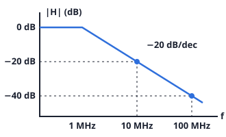

*극점이 1 MHz면 10 MHz에서 −20 dB(1/10배), 100 MHz에서 −40 dB(1/100배)예요.*

**정확히 말하면**

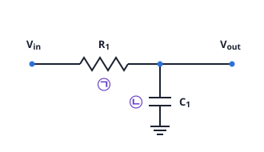

*㉠ 직렬 저항 $R_1$ · ㉡ 출력 노드에서 접지로 가는 $C_1$ (강의노트 s7 왼쪽)*

#### 숫자로 확인하기

극점이 $1\ \mathrm{MHz}$에 있는 1차 저역 통과 필터를 생각해요. 보데 근사로는 $1\ \mathrm{MHz}$까지 크기가 평평하다가, 그 뒤로 주파수가 10배, 즉 한 디케이드(decade) 오를 때마다 20 dB씩 줄어요.

1. $$
   20\log_{10}\frac{1}{10}=-20\ \mathrm{dB}
   $$

   10 MHz는 극점에서 한 디케이드 위라 크기가 1/10배
2. $$
   20\log_{10}\frac{1}{100}=-40\ \mathrm{dB}
   $$

   100 MHz는 두 디케이드 위라 크기가 1/100배

**1차 필터는 주파수가 10배 떨어져야 20 dB, 100배 떨어져야 40 dB 줄어요.**

#### 기울기는 어디서 나오나요

입력 전압은 ㉠ $R_1$과 ㉡ $C_1$에 나뉘어 걸리고, $C_1$ 양단 전압이 출력이에요. ㉡ $C_1$의 임피던스 $1/(sC_1)$은 주파수가 오를수록 작아지므로 출력 노드가 접지 쪽으로 끌려 내려가요.

1. ㉠ $R_1$과 ㉡ $C_1$의 전압 분배로 전달 함수를 써요.

   $$
   \begin{aligned}H(s)&=\frac{V_{out}}{V_{in}}\\&=\frac{1/(sC_1)}{R_1+1/(sC_1)}\\&=\frac{1}{1+sR_1C_1}\end{aligned}
   $$
2. 극점은 $s=-1/(R_1C_1)$이고, 그 크기가 컷오프 주파수(cutoff frequency)예요. $R=R_1$, $C=C_1$로 보면 R과 C의 곱의 역수예요.

   $$
   \omega_c=\frac{1}{RC}=\frac{1}{R_1C_1}
   $$

   각주파수로 쓴 값이며, 헤르츠로는 $f_c=\omega_c/(2\pi)$예요.
3. $\omega\gg\omega_c$이면 분모의 1을 무시할 수 있어요.

   $$
   |H(j\omega)|\approx\frac{\omega_c}{\omega}
   $$
4. dB로 바꾸면 $\omega$가 10배가 될 때마다 20 dB씩 줄어요.

   $$
   20\log_{10}|H(j\omega)|\approx-20\log_{10}\frac{\omega}{\omega_c}
   $$

**그래서 컷오프 뒤의 기울기가 $-20\text{ dB/dec}$예요.** 이 꺾인 직선은 보데 근사(Bode approximation)이고, 실제 곡선은 컷오프 근처에서 부드럽게 꺾인 뒤 멀어질수록 직선에 붙어요.

#### 바로 옆 간섭 신호는 왜 못 줄이나요

900 MHz 대역에서는 채널이 901 MHz, 902 MHz처럼 1 MHz 간격으로 붙어 있어요. 그래서 내 채널 바로 옆에는 원하지 않는 간섭 신호(interference)가 1 MHz만 떨어져 들어와요. 수업에서는 이렇게 1 MHz 옆에 있는 신호를 보통 40 dB, 즉 1/100 정도로 줄인다고 했어요.

이상적인 필터는 통과 대역에서 평평하다가 저지 대역에서 급격히 떨어지지만, 극점 하나짜리 필터는 서서히 떨어지기만 해요. **1차 필터는 40 dB를 얻으려면 꺾인 점에서 주파수가 100배나 멀어져야 하므로, 1 MHz 옆에 붙은 간섭 신호를 그만큼 줄이지 못해요.** 더 가파르게 떨어뜨리는 방법은 [선택도를 높이려면 극점을 늘려요](#s0-selectivity-order)에서 다뤄요.

**교수님 말씀**

> “옆에서 누가 큰 신호로 송신을 하면 그 신호를 받아 가지고 … 신호가 망가지게 되는 거예요.”

처음 스마트폰이 나왔을 때는 옆 사람이 전화를 걸면 내 통화가 끊기는 일이 잦았다고 했어요. 옆 단말의 신호는 기지국뿐 아니라 내 단말에도 들어오고, 같은 표준을 쓰면 주파수도 거의 같아서 간섭 신호가 내 신호 바로 옆에 붙어 들어와요.

**꼭 기억해요**

> “보통 1MHz 떨어진 거에서는 한 40dB 줄이죠. 그 필터의 역할 자체가 참 중요하니까.”

$-20\text{ dB/dec}$는 컷오프에서 크기가 한 번에 20 dB 떨어진다는 뜻이 아니에요. 컷오프 뒤에서 주파수가 10배가 될 때마다 20 dB씩 떨어지는 기울기예요.

$-40\ \mathrm{dB}$는 1/20배가 아니라 1/10배를 두 번 곱한 1/100배예요.

확인해 봐요. 극점이 2 MHz에 있는 1차 저역 통과 필터에서 200 MHz 신호는 통과 대역보다 몇 dB 줄어드나요? 보데 근사로 답해요.

답 보기

200 MHz는 2 MHz의 100배, 즉 두 디케이드 위예요. 한 디케이드마다 20 dB씩이므로 $-40\ \mathrm{dB}$, 크기로는 1/100배예요.

**페이지 요약**

1차 저역 통과 필터는 컷오프 뒤 주파수가 10배 오를 때마다 20 dB씩만 줄어요.

*핵심 식*

- 1차 RC 저역 통과

  $$
  \begin{aligned}H(s)&=\frac{V_{out}}{V_{in}}\\&=\frac{1/(sC_1)}{R_1+1/(sC_1)}\\&=\frac{1}{1+sR_1C_1}\end{aligned}
  $$
- 컷오프 주파수

  $$
  \omega_c=\frac{1}{RC}=\frac{1}{R_1C_1}
  $$
- 두 디케이드 위의 감쇠

  $$
  20\log_{10}\frac{1}{100}=-40\ \mathrm{dB}
  $$

*판단 기준*

기울기는 $-20\text{ dB/dec}$이므로 40 dB를 얻으려면 주파수가 100배 멀어져야 해요.

그래서 1 MHz 옆에 붙은 간섭 신호를 1차 필터로는 충분히 줄이지 못해요.

*용어*

- **컷오프 주파수(cutoff frequency)** — R과 C의 곱의 역수로, 이 주파수를 지나면 크기가 떨어지기 시작해요.
- **디케이드(decade)** — 주파수가 10배가 되는 구간이에요.
- **간섭 신호(interference)** — 내 신호의 수신을 방해하는 원하지 않는 주파수의 신호예요.

---

### 선택도를 높이려면 극점을 늘려요

*1127 수업 · L07 s7*

**쉽게 말하면**

극점이 하나 늘 때마다 컷오프 뒤 기울기가 $-20\text{ dB/dec}$씩 더 가팔라져서 옆 신호를 더 많이 걸러요.

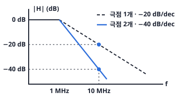

*같은 10 MHz에서 극점 하나는 −20 dB(1/10배), 극점 둘은 −40 dB(1/100배)까지 줄여요.*

**정확히 말하면**

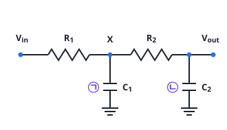

*㉠ 노드 X에서 접지로 가는 $C_1$ · ㉡ 출력 노드에서 접지로 가는 $C_2$ (강의노트 s7 오른쪽)*

#### 숫자로 확인하기

수업의 예시처럼 두 극점이 모두 $1\ \mathrm{MHz}$에 있다고 놓아요. 컷오프 전 기울기는 0이고, 실수 극점을 하나 지날 때마다 기존 기울기에 $-20\text{ dB/dec}$가 더해져요.

1. 1 MHz의 두 극점이 각각 $-20\text{ dB/dec}$를 더해요.

   $$
   2\times(-20\text{ dB/dec})=-40\text{ dB/dec}
   $$
2. $$
   20\log_{10}\frac{1}{100}=-40\ \mathrm{dB}
   $$

   한 디케이드 위인 10 MHz에서 크기가 1/100배

극점이 하나뿐이면 같은 10 MHz에서 −20 dB(1/10배)였어요. **극점이 하나 늘 때마다 기울기에 −20 dB/dec가 더해져 0 → −20 → −40 dB/dec로 가팔라져요.**

#### 선택도와 필터의 차수

선택도(selectivity)는 통과시키고 싶은 신호는 잘 통과시키고, 원하지 않는 신호는 잘 걸러 내는 정도예요. [1차 필터는 10배 떨어져야 20 dB 줄어요](#s0-first-order-limit)에서 본 것처럼 극점 하나로는 바로 옆 간섭 신호를 크게 줄이지 못하므로 선택도가 낮아요.

필터의 차수(order)는 전달 함수의 극점의 개수예요. 일반적인 필터의 전달 함수는 영점 $z_1,\dots,z_m$과 극점 $p_1,\dots,p_n$으로 써요.

$$
H(s) = \alpha\dfrac{(s-z_1)\cdots(s-z_m)}{(s-p_1)\cdots(s-p_n)}
$$

극점 수와 영점 수는 $n \ge m$이어야 해요. 영점이 더 많으면($m\gt n$) $\omega\to\infty$에서 $|H|$가 $\omega^{m-n}$처럼 끝없이 커져(발산) 실제 회로로 만들 수 없어요. 이 조건은 극점이 왼쪽 반평면(실수부 $\lt0$)에 있어야 한다는 안정성(stability) 조건과는 다른 이야기예요.

**차수는 극점의 개수로 정하고, 극점이 늘어날수록 선택도가 높아져요.** 관심 범위에 영점이 없는 저역 통과 필터라면 실수 극점 $n$개를 모두 지난 뒤의 기울기는 $-20n\text{ dB/dec}$예요.

#### 두 RC 단의 극점은 어디에 있나요

이 회로에는 ㉠ 노드 X에서 접지로 가는 $C_1$과 ㉡ 출력 노드에서 접지로 가는 $C_2$, 커패시터가 두 개 있어요. 수업에서는 $R_1=R_2$, $C_1=C_2$이면 두 극점이 같은 주파수에 놓인다고 보고 설명했어요. 실제로는 $R_2$와 $C_2$가 ㉠ 노드 X에서 전류를 빼 가는 로딩(loading) 때문에 두 극점이 갈라져요.

1. ㉡ 출력에는 부하가 없으므로 $R_2$와 $C_2$는 그대로 1차 분압기예요.

   $$
   \frac{V_{out}}{V_X}=\frac{1}{1+sR_2C_2}
   $$
2. ㉠ 노드 X에서 접지 쪽으로는 $C_1$과, $R_2$를 지나 $C_2$로 가는 가지가 병렬로 보여요. 이 둘째 가지가 첫 단을 로딩해요.

   $$
   Z_X=\frac{1}{sC_1}\parallel\left(R_2+\frac{1}{sC_2}\right)
   $$
3. $$
   Z_X=\frac{1+sR_2C_2}{s(C_1+C_2+sR_2C_1C_2)}
   $$

   병렬 합성을 한 분수로 정리
4. $R_1$과 $Z_X$의 전압 분배로 첫 단의 비를 써요. 분모를 $N(s)$로 둬요.

   $$
   \frac{V_X}{V_{in}}=\frac{Z_X}{R_1+Z_X}=\frac{1+sR_2C_2}{N(s)}
   $$
5. $$
   \begin{aligned}N(s)&=(1+sR_1C_1)(1+sR_2C_2)\\&\quad+sR_1C_2\end{aligned}
   $$

   $R_1$에 $Z_X$의 분모를 곱해 더한 값
6. 두 단의 비를 곱하면 $1+sR_2C_2$가 약분돼요.

   $$
   \begin{aligned}\frac{V_{out}}{V_{in}}&=\frac{V_X}{V_{in}}\cdot\frac{V_{out}}{V_X}\\&=\frac{1}{N(s)}\end{aligned}
   $$
7. $N(s)$를 전개하면 $s$의 2차식이므로 극점이 두 개, 즉 2차 필터예요.

   $$
   \begin{aligned}N(s)&=1\\&\quad+s(R_1C_1+R_2C_2+R_1C_2)\\&\quad+s^2R_1R_2C_1C_2\end{aligned}
   $$
8. 두 극점보다 훨씬 높은 주파수에서는 $s^2$ 항만 남아요.

   $$
   |H(j\omega)|\approx\frac{1}{\omega^2R_1R_2C_1C_2}
   $$

주파수가 10배가 되면 $\omega^2$은 100배가 되므로 크기는 1/100, 즉 디케이드마다 $-40\ \mathrm{dB}$씩 줄어요. $N(s)$의 $sR_1C_2$가 로딩 항이에요. 이 항이 없으면 $N(s)$가 두 1차 단의 곱이 되어 $R_1=R_2$, $C_1=C_2$일 때 두 극점이 정확히 겹쳐요.

$R_1=R_2=R$, $C_1=C_2=C$로 두면 $N(s)=1+3sRC+s^2R^2C^2$이고, 두 극점은 다음과 같아요.

$$
p_1=-\frac{3-\sqrt5}{2RC}\approx-\frac{0.38}{RC}
$$

$$
p_2=-\frac{3+\sqrt5}{2RC}\approx-\frac{2.62}{RC}
$$

일반적인 값에서도 $N(s)$를 $s$의 2차식으로 본 판별식 $\Delta$는 늘 양수예요.

$$
\begin{aligned}\Delta&=(R_1C_1-R_2C_2)^2\\&\quad+(R_1C_2)^2\\&\quad+2R_1C_2(R_1C_1+R_2C_2)\\&\gt0\end{aligned}
$$

그래서 RC만 이은 이 회로의 두 극점은 언제나 서로 다른 실수 극점이에요. **두 극점이 정확히 겹치지는 않지만, 두 실수 극점을 모두 지난 뒤의 점근 기울기는 $-40\text{ dB/dec}$예요.**

#### 고차 필터는 1차·2차 블록으로 만들어요

실제로 바로 옆의 큰 간섭 신호를 없앨 때는 보통 4차, 5차, 6차 같은 고차 필터를 써요. 고차 필터는 1차 필터와 2차 필터를 단위 블록으로 이어서 만들어요.

- 3차 필터 = 2차 블록 + 1차 블록
- 4차 필터 = 2차 블록 두 개
- 그보다 높은 차수도 두 블록의 조합

실수 극점(real pole)은 $s$평면의 실수축 위에 있는 극점이고, 복소 극점(complex pole)은 실수축 밖에 켤레 쌍으로 놓이는 극점이에요. 2차 필터를 1차 필터 두 개로 만들 수도 있지만, 1차 블록은 실수 극점만 만들어요. 실수 극점만으로 만든 필터는 상대적으로 선택도 성능이 좋지 않아요. **더 좋은 필터 특성을 얻으려면 복소 극점을 가진 2차 블록이 따로 필요해요.** 2차 블록의 표준형과 복소 극점의 위치는 [2차 필터는 분모를 고유 주파수와 Q로 써요](#s3-biquad)에서 이어서 봐요.

**교수님 말씀**

> “어떻게 하면 셀렉티비티를 높일 수 있을 것인가. 그것은 필터의 차수를 늘려야 됩니다.”

> “1차 필터로는 리얼 폴밖에 못 만듭니다. 2차 필터가 돼야지 컴플렉스 폴을 만들 수가 있어요.”

그래서 필터의 회로 설계는 1차 필터와 2차 필터 설계로 나뉘고, 나머지 고차 필터는 이 두 블록의 조합으로 만든다고 했어요.

확인해 봐요. 같은 주파수에 실수 극점이 세 개 있는 저역 통과 필터라면, 극점을 지난 뒤의 기울기와 한 디케이드 위에서의 감쇠는 얼마인가요?

답 보기

−40에 −20을 한 번 더 더해 $-60\text{ dB/dec}$예요. 한 디케이드 위에서는 $-60\ \mathrm{dB}$, 크기로는 1/1000배예요.

**페이지 요약**

필터의 차수는 극점의 개수이고, 실수 극점이 하나 늘 때마다 기울기가 $-20\text{ dB/dec}$씩 가팔라져 선택도가 높아져요.

*핵심 식*

- 필터의 전달 함수

  $$
  H(s) = \alpha\dfrac{(s-z_1)\cdots(s-z_m)}{(s-p_1)\cdots(s-p_n)}
  $$
- 두 극점의 기울기

  $$
  \begin{aligned}&2\times(-20\text{ dB/dec})\\&=-40\text{ dB/dec}\end{aligned}
  $$

*판단 기준*

극점 수와 영점 수는 $n \ge m$이어야 하고, 영점이 더 많으면 고주파에서 발산해 만들 수 없어요.

RC 두 단은 로딩 때문에 두 극점이 갈라져도 점근 기울기는 $-40\text{ dB/dec}$예요.

3차는 2차 블록과 1차 블록, 4차는 2차 블록 두 개로 만들어요.

*용어*

- **선택도(selectivity)** — 원하는 신호는 통과시키고 원하지 않는 신호는 걸러 내는 정도예요.
- **필터의 차수(order)** — 전달 함수의 극점의 개수예요.
- **실수 극점(real pole)** — $s$평면의 실수축 위에 있는 극점으로 1차 블록으로 만들 수 있어요.
- **복소 극점(complex pole)** — 실수축 밖에 켤레 쌍으로 놓이는 극점으로 2차 블록이 있어야 만들 수 있어요.

---

## 2. 1차 필터의 극점과 영점

### 극점과 영점 중 먼저 오는 쪽이 LPF·HPF를 정해요

*1127 수업 · L07 s9*

**쉽게 말하면**

주파수를 올리면서 극점을 먼저 만나면 크기가 −20 dB/dec로 내려가 LPF가 되고, 영점을 먼저 만나면 +20 dB/dec로 올라가 HPF가 돼요.

예를 들어 극점 크기가 $10^3\ \mathrm{rad/s}$, 영점 크기가 $10^5\ \mathrm{rad/s}$이면 극점을 먼저 만나므로 LPF예요.

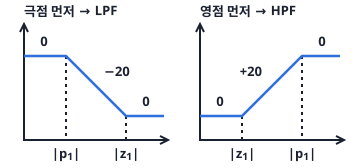

*가로축은 로그 주파수, 세로축은 dB 크기이고, 선 위 숫자는 기울기(dB/dec)예요.*

**정확히 말하면**

#### 숫자 하나로 먼저 그려 봐요

$\alpha=1$, $p_1=-10^3\ \mathrm{rad/s}$, $z_1=-10^5\ \mathrm{rad/s}$인 1차 필터 $H(s)=\dfrac{s+10^5}{s+10^3}$를 생각해요. 크기로 보면 극점이 $10^3\ \mathrm{rad/s}$, 영점이 $10^5\ \mathrm{rad/s}$라서 주파수를 올릴 때 극점을 먼저 만나요.

1. $$
   H(0)=\dfrac{0+10^5}{0+10^3}=100\ (40\ \mathrm{dB})
   $$

   시작 상태: $s=0$을 넣은 DC 이득이에요.
2. $$
   0\ \to\ -20\ \to\ 0\ \mathrm{dB/dec}
   $$

   변화 규칙: $10^3$에서 −20, $10^5$에서 +20을 더해요.
3. $$
   40\ \mathrm{dB}-20\ \mathrm{dB/dec}\times2\ \mathrm{dec}=0\ \mathrm{dB}
   $$

   결과: 두 decade 내려가 고주파 이득 $\alpha=1$과 만나요.

낮은 주파수는 100배, 높은 주파수는 1배로 지나가므로 낮은 주파수를 통과시키는 필터예요. **극점을 먼저 만나면 기울기가 0 → −20 → 0 dB/dec로 바뀌며 크기가 내려가 LPF가 돼요.** 위 숫자는 꺾은선 근사이고, 실제 곡선은 극점 꺾임점에서 약 3 dB 아래, 영점 꺾임점에서 약 3 dB 위로 부드럽게 지나가요.

#### 전달함수에서 극점과 영점은 어디에 있나요

1차 필터의 일반형은 극점 하나와 영점 하나로 써요.

$$
H(s) = \alpha\dfrac{s - z_1}{s - p_1}
$$

분모의 차수, 즉 극점 수가 1이라서 1차예요. 극점이 하나뿐이므로 $p_1$은 실수예요. 영점은 하나일 수도, 없을 수도 있어요.

극점은 좌반평면(left half-plane), 즉 실수부가 음수인 쪽($p_1\lt0$)에 있어야 안정해요. 영점 $z_1$은 좌반평면에 있어도, 우반평면에 있어도 돼요. **극점은 좌반평면에 있어야 안정하고, 영점의 자리는 안정성을 정하지 않아요.**

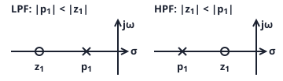

*가위표(×)는 극점, 테두리 원은 영점이고, 세로축 jω의 왼쪽이 좌반평면이에요.*

그래서 안정한 필터의 $p_1$은 음수예요. 보데 선도의 주파수 축에는 원점에서의 거리, 즉 크기 $|p_1|$(극점 주파수)과 $|z_1|$(영점 주파수)을 놓아요.

#### 양 끝의 이득은 어떻게 구하나요

1. $$
   H(0)=\alpha\dfrac{0-z_1}{0-p_1}=\alpha\dfrac{z_1}{p_1}
   $$

   $s=0$을 넣은 DC 이득이에요.
2. $$
   \lim_{s\to\infty}H(s)=\alpha
   $$

   $s$가 커지면 분자·분모에 $s$만 남는 고주파 이득이에요.
3. $$
   \dfrac{|H(0)|}{|H(\infty)|}=\dfrac{|z_1|}{|p_1|}
   $$

   두 이득의 비는 영점과 극점의 크기 비예요.

**DC 이득은 $\alpha\dfrac{z_1}{p_1}$, 고주파 이득은 $\alpha$이고, $|z_1|\gt|p_1|$이면 DC 이득이 더 커요.** 두 이득은 데시벨로 $20\log_{10}(|z_1|/|p_1|)$만큼 차이 나요. 앞의 예시는 $20\log_{10}100=40\ \mathrm{dB}$였어요. 영점이 우반평면에 있으면($z_1\gt0$) DC 이득의 부호만 바뀌고 크기는 같아요.

#### LPF와 HPF는 무엇으로 갈리나요

주파수를 올리면서 극점 주파수를 지나면 분모가 커져 기울기에 −20 dB/dec를 더하고, 영점 주파수를 지나면 분자가 커져 +20 dB/dec를 더해요.

| 경우 | 기울기 순서 | 더 큰 이득 | 종류 |
|---|---|---|---|
| $\vert p_1\vert \lt\vert z_1\vert $ (극점 먼저) | 0 → −20 → 0 dB/dec | DC 이득 $\alpha\dfrac{z_1}{p_1}$ | LPF |
| $\vert z_1\vert \lt\vert p_1\vert $ (영점 먼저) | 0 → +20 → 0 dB/dec | 고주파 이득 $\alpha$ | HPF |

통과 대역은 통과시킬 대역, 저지 대역은 걸러낼 대역, 천이 대역은 그 사이에서 크기가 바뀌는 대역이에요(1125 수업 복습). LPF는 $|p_1|$ 아래가 통과 대역, $|p_1|$과 $|z_1|$ 사이가 천이 대역, $|z_1|$ 위가 저지 대역이에요. HPF는 순서가 반대라서 $|z_1|$ 아래가 저지 대역, $|p_1|$ 위가 통과 대역이에요. **극점 주파수가 영점 주파수보다 낮으면 LPF, 영점 주파수가 더 낮으면 HPF예요.**

#### 1차 필터는 무엇이 부족한가요

1차 필터의 기울기는 −20 dB/dec 하나뿐이에요. 그래서 주파수가 10배 멀어져야 20 dB, 100배 멀어져야 40 dB 줄어요.

**1차 필터는 천이 대역이 넓고, 저지 대역 감쇠는 10배에 20 dB로 보통 수준이에요.** 이 한계를 넘는 방법은 [1차 필터는 10배 떨어져야 20 dB 줄어요](#s0-first-order-limit)와 [선택도를 높이려면 극점을 늘려요](#s0-selectivity-order)에서, 이 전달함수를 회로로 만드는 방법은 [RC 분압기는 이득이 1보다 작아요](#s2-passive)에서 이어져요.

**교수님 말씀**

> 원래는 폴은 이제 네거티브 폴이죠, 원래는. 정확하게 얘기하면.

교수님은 보데 선도에 극점과 영점을 양수 주파수, 즉 크기로 그리신 뒤 실제 값은 음수라고 짚으셨어요. 앰프의 주파수 응답도 대부분 이 LPF 모양이고, 앰프의 영점은 보통 아주 높은 주파수에 있다고 하셨어요. 1차 필터는 10배가 지나야 20 dB씩 변해서 천이 대역이 굉장히 넓다는 점도 거듭 강조하셨어요.

**꼭 기억해요**

> 로우패스냐 하이패스냐의 결정은 폴과 제로의 상대적인 위치에서 결정돼요.

상대적인 위치는 부호 있는 값이 아니라 원점에서의 거리(크기)로 비교해요. $p_1=-10^3$은 $z_1=-10^5$보다 수로는 크지만 크기는 $|p_1|=10^3\lt|z_1|=10^5$이라서 극점이 먼저예요. 부호 있는 값으로 비교하면 LPF와 HPF를 거꾸로 읽게 돼요.

확인해 봐요. $\alpha=2$, $p_1=-10^4\ \mathrm{rad/s}$, $z_1=-10^2\ \mathrm{rad/s}$인 1차 필터는 LPF와 HPF 중 무엇이고, DC 이득과 고주파 이득은 얼마인가요?

답 보기

HPF예요. 크기로 $|z_1|=10^2\lt|p_1|=10^4$이라 영점을 먼저 만나요. DC 이득은 $2\times\dfrac{10^2}{10^4}=0.02$, 고주파 이득은 $2$이고, +20 dB/dec로 두 decade(40 dB, 100배) 올라가 0.02가 2가 돼요.

**페이지 요약**

1차 필터는 주파수를 올릴 때 극점을 먼저 만나면 LPF, 영점을 먼저 만나면 HPF예요.

*핵심 식*

- 1차 전달함수

  $$
  H(s) = \alpha\dfrac{s - z_1}{s - p_1}
  $$
- DC 이득

  $$
  H(0)=\alpha\dfrac{z_1}{p_1}
  $$
- 고주파 이득

  $$
  \lim_{s\to\infty}H(s)=\alpha
  $$

$|p_1|\lt|z_1|$이면 기울기가 0 → −20 → 0 dB/dec로 바뀌어 LPF예요.

$|z_1|\lt|p_1|$이면 기울기가 0 → +20 → 0 dB/dec로 바뀌어 HPF예요.

극점은 좌반평면에 있어야 안정하고, 위치 비교는 부호가 아닌 크기로 해요.

*용어*

- **좌반평면(left half-plane)** — s-평면에서 실수부가 음수인 쪽이에요.
- **천이 대역(transition band)** — 통과 대역과 저지 대역 사이로, 1차 필터에서는 $|p_1|$과 $|z_1|$ 사이예요.

---

## 3. 1차 필터 구현: 수동과 능동

### RC 분압기는 이득이 1보다 작아요

*1127 수업 · L07 s10*

**쉽게 말하면**

직렬 $R_1\parallel C_1$과 접지로 가는 $R_2\parallel C_2$가 입력 전압을 나누므로, 출력은 저주파에서 저항비, 고주파에서 커패시터비만큼만 나와요.

예를 들어 $R_1=R_2$, $C_2=3C_1$이면 저주파 이득은 $1/2$, 고주파 이득은 $1/4$이에요.

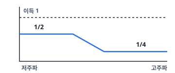

*예시 값의 두 평평한 구간은 모두 이득 1 선 아래에 있어요.*

**정확히 말하면**

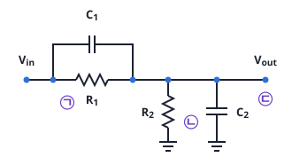

*㉠ 직렬 가지 $Z_1$ · ㉡ 접지로 가는 분로 가지 $Z_2$ · ㉢ 출력 노드 (강의노트 s10 (a))*

#### 숫자로 먼저 볼까요

커패시터의 임피던스 $1/(sC)$는 주파수가 낮으면 매우 커서 개방처럼 보이고, 주파수가 높으면 저항보다 훨씬 작아져요. 그래서 양 끝의 이득은 분압비로 바로 읽혀요.

1. 저주파에서는 커패시터가 개방이라 ㉠에 $R_1$, ㉡에 $R_2$만 남아요. $R_1=R_2$이면

   $$
   \frac{R_2}{R_1+R_2}=\frac{1}{2}
   $$
2. 고주파에서는 두 커패시터가 전압을 나눠요. 임피던스가 $1/C$에 비례하므로 $C_2=3C_1$이면

   $$
   \frac{1/C_2}{1/C_1+1/C_2}=\frac{C_1}{C_1+C_2}=\frac{1}{4}
   $$

**어느 쪽 끝에서도 출력은 입력보다 작아요.**

#### 두 임피던스로 전달함수를 세워요

㉠ 직렬 가지와 ㉡ 분로 가지의 임피던스를 각각 써요.

$$
Z_1 = R_1 \parallel \frac{1}{sC_1}=\frac{R_1}{1+sR_1C_1}
$$

$$
Z_2=R_2\parallel\frac{1}{sC_2}=\frac{R_2}{1+sR_2C_2}
$$

㉢ 출력 노드에 다른 부하가 없으므로 두 가지에 같은 전류가 흘러 전압이 나뉘어요.

$$
\frac{V_{out}}{V_{in}} = \frac{Z_2}{Z_1+Z_2}
$$

1. $$
   \frac{V_{out}}{V_{in}}=\frac{\dfrac{R_2}{1+sR_2C_2}}{\dfrac{R_1}{1+sR_1C_1}+\dfrac{R_2}{1+sR_2C_2}}
   $$

   두 임피던스를 대입해요.
2. $$
   =\frac{R_2(1+sR_1C_1)}{R_1(1+sR_2C_2)+R_2(1+sR_1C_1)}
   $$

   분자와 분모에 $(1+sR_1C_1)(1+sR_2C_2)$를 곱해요.
3. $$
   =\frac{R_2(1+sR_1C_1)}{(R_1+R_2)+sR_1R_2(C_1+C_2)}
   $$

   분모를 $s$의 차수별로 묶어요.

**분자와 분모가 모두 $s$의 1차식이라 극점 하나, 영점 하나인 1차 필터예요.**

(수업 중 직렬 가지를 $R_1+1/(sC_1)$처럼 읽었다가 정정: 그림대로 $R_1$과 $C_1$은 병렬이에요.)

#### 극점과 영점은 어디에 있나요

분자가 0이 되는 $s$가 영점, 분모가 0이 되는 $s$가 극점이에요.

$$
z = -\frac{1}{R_1C_1}
$$

$$
p = -\frac{R_1+R_2}{R_1R_2(C_1+C_2)}
$$

분자와 분모를 $R_1+R_2$로 나누면 강의노트의 꺾임점 표기가 돼요.

$$
p=-\frac{1}{(C_1+C_2)(R_1\parallel R_2)}
$$

둘 다 음의 실수라 좌반평면에 있어요. 강의노트 그래프의 꺾임점은 이 값들의 크기 $1/(R_1C_1)$과 $1/[(C_1+C_2)(R_1\parallel R_2)]$이에요. **영점은 ㉠의 $R_1C_1$만으로 정해지지만, 극점에는 네 소자가 모두 들어가요.** 그래서 극점을 옮기려고 $R_1$이나 $C_1$을 바꾸면 영점도 함께 움직여요.

(수업 중 극점을 $-1/[(R_1+R_2)(C_1+C_2)]$처럼 읽었다가 정정)

#### 저주파와 고주파 이득

1. $$
   \left.\frac{V_{out}}{V_{in}}\right|_{s\to0}=\frac{R_2}{R_1+R_2}
   $$

   ㉠·㉡의 커패시터가 개방이라 저항만 남아요.
2. $$
   \left.\frac{V_{out}}{V_{in}}\right|_{s\to\infty}=\frac{C_1}{C_1+C_2}
   $$

   분자·분모에서 $s$가 붙은 항 $sR_1R_2C_1$과 $sR_1R_2(C_1+C_2)$만 남겨요.

**두 이득은 모두 1보다 작아서, 이 수동 필터(passive filter)는 신호를 키울 수 없어요.**

#### LPF와 HPF를 가르는 조건

저주파 이득이 고주파 이득보다 크면 극점에서 먼저 꺾여 내려가므로 LPF예요.

1. $$
   \frac{R_2}{R_1+R_2}\gt\frac{C_1}{C_1+C_2}
   $$

   저주파 쪽이 더 크면 LPF예요.
2. $$
   R_2(C_1+C_2)\gt C_1(R_1+R_2)
   $$

   양변에 양수인 두 분모를 곱해요.
3. $$
   R_2C_2\gt R_1C_1
   $$

   양변의 $R_2C_1$이 지워져요.

극점 크기가 영점 크기보다 작다는 조건 $|p|\lt|z|$를 정리해도 같은 식이 나와요. **$R_2C_2\gt R_1C_1$이면 LPF, $R_1C_1\gt R_2C_2$이면 HPF예요.** 강의노트 s10의 (b)는 HPF, (c)는 LPF이고 아래 조건 표기도 이와 맞아요.

예시 값 $R_1=R_2=1\ \mathrm{k\Omega}$, $C_1=1\ \mathrm{nF}$, $C_2=3\ \mathrm{nF}$를 넣어요. $\mathrm{k\Omega}\times\mathrm{nF}=\mu\mathrm{s}$예요.

$$
R_2C_2=3\ \mu\mathrm{s}\gt R_1C_1=1\ \mu\mathrm{s}
$$

$$
|z|=\frac{1}{1\ \mu\mathrm{s}}=10^6\ \mathrm{rad/s}
$$

$$
\begin{aligned}|p|&=\frac{2\ \mathrm{k\Omega}}{(1\ \mathrm{k\Omega})^2\times4\ \mathrm{nF}}\\&=0.5\times10^6\ \mathrm{rad/s}\end{aligned}
$$

극점이 먼저 오므로 이득이 $1/2$에서 $1/4$로 내려가는 LPF예요.

**교수님 말씀**

교수님은 RC로 만든 이 구현의 첫 번째 단점으로 감쇠가 완만하다는 점을 들었어요.

> "10배가 지나야지 20dB가 감쇄를 시킬 수 있는 거고"

이상적인 필터처럼 날카롭게 꺾이지 않고 천이 대역(transition band)이 넓어서 이상적인 필터와 차이가 크다고 했어요. 또 극점 식에 영점을 정하는 소자가 섞여 있어 설계가 번거롭다고 했어요.

> "그나마 지저분한 거죠."

정리하면 $R_1C_1$을 크게 만들면 HPF, $R_2C_2$를 크게 만들면 LPF예요.

확인해 봐요. $R_1=R_2=1\ \mathrm{k\Omega}$, $C_1=3\ \mathrm{nF}$, $C_2=1\ \mathrm{nF}$이면 저주파·고주파 이득은 얼마이고, LPF와 HPF 중 무엇인가요?

답 보기

저주파 이득은 $\frac{R_2}{R_1+R_2}=\frac{1}{2}$, 고주파 이득은 $\frac{C_1}{C_1+C_2}=\frac{3}{4}$이에요. 고주파 쪽이 크고 $R_1C_1=3\ \mu\mathrm{s}\gt R_2C_2=1\ \mu\mathrm{s}$이므로 HPF예요.

**페이지 요약**

수동 RC 필터는 두 임피던스의 분압이라 저주파·고주파 이득이 모두 1보다 작아요.

*핵심 식*

- 분압

  $$
  \frac{V_{out}}{V_{in}} = \frac{Z_2}{Z_1+Z_2}
  $$
- 극점

  $$
  p = -\frac{R_1+R_2}{R_1R_2(C_1+C_2)}
  $$
- 영점

  $$
  z = -\frac{1}{R_1C_1}
  $$

*판단*

저주파 이득 $\frac{R_2}{R_1+R_2}$와 고주파 이득 $\frac{C_1}{C_1+C_2}$는 모두 1보다 작아요.

$R_2C_2\gt R_1C_1$이면 LPF, $R_1C_1\gt R_2C_2$이면 HPF예요.

*용어*

- **수동 필터(passive filter)** — R·C 같은 수동 소자만으로 만든 필터로, 이득이 1을 넘지 못해요.

---

### 반전 증폭기는 극점과 영점을 따로 정해요

*1127 수업 · L07 s11*

**쉽게 말하면**

OP-amp의 반전 단자가 0 V로 묶여 입력 가지 전류가 그대로 귀환 가지로 흐르므로, 이득은 두 임피던스의 비 $-Z_2/Z_1$이 되고 극점과 영점은 두 가지가 따로 정해요.

예를 들어 $R_2=2R_1$이면 저주파 이득의 크기가 2라서 1보다 커요.

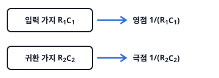

*입력 가지 $R_1C_1$은 영점만, 귀환 가지 $R_2C_2$는 극점만 정해요.*

**정확히 말하면**

*㉠ 입력 가지 $Z_1$ · ㉡ 반전 단자(가상 접지) · ㉢ 귀환 가지 $Z_2$ (강의노트 s11 (a))*

#### 숫자로 먼저 볼까요

저주파에서는 두 커패시터가 개방이라 ㉠에 $R_1$, ㉢에 $R_2$만 남는 반전 증폭기예요. $R_1=1\ \mathrm{k\Omega}$, $R_2=2\ \mathrm{k\Omega}$이면

$$
-\frac{R_2}{R_1}=-\frac{2\ \mathrm{k\Omega}}{1\ \mathrm{k\Omega}}=-2
$$

고주파에서는 저항보다 커패시터 임피던스가 훨씬 작아 두 커패시터의 비가 이득이 돼요. $C_1=1\ \mathrm{nF}$, $C_2=2\ \mathrm{nF}$이면

$$
-\frac{1/(sC_2)}{1/(sC_1)}=-\frac{C_1}{C_2}=-\frac{1}{2}
$$

**저주파 이득의 크기가 2로, 수동 RC 분압기와 달리 1보다 커질 수 있어요.**

#### 가상 접지에서 $-Z_2/Z_1$이 나와요

OP-amp의 이득이 매우 크고 음의 귀환이 걸려 있어 두 입력 단자의 전압이 거의 같아요. 비반전 단자가 접지이므로 ㉡ 반전 단자는 0 V인 가상 접지(virtual ground)예요. 또 OP-amp 입력 단자로는 전류가 들어가지 않아요.

1. $$
   I_{in}=\frac{V_{in}-0}{Z_1}
   $$

   ㉠ $Z_1$ 양 끝의 전압은 $V_{in}$과 0이에요.
2. $$
   V_{out}=0-I_{in}Z_2
   $$

   ㉢ 같은 전류가 $Z_2$를 지나 출력 쪽으로 흘러요.
3. $$
   \frac{V_{out}}{V_{in}}=-\frac{Z_2}{Z_1}
   $$

   두 식에서 $I_{in}$을 지워요.

**이득은 귀환 가지와 입력 가지의 임피던스 비에 음의 부호가 붙은 값이에요.**

#### 극점과 영점이 따로 정해져요

두 가지는 수동 구현과 같은 병렬 RC예요.

$$
Z_1=R_1\parallel\frac{1}{sC_1}=\frac{R_1}{1+sR_1C_1}
$$

$$
Z_2=R_2\parallel\frac{1}{sC_2}=\frac{R_2}{1+sR_2C_2}
$$

$-Z_2/Z_1$에 넣으면

$$
\frac{V_{out}}{V_{in}} = -\frac{R_2}{R_1}\cdot\frac{1 + sR_1C_1}{1 + sR_2C_2}
$$

$$
p = -\frac{1}{R_2C_2}
$$

$$
z = -\frac{1}{R_1C_1}
$$

**극점은 ㉢ 귀환 가지의 $R_2C_2$만, 영점은 ㉠ 입력 가지의 $R_1C_1$만으로 정해져요.** 한쪽을 바꿔도 다른 쪽은 그대로라 수동 구현보다 설계가 쉬워요.

#### 저주파와 고주파 이득

1. $$
   \left.\frac{V_{out}}{V_{in}}\right|_{s\to0}=-\frac{R_2}{R_1}
   $$

   두 커패시터가 개방이에요.
2. $$
   \left.\frac{V_{out}}{V_{in}}\right|_{s\to\infty}=-\frac{C_1}{C_2}
   $$

   $s$가 붙은 항만 남기면 $-\frac{R_2}{R_1}\cdot\frac{R_1C_1}{R_2C_2}$이에요.

**저주파 이득은 저항비, 고주파 이득은 커패시터비로 정해지고 둘 다 음수예요.** 크기만 보면 $R_2/R_1$과 $C_1/C_2$예요.

(수업 중 고주파 이득을 $C_2/C_1$처럼 읽었다가 $C_1/C_2$로 정정)

#### LPF와 HPF를 가르는 조건

극점 크기 $1/(R_2C_2)$가 영점 크기 $1/(R_1C_1)$보다 작으면 극점에서 먼저 꺾여 내려가므로 LPF예요. 같은 조건을 이득으로 쓰면 저주파 이득의 크기가 고주파 이득의 크기보다 커요.

$$
R_2C_2\gt R_1C_1\ \Leftrightarrow\ \frac{R_2}{R_1}\gt\frac{C_1}{C_2}
$$

**$R_2C_2\gt R_1C_1$이면 LPF, $R_2C_2\lt R_1C_1$이면 HPF예요.** 앞의 예시 값은 $R_2C_2=4\ \mu\mathrm{s}\gt R_1C_1=1\ \mu\mathrm{s}$라서 크기가 2에서 $1/2$로 내려가는 LPF예요.

$$
|p|=\frac{1}{4\ \mu\mathrm{s}}=0.25\times10^6\ \mathrm{rad/s}
$$

$$
|z|=\frac{1}{1\ \mu\mathrm{s}}=10^6\ \mathrm{rad/s}
$$

강의노트 s11의 (b)·(c) 아래 조건은 그래프와 서로 바뀌어 적혀 있어요. $1/(R_2C_2)$에서 먼저 내려가는 (b) LPF의 조건은 $R_2C_2\gt R_1C_1$이고, $1/(R_1C_1)$에서 먼저 올라가는 (c) HPF의 조건은 $R_2C_2\lt R_1C_1$이에요.

**교수님 말씀**

교수님은 OP-amp 두 입력이 가상 단락이고 OP-amp로 전류가 흘러 들어가지 않는다는 두 성질로 $-Z_2/Z_1$을 얻었어요.

> "입력이 거의 버추얼 숏이죠? 연산 증폭기이기 때문에"

그리고 수동 구현과 비교한 장점을 짚었어요.

> "폴과 제로를 우리가 인디펜던트하게 설계할 수 있게 되겠습니다."

**보충 · 수업에서 유도하진 않았어요**

수업에서는 이 회로의 입력 저항을 구하다가 넘어갔어요. 입력에서 본 임피던스는 $V_{in}/I_{in}$이고, ㉡이 가상 접지라서 $I_{in}=V_{in}/Z_1$이에요.

$$
R_{in} = Z_1 = R_1\parallel\frac{1}{sC_1}
$$

저주파에서는 $R_1$이고, 주파수가 높아지면 $C_1$ 쪽 임피던스가 작아져 입력 임피던스도 작아져요. 귀환 가지 $Z_2$는 가상 접지 너머에 있어 입력에서 보이지 않아요.

#### 직접 해 보기: 극점과 영점을 따로 옮겨 LPF와 HPF 만들기 *(정적 스냅샷 — 직접 조작은 HTML 버전)*

$R_1C_1$, $R_2C_2$, $R_2/R_1$을 바꾸면 보데 근사 선도가 LPF와 HPF 사이에서 바뀌고, 저주파 이득 $R_2/R_1$·고주파 이득 $C_1/C_2$ 수평선(크기)과 두 꺾임점 $1/(R_2C_2)$, $1/(R_1C_1)$이 함께 움직여요.

종류 **LPF(저주파 통과)** · 저주파 이득 **−2** · 고주파 이득 **−0.5** · 극점 크기 **0.25**×106 rad/s · 영점 크기 **1**×106 rad/s · **R2C2 = 4 µs &gt; R1C1 = 1 µs**

범례: 보데 근사 선도 · 실제 크기 · 저주파·고주파 이득의 크기

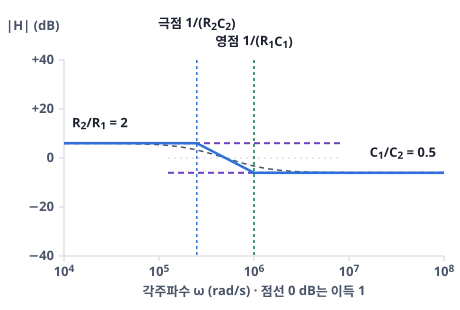

*대표 설정 1: $R_1C_1=1\ \mu\mathrm{s}$, $R_2C_2=4\ \mu\mathrm{s}$, $R_2/R_1=2$*

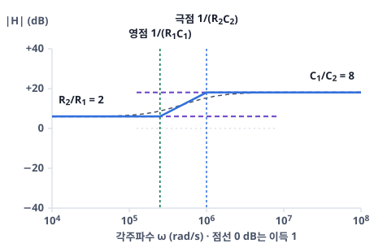

*대표 설정 2: $R_1C_1=4\ \mu\mathrm{s}$, $R_2C_2=1\ \mu\mathrm{s}$, $R_2/R_1=2$*

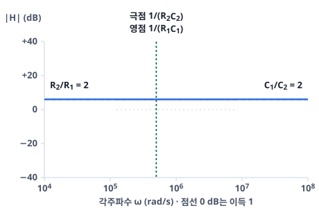

*대표 설정 3: $R_1C_1=2\ \mu\mathrm{s}$, $R_2C_2=2\ \mu\mathrm{s}$, $R_2/R_1=2$*

| 설정 | 값 | 저주파 이득 | 고주파 이득 | 종류 |
|---|---|---|---|---|
| 1 | $R_1C_1=1\ \mu\mathrm{s}$, $R_2C_2=4\ \mu\mathrm{s}$, $R_2/R_1=2$ | $-2$ | $-0.5$ | LPF(저주파 통과) |
| 2 | $R_1C_1=4\ \mu\mathrm{s}$, $R_2C_2=1\ \mu\mathrm{s}$, $R_2/R_1=2$ | $-2$ | $-8$ | HPF(고주파 통과) |
| 3 | $R_1C_1=2\ \mu\mathrm{s}$, $R_2C_2=2\ \mu\mathrm{s}$, $R_2/R_1=2$ | $-2$ | $-2$ | 평탄(극점과 영점이 겹침) |

확인해 봐요. $R_1=1\ \mathrm{k\Omega}$, $R_2=3\ \mathrm{k\Omega}$, $C_1=2\ \mathrm{nF}$, $C_2=1\ \mathrm{nF}$이면 저주파·고주파 이득과 필터 종류는 무엇인가요?

답 보기

저주파 이득은 $-R_2/R_1=-3$, 고주파 이득은 $-C_1/C_2=-2$예요. $R_2C_2=3\ \mu\mathrm{s}\gt R_1C_1=2\ \mu\mathrm{s}$이므로 크기가 3에서 2로 내려가는 LPF예요.

**페이지 요약**

반전 증폭기형 능동 필터는 이득이 $-Z_2/Z_1$이라 극점은 $R_2C_2$, 영점은 $R_1C_1$이 따로 정해요.

*핵심 식*

- 전달함수

  $$
  \frac{V_{out}}{V_{in}} = -\frac{R_2}{R_1}\cdot\frac{1 + sR_1C_1}{1 + sR_2C_2}
  $$
- 극점

  $$
  p = -\frac{1}{R_2C_2}
  $$
- 영점

  $$
  z = -\frac{1}{R_1C_1}
  $$

*판단*

저주파 이득은 $-R_2/R_1$, 고주파 이득은 $-C_1/C_2$예요.

$R_2C_2\gt R_1C_1$이면 LPF, $R_2C_2\lt R_1C_1$이면 HPF예요.

*용어*

- **가상 접지(virtual ground)** — 음의 귀환이 걸린 OP-amp의 반전 단자가 접지된 비반전 단자와 거의 같은 0 V가 되는 것이에요.

---

### 능동 필터는 이득을 얻는 대신 전력을 써요

*1127 수업 · L07 s10·s11*

**쉽게 말하면**

능동 필터는 OP-amp가 전원에서 받은 에너지로 이득을 1보다 크게 만들 수 있지만, 그 대가로 전력을 쓰고 아주 높은 주파수에서는 쓰기 어려워요.

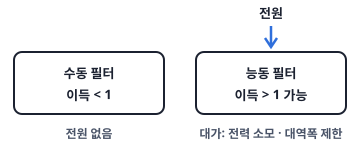

*수동 필터는 전원 없이 이득이 1보다 작고, 능동 필터는 전원을 받아 이득을 얻어요.*

**정확히 말하면**

#### 한 표로 비교해요

| 항목 | 수동 필터(RC 분압기) | 능동 필터(반전 증폭기) |
|---|---|---|
| 저주파 이득의 크기 | $\frac{R_2}{R_1+R_2}\lt1$ | $\frac{R_2}{R_1}$, $R_2\gt R_1$이면 1보다 커요 |
| 고주파 이득의 크기 | $\frac{C_1}{C_1+C_2}\lt1$ | $\frac{C_1}{C_2}$ |
| 극점과 영점 | 극점에 네 소자가 얽혀요 | 극점은 $R_2C_2$, 영점은 $R_1C_1$로 따로 정해요 |
| 1차 특성(기울기·천이 대역) | $\pm20\text{ dB/dec}$, 넓은 천이 대역 | 같아요 |
| 전력 소모 | 없어요 | OP-amp가 전력을 써요 |
| 동작 주파수(대역폭) | 상대적으로 제한이 적어요 | OP-amp 극점 이후 이득이 떨어져 제한돼요 |
| 면적 | R·C가 대부분이에요 | 트랜지스터가 늘지만 R·C보다 작아요 |

**능동 필터의 장점은 이득과 쉬운 설계이고, 대가는 전력과 대역폭이에요.**

#### 무엇이 좋아지나요

예시 값으로 보면 [RC 분압기는 이득이 1보다 작아요](#s2-passive)의 수동 필터는 $R_1=R_2$에서 저주파 이득이 $1/2$이지만, [반전 증폭기는 극점과 영점을 따로 정해요](#s2-active)의 능동 필터는 $R_2=2R_1$에서 저주파 이득의 크기가 2예요. **능동 필터는 $R_2\gt R_1$로 만들면 이득을 1보다 크게 얻을 수 있어요.** 능동이라고 이득이 늘 1보다 큰 것은 아니지만, 보통은 이득을 얻으려고 능동 필터를 설계해요. 또 극점과 영점을 독립적으로 정할 수 있어 원하는 꺾임점을 맞추기 쉬워요.

#### 무엇은 그대로인가요

**두 구현 모두 극점 하나, 영점 하나인 1차 필터라서 기울기와 천이 대역은 같아요.** 꺾임점 너머의 기울기는 어느 쪽이든 $-20\text{ dB/dec}$ 또는 $+20\text{ dB/dec}$예요. 이득이 생겨도 더 날카롭게 걸러 내지는 못해요.

#### 무엇을 내주나요

첫째 대가는 전력 소모(power consumption)예요. 출력이 입력보다 큰 전력을 내려면 그 에너지를 어딘가에서 받아야 해요. **전원이 공급한 전력 없이 이득을 얻는 것은 에너지 보존(energy conservation)에 어긋나므로, 능동 필터는 반드시 전력을 써요.**

둘째 대가는 동작 주파수, 곧 대역폭(bandwidth)의 제한이에요. OP-amp도 증폭기라서 자신의 극점 주파수를 지나면 이득이 떨어져요. 그래서 능동 필터는 수동 필터보다 높은 주파수에서 쓰기 어려워요.

#### 면적은 큰 단점이 아니에요

OP-amp를 쓰면 트랜지스터가 더 필요하지만, 칩에서 트랜지스터가 차지하는 면적(area)은 작아요. **칩에서는 오히려 R과 C가 트랜지스터보다 훨씬 커서, 면적이 늘어나는 것은 큰 단점이 아니에요.**

**교수님 말씀**

교수님은 능동 구현과 수동 구현의 가장 큰 차이로 이득을 꼽았어요.

> "R2가 R1보다 크게 만들면 이득이, 어, 커져요."

단점을 묻고는 전력 소모를 에너지 보존으로 설명했어요.

> "전력 소모를 하지 않고 이득을 얻을 수 없잖아요"

또 OP-amp도 증폭기라 동작 주파수가 제한된다고 했어요.

> "앰프의 폴 주파수 이후로 이게 떨어지잖아."

확인해 봐요. 1차 LPF에서 저주파 이득의 크기 3이 필요해요. RC 분압기와 반전 증폭기 중 무엇을 써야 하고, 그 대가는 무엇인가요?

답 보기

반전 증폭기예요. RC 분압기의 저주파 이득은 $\frac{R_2}{R_1+R_2}\lt1$이지만 반전 증폭기는 $R_2=3R_1$로 크기 3을 얻어요. 대가는 OP-amp의 전력 소모와 OP-amp 극점 이후의 대역폭 제한이에요.

**페이지 요약**

능동 필터는 이득을 1보다 크게 얻고 극점·영점을 따로 정하지만, 전력을 쓰고 대역폭이 제한돼요.

*판단*

수동 필터의 이득은 늘 1보다 작고, 능동 필터는 $R_2\gt R_1$이면 1보다 커요.

두 구현의 1차 특성(기울기·천이 대역)은 같아요.

전력 없이 이득을 얻을 수 없어요(에너지 보존).

*용어*

- **능동 필터(active filter)** — OP-amp·트랜지스터 같은 능동 소자를 함께 쓴 필터예요.
- **대역폭(bandwidth)** — OP-amp가 이득을 유지하는 주파수 범위로, 그 극점 이후로는 이득이 떨어져요.

---

## 4. 2차 필터 표준형과 Q

### 2차 필터는 분모를 고유 주파수와 Q로 써요

*1127 수업 · L07 s12*

**쉽게 말하면**

2차 필터는 분모를 $s^2 + \dfrac{\omega_n}{Q}s + \omega_n^2$ 꼴로 쓰고, $Q$가 $\frac{1}{2}$보다 커지면 두 극점이 실수축을 떠나 위아래로 마주 보는 복소 극점 한 쌍이 돼요.

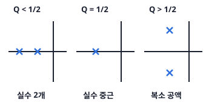

*가로선은 실수축, 세로선은 허수축이고, $Q$가 $\frac{1}{2}$보다 작으면 실수 극점 두 개, 같으면 한 점에 겹친 실수 극점, 크면 실수축 위아래로 마주 보는 복소 극점 한 쌍이에요.*

**정확히 말하면**

#### 1차 필터 두 개로는 왜 부족한가요

1차 필터는 실수 극점(real pole)밖에 만들지 못해요. 1차 필터 두 개를 이으면 2차 필터가 되지만, 그 극점은 여전히 실수 극점 두 개예요([선택도를 높이려면 극점을 늘려요](#s0-selectivity-order)).

실수 극점 두 개로 2차 필터를 만들 수도 있어요. **그래도 특성을 좋게 하려고 2차 필터는 보통 복소 공액 극점(complex conjugate poles) 한 쌍을 갖도록 설계해요.** 복소 극점이 응답을 어떻게 바꾸는지는 [Q가 클수록 고유 주파수 근처가 솟아요](#s4-lowpass-q)에서 봐요.

#### 표준형은 어떻게 쓰나요

극점이 두 개인 2차 전달함수는 분자와 분모를 모두 2차식으로 써요.

$$
H(s) = \dfrac{\alpha s^2 + \beta s + \gamma}{s^2 + \dfrac{\omega_n}{Q}s + \omega_n^2}
$$

분자는 2차항 계수 $\alpha$, 1차항 계수 $\beta$, 상수항 $\gamma$로 쓰는 보통의 2차식이에요. 분모는 $as^2 + bs + c$에서 $s^2$의 계수를 1로 맞춘 뒤 1차항 계수를 $\dfrac{\omega_n}{Q}$, 상수항을 $\omega_n^2$으로 쓴 꼴이에요.

**분모를 $\omega_n$과 $Q$로 쓰는 까닭은 이 두 값이 실제 필터의 특성을 정하는 파라미터이기 때문이에요.** 분자와 분모가 모두 2차식(quadratic)이라 이 꼴을 biquadratic, 줄여서 biquad라고 불러요. $\omega_n$과 $Q$의 뜻은 [Q가 커지면 극점이 허수축으로 다가가요](#s3-pole-circle)에서 이어서 봐요.

#### 숫자로 먼저 풀어 보기

$\omega_n = 1000\ \mathrm{rad/s}$로 두고 $Q$만 바꿔 분모가 0이 되는 $s$를 근의 공식으로 구해요.

1. $$
   s^2 + 1000s + 10^6 = 0
   $$

   $Q = 1$이면 1차항 계수 $\omega_n/Q = 1000$
2. $$
   s = \frac{-1000 \pm \sqrt{1000^2 - 4\times10^6}}{2}
   $$

   근호 안이 $-3\times10^6 \lt 0$
3. $$
   s = -500 \pm j500\sqrt{3}
   $$

   복소 공액 극점 한 쌍, $\approx -500 \pm j866.03\ \mathrm{rad/s}$
4. $$
   s^2 + 2500s + 10^6 = 0
   $$

   $Q = 0.4$이면 1차항 계수 $\omega_n/Q = 2500$
5. $$
   s = \frac{-2500 \pm \sqrt{2500^2 - 4\times10^6}}{2}
   $$

   근호 안이 $2.25\times10^6 \gt 0$
6. $$
   s = -500,\ -2000\ \mathrm{rad/s}
   $$

   서로 다른 실수 극점 두 개

**$Q$가 크면 근호 안이 음수가 되어 복소 공액 극점이 되고, $Q$가 작으면 실수 극점 두 개가 돼요.** 두 경우 모두 극점의 곱은 상수항 $\omega_n^2 = 10^6$이고, 합은 $-\omega_n/Q$예요.

#### 극점 공식과 판별식

같은 계산을 문자로 하면 $Q$의 경계가 나와요.

1. $$
   s^2 + \dfrac{\omega_n}{Q}s + \omega_n^2 = 0
   $$

   분모가 0이 되는 $s$가 극점
2. $$
   D = \left(\dfrac{\omega_n}{Q}\right)^2 - 4\omega_n^2
   $$

   근의 공식의 판별식
3. $$
   D = \omega_n^2\left(\dfrac{1}{Q^2} - 4\right)
   $$

   $\omega_n^2$으로 묶기
4. $$
   D \lt 0 \iff Q \gt \dfrac{1}{2}
   $$

   $\dfrac{1}{Q^2} \lt 4$이고 $Q \gt 0$
5. $$
   p_{1,2} = -\dfrac{\omega_n}{2Q} \pm j\omega_n\sqrt{1 - \dfrac{1}{4Q^2}}
   $$

   $D \lt 0$일 때 $\sqrt{D} = j\sqrt{-D}$를 넣고 2로 나누기

| $Q$의 범위 | 판별식 | 극점 |
|---|---|---|
| $Q \gt \frac{1}{2}$ | $D \lt 0$ | 복소 공액 극점 한 쌍 |
| $Q = \frac{1}{2}$ | $D = 0$ | 실수 중근 $s = -\omega_n$ |
| $Q \lt \frac{1}{2}$ | $D \gt 0$ | 서로 다른 실수 극점 두 개 |

**복소 극점을 가지려면 $Q \gt \frac{1}{2}$이어야 해요.** 수업에서는 "$Q$가 $\frac{1}{2}$ 이상"이라고 말했지만, $Q = \frac{1}{2}$에서는 판별식이 0이라 두 극점이 $-\omega_n$에 겹친 실수 중근이에요.

다른 책처럼 $\zeta = \dfrac{1}{2Q}$로 쓰면 같은 극점이 $-\zeta\omega_n \pm j\omega_n\sqrt{1 - \zeta^2}$예요. 수업 중에는 실수부를 $-2\zeta\omega_n$으로 말했지만 $-\zeta\omega_n$이 맞아요. 이 노트는 $\omega_n$과 $Q$ 표기를 써요.

**교수님 말씀**

> 일반적으로 특성을 좋게 하기 위해서 2차 필터는 컴플렉스 폴로 구현을 합니다.

교수님은 실수 극점 두 개로도 2차 필터를 만들 수 있지만, 대부분의 2차 필터는 복소 극점을 갖도록 설계한다고 하셨어요.

분모를 $\omega_n$과 $Q$로 쓰는 것은 $as^2 + bs + c$에서 $s^2$의 계수를 1로 만든 것일 뿐이고, 두 값이 필터 특성에 의미를 가지기 때문에 따로 정의한다고 짚으셨어요. 복소 극점의 조건은 학생에게 근의 공식으로 확인하게 하셨어요.

확인해 봐요. $\omega_n = 1000\ \mathrm{rad/s}$인 2차 필터에서 $Q = 0.3$, $Q = \frac{1}{2}$, $Q = 2$일 때 극점은 각각 어떤 종류인가요?

답 보기

$Q = 0.3$은 $\frac{1}{Q^2} - 4 \approx 7.11 \gt 0$이라 서로 다른 실수 극점 두 개($s \approx -333.33,\ -3000\ \mathrm{rad/s}$)예요. $Q = \frac{1}{2}$은 판별식이 0이라 $s = -1000\ \mathrm{rad/s}$에 겹친 실수 중근이에요. $Q = 2$는 $\frac{1}{Q^2} - 4 = -3.75 \lt 0$이라 복소 공액 극점 $s \approx -250 \pm j968.25\ \mathrm{rad/s}$예요.

**페이지 요약**

2차 필터는 분모를 $\omega_n$과 $Q$로 쓰고, $Q$가 $\frac{1}{2}$보다 커야 복소 공액 극점을 가져요.

*핵심 식*

- biquad 표준형

  $$
  H(s) = \dfrac{\alpha s^2 + \beta s + \gamma}{s^2 + \dfrac{\omega_n}{Q}s + \omega_n^2}
  $$
- 극점

  $$
  p_{1,2} = -\dfrac{\omega_n}{2Q} \pm j\omega_n\sqrt{1 - \dfrac{1}{4Q^2}}
  $$

판별식이 음수인 $Q \gt \frac{1}{2}$에서만 복소 공액 극점이에요.

$Q = \frac{1}{2}$이면 실수 중근, $Q \lt \frac{1}{2}$이면 서로 다른 실수 극점 두 개예요.

*용어*

- **biquad(biquadratic)** — 분자와 분모가 모두 2차식인 전달함수 꼴이에요.
- **복소 공액 극점(complex conjugate poles)** — 실수부가 같고 허수부의 부호만 다른 극점 한 쌍이에요.

---

### Q가 커지면 극점이 허수축으로 다가가요

*1127 수업 · L07 s12*

**쉽게 말하면**

$Q$를 키우면 극점은 원점에서 $\omega_n$만큼 떨어진 원을 따라 허수축 쪽으로 미끄러지고, 허수축에 닿으면 회로가 불안정해져요.

*극점(×)은 $Q$와 상관없이 반지름 $\omega_n$인 원 위에 있고, $Q$가 커질수록 허수축 위의 $\pm j\omega_n$으로 다가가요.*

**정확히 말하면**

#### 숫자로 먼저 보기

$\omega_n = 1000\ \mathrm{rad/s}$로 두고 $Q$를 1에서 5로 키워 극점의 실수부, 허수부, 원점까지의 거리를 비교해요. 실수부는 $-\dfrac{\omega_n}{2Q}$, 허수부는 $\omega_n\sqrt{1 - \dfrac{1}{4Q^2}}$로 계산해요.

| $Q$ | 실수부 (rad/s) | 허수부 (rad/s) | 원점까지 거리 (rad/s) |
|---|---|---|---|
| 1 | $-500$ | $\approx 866.03$ | 1000 |
| 5 | $-100$ | $\approx 994.99$ | 1000 |
| $\to\infty$ | $\to 0$ | $\to 1000$ | 1000 |

**$Q$가 커지면 실수부는 0으로, 허수부는 $\omega_n$으로 다가가지만 원점까지의 거리는 늘 $\omega_n$이에요.**

#### 극점은 왜 원 위에 있나요

$Q \gt \frac{1}{2}$인 복소 극점에서 실수부 제곱과 허수부 제곱을 더해요.

1. $$
   |p_{1,2}|^2 = \dfrac{\omega_n^2}{4Q^2} + \omega_n^2 - \dfrac{\omega_n^2}{4Q^2}
   $$

   실수부 제곱 + 허수부 제곱
2. $$
   |p_{1,2}|^2 = \omega_n^2
   $$

   $Q$가 들어간 두 항이 지워져요
3. $$
   |p_{1,2}| = \omega_n
   $$

   원점에서 극점까지의 거리

**극점은 $Q$와 상관없이 원점에서 $\omega_n$만큼 떨어진, 반지름 $\omega_n$인 원 위에 있어요.** $Q$는 그 원 위에서 극점이 어디에 놓이는지만 바꿔요.

#### Q가 무한대로 가면 어떻게 되나요

1. $$
   -\dfrac{\omega_n}{2Q} \to 0
   $$

   $Q \to \infty$이면 실수부가 사라져요
2. $$
   p_{1,2} \to \pm j\omega_n
   $$

   극점이 허수축($j\omega$ 축) 위에 놓여요

안정하려면 극점이 좌반평면(실수부가 음수인 쪽)에 있어야 해요. 극점이 $j\omega$ 축 위나 우반평면(RHP)에 있으면 회로는 불안정(unstable)해지고 발진해요.

**그래서 안정한 필터의 $Q$는 무한대보다 작아야 하고, $Q$가 클수록 회로는 불안정에 가까워져요.** 슬라이드도 "For high quality factor (Q) of the poles, the circuit is closer to instability."라고 정리해요.

#### Q와 고유 주파수는 무엇을 뜻하나요

$Q$는 극점의 품질 계수(quality factor)예요. $Q$가 커질수록 손실이 줄고, $Q$가 무한대이면 손실이 없어 극점이 $\pm j\omega_n$에 놓여요.

$\omega_n$은 고유 주파수(natural frequency)이고, 극점이 놓인 원의 반지름이에요. **$\omega_n$은 이득이 대략 어디서 떨어지는지 알려 주고, $Q$는 필터 응답의 모양을 정해요.**

$\omega_n$이 3 dB 주파수와 정확히 같은 것은 2차 저역 통과 필터에서 $Q = 1/\sqrt{2}$일 때뿐이에요. 그 모양은 [Q가 클수록 고유 주파수 근처가 솟아요](#s4-lowpass-q)에서 자세히 봐요.

**교수님 말씀**

> Q가 무한대로 가면 폴이 jω 축 상에 존재하게 되죠. 그러니까 언스테이블해진다.

> Q가 커진단 말은 손실이 줄어든다는 거야.

교수님은 극점의 크기를 물으시고, 실수부 제곱과 허수부 제곱을 더하면 $\omega_n^2$이라 두 극점 모두 원점에서 $\omega_n$만큼 떨어져 있다고 짚으셨어요.

$\omega_n$은 책에 따라 한글로 고유 주파수라고 쓰여 있다고 하셨어요.

확인해 봐요. $\omega_n = 1000\ \mathrm{rad/s}$에서 $Q = 10$이면 극점의 실수부와 원점까지의 거리는 얼마인가요? $Q = 1$일 때보다 허수축에 가까워졌나요?

답 보기

실수부는 $-\dfrac{1000}{2\times10} = -50\ \mathrm{rad/s}$이고, 거리는 $Q$와 상관없이 $|p_{1,2}| = 1000\ \mathrm{rad/s}$예요. 허수부는 $1000\sqrt{1 - \frac{1}{400}} \approx 998.75\ \mathrm{rad/s}$라서, 실수부가 $-500\ \mathrm{rad/s}$이던 $Q = 1$보다 허수축에 훨씬 가까워요.

**페이지 요약**

극점은 반지름 $\omega_n$인 원 위에 있고, $Q$가 커질수록 $\pm j\omega_n$에 다가가 불안정에 가까워져요.

*핵심 식*

- 극점의 크기

  $$
  |p_{1,2}| = \omega_n
  $$
- Q가 무한대일 때

  $$
  p_{1,2} \to \pm j\omega_n
  $$

$Q$가 커지면 실수부 $-\dfrac{\omega_n}{2Q}$는 0으로, 허수부는 $\omega_n$으로 다가가요.

극점이 $j\omega$ 축 위나 우반평면에 있으면 불안정해요.

*용어*

- **고유 주파수(natural frequency)** — 극점이 놓인 원의 반지름 $\omega_n$이에요.
- **품질 계수(quality factor)** — 극점의 $Q$로, 클수록 손실이 적고 무한대이면 손실이 없어요.

---

## 5. 2차 저역 통과와 Q

### Q가 클수록 고유 주파수 근처가 솟아요

*1127 수업 · L07 s13*

**쉽게 말하면**

분자가 상수뿐인 2차 저역 통과 필터는 Q를 키우면 고유 주파수 $\omega_n$ 근처의 크기가 DC 이득보다 솟고, Q를 줄이면 $\omega_n$보다 일찍부터 완만하게 내려가요.

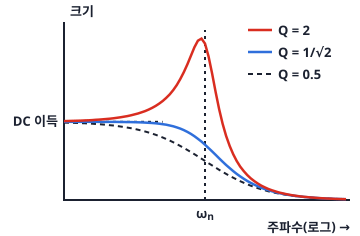

*$\omega_n$에서 크기는 DC 이득의 Q배라서, Q = 2이면 2배로 솟고 경계인 Q = 1/√2이면 약 0.71배(3 dB 감쇠)예요.*

**정확히 말하면**

#### 분자가 상수뿐이면 저역 통과예요

2차 필터 표준형([2차 필터는 분모를 고유 주파수와 Q로 써요](#s3-biquad))에서 분자의 $s^2$ 계수와 $s$ 계수를 모두 0으로 둔 경우, 즉 $\alpha = \beta = 0$인 경우예요. 분모는 그대로 두 극점을 만들고, 분자에 $s$가 없으니 영점은 없어요.

1. $$
   H(s)=\dfrac{\gamma}{s^2+\dfrac{\omega_n}{Q}s+\omega_n^2}
   $$

   분자에 상수 $\gamma$만 남겨요.
2. $$
   H(j\omega)=\dfrac{\gamma}{(\omega_n^2-\omega^2)+j\dfrac{\omega_n\omega}{Q}}
   $$

   $s=j\omega$를 넣으면 $s^2=-\omega^2$이라 실수부가 $\omega_n^2-\omega^2$이 돼요.
3. $$
   |H(j\omega)|^2 = \dfrac{\gamma^2}{(\omega_n^2-\omega^2)^2 + (\omega_n\omega/Q)^2}
   $$

   분모 크기의 제곱은 실수부 제곱과 허수부 제곱의 합이에요.
4. $$
   |H(j0)| = \dfrac{\gamma}{\omega_n^2}
   $$

   $\omega=0$이면 허수부가 0, 실수부가 $\omega_n^2$이에요.
5. $$
   |H(j\omega)|\approx\dfrac{\gamma}{\omega^2}\to0
   $$

   $\omega\to\infty$이면 분모에서 $\omega^4$ 항이 이겨요.

**분자가 상수뿐인 2차 필터는 저주파에서 DC 이득 $\dfrac{\gamma}{\omega_n^2}$을 통과시키고 고주파에서 0으로 가는 저역 통과 필터예요.** 아주 높은 주파수에서는 Q와 상관없이 $\gamma/\omega^2$을 따라 −40 dB/dec로 떨어져요.

(수업 중 $\omega=0$의 값을 귀환 식의 $1+KA_0$처럼 말한 부분은 말실수예요. 이 필터의 DC 이득은 $\dfrac{\gamma}{\omega_n^2}$이에요.)

#### $\omega_n$에서 크기는 DC 이득의 Q배예요

$\omega=\omega_n$이면 실수부 $\omega_n^2-\omega^2$이 0이 되어 허수부 $\omega_n\cdot\omega_n/Q$만 남아요.

1. $$
   |H(j\omega_n)|^2=\dfrac{\gamma^2}{(\omega_n^2/Q)^2}
   $$

   위 크기 식에 $\omega=\omega_n$을 넣어요.
2. $$
   |H(j\omega_n)| = \dfrac{\gamma}{\omega_n^2}Q
   $$

   제곱근을 씌우면 DC 이득에 Q가 곱해져요.

DC 이득이 1($\gamma=\omega_n^2$)인 필터로 숫자를 넣어 봐요.

| Q | $\omega_n$에서 크기 | dB | 모양 |
|---|---|---|---|
| 0.5 | 0.5 | ≈ −6.02 dB | 피크 없이 일찍부터 감소 |
| $1/\sqrt{2}$ | ≈ 0.71 | ≈ −3.01 dB | 피크 없음, 경계 |
| 2 | 2 | ≈ +6.02 dB | $\omega_n$ 근처가 솟음 |

**$\omega_n$에서의 크기는 DC 이득의 Q배라서, Q가 클수록 $\omega_n$ 근처가 DC 이득보다 높이 솟아요.** 주파수 응답에 이렇게 봉우리가 생기는 것을 피킹(peaking)이라고 해요.

#### $Q = 1/\sqrt{2}$가 경계예요

1. $$
   |H(j\omega_n)|=\dfrac{\gamma}{\omega_n^2}\cdot\dfrac{1}{\sqrt{2}}
   $$

   $Q = \dfrac{1}{\sqrt{2}}$를 넣어요.
2. $$
   20\log_{10}\dfrac{1}{\sqrt{2}}\approx-3.01\ \mathrm{dB}
   $$

   DC 이득보다 3 dB 낮아요.

**$Q = \dfrac{1}{\sqrt{2}}$이면 피크 없이 $\omega_n$에서 정확히 3 dB 떨어지고, 이 값이 피킹이 생기느냐 마느냐의 경계예요.** Q가 이보다 작으면 피크 없이 $\omega_n$보다 일찍부터 단조 감소하고, 크면 피킹이 생겨요. 그래서 $\omega_n$이 3 dB 주파수와 정확히 같은 것은 $Q = 1/\sqrt{2}$일 때뿐이고, 다른 Q에서 $\omega_n$은 이득이 꺾이기 시작하는 대략의 위치예요.

슬라이드의 $\sqrt{2}/2$는 $1/\sqrt{2}$와 같은 값이에요. 그림에 적힌 피크 위치 $\omega_n\sqrt{1-\dfrac{1}{2Q^2}}$은 수업에서 따로 다루지 않았고, 피크가 $\omega_n$보다 조금 아래에 선다는 것만 보면 돼요.

#### Q를 키우면 무엇을 얻고 잃나요

- 얻는 것: $\omega_n$ 부근에서 크기가 더 가파르게 떨어져 원하지 않는 주파수를 가려내는 선택도(selectivity)가 좋아져요.
- 잃는 것: 통과 대역 이득이 평탄하지 않고(피킹), 극점이 허수축에 다가가 불안정에 가까워져요([Q가 커지면 극점이 허수축으로 다가가요](#s3-pole-circle)).
- 시간 응답: Q가 클수록 계단 입력을 넣었을 때 출력이 최종값을 잠깐 넘어서는 오버슈트(overshoot)가 커져요.

**Q를 키우면 천이는 가팔라지지만 피킹과 오버슈트가 커지고 불안정에 가까워지는 트레이드오프가 있어요.** 그래서 슬라이드는 주파수 응답과 시간 응답을 모두 얌전하게 하려면 보통 Q를 $\sqrt{2}/2$ 이하로 유지한다고 정리해요.

**교수님 말씀**

> Q가 크면 클수록 피크가 커져요. 그래서 점점 더 언스테이블해지는 거고요.

교수님은 피크가 원치 않는 특성이지만, Q가 클수록 기울기가 커져서 선택도 측면에서는 특성이 더 강해진다고 하셨어요. 오버슈트가 생기는 대신 트랜지션이 샤프해지니, 무조건 오버슈트 없는 쪽이 좋은 것도 아니라고 강조하셨어요.

**꼭 기억해요**

> 피크는 생기지 않으면서 가장 샤프한 특징을 가지게 되고요.

$Q = 1/\sqrt{2}$는 피크가 없는 응답 가운데 가장 날카로운 응답이에요. 이보다 날카롭게 하려면 피킹을 받아들여야 해요.

주파수 응답의 피킹과 시간 응답의 오버슈트는 경계가 달라요. 피킹은 $Q \gt 1/\sqrt{2}$부터 생기지만, 계단 응답의 오버슈트는 극점이 복소수가 되는 $Q \gt 1/2$부터 조금씩 생겨요($Q = 1/\sqrt{2}$에서 약 4.32%). 수업의 "Q가 $1/\sqrt{2}$보다 작으면 오버슈트가 안 생긴다"는 말은 주파수 응답의 피크 기준으로 읽어요.

#### 직접 해 보기: Q를 바꾸면 극점과 크기 응답이 함께 움직여요 *(정적 스냅샷 — 직접 조작은 HTML 버전)*

Q를 0.3에서 5까지 바꾸면 왼쪽 s 평면의 두 극점(×)과 오른쪽 크기 응답이 함께 바뀌어요(점선 원은 반지름 $\omega_n$, 점선 곡선은 Q = 1/√2인 버터워스 기준).

극점 **≈ −0.71ωn ± j0.71ωn** · ωn에서 크기 ÷ DC 이득 = Q **≈ 0.71**(**≈ −3.01 dB**) · **피킹 없음, ωn에서 정확히 3 dB 감쇠(버터워스 경계)**

범례: 현재 Q의 크기 응답 · Q = 1/√2(버터워스) 기준과 반지름 ωn 원 · ωn에서의 크기

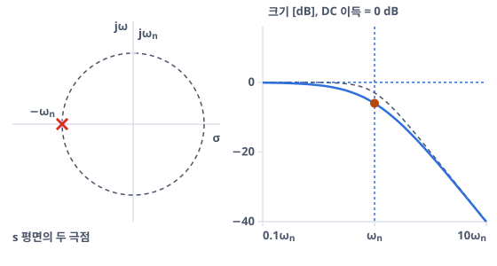

*Q = 0.5: 피킹 없음, ωn보다 일찍부터 단조 감소*

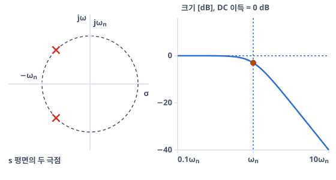

*Q = 1/√2 ≈ 0.71: 피킹 없음, ωn에서 정확히 3 dB 감쇠(버터워스 경계)*

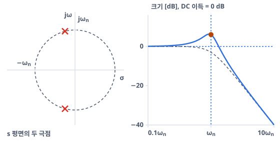

*Q = 2: DC 이득보다 솟는 피킹, 천이가 더 가파름*

| Q | 극점 | ωn에서 크기 ÷ DC 이득 | 모양 |
|---|---|---|---|
| 0.5 | 실수 중근 −1ωn | Q = 0.5(≈ −6.02 dB) | 피킹 없음, ωn보다 일찍부터 단조 감소 |
| 1/√2 ≈ 0.71 | ≈ −0.71ωn ± j0.71ωn | Q ≈ 0.71(≈ −3.01 dB) | 피킹 없음, ωn에서 정확히 3 dB 감쇠(버터워스 경계) |
| 2 | ≈ −0.25ωn ± j0.97ωn | Q = 2(≈ +6.02 dB) | DC 이득보다 솟는 피킹, 천이가 더 가파름 |

확인해 봐요. DC 이득 $\dfrac{\gamma}{\omega_n^2}$이 2인 2차 저역 통과 필터의 Q가 3이에요. $\omega=\omega_n$에서 크기는 얼마이고, 피킹이 생기나요?

답 보기

크기는 6이고 피킹이 생겨요. $|H(j\omega_n)|=\dfrac{\gamma}{\omega_n^2}Q=2\times3=6$이고, $Q=3$이 경계 $1/\sqrt{2}$보다 크기 때문이에요.

**페이지 요약**

2차 저역 통과 필터는 $\omega_n$에서 크기가 DC 이득의 Q배라서, $Q = 1/\sqrt{2}$를 경계로 피킹이 생기거나 사라져요.

*핵심 식*

- 크기의 제곱

  $$
  |H(j\omega)|^2 = \dfrac{\gamma^2}{(\omega_n^2-\omega^2)^2 + (\omega_n\omega/Q)^2}
  $$
- DC 이득

  $$
  |H(j0)| = \dfrac{\gamma}{\omega_n^2}
  $$
- $\omega_n$에서 크기

  $$
  |H(j\omega_n)| = \dfrac{\gamma}{\omega_n^2}Q
  $$

*판단*

$Q = 1/\sqrt{2}$이면 피크 없이 $\omega_n$에서 3 dB 감쇠해요.

Q가 이보다 크면 피킹과 오버슈트가 커지는 대신 천이가 가팔라져요.

*용어*

- **피킹(peaking)** — $\omega_n$ 근처에서 크기가 DC 이득보다 솟는 현상이에요.
- **오버슈트(overshoot)** — 계단 입력에 대해 출력이 최종값을 잠깐 넘어서는 현상이에요.

---

### 평탄한 버터워스, 날카로운 체비셰프

*1127 수업 · L07 s13*

**쉽게 말하면**

통과 대역의 평탄함과 경계의 날카로움은 함께 얻기 어려워서, 평탄함을 고르면 버터워스, 리플을 감수하고 날카로움을 고르면 체비셰프 필터예요.

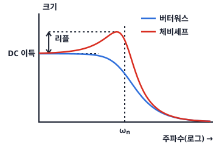

*버터워스는 통과 대역이 평평하고, 체비셰프는 리플이 있는 대신 $\omega_n$ 근처에서 더 가파르게 떨어져요.*

**정확히 말하면**

#### 평탄함과 날카로움은 함께 얻기 어려워요

리플은 한 대역 안에서 이득이 흔들리는 폭이에요. 이상적인 필터라면 통과 대역은 평탄하고 천이 대역은 수직이지만, 2차 필터에서는 Q 하나가 두 성질을 반대 방향으로 움직여요.

**통과 대역을 평탄하게 하면 천이가 완만해지고, 천이를 날카롭게 하면 리플을 감수해야 하는 트레이드오프예요.**

#### 버터워스는 최대 평탄이에요

$x=\omega/\omega_n$로 두고, 크기를 DC 이득 $\dfrac{\gamma}{\omega_n^2}$으로 나눠 봐요([Q가 클수록 고유 주파수 근처가 솟아요](#s4-lowpass-q)의 크기 식).

1. $$
   \dfrac{|H(j\omega)|^2}{(\gamma/\omega_n^2)^2}=\dfrac{1}{(1-x^2)^2+x^2/Q^2}
   $$

   분자와 분모를 $\omega_n^4$으로 나눠요.
2. $$
   (1-x^2)^2+2x^2=1+x^4
   $$

   $Q = \dfrac{1}{\sqrt{2}}$이면 $1/Q^2=2$예요.
3. $$
   \dfrac{|H(j\omega)|^2}{(\gamma/\omega_n^2)^2}=\dfrac{1}{1+x^4}
   $$

   $x$가 커질수록 줄기만 하고 솟지 않아요.

분모에 $x^2$ 항이 없어서 $x=0$ 근처가 아주 평평해요. **2차에서 $Q = \dfrac{1}{\sqrt{2}}$로 설계한 버터워스(Butterworth) 필터는 리플 없이 최대 평탄(maximally flat)한 응답을 가져요.** 대신 천이 대역은 덜 날카로워요.

#### 체비셰프는 Q를 더 키워 날카롭게 해요

체비셰프(Chebyshev) 필터는 2차에서 Q를 $1/\sqrt{2}$보다 크게 잡은 응답이에요. 통과 대역 끝인 $\omega_n$ 근처가 솟아 리플(피킹)이 생기지만, 그 뒤로 더 가파르게 떨어져요. DC 이득을 1로 두고 $\omega_n$에서 $2\omega_n$까지 떨어지는 양을 비교해요($x=2$이면 $(1-x^2)^2=9$).

1. $$
   |H(j2\omega_n)|=\dfrac{1}{\sqrt{9+8}}=\dfrac{1}{\sqrt{17}}
   $$

   $Q=1/\sqrt{2}$이면 $x^2/Q^2=4\times2=8$이에요.
2. $$
   |H(j2\omega_n)|=\dfrac{1}{\sqrt{9+1}}=\dfrac{1}{\sqrt{10}}
   $$

   $Q=2$이면 $x^2/Q^2=4/4=1$이에요.
3. $$
   20\log_{10}\dfrac{1/\sqrt{2}}{1/\sqrt{17}}\approx9.29\ \mathrm{dB}
   $$

   버터워스가 $\omega_n$에서 $2\omega_n$까지 줄어드는 양이에요.
4. $$
   20\log_{10}\dfrac{2}{1/\sqrt{10}}\approx16.02\ \mathrm{dB}
   $$

   Q = 2는 솟은 $\omega_n$에서부터 더 많이 줄어요.

**Q를 키운 체비셰프 필터는 통과 대역에 리플이 생기는 대신 천이가 더 날카로워요.** 여기서 날카롭다는 것은 $\omega_n$ 부근에서 떨어지는 빠르기예요. 같은 $\omega_n$으로 비교했으므로 $2\omega_n$에서의 크기 자체는 Q = 2 쪽이 아직 조금 더 크고, 아주 높은 주파수에서는 두 곡선이 같은 −40 dB/dec 직선에 모여요.

#### 실수 극점 두 개로는 만들 수 없어요

1차 필터 두 개를 이어 실수 극점 $-a$, $-b$($a,b\gt0$)만 만들면 분모를 표준형과 맞춰 Q를 구할 수 있어요. 예를 들어 $a=1\ \mathrm{krad/s}$, $b=9\ \mathrm{krad/s}$이면 다음과 같아요.

1. $$
   (s+a)(s+b)=s^2+(a+b)s+ab
   $$

   두 실수 극점이 만드는 분모예요.
2. $$
   \omega_n=\sqrt{ab}=\sqrt{1\times9}=3\ \mathrm{krad/s}
   $$

   상수항 $ab$가 $\omega_n^2$이에요.
3. $$
   Q=\dfrac{\sqrt{ab}}{a+b}=\dfrac{3}{10}=0.3
   $$

   $s$ 항 $a+b$가 $\omega_n/Q$예요.
4. $$
   Q=\dfrac{\sqrt{ab}}{a+b}\le\dfrac{1}{2}
   $$

   산술·기하 평균에서 $a+b\ge2\sqrt{ab}$예요.

**실수 극점 두 개의 Q는 1/2을 넘지 못하므로, $Q = 1/\sqrt{2}$ 이상이 필요한 버터워스·체비셰프 모양은 복소 극점을 갖는 2차 필터로 만들어요.** 그래서 2차 필터는 1차 두 개로도 만들 수 있지만, 더 날카롭게 하려고 보통 복소 극점으로 설계해요.

#### 언제 무엇을 쓰나요

- 제거해야 할 큰 신호가 통과 대역 바로 옆에 있으면 천이가 날카로운 체비셰프 필터를 써요.
- 통과시킬 대역 안에서 이득이 일정해야 하면 평탄한 버터워스 필터를 써요.

**어느 한쪽이 늘 더 좋은 것이 아니라, 응용이 평탄함과 날카로움 중 무엇을 요구하느냐로 골라요.** 버터워스·체비셰프는 응답 모양의 이름이라 능동·수동 어느 쪽으로도, 저역 통과·고역 통과 어느 쪽으로도 만들 수 있어요. 각각을 회로로 만드는 방법은 다음 시간에 다뤄요.

**교수님 말씀**

> 나는 플랫한 게 좋아, 버터워스 필터를 써요. 나는 플랫하지 않더라도 샤프한 특성을 보고 싶어, 체비셰프 필터를 써요.

교수님은 두 필터가 모두 쓰이며, 버터워스는 사람 이름이라고 덧붙이셨어요. 버터워스의 Q보다 크게 설계해 더 샤프하게 만드는 경우도 있다고 하셨어요.

2차에서 $Q = 1/\sqrt{2}$로 설계하면 버터워스 필터이고, Q가 커질수록 통과 대역에 리플이 생겨요.

확인해 봐요. 두 극점이 실수축 위 $-1\ \mathrm{krad/s}$와 $-4\ \mathrm{krad/s}$에 있는 2차 필터의 Q는 얼마이고, 버터워스나 체비셰프 모양을 만들 수 있나요?

답 보기

$Q=0.4$라서 만들 수 없어요. $\omega_n=\sqrt{1\times4}=2\ \mathrm{krad/s}$, $Q=\dfrac{2}{1+4}=0.4$로 $1/\sqrt{2}$보다 작기 때문이에요.

**페이지 요약**

2차에서 $Q = 1/\sqrt{2}$는 리플 없이 최대 평탄한 버터워스이고, Q를 더 키우면 리플을 감수하고 천이가 날카로운 체비셰프예요.

*핵심 식*

- 버터워스($x=\omega/\omega_n$)

  $$
  \dfrac{|H(j\omega)|^2}{(\gamma/\omega_n^2)^2}=\dfrac{1}{1+x^4}
  $$
- 실수 극점 두 개

  $$
  Q=\dfrac{\sqrt{ab}}{a+b}\le\dfrac{1}{2}
  $$

*판단*

통과 대역 이득이 일정해야 하면 버터워스를 써요.

바로 옆의 큰 신호를 없애야 하면 체비셰프를 써요.

*용어*

- **버터워스(Butterworth)** — 2차에서 $Q = 1/\sqrt{2}$인 최대 평탄 응답이에요.
- **체비셰프(Chebyshev)** — Q를 더 키워 리플 대신 날카로운 천이를 얻는 응답이에요.
- **리플(ripple)** — 한 대역 안에서 이득이 흔들리는 폭이에요.

---

## 6. 2차 고역 통과와 대역 통과

### 원점의 영점 두 개가 저주파를 막아요

*1127 수업 · L07 s14*

**쉽게 말하면**

분자에 $\alpha s^2$만 있으면 주파수 0에서는 크기가 0이고, 주파수가 아주 높아지면 크기가 $\alpha$로 평평해지는 고역 통과 필터가 돼요.

예를 들어 $\alpha=2$이면 저주파 이득은 0, 고주파 이득은 2예요.

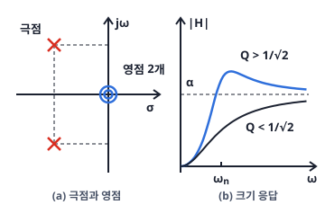

*원점에 겹친 영점 두 개(이중 원)가 저주파를 0으로 누르고, 높은 주파수에서는 크기가 $\alpha$에 머물러요.*

**정확히 말하면**

#### 두 극한으로 모양을 판정해요

2차 표준형([2차 필터는 분모를 고유 주파수와 Q로 써요](#s3-biquad))의 분자에서 $\beta = \gamma = 0$으로 두면 $s^2$ 항만 남아요.

$$
H(s) = \dfrac{\alpha s^2}{s^2 + \dfrac{\omega_n}{Q}s + \omega_n^2}
$$

필터의 형태는 주파수가 0일 때와 무한대일 때의 이득을 보면 판정돼요. 앞의 예시 $\alpha=2$를 그대로 따라가요.

1. $$
   \lim_{s \to 0} H(s) = \dfrac{0}{\omega_n^2} = 0
   $$

   분자가 먼저 0이 돼요
2. $$
   \lim_{s \to \infty} H(s) = \lim_{s \to \infty} \dfrac{\alpha}{1 + \dfrac{\omega_n}{Qs} + \dfrac{\omega_n^2}{s^2}} = \alpha
   $$

   분자·분모를 $s^2$으로 나눠요

$\alpha=2$이면 저주파 이득 0, 고주파 이득 2예요. **저주파 이득은 0이고 고주파 이득은 $\alpha$라서 고역 통과 필터예요.** 분자가 상수 $\gamma$뿐인 저역 통과 필터([Q가 클수록 고유 주파수 근처가 솟아요](#s4-lowpass-q))와 정반대예요.

#### 영점은 어디에 있나요

분모는 저역 통과 필터와 같아서 극점 두 개는 그대로예요. 분자 $\alpha s^2$이 0이 되는 $s$는 0이고, 제곱이라 두 번 나와요.

$$
\alpha s^2 = 0 \;\Rightarrow\; s_{z1} = s_{z2} = 0
$$

즉 원점에 영점 두 개가 있어요. $\omega \ll \omega_n$이면 분모가 거의 $\omega_n^2$이라 크기는 $\omega^2$에 비례해 0부터 올라와요.

$$
|H(j\omega)| \approx \dfrac{\alpha\omega^2}{\omega_n^2}
$$

**영점이 원점에 있으니 원점에서는 0이었다가 주파수가 높아지면 $\alpha$의 유한한 이득이 돼요.**

#### Q는 응답을 어떻게 바꾸나요

$s=j\omega$를 넣은 크기는 저역 통과 필터와 분자만 달라요.

$$
|H(j\omega)|^2 = \dfrac{\alpha^2\omega^4}{(\omega_n^2-\omega^2)^2 + (\omega_n\omega/Q)^2}
$$

$\omega=\omega_n$이면 분모의 첫 항이 사라져요.

$$
|H(j\omega_n)| = \dfrac{\alpha\omega_n^2}{\omega_n^2/Q} = \alpha Q
$$

$Q=1/\sqrt{2}$이면 $|H(j\omega_n)|=\alpha/\sqrt{2}$로 고주파 이득보다 3 dB 낮아요. **저역 통과 필터와 마찬가지로 $Q=1/\sqrt{2}$가 경계예요.** $Q \gt 1/\sqrt{2}$이면 $\omega_n$ 근처에 피킹이 생기는 대신 천이가 날카롭고, Q가 클수록 피킹이 커져요. $Q \lt 1/\sqrt{2}$이면 피킹 없이 곡선의 기울기가 작아져 더 완만하게 올라와요.

**교수님 말씀**

> 분자에 제곱항만 있으면 0일 때는 0이고 … 주파수 무한대로 갈 때는 이제 상쇄돼서 유한한 이득을 가지게 됩니다.

교수님은 모양을 외우기보다 주파수가 0일 때와 무한대로 갈 때의 이득을 보면 하이패스 필터라는 것을 예측할 수 있다고 하셨어요. $s^2$이니 제로가 원점에 두 개 있고, 고주파에서는 분자가 극점의 효과를 상쇄해 이득이 남는다고 설명하셨어요. 피킹은 복소 극점을 가진 2차 필터에서 나타나는 특성이라고 정리하셨어요.

확인해 봐요. $H(s)=\dfrac{3s^2}{s^2+200s+10^6}$ ($s$의 단위는 rad/s)의 저주파 이득과 고주파 이득은 얼마이고, 이 필터의 $Q$는 $1/\sqrt{2}$보다 큰가요?

답 보기

$s \to 0$에서 0, $s \to \infty$에서 3이므로 고주파 이득 3인 고역 통과 필터예요. $\omega_n^2=10^6$에서 $\omega_n=1000\,\mathrm{rad/s}$, $\omega_n/Q=200$에서 $Q=5$라서 $1/\sqrt{2}$보다 크고, $\omega_n$에서 크기 $\alpha Q=15$로 솟는 피킹이 생겨요.

**페이지 요약**

분자가 $\alpha s^2$뿐이면 원점에 영점 두 개가 생겨 저주파 이득은 0, 고주파 이득은 $\alpha$인 고역 통과 필터예요.

*핵심 식*

- 2차 HPF

  $$
  H(s) = \dfrac{\alpha s^2}{s^2 + \dfrac{\omega_n}{Q}s + \omega_n^2}
  $$
- $\omega_n$에서의 크기

  $$
  |H(j\omega_n)| = \dfrac{\alpha\omega_n^2}{\omega_n^2/Q} = \alpha Q
  $$

필터의 형태는 $s \to 0$과 $s \to \infty$의 이득으로 판정해요.

저역 통과 필터와 마찬가지로 $Q=1/\sqrt{2}$가 피킹의 경계예요.

*용어*

- **고역 통과(high-pass)** — 저주파는 막고 높은 주파수를 통과시켜요.
- **고주파 이득** — $s \to \infty$에서 남는 이득으로, 2차 HPF에서는 $\alpha$예요.
- **영점(zero)** — 전달함수를 0으로 만드는 $s$로, 2차 HPF는 원점에 두 개예요.

---

### 고유 주파수에서 가장 크게 통과해요

*1127 수업 · L07 s15*

**쉽게 말하면**

분자에 $\beta s$만 있으면 주파수 0과 아주 높은 주파수에서 모두 크기가 0이고, 그 사이 고유 주파수 $\omega_n$에서 가장 크게 통과하는 대역 통과 필터가 돼요.

예를 들어 $\omega_n=1000\,\mathrm{rad/s}$, $Q=5$, $\beta=200\,\mathrm{rad/s}$이면 $\omega_n$에서 크기가 $200\times5/1000=1$이에요.

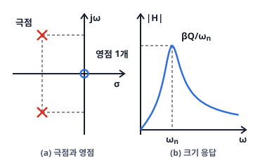

*원점의 영점 하나가 저주파를, 극점 두 개가 고주파를 누르고, 그 사이 $\omega_n$에서 크기가 가장 커요.*

**정확히 말하면**

#### 양 끝이 모두 0이에요

2차 표준형의 분자에서 $\alpha = \gamma = 0$으로 두면 $s$ 항만 남아요.

$$
H(s) = \dfrac{\beta s}{s^2 + \dfrac{\omega_n}{Q}s + \omega_n^2}
$$

고역 통과 필터와 같은 방법으로 두 극한을 봐요.

1. $$
   \lim_{s \to 0} H(s) = \dfrac{0}{\omega_n^2} = 0
   $$

   분자가 먼저 0이 돼요
2. $$
   \lim_{s \to \infty} H(s) = \lim_{s \to \infty} \dfrac{\beta}{s + \dfrac{\omega_n}{Q} + \dfrac{\omega_n^2}{s}} = 0
   $$

   분모의 차수가 하나 더 높아요

분자 $\beta s$가 0이 되는 $s$는 0 하나뿐이라 원점에 영점 하나, 극점 두 개인 형태예요. **0과 무한대에서 모두 0이라서 그 중간의 특정한 대역만 통과시키는 대역 통과 필터예요.**

#### 왜 고유 주파수에서 가장 클까요

$s=j\omega$를 넣고 분자·분모를 $\omega$로 나누면 $\omega$가 분모에만 남아요.

1. $$
   |H(j\omega)| = \dfrac{\beta\omega}{\sqrt{(\omega_n^2-\omega^2)^2 + (\omega_n\omega/Q)^2}}
   $$

   $s=j\omega$를 넣은 크기예요
2. $$
   |H(j\omega)| = \dfrac{\beta}{\sqrt{\left(\dfrac{\omega_n^2-\omega^2}{\omega}\right)^2 + \left(\dfrac{\omega_n}{Q}\right)^2}}
   $$

   분자·분모를 $\omega$로 나눠요
3. $$
   |H(j\omega_n)| = \dfrac{\beta Q}{\omega_n}
   $$

   첫 제곱 항이 0이 되는 곳이에요

첫 제곱 항은 0 이상이고 $\omega=\omega_n$일 때만 0이므로, 그때 분모가 가장 작아요. **$\omega=\omega_n$에서 분모의 실수부 $\omega_n^2-\omega^2$이 0이 되어 크기가 최대 $\beta Q/\omega_n$이 돼요.** 앞의 예시는 $200\times5/1000=1$이고, $\beta$와 $\omega_n$이 같으면 Q가 클수록 최대 크기도 커져요.

#### 세 필터를 나란히 보면

분모(극점)는 모두 같고, 분자가 원점에 두는 영점의 개수만 달라요.

| 필터 | 원점 영점 | $\omega \to 0$ / $\omega \to \infty$ | $\omega_n$의 크기 |
|---|---|---|---|
| 저역 통과 $\alpha=\beta=0$ | 없음 | $\gamma/\omega_n^2$ / 0 | $(\gamma/\omega_n^2)Q$ |
| 고역 통과 $\beta=\gamma=0$ | 두 개 | 0 / $\alpha$ | $\alpha Q$ |
| 대역 통과 $\alpha=\gamma=0$ | 하나 | 0 / 0 | $\beta Q/\omega_n$ |

**분자의 차이에서 저역 통과·고역 통과·대역 통과 특성이 갈려요.** 대역 통과 필터가 얼마나 넓은 대역을 통과시키는지, 즉 대역폭(bandwidth)은 다음 시간에 다뤄요([다음 시간 예고](#s6-next)).

**교수님 말씀**

> 그 중간에 게인을 가지는 즉 특정한 밴드만 통과시키는 밴드패스 필터의 모양이 되겠습니다.

교수님은 1차 항만 있으면 주파수가 0으로 갈 때도, 무한대로 갈 때도 크기가 0으로 간다고 먼저 짚으셨어요. 이어서 $\omega_n$을 넣으면 분모가 최소가 되어 그때 크기가 최대, 즉 피킹을 가진다고 정리하셨어요. 밴드패스 필터의 대역폭은 다음 시간에 하겠다고 하셨어요.

**꼭 기억해요**

교수님은 $\omega_n$에서의 크기를 짚으며 “중요한 거”라고 강조하셨어요. 대역 통과 필터에서 외워 둘 값은 최대 크기 $\beta Q/\omega_n$과 그 위치 $\omega_n$이에요.

저역 통과·고역 통과 필터는 $Q \gt 1/\sqrt{2}$일 때만 솟는 부분이 생기지만, 대역 통과 필터는 Q 값과 상관없이 항상 정확히 $\omega=\omega_n$에서 최대예요. 대역 통과의 봉우리를 피킹의 유무로 판정하지 않아요.

확인해 봐요. $\omega_n=2000\,\mathrm{rad/s}$, $Q=10$, $\beta=100\,\mathrm{rad/s}$인 2차 대역 통과 필터에서 $\omega \to 0$, $\omega \to \infty$일 때의 크기와 $\omega=\omega_n$에서의 크기는?

답 보기

양 끝은 모두 0이고, $\omega_n$에서 $|H(j\omega_n)|=\beta Q/\omega_n=100\times10/2000=0.5$예요.

**페이지 요약**

분자가 $\beta s$뿐이면 원점에 영점 하나가 생겨 양 끝은 0이고 $\omega_n$에서 가장 크게 통과해요.

*핵심 식*

- 2차 BPF

  $$
  H(s) = \dfrac{\beta s}{s^2 + \dfrac{\omega_n}{Q}s + \omega_n^2}
  $$
- 최대 크기

  $$
  |H(j\omega_n)| = \dfrac{\beta Q}{\omega_n}
  $$

$\omega=\omega_n$에서 분모의 실수부 $\omega_n^2-\omega^2$이 0이 되어 크기가 최대예요.

Q 값과 상관없이 최대는 항상 $\omega=\omega_n$이에요.

대역폭은 다음 시간에 다뤄요.

*용어*

- **대역 통과(band-pass)** — 0과 무한대 사이의 특정한 대역만 통과시켜요.
- **영점(zero)** — 2차 BPF는 원점에 영점 하나, 극점 두 개를 가져요.

---

## 7. 요약 · 예고

### 한눈에 다시 보기

*1127 수업 · L07 s7–s15*

원하는 신호는 통과시키고 원하지 않는 신호는 잘 걸러 내는 정도를 선택도(selectivity)라고 해요. 선택도를 높이려면 전달 함수의 극점 수, 곧 필터의 차수를 늘려요. 극점 하나는 $-20\text{ dB/dec}$이라서 10배 떨어진 간섭을 20 dB만 줄이고, 같은 위치의 극점 두 개면 $-40\text{ dB/dec}$이 돼요([선택도를 높이려면 극점을 늘려요](#s0-selectivity-order)). 고차 필터는 1차 필터와 2차 필터를 이어 만들고, 복소 극점은 2차 필터로만 만들 수 있어요.

**1차 필터.** $H(s) = \alpha\dfrac{s - z_1}{s - p_1}$의 DC 이득은 $\alpha\dfrac{z_1}{p_1}$, 고주파 이득은 $\alpha$예요. 주파수를 올릴 때 극점을 먼저 만나면 LPF, 영점을 먼저 만나면 HPF예요([극점과 영점 중 먼저 오는 쪽이 LPF·HPF를 정해요](#s1-pole-zero)). 두 구현 모두 $Z_1 = R_1\parallel\frac{1}{sC_1}$, $Z_2 = R_2\parallel\frac{1}{sC_2}$를 써요.

| 항목 | 수동: RC 분압기 | 능동: 반전 증폭기 |
|---|---|---|
| $Z_2$ 위치 | 출력과 접지 사이 | 반전 입력과 출력 사이(귀환) |
| 전달 함수 | $\frac{Z_2}{Z_1+Z_2}$ | $-\frac{Z_2}{Z_1}$ |
| 영점 | $-\frac{1}{R_1C_1}$ | $-\frac{1}{R_1C_1}$ |
| 극점 | $-\frac{R_1+R_2}{R_1R_2(C_1+C_2)}$ | $-\frac{1}{R_2C_2}$ |
| 저주파 이득 | $\frac{R_2}{R_1+R_2}$ | $-\frac{R_2}{R_1}$ |
| 고주파 이득 | $\frac{C_1}{C_1+C_2}$ | $-\frac{C_1}{C_2}$ |
| LPF 조건 | $R_2C_2 \gt R_1C_1$ | $R_2C_2 \gt R_1C_1$ |
| HPF 조건 | $R_2C_2 \lt R_1C_1$ | $R_2C_2 \lt R_1C_1$ |
| 좋은 점 | 전원이 필요 없고 전력을 쓰지 않아요 | $R_2 \gt R_1$이면 이득이 1보다 커요 극점과 영점을 따로 정해요 |
| 대가 | 이득이 1보다 작아요 극점·영점 식이 얽혀 설계가 번거로워요 | 전력 소모 OP-amp 극점 뒤의 대역폭 제한 |

두 구현 모두 1차라서 기울기는 $\pm20\text{ dB/dec}$(LPF는 내려가고 HPF는 올라가요)이고 천이 대역이 넓어요. 자세한 유도는 [RC 분압기는 이득이 1보다 작아요](#s2-passive), [반전 증폭기는 극점과 영점을 따로 정해요](#s2-active), 비교는 [능동 필터는 이득을 얻는 대신 전력을 써요](#s2-compare)에 있어요.

**2차 필터.** 분모를 고유 주파수 $\omega_n$과 품질 계수 $Q$로 쓴 biquad 표준형이에요([2차 필터는 분모를 고유 주파수와 Q로 써요](#s3-biquad)).

$$
H(s) = \dfrac{\alpha s^2 + \beta s + \gamma}{s^2 + \dfrac{\omega_n}{Q}s + \omega_n^2}
$$

$$
p_{1,2} = -\dfrac{\omega_n}{2Q} \pm j\omega_n\sqrt{1 - \dfrac{1}{4Q^2}}
$$

복소 극점이면 두 극점은 원점에서 $\omega_n$만큼 떨어진 원 위에 있어요($|p_{1,2}| = \omega_n$). $Q$가 커지면 실수부는 0으로, 허수부는 $\omega_n$으로 다가가요([Q가 커지면 극점이 허수축으로 다가가요](#s3-pole-circle)).

| $Q$ | 극점 | LPF·HPF 크기 응답 |
|---|---|---|
| $Q \le \frac{1}{2}$ | 실수 극점 두 개 ($Q = \frac{1}{2}$이면 중근) | 피크 없이 LPF는 단조 감소, HPF는 단조 증가해요. 덜 샤프해요 |
| $\frac{1}{2} \lt Q \lt \frac{1}{\sqrt{2}}$ | 복소 공액 극점 | 피크 없이 LPF는 단조 감소, HPF는 단조 증가해요. 덜 샤프해요 |
| $Q = \dfrac{1}{\sqrt{2}}$ | 복소 공액 극점 | 버터워스: 최대 평탄, $\omega_n$에서 정확히 3 dB 감쇠 |
| $Q \gt \frac{1}{\sqrt{2}}$ | 복소 공액 극점 | $\omega_n$ 근처 피킹·오버슈트, 천이가 샤프해요(체비셰프처럼 통과 대역 리플) |
| $Q \to \infty$ | $\pm j\omega_n$ (허수축 위) | 손실이 없고 불안정(발진)해요 |

실수 극점 두 개, 곧 1차 필터 두 개를 이은 것으로는 $Q \gt \frac{1}{\sqrt{2}}$인 샤프한 특성을 만들 수 없어요. 통과 대역 이득이 평탄해야 하면 버터워스, 가까운 큰 간섭을 없애야 하면 체비셰프를 써요([평탄한 버터워스, 날카로운 체비셰프](#s4-butterworth-chebyshev)). 슬라이드는 응답이 얌전하도록 보통 $Q$를 이 경계 이하로 둔다고 하고, 더 샤프하게 하려고 일부러 크게 설계하기도 해요.

**2차 LPF·HPF·BPF.** 분모는 그대로 두고 분자의 계수만 골라요. 판정은 $s \to 0$과 $s \to \infty$의 이득을 보면 돼요.

| 항목 | LPF | HPF | BPF |
|---|---|---|---|
| 분자 조건 | $\alpha = \beta = 0$ | $\beta = \gamma = 0$ | $\alpha = \gamma = 0$ |
| 분자 | $\gamma$ | $\alpha s^2$ | $\beta s$ |
| 영점 | 없음 | 원점에 두 개 | 원점에 하나 |
| $s \to 0$ | $\frac{\gamma}{\omega_n^2}$ | 0 | 0 |
| $s \to \infty$ | 0 | $\alpha$ | 0 |
| $\omega = \omega_n$의 크기 | $\frac{\gamma}{\omega_n^2}Q$ | $\alpha Q$ | $\frac{\beta Q}{\omega_n}$ (최대) |

$\omega = \omega_n$에서는 분모의 실수부 $\omega_n^2-\omega^2$이 0이 되어 분모 크기가 $\frac{\omega_n^2}{Q}$만 남아요. 그래서 LPF·HPF는 통과 대역 이득의 $Q$배가 되고, BPF는 이 주파수에서 크기가 가장 커요([Q가 클수록 고유 주파수 근처가 솟아요](#s4-lowpass-q), [원점의 영점 두 개가 저주파를 막아요](#s5-highpass), [고유 주파수에서 가장 크게 통과해요](#s5-bandpass)).

---

### 다음 시간 예고

*1127 수업 · L07 s15–s35*

이번 시간에는 1차 필터의 구현과, 2차 필터의 전달 함수에 따라 모양과 종류가 어떻게 달라지는지를 봤어요. 2차 대역 통과 필터는 $\omega_n$에서 크기가 가장 크다는 데까지 봤고, 그 대역폭은 다음 시간에 봐요. 이어서 2차 필터를 실제 회로로 어떻게 만드는지 예제와 함께 설명해요.

- 2차 대역 통과 필터의 대역폭(bandwidth)
- LC tank로 만드는 2차 필터와, 저항을 더한 RLC 구현
- 일반 임피던스 분압기로 만드는 LPF·HPF·BPF
- 능동 필터(active filter): OP-amp, R, C로 만드는 필터
- Sallen-Key 필터(Sallen and Key filter): 저역 통과와 통과 대역 이득
- 적분기 기반 biquad(integrator-based biquad)
- KHN biquad와 그 쓰임새
- Tow-Thomas biquad와 차동 Tow-Thomas biquad

---

### 함께 보면 좋은 자료

*1127 수업*

필터의 역할, 통과·저지·천이 대역과 리플, 수동·능동 분류는 1125 수업에서 정리했어요. 극점마다 기울기가 $-20\text{ dB/dec}$씩 꺾이는 보데 근사와 RC 저역 통과는 1014 수업, 직렬 커패시터가 만드는 고역 통과는 1016 수업에서 처음 봤어요.

- [필터는 주파수로 신호를 골라요 (1125)](../../1125/정리노트_1125_Analog_Filters.html#s3-filter-role)
- [통과·저지·천이 대역과 리플 (1125)](../../1125/정리노트_1125_Analog_Filters.html#s3-filter-bands)
- [주파수 특성과 소자로 필터를 나눠요 (1125)](../../1125/정리노트_1125_Analog_Filters.html#s3-filter-types)
- [RC 저역통과 필터 (1014)](../../1014/정리노트_1014_Frequency_Response.html#s0-rc-lowpass)
- [전달 함수: 극점과 영점 (1014)](../../1014/정리노트_1014_Frequency_Response.html#s1-transfer)
- [보데 근사: 극점마다 기울기 −20 dB/dec (1014)](../../1014/정리노트_1014_Frequency_Response.html#s1-bode)
- [직렬 커패시터는 저주파를 막아요 (1016)](../../1016/정리노트_1016_Miller_High_Frequency_Models.html#s1-highpass)

교과서 15장 핵심 6문항과 추가 연습 1문항이에요.

- [복습문제 7문항 · 문제지 PDF](../복습문제_1127_Second_Order_Filters-문제.pdf)
- [복습문제 답안 PDF](../복습문제_1127_Second_Order_Filters-답안.pdf)
- [문제설명](../문제설명_1127_Second_Order_Filters.html)

---

출처: 권익진 교수님 강의자료(Lec7) · 수업 녹음 전사(1127) · B. Razavi, *Microelectronics*, 2nd ed. (Wiley) 15장.
