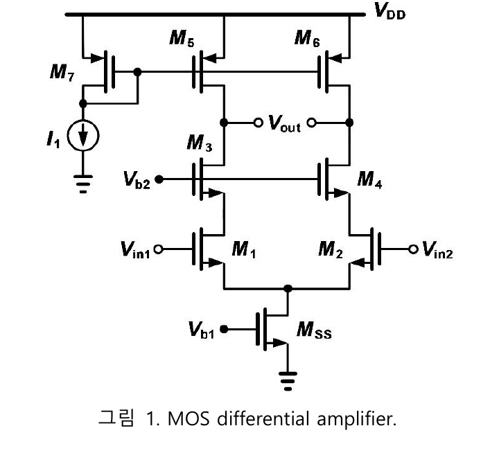
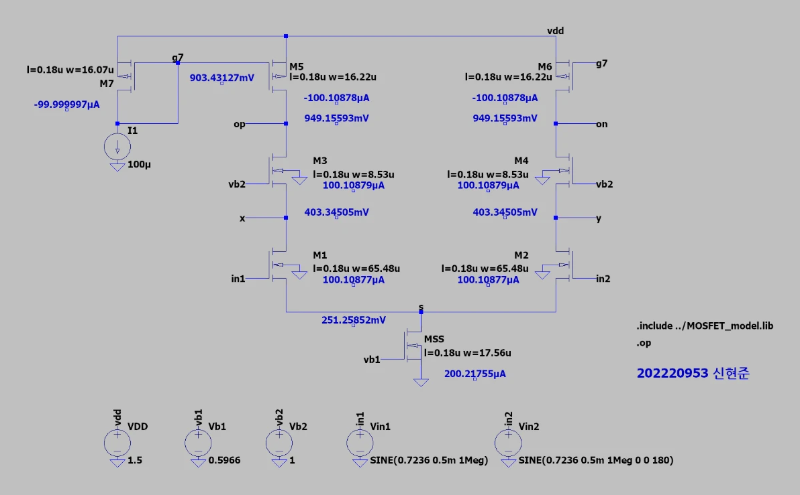
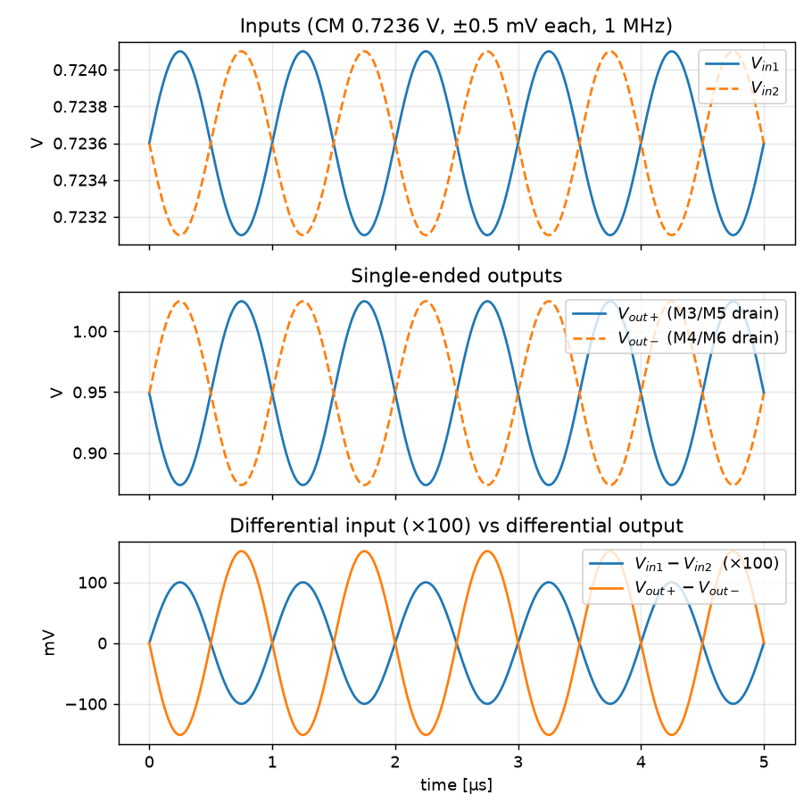
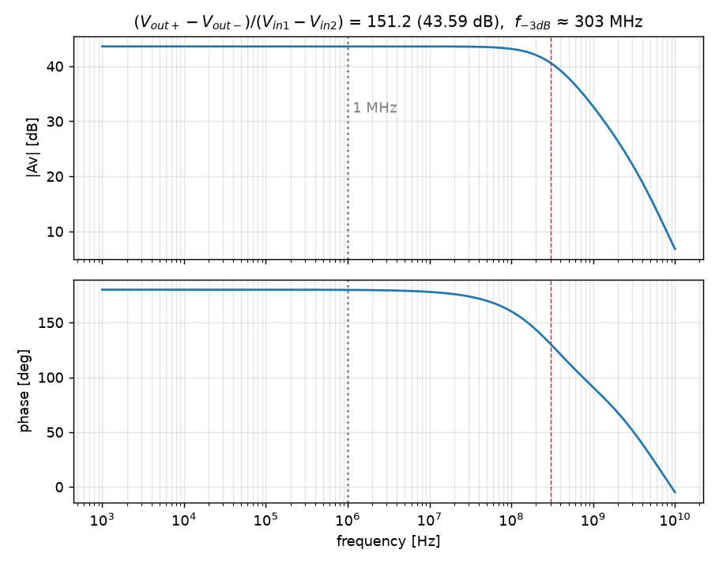

# 설계 과제 1: MOS Differential Amplifier

주어진 조건을 이용하여 다음 차동 증폭기를 설계하시오. 단, $I_1$은 ideal current source로 설계한다.

- $V_{DD} = 1.5\ \text{V}$, $L = 0.18\ \mu\text{m}$
- $\mu_n C_{ox} = 100\ \mu\text{A/V}^2$, $\mu_p C_{ox} = 50\ \mu\text{A/V}^2$
- $\lambda_n = 0.1\ \text{V}^{-1}$, $\lambda_p = 0.2\ \text{V}^{-1}$
- $V_{THN} = 0.4\ \text{V}$, $V_{THP} = -0.4\ \text{V}$

(주어지지 않은 parameter는 사양을 만족하도록 설계자가 결정함)

# 1. Design Problem (설계과정 필수)

**(a) 전체 전력소모 $\le 1\ \text{mW}$를 만족하고, 전압 이득이 100 이상 200 이하가 되도록 그림 1의 차동 증폭기를 설계하시오.**

**▶** $M_1, M_2$는 NMOS 입력 차동쌍, $M_{SS}$는 tail 전류원, $M_3, M_4$는 NMOS cascode, $M_5, M_6$은 $M_7$과 전류 미러를 이루는 PMOS 전류원 부하이고, 출력은 $V_{out} = V_{out+} - V_{out-}$ ($M_3/M_5$ 드레인과 $M_4/M_6$ 드레인 사이)이다. 계산에는 $I_D = \tfrac12\mu C_{ox}\tfrac WL V_{ov}^2(1+\lambda V_{DS})$, $g_m = 2I_D/V_{ov}$, $r_o = (1+\lambda V_{DS})/(\lambda I_D)$를 사용한다.

**① 이득식 유도**

차동 입력에서 tail 노드 S는 교류 접지이므로 반쪽 회로로 해석한다. 반쪽 회로는 $M_1$–$M_3$ cascode와 PMOS 전류원 부하 $M_6$으로 이루어지고, 차동 이득은 반쪽 회로 이득과 같다.

$$
\lvert A_v\rvert = \frac{v_{od}}{v_{id}} = G_m R_{out}, \qquad R_{out} = r_{o6} \parallel R_{cas}, \qquad R_{cas} = r_{o1} + r_{o3} + g_{m3} r_{o3} r_{o1}
$$

$G_m$은 출력을 교류 접지했을 때 출력으로 흐르는 전류 $i_{out}$와 $v_{in}$의 비다. cascode 소스 노드 X의 소신호 전압을 $v_x$라 하면, $M_3$에 흐르는 전류는 $i_{out} = -v_x(g_{m3}+g_{ds3})$이고 X에서 KCL은 $i_{out} = g_{m1}v_{in} + v_x/r_{o1}$이다. 두 식에서 $v_x$를 소거하면 다음을 얻는다.

$$
v_x = -\frac{g_{m1} v_{in}}{g_{m3} + g_{ds3} + 1/r_{o1}}, \qquad G_m = \frac{i_{out}}{v_{in}} = g_{m1}\,\frac{r_{o1}(g_{m3}+g_{ds3})}{1 + r_{o1}(g_{m3}+g_{ds3})}
$$

$r_{o1}(g_{m3}+g_{ds3}) \approx 100$이므로 $G_m \approx 0.99\,g_{m1}$이고, 설계 단계에서는 $G_m \approx g_{m1}$로 둔다 (1 % 차이는 2-(d)에서 확인한다). 또 $R_{cas}$($\approx 10\ \text{M}\Omega$)가 $r_{o6}$($\approx 55\ \text{k}\Omega$)보다 약 200배 크므로 $R_{out} \approx r_{o6}$이다.

$$
\lvert A_v\rvert \approx g_{m1} r_{o6} = \frac{2I_D}{V_{ov1}} \cdot \frac{1+\lambda_p \lvert V_{DS6}\rvert}{\lambda_p I_D} = \frac{2(1+\lambda_p \lvert V_{DS6}\rvert)}{\lambda_p V_{ov1}} \approx \frac{11.1\ \text{V}}{V_{ov1}}
$$

따라서 이득은 $I_D$와 거의 무관하고 $M_1$의 overdrive $V_{ov1}$로 정해진다. 이득 100~200을 얻으려면 $V_{ov1}$을 약 0.055~0.11 V로 잡아야 한다.

**② 전력 조건과 전류 배분**

$$
P = V_{DD}(I_{SS} + I_1) \le 1\ \text{mW} \;\Rightarrow\; I_{SS} + I_1 \le 667\ \mu\text{A}
$$

이득이 전류와 거의 무관하므로 전류는 여유 있게 $I_{SS} = 200\ \mu\text{A}$ ($I_{D1} = I_{D3} = I_{D5} = 100\ \mu\text{A}$), $I_1 = 100\ \mu\text{A}$ ($M_7 : M_5 \approx 1:1$ 미러)로 정했다. 이때 $P = 1.5\ \text{V} \times 300\ \mu\text{A} = 0.45\ \text{mW}$로 사양의 45 %다.

**③ 전압 headroom 분배**

$V_{DD} = 1.5\ \text{V}$ 사이에 $M_{SS}$, $M_1$, $M_3$, $M_5$ 네 개가 쌓이므로 $V_{ov,SS} = V_{ov3} = \lvert V_{ov5}\rvert = \lvert V_{ov7}\rvert = 0.2\ \text{V}$로 두고 노드 전압을 다음과 같이 정했다.

| 노드 | 설계값 | 근거 |
|---|---|---|
| $V_S$ (tail) | 0.25 V | $V_{DS,SS} = 0.25 \ge V_{ov,SS} = 0.2$, 여유 0.05 V |
| $V_X$ ($M_1$ 드레인) | 0.40 V | $V_{DS1} = 0.15 \ge V_{ov1}$ |
| $V_{out,CM}$ | 0.95 V | 하한 $V_{b2} - V_{TH} = 0.6$ V와 상한 $V_{DD} - \lvert V_{ov5}\rvert = 1.3$ V의 가운데 |

출력은 한쪽당 0.6~1.3 V(±0.35 V), 차동으로 ±0.7 V까지 흔들 수 있다.

**④ $V_{ov1}$ 결정**

목표 이득을 사양 범위의 가운데인 150으로 잡고, ①의 식($R_{cas}$ 포함, $G_m \approx g_{m1}$)을 $V_{ov1}$에 대해 풀어 $V_{ov1} = 0.0736\ \text{V}$를 얻었다.

| 소신호 파라미터 | 식 | 값 |
|---|---|---|
| $g_{m1}$ | $2I_D/V_{ov1} = 2(100\ \mu)/0.0736$ | 2.717 mS |
| $g_{m3}$ | $2I_D/V_{ov3} = 2(100\ \mu)/0.2$ | 1.000 mS |
| $r_{o1}$ | $(1+0.1 \times 0.15)/(0.1 \times 100\ \mu)$ | 101.5 kΩ |
| $r_{o3}$ | $(1+0.1 \times 0.55)/(0.1 \times 100\ \mu)$ | 105.5 kΩ |
| $r_{o6}$ | $(1+0.2 \times 0.55)/(0.2 \times 100\ \mu)$ | 55.5 kΩ |
| $R_{cas}$ | $r_{o1} + r_{o3} + g_{m3} r_{o3} r_{o1}$ | 10.92 MΩ |
| $R_{out}$ | $r_{o6} \parallel R_{cas}$ | 55.2 kΩ |
| $G_m/g_{m1}$ | $r_{o1}(g_{m3}+g_{ds3}) / (1 + r_{o1}(g_{m3}+g_{ds3}))$ | 0.990 |
| $\lvert A_v\rvert$ (설계값) | $g_{m1} R_{out}$ | **150.1** |

$G_m$ 정확식을 쓰면 $\lvert A_v\rvert = 0.990 \times 150.1 = 148.6$이고, 두 값 모두 사양 100~200 안에 있다.

**(b) 설계한 증폭기에서 모든 MOSFET이 saturation 영역에서 동작하기 위한 DC 바이어스 전압들과 각 MOSFET의 W/L들을 설계하시오.**

**▶** $I_D$ 식을 $W$에 대해 풀면 다음과 같고, (a)에서 정한 $I_D$, $V_{ov}$, $V_{DS}$를 대입한다.

$$
\frac WL = \frac{2 I_D}{\mu C_{ox} V_{ov}^2 (1+\lambda V_{DS})}, \qquad L = 0.18\ \mu\text{m}
$$

| MOSFET | 식 (숫자 대입) | W/L | W |
|---|---|---|---|
| $M_1, M_2$ | $\dfrac{2(100\ \mu)}{100\ \mu \cdot 0.0736^2 (1+0.1 \times 0.15)}$ | 363.75 | **65.48 µm** |
| $M_{SS}$ | $\dfrac{2(200\ \mu)}{100\ \mu \cdot 0.2^2 (1+0.1 \times 0.25)}$ | 97.56 | **17.56 µm** |
| $M_3, M_4$ | $\dfrac{2(100\ \mu)}{100\ \mu \cdot 0.2^2 (1+0.1 \times 0.55)}$ | 47.39 | **8.53 µm** |
| $M_5, M_6$ | $\dfrac{2(100\ \mu)}{50\ \mu \cdot 0.2^2 (1+0.2 \times 0.55)}$ | 90.09 | **16.22 µm** |
| $M_7$ | $\dfrac{2(100\ \mu)}{50\ \mu \cdot 0.2^2 (1+0.2 \times 0.60)}$ | 89.29 | **16.07 µm** |

$M_5$와 $M_7$은 $\lvert V_{DS}\rvert$가 0.55 V와 0.60 V로 달라서, $(1+\lambda V_{DS})$를 각각 보정해 $I_{D5} = I_{D7} = 100\ \mu\text{A}$가 되도록 W를 따로 정했다.

바이어스 전압은 노드 전압에서 $V_{GS} = V_{TH} + V_{ov}$를 더해 정한다.

| 바이어스 | 식 | 값 |
|---|---|---|
| $V_{in,CM}$ ($V_{in1}, V_{in2}$의 DC) | $V_S + V_{TH} + V_{ov1} = 0.25 + 0.4 + 0.0736$ | **0.7236 V** |
| $V_{b1}$ | $V_{TH} + V_{ov,SS} = 0.4 + 0.2$ | **0.60 V** (SPICE에서 0.5966 V로 조정, 2-(a)) |
| $V_{b2}$ | $V_X + V_{TH} + V_{ov3} = 0.4 + 0.4 + 0.2$ | **1.00 V** |
| $I_1$ | ideal current source | **100 µA** |
| $V_{G5,6,7}$ (결과값) | $V_{DD} - \lvert V_{THP}\rvert - \lvert V_{ov7}\rvert = 1.5 - 0.4 - 0.2$ | 0.90 V |

설계값 요약:

| MOSFET | $I_D$ | $\lvert V_{GS}\rvert$ | $\lvert V_{DS}\rvert$ | W/L | W |
|---|---|---|---|---|---|
| $M_1, M_2$ | 100 µA | 0.4736 V | 0.15 V | 363.75 | 65.48 µm |
| $M_{SS}$ | 200 µA | 0.60 V | 0.25 V | 97.56 | 17.56 µm |
| $M_3, M_4$ | 100 µA | 0.60 V | 0.55 V | 47.39 | 8.53 µm |
| $M_5, M_6$ | 100 µA | 0.60 V | 0.55 V | 90.09 | 16.22 µm |
| $M_7$ | 100 µA | 0.60 V | 0.60 V | 89.29 | 16.07 µm |

Saturation 조건 $\lvert V_{DS}\rvert \ge \lvert V_{GS}\rvert - \lvert V_{TH}\rvert$ (모두 $\lvert V_{GS}\rvert > 0.4\ \text{V}$):

- $M_1, M_2$: $0.15 \ge 0.4736 - 0.4 = 0.0736$ ✔
- $M_{SS}$: $0.25 \ge 0.60 - 0.4 = 0.20$ ✔
- $M_3, M_4$: $0.55 \ge 0.60 - 0.4 = 0.20$ ✔
- $M_5, M_6$: $0.55 \ge 0.60 - 0.4 = 0.20$ ✔
- $M_7$: $0.60 \ge 0.60 - 0.4 = 0.20$ ✔ (다이오드 연결이므로 항상 saturation)

# 2. Spice Problem

**SPICE를 사용하여 simulation을 확인하고 설명하시오.**

**▶** 과제 제공 모델(MOSFET_model.lib의 CMOSN, CMOSP, 파라미터 무수정)로 ngspice에서 DC, AC, Transient 해석을 했고, 회로도는 같은 소자값으로 LTspice에서 그렸다. NMOS body는 GND, PMOS body는 $V_{DD}$에 연결했다.

**(a) 설계한 회로의 schematic을 보이고, 각 MOSFET과 노드의 DC 바이어스 전압, 전류를 표시하시오. (DC simulation)**

**▶** 회로도와 DC 동작점 (.op):

손계산 값 $V_{b1} = 0.60\ \text{V}$를 그대로 넣으면 $V_{out,CM} = 0.756\ \text{V}$로 목표 0.95 V보다 낮게 나왔다. 원인은 두 가지다.

1. 모델의 실제 $\mu_n C_{ox}$는 $\mu_0\,\varepsilon_{ox}/t_{ox} = 120\ \text{cm}^2/\text{Vs} \times 8.63\ \text{mF/m}^2 = 103.6\ \mu\text{A/V}^2$로 과제 값 100보다 3.6 % 커서 tail 전류가 약간 늘어난다.
2. 이 회로에는 CMFB가 없어서, 출력 CM은 PMOS 전류원($M_5, M_6$)과 tail 전류원($M_{SS}$)의 전류가 같아지는 점에서 두 전류원의 $r_o$만으로 정해진다. 그래서 전류가 1 % 어긋나도 출력 CM이 수십 mV 움직이고, 실제로 $\partial V_{out,CM}/\partial V_{b1} \approx -57\ \text{V/V}$였다.

DC sweep으로 $V_{b1}$을 0.01 mV 간격으로 바꿔 $V_{out,CM} = 0.95\ \text{V}$가 되는 $V_{b1} = 0.5966\ \text{V}$를 사용했다 (손계산 대비 −3.4 mV).

| 노드 | 전압 [V] |
|---|---|
| $V_{DD}$ | 1.5000 |
| $V_{G5,6,7}$ | 0.9034 |
| $V_{out+}$ ($M_3/M_5$ 드레인) | 0.9492 |
| $V_{out-}$ ($M_4/M_6$ 드레인) | 0.9492 |
| $V_X, V_Y$ (cascode 소스) | 0.4033 |
| $V_S$ (tail) | 0.2513 |
| $V_{in1}, V_{in2}$ | 0.7236 |
| $V_{b1}$ / $V_{b2}$ | 0.5966 / 1.0000 |

전류는 $I_{SS} = 200.22\ \mu\text{A}$, $I_{D1} \sim I_{D6} = 100.11\ \mu\text{A}$, $I_{D7} = I_1 = 100.00\ \mu\text{A}$이고, 전원 전류 $I_{VDD} = 300.22\ \mu\text{A}$에서 $P = 1.5 \times 300.22\ \mu = 0.4503\ \text{mW} \le 1\ \text{mW}$ ✔

**(b) 모든 MOSFET이 saturation 영역에서 동작하는지를 검증하시오.**

**▶** 조건은 $\lvert V_{GS}\rvert > \lvert V_{TH}\rvert$이고 $\lvert V_{DS}\rvert \ge \lvert V_{GS}\rvert - \lvert V_{TH}\rvert$이다 ($\lvert V_{TH}\rvert = 0.4\ \text{V}$, GAMMA = 0이라 body effect 없음). 아래 값은 SPICE 동작점이다.

| MOSFET | $I_D$ [µA] | $\lvert V_{GS}\rvert$ [V] | $\lvert V_{GS}\rvert - V_{TH}$ [V] | $\lvert V_{DS}\rvert$ [V] | 여유 [V] | 영역 |
|---|---|---|---|---|---|---|
| $M_1$ | 100.11 | 0.4723 | 0.0723 | 0.1521 | 0.0797 | saturation ✔ |
| $M_2$ | 100.11 | 0.4723 | 0.0723 | 0.1521 | 0.0797 | saturation ✔ |
| $M_{SS}$ | 200.22 | 0.5966 | 0.1966 | 0.2513 | 0.0547 | saturation ✔ |
| $M_3$ | 100.11 | 0.5967 | 0.1967 | 0.5458 | 0.3492 | saturation ✔ |
| $M_4$ | 100.11 | 0.5967 | 0.1967 | 0.5458 | 0.3492 | saturation ✔ |
| $M_5$ | 100.11 | 0.5966 | 0.1966 | 0.5508 | 0.3543 | saturation ✔ |
| $M_6$ | 100.11 | 0.5966 | 0.1966 | 0.5508 | 0.3543 | saturation ✔ |
| $M_7$ | 100.00 | 0.5966 | 0.1966 | 0.5966 | 0.4000 | saturation ✔ |

- $M_1, M_2$: $0.1521 \ge 0.0723$ ✔
- $M_{SS}$: $0.2513 \ge 0.1966$ ✔
- $M_3, M_4$: $0.5458 \ge 0.1967$ ✔
- $M_5, M_6$: $0.5508 \ge 0.1966$ ✔
- $M_7$: $0.5966 \ge 0.1966$ ✔

8개 MOSFET이 모두 saturation에서 동작한다. 여유가 가장 작은 것은 $M_{SS}$(55 mV)이고, 손계산 때 정한 headroom 분배가 그대로 유지됐다.

**(c) 입력에 1 MHz 신호를 인가하고, 입력 파형과 출력 파형을 plot 하시오. (Transient simulation)**

**▶** 입력은 차동으로 인가했다: $V_{in1} = 0.7236\ \text{V} + 0.5\ \text{mV} \cdot \sin(2\pi \cdot 1\ \text{MHz} \cdot t)$, $V_{in2}$는 같은 크기에 위상 180°. 따라서 $v_{id} = V_{in1} - V_{in2}$는 1 mV peak (2 mV p-p)다.

- 차동 출력 $v_{od} = V_{out+} - V_{out-}$는 302.5 mV p-p이므로 $\lvert A_v\rvert = 302.5 / 2.0 = 151.2$이다.
- 출력은 입력과 반전된다 ($V_{in1}$ 증가 → $M_1$ 전류 증가 → $V_{out+}$ 감소).
- 한쪽 출력은 0.95 V ± 76 mV로, 허용 범위(0.6~1.3 V) 안에서 왜곡 없이 동작한다.

**(d) 소신호 전압 이득을 구하고, 설계값과 비교하시오. 오차가 10% 이상일 경우 그 이유를 설명하시오.**

**▶** AC 해석으로 차동 이득 $(V_{out+} - V_{out-})/(V_{in1} - V_{in2})$의 크기와 위상을 구했다.

| 방법 | $\lvert A_v\rvert$ |
|---|---|
| 손계산 (설계값, $G_m \approx g_{m1}$) | 150.1 |
| 손계산 ($G_m$ 정확식) | 148.6 |
| SPICE AC (1 kHz) | 151.2 (43.59 dB) |
| SPICE AC (1 MHz) | 151.2 |
| SPICE Transient (1 MHz) | 151.2 |

저주파 위상은 180°(반전 증폭)이고 −3 dB 대역폭은 약 304 MHz다. 1 MHz는 대역폭보다 훨씬 낮아 AC 이득과 transient 이득이 같다. 이 대역폭은 소스·드레인 면적(AD/AS/PD/PS)을 지정하지 않아 junction 커패시턴스가 빠진 값이므로 실제보다 낙관적이지만, 1 MHz 이득에는 영향이 없다.

오차는 설계값 대비 $(151.2 - 150.1)/150.1 = +0.8\ \%$로 10 %보다 훨씬 작다. 차이의 원인은 두 가지이고 서로 일부 상쇄된다.

1. (+1.8 %) $V_{ov1}$ 감소: 모델의 $\mu_n C_{ox}$가 103.6 µA/V²라서 같은 100 µA에서 $V_{ov1}$이 0.0736 V에서 0.0723 V로 줄었다. $\lvert A_v\rvert \propto 1/V_{ov1}$이므로 이득이 늘어난다.
2. (−1.0 %) $G_m < g_{m1}$: 1-(a)에서 유도한 대로 노드 X의 소신호 전압이 0이 아니어서 $r_{o1}$로 전류 일부가 빠진다. SPICE 동작점의 $g_m$, $g_{ds}$로 계산하면 $g_{m1} R_{out} = 152.7$이고 $G_m/g_{m1} = 0.9905$를 곱한 $151.25$가 AC 결과와 일치한다.
