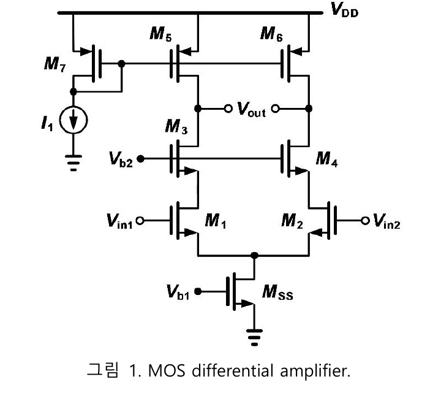

# 전자회로2 설계과제 #1

> 출처: 아주BB · ECE305 전자회로2 · 과제출제/제출 → 설계과제#1 (게시 2026-10-09)
> 원본: [2026-2_전자회로2_설계과제1_v3.pdf](2026-2_전자회로2_설계과제1_v3.pdf)

## 공지 본문

첨부 전자회로2 설계과제#1 파일 확인 바랍니다.

- **제출**: 아주BB에 PDF파일 업로드
- **제출기한**: 10/30(금) — BB 마감 2026-10-30 23:59 (KST), 배점 100점
- 설계에 필요한 모델 라이브러리 첨부하였으니, 다운로드 후 시뮬레이션에 사용하기 바람.
- 주어진 MOSFET 모델의 parameter는 수정 불가하며, 변경 없이 사용함.
- SPICE (PSPICE, LTSPICE 등) 모두 사용 가능 (시뮬레이션 가이드 문서 참조)
- Copy 제출 모두 0점 부여 (관련 학생 모두 동일하게 조치)
- 지각 제출 0점 부여

첨부파일:
- `2026-2_전자회로2_설계과제1_v3.pdf` — 과제 문제
- `MOSFET_Model_Guide_2510.zip` — 모델 라이브러리 + 시뮬레이션 가이드 (압축 해제: [MOSFET_Model_Guide_2510/](MOSFET_Model_Guide_2510/))

---

## <설계과제 1>

주어진 조건을 이용하여 다음 차동 증폭기를 설계하시오.
단, $I_1$은 ideal current source로 설계한다.

- $V_{DD} = 1.5\ \text{V}$, $L = 0.18\ \mu\text{m}$
- $\mu_n C_{ox} = 100\ \mu\text{A/V}^2$, $\mu_p C_{ox} = 50\ \mu\text{A/V}^2$
- $\lambda_n = 0.1\ \text{V}^{-1}$, $\lambda_p = 0.2\ \text{V}^{-1}$
- $V_{THN} = 0.4\ \text{V}$, $V_{THP} = -0.4\ \text{V}$

(주어지지 않은 parameter는 사양을 만족하도록 설계자가 결정함)



**그림 1. MOS differential amplifier.**

회로 구성 (그림 1):
- $M_1, M_2$: NMOS 입력 차동쌍 (게이트 $V_{in1}, V_{in2}$)
- $M_{SS}$: NMOS 꼬리 전류원 (게이트 $V_{b1}$)
- $M_3, M_4$: NMOS cascode (게이트 공통 $V_{b2}$)
- $M_5, M_6$: PMOS 전류원 부하, $M_7$(다이오드 연결 PMOS)과 전류 미러 구성, $M_7$은 $I_1$(ideal current source)으로 바이어스
- 출력 $V_{out}$: $M_3/M_5$ 드레인과 $M_4/M_6$ 드레인 사이 (차동 출력)

### 1) Design Problem (설계과정 필수)

(a) 전체 전력소모 $\le 1\ \text{mW}$를 만족하고, 전압 이득이 100 이상 200 이하가 되도록 그림 1의 차동 증폭기를 설계하시오.

(b) 설계한 증폭기에서 모든 MOSFET이 saturation 영역에서 동작하기 위한 DC 바이어스 전압들과 각 MOSFET의 W/L들을 설계하시오.

### 2) Spice Problem

SPICE를 사용하여 simulation을 확인하고 설명하시오.

(a) 설계한 회로의 schematic을 보이고, 각 MOSFET과 노드의 DC 바이어스 전압, 전류를 표시하시오. (DC simulation)

(b) 모든 MOSFET이 saturation 영역에서 동작하는지를 검증하시오.

(c) 입력에 1 MHz 신호를 인가하고, 입력 파형과 출력 파형을 plot 하시오. (Transient simulation)

(d) 소신호 전압 이득을 구하고, 설계값과 비교하시오. 오차가 10% 이상일 경우 그 이유를 설명하시오.

---

## 첨부 모델 라이브러리 (MOSFET_Model_Guide_2510)

```
MOSFET_Model_Guide_2510/
├── LTspice 시뮬레이션 가이드.pdf
├── PSpice_시뮬레이션 가이드.pdf
├── LTspice_MOSFET_model_2510/standard.mos
└── PSpice_MOSFET_model_2510/  (MOSFET_model.lib, .OLB, .OBK, .opj, .ind, .prp)
```

PSpice `MOSFET_model.lib`의 Level-1 모델 (0.18 µm):

```spice
.model CMOSN NMOS(Level=1 VTO=0.4 GAMMA=0 PHI=0.8
+  WD=0 UO=120 LAMBDA=0.1 TOX=4E-9 PB=0.9 CJ=0.57E-3
+  CJSW=120E-12 MJ=0.5 MJSW=0.4 CGDO=0.4E-9 JS=10E-9 CGBO=0.38E-9
+  CGSO=0.4E-9)
.model CMOSP PMOS(Level=1 VTO=-0.4 GAMMA=0 PHI=0.75
+  WD=0 UO=60 LAMBDA=0.2 TOX=4E-9 PB=0.9 CJ=0.93E-3
+  CJSW=170E-12 MJ=0.5 MJSW=0.35 CGDO=0.35E-9 JS=5E-9 CGBO=0.38E-9
+  CGSO=0.35E-9)
```
