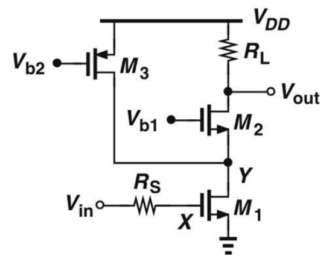
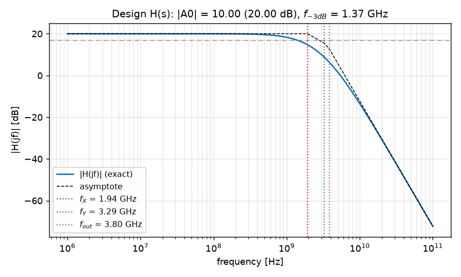
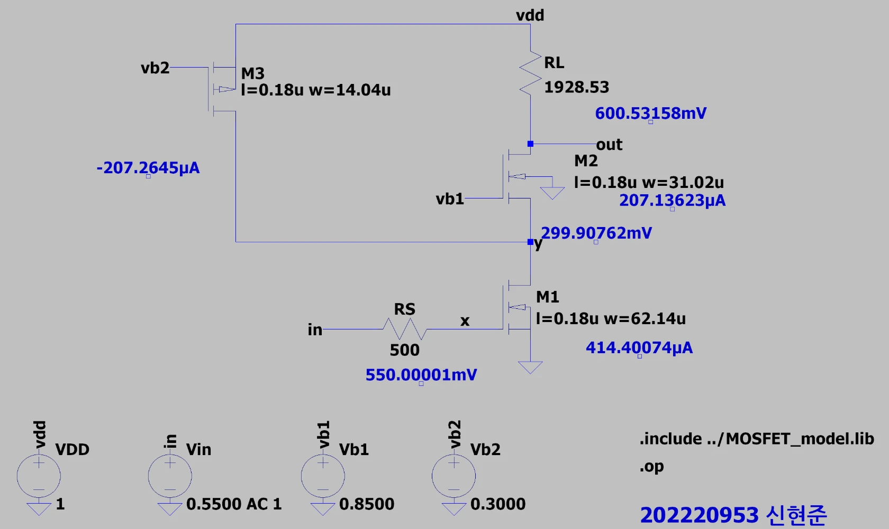
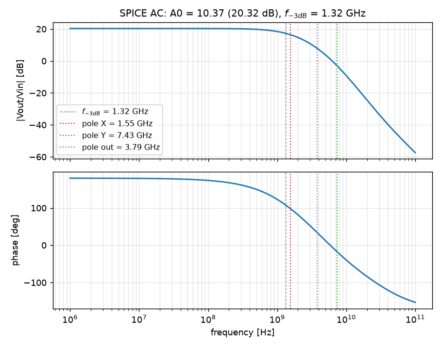

# 설계 과제 2: Cascode Amplifier 주파수 응답 특성

<table_of_contents color="gray"/>

<empty-block/>
# 설계 조건

주어진 조건을 이용하여 다음 cascode 증폭기를 설계하고, 주파수 응답 특성을 검증하시오.

- $L = 0.18\ \mu\text{m}$
- $\mu_n C_{ox} = 100\ \mu\text{A/V}^2$, $\mu_p C_{ox} = 50\ \mu\text{A/V}^2$
- $\lambda_n = 0.1\ \text{V}^{-1}$, $\lambda_p = 0.2\ \text{V}^{-1}$
- $V_{THN} = 0.4\ \text{V}$, $V_{THP} = -0.4\ \text{V}$

(주어지지 않은 parameter는 사양을 만족하도록 설계자가 결정함)

| Capacitance Parameters | |
|---|---|
| $C_{ox}$ | $12\ \text{fF}/\mu\text{m}^2$ |
| $C_{GS}$ | $(2/3)WLC_{ox} + (0.3\ \text{fF}/\mu\text{m})\times W$ |
| $C_{GD}$ | $(0.3\ \text{fF}/\mu\text{m})\times W$ |
| $C_{DB}$ | $(0.4\ \text{fF}/\mu\text{m})\times W$ |
| $C_{SB}$ | $(0.4\ \text{fF}/\mu\text{m})\times W$ |

<empty-block/>
<empty-block/>
# Design Problem
## (a) 이득·전력·극점 사양을 만족하는 설계

**(a) $V_{DD} = 1\ \text{V}$, $R_S = 500\ \Omega$, 최대 소모전력 $\le 0.5\ \text{mW}$, $I_{D2} = |I_{D3}|$인 조건에서, 저주파 전압 이득이 10이고, 모든 pole 주파수들이 1 GHz 이상이 되도록 회로를 설계하시오.**

$M_1$은 입력 common-source 단, $M_2$는 게이트가 $V_{b1}$에 고정된 common-gate cascode, $M_3$은 게이트가 $V_{b2}$에 고정된 PMOS 전류원으로 노드 $Y$에 전류를 넣는다. $R_L$은 $V_{DD}$와 $V_{out}$ 사이 부하, $R_S$는 신호원 저항이다. 계산에는 $I_D = \tfrac12\mu C_{ox}\tfrac WL V_{ov}^2(1+\lambda V_{DS})$, $g_m = 2I_D/V_{ov}$, $r_o = (1+\lambda V_{DS})/(\lambda I_D)$를 사용한다.

**① 전류 배분과 전력**

노드 $Y$에서 KCL을 쓰면 $M_1$의 전류는 $M_2$와 $M_3$이 나눠 공급한다. 조건 $I_{D2} = |I_{D3}|$에서 다음이 성립한다.

$$
I_{D1} = I_{D2} + |I_{D3}| = 2 I_{D2}, \qquad P = V_{DD}\,(I_{D2} + |I_{D3}|) = V_{DD}\, I_{D1}
$$

$R_L$을 흐르는 전류도 $I_{D2}$이므로 전원에서 나가는 전류는 $I_{D1}$ 하나다. $I_{D1} = 400\ \mu\text{A}$ ($I_{D2} = |I_{D3}| = 200\ \mu\text{A}$)로 정했고, 이때 $P = 1\ \text{V} \times 400\ \mu\text{A} = 0.4\ \text{mW} \le 0.5\ \text{mW}$ (만족, 상한의 80 %)다.

**② 이득식 유도 ($G_m$, $R_{out}$)**

저주파 이득은 $A_0 = -G_m R_{out}$으로 쓴다. $G_m$은 출력을 교류 접지($v_{out} = 0$)했을 때 출력에서 $M_2$로 흘러 들어가는 전류 $i_{out}$와 $v_{in}$의 비다. 저주파에서는 게이트 전류가 없으므로 $v_x = v_{in}$이다. $r_{o1} \parallel r_{o3}$를 $r_{13}$이라 하면, $v_{out} = 0$일 때 $M_2$의 드레인 전류는 $i_{out} = -v_y(g_{m2} + g_{ds2})$이고, 노드 $Y$에서 나가는 전류의 합은 $g_{m1} v_{in} + v_y / r_{13} - i_{out} = 0$이다. 두 식에서 $v_y$를 소거한다.

$$
v_y = -\frac{g_{m1} v_{in}}{1/r_{13} + g_{m2} + g_{ds2}}, \qquad G_m = \frac{i_{out}}{v_{in}} = g_{m1}\,\frac{r_{13}}{r_{13} + R_{in2,sc}}, \qquad R_{in2,sc} = \frac{1}{g_{m2} + g_{ds2}} = \frac{r_{o2}}{1 + g_{m2} r_{o2}}
$$

$R_{in2,sc}$는 출력을 단락했을 때 $Y$에서 $M_2$ 소스로 들여다본 저항이다. $M_1$의 소신호 전류 중 $r_{13}$으로 새는 몫이 있어 $G_m < g_{m1}$이 된다. 출력 저항은 $R_L$과, 소스가 $r_{13}$으로 degeneration된 $M_2$ 드레인 쪽 저항의 병렬이다.

$$
R_{cas} = r_{o2} + r_{13} + g_{m2} r_{o2} r_{13}, \qquad R_{out} = R_L \parallel R_{cas}, \qquad A_0 = -G_m R_{out}
$$

$R_{cas}$($\approx 1.93\ \text{M}\Omega$)가 $R_L$($\approx 1.93\ \text{k}\Omega$)의 약 1000배이므로 $R_{out} \approx R_L$, $G_m \approx g_{m1}$로 근사하면 다음과 같다.

$$
|A_0| \approx g_{m1} R_L = \frac{2 I_{D1}}{V_{ov1}} R_L = \frac{4 I_{D2} R_L}{V_{ov1}} \;\Rightarrow\; I_{D2} R_L \approx \frac{|A_0|\, V_{ov1}}{4}
$$

즉 $|A_0| = 10$이면 출력 DC 강하 $I_{D2} R_L$은 전류와 무관하게 $V_{ov1}$로 정해진다 ($V_{ov1} = 0.15\ \text{V}$이면 약 0.375 V).

**③ 전압 headroom 분배**

세 MOSFET이 모두 saturation이려면 $V_Y \ge V_{ov1}$, $V_{out} - V_Y \ge V_{ov2}$, $V_{DD} - V_Y \ge |V_{ov3}|$이어야 한다. ②에서 $V_{out} = V_{DD} - I_{D2}R_L \approx 1 - 2.5\,V_{ov1}$이므로 $1 - 2.5\,V_{ov1} \ge V_{ov1} + V_{ov2}$, 즉 $3.5\,V_{ov1} + V_{ov2} \le 1\ \text{V}$를 만족해야 한다. $V_{ov1} = V_{ov2} = 0.15\ \text{V}$이면 $0.675 \le 1$로 여유가 있고, 남는 전압은 세 MOSFET의 포화 여유로 고르게 나눴다.

| 노드 | 설계값 | 근거 |
|---|---|---|
| $V_X$ ($= V_{in,DC}$) | 0.55 V | $V_{TH} + V_{ov1} = 0.4 + 0.15$ |
| $V_Y$ | 0.30 V | $V_{DS1} = 0.30 \ge V_{ov1} = 0.15$, $V_{SD3} = 0.70 \ge \lvert V_{ov3}\rvert = 0.30$ |
| $V_{out}$ | 0.6143 V | $V_{DD} - I_{D2}R_L = 1 - 200\ \mu \times 1928.53$, $V_{DS2} = 0.3143 \ge V_{ov2} = 0.15$ |

$|V_{ov3}| = 0.30\ \text{V}$는 $M_3$의 W를 줄여 노드 $Y$의 커패시턴스를 작게 하려고 $V_{SD3} = 0.70\ \text{V}$ 안에서 크게 잡은 값이다.

**④ 전류와 $V_{ov}$를 정한 근거 (극점 사양)**

$V_{ov}$를 고정하면 W는 전류에 비례하고, 노드 저항은 다음과 같이 움직인다.

- $f_X = 1/(2\pi R_S C_X)$: $R_S$는 고정이고 $C_X \propto W_1 \propto I_{D1}/V_{ov1}^2$이므로 $f_X \propto 1/I_{D1}$이다. 세 극점 중 가장 낮고, 전류를 줄이거나 $V_{ov1}$을 키우면 올라간다.
- $f_Y \approx g_{m2}/(2\pi C_Y)$, $f_{out} = 1/(2\pi R_L C_{out})$: $g_{m2}$와 $1/R_L$이 전류에 비례하고 C도 전류에 비례하므로 전류와 거의 무관하다.

따라서 극점 사양은 $M_1$의 크기로 결정된다. $V_{ov1}$을 크게 하면 W1이 줄어 $f_X$가 오르지만 ③의 headroom이 줄어든다. $V_{ov1} = 0.15\ \text{V}$와 $I_{D1} = 400\ \mu\text{A}$에서 (c)의 최저 극점이 1.94 GHz가 되어 1 GHz 사양에 대해 여유를 남겼다. 전류를 더 줄이면 $f_X$는 더 오르지만 $R_L$($\propto 1/I_{D2}$)이 커져 출력 노드가 외부 부하 커패시턴스에 민감해지므로, 전력 상한의 80 %에서 멈췄다.

**⑤ $R_L$ 결정과 소신호 파라미터**

$V_{out}$이 $R_L$에 따라 바뀌어 $r_{o2}$도 바뀌므로, ②의 정확식으로 $|A_0| = 10.000$이 되도록 $R_L$을 반복 계산해 $R_L = 1928.53\ \Omega$을 얻었다.

| 소신호 파라미터 | 식 | 값 |
|---|---|---|
| $g_{m1}$ | $2(400\ \mu)/0.15$ | 5.333 mS |
| $g_{m2}$ | $2(200\ \mu)/0.15$ | 2.667 mS |
| $g_{m3}$ | $2(200\ \mu)/0.30$ | 1.333 mS |
| $r_{o1}$ | $(1+0.1 \times 0.30)/(0.1 \times 400\ \mu)$ | 25.75 kΩ |
| $r_{o2}$ | $(1+0.1 \times 0.3143)/(0.1 \times 200\ \mu)$ | 51.57 kΩ |
| $r_{o3}$ | $(1+0.2 \times 0.70)/(0.2 \times 200\ \mu)$ | 28.50 kΩ |
| $r_{13} = r_{o1} \parallel r_{o3}$ | | 13.53 kΩ |
| $R_{in2,sc}$ | $r_{o2}/(1+g_{m2} r_{o2})$ | 372.3 Ω |
| $G_m/g_{m1}$ | $r_{13}/(r_{13} + R_{in2,sc})$ | 0.9732 |
| $G_m$ | | 5.1905 mS |
| $R_{cas}$ | $r_{o2} + r_{13} + g_{m2} r_{o2} r_{13}$ | 1.925 MΩ |
| $R_{out}$ | $R_L \parallel R_{cas}$ | 1926.60 Ω |
| $\lvert A_0\rvert$ (설계값) | $G_m R_{out}$ | **10.000** |

근사식 $g_{m1}R_L$로는 10.28이 나오므로, $G_m/g_{m1} = 0.9732$를 넣은 정확식으로 $R_L$을 정했다. 같은 회로를 $X$, $Y$, $V_{out}$ 세 노드의 KCL 연립방정식으로 직접 풀어도 $A_0 = -10.000$이 나와 위 식과 일치한다.

<empty-block/>
## (b) DC 바이어스와 W/L 설계

**(b) 설계한 증폭기에서 모든 MOSFET이 saturation 영역에서 동작하기 위한 DC 바이어스 전압들과 각 MOSFET의 W/L들을 설계하시오.**

$I_D$ 식을 $W$에 대해 풀고, (a)에서 정한 $I_D$, $V_{ov}$, $V_{DS}$를 대입한다. W는 0.01 µm 단위로 반올림했다.

$$
\frac WL = \frac{2 I_D}{\mu C_{ox} V_{ov}^2 (1+\lambda \lvert V_{DS}\rvert)}, \qquad L = 0.18\ \mu\text{m}
$$

| MOSFET | 식 (숫자 대입) | W/L | W |
|---|---|---|---|
| $M_1$ | $\dfrac{2(400\ \mu)}{100\ \mu \cdot 0.15^2 (1+0.1 \times 0.30)}$ | 345.20 | **62.14 µm** |
| $M_2$ | $\dfrac{2(200\ \mu)}{100\ \mu \cdot 0.15^2 (1+0.1 \times 0.3143)}$ | 172.36 | **31.02 µm** |
| $M_3$ | $\dfrac{2(200\ \mu)}{50\ \mu \cdot 0.30^2 (1+0.2 \times 0.70)}$ | 77.97 | **14.04 µm** |

바이어스 전압은 노드 전압에 $V_{GS} = V_{TH} + V_{ov}$를 더해 정한다.

| 바이어스 | 식 | 값 |
|---|---|---|
| $V_{in,DC}$ ($V_X$) | $V_{TH} + V_{ov1} = 0.4 + 0.15$ | **0.55 V** |
| $V_{b1}$ | $V_Y + V_{TH} + V_{ov2} = 0.30 + 0.4 + 0.15$ | **0.85 V** |
| $V_{b2}$ | $V_{DD} - \lvert V_{THP}\rvert - \lvert V_{ov3}\rvert = 1 - 0.4 - 0.30$ | **0.30 V** |
| $R_L$ | (a) ⑤ | **1928.53 Ω** |
| $R_S$ | 주어진 값 | 500 Ω |

설계값 요약:

| MOSFET | $I_D$ | $\lvert V_{GS}\rvert$ | $\lvert V_{DS}\rvert$ | W/L | W |
|---|---|---|---|---|---|
| $M_1$ | 400 µA | 0.55 V | 0.30 V | 345.20 | 62.14 µm |
| $M_2$ | 200 µA | 0.55 V | 0.3143 V | 172.36 | 31.02 µm |
| $M_3$ | 200 µA | 0.70 V | 0.70 V | 77.97 | 14.04 µm |

Saturation 조건 $\lvert V_{DS}\rvert \ge \lvert V_{GS}\rvert - \lvert V_{TH}\rvert$ (모두 $\lvert V_{GS}\rvert > 0.4\ \text{V}$):

- $M_1$: $0.30 \ge 0.55 - 0.4 = 0.15$ (만족, 여유 0.15 V)
- $M_2$: $0.3143 \ge 0.55 - 0.4 = 0.15$ (만족, 여유 0.164 V)
- $M_3$: $0.70 \ge 0.70 - 0.4 = 0.30$ (만족, 여유 0.40 V)

<empty-block/>
## (c) Miller 근사로 구한 pole 주파수

**(c) Miller's approximation을 적용하여 모든 pole 주파수를 구하시오.**

신호 경로의 노드는 $X$, $Y$, $V_{out}$ 세 개다. $V_{b1}$, $V_{b2}$, $V_{DD}$는 교류 접지이므로 $M_3$의 $C_{GS3}$, $C_{SB3}$와 $M_1$의 $C_{SB1}$은 양 끝이 모두 접지라 극점에 영향이 없다. 노드 $X$와 $Y$ 사이를 잇는 $C_{GD1}$에 Miller 근사를 적용한다.

**① $X$–$Y$ 이득 $A_{XY}$**

$Y$에서 본 저항은 $r_{o1}$, $r_{o3}$, 그리고 $M_2$ 소스로 들여다본 저항(부하 $R_L$ 포함)의 병렬이다.

$$
R_{in2} = \frac{R_L + r_{o2}}{1 + g_{m2} r_{o2}} = 386.21\ \Omega, \qquad R_Y = r_{o1} \parallel r_{o3} \parallel R_{in2} = 375.49\ \Omega
$$

$$
A_{XY} = -g_{m1} R_Y = -5.333\ \text{mS} \times 375.49\ \Omega = -2.003
$$

강의의 근사 $R_Y \approx 1/g_{m2}$를 쓰면 $A_{XY} \approx -g_{m1}/g_{m2} = -2.00$으로 거의 같다.

**② 각 소자의 커패시턴스 (과제 표 값, W는 µm, 단위 fF)**

| MOSFET | $C_{GS} = \tfrac23 W L C_{ox} + 0.3W$ | $C_{GD} = 0.3W$ | $C_{DB} = 0.4W$ | $C_{SB} = 0.4W$ |
|---|---|---|---|---|
| $M_1$ ($W = 62.14$) | 108.12 | 18.64 | 24.86 | 24.86 |
| $M_2$ ($W = 31.02$) | 53.97 | 9.31 | 12.41 | 12.41 |
| $M_3$ ($W = 14.04$) | 24.43 | 4.21 | 5.62 | 5.62 |

**③ 노드별 커패시턴스와 저항**

$$
C_X = C_{GS1} + (1 - A_{XY})\,C_{GD1} = 108.12 + 3.003 \times 18.64 = 164.10\ \text{fF}, \qquad R_X = R_S = 500\ \Omega
$$

$$
C_Y = C_{DB1} + \left(1 - \frac{1}{A_{XY}}\right) C_{GD1} + C_{GS2} + C_{SB2} + C_{DB3} + C_{GD3} = 24.86 + 1.499 \times 18.64 + 53.97 + 12.41 + 5.62 + 4.21 = 129.02\ \text{fF}
$$

$$
C_{out} = C_{DB2} + C_{GD2} = 12.41 + 9.31 = 21.71\ \text{fF}, \qquad R_{out} = R_L \parallel R_{cas} = 1926.60\ \Omega
$$

$R_Y = 375.49\ \Omega$이다. $M_2$의 게이트가 교류 접지이므로 출력 노드는 다른 노드와 커패시턴스로 연결되지 않는다.

**④ Pole 주파수**

| 노드 | $R$ | $C$ | $f_p = 1/(2\pi R C)$ | 1 GHz 이상 |
|---|---|---|---|---|
| $X$ | 500.00 Ω | 164.10 fF | **1.940 GHz** | 만족 |
| $Y$ | 375.49 Ω | 129.02 fF | **3.285 GHz** | 만족 |
| $V_{out}$ | 1926.60 Ω | 21.71 fF | **3.804 GHz** | 만족 |

세 pole이 모두 1 GHz 이상이고, 지배 pole은 입력 노드 $X$ ($R_S$와 Miller 증배된 $C_{GD1}$)다. $C_{GD1}$은 $X$에서 $Y$로 가는 앞먹임 경로도 만들어 우반면 영점 $g_{m1}/(2\pi C_{GD1}) = 45.5\ \text{GHz}$가 생기지만, 세 pole보다 열 배 이상 높으므로 이후 전달 함수에서는 무시한다.

<empty-block/>
## (d) 전달 함수와 Bode magnitude plot

**(d) 전달 함수 H(s)를 구하고, Bode magnitude plot을 그리시오.**

(a)의 저주파 이득과 (c)의 세 pole로 전달 함수를 쓴다 ($\omega_p = 2\pi f_p$).

$$
H(s) = \frac{A_0}{\left(1 + \dfrac{s}{\omega_X}\right)\left(1 + \dfrac{s}{\omega_Y}\right)\left(1 + \dfrac{s}{\omega_{out}}\right)}, \qquad A_0 = -10
$$

$$
\omega_X = 1.219 \times 10^{10}\ \text{rad/s}, \quad \omega_Y = 2.064 \times 10^{10}\ \text{rad/s}, \quad \omega_{out} = 2.390 \times 10^{10}\ \text{rad/s}
$$

$$
H(s) = \frac{-10}{\left(1 + \dfrac{s}{1.219 \times 10^{10}}\right)\left(1 + \dfrac{s}{2.064 \times 10^{10}}\right)\left(1 + \dfrac{s}{2.390 \times 10^{10}}\right)}
$$

저주파 이득은 20 dB이고, 1.94 GHz부터 −20 dB/dec, 3.29 GHz부터 −40 dB/dec, 3.80 GHz부터 −60 dB/dec로 꺾인다 (점선이 점근선). 세 pole이 가까이 모여 있어 실제 곡선은 −3 dB 주파수 $f_{-3dB} = 1.374\ \text{GHz}$에서 지배 pole $f_X$보다 낮게 꺾인다.

<empty-block/>
<empty-block/>
# Spice Problem

**SPICE를 사용하여 simulation을 확인하고 설명하시오.**

과제 제공 모델(MOSFET_model.lib의 CMOSN, CMOSP, 파라미터 무수정)로 ngspice에서 DC(.op), AC, pole-zero(.pz) 해석을 했고, 회로도는 같은 소자값으로 LTspice에서 그렸다. NMOS body는 GND, PMOS body는 $V_{DD}$에 연결했다. 접합 커패시턴스가 들어가도록 모든 MOSFET에 $AD = AS = 0.49\ \mu\text{m} \times W$, $PD = PS = W$를 지정했다. 이 값이면 영 바이어스 접합 커패시턴스가 NMOS에서 $C_J \cdot 0.49 + C_{JSW} = 0.57 \times 0.49 + 0.12 = 0.40\ \text{fF}/\mu\text{m} \times W$로 과제 표의 $C_{DB}, C_{SB}$와 같아진다.

<empty-block/>
## (a) 회로도와 DC 동작점

**(a) 설계한 회로의 schematic을 보이고, 각 MOFET과 노드의 DC 바이어스 전압, 전류를 표시하시오. (DC simulation)**

회로도와 DC 동작점 (.op):

바이어스는 Design Problem (b)의 손계산 값($V_{in,DC} = 0.55$, $V_{b1} = 0.85$, $V_{b2} = 0.30\ \text{V}$, $R_L = 1928.53\ \Omega$)을 조정 없이 그대로 넣었다.

| 노드 | 설계값 [V] | SPICE [V] |
|---|---|---|
| $V_{DD}$ | 1.0000 | 1.0000 |
| $V_{in}$, $V_X$ | 0.5500 | 0.5500 |
| $V_Y$ | 0.3000 | 0.2999 |
| $V_{out}$ | 0.6143 | 0.6005 |
| $V_{b1}$ / $V_{b2}$ | 0.8500 / 0.3000 | 0.8500 / 0.3000 |

| 전류 | 설계값 | SPICE |
|---|---|---|
| $I_{D1}$ | 400.00 µA | 414.40 µA |
| $I_{D2}$ | 200.00 µA | 207.14 µA |
| $\lvert I_{D3}\rvert$ | 200.00 µA | 207.26 µA |
| $I_{VDD}$ | 400.00 µA | 414.40 µA |

전원 전류로 계산한 전력은 $P = 1\ \text{V} \times 414.40\ \mu\text{A} = 0.4144\ \text{mW} \le 0.5\ \text{mW}$ (만족)다. $I_{D2}$와 $\lvert I_{D3}\rvert$의 차이는 0.06 %로 $I_{D2} = |I_{D3}|$ 조건도 지켜진다 (만족).

전류가 설계값보다 3.6 % 큰 이유는 모델의 실제 $\mu C_{ox}$가 과제 값과 다르기 때문이다. 모델의 $C_{ox} = \varepsilon_{ox}/t_{ox} = 3.9 \times 8.854\ \text{pF/m} / 4\ \text{nm} = 8.63\ \text{fF}/\mu\text{m}^2$이므로 $\mu_n C_{ox} = 120\ \text{cm}^2/\text{Vs} \times 8.63\ \text{fF}/\mu\text{m}^2 = 103.6\ \mu\text{A/V}^2$, $\mu_p C_{ox} = 60 \times 8.63 = 51.8\ \mu\text{A/V}^2$로 둘 다 과제 값보다 3.6 % 크다. 게이트 전압을 그대로 두었으므로 $V_{ov}$는 설계값(0.15, 0.15, 0.30 V)을 유지하고 세 전류가 같은 비율(×1.036)로 늘어난다. 그래서 $I_{D2} = |I_{D3}|$는 유지되고, $V_{out}$만 $R_L$의 전압 강하가 커진 만큼 $1 - 207.14\ \mu \times 1928.53 = 0.6005\ \text{V}$로 낮아졌다. $V_{DS2}$ 여유는 여전히 0.15 V이므로 바이어스를 다시 조정하지 않았다.

<empty-block/>
## (b) Saturation 동작 검증

**(b) 모든 MOSFET이 saturation 영역에서 동작하는지를 검증하시오.**

조건은 $\lvert V_{GS}\rvert > \lvert V_{TH}\rvert$이고 $\lvert V_{DS}\rvert \ge \lvert V_{GS}\rvert - \lvert V_{TH}\rvert$이다 ($\lvert V_{TH}\rvert = 0.4\ \text{V}$, GAMMA = 0이라 body effect 없음). 아래 값은 SPICE 동작점이다.

| MOSFET | $I_D$ [µA] | $\lvert V_{GS}\rvert$ [V] | $\lvert V_{GS}\rvert - \lvert V_{TH}\rvert$ [V] | $\lvert V_{DS}\rvert$ [V] | 여유 [V] | 영역 |
|---|---|---|---|---|---|---|
| $M_1$ | 414.40 | 0.5500 | 0.1500 | 0.2999 | 0.1499 | saturation |
| $M_2$ | 207.14 | 0.5501 | 0.1501 | 0.3006 | 0.1505 | saturation |
| $M_3$ | 207.26 | 0.7000 | 0.3000 | 0.7001 | 0.4001 | saturation |

- $M_1$: $0.2999 \ge 0.1500$ (만족)
- $M_2$: $0.3006 \ge 0.1501$ (만족)
- $M_3$: $0.7001 \ge 0.3000$ (만족)

세 MOSFET이 모두 saturation에서 동작한다. 여유가 가장 작은 것은 $M_1$(0.150 V)이고, $V_{out}$이 14 mV 낮아진 영향은 $M_2$ 여유(0.164 → 0.150 V)에만 나타났다.

<empty-block/>
## (c) 주파수 응답과 전압 이득 비교

**(c) 주파수 응답(magnitude & phase response)을 plot 하시오. (AC simulation) 그리고, 전압 이득을 설계값과 비교하시오.**

입력에 AC 1 V를 넣고 1 MHz부터 100 GHz까지 AC 해석을 했다.

| 방법 | $\lvert A_0\rvert$ | 오차 |
|---|---|---|
| 설계값 (Design Problem (a)) | 10.000 (20.00 dB) | 기준 |
| SPICE AC (1 MHz) | 10.359 (20.31 dB) | +3.59 % |
| SPICE 동작점의 $g_m$, $g_{ds}$를 설계 이득식에 대입 | 10.359 | +3.59 % |

- 저주파 위상은 180°(반전 증폭)이고, $f_{-3dB} = 1.323\ \text{GHz}$ (설계 1.374 GHz, −3.8 %)에서 위상은 108°다. 고주파로 가면서 세 pole과 우반면 영점이 각각 −90°씩 더해져 100 GHz에서 −153°까지 내려간다.
- 이득 오차는 +3.59 %로 10 %보다 작다. 원인은 Spice Problem (a)의 $\mu C_{ox}$ 차이(+3.6 %)다. $V_{ov}$가 그대로이므로 $g_m = 2I_D/V_{ov}$가 전류와 같은 비율로 커지고, $R_L$은 고정이므로 $\lvert A_0\rvert \approx G_m R_{out}$도 약 3.6 % 커진다.
- SPICE의 $g_m$, $g_{ds}$를 Design Problem (a)의 $G_m R_{out}$ 식에 넣은 값이 AC 결과와 소수점 셋째 자리까지 같으므로, 이득식 자체는 정확하다.

<empty-block/>
## (d) Pole 주파수 비교

**(d) Pole 주파수들을 각각 구하고, 설계값과 비교하시오.**

**① Pole 추출 방법**

ngspice의 pole-zero 해석(.pz, 입력 $V_{in}$, 출력 $V_{out}$, 전압 전달)으로 전달 함수의 pole과 zero를 직접 구했다. 결과는 pole $-9.751 \times 10^9$, $-2.383 \times 10^{10}$, $-4.667 \times 10^{10}\ \text{rad/s}$ (1.552, 3.792, 7.428 GHz, 모두 실수)와 우반면 zero $+2.223 \times 10^{11}\ \text{rad/s}$ (35.4 GHz)다. AC 크기 곡선에서는 가까이 붙은 pole을 하나씩 읽을 수 없어서 .pz를 사용했다.

각 pole이 어느 노드에 해당하는지는 노드 $X$, $Y$, $V_{out}$에 1 fF를 하나씩 더해 .pz를 다시 돌리고, pole이 움직인 비율 $\lvert\Delta p\rvert/\lvert p\rvert$로 정했다.

| 1 fF를 더한 노드 | pole 1 (1.55 GHz) | pole 2 (3.79 GHz) | pole 3 (7.43 GHz) | 대응 |
|---|---|---|---|---|
| $X$ | 0.357 % | 0.062 % | 0.495 % | pole 1 |
| $Y$ | 0.201 % | 0.009 % | 0.707 % | pole 3 |
| $V_{out}$ | 0.111 % | 4.069 % | 0.149 % | pole 2 |

$V_{out}$은 pole 2만 크게 움직여 바로 대응된다. $X$와 $Y$는 둘 다 pole 1과 pole 3을 함께 움직이는데, 두 노드가 $C_{GD1}$로 이어져 두 pole이 두 노드에 함께 걸쳐 있기 때문이다. 그래서 세 노드의 이동 비율 합이 가장 큰 일대일 대응($X$ → pole 1, $Y$ → pole 3)을 택했다.

**② 설계값과 비교**

같은 회로를 Miller 근사 없이 세 노드의 KCL 연립방정식으로 푼 값(정확해)을 함께 적었다. 과제 표의 커패시턴스로 푼 것이 "설계 (표 C, 정확해)", SPICE 동작점의 $g_m$, $g_{ds}$, 소자 커패시턴스로 푼 것이 "SPICE 소자값 정확해"다.

| pole | 설계 (Miller) | 설계 (표 C, 정확해) | SPICE 소자값 정확해 | SPICE (.pz) | 오차 (Miller 대비) | 오차 (정확해 대비) |
|---|---|---|---|---|---|---|
| $f_X$ [GHz] | 1.940 | 1.590 | 1.552 | 1.552 | −20.0 % | −2.4 % |
| $f_Y$ [GHz] | 3.285 | 5.959 | 7.431 | 7.428 | +126.1 % | +24.7 % |
| $f_{out}$ [GHz] | 3.804 | 3.786 | 3.793 | 3.792 | −0.3 % | +0.2 % |
| $f_{-3dB}$ [GHz] | 1.374 | - | - | 1.323 | −3.8 % | - |
| $\sum 1/\omega_p$ [ps] | 172.33 | 168.83 | 165.91 | 165.95 | −3.7 % | −1.7 % |

SPICE의 세 pole은 모두 1 GHz 이상이다 (최저 1.552 GHz, 만족). $f_{out}$은 0.3 % 안에서 일치하지만 $f_X$는 −20 %, $f_Y$는 +126 % 차이가 난다. 원인은 다음과 같다.

1. Miller 근사의 한계 (pole splitting): Miller 근사는 $X$와 $Y$를 잇는 $C_{GD1}$을 저주파 이득 $A_{XY}$로 나눠 각 노드에 따로 붙이고, 두 노드가 서로에게 미치는 영향을 버린다. 같은 회로를 근사 없이 풀면 (과제 표 C 그대로) $f_X$는 1.940 → 1.590 GHz로 내려가고 $f_Y$는 3.285 → 5.959 GHz로 올라간다. 두 pole이 서로 밀어내며 벌어지는 pole splitting이다. 반면 시정수의 합 $\sum 1/\omega_p$는 172.33 → 168.83 ps로 2 % 차이뿐이어서, 근사가 바꾸는 것은 시정수의 합이 아니라 두 pole 사이의 분배다.
2. 모델 커패시턴스가 과제 표와 다름: 특히 $C_{GD1}$이 24.86 fF로 표 값 18.64 fF보다 33 % 크다 (모델 CGDO = 0.4 fF/µm, 표는 0.3 fF/µm). $X$–$Y$ 결합이 강해져 pole splitting이 더 커지므로 $f_Y$가 5.959 → 7.43 GHz로 더 올라간다. 커패시턴스별 차이는 Spice Problem (e)에 정리했다.
3. 위 두 원인으로 차이가 모두 설명된다. SPICE 동작점의 소자값을 같은 3노드 식에 넣으면 1.552, 3.793, 7.431 GHz가 나와 .pz 결과와 0.04 % 안에서 같다. $V_{out}$ 노드는 $M_2$ 게이트가 교류 접지여서 다른 노드와 결합되지 않으므로 Miller 근사 없이도 독립된 pole이고, 그래서 −0.3 %로 일치한다.

설계 단계에서 Miller pole이 모두 1.5 GHz 이상이 되도록 여유를 둔 것은 이 pole splitting 때문에 실제 최저 pole이 약 20 % 낮아질 것을 고려한 것이다. 실제로 최저 pole은 1.94 → 1.55 GHz로 내려갔지만 사양 1 GHz를 만족한다.

<empty-block/>
## (e) 노드 등가 커패시턴스 비교

**(e) 구한 pole 주파수들을 이용하여 각 노드의 등가 capacitance를 각각 계산하고, 설계값과 비교하시오.**

Spice Problem (d)의 pole $f_p$와 SPICE 동작점의 $g_m$, $g_{ds}$로 계산한 노드 저항 $R$에서 등가 커패시턴스를 $C_{eq} = 1/(2\pi f_p R)$로 구했다. 노드 저항은 Design Problem (c)와 같은 식이다 ($R_X = R_S$, $R_Y = r_{o1} \parallel r_{o3} \parallel R_{in2}$, $R_{out} = R_L \parallel R_{cas}$). 마지막 열은 SPICE가 보고한 소자 커패시턴스를 Design Problem (c)의 Miller 식에 넣은 값이다 ($A_{XY}$ SPICE = −2.007).

| 노드 | $R$ 설계 [Ω] | $R$ SPICE [Ω] | $C$ 설계 [fF] | $C_{eq}$ SPICE [fF] | 오차 | SPICE 소자 C의 Miller 합 [fF] |
|---|---|---|---|---|---|---|
| $X$ | 500.0 | 500.0 | 164.1 | 205.1 | +25.0 % | 164.0 |
| $Y$ | 375.5 | 363.2 | 129.0 | 59.0 | −54.3 % | 125.9 |
| $V_{out}$ | 1926.6 | 1926.5 | 21.7 | 21.8 | +0.3 % | 22.2 |

소자별로 보면 다음과 같다 (단위 fF, 표 = 과제 표 값, SPICE = ngspice 동작점).

| MOSFET | $C_{GS}$ 표 | $C_{GS}$ SPICE | $C_{GD}$ 표 | $C_{GD}$ SPICE | $C_{DB}$ 표 | $C_{DB}$ SPICE | $C_{SB}$ 표 | $C_{SB}$ SPICE |
|---|---|---|---|---|---|---|---|---|
| $M_1$ | 108.12 | 89.23 | 18.64 | 24.86 | 24.86 | 21.68 | 24.86 | 24.81 |
| $M_2$ | 53.97 | 44.54 | 9.31 | 12.41 | 12.41 | 9.74 | 12.41 | 10.82 |
| $M_3$ | 24.43 | 19.46 | 4.21 | 4.91 | 5.62 | 6.75 | 5.62 | 8.78 |

$V_{out}$ 노드는 설계값과 0.3 % 안에서 같다. $X$와 $Y$는 각각 +25 %, −54 % 차이가 나지만, SPICE 소자 커패시턴스를 Miller 식으로 더한 값(164.0, 125.9 fF)은 설계값(164.1, 129.0 fF)과 3 % 안에서 같다. 즉 소자 커패시턴스의 합은 거의 같고, 차이는 pole에서 거꾸로 계산하는 과정에서 생긴다. 원인은 다음과 같다.

1. Pole splitting: $C_{eq} = 1/(2\pi f_p R)$는 각 pole이 한 노드의 RC로 정해진다고 가정한다. 실제로는 $C_{GD1}$로 결합된 $X$, $Y$의 pole이 Spice Problem (d)처럼 벌어져 있으므로, 낮아진 $f_X$는 $C_X$를 크게(205.1 fF), 높아진 $f_Y$는 $C_Y$를 작게(59.0 fF) 보이게 만든다. 결합이 없는 $V_{out}$은 이 영향이 없어 일치한다.
2. $C_{ox}$ 차이: 모델의 $C_{ox}$는 8.63 fF/µm²로 표의 12 fF/µm²보다 28 % 작아, 채널 성분 $\tfrac23 WLC_{ox}$가 줄어든다 ($M_1$: 89.48 → 64.37 fF). 그래서 $C_{GS}$가 표보다 17~20 % 작다.
3. Overlap 커패시턴스 차이: 모델의 CGSO, CGDO는 NMOS 0.4 fF/µm, PMOS 0.35 fF/µm로 표의 0.3 fF/µm보다 크다. $C_{GD}$가 표보다 17~33 % 크고, $C_{GS}$ 감소분 일부를 상쇄한다. $C_{GD1}$이 커지면 Miller 증배와 pole splitting이 함께 커진다.
4. 접합 커패시턴스의 바이어스 의존성: 모델의 접합 커패시턴스는 역바이어스 $V_R$에 따라 $C_J(1+V_R/PB)^{-MJ}$로 줄어든다. 영 바이어스에서 NMOS는 표 값 0.4 fF/µm × W와 같도록 AD, PD를 정했지만, $M_1$ 드레인은 0.3 V 역바이어스라 24.86 → 21.68 fF로 13 % 작다. PMOS는 $C_J$, $C_{JSW}$가 커서 영 바이어스 값이 0.63 fF/µm × W이므로 $C_{SB3}$(역바이어스 0 V)는 8.78 fF로 표보다 크다.
5. $R_Y$ 차이: SPICE의 $g_{m2}$(2.760 mS)가 설계값(2.667 mS)보다 커서 $R_Y$가 3.3 % 작다. $C_Y$ 비교에는 이 차이도 들어 있다.
