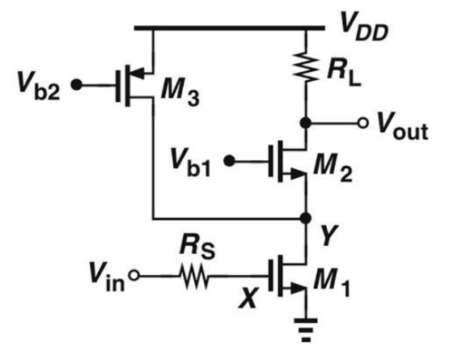

# 전자회로2 설계과제 #2

> 출처: 아주BB · ECE305 전자회로2 · 과제출제/제출 → 설계과제#2 (게시 2026-11-06)
> 원본: [2026-2_전자회로2_설계과제2_v1.pdf](2026-2_전자회로2_설계과제2_v1.pdf)

## 공지 본문

첨부 전자회로2 설계과제#2 파일 확인 바랍니다.

- **제출**: 아주BB에 PDF파일 업로드
- **제출기한**: 11/20(금) — BB 마감 2026-11-20 23:59 (KST), 배점 100점
- 설계에 필요한 모델 라이브러리는 설계과제#1 참조.
- 주어진 MOSFET 모델의 parameter는 수정 불가하며, 변경 없이 사용함.
- Copy 제출 모두 0점 부여 (관련 학생 모두 동일하게 조치)
- 지각 제출 0점 부여

첨부파일:
- `2026-2_전자회로2_설계과제2_v1.pdf` — 과제 문제
- 모델 라이브러리: 설계과제#1 첨부 `MOSFET_Model_Guide_2510.zip`의 `MOSFET_model.lib`를 그대로 쓴다 ([sim/MOSFET_model.lib](sim/MOSFET_model.lib), 과제1 파일과 바이트 단위로 같음)

---

## <설계과제 #2: 주파수 응답 특성>

주어진 조건을 이용하여 다음 cascode 증폭기를 설계하고, 주파수 응답 특성을 검증하시오.

- $L = 0.18\ \mu\text{m}$
- $\mu_n C_{ox} = 100\ \mu\text{A/V}^2$, $\mu_p C_{ox} = 50\ \mu\text{A/V}^2$
- $\lambda_n = 0.1\ \text{V}^{-1}$, $\lambda_p = 0.2\ \text{V}^{-1}$
- $V_{THN} = 0.4\ \text{V}$, $V_{THP} = -0.4\ \text{V}$

(주어지지 않은 parameter는 사양을 만족하도록 설계자가 결정함)

**그림 1. Cascode amplifier.**

회로 구성 (그림 1):
- $M_1$: NMOS common-source 입력단 (게이트 $X$, 드레인 $Y$, 소스 GND)
- $M_2$: NMOS common-gate cascode (게이트 $V_{b1}$, 소스 $Y$, 드레인 $V_{out}$)
- $M_3$: PMOS 전류원 (게이트 $V_{b2}$, 소스 $V_{DD}$, 드레인 $Y$)
- $R_L$: $V_{DD}$와 $V_{out}$ 사이 부하 저항
- $R_S$: $V_{in}$과 $X$ 사이 신호원 저항

| Capacitance Parameters | |
|---|---|
| $C_{ox}$ | $12\ \text{fF}/\mu\text{m}^2$ |
| $C_{GS}$ | $(2/3)WLC_{ox} + (0.3\ \text{fF}/\mu\text{m})\times W$ |
| $C_{GD}$ | $(0.3\ \text{fF}/\mu\text{m})\times W$ |
| $C_{DB}$ | $(0.4\ \text{fF}/\mu\text{m})\times W$ |
| $C_{SB}$ | $(0.4\ \text{fF}/\mu\text{m})\times W$ |

### 1) Design Problem (설계과정 필수)

(a) $V_{DD} = 1\ \text{V}$, $R_S = 500\ \Omega$, 최대 소모전력 $\le 0.5\ \text{mW}$, $I_{D2} = |I_{D3}|$인 조건에서, 저주파 전압 이득이 10이고, 모든 pole 주파수들이 1 GHz 이상이 되도록 회로를 설계하시오.

(b) 설계한 증폭기에서 모든 MOSFET이 saturation 영역에서 동작하기 위한 DC 바이어스 전압들과 각 MOSFET의 W/L들을 설계하시오.

(c) Miller's approximation을 적용하여 모든 pole 주파수를 구하시오.

(d) 전달 함수 H(s)를 구하고, Bode magnitude plot을 그리시오.

### 2) Spice Problem

SPICE를 사용하여 simulation을 확인하고 설명하시오.

(a) 설계한 회로의 schematic을 보이고, 각 MOFET과 노드의 DC 바이어스 전압, 전류를 표시하시오. (DC simulation)

(b) 모든 MOSFET이 saturation 영역에서 동작하는지를 검증하시오.

(c) 주파수 응답(magnitude & phase response)을 plot 하시오. (AC simulation) 그리고, 전압 이득을 설계값과 비교하시오.

(d) Pole 주파수들을 각각 구하고, 설계값과 비교하시오.

(e) 구한 pole 주파수들을 이용하여 각 노드의 등가 capacitance를 각각 계산하고, 설계값과 비교하시오.
