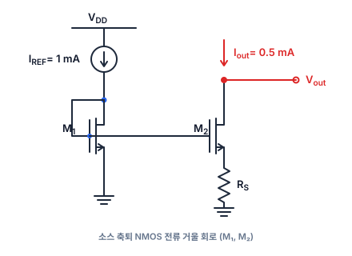
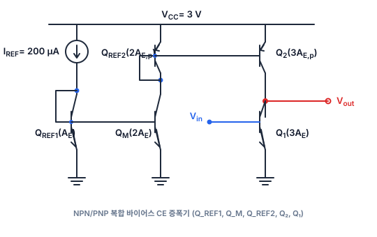

# Q2. 축퇴 저항 전류 거울 복사비 설계 및 복합 바이어스 CE 단 (배점: 20점)

## 문제

다음 회로들에 대해 주어진 소자 파라미터와 동작 조건을 이용하여 질문에 답하시오. (총 20점)

### (a) 소스 축퇴 MOS 전류 거울의 복사비 설계 및 출력 저항 [10점]

그림 (a)의 회로에서 동일한 크기를 갖는 두 NMOS 트랜지스터 $M_1, M_2$는 모두 포화 영역에서 동작한다. 기준 전류 $I_{REF} = 1\,\text{mA}$가 다이오드 연결된 $M_1$에 인가될 때, 복사 전류가 $I_{out} = 0.5\,\text{mA}$가 되도록 $M_2$의 소스 축퇴 저항 $R_S$의 값을 설계하고, 출력 노드에서 바라본 소신호 출력 저항 $R_{out}$을 유도 및 계산하시오.

- 파라미터: $\mu_n C_{ox} = 100\,\mu\text{A/V}^2$, $(W/L)_1 = (W/L)_2 = 100/0.2 = 500$, $V_{TH} = 0.4\,\text{V}$, $\lambda = 0.1\,\text{V}^{-1}$
- 직류 바이어스 해석 시 채널 길이 변조 효과는 1차적으로 무시($\lambda \approx 0$)하고, 소신호 저항 계산 시에는 $r_{o2} = 1/(\lambda I_{out})$를 반영하시오.

### (b) NPN/PNP 복합 바이어스 공통 이미터(CE) 증폭기의 바이어스 및 소신호 이득 [10점]

그림 (b)의 회로는 NPN 전류 거울과 PNP 전류 거울이 결합되어 CE 증폭단 $Q_1$의 능동 부하 및 바이어스 전류를 제공한다. 직류 기준 전류 $I_{REF} = 200\,\mu\text{A}$가 인가될 때, 트랜지스터 $Q_1$의 바이어스 컬렉터 전류 $I_{C1}$을 구하고, 증폭기의 소신호 등가 트랜스컨덕턴스 $G_m$, 출력 저항 $R_{out}$, 전압 이득 $A_v = v_{out} / v_{in}$을 구하시오.

- 파라미터: $V_{CC} = 3\,\text{V}$, $V_T = 26\,\text{mV}$, $\beta = 100$, 얼리 전압 $V_{A,n} = V_{A,p} = 40\,\text{V}$
- 트랜지스터 이미터 면적비: $Q_{REF1} = A_E$, $Q_M = 2A_E$, $Q_{REF2} = 2A_{E,p}$, $Q_2 = 3A_{E,p}$, $Q_1 = 3A_E$
- 직류 해석 시 베이스 전류는 무시($I_B \approx 0$)하고, $g_m r_o \gg 1$로 가정하시오.

---

## 풀이

### (a) 소스 축퇴 MOS 전류 거울 설계 및 $R_{out}$ 유도 [10점]

#### 1. $M_1$의 게이트-소스 전압 $V_{GS1}$ 계산
- 다이오드 연결된 $M_1$의 소스는 접지에 연결되어 있으므로 $V_{S1} = 0$이다. 포화 영역 전류식에 대입하면:
$$I_{REF} = \frac{1}{2} \mu_n C_{ox} \left(\frac{W}{L}\right)_1 (V_{GS1} - V_{TH})^2$$
$$\mu_n C_{ox} \left(\frac{W}{L}\right) = 100\,\mu\text{A/V}^2 \times 500 = 50\,\text{mA/V}^2$$
$$1\,\text{mA} = \frac{1}{2} \times 50\,\text{mA/V}^2 \times (V_{GS1} - 0.4\,\text{V})^2$$
$$(V_{GS1} - 0.4\,\text{V})^2 = \frac{2}{50} = 0.04\,\text{V}^2 \implies V_{GS1} - 0.4\,\text{V} = 0.2\,\text{V}$$
$$V_{GS1} = 0.6\,\text{V}$$

#### 2. $I_{out} = 0.5\,\text{mA}$ 설계를 위한 $R_S$ 계산
- $M_2$의 드레인 전류가 $I_{out} = 0.5\,\text{mA}$일 때, $M_2$의 오버드라이브 전압 $V_{ov2} = V_{GS2} - V_{TH}$는 다음과 같다:
$$I_{out} = \frac{1}{2} \mu_n C_{ox} \left(\frac{W}{L}\right)_2 (V_{GS2} - V_{TH})^2$$
$$0.5\,\text{mA} = \frac{1}{2} \times 50\,\text{mA/V}^2 \times (V_{GS2} - 0.4\,\text{V})^2$$
$$(V_{GS2} - 0.4\,\text{V})^2 = \frac{1}{50} = 0.02\,\text{V}^2 \implies V_{GS2} - 0.4\,\text{V} = \sqrt{0.02} \approx 0.1414\,\text{V}$$
$$V_{GS2} \approx 0.5414\,\text{V}$$
- $M_1$과 $M_2$의 게이트가 연결되어 있으므로 KVL에 의해:
$$V_{G1} = V_{G2} \implies V_{GS1} = V_{GS2} + I_{out} R_S$$
$$I_{out} R_S = V_{GS1} - V_{GS2} = 0.6\,\text{V} - 0.5414\,\text{V} = 0.0586\,\text{V} = 58.6\,\text{mV}$$
- 따라서 필요한 소스 축퇴 저항 $R_S$의 값은 다음과 같다:
$$R_S = \frac{V_{GS1} - V_{GS2}}{I_{out}} = \frac{0.0586\,\text{V}}{0.5\,\text{mA}} \approx 117.2\,\Omega$$

#### 3. 소신호 파라미터 및 출력 저항 $R_{out}$ 유도
- $M_2$의 소신호 파라미터 계산:
$$g_{m2} = \frac{2 I_{out}}{V_{GS2} - V_{TH}} = \frac{2 \times 0.5\,\text{mA}}{0.1414\,\text{V}} \approx 7.071\,\text{mS}$$
$$r_{o2} = \frac{1}{\lambda I_{out}} = \frac{1}{0.1\,\text{V}^{-1} \times 0.5\,\text{mA}} = 20\,\text{k}\Omega$$
$$g_{m2} R_S = 7.071 \times 10^{-3}\,\Omega^{-1} \times 117.2\,\Omega \approx 0.8287$$
- 소스 축퇴 회로의 소신호 출력 저항 유도:
  - $M_2$의 게이트는 소신호 접지($v_g = 0$)이다. 출력단에 시험 전압 $v_t$를 걸고 유입되는 시험 전류 $i_t$를 구한다.
  - $v_s = i_t R_S$이고, $v_{gs} = v_g - v_s = -i_t R_S$이다.
  - 트랜지스터 내부 $r_{o2}$ 양단 전압은 $v_t - v_s$이므로, $M_2$ 드레인 전류는:
$$i_t = g_{m2} v_{gs} + \frac{v_t - v_s}{r_{o2}} = -g_{m2} i_t R_S + \frac{v_t - i_t R_S}{r_{o2}}$$
$$i_t \left( 1 + g_{m2} R_S + \frac{R_S}{r_{o2}} \right) = \frac{v_t}{r_{o2}}$$
$$R_{out} = \frac{v_t}{i_t} = r_{o2} (1 + g_{m2} R_S) + R_S$$
- 수치 계산:
$$R_{out} = 20\,\text{k}\Omega \times (1 + 0.8287) + 0.1172\,\text{k}\Omega = 36.574\,\text{k}\Omega + 0.1172\,\text{k}\Omega \approx 36.69\,\text{k}\Omega$$
- (수업 근사 $R_{out} \approx r_{o2}(1 + g_{m2} R_S) \approx 36.57\,\text{k}\Omega$도 정답 인정)

---

### (b) NPN/PNP 복합 바이어스 CE 증폭기 직류 동작점 및 소신호 이득 [10점]

#### 1. 직류 바이어스 전류 $I_{C1}$ 계산
- 베이스 전류를 무시하므로 컬렉터 전류 복사비는 트랜지스터의 이미터 면적비와 일치한다.
- $Q_{REF1}$과 $Q_M$은 NPN 전류 거울을 형성하므로:
$$I_{C,QM} = \frac{A_{E,QM}}{A_{E,QREF1}} I_{REF} = \frac{2 A_E}{A_E} \times 200\,\mu\text{A} = 400\,\mu\text{A}$$
- $Q_M$의 컬렉터 전류는 다이오드 연결된 PNP 트랜지스터 $Q_{REF2}$로 유입된다:
$$I_{C,QREF2} = I_{C,QM} = 400\,\mu\text{A}$$
- $Q_{REF2}$와 $Q_2$는 PNP 전류 거울을 형성하므로 능동 부하 $Q_2$의 공급 전류는 다음과 같다:
$$I_{C2} = \frac{A_{E,Q2}}{A_{E,QREF2}} I_{C,QREF2} = \frac{3 A_{E,p}}{2 A_{E,p}} \times 400\,\mu\text{A} = 600\,\mu\text{A} = 0.6\,\text{mA}$$
- 직류 상태에서 출력단에 외부 부하가 연결되어 있지 않으므로, KCL에 의해 증폭 트랜지스터 $Q_1$의 직류 바이어스 전류는 다음과 같다:
$$I_{C1} = I_{C2} = 0.6\,\text{mA}$$

#### 2. 소신호 파라미터 계산
- $Q_1$의 트랜스컨덕턴스 및 출력 저항:
$$g_{m1} = \frac{I_{C1}}{V_T} = \frac{0.6\,\text{mA}}{26\,\text{mV}} \approx 23.08\,\text{mS}$$
$$r_{o1} = \frac{V_{A,n}}{I_{C1}} = \frac{40\,\text{V}}{0.6\,\text{mA}} \approx 66.67\,\text{k}\Omega$$
- 능동 부하 $Q_2$의 출력 저항:
$$r_{o2} = \frac{V_{A,p}}{I_{C2}} = \frac{40\,\text{V}}{0.6\,\text{mA}} \approx 66.67\,\text{k}\Omega$$

#### 3. $G_m \to R_{out} \to A_v$ 표준 3단계 전개
- **1단계: 단락 트랜스컨덕턴스 $G_m$ 계산**
  - 출력을 가상 접지($v_{out} = 0$)시킬 때 출력으로 흘러 나가는 소신호 단락 전류 $i_{out,sc}$는 $Q_1$의 소신호 전류이다:
  $$i_{out,sc} = -g_{m1} v_{in} \implies G_m = \left.\frac{i_{out,sc}}{v_{in}}\right|_{v_{out}=0} = g_{m1} \approx 23.08\,\text{mS}$$
- **2단계: 소신호 출력 저항 $R_{out}$ 계산**
  - 입력 신호를 접지($v_{in} = 0$)하면 $Q_1$과 $Q_2$의 베이스가 모두 교류 접지되므로, 출력 노드에서 바라본 저항은 두 트랜지스터의 출력 저항 병렬 연결이다:
  $$R_{out} = r_{o1} \parallel r_{o2} = \frac{66.67\,\text{k}\Omega \times 66.67\,\text{k}\Omega}{66.67\,\text{k}\Omega + 66.67\,\text{k}\Omega} \approx 33.33\,\text{k}\Omega$$
- **3단계: 전압 이득 $A_v$ 계산**
  - 표준 공식 $A_v = -G_m R_{out}$에 대입한다:
  $$A_v = -g_{m1} (r_{o1} \parallel r_{o2}) = -23.08\,\text{mS} \times 33.33\,\text{k}\Omega \approx -769.2$$
  - (얼리 전압 기반 직접 대입: $A_v = -\frac{I_{C1}}{V_T} \left( \frac{V_A}{2 I_{C1}} \right) = -\frac{V_A}{2 V_T} = -\frac{40\,\text{V}}{2 \times 0.026\,\text{V}} \approx -769.23$)
