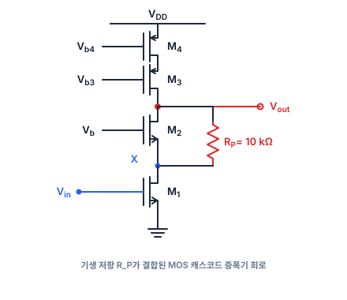
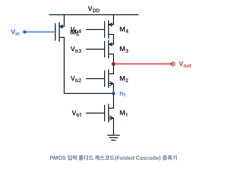

# Q3. 기생 저항 Rp 캐스코드 및 Folded Cascode 증폭기 (배점: 20점)

## 문제

다음 캐스코드 증폭기 회로들에 대해 소신호 파라미터와 동작 조건을 이용하여 질문에 답하시오. (총 20점)

### (a) 기생 병렬 저항 $R_P$가 결합된 MOS 캐스코드 증폭기 [10점]

그림 (a)는 공통 소스 트랜지스터 $M_1$, 캐스코드 트랜지스터 $M_2$, 그리고 PMOS 캐스코드 능동 부하 $M_3, M_4$로 구성된 캐스코드 증폭기이다. 소자 제조 공정의 기생 효과로 인해 $M_2$의 드레인과 소스 양단 사이에 저항 $R_P = 10\,\text{k}\Omega$가 병렬로 연결되어 있다.

모든 트랜지스터에 $I_D = 1\,\text{mA}$의 바이어스 전류가 흐를 때, 증폭기의 소신호 출력 저항 $R_{out}$과 전압 이득 $A_v = v_{out} / v_{in}$을 구하시오.

- 파라미터: $\mu_n C_{ox} = 100\,\mu\text{A/V}^2$, $\mu_p C_{ox} = 50\,\mu\text{A/V}^2$, $\lambda_n = \lambda_p = 0.1\,\text{V}^{-1}$
- 트랜지스터 크기: $(W/L)_{1,2} = 100/0.2 = 500$, $(W/L)_{3,4} = 50/0.2 = 250$
- $R_P$를 통해 흐르는 직류 전류는 무시할 수 있으며($I_{D2} \approx I_{D1} = 1\,\text{mA}$), $g_m r_o \gg 1$ 근사를 적용하시오.

### (b) PMOS 입력 Folded Cascode 증폭기 [10점]

그림 (b)는 입력단에 PMOS 트랜지스터 $M_5$를 사용하고, 신호 전류를 NMOS 캐스코드 $M_2$로 접어 올리는 Folded Cascode 증폭기이다. $M_1$은 바이어스 전류원이며, $M_3, M_4$는 PMOS 캐스코드 능동 부하를 형성한다.

증폭기의 (1) 단락 트랜스컨덕턴스 $G_m$, (2) 소신호 출력 저항 $R_{out}$, (3) 전압 이득 $A_v = v_{out} / v_{in}$의 기호 대수식을 유도하고, 주어진 파라미터를 대입하여 수치를 계산하시오.

- 파라미터: $\mu_n C_{ox} = 100\,\mu\text{A/V}^2$, $\mu_p C_{ox} = 50\,\mu\text{A/V}^2$, $\lambda_n = \lambda_p = 0.1\,\text{V}^{-1}$
- 바이어스 전류: $I_{D5} = 0.5\,\text{mA}$, $I_{D1} = 1.0\,\text{mA}$, $I_{D2} = I_{D3} = I_{D4} = 0.5\,\text{mA}$
- 트랜지스터 크기: $(W/L)_5 = 200/0.2 = 1000$, $(W/L)_{1,2} = 100/0.2 = 500$, $(W/L)_{3,4} = 100/0.2 = 500$
- $g_m r_o \gg 1$ 근사를 적용하시오.

---

## 풀이

### (a) 기생 저항 $R_P$가 결합된 MOS 캐스코드 증폭기 [10점]

#### 1. 소신호 파라미터 계산
- 모든 트랜지스터의 직류 바이어스 전류는 $I_D = 1\,\text{mA}$이다.
- NMOS $M_1, M_2$:
$$g_{m1} = g_{m2} = \sqrt{2 \mu_n C_{ox} \left(\frac{W}{L}\right)_{1,2} I_D} = \sqrt{2 \times 100\,\mu\text{A/V}^2 \times 500 \times 1\,\text{mA}} = \sqrt{0.1} = 10.0\,\text{mS}$$
$$r_{o1} = r_{o2} = \frac{1}{\lambda_n I_D} = \frac{1}{0.1\,\text{V}^{-1} \times 1\,\text{mA}} = 10.0\,\text{k}\Omega$$
$$g_{m2} r_{o1} = 10.0\,\text{mS} \times 10.0\,\text{k}\Omega = 100 \gg 1$$
- PMOS $M_3, M_4$:
$$g_{m3} = g_{m4} = \sqrt{2 \mu_p C_{ox} \left(\frac{W}{L}\right)_{3,4} I_D} = \sqrt{2 \times 50\,\mu\text{A/V}^2 \times 250 \times 1\,\text{mA}} = \sqrt{0.025} = 5.0\,\text{mS}$$
$$r_{o3} = r_{o4} = \frac{1}{\lambda_p I_D} = \frac{1}{0.1\,\text{V}^{-1} \times 1\,\text{mA}} = 10.0\,\text{k}\Omega$$
$$g_{m3} r_{o4} = 5.0\,\text{mS} \times 10.0\,\text{k}\Omega = 50 \gg 1$$

#### 2. 소신호 출력 저항 $R_{out}$ 유도 및 계산
- 기생 저항 $R_P$는 $M_2$의 드레인과 소스 사이에 연결되어 있으므로, $M_2$ 자체의 고유 출력 저항 $r_{o2}$와 병렬을 이룬다:
$$r_{o2}' = r_{o2} \parallel R_P = 10.0\,\text{k}\Omega \parallel 10.0\,\text{k}\Omega = 5.0\,\text{k}\Omega$$
- 출력 노드 $V_{out}$에서 하단 NMOS 캐스코드 쪽을 바라본 출력 저항 $R_{out,n}$은 $M_1$의 출력 저항 $r_{o1}$에 의해 소스 축퇴된 $M_2$의 저항이다:
$$R_{out,n} \approx g_{m2} r_{o1} (r_{o2} \parallel R_P) = 10.0\,\text{mS} \times 10.0\,\text{k}\Omega \times 5.0\,\text{k}\Omega = 500\,\text{k}\Omega$$
- (정밀식: $R_{out,n} = [1 + g_{m2}(r_{o2} \parallel R_P)] r_{o1} + (r_{o2} \parallel R_P) = (1 + 50) \times 10\,\text{k}\Omega + 5\,\text{k}\Omega = 515\,\text{k}\Omega$)
- 출력 노드 $V_{out}$에서 상단 PMOS 캐스코드 부하를 바라본 출력 저항 $R_{out,p}$:
$$R_{out,p} \approx g_{m3} r_{o3} r_{o4} = 5.0\,\text{mS} \times 10.0\,\text{k}\Omega \times 10.0\,\text{k}\Omega = 500\,\text{k}\Omega$$
- (정밀식: $R_{out,p} = (1 + g_{m3} r_{o4}) r_{o3} + r_{o4} = (1 + 50) \times 10\,\text{k}\Omega + 10\,\text{k}\Omega = 520\,\text{k}\Omega$)
- 전체 출력 저항 $R_{out}$은 상·하단 저항의 병렬 연결이다:
$$R_{out} = R_{out,n} \parallel R_{out,p} \approx 500\,\text{k}\Omega \parallel 500\,\text{k}\Omega = 250\,\text{k}\Omega$$
- (정밀값: $R_{out} = 515\,\text{k}\Omega \parallel 520\,\text{k}\Omega \approx 258.7\,\text{k}\Omega$)

#### 3. 전압 이득 $A_v$ 계산
- 입력 $v_{in}$이 인가되는 $M_1$의 단락 트컨덕턴스는 $M_2$의 소스 임피던스($\approx 1/g_{m2} = 100\,\Omega \ll r_{o1}$)가 매우 작으므로:
$$G_m \approx g_{m1} = 10.0\,\text{mS}$$
- 따라서 전압 이득은 $A_v = -G_m R_{out}$에 의해 다음과 같다:
$$A_v = -g_{m1} R_{out} \approx -10.0\,\text{mS} \times 250\,\text{k}\Omega = -2.50 \times 10^3$$
- (정밀값 대입 시: $A_v = -10.0\,\text{mS} \times 258.7\,\text{k}\Omega = -2.587 \times 10^3$)

---

### (b) PMOS 입력 Folded Cascode 증폭기 [10점]

#### 1. 소신호 파라미터 계산
- 입력 PMOS $M_5$ ($I_{D5} = 0.5\,\text{mA}$, $(W/L)_5 = 1000$):
$$g_{m5} = \sqrt{2 \mu_p C_{ox} \left(\frac{W}{L}\right)_5 I_{D5}} = \sqrt{2 \times 50\,\mu\text{A/V}^2 \times 1000 \times 0.5\,\text{mA}} = \sqrt{0.05} \approx 7.071\,\text{mS}$$
$$r_{o5} = \frac{1}{\lambda_p I_{D5}} = \frac{1}{0.1\,\text{V}^{-1} \times 0.5\,\text{mA}} = 20.0\,\text{k}\Omega$$
- 바이어스 NMOS $M_1$ ($I_{D1} = 1.0\,\text{mA}$, $(W/L)_1 = 500$):
$$r_{o1} = \frac{1}{\lambda_n I_{D1}} = \frac{1}{0.1\,\text{V}^{-1} \times 1.0\,\text{mA}} = 10.0\,\text{k}\Omega$$
- 캐스코드 NMOS $M_2$ ($I_{D2} = 0.5\,\text{mA}$, $(W/L)_2 = 500$):
$$g_{m2} = \sqrt{2 \mu_n C_{ox} \left(\frac{W}{L}\right)_2 I_{D2}} = \sqrt{2 \times 100\,\mu\text{A/V}^2 \times 500 \times 0.5\,\text{mA}} = \sqrt{0.05} \approx 7.071\,\text{mS}$$
$$r_{o2} = \frac{1}{\lambda_n I_{D2}} = \frac{1}{0.1\,\text{V}^{-1} \times 0.5\,\text{mA}} = 20.0\,\text{k}\Omega$$
- PMOS 부하 $M_3, M_4$ ($I_{D3} = I_{D4} = 0.5\,\text{mA}$, $(W/L)_{3,4} = 500$):
$$g_{m3} = \sqrt{2 \mu_p C_{ox} \left(\frac{W}{L}\right)_3 I_{D3}} = \sqrt{2 \times 50\,\mu\text{A/V}^2 \times 500 \times 0.5\,\text{mA}} = \sqrt{0.025} = 5.0\,\text{mS}$$
$$r_{o3} = r_{o4} = \frac{1}{\lambda_p I_{D3}} = 20.0\,\text{k}\Omega$$

#### 2. 표준 3단계 전개 ($G_m \to R_{out} \to A_v$)

- **1단계: 단락 트랜스컨덕턴스 $G_m$ 유도**
  - 출력단을 소신호 접지($v_{out} = 0$)시킬 때, $M_2$ 소스 노드 $n_1$에서 $M_2$ 쪽으로 바라본 입력 저항은 약 $1/g_{m2} \approx 141.4\,\Omega$이다.
  - 노드 $n_1$에 병렬로 연결된 $M_1$의 드레인 저항과 $M_5$의 드레인 저항의 병렬값은:
  $$r_{o1} \parallel r_{o5} = 10\,\text{k}\Omega \parallel 20\,\text{k}\Omega = \frac{20}{3}\,\text{k}\Omega \approx 6.67\,\text{k}\Omega$$
  - $1/g_{m2} \ll r_{o1} \parallel r_{o5}$이므로, 입력 트랜지스터 $M_5$가 생성한 소신호 신호 전류 $i_{d5} = g_{m5} v_{in}$는 거의 전부 $M_2$의 소스로 흘러 들어간다.
  - 따라서 단락 트랜스컨덕턴스는 다음과 같다:
  $$G_m \approx g_{m5} \approx 7.071\,\text{mS}$$

- **2단계: 소신호 출력 저항 $R_{out}$ 유도**
  - 출력 노드 $V_{out}$에서 아래쪽을 바라본 저항 $R_{out,n}$은 $M_2$의 소스가 $r_{o1} \parallel r_{o5}$로 축퇴된 캐스코드 저항이다:
  $$R_{out,n} \approx g_{m2} r_{o2} (r_{o1} \parallel r_{o5}) = 7.071\,\text{mS} \times 20\,\text{k}\Omega \times 6.667\,\text{k}\Omega \approx 942.8\,\text{k}\Omega$$
  - 출력 노드 $V_{out}$에서 위쪽을 바라본 저항 $R_{out,p}$는 PMOS 캐스코드 부하 저항이다:
  $$R_{out,p} \approx g_{m3} r_{o3} r_{o4} = 5.0\,\text{mS} \times 20\,\text{k}\Omega \times 20\,\text{k}\Omega = 2000\,\text{k}\Omega = 2.0\,\text{M}\Omega$$
  - 전체 소신호 출력 저항은 두 저항의 병렬 연결이다:
  $$R_{out} = R_{out,n} \parallel R_{out,p} = \frac{942.8\,\text{k}\Omega \times 2000\,\text{k}\Omega}{942.8\,\text{k}\Omega + 2000\,\text{k}\Omega} \approx 640.7\,\text{k}\Omega$$

- **3단계: 전압 이득 $A_v$ 계산**
  - $v_{in}$이 상승하면 PMOS $M_5$의 소스-게이트 전압 $v_{sg5}$가 감소하여 $M_5$ 드레인 전류가 줄어든다. 이로 인해 노드 $n_1$ 전압이 하강하고 $M_2$를 통해 출력 노드 $V_{out}$의 전하를 끌어당겨 $v_{out}$이 하강하므로 전압 이득은 음수(반전)이다.
  $$A_v = -G_m R_{out} \approx -g_{m5} [g_{m2} r_{o2}(r_{o1} \parallel r_{o5}) \parallel g_{m3} r_{o3} r_{o4}]$$
  $$A_v = -7.071\,\text{mS} \times 640.7\,\text{k}\Omega \approx -4530$$
